# 10주차 온라인 강의: 시스템 프로그래밍, 시스템 콜

- 리눅스 프로그래밍의 기본이 되는 시스템 프로그래밍에 대해 살펴본다. 리눅스 커널에서 제공하는 시스템 콜의 종류와 시스템 콜들 중에서 대표적인 것들, file, process, signal, thread와 같은 시스템 프로그램의 개념을 살펴보고 관련된 시스템 콜들을 살펴본다.

---

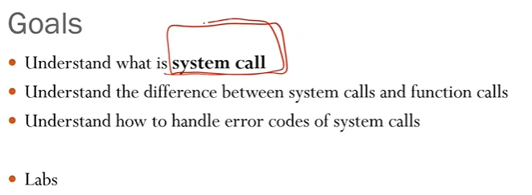

- 시스템 콜이 무엇인지 살펴보며, 일반 함수들과는 어떤 차이가 있는지 살펴본다. 시스템을 사용하게 되면 에러가 발생할 수도 있는데, 이 에러들을 handling하는 방법에 대해 살펴본다.

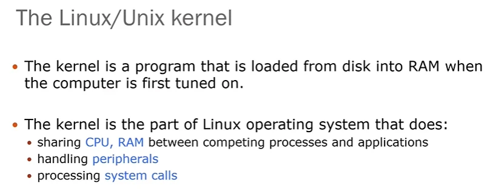

- 리눅스 커널 : 초기에 부팅될 때 메모리에 로드되어서 시스템을 초기화시켜 주고, 시스템이 동작하도록 해주는 운영체제의 핵심적인 부분이다. 커널은 부팅이 될 때 자원들(CPU, RAM, Disk 등)이 여러 process와 application에서 공유할 수 있도록 만들어주며, 컴퓨터와 연결된 주변 기기(마우스, 키보드 등)들이 동작하도록 관리해주며, 어플리케이션이 보내는 시스템 콜을 처리해주는 역할을 한다.

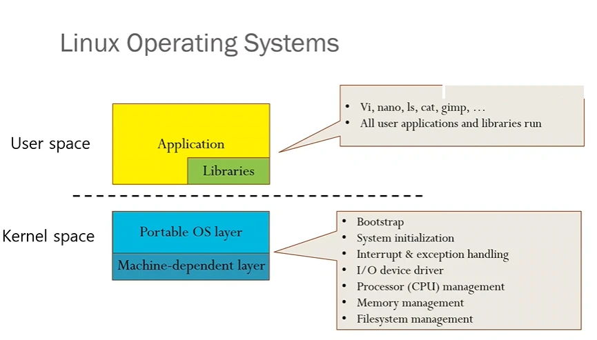

- 시스템 콜을 이해하려면 먼저 리눅스 운영체제의 구조를 살펴볼 필요가 있다. 리눅스 운영체제는 크게 두 가지 부분으로 나뉜다. 1) User Space(응용 프로그램이 돌아가는 영역), 2) Kernel Space 이다. 유저가 수행하는 application들도 memory space를 상세하게 보면, memory location이 user space와 kernel space로 나뉘어져 있다.
- kernel은 부팅을 시켜주고, 시스템 초기화, 인터럽트나 예외 처리, I/O 디바이스 드라이버 관리, CPU나 메모리, 파일 시스템 등을 관리하는 역할을 한다.

> 우리가 사용하는 대부분의 s/w나 command를 application이라고 한다.

- application이 정상적으로 동작하기 위해서는 위에 열거된 kernel의 여러 기능들을 호출해서 사용해야만 한다. 바로 System Call이라는 Programming Interface를 통해 호출할 수 있다.

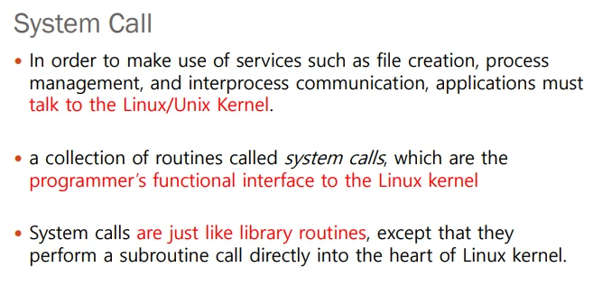

- 시스템 콜은 Application이 리눅스 커널과 소통/대화하는 방법이라고 생각할 수 있다. 리눅스 커널에서 제공하는 기능들을 사용하기 위해 대화하는 부분이다.
- 실제적으로는 Library와 생긴 것도 비슷하고 사용하는 방법도 비슷하기 때문에 printf와 비슷하게 사용할 수도 있다. ⇒ 그렇다면 무엇이 다른가?

> 시스템 콜은 리눅스 커널에 있는 기능을 바로 호출해서 사용한다.

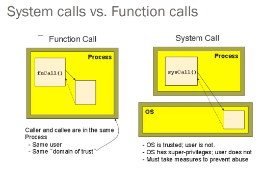

- Function Call의 경우, 어떤 함수에서 다른 함수를 호출한다고 하면, 그것은 다 User Space에 있는 함수에서 다른 User Space에 있는 함수를 호출하는 것이다. 따라서 Kernel Space까지 내려가지 않는다. 그런데, Process 안에서 System Call을 호출하게 되면, System Call은 User Space가 아니라 Kernel에 있는 Subroutine을 갖다가 호출해서 어떤 기능을 Kernel이 처리한 다음에 그 처리된 결과를 갖다가 User에게 동작 결과를 알려주게 되는 것이다.

    Function Call은 User Space에 있는 함수들끼리 호출 관계가 있는 것이라면, 시스템 콜은 커널 내부에 존재하는 함수. Subroutine 들을 호출해서 사용하는 것이라고 생각하면 된다.

---

- 시스템 콜의 종류와 POSIX

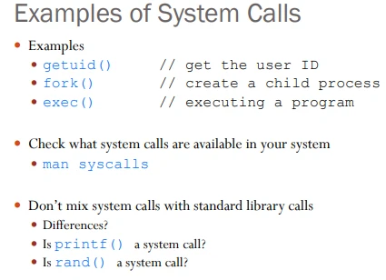

- getuid() : 사용자의 ID를 return하는 시스템 콜 → 함수처럼 사용해서 호출
- fork() : child process를 만들어낸다.
- exec() : 프로그램을 수행시켜 준다.

→ 이런 것들이 모두 kernel에 무언가를 요청하면, 요청된 결과를 사용자에게 전달해주는 것이다. 시스템 콜은 총 200여 개 정도가 존재한다.

man syscalls 를 입력하면 현재 시스템에 어떤 시스템 콜이 있는지 살펴볼 수 있다. 사용자 입장에서는 일반 함수와 시스템 콜이 동일하게 사용되고 호출된다. 따라서 일반 함수와 시스템 콜을 섞어서 사용할 수도 있다. 예를 들면, printf()는 시스템 콜은 아니다. write()라는 유사한 시스템 콜이 존재한다. write()를 좀 더 쓰기 편하게 만들어 놓은 라이브러리 함수가 printf()인데, 하나를 쓸 때는 하나만 쓰는 것이 좋으며 둘을 섞어서 사용하는 것은 좋지 않다.

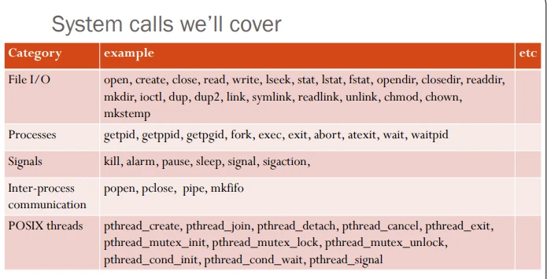

- 시스템 콜의 정확한 개수는 알 수 없지만, 약 200개 이상이다. 시스템 콜이 어떤 종류가 있는지 살펴보자.
- File I/O : file의 입출력, file의 속성을 변경한다던지 등등
- Processes : 프로그램을 실행하게 되면 이를 프로세스라고 하는데, 그 프로세스 생성과 관리에 관련된 것들 getpid, fork, exec, exit 등의 시스템 콜 존재
- Signals : 시스템에 메시지를 전달해주고 싶을 때 사용하는 시스템 콜
- Interp-process communication : 프로그램들 간의 통신을 하고싶을 때 사용하는 시스템 콜
- POSIX threads : 시스템 안에 여러 개의 thread를 둘 수 있고, thread를 생성, 소멸, 관리 하는 시스템 콜

⇒ 모든 시스템 콜이 있는 것은 아니며, 예를 든 것이다.

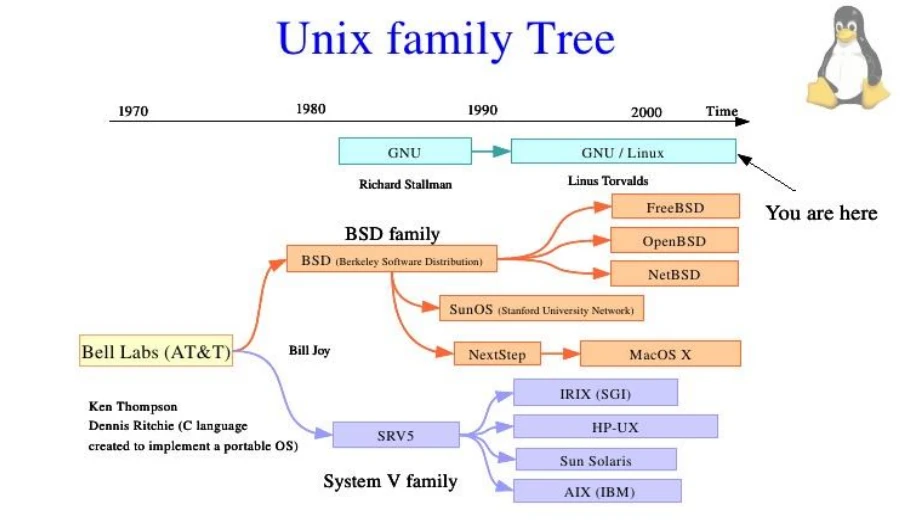

- POSIX(System Call Standard) : Unix 계열의 운영체제에서 사용할 수 있는 시스템 콜, 명령어 들의 표준을 정의한 것. 표준이 등장하게 된 배경을 살펴보자.

리눅스는 유닉스라고 하는 기존의 운영체제의 변종이다. 유닉스는 생긴지 굉장히 오래되었는데, 켄 톰슨과 데니스 리치가 AT&T 연구소에서 개발했다. 데니스 리치는 리눅스를 돌리기 위해 C를 만들기도 했다. 유닉스는 크게 두 개의 갈래로 나뉘게 되는데, BSD family와 System V family로 나뉜다. BSD family에서 생긴 것은 FreeBSD, OpenBSD, NetBSD, MacOS X 등이 있고, System V family에서 생긴 것은 Sun Solaris나 AIX(IBM) 등이 있다. 이후에 1990년대에 등장한 유닉스 계열의 별도의 운영체제가 바로 리눅스이다. 여기에 나온 모든 운영체제가 초기에는 유닉스로 시작했지만 점차 여러 갈래로 나뉘게 되었기 때문에 초기에는 사용되는 시스템 콜이 유사했지만 시간이 지날수록 바뀌게 되었다. 예를 들면, FreeBSD에서 작성한 프로그램을 Linux에서 컴파일하면 거의 컴파일이 되지만 일부분이 달라서 컴파일이 안되는 부분이 생긴다.

> 이에 따라 POSIX라는 유닉스 계열의 시스템 콜, 명령들의 표준을 만들어서 서로 다른 운영체제에서도 같은 방식으로 시스템이 동작될 수 있도록 규정하였다.

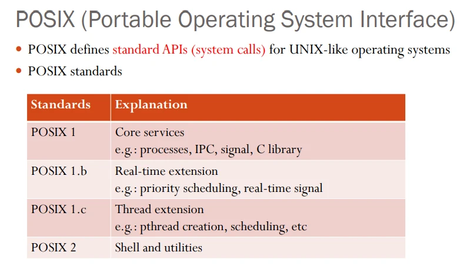

- POSIX 1: Core Service라고 하며, 유닉스 운영체제에 관련된 여러가지 시스템 콜이나 C Library, Shell Command 들의 표준이 정의되어 있다. POSIX는 몇 개의 챕터로 나누어져 있다.

    사용자가 임베디드(실시간) 환경에서 운영체제를 사용하기 위해 필요한 realtime process scheduling이나 realtime signal과 같은 시스템 콜들을 정의해놓은 것이 POSIX 1.b이다.

    POSIX 1.c는 한 process에서 여러가지 thread를 사용할 수 있도록 만들어주는 표준이다.

    POSIX 2 우리가 사용하는 기본적인 명령어들의 표준을 정해놓은 것이 POSIX 2이다.

---

- 시스템 콜을 사용할 때 주의사항(Error Handling)

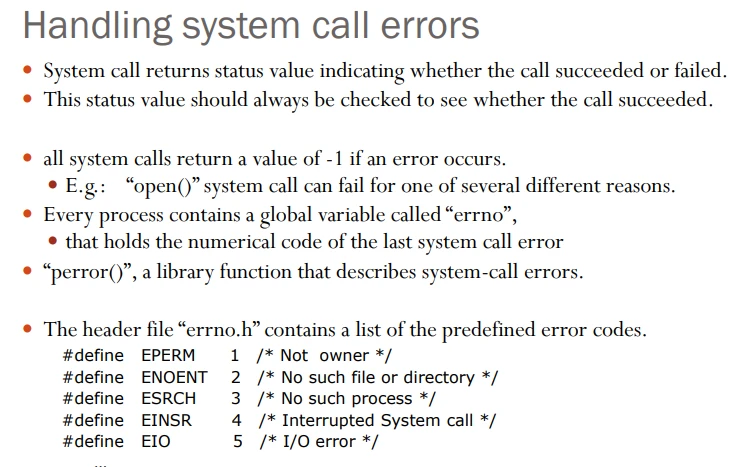

System Call은 마치 함수처럼 사용할 수 있다. 그런데, 시스템 콜을 부른다고 항상 성공적으로 결과가 처리되지 않을 수도 있다. 이럴 때 Error가 발생하게 되는데, 이를 확인하기 위해 시스템 콜이 반환하는 status value를 확인해야 한다.

> System Call을 사용할 때는 항상 return code를 확인해서 결과를 체크한다.

만약, 시스템 콜이 -1을 return하면 시스템 콜의 동작이 실패한 것이다. 그 이유를 확인하려면 errno이라는 전역 변수를 살펴보면 원인을 확인할 수 있다. errno은 이미 사전에 전역 변수로서 define되어 있는 변수이기 때문에 따로 만들거나 선언할 필요가 없다. errno은 errno.h라는 header file에 저장되어 있는데, 번호로 return된다. 이 의미를 파악하려면 perror()라는 함수를 이용하면 사용자가 알아들을 수 있는 문자열로써 결과를 return해준다.

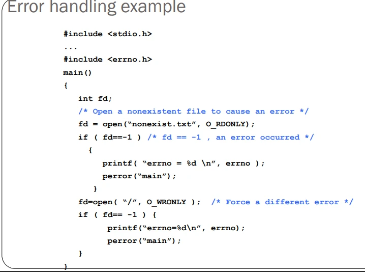

→ error에 관련된 처리를 하려면 #include &lt;errno.h&gt;  
int fd;  
fd = open(”nonexist.txt”, O_RDONLY); 를 하면, status가 -1이 return되는데, 이것이 어떤 오류인지 체크하려면 errno을 print해보면 된다. 그러면 몇 번 에러가 발생했는지 알 수 있다. 그리고 밑에 보면 perror() 함수가 불리게 되는데, 위에 나오는 error에 해당하는 내용이 무엇인지 사람이 알아들을 수 있는 string으로 표시해준다.

---

- 파일 입출력

    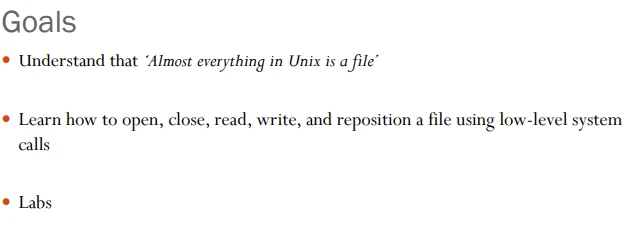

리눅스에서 모든 것은 file로써 접근된다는 것을 이해하고, 실제로 파일을 통해 여러가지에 접근할 때 사용되는 System Call들 open, close, read, write, reposition 등에 대해 살펴본다.

> In Unix, everything is a file.  
> 실제로, 정말 모든 것이 파일이라는 것은 아니고, 모든 리소스들과 자원에 파일로 접근이 가능하다는 것이다. (CPU, Memory, Text File, .C, .O …) 디스크 상에 존재하는 실제 파일들( .C .O 등 ) 외에도 유닉스나 리눅스에서는 다른 것들도 파일로 존재한다. 예를 들면 Device 들도 Device files로써 접근이 가능하다. 이를 통해 디바이스에 데이터를 전송하거나 수신할 수도 있다.

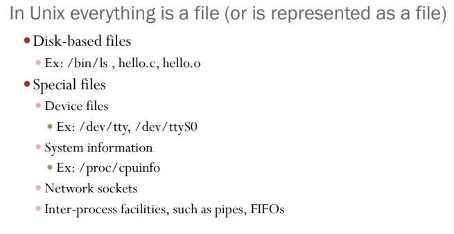

- proc file system : root 밑에 proc 디렉터리에 가보면, 굉장히 많은 파일들이 있다. 그 파일들 하나하나가 시스템에서 kernel이 갖고 있는 정보를 표시하는 것이다. 예를 들어 cpuinfo라는 파일을 open해서 읽어보면, 우리 시스템의 cpu에 대한 정보가 저장되어 있다. 이것은 실제로 디스크 상에 존재하는 것이 아니라, kernel이 file이라는 형태로 사용자에게 보여줄 수 있도록 Interface만 맞춰준 것이다.
- 통신할 때 사용하는 socket 들도 file interface로 접근이 가능하다.
- process와 다른 process간에 통신하기 위해 사용하는 pipe나 FIFO, 이런 것들도 다 file을 통해 접속을 해서 사용하게 된다.

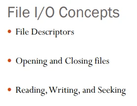

파일을 사용하기 위해 필요한 File Descriptor, Open and Close, Reading, Writing, Seeking 등에 대해 살펴본다.

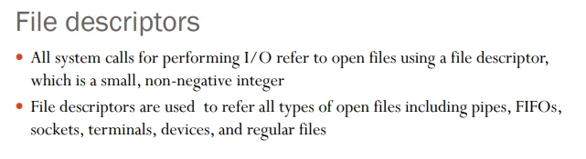

우리가 파일을 사용한다고 한다면, 그 파일을 사용하겠다는 의사를 kernel에 표시하고, 그 파일에 대한 descriptor를 얻어와야 한다, file descriptor란, 실제로는 non negative integer value인데, 이를 통해 우리가 값을 얻어온 다음에는, file descriptor에다 값을 쓰고 읽고할 수 있다. sockets, terminls, devices, pipes, FIFOs, 이런 것들에 대해 값을 쓰거나 읽을려면 먼저 다 file descriptor를 얻어와야 한다.

- file descriptor

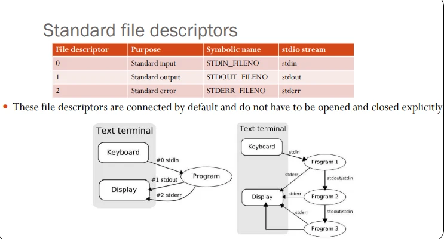

file descriptor는 명시적으로 open이라는 system call을 통해서 얻어와야 한다. 명시적으로 얻어오지 않더라도 항상 우리 process들이 가지고 있는, 이미 open되어 있는 file descriptor들이 몇 개가 존재한다.(Standard file descriptors) → 0(stdin, keyboard로 부터 값을 입력받는것), 1(stdout, terminal에 값을 출력하는 것), 2(stderr, terminal에 error를 출력한다.) macro로 symbolic하게 name을 사용할 때는 STDIN_FILENO, STDOUT_FILENO, STDERR_FILENO 등을 숫자 대신으로 사용해도 된다. 또한 파일을 open할 때, 시스템 콜을 사용하기도 하지만 standard input output library에서 fopen, fclose, fread와 같은 library 함수를 통해 접근할 수도 있다. stdio stream으로 사용할 때는 stdin, stdout, stderr와 같은 이름으로써 접근할 수 있는 것이 바로 file descriptor이다. stdin, stdout, stderr는 프로그램이 돌 때 항상 open되어 있다. 그런데, stdin은 0번으로써 키보드로부터 값을 받아들이고, 메시지를 출력하게 되면 stdout 1번을 통해서 출력하게 되어 터미널에 표시가 되며,  error 메시지를 2번 descriptor를 통해 표시하게 되면 다 display, terminal에 표시된다. 이것이 가장 일반적인 default setting이다. 그런데, stdin이 항상 keyboard로 부터 오고, stdout, stderr가 항상 monitor(display)로만 나가는 것은 아닐 수도 있다. 한 프로그램의 output을 다른 것으로 바꿀 수 있다. 예를 들어 오른쪽의 그림을 보면, 어떤 프로그램에서 stdout을 display로 내보내지 않고 또다른 프로그램의 stdin으로 넣어주고 있는데, 이와 같이 stdout을 default인 display로 주지 않고 다른 프로그램의 stdin으로 줄 수 있다. 우리는 이걸 어디서 보았었는가? 바로 Pipe에서 확인했었다.

---

- open, read, write, lseek

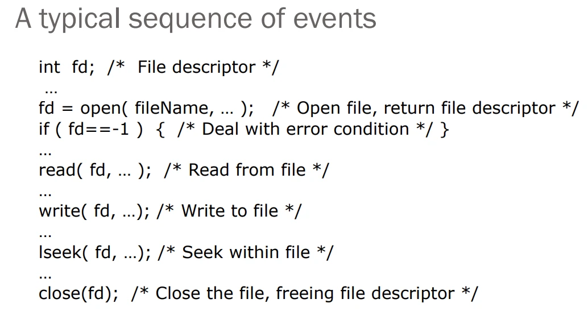

- file을 사용할 때는 open이라는 것을 통해 file의 descriptor를 얻어내고, 그 descriptor를 이용해서 file을 read하거나 write하거나 file offset의 position을 바꾸거나 다 쓰고나면 close하는 방식으로 사용하게 된다. 각각의 open, read, write, lseek, close에 대해서 살펴본다.

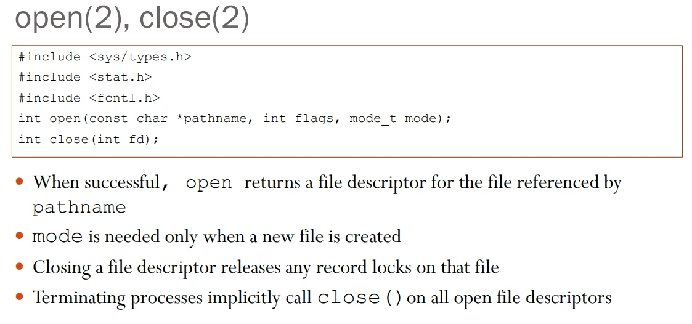

```c
#include <sys/types.h>
#include <stat.h>
#include <fctl.h>
// 위와 같은 header file들을 include하고,

int open(const char *pathname, int flags, mode_t mode);
// pathname : 열고자 하는 file name
// flags : 열 때 사용되는 option들
// mode : file creation을 할 때만 의미가 있는 parameter 
// 만약, file을 성공적으로 open하면 int type의 file descriptor를 return하고, 만약에
// 잘못되어 있으면 -1을 return하게 될 것이다.

int close(int fd);
// open한 file은 반드시 close를 해주는 것이 좋다.
// 위와 같이 사용한다. function prototype
```

- open을 통해 한 번 file의 descriptor를 얻었다면, close를 해주는 것이 좋다. close를 할 때는 file에 record lock 같은 것이 걸려있었다면, 그런 것이 release가 되며 만약 process를 termination(종료) 시키게 되면, 명시적으로 close를 하지 않더라도 묵시적으로 file descriptor들이 close가 되도록 설정되어 있다.
- flag의 사용법

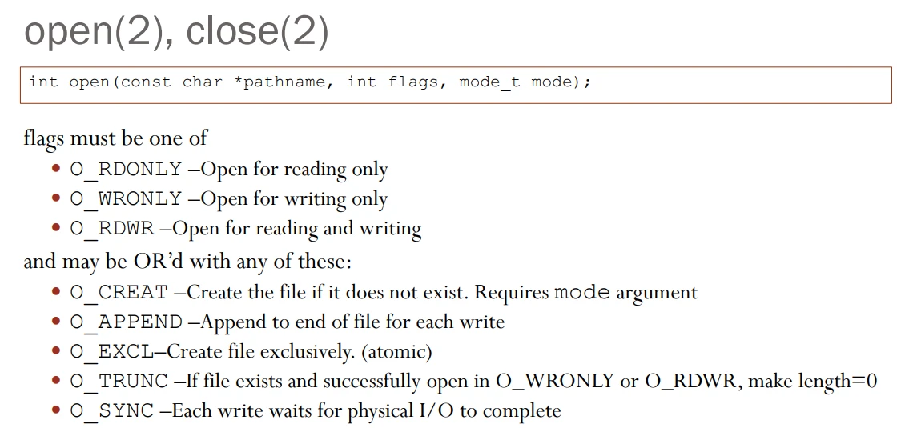

- O_RDONLY : open for reading only
- O_WRONLY : open for writing only
- O_RDWR : open for reading and writing

이 세 개의 설정에 추가적으로 OR operator를 사용하면 아래 오는 flag 설정도 선택할 수 있다.

- O_CREATE : create the file if it does not exist. // file을 열려는데 file이 없으면 생성.  
    → create라는 option을 준 경우에만 mode parameter가 의미를 갖게 된다.
- O_APPEND : append to end of file for each write // file을 갖다가 write를 할 때 항상 file의 제일 끝에다가 추가를 하며 붙여나가라는 뜻이다. (덮어쓰기 X)
- O_EXCL : Create file exclusively (atomic) // file을 create 하긴 하는데, exclusively 하게 생성하라는 의미이다.
- O_TRUNC : If file exists and successfully open in O_WRONGLY or O_RDWR, make length = 0  
    // read only나 read write로 file을 open한 경우에, file이 기존에 존재하던 file인 경우에는 파일의 size를 0으로 만들라는 의미이다. 즉, 기존에 있던 것을 다 지우라는 의미이다.
- O_SYNC : file에다가 write를 하게 되면, 그 file을 write한 것이 즉각적으로 disk에 가지 않고, buffer cash라는 메모리를 거치게 된다. 디스크에 write하는 것은 나중에 시스템이 진짜로 write해야겠다고 판단할 때 하는 것이다. write를 하고 나면, 우선 disk에 write 하지 않고 return하게 되는데, O_SYNC option을 주게 되면, write 할 시에 무조건 disk에 write하고 난 뒤, return하는 것이다.

만약, O_WRONLY로 하고, file을 synchronous하게 physical I/O 가 끝날때까지 기다리도록 하겠다면, O_WRONLY | O_SYNC 로 option을 주면 된다.

---

create flag로 설정을 주는 경우에는, mode parameter가 의미가 있는데, file을 만들기는 만들되 어떤 속성을 갖는 file을 만들 것인가를 정해주는 option이라고 할 수 있다.

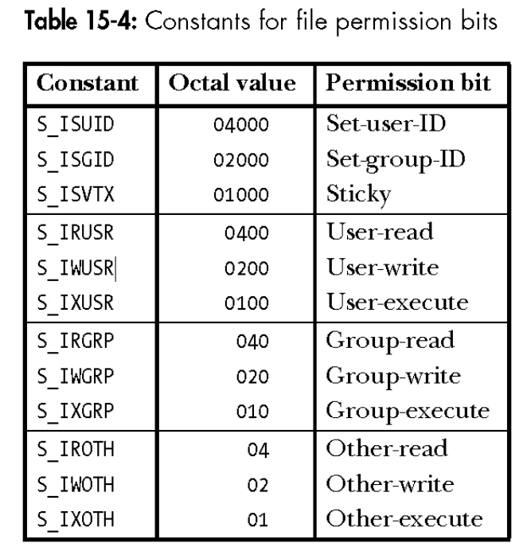

- 유닉스나 리눅스에서 file을 보게 되면, 어떤 유저나 R/W가 가능한 것, group R/W, other R/W 속성을 선택할 수 있는데, 만약 그 파일을 만든 사람이 읽고 쓰고를 가능하게 하려면  
    S_IRUSR | S_IWUSR 이렇게 입력해주면 된다.

    만약, 다른 사람이 사용할 수 있도록 하고 싶다면, 계속 | (or)를 붙여주면서 권한을 계속해서 추가해주면 된다. ( | 는 bitwise or 표시이다. )

    그런데, 일일이 or를 써가면서 모든 권한을 표시하기에는 너무 힘드므로 그냥 0666 option을 자주 사용한다. 여기서 0은 8진수를 의미하며, 사용자, 그룹, 일반 사용자의 R/W를 허용하는 option이다.

---

- open, read, write의 사용 예시

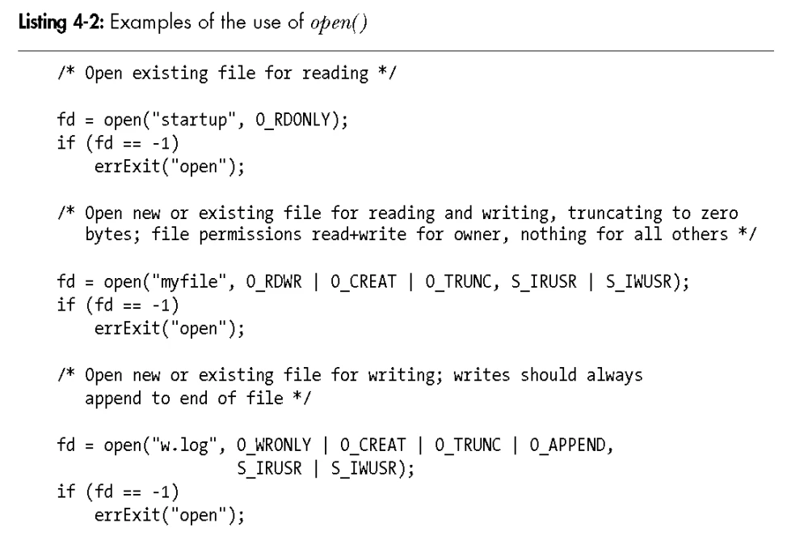

```c
fd = open("startup", O_RDONLY);
// startup이라는 filename의 file을 read only로 open하여 file descriptor를 얻어온다.
if (fd == -1)
	errExit("open");
// 얻어온 file descriptor를 확인한다.

fd = open("myfile", O_RDWR | O_CREAT | O_TRUNC, S_IRUSR | S_IWUSR);
// myfile이라는 file을 R/W로 open하며, 만약 file이 존재하지 않으면 생성한다. 만약 file이
// 있다면, file size를 0으로 만든다.(O_CREAT)
// 만약 file을 만들게 되면, 사용자가 R/W를 할 수 있도록 세팅해준다.

if (fd == -1)
	errExit("open");

fd = open("w.log", O_WRONLY | O_CREAT | O_TRUNC | O_APPEND, S_IRUSR | S_IWUSR);
// write only로 세팅하며, file이 존재하지 않으면 생성, 존재한다면 truncate하며, 내용을
// 추가할 때는 기존 내용에 추가하게 된다.(기존 내용에 덮어쓰지 말고, 기존 파일 내용의 맨 끝
// 에서부터 붙여나가라는 설정.
// 사용자가 R/W를 할 수 있도록 설정한다.

if (fd == -1)
	errExit("open");
```

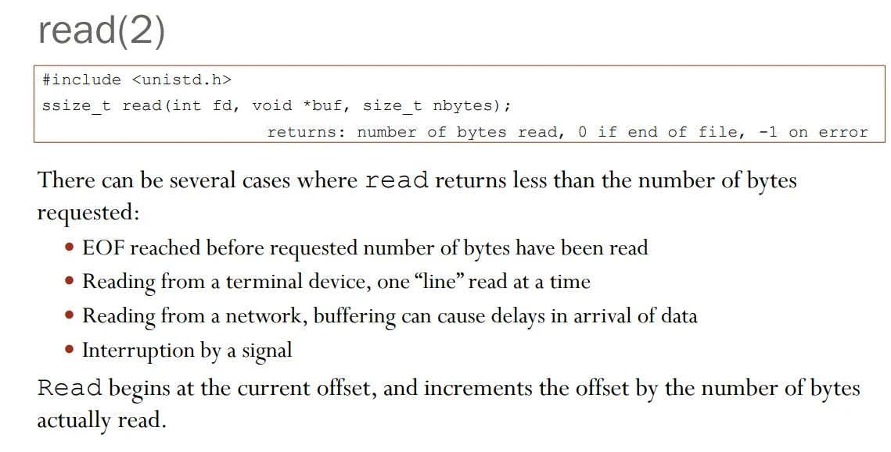

- file로부터 size_t nbytes를 읽어와서 지정한 buffer에 넣어주라는 얘기이다. file descriptor fd를 통해서 nbyte를 읽어가지고 우리가 준 버퍼에 값을 읽어오라는 뜻이다. 그 때 몇 바이트를 읽어왔는지 return 값으로 전해준다.

    그런데, read 값이 nbytes보다 작은 경우가 있다.

    1. file을 읽는데, 예를 들어서 10 bytes를 읽어오라고 했는데 return이 8이 됐다고 한다면, file이 EOF(End of File)인 경우 더 이상 읽을게 없으므로 nbytes보다 작은 값을 return하게 된다.
    2. 사용자가 stdin으로부터 값을 읽어올 경우에, Enter를 치게 되면 그 사이즈 만큼만 return을 하게 되므로  잘못된 값이 전달될 수 있음.
    3. 네트워크나 소켓에서 값을 읽어오는데, 그 값이 만약 10 bytes를 읽어오고 싶은데, 너무 느려서 10 bytes가 전달이 안된다고하자. 만약 10 bytes 중에서 5 bytes만 return이 된다면, 적은 값이  return될 수 있다.
    4. read를 실행하는 도중에 인터럽트가 걸려서 부족한 bytes를 read하고 return하게 되는 경우가 있다.

    file을 보면, file offset이라는 개념을 대부분 다 알고 있을 것이다. 현재 file을 조작하고 있을 때, file을 읽고 쓰는 위치가 어디냐 하는 file pointer이다. 대부분의 file이 처음 open하게 되면 file의 제일 앞을 가리키게 된다. 만약 n bytes를 read한다고 하면, file offset은 n bytes 만큼 증가해서 그 다음 부분을 file pointer (file offset) 가 가리키고 있게 된다.

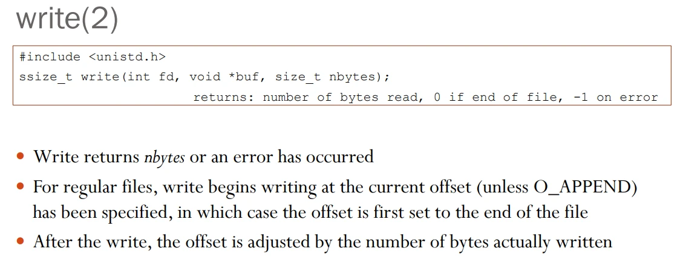

- write는, buffer에 넣어놓은 data를 nbytes 만큼 쓰겠다, write하겠다는 의미이다. 만약 nbytes를 write한다고 할 때, nbytes를 write하지 못하는 상황이 되면 -1이 return 될 것이다. write를 할 때는 file offset이 있다고 했는데, 이 file offset에 nbytes만큼 write를 하게 되면 file offset은 자동적으로 이동을 하게 된다. (n bytes 만큼)

    그런데 만약  file을 open할 때, O_APPEND flag를 설정하게 되면, write를 할 때 현재 current offset에 쓰는게 아니라, 무조건 file 맨 끝에 붙여넣게 된다. 기존 위치에 엎어쓰기를 하지 않고 계속 file 뒤에 갖다 붙힌다.

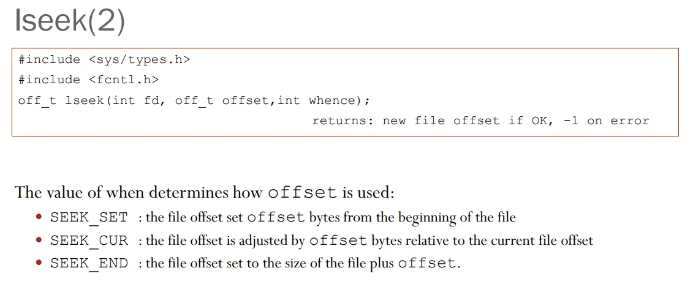

- file offset : lseek는 file offset을 우리가 원하는 위치로 이동시켜주는 것이다. 우리가 원하는 file의 offset을 원하는 위치로 옮겨주게 된다.

    1. whence : 기준점으로서, offset을 정하는 기준점이 된다.
    2. offset : 기준점에서부터의 offset

    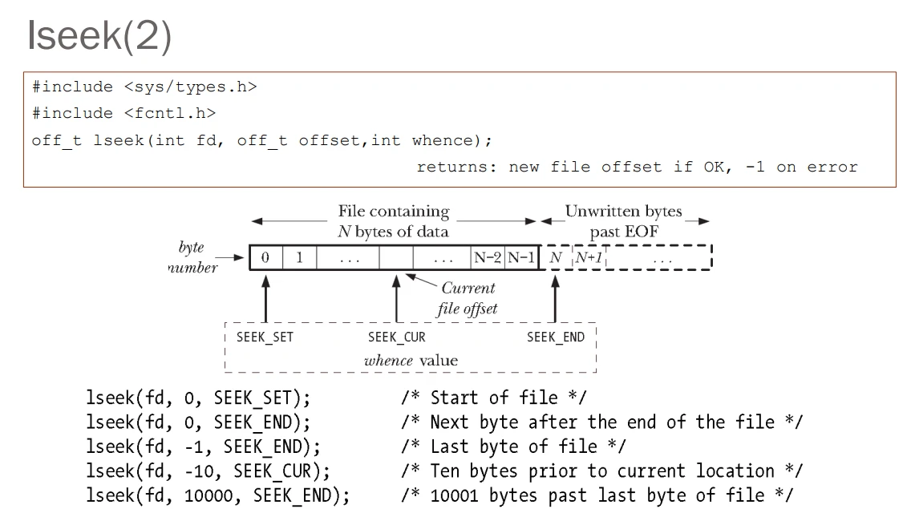

    - SEEK_SET : 어떤 file이 있다고 할 때, SEEK_SET을 whence에 적어주게 되면, file pointer의 기준점을 file의 제일 첫 부분으로 잡는다는 뜻이다.
    - SEEK_CUR : file offset의 현재 위치
    - SEEK_END : file의 끝, 그 다음 위치. 즉, N bytes의 data가 있다면, N(N-1 다음) 번 째 byte를 의미한다.

lseek(fd, 0, SEEK_SET); → 0

lseek(fd, 0, SEEK_END); → N

lseek(fd, -1, SEEK_END); → N-1

lseek(fd, -10, SEEK_CUR); → 현재 file pointer(offset)가 가리키고 있는 위치를 기준으로 -10

lseek(fd, 10000, SEEK_END); → N번째 byte를 기준으로 10001번 이동한 byte
