# 11주차 온라인 강의: 프로세스 소개, 프로세스의 관리

작성일 2022-11-12 · 최종 수정일 2022-12-03
{ .post-date }

## 프로세스 소개

프로세스는 운영체제에서 프로그램을 수행시키고, 그것을 관리하는데 가장 중요한 개념이다. 프로세스의 개념에 대해 살펴보고 리눅스와 유닉스에서 이것을 어떻게 관리하며 프로세스 관리를 위한 시스템 콜은 무엇이 있는지 살펴보도록 한다.

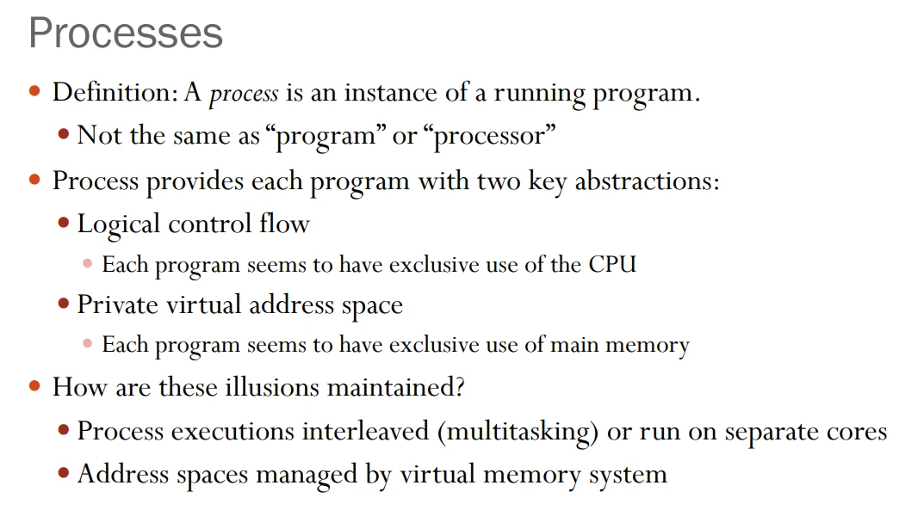

- Definition : 프로세스란, 프로그램들이 수행되고 있는 상태 또는 그 instance를 의미한다.  
    process는 program이나 CPU를 의미하는 processor와는 다른 개념이다.
- 프로세스는 두 가지 Abstraction을 제공한다.

<!-- -->

1. Logical Control Flow  
    프로세스가 혼자 CPU를 독자적으로 사용하는 것으로 보이도록 만드는 것. 시스템을 보게되면 여러 개의 프로세스들이 돌아가고 있는데, 이 프로세스들이 각각 자기 혼자 CPU를 사용하고 있는 것처럼 착각을 하게 만든다.
2. Private virtual address space  
    우리가 사용하는 프로그램은, 그 시스템에 있는 메모리를 마치 그 그 프로그램 혼자 사용하고 있는 것처럼 착각하도록 만든다.

> 어떻게 이런 효과를 줄 수 있을까?

1. 여러 개의 프로세스가 동시에 돌아가는 과정에서, 빠르게 switching을 하며 작업을 수행한다. 이를 multi-tasking이라고 한다. switching이 매우 빠른 속도로 동작하기 때문에 마치 각각의 프로세스가 CPU를 독점하는 것처럼 만들어줄 수 있다.
2. CPU마다 virtual memory라는 가상 메모리 시스템을 제공한다. 프로세스가 switching되어 바뀔 때마다 예전의 프로세스의 내용을 disk 같은 곳에 저장하고 새로 수행할 프로세스의 내용을 읽어오는 방식이다. 이를 자동으로 처리해주는 것이 바로 virtual memory system이다.

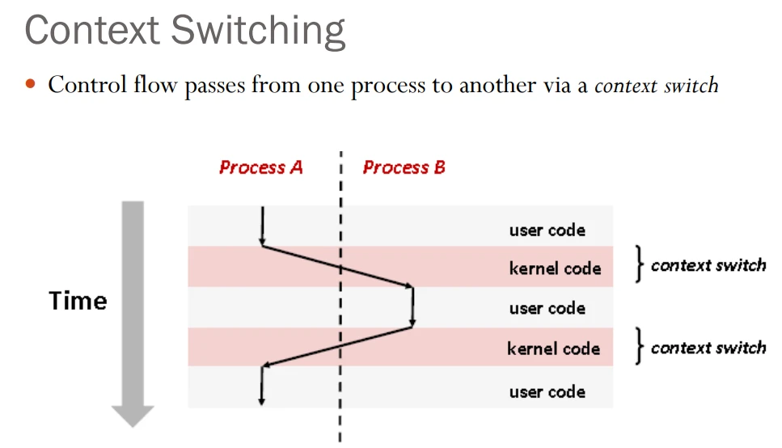

- Context Switching

한 시스템에 돌고 있는 여러 개의 프로그램이 어떻게 switching이 되는가?

만약 프로세스 A, 프로세스 B가 동시에 수행되고 있다고 하자. (CPU에 core가 하나만 있을 경우) 프로세스 A가 먼저 돌아가고 있는 상황에서 약 10ms정도 수행되고 나서 다른 프로세스 B로 switching이 일어나게 되는데 이를 바로 contect switching이라고 하며, kernel이 관리해준다. swtiching을 시작할 때 kernel은 프로세스 A가 사용하고 있는 레지스터 값들, 메모리의 상태(virtual memory) 등을 저장하고 프로세스 B가 수행되기 위해 필요한 내용 (레지스터 값들, 메모리의 상태 등)들을 복원한 다음 프로세스 B를 수행한다. 이 과정이 지나고 10ms 정도가 지나면 다시 kernel이 관여해서 프로세스 A로 다시 switching한다.

---

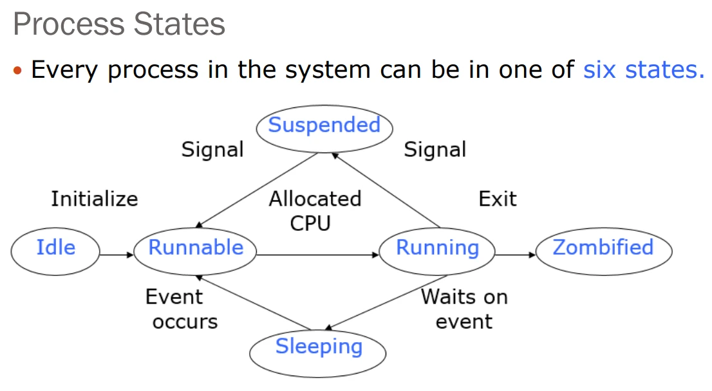

- 프로세스는 state를 갖는다.

<!-- -->

1. Idle : 제일 먼저 프로세스가 생성이 되면 Idle 상태이며, CPU에서 할당되어 수행될만한 준비가 안되어 있는 상태이다. 어느정도 초기화가 되면 Runnable 상태가 된다.
2. Runnable : CPU에서 돌아가고 있는 상태는 아니지만, 수행될 수 있는 상태.
3. Running : 실제로 CPU 상에서 돌아가고 있는 것. 그런데 context switching를 진행하기 때문에 계속해서 Running 상태에 존재하지는 않는다.
4. Sleeping : 자기가 사용하는 시간이 다 지나버려서, 자기 차례가 돌아오기를 기다리거나(context switching) disck를 process에서 접근할 때, 시간이 걸리기 때문에 그 때 까지 sleeping에서 대기하는 상황 등이 있을 수 있음. 실제로 disk에서 값을 다 읽어오게 되면 Runnable 상태로 이동하게 되는 것이다. 만약 Timer를 사용할 때 정해진 시간이 다 지나게 되면 Sleeping status에 있던 process가 Runnable 상태로 이동하게 된다.

Signal : 현재 돌아가고 있는 프로세스에 Signal(Ctrl+C, Ctrl+Z 등)을 주게 되면, 프로세스에 특정 시그널을 보내 프로세스를 중단시킬 수 있다. suspend되어있는 프로세스에 다시 진행하라는 시그널을 주게 되면 Runnable 상태로 가게 되는 것이다.

5. Zombified : 프로세스의 수행이 끝나게 되면, 바로 끝나게 될 수도 있지만 Zombified로 가게될 수도 있다. 프로그램이 끝나게 되면 부모 프로세스가 종료된 프로세스에 대해서 뒷처리를 해줘야 한다. 아직 사후 처리가 안되어서 프로세스를 종료하기는 했지만, 완전하게 종료되지 않은 상태를 Zombified라고 한다.

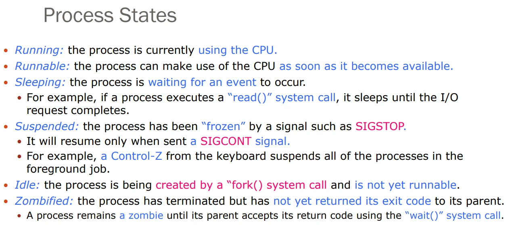

- 프로세스의 구성

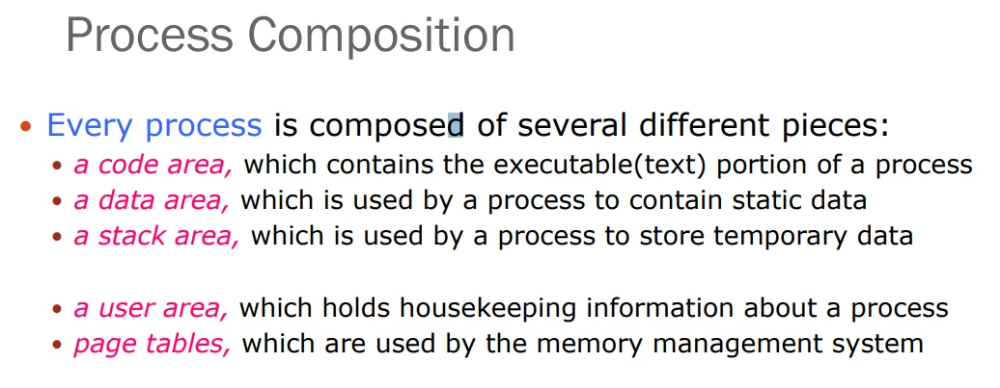

프로세스는 실제로 메모리 상에 로드가 되어 수행되는 것이다. 그 프로세스가 어떻게 구성되어 있는지 살펴보도록 한다. 프로세스는 크게 몇 가지 부분으로 나눌 수 있다.

1. code area : 실제로 프로세스라는 것은 프로그램이 메모리에 로드가 되어 수행되는 것이다. 따라서 메모리에 로드되어 수행되는 코드가 존재하는 영역을 code area라고 한다.
2. data area : 프로그램이 돌아가면서 사용하는 변수나 malloc 등을 통해 할당받은 (heap 영역) 값들이 존재하는 영역이다.
3. stack area : 함수를 수행하게 되면 stack area에 data가 쌓이게 되는데, 이 data가 존재하는 영역이 stack area이다.
4. user area : 해당 프로세스에 대한 여러가지 정보를 갖고 있는 부분을 user area라고 한다.
5. page tables : 우리가 사용하는 메모리에 대한 정보를 갖고 있는 부분이다.

→ 4, 5번은 kernel에 속하는 부분이다.  
 1\~3은 우리가 프로그래밍 하면서 실제로 사용하고 접근할 수 있는 부분이다.

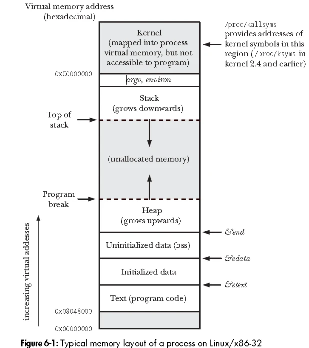

이게 일반적으로 32x, x86 플랫폼에서 돌아가는 리눅스의 메모리 맵이다. (프로세스의 메모리 맵) memory address가 0번부터 시작해서 (보통 32x에서는 4GB이므로,) 4GB의 공간이 생긴다.

보통 1GB는 kernel에 대해서 사용되며 (상단부) 나머지 3GB는 유저에 의해서 사용되는 영역이다. 우리가 수행하는 하나의 프로세스에 대한 메모리 맵이다. Text에는 프로그램의 코드가 저장되고 Data area에는 프로그램에 사용되는 data가 저장되며, malloc 등을 사용해서 동적 할당 받은 데이터를 저장하는 영역이 Heap 영역이다. Stack 영역은 함수를 호출할 때마다 stack frame이 생기고 return하게 되면 frame이 사라지게 되는 영역이다. 각각의 프로세스, 1개의 프로세스가 4GB의 메모리 맵을 갖게 된다. 그런데 프로세스가 100개가 있다고 한다면, 한 프로세스당 4GB의 메모리를 가질려면 400GB의메모리가 필요하다. 하지만 우리는 400GB를 사용하지 않는다. 이를 가능하게 하는 것이 가상 메모리이다. 개념적으로 생각할 때는 프로세스 A에서 프로세스 B로 바뀔 때 프로세스 A의 내용이 모두 disk에 저장된다고 생각하면 되며, 프로세스 B가 실행될 때는 disk에 저장되어 있던 프로세스 B에 대한 정보가 불러와진다고 생각하면 된다.

- 프로세스 테이블

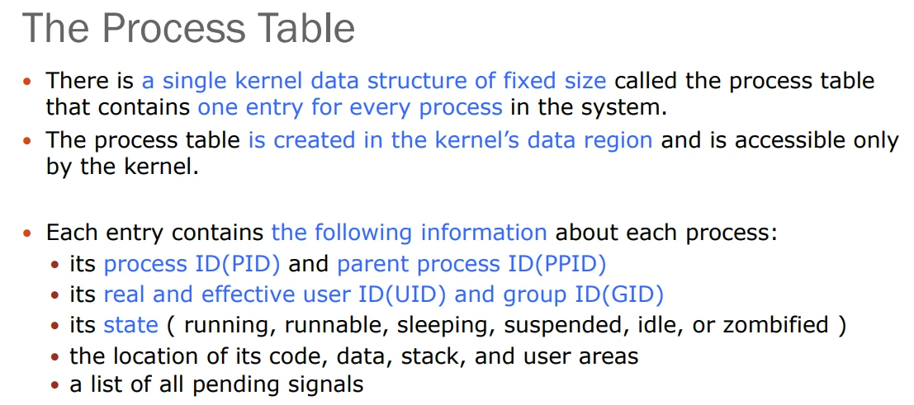

kernel은 현재 어떤 프로세스가 우리 시스템에서 돌아가고 있는지에 대한 총괄적인 정보를 갖고 있다. 이를 process table이라고 한다. 일종의 kernel data structure이며, 각각의 프로세스의 ID와 부모 프로세스는 무엇인지(PPID), 소유하고 있는 유저와 그룹은 누구이고 어떤 상태에 있는지, code, data, stack 그리고 user area가 어디에 저장되어 있는지 저장된 위치 정보, 그리고 pending된 signal에 대한 정보를 갖는다.

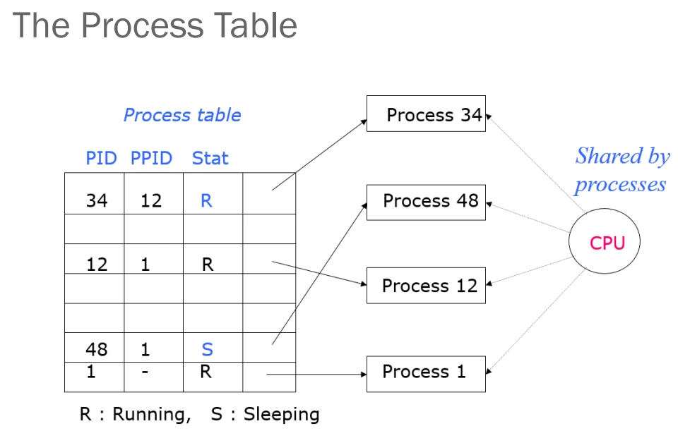

커널은 process table에 저장된 정보를 바탕으로 process를 scheduling한다. 즉, context swtiching을 진행한다. 이 과정에서 어떤 프로세스를 나중에 수행하고 어떤 프로세스를 먼저 수행하는지에 대한 문제를 다루는 사항을 CPU scheduling 이라고 한다.

---

## 프로세스의 관리

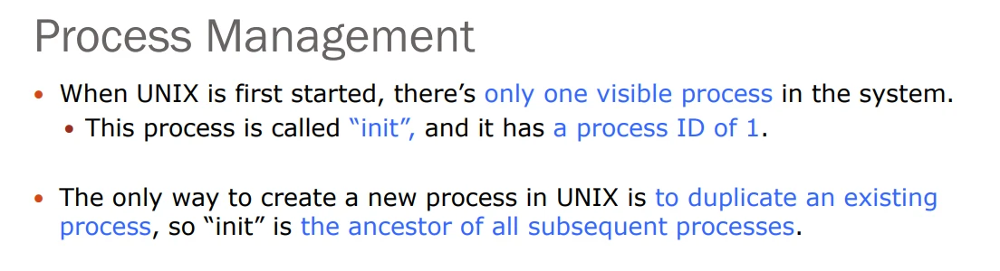

리눅스나 유닉스가 처음 부팅되면, 초기에는 단 하나의 프로세스만 존재하게 되는데 이를 init이라고 한다. (sbin directory 밑에 존재함) 이 프로세스의 PID는 1이다. 리눅스와 유닉스에서 프로세스를 만들 수 있는 유일한 방법은 기존의 프로세스를 복제하는 것이다. init 프로세스가 자기 자신을 복제해서 다른 어떤 프로세스를 만들어내게 되는 것이다. 이 때 init을 parent process라고 하며, 생성된 process를 child process라고 한다. child process는 자기 자신을 만든 process의 PID. PPID를 갖게 된다. 이 상황에서는 child process의 PPID = 1이 될 것이다. init process는 모든 프로세스의 조상 프로세스가 된다. (가장 최초의 프로세스 이므로)

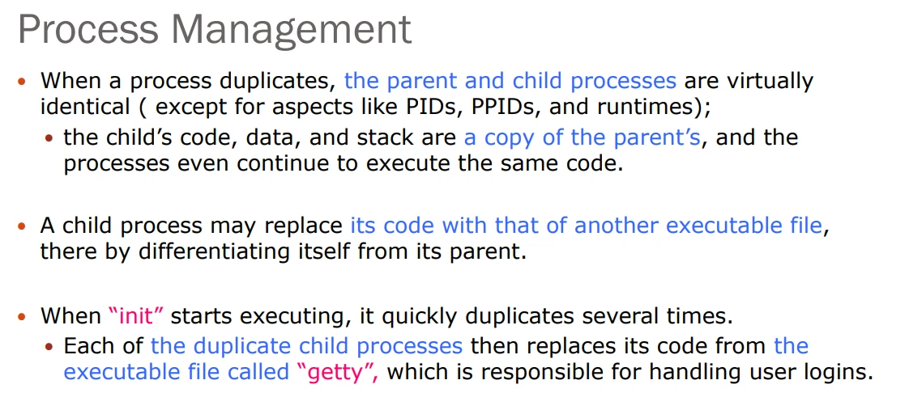

프로세스들은 fork()라는 시스템 콜을 통해 복제가 된다. 복제가 될 때, parent process와 child process는 모두 동일한다. 단지 PID, PPID만 다를 뿐이다. child process는 parent process의 code, data, stack area를 그대로 복사해오기 때문에 완전히 똑같은 프로세스로 복제된다고 할 수 있다.

그러면 예를 들어 init process가 fork를 통해서 또다른 프로세스를 만들었는데 그게 똑같이 init이라고 해보자. 그렇다면 우리는 init process만 계속 만들어야 할까? 그게 아니라, 어떤 process가 있으면 그 process가 프로그램 코드를 수행하기를 원하는 것이다. 우리가 fork()를 한 다음에 생성된 child process의 code부분을 갖다가 원하는 실행 file의 code로 바꿔치기하도록 도와주는 시스템 명령이 있다. 이 명령어들은 exec 계열의 명령어 들이며 이를 사용해 바꿔치기를 하고 나면 우리가 원하는 프로그램이 수행된다.

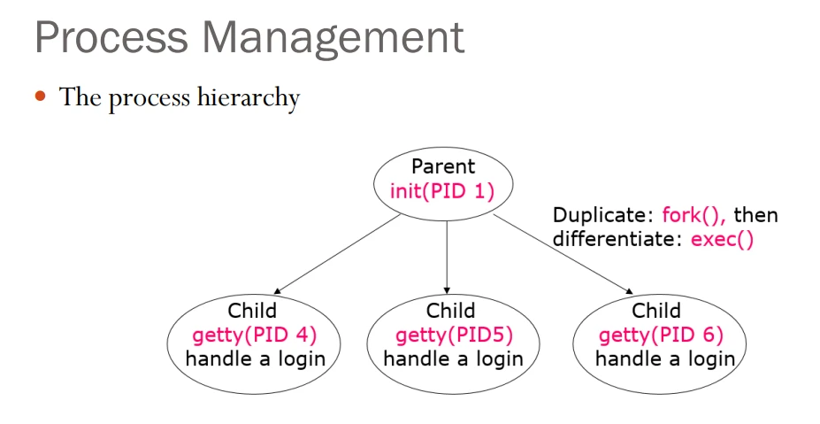

제일 처음에 init 프로세스가 있으면 이 init process는 초기에 fork()를 여러 번 수행해서 자기 자신을 여러 개 복제한다. 그 다음에 exec()를 수행하는데, parameter로 getty(PID n)을 넣어주면 이 프로그램이 getty(PID n)을 수행하는 프로그램으로 바뀌게 된다. getty는 로그인 handling을 실행한다. 제일 먼저 시스템을 켜면 login message가 나오는데, 이걸 수행하도록 하는 것이 바로 getty이다. 이후 로그인이 되고 나면, shell interpreter (bash)를 생성해야 되므로 fork를 하고, exec(bash) → bash의 실행 파일을 지정하면 해당 프로세스로 변경이 되는 것이다.

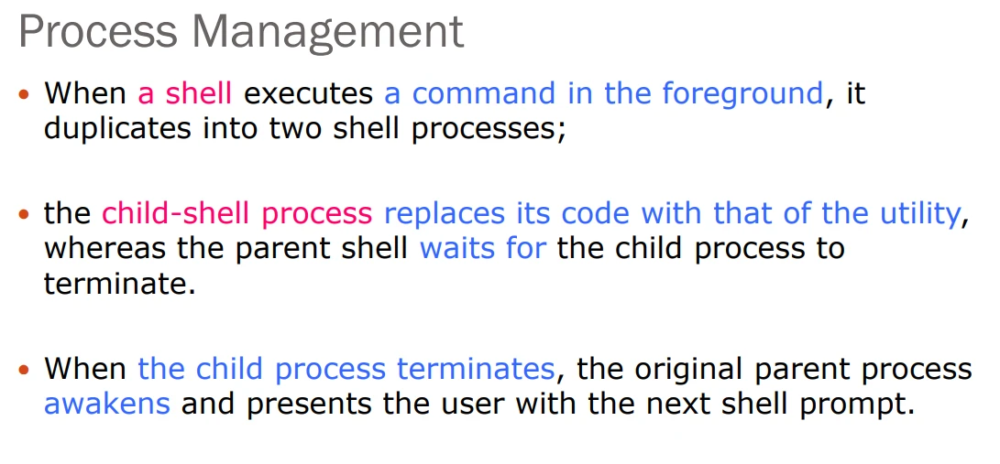

일반적으로 프로그램을 실행할 때는 shell prompt에서 해당 프로그램의 이름을 입력하고 엔터를 치면 그 프로그램의 프로세스가 쉘에 의해서 생성되는데 이 과정을 살펴본다.

쉘 프롬프트가 깜빡거리고 있는 것은 쉘 프로세스가 실행되고 있다는 것이다. 그러고 나서 실행 파일의 이름을 쳐주고 엔터를 치게 되면, 쉘 프로세스는 fork()라는 시스템 콜을 이용해 자기 자신을 복사한 다음 원하는 명령어를 수행하기 위하여 exec()를 이용해 우리가 지정한 프로그램의 코드로 대체한다. 그렇게 되면 우리가 지정한 프로그램을 수행하는 child process를 생성할 수 있게 된다. 그러고 나서는 child process가 수행되기 때문에 parent process(여기서는 shell process)는 wait()을 사용하여 해당 프로그램이 끝나기를 기다린다. child process가 종료하고 나면 shell process가 깨어나서 child process에 대한 뒷처리(후속조치를 해야 완벽하게 child process가 종료된다.)를 해주고, 그 다음 명령어를 입력할 수 있도록 프롬프트를 깜빡깜빡 시킨다.

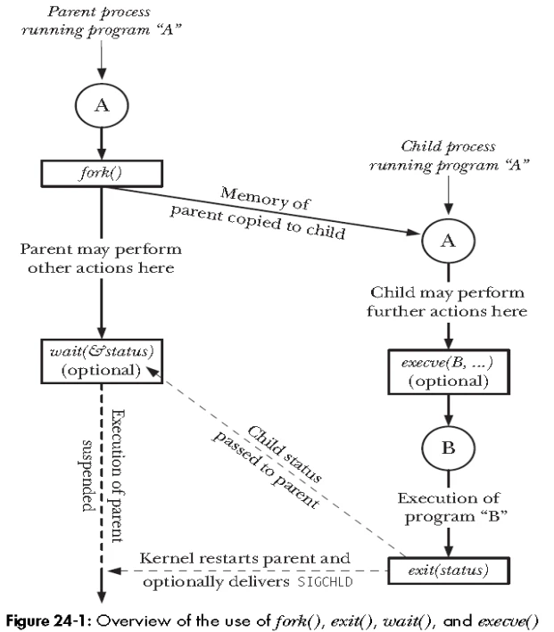

이 과정이 어떻게 발생하는지 그림으로써 살펴보도록 한다. 여기서 프로세스 A를 shell process라고 해보자. 우리가 프로그램의 이름을 shell prompt에 입력하면 shell은 자기 자신과 완전히 동일한 process를 복제하게 된다. fork()를 사용한다. 그리고 process A(여기서는 shell)는 wait()을 하며 child process의 수행이 끝나기를 기다린다. child process의 code 부분을 우리가 원하는 code로 바꾸기 위하여 execve()를 수행하여 child process의 code 영역이 또 다른, 우리가 실행하기를 원하는 프로세스인 B의 code로 바꿔주면 부모와는 code 부분이 다른 process가 되는 것이다. 그리고 수행이 끝나면 종료가 될 것이다. exit()를 이용한다. child process의 수행이 끝나면 parent process는 child process의 종료 후속 조치를 취한 후, 프로그램을 다시 수행하게 된다.

---

- fork() : 프로세스를 동일하게 복제하는 시스템 콜
- execve() : 복제된 child process의 code area를 특정해서 대체하는 시스템 콜  
    ⇒ 복제된 process가 다른 프로그램을 수행하도록 만든다.
- exit() : 프로세스를 종료할 때 상태 변수를 전달해주는 시스템 콜
- wait() : child process의 상태 변수를 받아오기 위해서 parent가 대기하도록 하는 시스템 콜

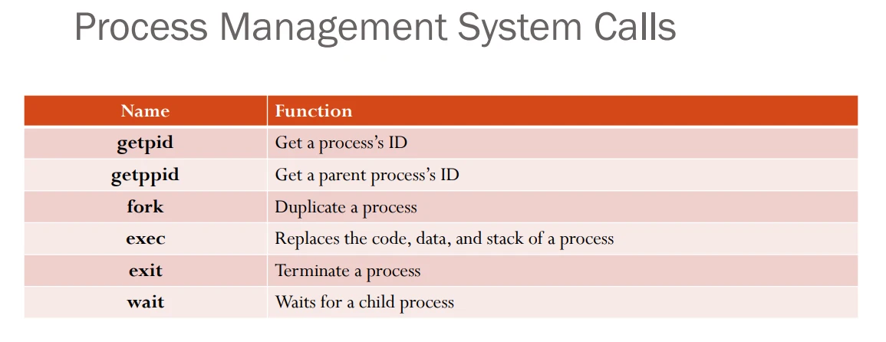

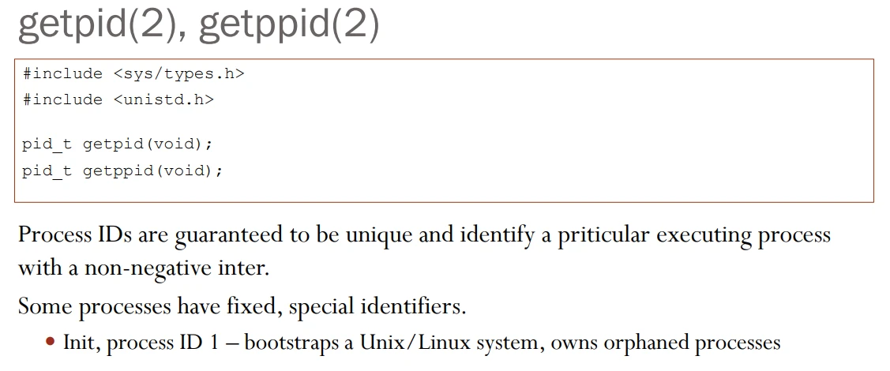

- getpid(2) : 어떤 프로세스가 있으면, 프로세스의 pid를 받아오는 것이 getpid(2)이다. pid는 non-negatvie integer이다. process 생성 시에 아직 사용되지 않은 PID를 할당받는다.
- getppid(2) : 자신을 생성한 parent process의 pid를 받는다.

process의 PID는 어떤 것이 배정될지 미리알 수 없지만, init process는 항상 pid가 1이다.

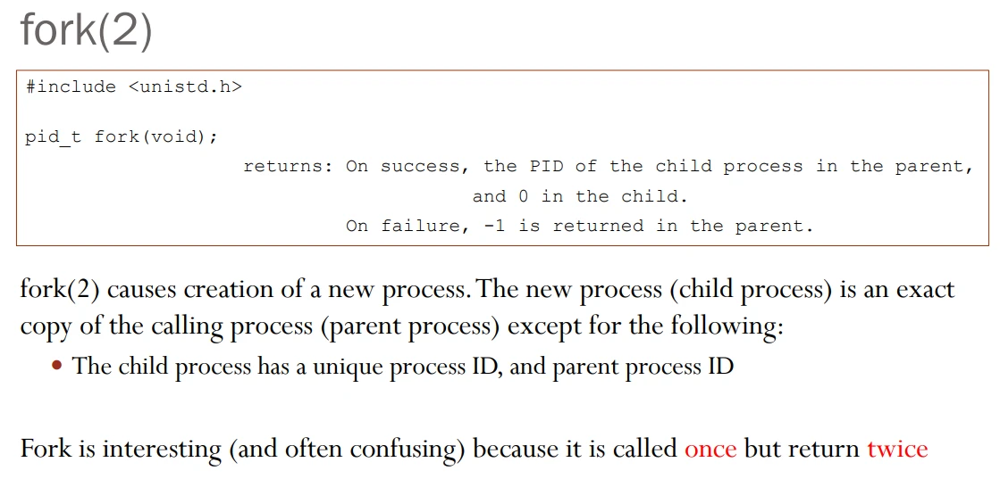

- fork : 어떤 프로세스가 자기 자신을 복제해서 child process를 만들어 내는 시스템 콜이다. 이 때 두 프로세스는 완전히 똑같은 코드를 수행하는 프로세스이다. 다른 것은 PID 뿐이다. parameter는 void이며 return type으로 pid_t를 return한다. 한 번 parent process에서 fork()를 부르게 되면 return을 두 번 하게 된다. parent process가 받는 return 값은, child process의 return 값이다. child process(생성된 process)에서는 0이라는 값을 전달받게 된다.

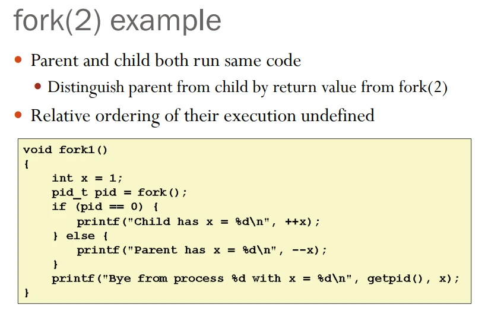

위의 예제에서, parent process에는 새롭게 복제된 child process의 pid가 return되고, child process에는 0이 return된다. 생성이 되면 parent process는 pid가 non 0 이기 때문에 else 구문이 실행되고, child process는 pid_t pid = fork(); 시점부터 다시 실행이 되며 pid == 0이기 때문에 if 구문이 실행된다.

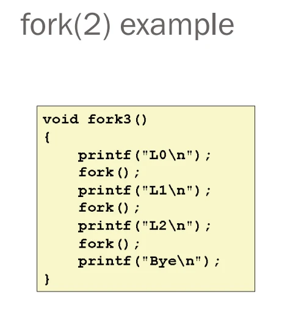

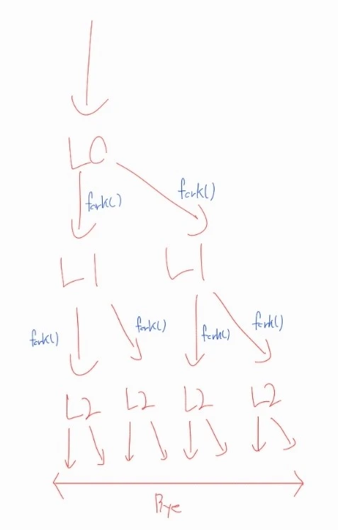

→ 그런데, 어떤 프로세스가 먼저 수행되고 어떤 프로세스가 나중에 수행될 지는 우리가 정할 수 없다. 그것은 스케쥴러가 정해주는 것이다. 우선순위를 따로 정해주지 않으면 수행 순서의 예측은 불가능하다.

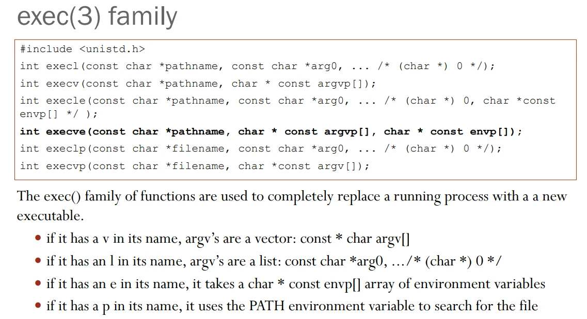

- exec 계열 시스템 콜이 굉장히 많은데, 사실 실제 exec는 execve()이고, 나머지 것들은 execve()에서 기능을 조금 추가해서 만들어진 것이다. 약간씩 기능이 다르다. exec() family는 특정 프로세스의 code area를 내가 지정한 프로그램으로 대체해서 수행하도록 만드는 것이다.

- execve()

    pathname : 자신이 수행하고 싶은 수행 파일의 pathname을 준다.

    argvp[] : 전달해 줄 인자를 vector 형태로 전달한다.

    envp[] : 프로그램 수행에 필요한 환경 변수를 vector 형태로 전달한다.

뒤에 v가 붙어 있는 exec() 함수들은 argument를 vector로써 전달하는 함수들이다.

뒤에 l이 붙어있는 exec() 함수들은 argument들을 list형태로 순서대로 적어주는 함수이다.

뒤에 e가 붙어있는 exec() 함수들은 프로그램을 수행할 때 환경변수를 넘겨주는 함수이다.

뒤에 p가 붙어있는 exec() 함수들은 pathname이 아니라 filename을 주고, 경로를 PATH라는 환경변수에 지정한 곳에서 찾게 된다.

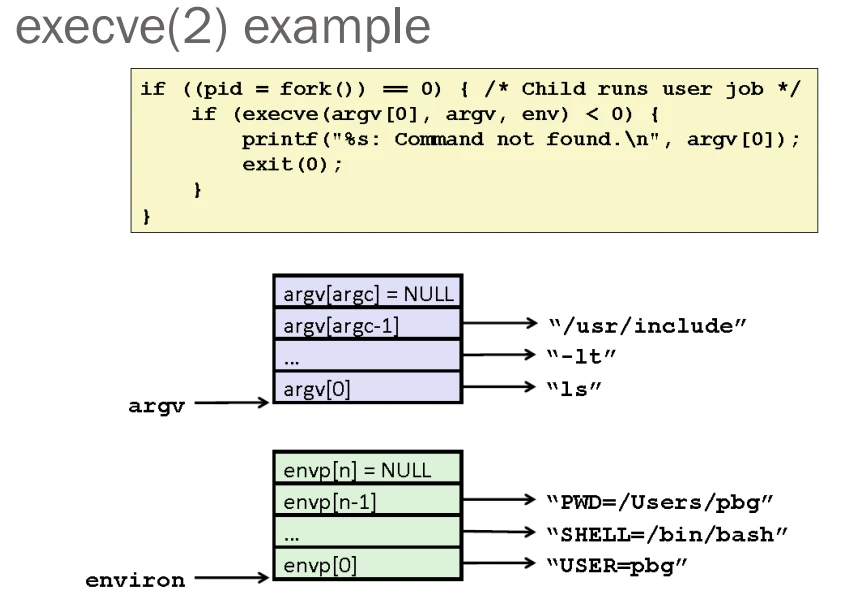

새로운 프로그램을 수행하기 위해서 fork()와 exec()를 사용하면, fork() == 0으로 if를 걸어준다. 그러면 child process가 해당 부분을 수행하게 된다. child process가 execve(argv[0], argv, env) &lt; 0. argv[0]은 현재 수행중인 프로그램의 이름이고, argv는 인자 env는 환경 변수들이다. 이렇게 되면 전달된 프로그램이 실행되는 것이다. 만약 return code가 0보다 작으면 command가 존재하지 않는다고 찍어준다.

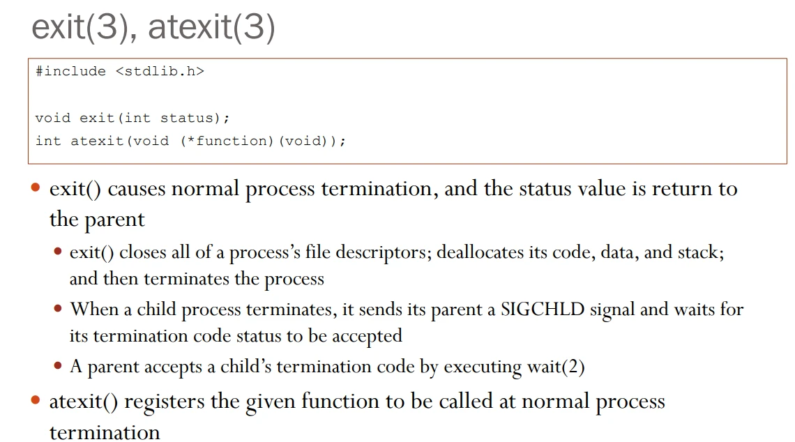

exit()는 프로세스가 자기 자신을 정상적으로 종료시킬 때 사용하는 시스템 콜이다. 만약, 외부에서 시그널을 보내서 내 프로세스를 강제로 종료시키는 경우는 비정상적으로 종료되는 경우를 의미한다. 이런 경우가 아니라 exit 함수를 불러서 종료하는 경우는 정상 종료하는 것이라고 판단한다. 그렇게 되면 child process는 SIGCHLD라는 signal을 parent에게 보내는데, 그렇게 되면 parent process가 wait하고있다가 시그널을 받고 깨어나 동작하게 된다.

int atexit(void (\*function) (void)); ⇒ function pointer.

여기다가 함수를 등록해놓으면, exit하기 전에 함수를 수행해준다.

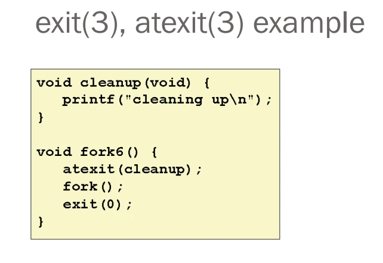

예를 들어 atexit()에  cleanup() 이라는 함수를 등록해주었다면, parent process와 fork()로 생성된 child process는 종료 시에 둘 다 cleanup()을 부르게 될 것이다.

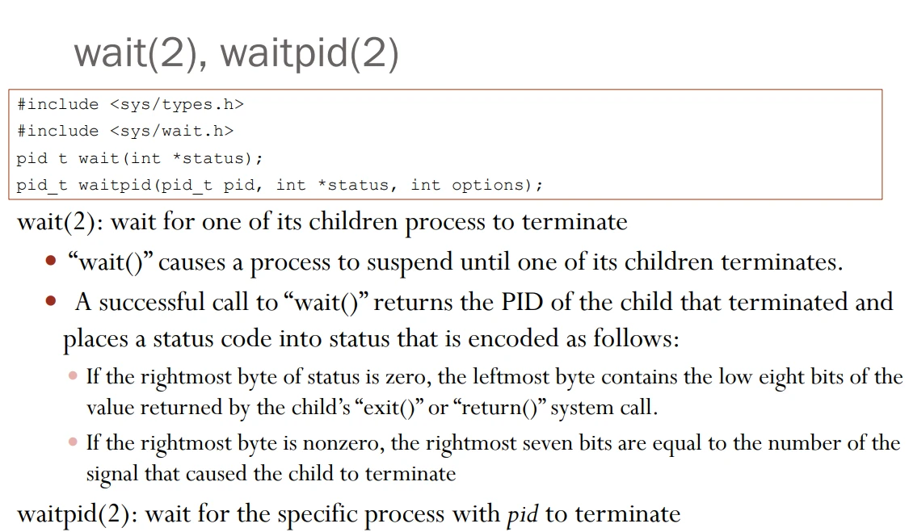

wait process는 parent process에서 child process가 종료될 때까지 기다리는 시스템 콜이다. 그런데, child process는 여러 개 만들어질 수 있는데 만약 그 중 아무거나 하나가 종료되면 child process가 보내준 exit code를 바탕으로 동작을 이어가게 된다.

wait가 return하는 값은 여러 child process일 때 어떤 process가 termination돼서 return 값을 줬는지 pid를 갖다가 return하게 되어있고, status value는 bit mask로 해석을 해서 알아볼 필요가 있다.

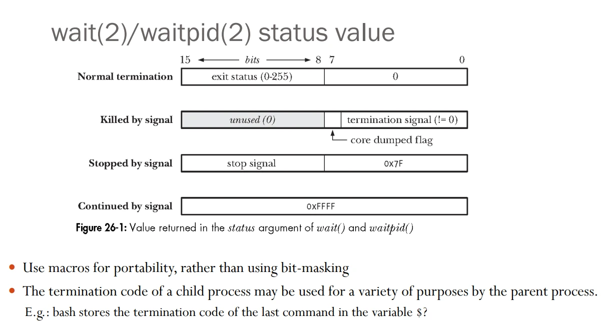

status value에서 보면, 만약 우측에 있는 8bit가 0으로 되어있으면 process가 정상 종료되었다는 의미로 파악한다. status code는 좌측에 있는 8bit에 전달된다.(0\~255) 만약 프로세스가 정상 종료된 것이 아니라 외부의 Signal에 의해 종료되었다면 우측 8bit가 non-zero이며, 어떤 signal에 의해 child process가 termination되었는지 그 정보가 담기게 된다. 그런데, 우리가 이와 같이 bit-masking을 한다기 보다는 몇 가지 macro들이 manual을 통해 제공이 된다. 그러므로, bit-mask를 직접 하지 말고 test macro들을 조작해서 사용하도록 한다.

그런데, 우리가 아무 process나 종료되길 기다리는 것이 아니라 특정 process가 종료되기를 기다려야 할 때가 있을 것이다. 그러면 사용하는 것이 waitpid라는 시스템 콜이다. signature를 보면, pid를 아예 명시해버린다. wait와 동일하게 status 값을 가져올 수 있다. 사실 waitpid는 기능이 되게 많은데, option 파트의 값을 적절히 설정해주면 child process가 종료될 때까지 기다리는 것이 아니라, 만약 상태변화 했을 때 그 값을 가져올 수 있도록 하는 것이 바로 waitpid이다.

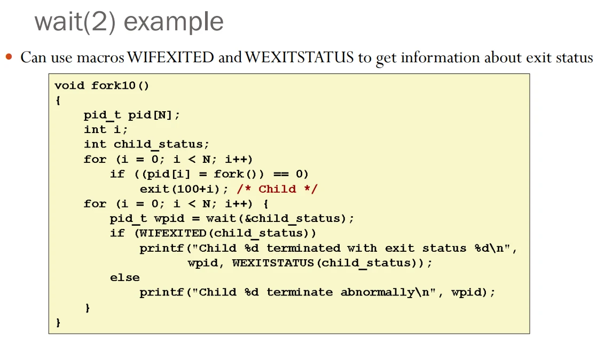

위는 wait을 사용한 예제이다. for문을 보면 N개의 child process가 생성될 것이다. if에서는 child process가 0을 return 받으므로 바로 exit(100+i)를 넘겨주면서 child process를 종료시킨다. parent process는 다음 for로 넘어와서 wait을 시작한다. 위에서 나온 exit status가 변경이 돼서  child_status에 전달되는데, 그대로 전달되는 것이 아니라 약간 변경돼서 전달된다. 그렇게 약간 변경돼서 전달된 status code를 해석해주어야 하는데 이를 직접하지말고 몇 가지 macro를 써서 하는 것이 좋다. WIFEXITED macro는 child process가 정상종료 되었는지 판단하는 macro이다. WEXITSTATUS macro는 받아온 status code에서 왼쪽 8bit(exit status)만 추출해주는 것이다. parent process는 child process 중 하나가 종료될 때까지 대기를 하게 되는데 만약 종료가 됐다면 그 다음으로 넘어가서 exit code를 추출하게 된다.

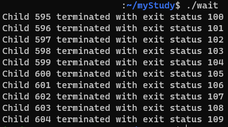

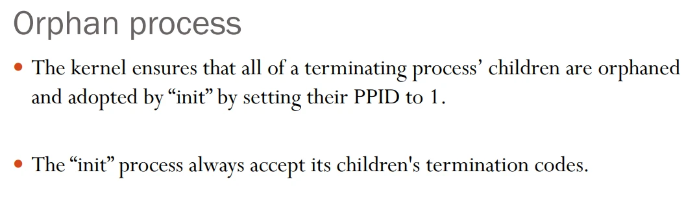

어떤 프로세스가 child process를 생성해서 두 개가 수행되고 있는데, parent process가 child process가 exit될 때까지 기다려줘야되는데 child process보다 먼저 수행이 종료된 경우이다. 이렇게 되면 child process는 parent process가 없는 process가 되는데 리눅스에서는 이를 어떻게 처리하냐면, 이 프로세스의 ppid를 1로 세팅해버린다. (Init process가 parent가 되도록 만든다. 일종의 입양, adopt)

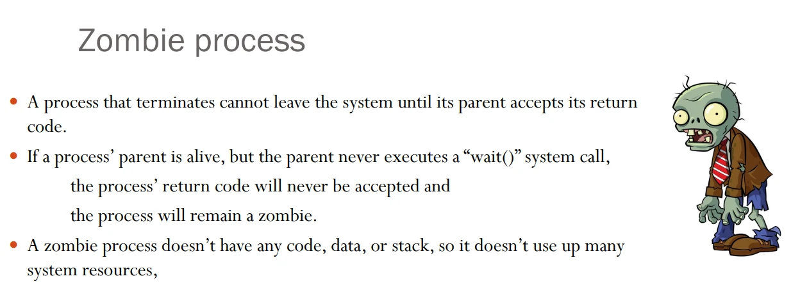

child process가 생성되어 수행이 되고 있는데, child process가 exit를 수행했다고 하자. 그런데 사실, eixt를 했다고 바로 끝나는 것은 아니고 현재 wait하고있는 parent process가 exit code를 가져가야만 제대로 끝이 나는 것이다. 그렇게 되면 메모리에 로드되어 있던 child process의 데이터나 시스템 리소스가 모두 제거된다. 따라서 parent process는 반드시 wait() 상태에 있어야만 한다. 그런데 child process는 exit를 하긴 했는데 만약 그 때 parent process가 wait상태가 아니라 다른 작업을 수행중이었다고 한다면, child process의 데이터는 제거가 되었는데 완벽하게 종료가 안된 상태인 zombie process 상태가 된다.
