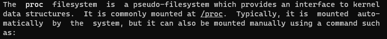
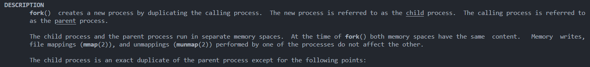
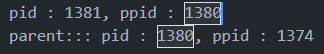
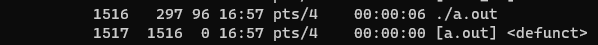

# 12주차: 프로세스 시스템 콜

작성일 2022-11-17 · 최종 수정일 2022-11-20
{ .post-date }

## System Call - Process

- 프로세스란? : 메모리에 로드되어 실행되고 있는 프로그램의 인스턴스, 또는 그 자체를 말한다.

시스템에 있는 전체 프로세스를 볼려면 \$ ps -ef 를 (혹은 ps -elf)입력한다. 윈도우 wsl에서 돌리고 있으므로, 프로세스가 굉장히 축약된 형태로 나오지만 실제로는 굉장히 많은 프로세스가 돌고 있다.

- PID : 모든 프로세스는 ID를 가지며, 이는 실행할 때마다 달라진다. 하지만 init process는 항상 1번을 가진다. 시스템이 부팅될 때 가장 먼저 만들어지는 프로세스 이므로 항상 1번의 PID를 가지는 것이다.
- top을 사용하면 마치 윈도우의 작업관리자처럼 현재 돌고 있는 모든 프로세스를 확인할 수 있다. CPU, Memory 점유율도 확인할 수 있음. 굉장히 자주 쓰는 tool이다. (workload를 확인할 수 있는 툴)
- /proc에 가면 process에 관련된 모든 내용이 들어있음.



kernel이 자신이 갖고있는 데이터를 보여주기 위해 만들어내는 파일 시스템

> cd /proc  
> ls

⇒ 번호로된 디렉터리는 모두 프로세스의 PID를 의미하며, 안에 들어가면 프로세스에 관련된 파일들이 들어있다. top program은 사실 /proc에 있는 프로세스 디렉터리 안에 있는 내용을 잘 정리해서 보여주는 프로그램이다.

- fd라는 디렉터리에 들어가보면, 0, 1, 2, … 이렇게 디렉터리가 추가로 있는데 여기서 0, 1, 2는 stdin, stdout, stderr를 의미한다. (그런데, fd에 들어가지지 않는다.)
- sched을 cat sched로 읽어보면, 프로세스들이 cpu에서 어떻게 스케쥴링되고 있는지 알아볼 수 있다.

만약 내가 시스템 개발을 하게 된다면, 특히 man proc처럼 내 시스템이 어떻게 돌아가고 있는지 확인할 수 있는 수단을 알려주는 것에 대해 많이 참고하게 된다.

---

\~/class/lab6-process  
\$ code .

- 프로세스는 항상 어떤 프로세스가 만들어줘야 한다. 자기랑 완전히 똑같은 것을 만들어내줘야 하는데, 이것은 fork()를 통해 할 수 있다.

\$ man fork

### description



fork가 재밌는 것은, 모든 것을 똑같이 복사하기 때문에 심지어는 레지스터 값까지 똑같이 복사한다. register 값까지 복사를 하게 되는데, program counter 까지 복사해서 똑같은 부분을 복사하게 된다. → 이 말은 즉슨, 아예 같은 프로그램을 실행하게 되므로 차이가 있어야 된다. fork는 return을 두 번 하는데, child process에는 성공시에 0을 return하고 parent process에는 child process의 pid를 return한다. 만약 실패할 시, child process는 생성되지 않으며, parent process에는 -1이 return 된다.

- fork()를 한 번 하고, PID와 PPID를 출력하는 프로그램

```c
#include <stdio.h>
#include <sys/types.h>
#include <unistd.h>

int main(void) {

    pid_t pid = fork();

    printf("returned value from fork() : %d\n", pid);
    printf("PID : %d\n", getpid());
    printf("PPID : %d\n", getppid());

    return 0;
}
```

fork()를 하는 순간, 똑같은 프로세스가 두 개가 돌게 되므로, printf가 똑같은 동작으로 두 번 실행되게 된다. 두 개는 똑같으므로 구별하기가 어렵기 때문에, return value를 이용하여 동작을 구분해준다

```c
#include <stdio.h>
#include <sys/types.h>
#include <unistd.h>

int main(void) {

    pid_t pid = fork();

    if (pid == 0) { // child process
        printf("pid : %d, ppid : %d\n", getpid(), getppid());
    } else { // parent process
        printf("parent::: pid : %d, ppid : %d\n", getpid(), getppid());
    }

    return 0;
}
```

원칙적으로는 parent process는 동작이 끝나고, child process가 종료될 때까지 검사하면서 기다리고 있어야한다. 그렇게 하기 위해 필요한 것이 wait()이다.

\$ man wait → 그런데, man wait하면 이상한게 나온다. 이런 경우에는 man 2 wait, or man 3 wait을 해준다. wait은 parameter에 child process가 어떻게 종료됐는지 알려주는 status를 받아온다. (exit code)

- wait 활용

```c
#include <stdio.h>
#include <sys/types.h>
#include <unistd.h>
#include <sys/wait.h>

int main(void) {

    pid_t pid = fork();

    if (pid == 0) { // child process
        printf("pid : %d, ppid : %d\n", getpid(), getppid());
    } else { // parent process
        int exitstatus;
        wait(&exitstatus);
        printf("parent::: pid : %d, ppid : %d\n", getpid(), getppid());
    }

    return 0;
}
```

→ 실행 결과, child가 먼저 찍히고 child의 실행이 끝나면 parent가 찍힌다.



> wait()을 안하는 경우, parent process가 먼저 끝나는 경우가 생기는데, 이 때 프로세스를 또 실행하면 orphan process가 만들어질 수 있다. (자식보다 부모가 먼저 끝나는 경우.) 이런 경우, child process의 parent process는 init process가 된다.

- zombie process

    child process가 termination되면 parent process가 정리해줘야 한다. → memory 해제, process table에서 지워버린다. 이 과정을 parent process가 담당해야하며, wait()을 해야만 한다. 그런데 parent process가 wait()을 하지 않고 딴 짓을 하는 경우가 있는데 이렇게 되면 child process가 완전히 종료되지 않는 경우가 발생해서 zombie process가 생겨난다. &lt;defunct&gt; 라고 종종 표시된다.

```c
#include <stdio.h>
#include <sys/types.h>
#include <unistd.h>
#include <sys/wait.h>

int main(void) {

    pid_t pid = fork();

    if (pid == 0) { // child process
        printf("pid : %d, ppid : %d\n", getpid(), getppid());
    } else { // parent process
        int exitstatus;

        while (1) {};

        wait(&exitstatus);
        printf("parent::: pid : %d, ppid : %d\n", getpid(), getppid());
    }

    return 0;
}
```



- 확인해보면, 좀비 프로세스가 남아있게 된다. (무한 루프를 넣어두면 wait이 불가능해진다.)

지금 까지의 코드에서는 child가 명시적으로 exit code를 넘겨주지 않고 있는데, 이를 명시적으로 넘겨주려면 exit()를 사용하면 된다.  
\$ man 3 exit

```c
#include <stdio.h>
#include <sys/types.h>
#include <unistd.h>
#include <stdlib.h>
#include <sys/wait.h>

int main(void) {

    pid_t pid = fork();

    if (pid == 0) { // child process
        printf("pid : %d, ppid : %d\n", getpid(), getppid());
        exit(101);
    } else { // parent process
        int exitstatus;

        // while (1) {};
        wait(&exitstatus);
        printf("exitcode: %d\n", WEXITSTATUS(exitstatus));
        printf("parent::: pid : %d, ppid : %d\n", getpid(), getppid());
    }

    return 0;
}
```

그런데, 이걸 찍어보면 exit code가 이상하게 나온다. 그 이유는, exit code를 보관하는 byte가 2바이트라서 전체 값을 출력하기 때문이다. exit code는 오른쪽 한 바이트에는 정상 종료될 시 0이 담기게 된다. 그게 아니라 비정상적으로 종료될 경우 exit code가 우측 바이트에 담기게 되므로, WEXITSTATUS(exitstatus)를 출력해준다.

좌측은 exit status, 우측은 termination signal로 보인다.

```c
#include <stdio.h>
#include <sys/types.h>
#include <unistd.h>
#include <stdlib.h>
#include <sys/wait.h>

int main(void) {

    pid_t pid = fork();

    if (pid == 0) { // child process
        printf("pid : %d, ppid : %d\n", getpid(), getppid());
        for (int i = 0; i < 100; i++) {
            printf("%d\n", i);
        }
        exit(101);
    } else { // parent process
        int exitstatus;
        printf("parent start!\n");
        for (int i = 100; i < 200; i++) {
            printf("%d\n", i);
        }

        wait(&exitstatus);
        printf("parent::: pid : %d, ppid : %d\n", getpid(), getppid());
        printf("exitcode: %d\n", WEXITSTATUS(exitstatus));
    }

    return 0;
}
```

이 프로그램을 돌리면 어떤 경우에는 하나를 먼저 다 하고 나머지를 출력하고, 어떤 경우에는 동시에 출력하게 되는데 이것은 OS의 Scheduler에 따라 다르다. 이것은 우선순위를 알지 못한다면 예측할 수 없다. 또한, 다른 것의 영향이 있는데 printf는 사실 바로 출력하는 것이 아니라, 메모리 버퍼에 갔다가 stdoutd으로 넘겨줘야 하기 때문에 오버헤드가 크다. 이것의 영향으로 순서가 바뀔 수 있다.

- fflush(NULL)

```c
#include <stdio.h>
#include <sys/types.h>
#include <unistd.h>
#include <stdlib.h>
#include <sys/wait.h>

int main(void) {

    pid_t pid = fork();

    if (pid == 0) { // child process
        printf("pid : %d, ppid : %d\n", getpid(), getppid());
        for (int i = 0; i < 100; i++) {
            printf("%d\n", i);
            fflush(NULL);
        }
        exit(101);
    } else { // parent process
        int exitstatus;
        printf("parent start!\n");
        for (int i = 100; i < 200; i++) {
            printf("%d\n", i);
            fflush(NULL);
        }

        wait(&exitstatus);
        printf("parent::: pid : %d, ppid : %d\n", getpid(), getppid());
        printf("exitcode: %d\n", WEXITSTATUS(exitstatus));
    }

    return 0;
}
```

이걸 넣으면, printf에서 stdin으로 들어온 값을 메모리 버퍼를 거치지 않고 바로 출력하도록 해준다. 이렇게 하면 결과가 조금 달라질 수 있다. 두 개가 땅\~하고 달리는데 어떤 순서로 달릴 지는 모른다는 것이 race condition이다.

- execve : fork로 복사한 프로세스가 다른 코드를 수행하도록 바꿔주는 코드  
    \$ man 3 exec를 하면, 다양한 종류의 exec가 있는데 이것들은 기존의 execve를 활용하여 다른 parameter를 받아 활용할 수 있다.

여러 exec들의 signature를 보면, 가변 인자를 전달받는다. char\* const argv[]

> 그런데, 사실 시스템콜은 execve() 밖에 없고, 나머지는 이걸 바탕으로 만들어낸 것들이다.

int execve(cont char \*pathname, char \*const argv[], char \*const envp[])  
→ pathname : 절대 경로를 넣어도 되고, 경로가 잡혀있는 ls 같은 프로그램들은 그냥 ls만 쳐도 된다.

→ argv : 실행에 필요한 옵션을 넣어준다.

→ envp : 환경 변수를 넣는다. 필요없으면 NULL

- 프로그램을 ls로 바꿔보자!

```c
#include <unistd.h>
#include <stdio.h>

int main(void) {

    char* argv[] = {"ls", "-l", NULL};
    char* env[] = {NULL};
    
    execve("/bin/ls", argv, env);
		// printf("hello, world!\n);

    return 0;
}
```

- pathname을 적어줘야 하므로, path는 절대경로로 지정해주어야 한다. 절대 경로를 안쓰려면, execvp나 execvpe와 같이 parameter를 file로 받는 것을 사용한다.
- 가변인자들의 뒤에는 NULL을 써줘야 한다.
- argv[0]는 그냥 이름이므로 그다지 중요하지 않지만, 그 뒤는 중요하다.

위의 주석을 보면, hello world는 출력이 가능할까? 안된다. execve가 실행되는 순간, code area가 모두 ls로 바뀌고, 기존에 컴파일되어 있던 코드는 날라가기 때문에 명령이 수행되지 않는다.

보통은 fork를 해서, child process가 execve를 수행하도록 한다.

---

- 이제 fork()와 execve()를 동시에 사용해보자!

```c
#include <stdio.h>
#include <sys/types.h>
#include <unistd.h>
#include <stdlib.h>
#include <sys/wait.h>

int main(void) {

    pid_t pid;
    pid = fork();

    if (pid == 0) {
        char *new_argv[] = {"ls", "-a", "-l", NULL};
        execve("/bin/ls", new_argv, NULL);
    }
    else {
        int exitstatus;
        wait(&exitstatus);
    }
    printf("hello, world!\n"); // parent가 한 번만 찍어준다.

    return 0;
}
```

- execve를 실행한 이후에는 이전 까지 작성된 모든 프로그램이 관련이 없어진다. 이번 예제의 경우에는 ls로 대체했으므로, ls가 프로그램 exit를 관장해주는 역할을 한다. 굳이 exit를 명시하지 않아도 된다.

---

```c
#include <stdio.h>
#include <stdlib.h>

int main() {

    system("ls -l | wc -l");
    printf("hello, world!\n");
    return 0;
}
```

- system() 이라는 call은 “ “ 안에 들어간 명령어를 그냥 수행시켜준다.
