# 12주차 온라인 강의: 시그널, 알람 타이머

작성일 2022-11-24
{ .post-date }

- 시그널은 리눅스 초기부터 외부의 이벤트가 발생했다는 것을 프로세스에게 알려주기 위한 기능을 했다.
- 시그널의 개념, 어떤 시그널이 사용 가능한지, 어떻게 다른 프로세스에게 시그널을 보낼 수 있는지, 내가 받은 시그널을 어떻게 처리할 수 있는지를 살펴본다.
- 시그널과 관련있는 알람 타이머를 살펴본다.

---

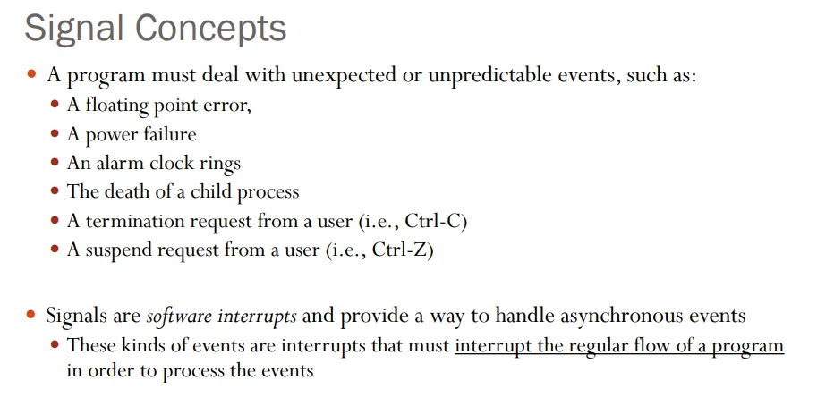

프로그램을 수행하다보면 여러가지 이벤트, 사건이 발생하게 된다. 예를 들면, floating point error, divide 0, power failure, 설정된 alarm이 울렸다던지, child process가 수행되다가 parent process에게 termination을 알려주는 이벤트가 발생했다던지, 프로그램을 종료시키기 위해 명시적으로 Ctrl+C를 눌렀다던지, 프로그램을 잠시 중단 시키기 위해 Ctrl+Z를 누르는 상황 등등…

이러한 상황들이 바로 프로그램이 수행되는 도중에 일어날 수 있는 사건들이다. 이를 통칭해서 Signal이라고 부르며, S/W interrupt라고도 한다. 어떤 비동기적인 이벤트를 프로세스에게 알려주기 위한 수단이 Signal이다. 이러한 시그널들은 프로그램이 동작하고 있는 중에는 언제든지 발생할 수 있다. 프로그램의 어느 시점에 signal이 발생할지는 미리 알 수 없으므로, 비동기적으로 동작한다.

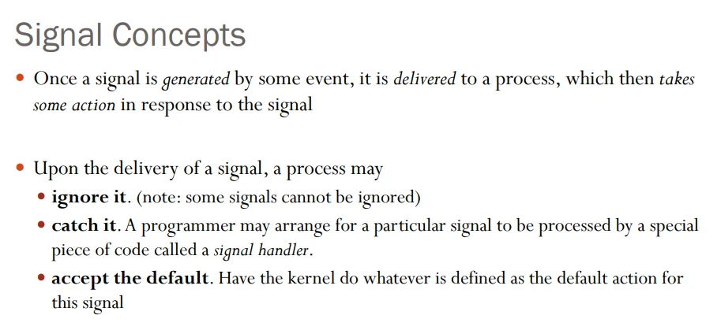

signal이 발생하게 되면, 현재 수행 중인 프로그램, process에 전달된다. 그러면 프로세스는 시그널에 대응하여 다양한 action을 취하게 된다.

1. ignore (signal을 무시한다.)
2. catch (handle한다고도 하며, 전달된 signal을 처리하는 function을 전달해주는 것. signal을 처리하는 함수를 signal handler라고 한다.)
3. default action, function을 명시적으로 등록하지 않았다고 해도 signal에 따라 default 값이 있다. 그 행동을 하도록 내버려 두는 것도 있다.

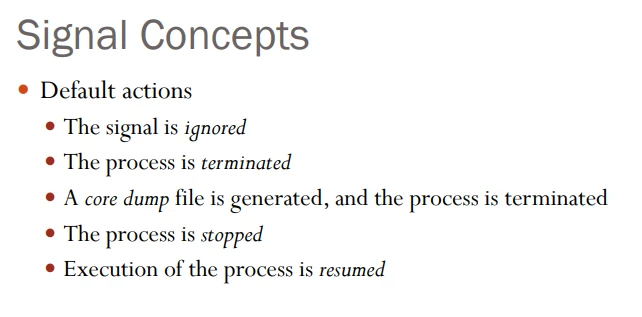

- default action

<!-- -->

1. 시그널 무시
2. 프로세스 종료
3. core dump라는 file을 만들어서 그 프로세스의 register 값들이나 memory에 있는 값들을 특정 file에 저장하고 프로세스 종료.

(\_\_\_.swp file들이 그러한 예이며, 읽을 수 있는 형태는 아니지만 나중에 디버깅에 사용할 수 있음.)

4. 프로세스 중지, 종료가 아니라 일시적으로 중지하는 것이다.
5. 프로세스 재개, 만약 시그널을 받았을 때 프로세스가 중지된 상태라면 프로세스를 다시 실행.

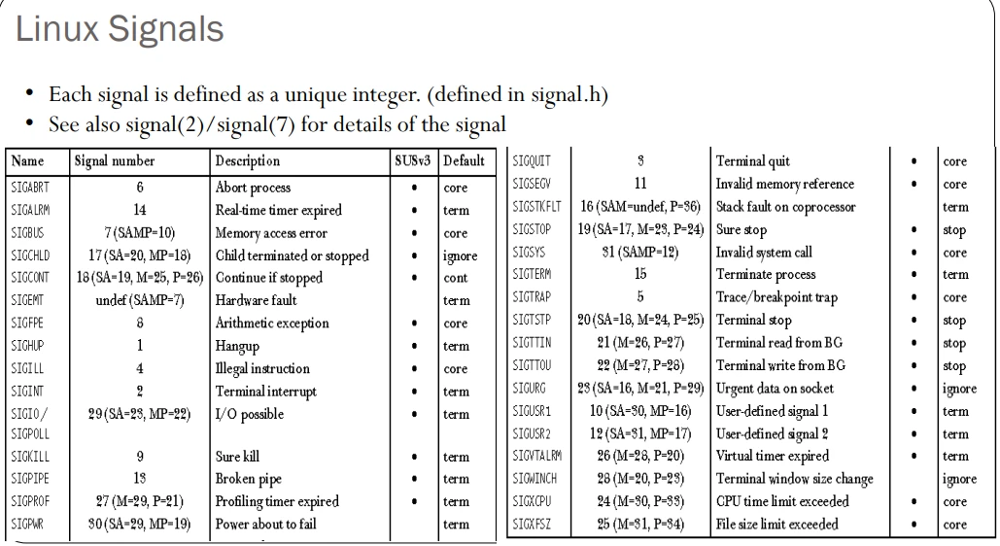

시그널들은 signal.h라는 header file에 int 값으로 define되어 있다. 그 값들을 하나하나 외우기는 힘들기 때문에 name을 numeric으로 지정해두었다. 대표적인 signal을 살펴보면,

- SIGALRM : 일정 시간 뒤에 프로세스에 알람 시그널을 전달해주도록 설정한다.  
    → signal number는 14, default option은 term(termination)
- SIGCHLD : child process가 종료되었을 때 parent process가 받는 signal.  
    → signal number 17, default option은 ignore
- SIGCONT : 시그널이 전달되었을 때, 프로세스가 중지된 상태라면 프로세스 수행을 재개한다.  
    → signal number 18, default option cont(continue)
- SIGKILL : 시그널이 전달된 프로세스를 반드시 종료시키는 시그널  
    → signal number 9, default option term(termination)
- SIGQUIT : 시스템을 종료할 때 전달되는 시그널(시스템 끄기)  
    → signal number : 3, default option core(core dump)
- SIGSEGV : 포인터를 잘못쓰면 프로그램이 죽으면서 출력해주는 것이 SIGSEGV라는 시그널을 받았다는 내용인데, 이것은 잘못된 메모리를 포인터로 잘못 접근한 경우에 발생된다.  
    → signal number : 11, default option core(core dump)
- SIGSTOP : 프로세스를 잠시 정지시키고 싶을 때 사용하는 시그널  
    → signal number : 19, default option stop
- SIGTERM : 프로세스를 종료시키라는 것, SIGKILL은 반드시 프로세스가 죽지만 SIGTERM은 handler를 지정하면 다르게 처리할 수 있다.  
    → signal number : 15, default option term(termination)

> real-time signal 이란 것도 있다.  
> signal에 대한 더 자세한 정보는 signal page의 section2, section7에 있다.

---

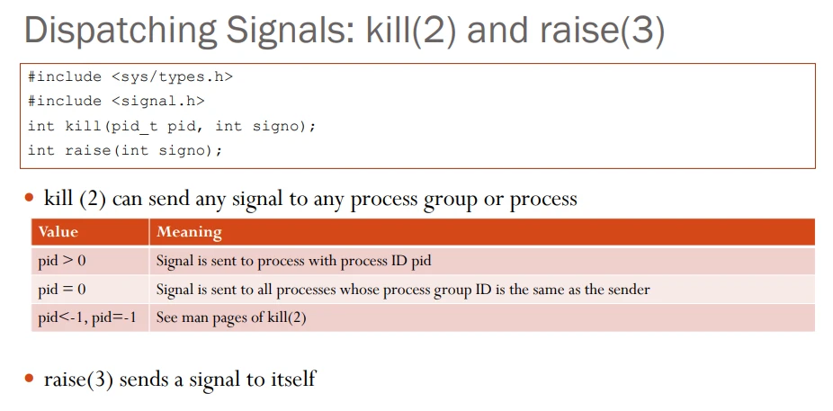

프로그램을 수행하다보면 우리가 원하지 않아도 시그널이 수행될 수 있다. 또는 명시적으로 시그널을 발생시켜서 특정 프로세스에게 보낼 수도 있다. 시그널을 특정 프로세스에게 보내는 것을 Signal Dispatching 이라고 한다. 이 경우에 사용되는 것이 kill(2)과 raise(3)가 있다.

- kill

int kill(pid_t pid, int signo) : 지정된 프로세스의 pid에 우리가 원하는 signal signo를 전달해준다.

ex) int kill(100, SIGTERM); ⇒ 100번 process에 SIGTERM signal을 보내는 것이다.  
pid가 0인 process는 존재하지 않지만, 시스템 콜 kill에 pid = 0을 지정할 수 있는데, 이렇게 하면 signal을 보내는 프로세스와 process group ID가 같은 모든 process에 지정한 signald을 전달해준다. 일종의 broadcast나 multicast와 같은 개념이다.

- raise

시그널을 자기 자신에게 보내는 것이다. 이는 kill(getpid(), signo); 과 같은 역할을 하는 것이다.

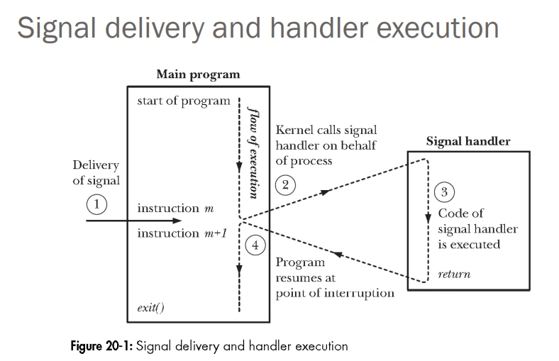

시그널을 보내는 함수가 kill인데, 시그널이 언제 정확히 발생할 지 예측을 할 수 없다. 만약 프로그램이 수행되고 있는데 언제 어떤 시그널이 해당 프로세스에 동작할 지 알 수 없다. 그래서 시그널은 asynchronous하게 동작한다. 현재 프로세스가 m번 라인을 수행하고 있는데, 시그널 1번이 도착한다고 하면 프로세스는 수행을 잠시 중단하고 등록된 signal handler 함수로 이동하게 된다. 그러면 handler에서 동작을 처리하고, 다시 process로 돌아와서 수행을 재개한다.

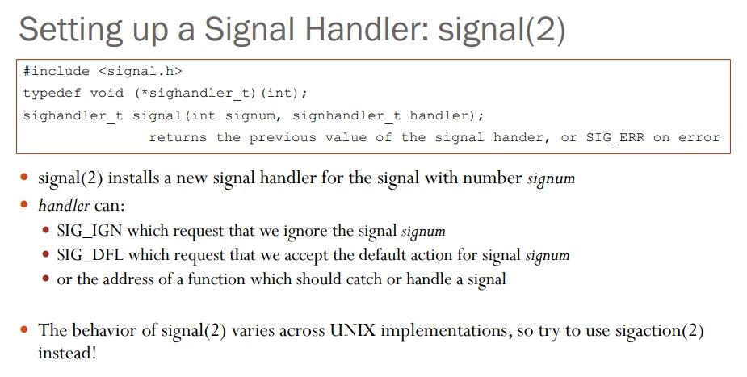

그렇다면 signal handler를 어떻게 등록할 수 있을까? 이를 등록하는 시스템 콜이 바로 signal(2)이다.

typedef void (\*sighandler_t) (int) ; // 첫 번째 parameter가 int type인 function에 대한 pointer.  
sighandler_t signal(int signum, signhandler_t handler);

정리하면, signal system call은 signum에 해당하는 signal에 대한 handler를 새롭게 등록한다.

signal의 변수 handler에는 function pointer를 줄 수도 있고, SIG_IGN, SIG_DFL을 줄 수도 있다.

SIG_IGN은 지정한 시그널을 받으면 무시하겠다는 거고 SIG_DFL은 지정한 시그널을 받으면 default action을 수행한다는 것이며, 그 두 개도 아니면 명시적으로 signal hander를 등록하는 것이다. signal handler는 function이다.

signal은 UNIX가 처음 개발되었을 때부터 사용된 아주 오래된 함수이다. 그런데 그 뒤에, UNIX가 처음 개발되었을 때는 없던 개념들이 추가되었다. (Thread 등) 이런 것들을 처리하기 위해 SIGNAL을 정교하게 처리할 필요가 있다. 지금은 signal 시스템 콜을 사용하지는 않고, sigaction(2) 시스템 콜을 주로 사용한다.

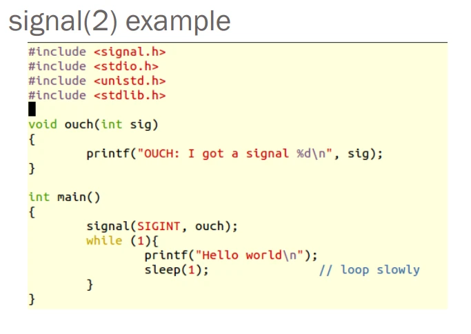

- SIGINT는 default option이 시그널을 종료시키는 것인데, handler를 지정해놓았으므로 종료대신 signal handler를 수행한다.

---

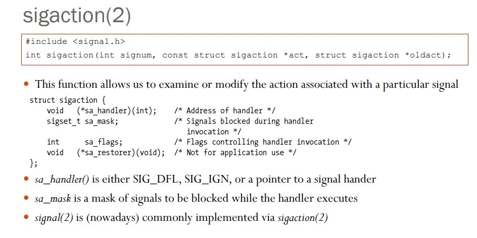

sigaction은 앞에서 설명한 signal 함수와 같은 일을 하지만, 그것보다 정밀한 작업을 할 때 사용한다. 예를 들어 thread를 건드린다던가 real-time signal이라던지와 같은 것을 신경써서 프로그램을 짤 때는 반드시 sigaction을 써서 handler를 지정하도록 한다.

int sigaction(int signum, const struct sigaction \*act, struct sigaction \*oldact);

signum에 해당하는 signal에 대한 handler를 등록하고 싶은데, 두 번째 parameter를 보면 struct sigaction으로 되어있다. handler를 바로 등록하는 것이 아니라, sigaction이라는 structure를 통해 등록한다. sigaction structure를 보게 되면, 내부는 다음과 같다.

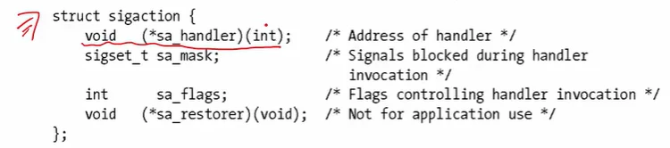

function pointer는 내부에 존재한다. void (\*sa_handler)(int); 에 handler를 등록하면 나중에 해당 프로세스에 지정한 signo이 들어오면, 지정된 handler로 가서 handler를 수행해준다. sigset_t sa_mask;는 지정한 handler가 수행되는 동안에는 다른 signal이 수행되는 것을 막아주는 역할을 한다. int sa_flag 는 thread나 real-time signal을 사용할 때 의미가 있으므로 여기서는 사용하지 않는다.

그래서 현재 linux에서는 signal 함수가 이 sigaction 함수를 내부적으로 이용해서 구현되어 있다. 그래서 되도록이면 sigaction을 사용해서 signal handler를 지정해주는 것이 좋다.

- sigset_t

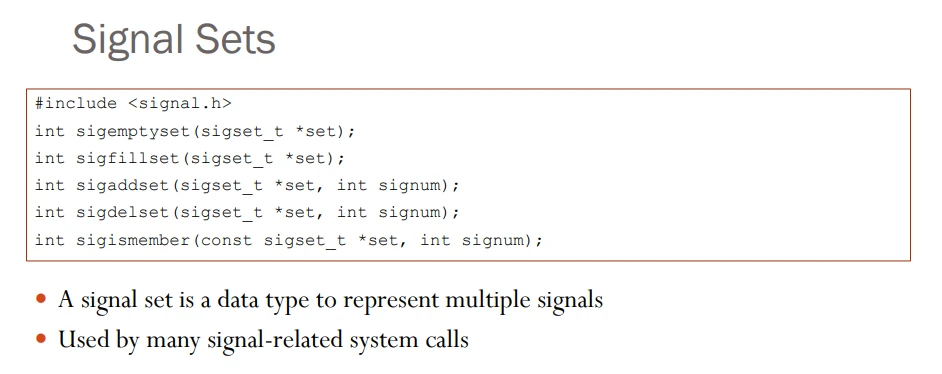

sigset_t은 여러 시그널을 set으로써 지정하고 싶을 때 사용하는 것이다. 그것을 조작하기 위한 함수들이 몇 개 존재한다.

- int sigemptyset (sigset_t \*set) : 지정한 set을 공집합으로 만든다.
- int sigfillset (sigset_t \* set) : 내부적으로 모두 다 1로 설정해버린다.
- int sigaddset (sigset_t \* set, int signum) : 지정한 set에 signum을 추가한다. 원소를 추가한다.
- int sigdelset (sigset_t \*set, int signum) : 지정한 set에서 signum을 제거한다.
- int sigismember (const sigset_t \*set, int signum) : 지정한 set에 signum이 존재하는지 알려준다.

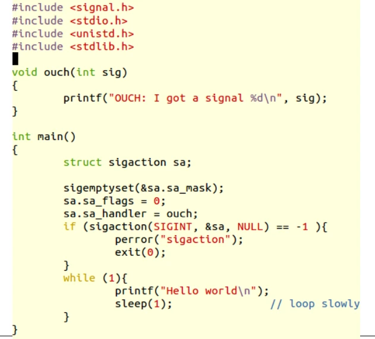

- sigemptyset(&sa.sa_mask); ⇒ sa_mask를 clear한다. 이 말은 즉슨, signal handler가 동작하는 동안 다른 모든 signal이 수행되는 것을 막지 않는다는 의미이다.
- sa.sa_flags = 0; ⇒ 특별한 경우가 아니면 0 or NULL을 준다.
- sa.sa_handler = ouch; ⇒ handler에 function을 등록한다.
- if (sigaction(SIGINT, &sa, NULL) == -1) ⇒ struct sigaction sa는 이미 위에서 sa_mask, sa_flags, sa_handler가 지정된 상태이다. sigaction을 불러와서 SIGINT signal이 들어올 때, 해당 프로세스 에서는 sa를 지정해준다. 우측에 NULL이 들어간 위치는, 만약 기존에 SIGINT에 대하여 등록되어 있던 handler가 존재한다면 그 handler를 return해주는 것이다. 즉, NULL이므로 return하지 않는다는 뜻.

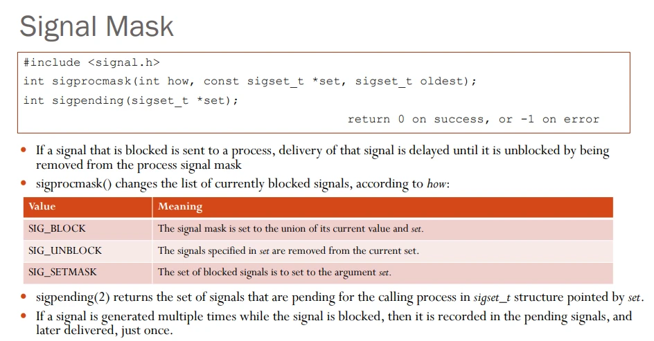

시그널 마스킹, 시그널 블록킹 : 우리 프로그램에서 시그널이 오는 것을 막을 수 있는데, 그걸 도와주는 함수가 바로 sigprocmask 함수이다.

- int sigprocmask(int how, const sigset_T \*set, sigset_t oldest);

how를 지정하면, set으로 전달되는 sigset에 대해 취할 동작을 정할 수 있다.

1. SIG_BLOCK : set으로 전달된 signal들을 현재 block된 signal에 합산한다. 그렇게 돼서 기존에 들어온 signal과 추가로 들어온 signal을 모두 막아서 수행이 안되게 한다.
2. SIG_UNBLOCK : 현재 막혀있는 signal들 중에서 set으로 들어온 signal들을 unblock해서 다시 수행되도록 만든다.
3. SIG_SETMASK : set에 지정된 signal들만 block하는 set으로 만들어버린다.

<!-- -->

- int sigpending(sigset_t \*set);

    signal이 block돼서 대기하고 있는 상태가 있는데, 그런 상태를 pending 되어있다고 한다. sigpending을 사용하면 현재 pending되어 있는 signal을 set에 저장해서 return값으로 돌려준다.

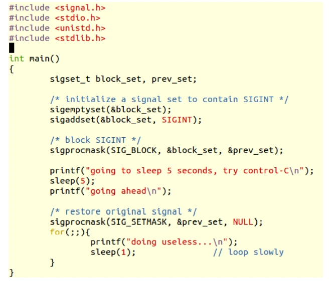

```c
#include <signal.h>
#include <stdio.h>
#include <unistd.h>
#include <stdlib.h>

int main() {

    sigset_t block_set, prev_set;
// 사용할 sigset_t를 선언한다. sigset_t는 signal들을 담아두는 집합이다.

    sigemptyset(&block_set);
// block_set을 비운다.
    sigaddset(&block_set, SIGINT);
// block_set에 SIGINT signal을 추가한다.

    sigprocmask(SIG_BLOCK, &block_set, &prev_set);
// 현재 프로세스에 들어오는 signal을 block한다. (SIG_BLOCK)
// block_set에 들어있는 signal을 block하고, 기존에 등록되어 있던
// sigset_t는 prev_set에 저장한다.
    
    printf("going to sleep 5 seconds, try control-C\n");
    sleep(5);
    printf("going ahead\n");
// 위 부분이 수행되는 동안에는 SIGINT가 block되어 있으므로
// Ctrl+C를 눌러도 수행이 종료되지 않는다.

// 수행이 끝나면, 다시 이전에 등록되어 있던 sigset_t인 prev_set을 등록하고
// block_set은 NULL로써, 다시 받지 않는다.
    sigprocmask(SIG_SETMASK, &prev_set, NULL);
// 이렇게 되면 현재 pending중인 Ctrl+C에 대한 block이 해제되므로
// 프로그램의 수행이 종료된다.

    for (;;) {
        printf("doing useless...\n");
        sleep(1);
    }
}
```

sleep하는 동안 Ctrl+C를 몇 번이나 누른다고 해서 pending중인 signal에 SIGINT가 누른 횟수만큼 저장되지는 않는다. 한 signal은 몇 번이나 들어오던지 그 signal이 수행됐고, pending중이라는 기록 딱 한 번만 기록된다.

---

- timer & sleep

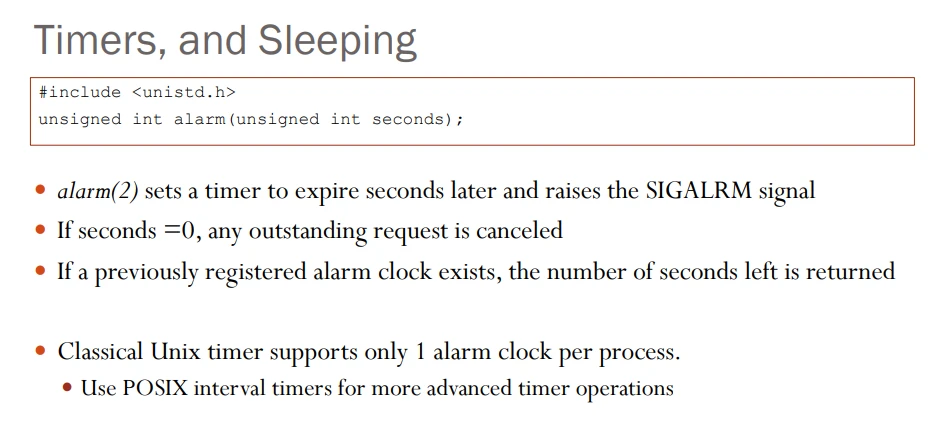

알람은 UNIX 초기부터 사용되었던 시스템 콜인데, 사실 알람을 딱 한 개만 설정할 수 있어서 제약점이 매우 많다. POSIX interval timer라는 기능이 추가되었는데, 이를 사용하면 여러 개의 타이머를 세팅하고 사용할 수 있다. 정밀한 작업을 수행할 때는 POSIX interval timer를 사용하고, 간단한 작업을 할 때는 alarm을 사용하도록 한다.

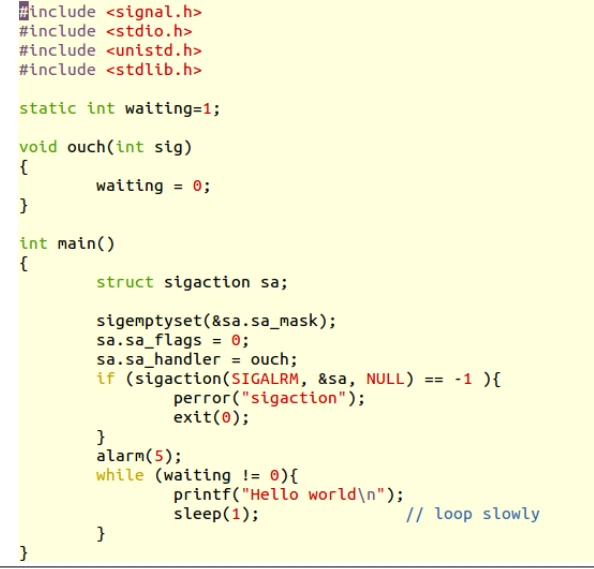

```c
#include <signal.h>
#include <stdio.h>
#include <unistd.h>
#include <stdlib.h>

static int waiting = 1;

void ouch(int sig) {
    waiting = 0;
}

int main() {
    struct sigaction sa;

    sigemptyset(&sa.sa_mask);
    sa.sa_flags = 0;
    sa.sa_handler = ouch;

    if (sigaction(SIGALRM, &sa, NULL) == -1) {
        perror("sigaction");
        exit(0);
    }
    alarm(5);
    while (waiting != 0) {
        printf("Hello, World!\n");
        sleep(1);
    }
}
```

현재 process에서 SIGALRM signal에 대해 function pointer를 지정해 waiting flag를 0으로 만드는 handler를 지정한다. 이렇게 하면, 5초 뒤에 SIGALRM signal이 오면 while이 종료된다.

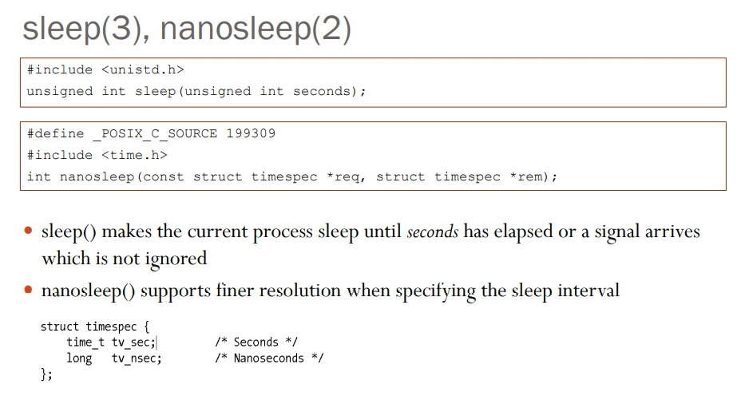

sleep 함수는 지정된 시간(초) 동안 프로그램의 수행을 잠시 중단하는 것이다. sleep()은 초 단위로 수행을 중지하고, nanosleep은 ms 단위 또는 ns 단위로 프로그램을 정밀하게 정지시킨다. nanosleep은 뒤에 초를 적어주는게 아니라, timespec 이라는 struct를 적어준다.

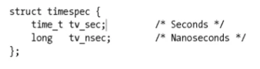

tv_sec에는 seconds를 적어주고, tv_nsec;에는 nano seconds를 적어준다.

int nanosleep(const struct timespec \*req, struct timespec \*rem);에서 req에 전달된 struct parameter만큼 프로그램이 멈춘다. 만약 프로그램이 sleep되고 있는데 프로그램이 interrupt등으로 멈춘다면, 아직 sleep이 남은 시간을 rem에다가 저장해서 return해버리는 것이다.
