# 13주차 온라인 강의: 쓰레드, Multi-Threading

- 지금까지 우리가 만든 프로그램은 한 번에 하나의 일만 처리할 수 있었다. 하지만 프로그래밍을 하다보면 동시에 여러 일을 처리하도록 만들어야 할 때가 있다. 이를 Multi-Threading이라고 한다. Thread가 무엇인지 개념을 살펴보고, Thread들을 어떻게 생성하고 종료시키는지 POSIX-Thread Library를 통해 살펴본다.

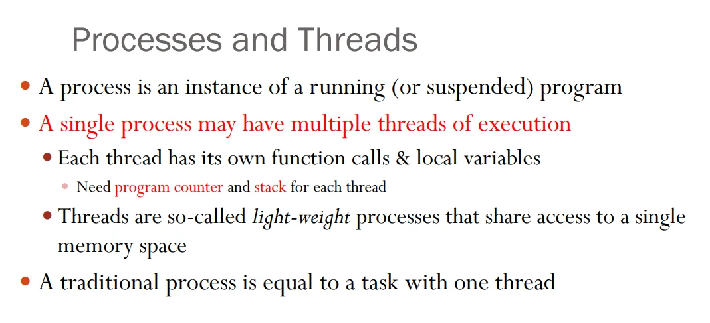

- 프로세스란, 실행 중인 프로그램의 instance라고 했다. 우리가 여태까지 살펴본 프로세스들은 어느 특정한 시점에, 프로그램의 특정한 부분을 수행했다. 하지만 우리가 쓰레드라는 것을 이용하면 어떤 프로세스의 여러 부분을 동시에 수행할 수 있게 된다.
- 쓰레드는 프로그램의 여러 부분을 독립적으로 수행하고 있기 때문에, 각자 자신이 function을 호출해가는 순서가 있고, 그 function 내에서의 local variable을 저장할 공간이 필요하다.
- 따라서 각각의 쓰레드들은 각각의 Program Counter와 function을 호출하는 순서를 기록해 둘 stack을 개별적으로 가지고 있다.
- 하지만 쓰레드를 light-weight processes라고도 부르는데, 쓰레드들은 각각 독립된 메모리 영역을 가지고 있다. 예를 들어 32bit 아키텍처(ARM) 같은 경우에는, 각각의 프로세스가 4GB의 메모리 주소 영역을 독립적으로 가지고 있다. 하지만, 하나의 프로세스에 있는 여러 개의 쓰레드들은 그 프로세스에 있는 메모리 영역 4GB를 공유해서 사용하게 된다. 따라서, 메모리 영역을 독립적으로 가지고 있을 필요가 없기 때문에 light-weight process라고도 부른다.
- 앞에서 살펴봤던 일반적인 프로세스들은 쓰레드가 하나밖에 없는 프로세스다. 라고 생각하면 될 것이다.

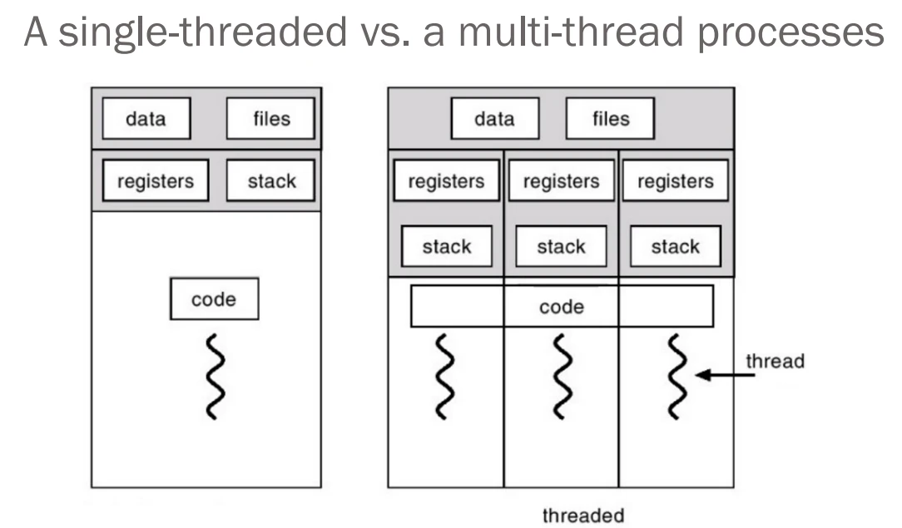

- 이전에 만들었던 single-threaded process같은 경우에는, 프로세스의 address space에 데이터를 저장하는 부분이 있고, 파일을 저장하는 부분이 있고(추가로, 파일 디스크립터도 존재), CPU의 상태를 저장하는 register값들, function을 어떤 식으로 호출해갔는지 저장하는 stack영역이 있고, 프로그램의 어떤 영역을 수행하는 code 영역이 하나만 있었다.
- 이와 달리 multi-threaded process같은 경우에는, 코드를 수행하는 부분이 여러 개가 있다. 이렇게 독립적으로 코드를 수행하려면, memory space는 공유할 수 있지만, register와 stack은 개별적으로 존재하게 된다.

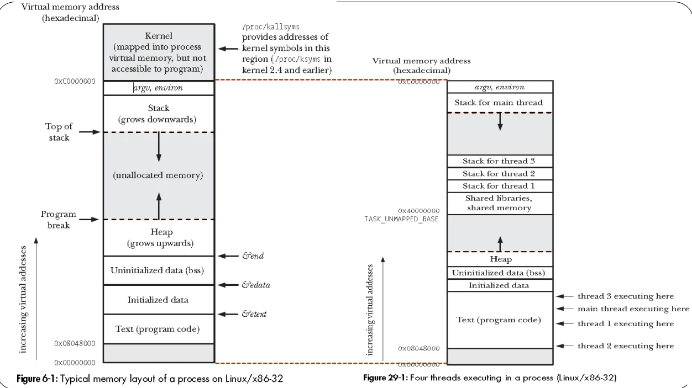

- 이 single-threaded process같은 경우에는 쓰레드가 하나밖에 없기 때문에, 텍스트(코드) 영역이 있고, 데이터(Initialized data, Uninitialized data) 영역이 있고, Heap 영역이 있고, 쓰레드가 하나밖에 없기 때문에 stack이 딱 하나밖에 없다. 그 위에는 kernel 영역이 있다.
- 하지만 multi-threaded process같은 경우에는, (kernel 영역은 그리지 않았을 뿐, 똑같이 존재) user 영역이 다르다. 텍스트(코드) 영역, 데이터 영역, Heap 영역은 동일하게 존재한다. 하지만 각각의 쓰레드 별로 stack이 따로 따로 따로… 존재하게 된다.
- stack이 따로 존재해야만 하는 이유는, 각각의 쓰레드가 각기 다른 프로그램 영역을 콜하면서 처리하게 된다. 따라서 그 정보를 저장해야 올바르게 처리할 수 있는 것이다. 우측의 그림을 보면, main 쓰레드와 쓰레드 1, 2, 3이 존재하기 때문에 네 개의 쓰레드가 독립적으로 수행되고 있다고 볼 수 있다.
- 그렇다면, 여러 개의 프로세스를 사용하지 않고 왜 굳이 멀티 쓰레드를 사용하는 것일까?

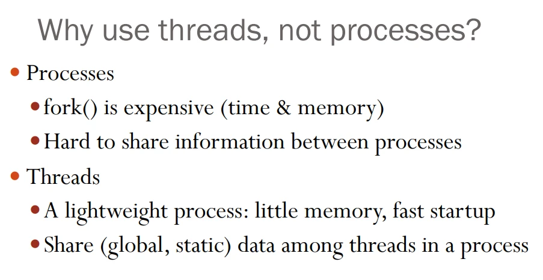

- 왜 그러냐면, 프로세스가 또 다른 프로세스를 생성해나가는 방법은 fork()를 하는 것이다. fork()는 기본적으로 굉장히 overhead가 크다. time이라던지, memory 부분에서도 매우 overhead가 크다. fork를 사용하려면, 기존의 프로세스의 메모리 영역을 그대로 복제해야한다. 그렇기 때문에 시간도 많이 걸리고 메모리도 많이 차지하게 된다.
- 그리고 프로세스가 일단 생성되면, 각각 독립적인 메모리 영역을 차지하기 때문에 서로 데이터를 주고받기가 굉장히 어렵다. 데이터를 주고받기 위해서는 Interprocess Communication Mechanism(IPC)이라는 특별한 통신 방법을 사용해야만 데이터를 주고받을 수 있게 된다. 그것과 대비해서 쓰레드는 하나의 프로세스 내에서 같은 메모리 영역을 공유하기 때문에 데이터를 주고받는 것이 매우 쉽다. (global, static data 등등을 바로 읽어들일 수 있다.)

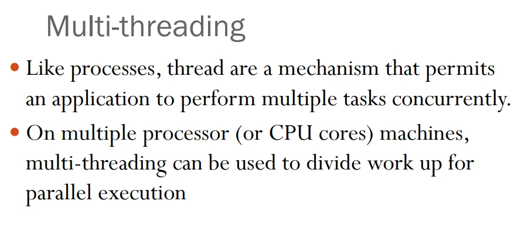

- 어떤 일을 동시에 수행하기 위해서 프로세스를 여러 개 만들어서 사용할 수도 있겠지만 이것은 overhead가 굉장히 크기 때문에 이 대신에 쓰레드를 여러 개 만들어서 한 프로세스를 여러 파트로 나누어서 수행하도록 하는 것이 멀티 쓰레드이다.

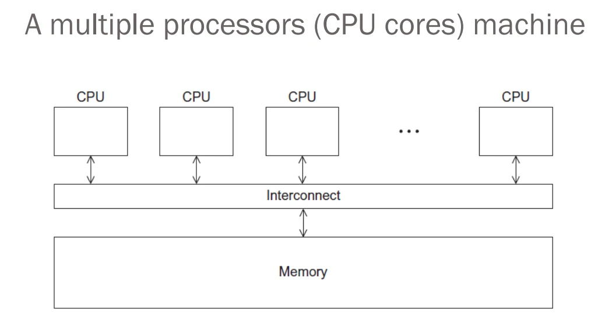

- 만약 코어가 하나 있는 CPU를 사용할 때는 하나의 코어를 time sharing 하면서 프로그램(또는 쓰레드)이 수행되어야 하기 때문에 쓰레드를 생성한 본질을 잃게 된다. (수행 속도가 빨라지지 않는다.)
- 하지만 코어가 여러 개 있다면, 서로 다른 코어가 서로 다른 쓰레드를 수행하게 되면서 동시에 처리하기 때문에 time sharing할 필요 없이 진정한 병렬 처리를 수행할 수 있게 된다.

---

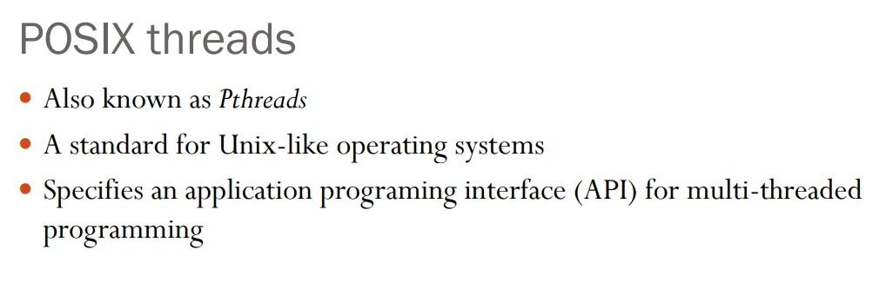

- 멀티 쓰레딩을 하는데 필요한 POSIX-threads를 살펴본다.
- POSIX-thread는 Pthreads라고 부르기도 하며, UNIX 계열의 운영체제들 (LINUX도 마찬가지) 멀티 쓰레드 프로그래밍을 하기 위해 필요한 프로그래밍 API들(함수들)을 define해놓은 것이다.

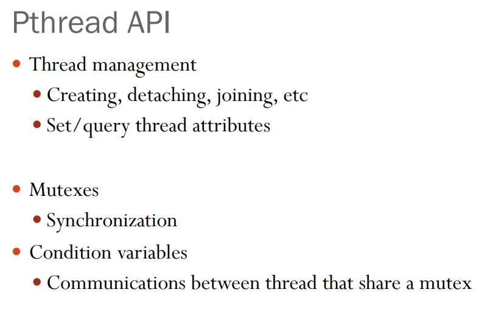

- Thread 관리를 위한 API

실행, 종료 등  
쓰레드의 속성을 관리하는 API

(쓰레드는 하나의 address space에서 동시에 여러 개가 수행되기 때문에 데이터를 서로 공유한다. 그 데이터를 공유해서 사용할 때, 어떻게 충돌이 나지 않게 공유할 수 있을 것인가를 규정하는 mutexes, Condition variables와 같은 것들이 존재.

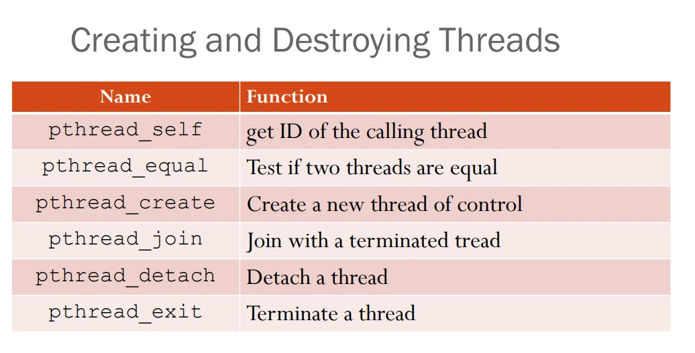

pthread_self : 쓰레드의 ID를 가져온다.

pthread_equal : 두 쓰레드가 같은 쓰레드인지 비교한다.

pthread_create : 새로운 쓰레드를 생성하기 위해 사용하는 API

pthread_join : 쓰레드가 종료될 때까지 기다리도록 한다.

pthread_detach : 쓰레드가 join된 것을 detach시킨다.

pthread_exit : 쓰레드를 종료시킨다.

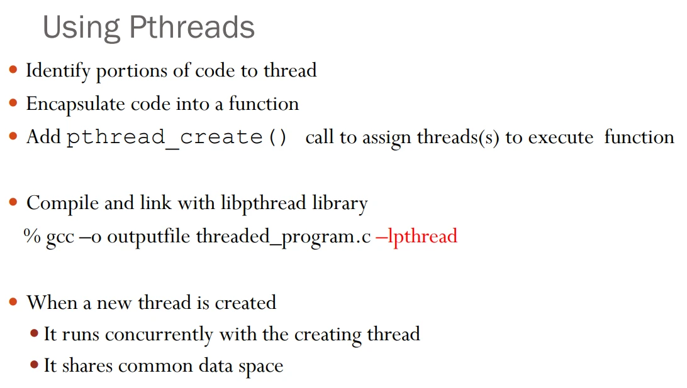

- 프로그램에서 어떤 부분을 병렬로 처리할 것인지 확인하고 쓰레드로 만들 것인지 확인한다.
- 병렬로 수행하고 싶은 부분을 함수의 형태로 만든다.
- 그 함수를 `pthread_create()` 에 인자로 넘겨주게 되면, 그 함수를 새로운 쓰레드로써 수행하게 된다.
- 한 번 멀티 쓰레드로 생성되면 컴파일을 해야하는데, libpthread와 링크를 해서 사용해야 한다.

```shell
gcc -o outputfile threaded_program.c -lpthread
```

- 일단 링크해서 컴파일이 잘 되면 pthread 프로그램을 수행하게 되는데, 메인 쓰레드와 새롭게 생성된 쓰레드가 서로 데이터 메모리 스페이스를 공유하면서 동시에 수행된다.

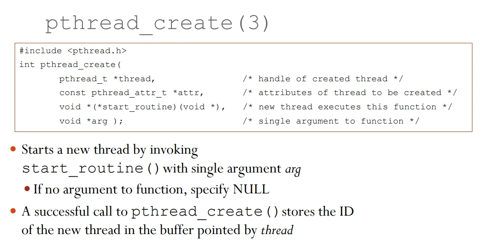

- 먼저 &lt;pthread.h&gt;를 include해야 한다. 인자를 보면 네 개가 있다.

<!-- -->

1. pthread_t\* thread : 쓰레드를 생성하게 되면, pthread_t라는 타입의 핸들을 return한다.
2. const pthread_attr_t\* attr : 쓰레드에 여러 가지 속성을 결정할 수 있다.  
    → 굳이 지정을 할 필요가 없다면, NULL로 세팅하면 된다.
3. void \*(\*start_routine) (void \*) : 쓰레드로 수행하고 싶은 함수  
    → new thread executes this function. function pointer type으로 선언되어 있다. 그러므로 function의 이름을 넘겨주면 될 것이다.
4. void\* arg : 쓰레드로 수행할 함수에 넘겨줄 argument를 이 인자로 지정한다.

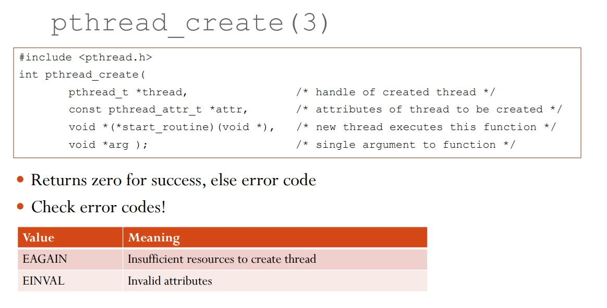

- create에 성공하면 0를 return하고, 생성이 잘 안되면 error code를 return하는데, 반드시 error code를 체크해서 생성이 제대로 되었는지 확인해야 한다.
- error code 중에서, EAGAIN, EINVAL과 같은 것이 들어올 수 있다.

EAGAIN : Insufficient resources to create thread → stack을 생성할 공간이 부족함.

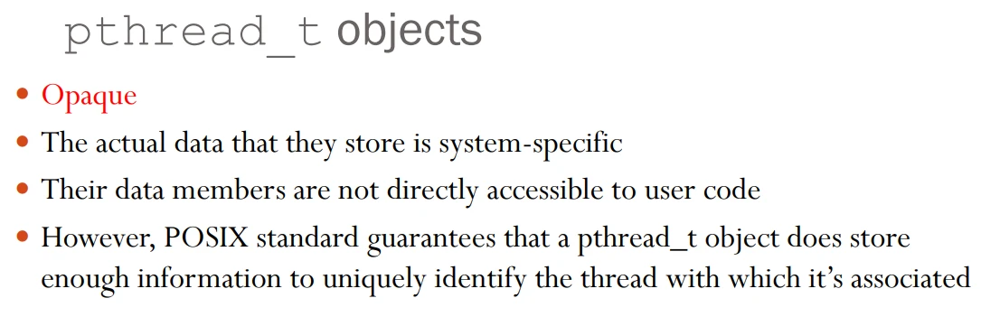

- pthread_t 타입의 핸들을 return하는데, 쓰레드의 ID가 pthread_t 타입으로 return되는 것이다. 내부적으로 구조체인지, 어떤 값인지 등등 어떻게 구현되어 있는지는 알 필요가 없다.(Opaque) 이를 통해서 쓰레드 각각을 handle로서 구분할 수 있는 것이다.

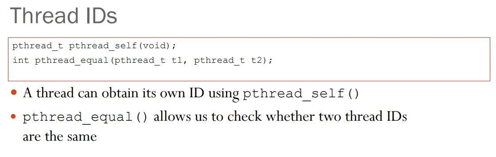

- pthread_t의 내부를 알 수 없기 때문에, 여러가지 보조 함수들이 존재한다. 쓰레드가 자기 자신의 아이디를 얻기 위해 사용하는 함수가 `pthread_self` 이다.
- 서로 다른 쓰레드의 ID t1, t2가 있을 때 두 쓰레드가 같은지 비교하는 함수가 pthread_equal이다.
- 이러한 보조함수들이 존재하기 때문에, pthread_t를 직접적으로 참조해서 조작하려고 하지 말고 보조함수를 통해 접근하고 제어하면 된다.

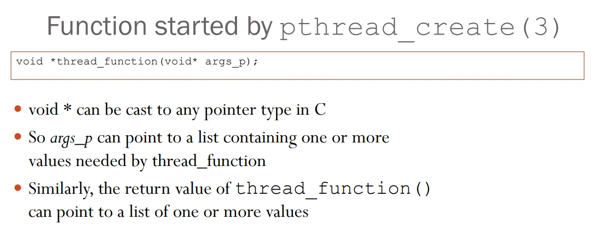

- 쓰레드를 생성할 때 전달해주는 함수는 선언될 때 위와 같이 선언된다. argument로써 void pointer type을 갖고, return type으로 void pointer type을 쓰레드가 수행할 function으로써 지정하는 것이다.
- void pointer type으로 넘겨준다는 것은, 어떠한 데이터 타입의 포인터도 넘겨줄 수 있다는 것이다. 이걸 넘겨주면 함수 안에서 type casting을 해서 사용하면 된다.
- 마찬가지로 return하는 것도 void pointer type으로 넘겨주므로, 받았을 때 type casting을 해서 사용하면 된다.

```c
#include <pthread.h>
#include <stdio.h>
#include <stdlib.h>

void* snow(void *data) {

    printf("Let it snow... %s\n", (char *)data);
    pthread_exit(NULL);
}

int main(void) 
{
    pthread_t mythread;
    char *data = "Let it snow.";
    int result;

    result = pthread_create(&mythread, NULL, snow, data);
    if (result) {
        exit(1);
    }

    pthread_exit(NULL);
}
```

pthread_create : 생성되는 쓰레드의 핸들을 가져오기 위한 것.

result = pthread_create

result는 error code  
&mythread : 쓰레드의 핸들을 가져오기 위한 것  
NULL : 속성을 정하지 않는 것  
snow : 이 쓰레드가 수행할 function

- 쓰레드가 수행되는 동안, 여전히 pthread_create를 수행한 main thread도 동시에 수행된다. main thread가 수행이 되고 있으면, snow 함수를 function으로 수행하는 thread가 동시에 수행되는 것이다.

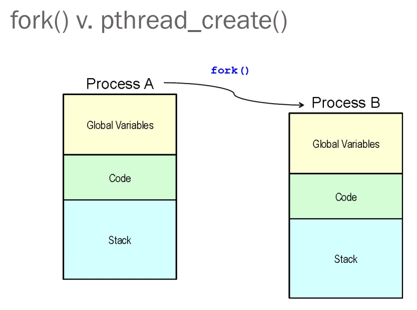

- thread create를 fork()와 비교해서 살펴보면, fork()는 이전의 프로세스와 완전하게 동일한 새로운 프로세스를 만들어내는 것이다. 그렇기 때문에 fork()는 overhead가 굉장히 크다.

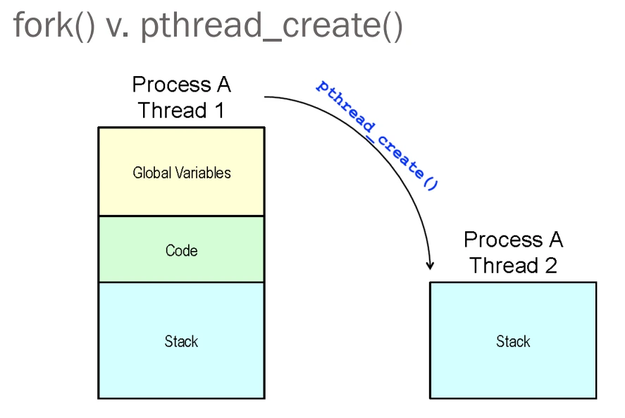

- fork()와 다르게 pthread_create는 main thread가 default로 수행되고 있는 상황이며, 쓰레드를 새롭게 만들면 그 쓰레드를 위한 Stack을 만들고, 나머지 Data의 영역이나 Text(code) 영역은 공유를 하는 것이다.

---

- 쓰레드의 종료

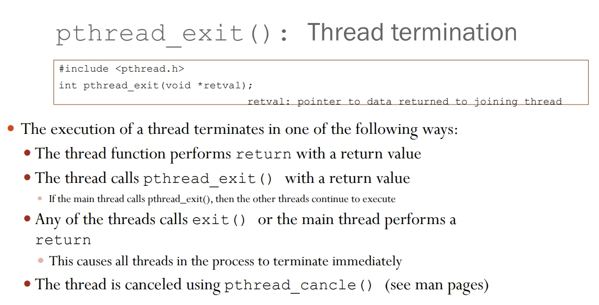

1)

- 예를 들어 쓰레드로 수행되는 함수가 있다고 하자. 그 함수를 쓰레드로써 수행하는데, 제일 마지막에 return한다고 하면, 쓰레드가 종료되는 것이다. (implicit 하게 종료하는 방법)

2)

- 또는 pthread_exit()를 이용하여 쓰레드를 explicit하게 종료할 수도 있다. exit를 하면서 어떤 return 값을 넘겨줄 수도 있는데, 기다리고 있는 어떤 쓰레드에 void pointer type으로 넘겨줄 수 있다.
- main thread가 아닌 경우에는 위의 예시처럼 하는데, main thread가 pthread_exit()를 하게되면, 프로그램이 종료되는 것이 아니다. main thread는 종료되지만, 다른 sub thread들이 종료될 때까지 프로세스가 계속 돌게 된다.

3)

- 모든 thread들에서, 만약 어떤 thread가 exit()를 수행하게 되면, 그 프로세스 전체가 끝나버린다. 그 말은 즉슨, 현재 수행중인 thread를 모두 종료하게 된다. 또는 main thread에서 pthread_exit()가 아닌, return을 하게 되면 exit()와 마찬가지로 프로세스가 종료된다.

4)

- 하나의 thread가 다른 thread를 죽일 수 있다. pthread_cancle()을 이용하면 된다.

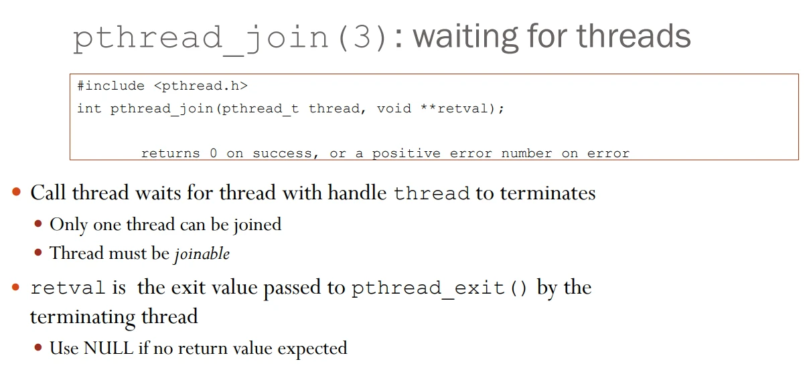

- 한 thread가 다른 thread가 종료되기를 기다리는 것이 pthread_join이라는 함수이다. 그리고 아까 pthread_exit()의 argument로써 return 값을 넣어주었는데, 그 값을 pthread_join의 argument로 줘서 가져올 수 있는 것이다.
- 만약 아무 것도 값을 가져올 필요가 없다면, NULL로 세팅하면 된다. pthread_join은 하나의 쓰레드가 다른 쓰레드의 종료를 기다리는 것이다. 그러므로 만약 쓰레드가 여러 개 종료되기를 기다린다면, 각각의 쓰레드에 대해서 pthread_join을 불러주어야 한다.

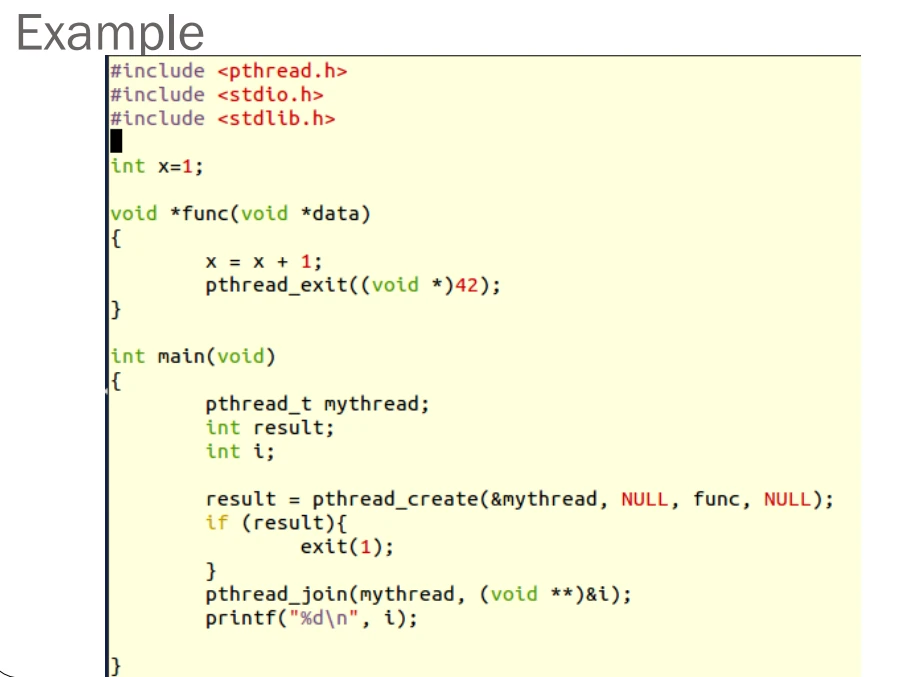

- main thread가 수행되고 있다가, func이라는 함수를 수행하는 쓰레드를 새롭게 만듦.
- main thread에서 pthread_join()을 통해 func를 수행하는 thread의 종료를 기다림.
- func thread에서 pthread_exit()를 통해 explicit하게 thread를 종료함. void pointer type으로 42라는 값을 return 해줌.
- pthread join에서 void pointer type으로 값을 받아와서 return 값을 사용할 수 있다.

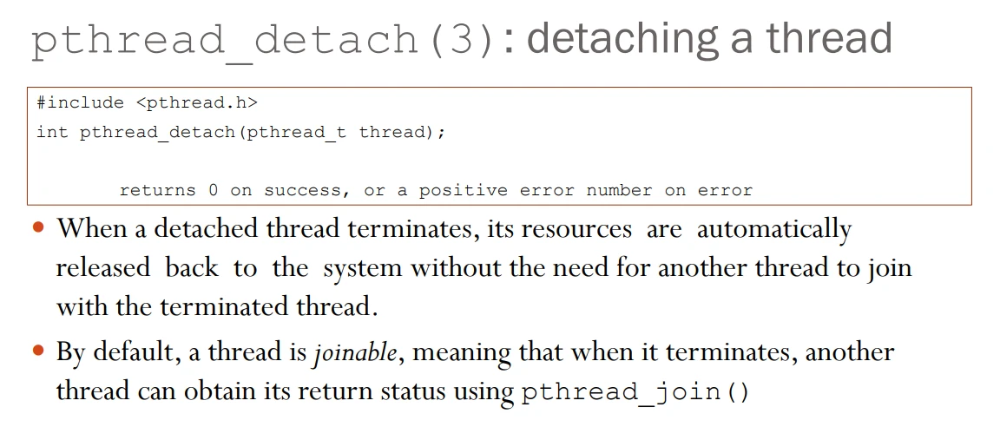

- 한 쓰레드가 종료되었을 때, 다른 쓰레드가 join을 해서 그 exit 값을 받아와야지 종료된 thread에 관련된 자원들(stack 등)이 release가 되는 것이다. 그런데, 이 thread 하나가 종료되면 기다릴 필요 없이 종료해버려라. 아무도 기다리지 않겠다. 라고 선언해줄 수 있는 함수가 있다. 바로, pthread_detach라는 함수이다. 이 함수를 이용하면, thread가 생성되고 종료되면 아무도 기다리지 않을 것이니 그냥 자원을 release하고 종료하라고 선언해줄 수 있다.

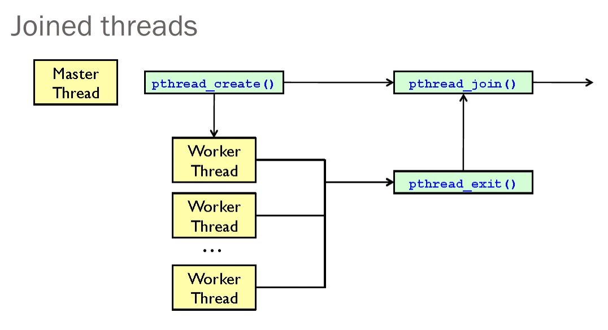

- 이 예제는 main thread가 Worker thread들의 종료를 모두 join으로 기다리고 있는 상황.

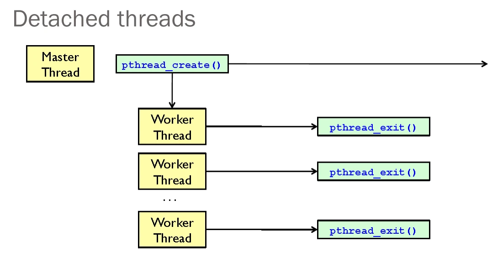

- 위의 예제와는 다르게, pthread_detach()를 각각의 Worker Thread에 선언해주면, 아무도 기다리지 않고 Thread가 종료되면 그냥 모든 자원을 release해버린다.
