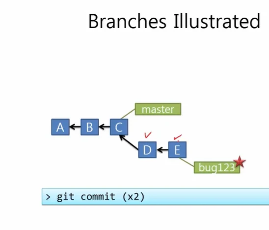
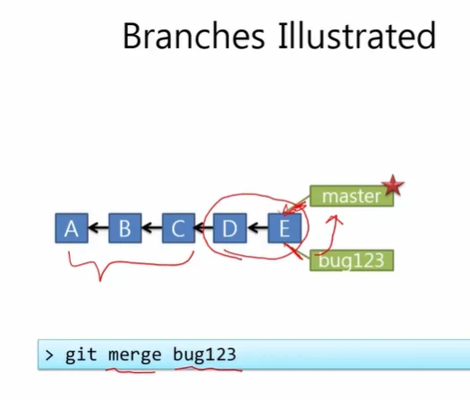
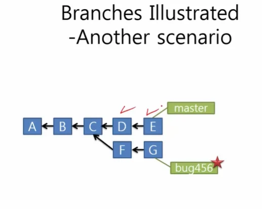
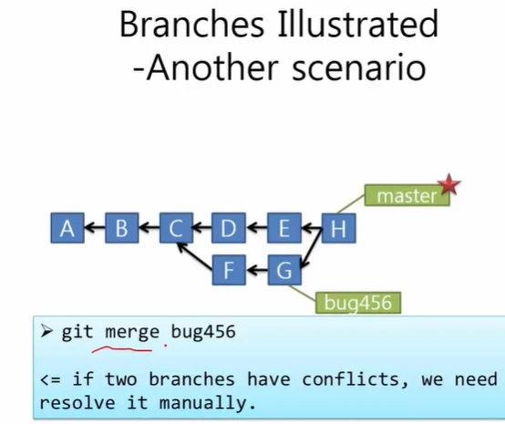
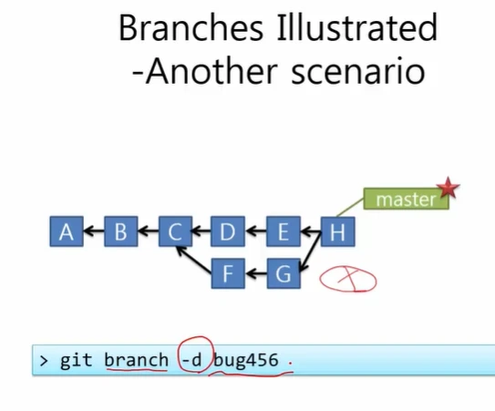
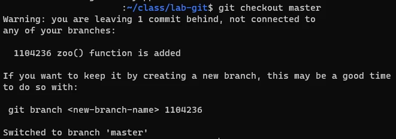
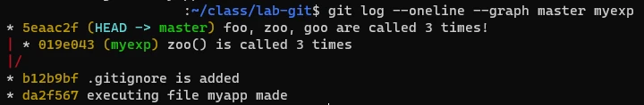

# Git

- `버전 관리 시스템`(Version Control System, VCS)  
    ⇒ 소프트웨어의 버전을 체계적으로 관리해주는 시스템. 최근에는 Git이 가장 많이 사용됨.

## Git

- `중앙 집중식 버전 관리 시스템` : 중앙 서버에서 Central VCS Server가 돌아가게 되고, 각 컴퓨터에서 파일을 가져와서 VCS의 repository를 대상으로 checkout하거나, 본인이 변경한 사항을 공유할 수 있는 방식을 채용함.
- 기존의 VCS들과 Git의 차이점

기존의 VCS는 delta storage 방식으로, 한 파일에 변경이 가해지면 그 파일의 수정사항 (diff)만 저장한다. 그리고 이후에 해당 파일을 불러올 때는 가장 처음에 저장되었던 원본에서 수정사항을 적용하면서 파일을 불러온다. 그래서 이 방식은 프로젝트가 클수록 overhead가 컸다.

하지만, Git은 snapshot storage 방식을 채용했다. 이 방식은 한 파일에 변경이 가해지면 변경된 파일 전체를 저장하고, 추후에 특정 시점에서 파일을 불러오면 가장 최근에 변경된 파일을 가져오게 된다.

⇒ 이 방식을 통해 큰 프로젝트에서 overhead가 줄어들도록 했다.

## Git의 기본적인 사용 방식

1. git directory(repository)
2. staging area
3. working directory

위의 세 개의 구역을 옮겨가면서 Git 작업을 하게 된다.

- 실제적으로 저장된 소스코드가 존재하는 부분은 `git directory`이다. `checkout` 과정을 통해 Central VCS Server에서 Local repository로 copy해올 수 있다. (git directory → working directory)
- 이후에 모든 수정을 하게 되면, Local repository에서 git directory(repository)로 checking을 해주어야 하는데, 먼저 `staging`을 해준다. staging area는 일종의 buffer 역할을 하며, 실제 commit을 하기 전에 변경한 사항을 review하는 임시 저장소의 역할을 한다.
- staging이 끝나게 되면, `commit`을 통해 git repository에 최종적으로 checking한다.
- 기본적인 work flow

<!-- -->

1. repository를 init해서 새로 만들거나, 남이 만든(혹은 미리 만들어둔) repository를 clone해서 Local repository(working directory)로 가져온다. (checkout or clone)
2. working directory에서 소스 코드를 수정한다. (modify)
3. 변경된 파일들을 commit하기 전에, staging area에 올린다. (staging)
4. staging area에 올라온 파일들을 commit해서 repository에 영구적으로 보관한다. (commit)

> sudo apt-get install git  
> 리눅스에서 git 다운로드 받기

- 기본적인 git setting command

```shell
git config --global user.name "Gildong Hong"
git config --global user.email user@example.com
# 소스코드를 변경할 때, 로그에 사용자 기록을 남길 때 사용된다.

git config --global core.editor vim
# 사용하는 editor 정보를 남긴다.

git config --list
# 현재 설정한 setting을 확인할 수 있다.
```

## Git commands

- 기본적인 git command들

```shell
git log
# 사용자가 해당 repository에 가한 변경의 기록을 보여준다.

git log -p
# 무엇을 바꿨는지 좀 더 자세하게 알려준다.

git log --stat
# 소스 코드에 대한 통계를 보여준다.
# 예를 들면, 어떤 파일에서 몇 개의 라인이 추가되고 삭제되었는지 등을 알려준다.

git log --oneline
# 수정 사항을 간략하게 한 줄로 보여준다.

git log --oneline -- graph
# branch의 생성을 visualize해서 보여준다.
```

- Git repository를 만드는 방법은 두 가지가 있다.

<!-- -->

1. git init
2. git clone

**`myfuncs 만들기`**

```c
// myfuncs.h
#ifndef __MYFUNCS_H__
#define __MYFUNCS_H__

void foo();
void goo();

#endif
```

```shell
gcc -c src/myfuncs.c -o obj/myfuncs.o -Iinclude/
gcc -c src/myapp.c -o obj/myapp.o -Iinclude/
# object file 만들기. myfuncs.c와 myapp.c는 header file include 필요.

gcc -o bin/myapp obj/myapp.o obj/myfuncs.o
# Linking
```

⇒ 이 과정을 거치면, 현재 working directory에 파일들이 만들어지므로, init을 시작한다.

- git init

```shell
git config --global user.name "user"
git config --global user.email user@example.com
git config --global core.editor nano # 기본 에디터 설정

git init # 중간에 해도 됨.
# 실행하면, git file이 숨김 파일로 생성됨.

git add . # 현재 파일에 있는 모든 파일을 git으로 관리하기 위해 staging area에 추가
git add include/
git add include/funcs.h

git status # 현재 staging된 상태와 branch 확인 가능.
git rm --cached <filename> # staging area에서 파일을 빼낼 수 있음.
# git rm -r --cahed . 하면, 현재 staging area에 있는 모든 파일을 빼낼 수 있음.

git commit -m "Initial Commit" # commit message 설정 가능.

# 그런데, 모든 파일을 git에 올릴 필요는 없으므로, .gitignore를 만들어서
# .c file과 .h만 추가하도록 해주자.
# .gitignore
# bin/
# obj/
# *.o

git add .
git commit -m ".gitignore is added"

git log --oneline # --graph
# 위 command를 통해 현재 repository의 commit log 확인 가능.
```

- git clone

```shell
git clone https://github.com/<계정>/oop_sw_final
```

## Git branching

- VCS에서 제공하는 가장 큰 특징 중 하나에는 branching이 있다. branching은 현재 checkout한 소스 파일을 다른 방식으로 수정해보고 싶을 때, 현재 파일에 영향을 주지 않고 수정할 수 있는 다른 변경점을 만드는 것이다.

- branch 만들기

```shell
git checkout -b bug123 
# bug123 이라는 이름의branch가 새롭게 만들어진다.

git branch
# 현재 repository에 존재하는 모든 branch가 출력된다.
```

⇒ 이렇게 branching을 하고 git commit을 계속하면, bug123 branch에 계속해서 포인터가 추가된다. 이후에 기존에 작업하던 master branch와 bug123을 합치고 싶다면, 먼저 현재 bug123에 위치하고 있는 포인터를 master로 이동시켜 주어야 한다.

```shell
git checkout master
# 포인터의 위치를 옮긴다. (checkout)
```

⇒ 그리고 나서, merge command를 통해 두 branch를 합칠 수 있다.

```shell
git merge bug123
```

⇒ 이렇게 하면, master와 bug123은 가장 최근에 bug123이 수정한 파일을 같이 포인팅하게 된다. 뿐만 아니라, bug123 branch가 생기기 전 가장 마지막으로 만들어진 파일의 다음 포인터는 bug123이 만들어지고 처음 만들어진 파일을 가리키게 된다.





- merge를 진행하고 해당 branch가 필요없게 된다면, branch를 제거한다.

```shell
git branch -d bug123
# branch를 제거한다.
```



master는 D, E copy를 commit해서 bug456의 초기 copy인 C가 아니라 E를 가리키고 있는 것을 확인할 수 있다. 이 때 master와 bug456이 두 가지의 경로로 갈라지게 되었다. 이런 경우에는 어떻게 해야하는가? 결국에는 bug456을 master에 합쳐주어야 되는데, 일단 git checkout master를 입력해서 현재 활동중인 포인터를 master로 옮겨준다.



그 뒤, git merge bug456을 통해 merge한다. 이렇게 하면 F, G copy의 내용이 H의 master branch에 합쳐지게 된다. 그런데, 합쳐지게되면 자동적으로 잘 합쳐지는 경우가 있다. 예를 들면, 우리가 master에 가했던 D, E의 변경과 bug456에서 가했던 F, G의 변경이 서로 전혀 다른 부분을 update했다면 쉽게 갖다붙일 수 있다. 하지만, 두 branch가 서로 같은 부분을 수정했다고 하면, merge가 자동적으로 될 수 없다. 그런 경우에는 어쩔 수 없이 사람이 직접 conflict가 난 부분을 찾아가서 수정을 가해줘야 한다.

merge가 이루어지고 나면, bug456이 필요없어지므로, git branch -d bug456을 입력하여 branch를 제거한다.



우리가 살펴봤듯이, branching과 merging을 하는 가장 큰 이유는 우리가 main line development line과 별도로 다른 branch에서 동시에 일을 진행할 수 있기 때문이다. 그리고 대부분 branch는 서로 다른 부분을 건드리기 때문에 conflict가 거의 발생하지 않지만, 만약 conflict가 발생하게 된다면 manual하게 git에서 수정을 가해주면 문제없이 merge를 진행할 수 있게 된다.

- 작업을 하다보면, 특정 시점으로 돌아가서 확인해보고 싶을 때가 있다. 이럴 때는 checkout을 통해 돌아갈 수 있다.

```shell
git log --oneline # git에 commit하면 ID를 갖게 되는데, 이 ID를 확인해서 checkout에 활용
git checkout xxxxxxxx # ID가 구별되면, 굳이 다 써주지 않아도 됨.
```

⇒ 이 상태에서 git log를 확인하면, 이전 시점으로 돌아온 것을 알 수 있다. 이제 돌아온 현재 시점에서 zoo() function을 myfuncs.c와 myfuncs.h에 추가하고, commit 해본다.

- 이 이후에 git checkout master를 하면, 다음과 같이 나온다.



이전 branch에서 변경 사항을 유지하려면, branch를 새로 만들어야된다는 내용이다. 여기서는 일단 그냥 버리도록 하자.

- 이제, branch를 만들어보자. 만약 myexp라는 branch를 만들려면, 아래와 같이 한다.

```shell
git branch myexp
git checkout -b myexp
```

⇒ 이렇게 생성된 myexp branch에서 zoo() function을 추가하고, main에서 3번 불리도록 해본다. 이렇게 commit하고, 다시 master branch로 checkout하면, 변경사항은 다 날라가 있을 것이다. 이전에 바꾼 내용은 일단 다 버리도록 하자.

- 이제 master branch에서, zoo() function을 추가하고, main에서 foo(), goo(), zoo()가 3번 불리도록 소스코드를 수정한 뒤, commit 해보자.

```shell
git log --oneline --graph master myexp
# master와 특정 branch를 비교해서 보여줌
```



⇒ branch는 작업이 끝나면 정리해주어야 한다. branch를 합칠 때는 항상 master에 합쳐야 하며, master는 항상 남아있어야 하는 것이다.

```shell
# merge를 하기 전에, 반드시 현재 checkout이 master로 되어있는지 확인하자.
git merge myexp
# 특별한 이슈가 없다면, merge가 될 것이다.

# merge가 끝났으니, branch를 정리하자
git branch -d myexp
```

- 이제 현재 repository를 git repository에 올려보자.

```shell
# command 라인에서는 실행이 안되므로, vs code에서 진행.
git remote -v
git remote add origin https://github.com/<계정>/opensw2022_ex_repository.git
git remote -v

git branch -M main
git push -u origin main

# 반대로, 수정된 내용을 Local repository에 가져오는 방법
git pull origin main
# remote add origin이 되어 있어야 함.
```
