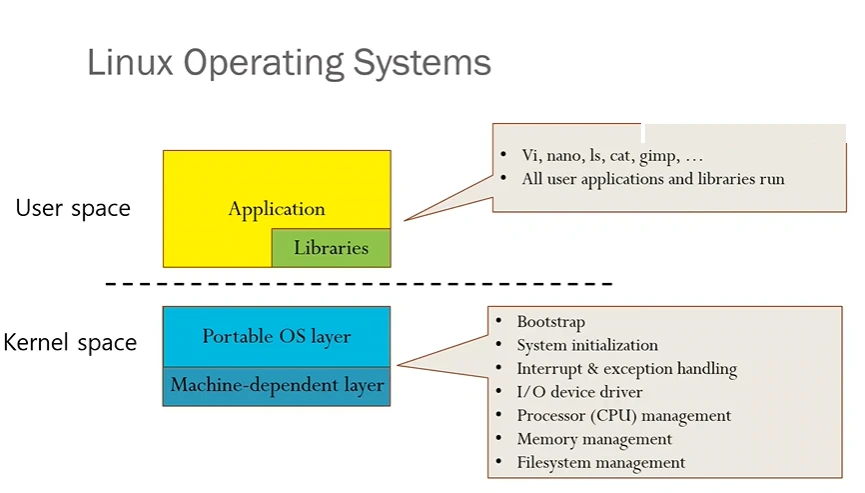
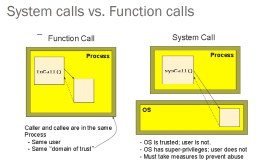
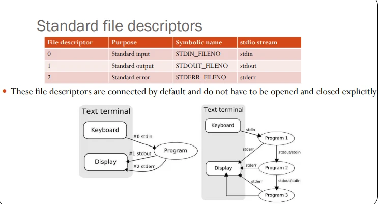
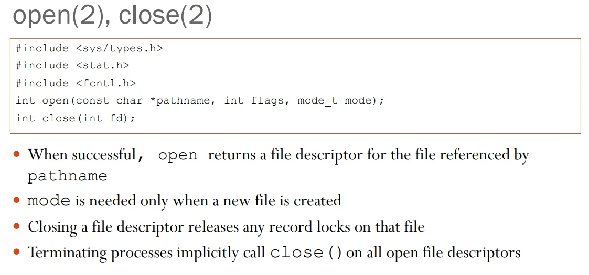
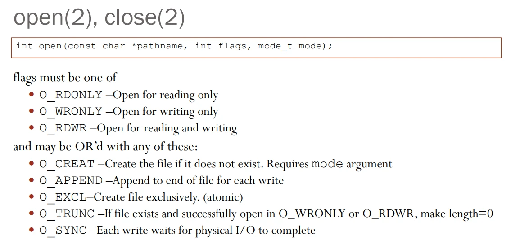
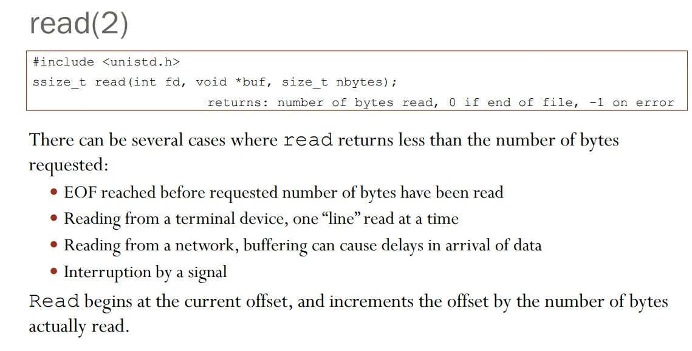
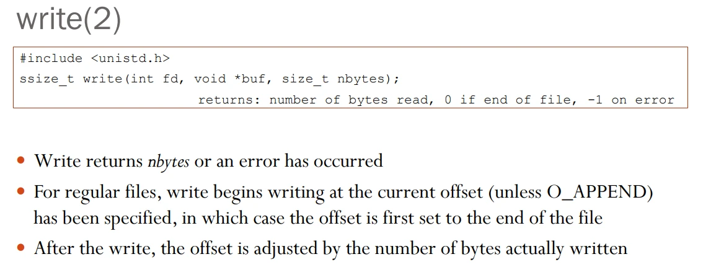
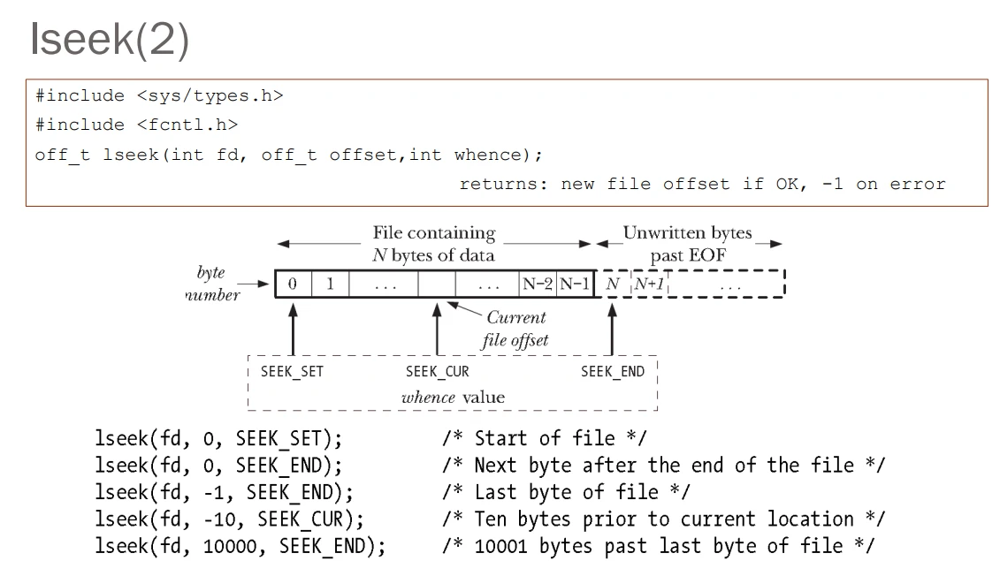

# System Call & File Descriptor

## Linux Kernel

- 시스템이 초기에 부팅될 때 메모리에 로드되어서 시스템을 초기화 시켜주고, 시스템이 동작하도록 해주는 `운영체제`의` 핵심적인 부분`이다. 커널은 부팅될 때 자원들(CPU, RAM, Disk 등)을 여러 process와 application에서 공유할 수 있도록 만들어주며, 컴퓨터와 연결된 주변 기기(마우스, 키보드 등)들이 동작하도록 관리해주고, 어플리케이션이 보내는 시스템 콜을 처리하여 H/W 자원 사용에 대한 요청을 관리해주는 역할을 한다.



- `리눅스`  `운영체제`는 크게 두 가지 부분으로 나뉜다.

1) `User Space`(응용 프로그램이 돌아가는 영역)  
2) `Kernel Space` 이다.

유저가 수행하는 application들도 memory space를 상세하게 보면, memory location이 `user space`와 `kernel space`로 나뉘어져 있다.

- kernel은 부팅을 시켜주고, 시스템 초기화, 인터럽트나 예외 처리, I/O 디바이스 드라이버 관리, CPU나 메모리, 파일 시스템 등을 관리하는 역할을 한다. application이 정상적으로 동작하기 위해서는 위에 열거된  kernel의 여러 기능들을 호출해서 사용해야만 한다. `System Call`이라는 `Programming Interface`를 통해 이러한 기능들을 호출할 수 있다.

⇒ `즉, 시스템 콜을 호출해서 Kernel 사용에 대한 요청을 보낼 수 있다.`



- Function Call은 호출될 때 모두 User Space영역에서 처리되므로, Kernel Space까지 내려가지 않는다. 하지만 Process안에서 System Call을 호출하게 되면, User Space가 아닌 Kernel에 있는 Subroutine을 갖다가 호출해서 처리한다.

## 시스템 콜의 종류와 POSIX

- POSIX(System Call Standard, Portable Operating System Interface) : UNIX 계열의 운영체제에서 사용할 수 있는 시스템 콜과 명령어들의 표준을 정의한 체계
- 시스템 콜은 마치 함수처럼 사용할 수 있으며, 항상 `예외 처리`를 해주어야 한다. (status value) 만약 시스템 콜이 `-1`을 return하면, 시스템 콜의 동작이 실패한 것이다. 그 이유를 확인하려면 `errno`이라는 전역 변수를 살펴보면 된다. errno은 `errno.h`를 include하면 사용할 수 있다.
- error handling example

```c
#include <stdio.h>
#include <errno.h>

int main(void) {

	int fd;
	fd = open("nonexist.txt", O_RDONLY);
	if (fd == -1) {
		printf("errno = %d\n", errno); // 몇 번 에러인지 체크 가능.
		perror("main"); // errno에 해당하는 내용을 사람이 알아들을 수 있도록 보여줌.
	}

	fd = open( "/", O_WRONLY );
	if (fd == -1) {
		printf("errno = %d\n", errno);
		perror("main");
	}

	return 0;
}
```

## 기본적인 시스템 콜

- 파일 입출력을 하기 위해 필요한 기본적인 시스템 콜들

getpid() : 자신의 프로세스 번호를 출력한다.

getppid() : 자신을 생성한 부모 프로세스의 번호를 출력한다.

```c
#include <stdio.h>
#include <sys/types.h>
#include <unistd.h>

int main(void) {

    pid_t pid_num = getpid();
    pid_t ppid_num = getppid();

    printf("pid_num : %d\nppid_num : %d\n", pid_num, ppid_num);

    return 0;
}
```

- `strace` : 프로그램을 실행할 때 사용된 `모든`  `시스템 콜`과 `시그널`을 출력해주는 `시스템 콜`

ex) 이 프로그램을 수행할 떄 필요한 모든 시스템 콜과 시그널을 알아내려고 한다. 어떻게 해야 하는가? ⇒ `strace ./ex`

ex) 이 프로그램을 수행할 때 필요한 모든 `시스템 콜`과 `시그널`의 개수를 알아내려면 어떻게 해야 하는가? ⇒ `strace ./ex | wc -l`

- man page의 section

`1   Executable programs or shell commands`

`2   System calls (functions provided by the kernel)`

`3   Library calls (functions within program libraries)`  
4   Special files (usually found in /dev)  
5   File formats and conventions, e.g. /etc/passwd  
6   Games  
7   Miscellaneous (including macro packages and conventions), e.g. man(7), groff(7)  
8   System administration commands (usually only for root)  
9   Kernel routines [Non standard]

> ⇒ 예를 들어, man 2 write를 하면 시스템 콜 write에 대한 설명이 나오지만, man 3 write는 동작하지 않는다. 왜냐면, 라이브러리 내에 write라는 함수가 존재하지 않기 때문이다. 다른 예로, man 3 printf를 하면 stdio의 printf에 대한 설명이 나온다. 하지만, man 2 printf는 나오지 않는다. 왜냐면, 시스템 콜 printf는 존재하지 않기 때문이다.

## 파일 입출력

- proc file system : root밑에 존재하는 proc 디렉터리는 kernel이 갖고 있는 정보를 표시하고 있는 디렉터리이다. 이는 실제로 디스크 상에 존재하는 데이터들이 아니라, kernel이 file이라는 형태로 사용자에게 보여줄 수 있도록 interface만 맞춰준 것이다. 이처럼, Linux에서는 통신할 때 사용하는 Socket들도 file interface로 접근이 가능하다.
- `File Descriptor` : 사용자가 파일을 사용하기 위해서는 파일을 사용하겠다는 의사를 kernel에 표시하고, 그 파일에 대한 descriptor를 얻어와야 한다.



0 - Standard Input - STDIN_FILENO - stdin

1 - Standard Output - STDOUT_FILENO - stdout

2 - Standard Error - STDERR_FILENO - stderr

⇒ macro를 숫자 대신으로 사용할 수도 있다.

- stdin은 0번이며, 키보드로부터 값을 받아들인다. stdout은 1번이며, 터미널에 메시지를 출력한다. stderr는 2번이며, 2번 descriptor를 통해 error를 표시하게 되면, display와 terminal에 표시된다. 그런데, stdin이 항상 키보드로부터 오고, stdout, stderr가 항상 monitor(display)로만 나가는 것은 아닐 수 있다. 바로 `pipe`를 이용하면 된다.

- open, read, write, lseek

<!-- -->

1. open



- open을 해서 file descriptor를 얻었다면, close를 해줘야 한다. close를 할 때 file에 record lock 같은 것이 걸려있었다면, 그런 것이 release가 된다. 만약 process를 termination시키게 되면, 명시적으로 close를 하지 않더라도 묵시적으로 file descriptor들이 close가 되도록 설정되어 있다.
- flag의 사용법



- default flags

`O_RDONLY` : 읽기 전용

`O_WRONLY` : 쓰기 전용

`O_RDWR` : 읽기 쓰기

- additional flags (by | operator)

`O_CREATE` : file이 없으면 file 생성 ⇒ 이 옵션을 줘야만 mode parameter가 의미를 갖는다.

`O_APPEND` : file에 write할 때, 항상 file의 제일 끝에다가 추가를 하며 붙여나간다. (덮어쓰기 X)

`O_EXCL` : (O_CREATE와 함께 사용할 경우) 기존에 file이 없다면 생성하지만, 이미 있다면 에러 메시지를 내보낸다.

`O_TRUNC` : 파일을 생성할 때 이미 있는 파일이고, 쓰기 옵션으로 열었으면 내용을 모두 지운다.

`O_SYNC` : 보통 file에다가 write를 하게 되면, write한 내용이 우선 buffer cash라는 메모리에 저장되었다가 나중에 디스크에 쓰게 되는데, 이 옵션을 주면 file에 write할 때, 무조건 disk에 write하고 난 뒤에 return한다.

- O_CREAT

이 옵션을 주게 되면, mode parameter가 의미를 갖게 되는데, file을 만들기는 만들되 어떤 속성을 갖는 file을 만들 것인지를 정해주는 옵션이다. 0666과 같이 Octal number xxx를 입력해주면 된다.

2. read



3. write



4. lseek



- `SEEK_SET` : file의 시작 부분
- `SEEK_END` : file의 마지막 바이트 다음 바이트
- `SEEK_CUR` : 현재 바이트
- return : new file off set on OK, -1 on error.

```c
#include <stdio.h>
#include <sys/types.h>
#include <sys/stat.h>
#include <fcntl.h>
#include <stdlib.h>
#include <unistd.h>
#include <errno.h>

#define BUF_SIZE 64

int main(int argc, char* argv[]) {

    if (argc != 3) {
        printf("Not enough parameter.\n");
        exit(0);
    }

    printf("Command : %s\n", argv[0]);
    printf("Source file : %s\n", argv[1]);
    printf("Destination file : %s\n", argv[2]);
    
    int source_fd = open(argv[1], O_RDONLY);
    int dest_fd = open(argv[2], O_WRONLY | O_CREAT /* | O_EXCL */ | O_TRUNC | O_SYNC, 0660);
    // excl을 넣으면, 이미 존재하는 파일이 있을 경우, 에러를 띄움.

    // system call은 return code를 확인해야 함.
    if (source_fd == -1 || dest_fd == -1) {
        perror("error on opening files!");
        exit(0);
    }

    // 여기까지 오면, 파일이 정상적으로 열린 것이므로,
    // 복사해준다.

    char* buffer = malloc(sizeof(char)*BUF_SIZE);

    while (1) {

        int read_size = read(source_fd, buffer, BUF_SIZE);

        if (read_size == 0) {
            printf("\n\n\nEOF...\n");
            free(buffer);
            break;
        }

        int write_size = write(dest_fd, buffer, read_size);
        // read_size만큼 write해야한다...
        printf("%d만큼 복사했습니다.\n", write_size);
    }

    printf("coping done...\n");
    close(source_fd);
    close(dest_fd);

    return 0;
}
```

```c
#include <stdio.h>
#include <sys/types.h>
#include <sys/stat.h>
#include <fcntl.h>
#include <stdlib.h>
#include <unistd.h>
#include <errno.h>

#define BUF_SIZE 10

int main(int argc, char* argv[]) {

    if (argc != 2) {
        printf("Not enough parameters...\n");
        exit(0);
    }

    int fd = open(argv[1], O_RDONLY);
    
    if (fd == -1) {
        perror("error:");
        exit(0);
    }

    char* buffer = malloc(sizeof(char)*BUF_SIZE);

    lseek(fd, 11, SEEK_SET);
    int read_size = read(fd, buffer, BUF_SIZE);
    printf("size : %d, read string : %s\n", read_size, buffer);

    lseek(fd, 1, SEEK_CUR);
    read_size = read(fd, buffer, BUF_SIZE);
    printf("size : %d, read string : %s\n", read_size, buffer);

    lseek(fd, -5, SEEK_END);
    read_size = read(fd, buffer, BUF_SIZE);
    printf("size : %d, read string : %s\n", read_size, buffer);
    // SEEK_END는 마지막으로 쓰인 글자의 바로 다음! 위치이다.
    // 새로 읽어들이면, 이전의 버퍼의 내용은 남아있다.
    // 버퍼를 비우고 새로 읽는게 아니다.

    return 0;
}
```

⇒ 실행 파일도 복사할 수 있지만, 복사하고나면 권한이 죽는다. chmod로 권한을 바꾸주면 다시 실행할 수 있게 된다.

- Implementing tee

```c
#include <stdio.h>
#include <sys/types.h>
#include <sys/stat.h>
#include <fcntl.h>
#include <stdlib.h>
#include <unistd.h>
#include <errno.h>

#define BUF_SIZE 64

int main(int argc, char* argv[]) {

    if (argc != 2) {
        printf("Not enough parameters.\n");
        exit(0);
    }

    int dest_fd = open(argv[1], O_WRONLY | O_CREAT | O_TRUNC, 0666);

    if (dest_fd == -1) {
        perror("main:");
        exit(0);
    }

    char* buffer = malloc(sizeof(char)*BUF_SIZE);

    while (1) {

        int read_size = read(STDIN_FILENO, buffer, BUF_SIZE);

        if (read_size == 0) {
            free(buffer);
            break;
        }

        int std_write_size = write(STDOUT_FILENO, buffer, read_size);
        int write_size = write(dest_fd, buffer, read_size);
    }

    close(dest_fd);
    return 0;
}
```
