# Process

작성일 2022-12-03 · 최종 수정일 2022-12-15
{ .post-date }

## Context Switching

- `프로세스`란, 프로그램들이 실행되고 있는 상태 또는 그 instance이다.
- `프로세스`는 두 가지 Abstraction을 제공한다.

<!-- -->

1. Logical Control Flow : 프로세스가 혼자 CPU를 독자적으로 사용하는 것으로 보이도록 만드는 것.
2. Private Virtual Address Space : 우리가 사용하는 프로그램이 그 시스템에 있는 메모리를 마치 혼자 사용하고 있는 것처럼 착각하게 만드는 것.

⇒ 어떻게 이런 것들을 할 수 있는가?

1. 여러 개의 프로세스가  동시에 돌아가는 과정에서 매우 빠르게 Swtiching을 하며 작업을 수행한다. 이를 multi-tasking이라고 하며, `context switching`이 매우 빠르게 일어나기 때문에 마치 각각의 프로세스가 CPU를 독점하고 있는 것처럼 만들어 줄 수 있다.
2. CPU마다 `Virtual Memory`라는 가상의 메모리 시스템을 제공해서, 프로세스가 Switching되어 바뀔 때마다 예전의 프로세스의 내용을 disk 같은 곳에 저장하고 새로 수행할 프로세스의 내용을 읽어온다. 이를 자동으로 처리해주는 것이 바로 `Virtual Memory System`이다.

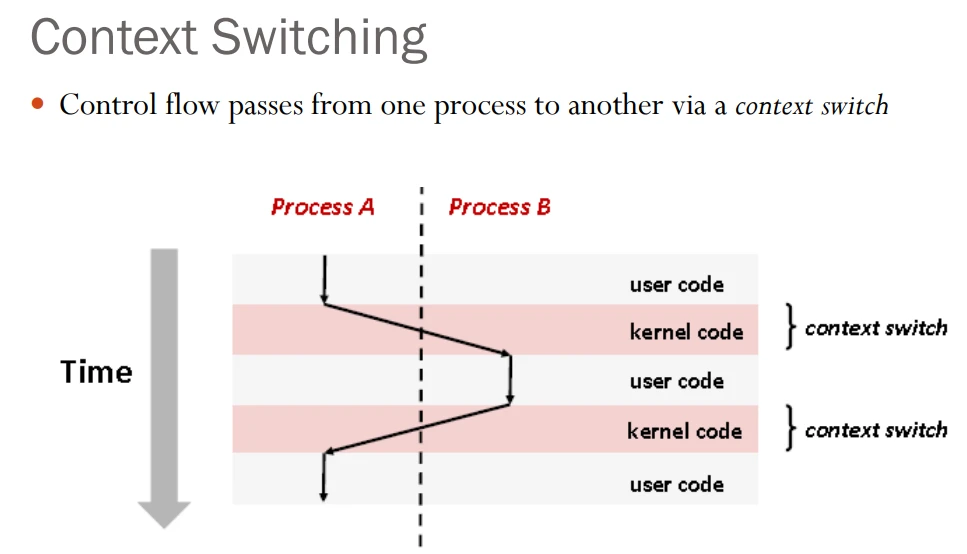

- `Context Switching`

A 프로세스가 돌고 있다가, 일정 시간이 지나면 커널은 다른 프로세스 B를 수행하기 위해 Context Switching을 한다. 이 때 기존에 수행되던 프로세스 A의 레지스터 값, 메모리의 상태 등을 저장하고 기존의 프로세스 B 수행 과정에서 저장되었던 값을 복원하면서 프로세스 B를 수행하게 된다. 이 과정에서 레지스터, 메모리의 데이터를 자동으로 저장하고 복원해주는 역할을 하는 것이 Virtual Memory System이다.

- 프로세스의 상태

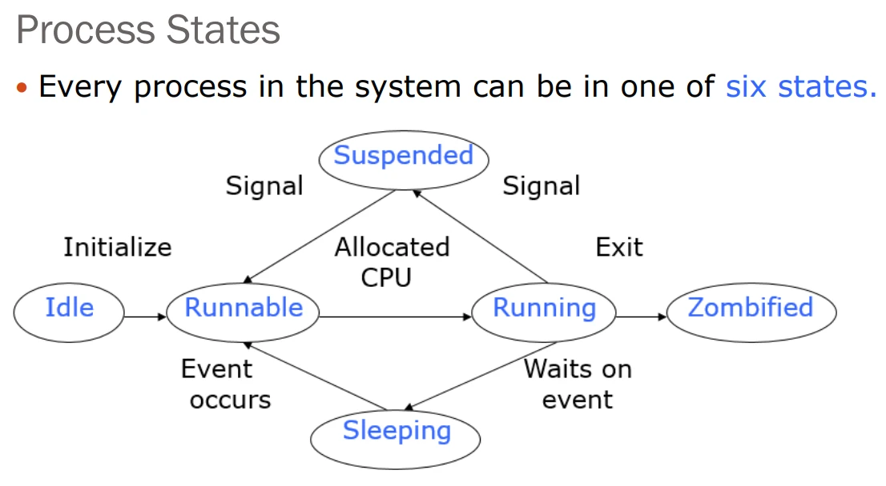

1. `Idle` : 제일 먼저 프로세스가 생성이 되면 Idle 상태이며, CPU에서 할당되어 수행될만한 준비가 안되어 있는 상태이다. 어느정도 초기화가 되면 Runnable 상태가 된다.
2. `Runnable` : CPU에서 돌아가고 있는 상태는 아니지만, 수행될 수 있는 상태이다.
3. `Running` : 실제로 CPU 상에서 돌아가고 있는 것. 그런데 context switching를 진행하기 때문에 계속해서 Running 상태에 존재하지는 않는다.
4. `Sleeping` : 자기가 사용하는 시간이 다 지나버려서, 자기 차례가 돌아오기를 기다리거나(context switching) disk를 process에서 접근할 때, 시간이 걸리기 때문에 그 때 까지 sleeping에서 대기하는 상황 등이 있을 수 있음. 실제로 disk에서 값을 다 읽어오게 되면 Runnable 상태로 이동하게 되는 것이다. 만약 Timer를 사용할 때 정해진 시간이 다 지나게 되면 Sleeping status에 있던 process가 Runnable 상태로 이동하게 된다.

<!-- -->

- `Suspending` : 만약 현재 돌아가고 있는 프로세스에 Signal(Ctrl + C, Ctrl + Z 등)을 주게 되면, 프로세스에 특정 시그널을 보내 프로세스를 중단시킬 수 있다. suspend되어있는 프로세스에 다시 진행하라는 시그널을 주게 되면 Runnable 상태로 가고, 다시 본인의 차례가 돌아오면 Running으로 가게 된다.

<!-- -->

5. `Zombified` : 프로세스의 수행이 끝나게 되면, 바로 끝나게 될 수도 있지만 Zombified 상태가 될 수도 있다. 프로그램이 끝나게 되면 부모 프로세스가 wait()을 통해 자식 프로세스의 return code를 받아와야 하는데, 프로세스가 종료되었지만 아직 부모 프로세스에 return code를 전달하지 못한 프로세스의 상태를 Zombified 상태라고 한다.

## Process Composition

1. `code area` : 실제로 수행되는 코드가 존재하는 영역 (Text area)
2. `data area` : 프로그램이 돌아가면서 사용하는 변수나 malloc 등을 통해 할당받은 heap 영역의 값들이 존재하는 영역
3. `stack area` : 프로세스 내에서 함수를 수행할 때, stack area에 실행 정보가 쌓이게 되는데, 이 data가 존재하는 영역

---

4. `user area` : 해당 프로세스에 대한 여러가지 정보를 갖고 있는 영역
5. `page tables` : 우리가 사용하는 메모리에 대한 정보를 갖고 있는 부분

⇒ 4\~5는 kernel에 존재하는 부분이다.

---

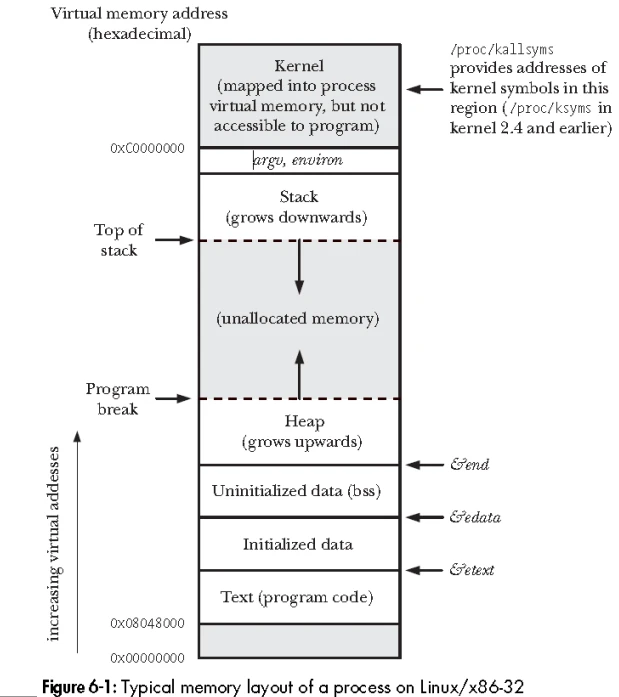

⇒ 일반적인 32x, x86 플랫폼에서 돌아가는 리눅스 프로세스의 메모리 맵. 4GB가 할당된다.

> Q. 일반적으로 리눅스 x86 시스템에서는 하나의 프로세스가 4GB의 메모리를 할당받게 된다. 하지만 우리는 100개의 프로세스를 실행해도 실제로 400GB의 메모리를 사용하지는 않는데, 그 이유를 설명하고 리눅스에서 프로세스의 메모리 구조는 어떻게 이루어져 있는지 설명하시오.

A. 리눅스 x86 시스템에서 프로세스의 메모리 맵은 실제로 메모리에 로드되어 실행되는 코드가 존재하는 code area, 프로그램 수행에 사용되는 변수와 동적 할당을 통해 생성한 변수가 존재하는 data area(heap을 포함함), function이 수행될 때 그 수행 정보를 보관하는 stack 그리고 1GB의 kernel area로 이루어져 있다. 리눅스 시스템 상에는 Virtual Memory System이 있어서, Context Switching이 일어날 때 기존의 프로세스의 정보를 자동으로 disk에 저장하고, 새롭게 실행되는 프로세스의 정보를 disk에서 가져오기 때문에 400GB의 공간을 모두 사용하지 않고도 프로세스를 실행할 수 있다.

- `Process Table` : 커널은 현재 어떤 프로세스가 우리 시스템에서 돌아가고 있는지에 대한 총괄적인 정보를 갖고 있는데, 이를 Process Table이라고 한다. 일종의 kernel data structure이며, 각각의 프로세스의 ID와 부모 프로세스는 무엇인지 (PPID), 소유하고 있는 유저와 그룹은 누구이고 어떤 상태에 있는지, code, data, stack 그리고 user area가 어디에 저장되어 있는지에 대한 위치 정보, 그리고 pending된 signal에 대한 정보를 갖는다.

⇒ 커널은 process table에 저장된 정보를 바탕으로 process scheduling을 진행한다.

## 프로세스의 관리

- 프로세스들은 모두 fork()라는 시스템 콜을 통해서 복제가 되며, 복제가 될 때, parent process와 child process는 모두 동일한 프로세스이며, 다른 것은 단지 PID와 PPID 뿐이다. 프로세스를 fork()로 복제한 이후에는 exec 계열의 명령어를 사용해서 프로세스의 내용을 바꾸어 원하는 프로세스로 만들 수 있다.
- 우리가 Terminal에서 사용하는 bash도 일종의 프로세스이다. 우리가 프로그램을 하나 실행하면, bash는 자기 자신을 fork()로 복제한 뒤, exec()를 이용해 우리가 지정한 프로그램의 코드로 대체한다. 그렇게 되면 우리가 지정한 프로그램을 수행하는 child process가 만들어진다. 이후 parent process인 bash는 wait()을 이용해 child process의 수행 종료를 기다리고, 수행이 종료되면 child process로부터 return code를 받아 깨어나게 된다.

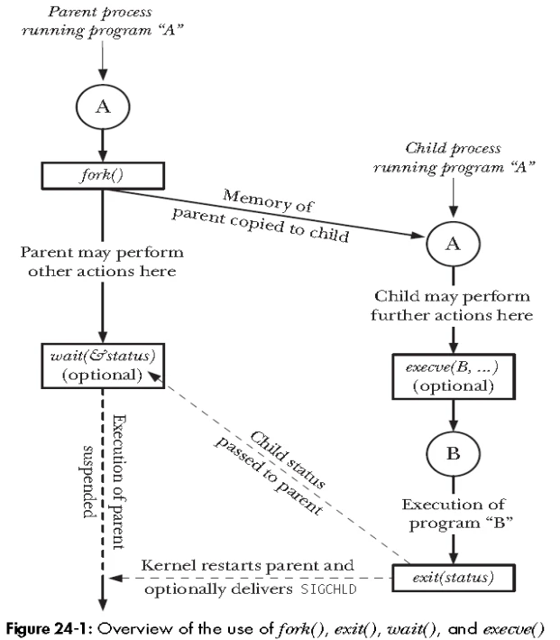

이 과정이 어떻게 발생하는지 그림으로써 살펴보도록 한다. 여기서 프로세스 A를 shell process라고 해보자. 우리가 프로그램의 이름을 shell prompt에 입력하면 shell은 자기 자신과 완전히 동일한 process를 복제하게 된다. fork()를 사용한다. 그리고 process A(여기서는 shell)는 wait()을 하며 child process의 수행이 끝나기를 기다린다. child process의 code 부분을 우리가 원하는 code로 바꾸기 위하여 execve()를 수행하여 child process의 code 영역이 또 다른, 우리가 실행하기를 원하는 프로세스인 B의 code로 바꿔주면 부모와는 code 부분이 다른 process가 되는 것이다. 그리고 수행이 끝나면 종료가 될 것이다. exit()를 이용한다. child process의 수행이 끝나면 parent process는 child process의 종료 후속 조치를 취한 후, 프로그램을 다시 수행하게 된다.

- fork() : 프로세스를 동일하게 복제하는 시스템 콜
- execve() : 복제된 child process의 code area를 특정해서 대체하는 시스템 콜  
    ⇒ 복제된 process가 다른 프로그램을 수행하도록 만든다.
- exit() : 프로세스를 종료할 때 상태 변수를 전달해주는 시스템 콜
- wait() : child process의 상태 변수를 받아오기 위해서 parent가 대기하도록 하는 시스템 콜

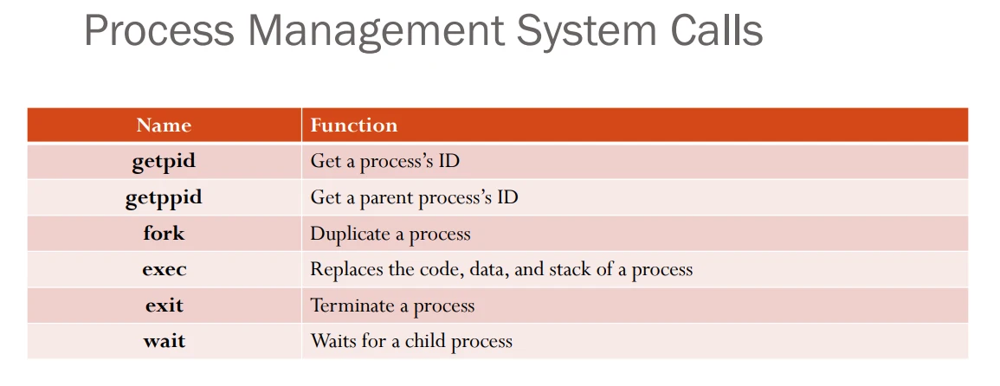

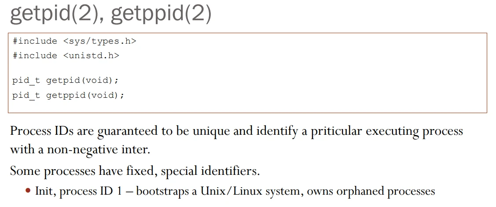

- getpid(2) : 어떤 프로세스가 있으면, 프로세스의 pid를 받아오는 것이 getpid(2)이다. pid는 non-negatvie integer이다. process 생성 시에 아직 사용되지 않은 PID를 할당받는다.
- getppid(2) : 자신을 생성한 parent process의 pid를 받는다.

process의 PID는 어떤 것이 배정될지 미리알 수 없지만, init process는 항상 pid가 1이다.

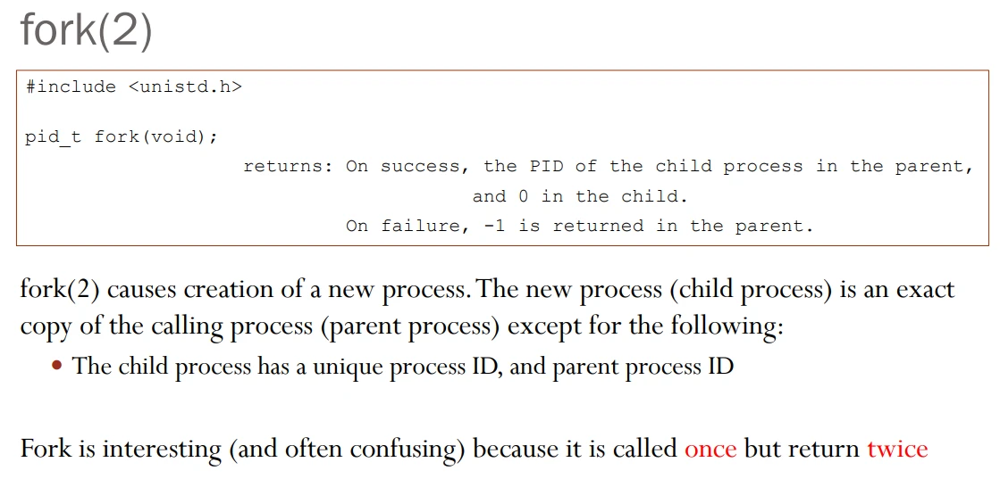

- fork : 어떤 프로세스가 자기 자신을 복제해서 child process를 만들어 내는 시스템 콜이다. 이 때 두 프로세스는 완전히 똑같은 코드를 수행하는 프로세스이다. 다른 것은 PID 뿐이다. parameter는 void이며 return type으로 pid_t를 return한다. 한 번 parent process에서 fork()를 부르게 되면 return을 두 번 하게 된다. parent process가 받는 return 값은, child process의 return 값이다. child process(생성된 process)에서는 0이라는 값을 전달받게 된다. 만약, 자식 프로세스의 생성에 실패할 경우 자식 프로세스는 생성되지 않고, 부모 프로세스는 -1을 전달받게 된다.

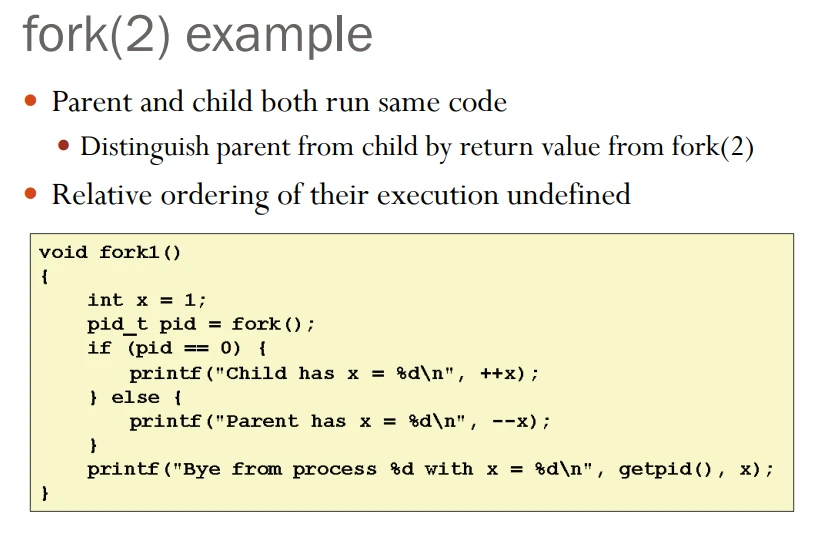

위의 예제에서, parent process에는 새롭게 복제된 child process의 pid가 return되고, child process에는 0이 return된다. 생성이 되면 parent process는 pid가 non 0 이기 때문에 else 구문이 실행되고, child process는 pid_t pid = fork(); 시점부터 다시 실행이 되며 pid == 0이기 때문에 if 구문이 실행된다.

## execve()

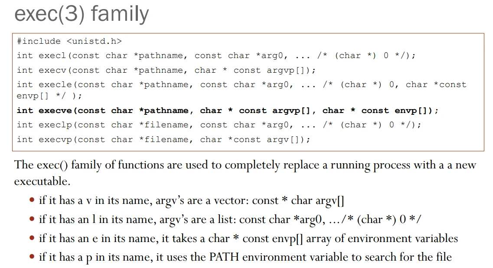

- 실제 exec는 execve()이고, 나머지 것들은 execve()에 기능을 추가해서 만들어진 것들이다. exec() family는 특정 프로세스의  code area를 내가 원하는 code로 대체한다.

→ execv, execvp, execve / execl, execlp, execle

- execve()

    pathname : 자신이 수행하고 싶은 수행 파일의 pathname을 준다.

    argvp[] : 전달해 줄 인자를 vector 형태로 전달한다.

    envp[] : 프로그램 수행에 필요한 환경 변수를 vector 형태로 전달한다.

뒤에 v가 붙어 있는 exec() 함수들은 argument를 vector로써 전달하는 함수들이다.

뒤에 l이 붙어있는 exec() 함수들은 argument들을 list형태로 순서대로 적어주는 함수이다.

뒤에 e가 붙어있는 exec() 함수들은 프로그램을 수행할 때 환경변수를 넘겨주는 함수이다.

뒤에 p가 붙어있는 exec() 함수들은 pathname이 아니라 filename을 주고, 경로를 PATH라는 환경변수에 지정한 곳에서 찾게 된다.

- exit()

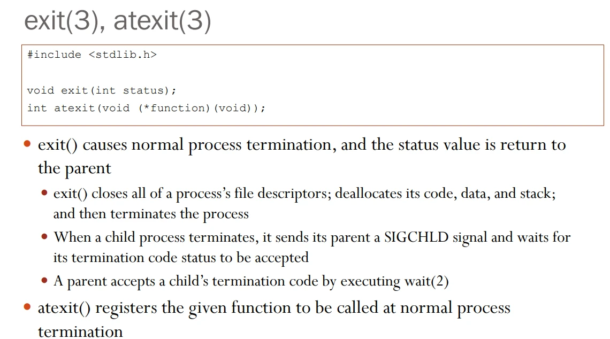

`exit()`는 프로세스가 자기 자신을 `정상적`으로 `종료`시킬 때 사용하는 시스템 콜이다. 만약, 외부에서 `시그널`을 보내서 내 프로세스를 강제로 종료시키는 경우는 `비정상적`으로 종료되는 경우를 의미한다. 이런 경우가 아니라 `exit()` 함수를 불러서 종료하는 경우는 정상 종료하는 것이라고 판단한다. 그렇게 되면 `child process`는 `SIGCHLD`라는 `signal`을 `parent`에게 보내는데, 그렇게 되면 `parent`가 `wait`하고있다가 시그널을 받고 깨어나 동작하게 된다.

int atexit(void (\*function) (void)); ⇒ function pointer.

여기다가 함수를 등록해놓으면, exit하기 전에 함수를 수행해준다.

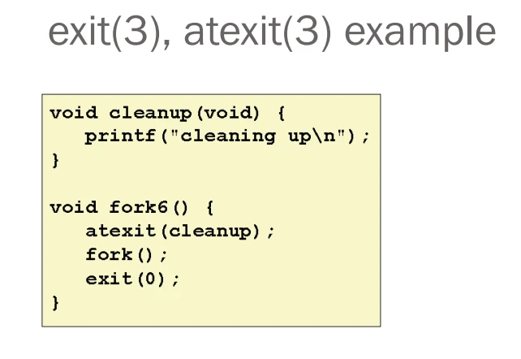

> Q. 프로그램이 종료될 때 exit(0)를 수행하면, bye()라는 함수가 수행되도록 코드를 구현하려고 한다. 다음 빈 칸을 구성하시오.
>
> A. atexit(bye);

- wait()

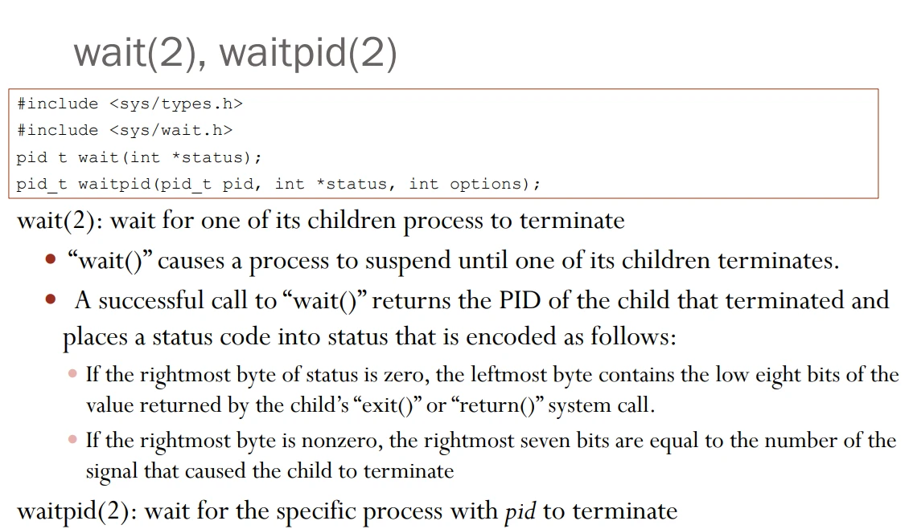

⇒ waitpid(2)를 사용하면, 특정 프로세스가 끝나길 기다릴 수 있음.

- wait system call은 parent process에서 child process가 종료될 때까지 기다리게 한다. child process는 여러 개 만들어질 수 있는데, 만약 그 중 아무거나 하나가 종료되면, child process가 보내준 exit code를 바탕으로 동작을 이어가게 된다.
- wait()은 실행을 재개시킨(그러니까, termination돼서 SIGCHLD 시그널을 parent process에게 전달해준 프로세스의) pid를 return하며, status value는 사전에 define 되어 있는 bit mask macro를 통해 확인해야 한다.

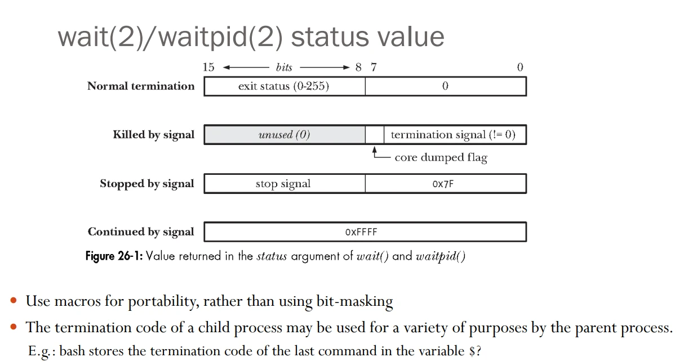

⇒ child process가 정상 종료되었다면, LSB가 0이고, MSB는 child process의 exit code이다.

- `WIFEXITED` : wait의 인자로 반환받은 child_status를 집어넣으면, child process가 정상종료되었는지 아닌지 판단할 수 있다. 정상 종료되었다면 true를 return한다.
- `WEXITSTATUS` : 받아온 status code에서 왼쪽 8bit(exit status)만 추출하고, exit code를 return해준다. (child process에서 exit(n)으로 넘겨준 n!)

## Abnormal process

- `Orphan process` : 부모 프로세스와 자식 프로세스가 수행되고 있는데, 부모 프로세스가 자식의 종료를 기다리지 않고 먼저 수행이 종료된 경우이다. 이럴 경우, 리눅스에서는 자식 프로세스를 init process(1)을 ppid로 세팅해버린다. (일종의 입양, adopt)
- `Zombie process(Zombified)` : 부모 프로세스와 자식 프로세스가 수행되고 있을 때, 자식 프로세스가 exit()를 했지만 부모 프로세스가 wait을 하지 않고 다른 동작을 하고 있어서 자식의 exit status code를 가져오지 못한 경우 해당 자식 프로세스를 Zombie process라고 한다.

- `ps -ef` (혹은 `ps -elf`) : 시스템에 있는 전체 프로세스 확인
- `top` : 윈도우의 작업 관리자처럼 프로세스의 점유율과 CPU, Memory 사용률을 확인 가능.
- `/proc` : process에 관련한 모든 내용이 들어 있음. Kernel이 자신이 갖고 있는 데이터를 보여주기 위해 만들어내는 파일 시스템이다.

⇒ cd /proc

- /proc에 있는 fd라는 디렉터리에 가보면, 0, 1, 2 … 이렇게 디렉터리가 추가로 있는데 여기서 0, 1, 2 는 stdin, stdout, stderr를 의미한다.
- sched를 cat sched로 읽어보면, 프로세스들이 cpu에서 어떻게 스케쥴링되고 있는지 볼 수 있다.

---

- fork()를 한 번 하고, PID와 PPID를 출력하는 프로그램

```c
#include <stdio.h>
#include <sys/types.h>
#include <unistd.h>

int main(void) {

    pid_t pid = fork();

    if (pid == 0) { // child process
        printf("pid : %d, ppid : %d\n", getpid(), getppid());
    } else { // parent process
        printf("parent::: pid : %d, ppid : %d\n", getpid(), getppid());
    }

    return 0;
}
```

⇒ 원칙적으로는 parent process는 동작이 끝나고, child process가 종료될 때까지 검사하면서 기다리고 있어야 한다. 그렇게 하기 위해서 필요한 것이 wait()이다. wait은 인자로 child_status를 포인터로 넘겨준다. 예를 들면, `pid_t wpid = wait(&child_status)` 라고 사용 가능하다. 이렇게 되면 child_status에는 child process가 exit한 코드가 들어가고, wpid에는 termination된 child process의 pid가 전달된다. WIFEXITED(child_status)를 하면, 정상 종료 되었는지 아닌지가 나온다. WEXITSTATUS(child_status)를 하면, exit code가 뭐였는지 알려준다.

⇒ wait을 하지 않으면, orphan process또는 zombie process가 만들어질 수 있음.

- my fork example

```c
#include <stdio.h>
#include <sys/types.h>
#include <unistd.h>
#include <stdlib.h>
#include <sys/wait.h>

int main(void) {

    pid_t pid = fork();

    if (pid == 0) {
        printf("child process\npid : %d, ppid : %d\n", getpid(), getppid());
        exit(100);
    } else {
        int child_status;

        pid_t child_pid = wait(&child_status);
        
        printf("Parent process\npid : %d, ppid : %d\n", getpid(), getppid());

        if (WIFEXITED(child_status)) {
            printf("Child process %d가 정상 종료 되었음.\n", child_pid);
            printf("exit code : %d\n", WEXITSTATUS(child_status));
        } else {
            printf("Child process가 비정상적으로 종료됨.\n");
        }
    }

    return 0;
}
```

- race condition

```c
#include <stdio.h>
#include <sys/types.h>
#include <unistd.h>
#include <stdlib.h>
#include <sys/wait.h>

int main(void) {

    pid_t pid = fork();

    if (pid == 0) { // child process
        printf("pid : %d, ppid : %d\n", getpid(), getppid());
        for (int i = 0; i < 100; i++) {
            printf("%d\n", i);
        }
        exit(101);
    } else { // parent process
        int exitstatus;
        printf("parent start!\n");
        for (int i = 100; i < 200; i++) {
            printf("%d\n", i);
        }

        wait(&exitstatus);
        printf("parent::: pid : %d, ppid : %d\n", getpid(), getppid());
        printf("exitcode: %d\n", WEXITSTATUS(exitstatus));
    }

    return 0;
}
```

⇒ 이 상태에서 코드를 실행하면, 순서가 거의 뒤죽박죽으로 나오게 된다. 그 이유는, 프로세스가 수행되는 순서는 OS의 Scheduler가 어떻게 스케쥴링을 하냐에 따라 다르다. 이것은 우선순위를 모르면 예측할 수 없다. 또, 다른 것의 영향도 하나 있는데, printf는 사실 바로 출력하는 것이 아니라 메모리 버퍼에 갔다가 stdout으로 넘겨줘야 하기 때문에, 오버헤드가 크다. 이것의 영향으로 순서가 뒤바뀔 수 있다. 이를 방지하려면 printf의 밑에 fflush(NULL);을 추가해서, 메모리 버퍼에 가지 않고 바로 출력하도록 만들어볼 수 있다.

```c
#include <stdio.h>
#include <sys/types.h>
#include <unistd.h>
#include <stdlib.h>
#include <sys/wait.h>

int main(void) {

    pid_t pid = fork();

    if (pid == 0) { // child process
        printf("pid : %d, ppid : %d\n", getpid(), getppid());
        for (int i = 0; i < 100; i++) {
            printf("%d\n", i);
            fflush(NULL);
        }
        exit(101);
    } else { // parent process
        int exitstatus;
        printf("parent start!\n");
        for (int i = 100; i < 200; i++) {
            printf("%d\n", i);
            fflush(NULL);
        }

        wait(&exitstatus);
        printf("parent::: pid : %d, ppid : %d\n", getpid(), getppid());
        printf("exitcode: %d\n", WEXITSTATUS(exitstatus));
    }

    return 0;
}
```

⇒ 하지만 이렇게 해도, 순서가 완벽하게 맞을 수는 없다. 스케쥴링에 따라 다르기 때문이다…

- execve : fork로 복사한 프로세스가 다른 코드를 수행하도록 바꿔주는 코드. 다양한 종류의 exec 계열 시스템 콜이 있는데, 이것들은 기존의 execve()를 활용하여 다른 parameter를 받아 활용하는 것이다.

int execve(const char \*pathname, char \*const argv[], char \*const envp[]);

→ pathname : 절대 경로를 넣는다.

→ argv : 실행에 필요한 옵션을 넣어준다.

→ envp : 환경 변수를 넣는다. 필요 없으면 NULL

- execve를 이용해 자식 프로세스를 ls로 바꿔보자.

```c
#include <stdio.h>
#include <sys/types.h>
#include <unistd.h>
#include <stdlib.h>
#include <sys/wait.h>

int main(void) {

    pid_t pid;
    pid = fork();

    if (pid == 0) {
        char *new_argv[] = {"ls", "-a", "-l", NULL};
        execve("/bin/ls", new_argv, NULL); // 절대 경로를 써주어야 함.
    }
    else {
        int exitstatus;
        wait(&exitstatus);
    }

    printf("Parent Only!\n");
    return 0;
}
```

- execve를 실행한 이후에는 이전 까지 작성된 모든 프로그램이 관련이 없어진다. 이번 예제의 경우에는 ls로 대체했으므로, ls가 프로그램 exit를 관장해주는 역할을 한다. 굳이 exit를 명시하지 않아도 된다.
- 만약, 절대 경로로 실행하는 것이 귀찮다면, execve가 아닌, execvp()를 사용하고 ls를 쓰고, 환경 변수를 빼주면 된다.

```c
#include <stdio.h>
#include <sys/types.h>
#include <unistd.h>
#include <stdlib.h>
#include <sys/wait.h>

int main(void) {

    pid_t pid;
    pid = fork();

    if (pid == 0) {
        char *new_argv[] = {"ls", "-a", "-l", NULL};
        execvp("ls", new_argv);
    }
    else {
        int exitstatus;
        wait(&exitstatus);
    }

    printf("Parent Only!\n");
    return 0;
}
```

> execl과 execv의 차이점 : 인자를 전달받는 방식이 다르다.
>
> l: List 형태의 명령라인 argument (argv[0], argv[1], …)
>
> v: Vector 형태의 명령 argument (argv) → 주소를 전달해준다.

## Implementing ‘System’

```c
#include <sys/types.h>
#include <unistd.h>
#include <sys/wait.h>
#include <stdio.h>
#include <stdlib.h>

int my_system(char* command) {

    pid_t pid = fork();
    
    if (pid == 0) {
        execl("/bin/sh", "sh", "-c", command, NULL);
    } else {
        int exitcode;
        pid_t child_pid = wait(&exitcode);

        return child_pid;
    }
}

int main(void) {

    int status;
    status = my_system("ls -l | wc");
    printf("exit code %d\n", WEXITSTATUS(status));

    return 0;
}
```
