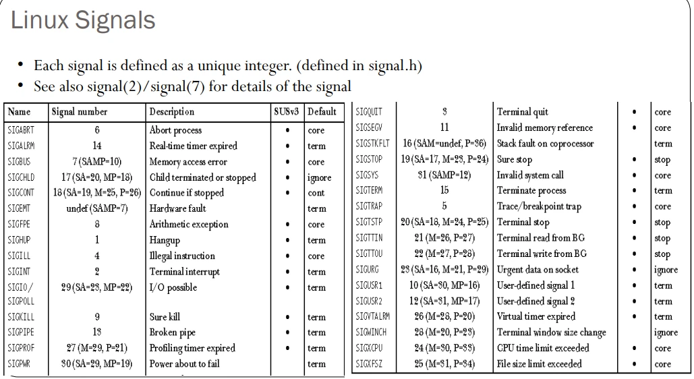
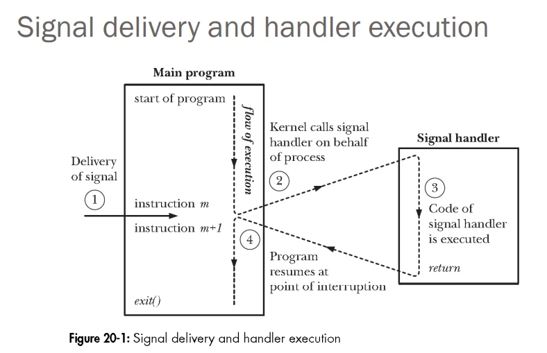
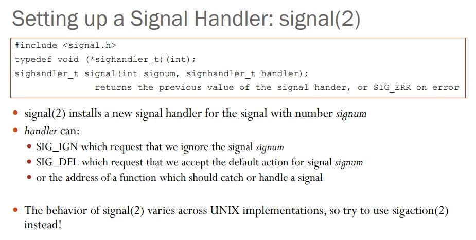
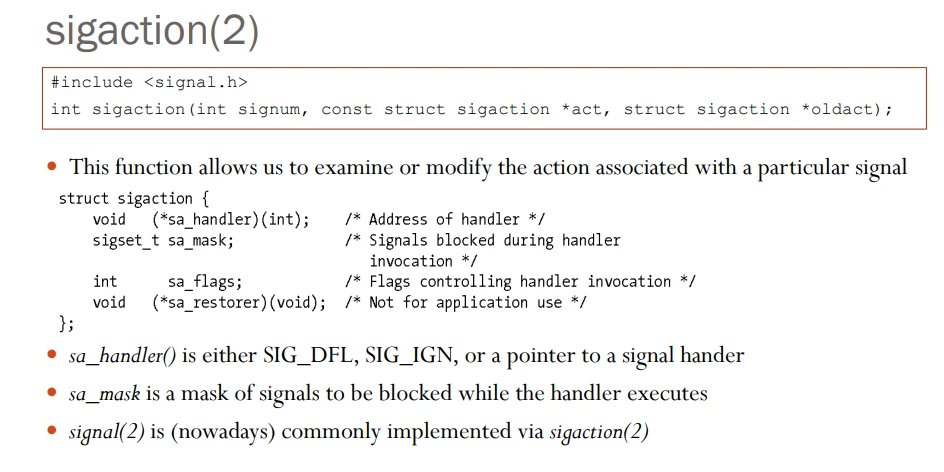
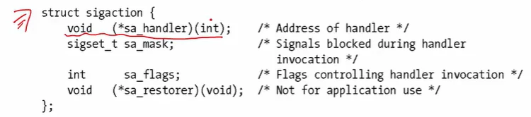
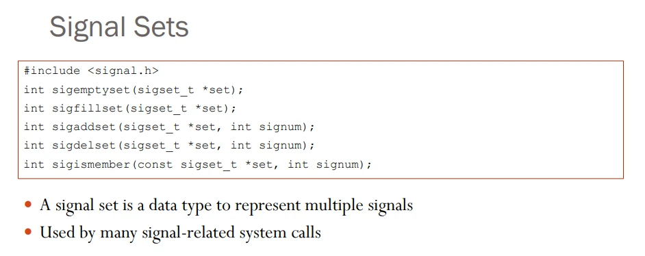
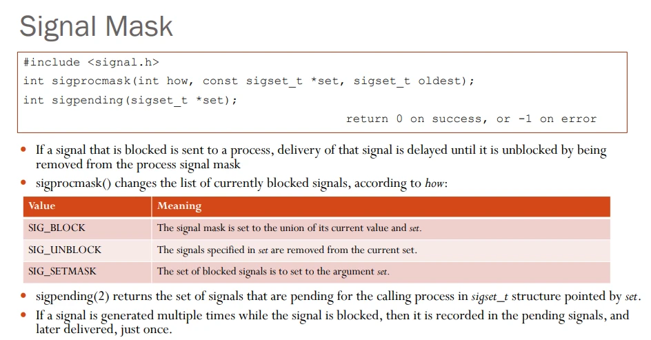
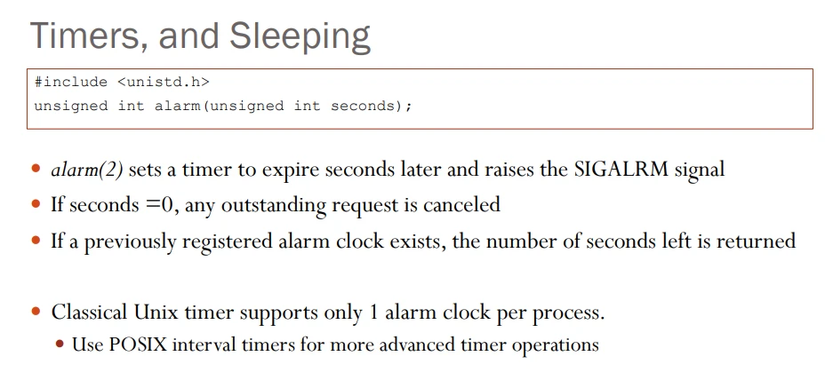
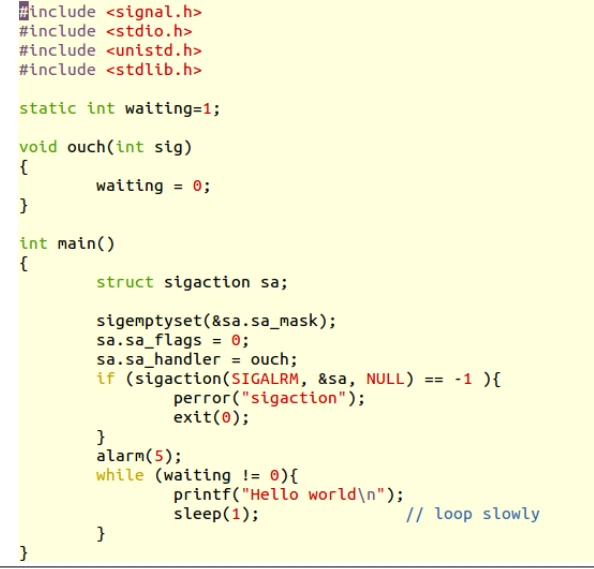
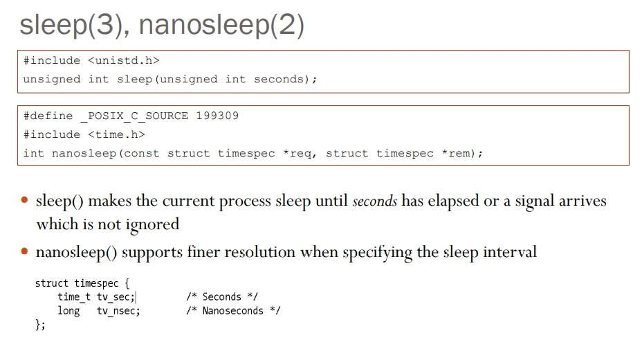

# Signal

작성일 2022-12-03 · 최종 수정일 2022-12-15
{ .post-date }

- `Signal` : 시그널은 리눅스 초기부터 `외부의 이벤트`를 `프로세스`에게 알려주기 위한 기능을 했다. 시그널은 `S/W interrupt`라고도 한다. 어떤 `비동기적인 이벤트`를 프로세스에게 알려주기 위한 수단이 바로 Signal이다. 이러한 시그널들은 프로그램이 동작하고 있는 중에는 언제든지 발생할 수 있다. 프로그램의 어느 시점에 시그널이 발생할지는 미리 알 수 없으므로, 비동기적으로 동작한다. `man 7 signal`을 보면, signal에 대한 전반적인 설명이 나온다.

## Signal Concepts

- 시그널이 프로세스에 도착할 때, 프로세스가 취하는 동작은 다음과 같다.

<!-- -->

1. `ignore` (시그널을 무시한다.)
2. `catch` (시그널을 handle한다고 하며, 전달된 시그널을 처리하는 function을 등록해주는 것이다. 시그널을 처리하는 함수를 시그널 핸들러라고 한다.)
3. `default action` (function을 명시적으로 등록하지 않았다고 해도, 시그널에 따라 default 값이 있다. 그 행동을 하도록 내버려 두는 옵션이다.

<!-- -->

- `Default Action`의 종류는 다음과 같다.

<!-- -->

1. 시그널 무시
2. 프로세스 종료
3. core dump라는 file을 만들어서 그 프로세스의 register 값들이나 memory에 있는 값들을 특정 file에 저장하고 프로세스 종료. (\*.swp file들이 그러한 예이며, 읽을 수 있는 형태는 아니지만 나중에 디버깅에 사용할 수 있다.)
4. 프로세스 중지, 종료가 아니라 일시적으로 중지하는 것이다.
5. 프로세스 재개, 만약 시그널을 받았을 때 프로세스가 중지된 상태라면 프로세스를 다시 실행.



시그널들은 `signal.h`라는 header file에 int 값으로 define되어 있다. 그 값들을 하나하나 외우기는 힘들기 때문에 name을 numeric으로 지정해두었다. 대표적인 signal을 살펴보면,

- `SIGALRM` : 일정 시간 뒤에 프로세스에 알람 시그널을 전달해주도록 설정한다.  
    → signal number는 14, default option은 term(termination)
- `SIGCHLD` : child process가 종료되었을 때 parent process가 받는 signal.  
    → signal number 17, default option은 ignore
- `SIGCONT` : 시그널이 전달되었을 때, 프로세스가 중지된 상태라면 프로세스 수행을 재개한다.  
    → signal number 18, default option cont(continue)
- `SIGKILL` : 시그널이 전달된 프로세스를 반드시 종료시키는 시그널  
    → signal number 9, default option term(termination)
- `SIGQUIT` : 시스템을 종료할 때 전달되는 시그널(시스템 끄기)  
    → signal number : 3, default option core(core dump)
- `SIGSEGV` : 포인터를 잘못쓰면 프로그램이 죽으면서 출력해주는 것이 SIGSEGV라는 시그널을 받았다는 내용인데, 이것은 잘못된 메모리를 포인터로 잘못 접근한 경우에 발생된다.  
    → signal number : 11, default option core(core dump)
- `SIGSTOP` : 프로세스를 잠시 정지시키고 싶을 때 사용하는 시그널  
    → signal number : 19, default option stop
- `SIGTERM` : 프로세스를 종료시키라는 것, SIGKILL은 반드시 프로세스가 죽지만 SIGTERM은 handler를 지정하면 다르게 처리할 수 있다.  
    → signal number : 15, default option term(termination)

## KILL

- 명시적으로 시그널을 발생시켜서 특정 프로세스에게 보낼 수도 있다. 시그널을 특정 프로세스에게 보내는 것을 `Signal Dispatching`이라고 한다. 이 경우에 사용되는 것은 `kill (2)`과  
    `raise (3)` 가 있다.

```c
#include <signal.h>

int kill(pid_t pid, int signo)
// 지정된 프로세스의 pid에 우리가 원하는 signal signo를 전달해준다.
// signal.h를 include했다면, define된 macro를 사용할 수 있다.
```

⇒ ex) `int kill(100, SIGTERM);` pid가 0인 process는 존재하지 않지만, 시스템 콜 kill에 `pid = 0`을 지정할 수 있는데, 이렇게 하면 signal을 보내는 프로세스와 `process group ID`가 같은 모든  process에 지정한 signal을 전달해준다. 일종의 `Broadcast`나 `Multicast`와 같은 개념이다.

## raise

- `시그널`을 `자기 자신`에게 보내는 것이다. 이는 `kill(getpid(), signo);`과 같은 역할이다.

---



- 시그널을 보내는 함수가 `kill`인데, 시그널은 언제 정확히 발생할지 예측할 수 없다. 그래서 시그널은 `Asynchronous`하게 동작한다. 현재 프로세스가 m번 라인을 수행하고 있는데, 시그널 1번이 도착한다고 하면, 프로세스는 수행을 잠시 중단하고 등록된 signal handler 함수로 이동하게 된다. 그러면 handler에서 등록된 코드를 수행하고, 다시 m+1번 라인으로 돌아와서 수행을 재개한다.
- `H/W` 레벨에서는 `clock`에 의해서 모든 것이 `Synchronous`하게 동작하기 때문에 컴퓨터는 H/W 자체적으로는 `Synchronous System`이다. 하지만, `OS`가 부착되어 `추상화`가 되면서 `시간(Clock)`이라는 개념을 가려버리기 때문에, 컴퓨터에서 동작하는 `S/W`는 `Asynchronous`하게 동작하는 것이 대부분이다.
- `시간(clock)`이라는 개념이 사라지면서 프로그램이 쉬워진다고 생각할 수도 있지만, 나중에  
    `멀티스레딩`, `멀티 프로세스`를 도입하게 되면 어려움이 발생할 수 있다. 예를 들면, 스케쥴러가 어떻게 설정하냐에 따라서 스레드가 어떤 순서로 돌 지가 결정되기 때문에, 스레드의 `동작 순서`를 `예측`하고 프로그램을 작성할 수 없다.

## Signal Handling



- `signal (2)` : signal handler를 등록한다.

```c
typedef void (*sighandler_t) (int);
sighandler_t signal(int signum, sighandler_t handler);
	returns the previous value of the signal handler, or SIG_ERR on error!
```

⇒ 정리하자면, `signal (2)`는 `signo`에 `handler`를 등록하는 시스템 콜이다. `signal (2)`의 인자 handler에는 `function pointer`를 줄 수도 있고, `SIG_IGN`, `SIG_DFL`을 줄 수도 있다.

> 그런데, signal (2)는 thread 처리에 적합하지 않기 때문에, 지금은 signal (2) 대신,  
> `sigaction (2)` 를 주로 사용한다.

- signal (2) example

```c
#include <signal.h>
#include <stdio.h>
#include <unistd.h>
#include <stdlib.h>

void ouch(int sig) {
	printf("OUCH : I got a signal %d\n", sig);
}

int main() {

	signal(SIGINT, ouch);
	while (1) {
		printf("Hello, World!\n);
		sleep(1); // loop slowly...
	}

	return 0;
}
```

## sigaction



- `sigaction (2)`은 앞에서 설명한 `signal (2)`과 같은 일을 하지만, 보다 정밀한 작업을 수행할 때 사용된다. 함수의 프로토타입을 보면, `signum`에 대한 `handler`를 등록하고 싶은데, 두 번째 parameter를 보면 `struct sigaction type`으로 되어있다. 즉, handler를 바로 등록하는 것이 아니라, `sigaction`이라는 `구조체`를 통해 등록한다. `structure sigaction`의 구조는 아래와 같다.



- 이전의 `signal (2)`는 `function pointer`를 인자로 바로 지정해주거나, `SIG_IGN`, `SIG_DFL`을 지정해줬지만 여기서는 function pointer가 내부 `void (*sa_handler) (int)` 에 존재한다. 그래서 `signal handler`를 `struct sigaction` 내부에 존재하는 handler에 지정해주면, 나중에 해당 SIGNAL이 프로세스에 전달될 때, handler가 수행된다.
- `sigset_t sa_mask`는 지정한 handler가 수행되는 동안에는 다른 signal이 수행되는 것을  
    `막아주는` 역할을 한다. int sa_flag는 thread나 real-time signal을 처리할 때 의미가 있으므로, 여기서는 사용하지 않는다.

⇒ 현재 Linux 시스템에서는 signal 함수가 sigaction 함수를 내부적으로 이용해서 구현되어 있으므로, 되도록이면 sigaction을 이용해서 signal handler를 지정해주는 것이 좋다.

## Signal Sets



- sigset_t은 여러 시그널을 set으로써 지정하고 싶을 때 사용하는 것이다. 그것을 조작하기 위한 함수들이 몇 개 존재한다.

`int sigemptyset (sigset_t *set)` : 지정한 set을 공집합으로 만든다.

`int sigfillset (sigset_t * set)` : 해당 set에 모든 signal을 다 추가해버린다.

`int sigaddset (sigset_t * set, int signum)` : 지정한 set에 signum을 추가, 원소를 추가한다.

`int sigdelset (sigset_t *set, int signum)` : 지정한 set에서 signum을 제거한다.

`int sigismember (const sigset_t *set, int signum)` : 현재 set에 signum이 존재하는지 알려준다.

- sigset_t를 이용한 코드

```c
#include <signal.h>
#include <stdio.h>
#include <unistd.h>
#include <stdlib.h>

void ouch(int sig) {
    printf("OUCH: I got a signal %d\n", sig);
}

int main() {

    struct sigaction sa;

    sigemptyset(&sa.sa_mask);
    // sigaction 구조체 내부의 sigset_t type sa_mask를 clear해준다.

    sa.sa_flags = 0;
    // 안쓰는건데, 일단 0으로 만들어줌.
    sa.sa_handler = ouch; // function pointer

    // sigaction 등록이 실패하면,
    if (sigaction(SIGINT, &sa, NULL) == -1) {
		// NULL은, 기존에 설정되어 있던 handler를 return하지 않는 것이다.
        perror("sigaction");
        exit(0);
    }

    while (1) {
        printf("Hello, World!\n");
        sleep(1); // loop slowly...
    }

    return 0;
}
```

## Signal Mask

- 프로세스에 시그널이 오는 것을 막을 수 있는데, 그걸 도와주는 함수가 바로 `sigprocmask` 함수이다.



```c
int sigprocmask(int how, const sigset_t *set, sigset_t oldest);
```

- how를 지정하면, set으로 전달되는 sigset에 대해 취할 동작을 정할 수 있다.

<!-- -->

1. `SIG_BLOCK` : set으로 전달된 signal들을 현재 block된 signal에 합산한다. 그렇게 돼서 기존에 들어온 signal과 추가로 들어온 signal을 모두 막아서 수행이 안되도록 한다.
2. `SIG_UNBLOCK` : 현재 막혀있는 signal들 중에서 set으로 들어온 signal들을 unblock해서 다시 수행되도록 만든다.
3. `SIG_SETMASK` : set에 지정된 signal들만 block하는 set으로 만들어버린다.

```c
int sigpending(sigset_t *set); // sigprockmask에 의해 block되어있는 것을 받아온다.
// 단, sigset_t를 주소로 인자로 넣어주어야 함.
```

`signal`이 `block`돼서 대기하고 있는 상태를 `pending` 되어있다고 한다. `sigpending`을 사용하면 현재 pending되어 있는 signal을 set에 저장해서 return값으로 돌려준다.

```c
#include <signal.h>
#include <stdio.h>
#include <unistd.h>
#include <stdlib.h>

int main() {

    sigset_t block_set, prev_set;
// 사용할 sigset_t를 선언한다. sigset_t는 signal들을 담아두는 집합이다.

    sigemptyset(&block_set);
// block_set을 비운다.
    sigaddset(&block_set, SIGINT);
// block_set에 SIGINT signal을 추가한다.

    sigprocmask(SIG_BLOCK, &block_set, &prev_set);
// 현재 프로세스에 들어오는 signal을 block한다. (SIG_BLOCK)
// block_set에 들어있는 signal을 block하고, 기존에 등록되어 있던
// sigset_t는 prev_set에 저장한다.
    
    printf("going to sleep 5 seconds, try control-C\n");
    sleep(5);
    printf("going ahead\n");
// 위 부분이 수행되는 동안에는 SIGINT가 block되어 있으므로
// Ctrl+C를 눌러도 수행이 종료되지 않는다.

// 수행이 끝나면, 다시 이전에 등록되어 있던 sigset_t인 prev_set을 등록하고
// block_set은 NULL로써, 다시 받지 않는다.
    sigprocmask(SIG_SETMASK, &prev_set, NULL);
// 이렇게 되면 현재 pending중인 Ctrl+C에 대한 block이 해제되므로
// 프로그램의 수행이 종료된다.

    for (;;) {
        printf("doing useless...\n");
        sleep(1);
    }
}
```

⇒ `sigprocmask`에서 `SIG_BLOCK`이 되어있는 signal이 여러번 (여기서는 SIGINT) 들어와도, `pending`중인 것은 `한 번만` 기록이 남는다.

## Timer



- `알람`은 UNIX 초기부터 사용되었던 시스템 콜인데, 사실 알람을 딱 한 개만 설정할 수 있어서 제약점이 매우 많다. `POSIX interval timer`라는 기능이 추가되었는데, 이를 사용하면 여러 개의 타이머를 세팅하고 사용할 수 있다. `정밀한 작업`을 수행할 때는 POSIX interval timer를 사용하고, `간단한 작업`을 할 때는 `alarm`을 사용한다.



- SIGALRM 시스템 콜에대한 handler를 sigaction에 지정하는 예제

```c
#include <signal.h>
#include <stdio.h>
#include <unistd.h>
#include <stdlib.h>

static int waiting = 1;

void ouch(int signo) {
    waiting = 0;
}

int main(void) {

    struct sigaction sa;
    sigemptyset(&sa.sa_mask);
    sa.sa_flags = 0;
    sa.sa_handler = ouch;

    if (sigaction(SIGALRM, &sa, NULL) == -1) {
        perror("sigaction");
        exit(0);
    }
    
    alarm(5);
    while (waiting != 0) {
        printf("Alarm arrived!\n");
        sleep(1);
    }
}
```

## sleep (3), nanosleep (2)

- `sleep` : 초단위로 수행을 중지.
- `nanosleep` : `ms` 단위, 또는 `ns` 단위로 프로그램을 정밀하게 정지시킨다. nanosleep은 sleep (3) 처럼 뒤에 초를 적어주는게 아니라, `timespec`이라는 `struct`를 이용한다.



- `tv_sec`에는 `seconds`를 적어주고, `tv_nsec`에는 `ns`를 적어준다.

```c
int nanosleep(const struct timespec *req, struct timespec *rem);
```

에서 `req`에 전달된 `struct parameter`만큼 프로그램이 멈춘다. 만약 프로그램이 `nanosleep`하고 있는데 `interrupt` 등으로 멈춘다면, sleep이 남은 시간이 rem에 전달된다.

- `SIGKILL` : 프로그램을 죽이는 시그널, `handler` 설정이 `불가능`하다.
- `SIGSTOP` : `handler` 설정이 `불가능`하다.
- `SIGTERM` : 비슷하게 종료하는 기능이지만, 이건 handler 지정이 가능하다.
- `SIGSEGV` : 리눅스 환경에서 C로 포인터를 잘못 사용하면 해당 시그널을 만난다.
- 무한루프 프로그램

```c
#include <signal.h>
#include <stdio.h>
#include <unistd.h>
#include <stdlib.h>
#include <sys/types.h>

int main(void) {

    while(1) {
        printf("pid : %d\n", getpid());
        sleep(1);
    }

    return 0;
}
```

- 무한 루프 프로그램이 signal을 받으면, ouch!를 출력하도록 설정하시오.

```c
#include <signal.h>
#include <stdio.h>
#include <unistd.h>
#include <stdlib.h>

void ouch(int signo) {
    printf("ouch!\n");
}

int main(void) {

    struct sigaction sa;
    sigemptyset(&sa.sa_mask);
    sa.sa_flags = 0;
    sa.sa_handler = ouch;

    if (sigaction(SIGINT, &sa, NULL) == -1) {
        perror("sigaction");
        exit(0);
    }

    while (1) {
        printf("wating for SIGINT... pid : %d\n", getpid());
        sleep(1);
    }

    return 0;
}
```

- SIGQUIT에 대해서도 handler를 추가하시오.

```c
#include <signal.h>
#include <stdio.h>
#include <unistd.h>
#include <stdlib.h>

void ouch(int signo) {
    printf("ouch!\n");
}

void bye(int signo) {
    printf("bye!\n");
		exit(0);
}

int main(void) {

    struct sigaction sa;
    struct sigaction sa2;

    sigemptyset(&sa.sa_mask);
    sigemptyset(&sa2.sa_mask);

    sa.sa_flags = 0;
    sa2.sa_flags = 0;

    sa.sa_handler = ouch;
    sa2.sa_handler = bye;

    if (sigaction(SIGINT, &sa, NULL) == -1) {
        perror("sigaction");
        exit(0);
    }

    if (sigaction(SIGQUIT, &sa2, NULL) == -1) {
        perror("sigaction");
        exit(0);
    }

    while (1) {
        printf("wating for SIGINT & SIGQUIT... pid : %d\n", getpid());
        sleep(1);
    }

    return 0;
}
```

⇒ `kill -SIGKILL` pid or `kill -9 pid` 를 해서 프로세스를 죽일 수 있다.

- `SIGALRM`을 이용해 매 1초마다 알람이 전달되도록 하고, “Alarm Arrived!”를 출력하라.  
    ⇒ 변형으로, 하나의 handler로 세 개의 Signal을 처리하도록 만듦.

```c
#include <signal.h>
#include <stdio.h>
#include <unistd.h>
#include <stdlib.h>
#include <sys/types.h>

void myAlarm(int signo) {

    if (signo == SIGALRM) {

        printf("Alarm Arrived!\n");
        alarm(1);
   } else if (signo == SIGQUIT) {
        printf("SIGQUIT Arrived... Bye!\n");
        exit(0);
   } else if (signo == SIGINT) {
        printf("SIGINT Arrived!\n");
   }
}

int main(void) {

    struct sigaction sa;
    sa.sa_flags = 0;
    sigemptyset(&sa.sa_mask);
    sa.sa_handler = myAlarm;

    if (sigaction(SIGALRM, &sa, NULL) == -1) {
        perror("sigaction!");
        exit(0);
    }

    if (sigaction(SIGINT, &sa, NULL) == -1) {
        perror("sigaction!");
        exit(0);
    }

    if (sigaction(SIGQUIT, &sa, NULL) == -1) {
        perror("sigaction!");
        exit(0);
    }

    alarm(1);

    while (1) {
    }

    return 0;
}
```

## sigprocmask

- sigprocmask assignment

```c
#include <signal.h>
#include <stdio.h>
#include <stdlib.h>
#include <unistd.h>

struct two_double {
    double a;
    double b;
}data;

void signal_handler(int signo) {
    printf("%f, %f\n", data.a, data.b);
    alarm(1);
}

int main(void) {

    struct sigaction sa;
    static struct two_double zeros = {0.0, 0.0}, ones = {1.0, 1.0};

    sigset_t block_set;
    sigaddset(&block_set, SIGALRM);
    sigemptyset(&sa.sa_mask);
    
    sa.sa_flags = 0;
    sa.sa_handler = signal_handler;

    if (sigaction(SIGALRM, &sa, NULL) == -1)
    {
        perror("sigaction");
        exit(0);
    }

    data = zeros;
    alarm(1);

    while (1) {
        sigprocmask(SIG_BLOCK, &block_set, NULL);
        data = zeros;
        sigprocmask(SIG_UNBLOCK, &block_set, NULL);

        sigprocmask(SIG_BLOCK, &block_set, NULL);
        data = ones;
        sigprocmask(SIG_UNBLOCK, &block_set, NULL);
    }

    return 0;
}
```
