# Thread

- `스레드` : 스레드를 이용하면 프로세스의 어떤 부분을 동시에 수행할 수 있게 된다. 스레드는 프로그램의 여러 부분을 독립적으로 수행하고 있고, 그 function내에서 local variable을 저장할 공간이 필요하다.
- 따라서 각각의 스레드들은 각각 `Program Counter`와 `function`을 호출하는 순서를 기록해 둘 `stack`을 개별적으로 가지고 있다.
- 하지만 스레드를 `light-weight process`라고도 부르는데, 이는 스레드가 독립적인 `register` 값을 저장하는 공간과 `stack`을 가지고 있긴 하지만, 프로세스와 `메모리 영역`을 `공유`하기 때문이다. 따라서, 메모리 영역을 독립적으로 가지고 있을 필요가 없다.

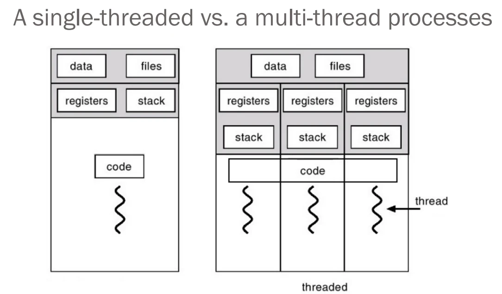

- 위의 그림처럼, 스레드는 생성될 시에 독립적으로 CPU의 상태를 저장하는 registers, function의 호출 상태를 저장하는 stack을 생성하고, data를 저장하는 메모리 영역은 프로세스와 공유한다.

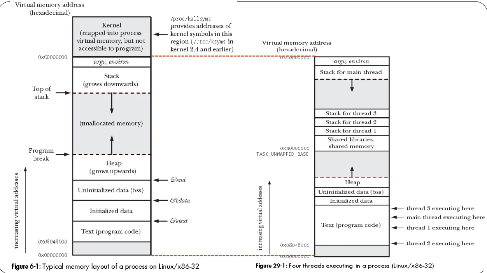

- 우측의 그림을 보면, 스레드가 새롭게 만들어지면서 스레드를 처리하기 위한 새로운 스택이 만들어진 것을 볼 수 있다. (커널 영역은 위에 존재하지만, 그리지 않음)

## Why Thread?

- 기본적으로 한 프로세스가 또 다른 프로세스를 생성하는 방법은 fork()인데, fork()는 사실 overhead가 매우 크다. 기본적으로 프로세스의 모든 정보를 복사해서 완전히 똑같은 프로세스 하나를 새롭게 만들어내는 것이기 때문에 시간이라던가, 메모리 측면에서 overhead가 매우 크다고 볼 수 있다.
- 또, 프로세스가 생성되면 각각 독립적인 메모리 영역을 차지하기 때문에 서로 데이터를 주고받기가 굉장히 어렵다.
- 반면, 스레드는 하나의 프로세스 내에서 같은 메모리 영역을 공유하기 때문에 데이터를 주고받는 것이 굉장히 쉽다.

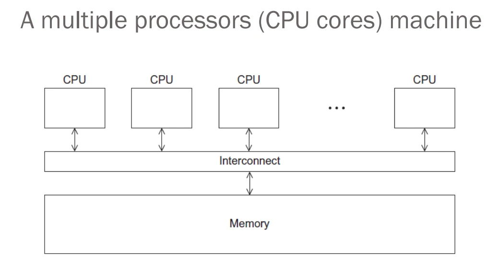

- 만약 Single Core CPU를 사용한다면, 하나의 코어를 time sharing하면서 프로그램(또는 스레드)이 수행되어야 하기 때문에 스레드를 생성한 본질을 잃게 된다. 하지만 코어가 여러 개 있다면, 서로 다른 코어가 서로 다른 스레드를 동시에 수행하게 되면서 time sharing 할 필요 없이 진정한 병렬 처리를 수행할 수 있게 된다.

## POSIX threads(a.k.a Pthreads)

- UNIX 계열의 운영체제들에서 멀티스레드 프로그래밍을 하기 위해 필요한 프로그래밍 API들을 define해놓은 standard
- 스레드의 실행, 종료 등 속성을 관리해주는 API들이 있다.

> 스레드는 하나의 address space에서 동시에 여러 개가 수행되기 때문에 데이터를 서로 공유한다. 그 데이터를 공유해서 사용할 때, 어떻게 충돌이 나지 않게 공유할 수 있을 것인가를 규정하는 mutexes, Condition variable와 같은 것들이 존재한다.

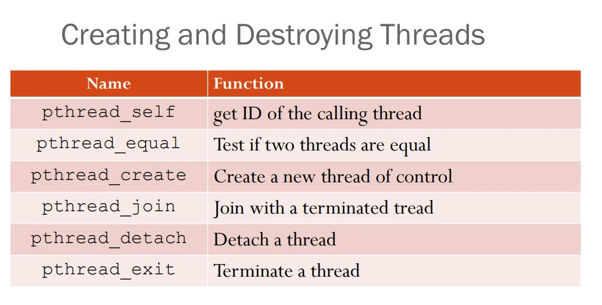

pthread_self : 쓰레드의 ID를 가져온다.

pthread_equal : 두 쓰레드가 같은 쓰레드인지 비교한다.

pthread_create : 새로운 쓰레드를 생성하기 위해 사용하는 API

pthread_join : 쓰레드가 종료될 때까지 기다리도록 한다.

pthread_detach : 쓰레드가 join된 것을 detach시킨다.

pthread_exit : 쓰레드를 종료시킨다.

- using pthreads

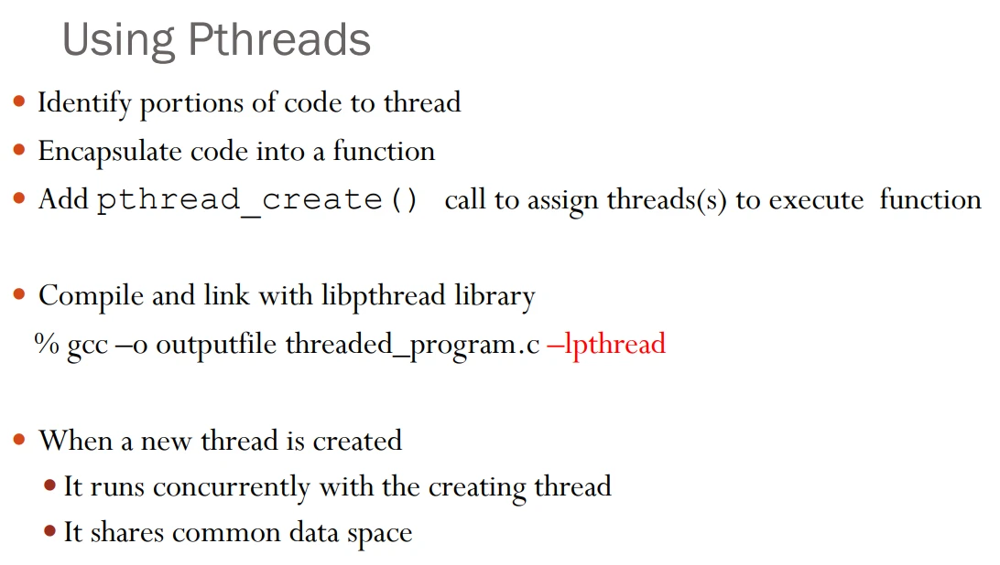

- 병렬로 수행하고 싶은 부분을 함수의 형태로 만든다.
- 그 함수를 `pthread_create()` 에 인자로 넘겨주게 되면, 그 함수를 새로운 쓰레드로써 수행하게 된다.
- 한 번 멀티 쓰레드로 생성되면 컴파일을 해야하는데, libpthread와 링크를 해서 사용해야 한다.

```shell
gcc -o outputfile threaded_program.c -lpthread
# 그런데, 버전이 업데이트되면서 linking 방법 바뀜.
gcc -o outputfile threaded_program.c -pthread 
# 이렇게 하면 된다.
```

## pthread methods (3)

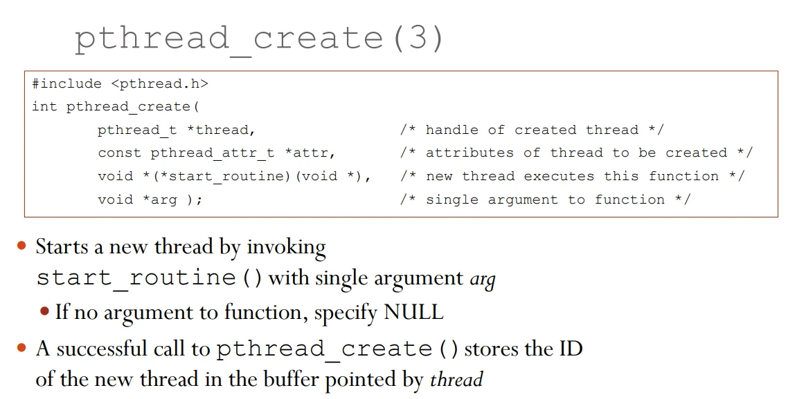

1. pthread_t\* thread : 스레드를 생성하게 되면, pthread_t라는 타입의 핸들을 return한다.
2. const pthread_attr_t\* attr : 스레드에 여러가지 속성을 결정할 수 있다.  
    → 굳이 지정할 필요가 없다면, NULL로 세팅.
3. void (Start_routine) (void\*) : 스레드로 수행하고 싶은 함수  
    → function pointer로 넘겨준다.
4. void\* arg : 스레드로 수행할 함수에 넘겨줄 argument를 이 인자로 지정한다.

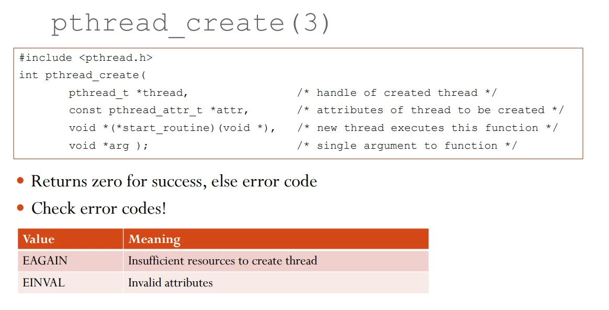

- create에 성공하면 0를 return하고, 생성이 잘 안되면 error code를 return하는데, 반드시 error code를 체크해서 생성이 제대로 되었는지 확인해야 한다.
- error code 중에서, EAGAIN, EINVAL과 같은 것이 들어올 수 있다.

EAGAIN : Insufficient resources to create thread → stack을 생성할 공간이 부족함.

EINVAL : Invalid attributes → 잘못된 속성 지정

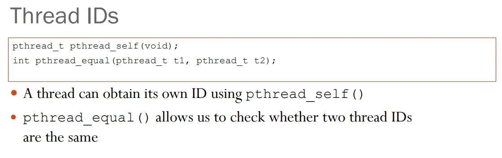

- pthread_t의 내부를 알 수 없기 때문에, 여러가지 보조 함수들이 존재한다. 쓰레드가 자기 자신의 아이디를 얻기 위해 사용하는 함수가 `pthread_self` 이다.
- 서로 다른 쓰레드의 ID t1, t2가 있을 때 두 쓰레드가 같은지 비교하는 함수가 pthread_equal이다.
- 이러한 보조함수들이 존재하기 때문에, pthread_t를 직접적으로 참조해서 조작하려고 하지 말고 보조함수를 통해 접근하고 제어하면 된다.

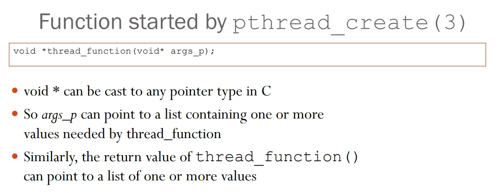

- 쓰레드를 생성할 때 전달해주는 함수는 선언될 때 위와 같이 선언된다. argument로써 void pointer type을 갖고, return type으로 void pointer type을 쓰레드가 수행할 function으로써 지정하는 것이다.
- void pointer type으로 넘겨준다는 것은, 어떠한 데이터 타입의 포인터도 넘겨줄 수 있다는 것이다. 이걸 넘겨주면 함수 안에서 type casting을 해서 사용하면 된다.
- 마찬가지로 return하는 것도 void pointer type으로 넘겨주므로, 받았을 때 type casting을 해서 사용하면 된다.

> 여기서, data는 args_p를 통해 전달되는데, 이것은 포인터를 통해 접근하는 것이므로 만약 데이터를 수정했다면 main에서 전달한 주소값을 통해 접근해서 바뀐 값을 참조하면 된다. 이와 다르게 return하는 것은 단순히 exit code에 가깝다. pthread_exit((void\*)42); 처럼 사용한다. pthread_exit(NULL);

```c
#include <pthread.h>
#include <stdio.h>
#include <stdlib.h>

void* snow(void *data) {

    printf("Let it snow... %s\n", (char *)data);
    pthread_exit(NULL);
}

int main(void) 
{
    pthread_t mythread;
    char *data = "Let it snow.";
    int result;

    result = pthread_create(&mythread, NULL, snow, data);
    if (result) {
        exit(1);
    }

    pthread_exit(NULL);
}
```

pthread_create : 생성되는 쓰레드의 핸들을 가져오기 위한 것.

result = pthread_create

result는 error code  
&mythread : 쓰레드의 핸들을 가져오기 위한 것  
NULL : 속성을 정하지 않는 것  
snow : 이 쓰레드가 수행할 function

- 쓰레드가 수행되는 동안, 여전히 pthread_create를 수행한 main thread도 동시에 수행된다. main thread가 수행이 되고 있으면, snow 함수를 function으로 수행하는 thread가 동시에 수행되는 것이다.
- pthread_exit()

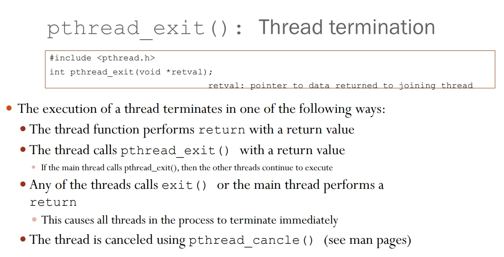

1)

- 예를 들어 `스레드`로 수행되는 `함수`가 있다고 하자. 그 함수를 쓰레드로써 수행하는데, 제일 마지막에 `return`한다고 하면, 쓰레드가 종료되는 것이다. (`implicit` 하게 종료하는 방법)

2)

- 또는 `pthread_exit((void*) exitcode)`를 이용하여 쓰레드를 `explicit`하게 종료할 수도 있다. exit를 하면서 어떤 return 값을 넘겨줄 수도 있는데, 기다리고 있는 어떤 쓰레드에  
    `void pointer` type으로 넘겨줄 수 있다.
- `main thread`가 아닌 경우에는 위의 예시처럼 하는데, main thread가 `pthread_exit()`를 하게되면, 프로그램이 종료되는 것이 아니다. main thread는 종료되지만, 다른 sub thread들이 종료될 때까지 프로세스가 계속 돌게 된다.

3)

- 모든 thread들에서, 만약 어떤 thread가 `exit(), (pthread_exit()가 아님…)`를 수행하게 되면, 그 프로세스 전체가 끝나버린다. 그 말은 즉슨, 현재 수행중인 thread를 모두 종료하게 된다. 또는 `main thread`에서 pthread_exit()가 아닌, `return`을 하게 되면 `exit()`와 마찬가지로 프로세스가 종료된다.

4)

- 하나의 thread가 다른 thread를 죽일 수 있다. `pthread_cancle()`을 이용하면 된다.
- pthread_join()

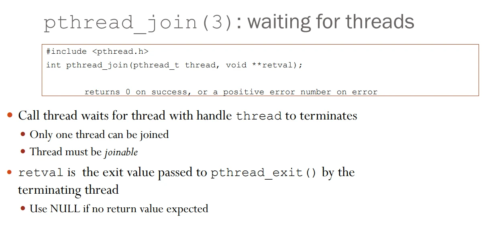

- 한 `thread`가 다른 thread가 종료되기를 `기다리는 것`이 `pthread_join`이라는 함수이다. 그리고 아까 `pthread_exit()`의 `argument`로써 `return` 값을 넣어주었는데, 그 값을 `pthread_join`의 `argument`로 줘서 가져올 수 있는 것이다.
- 만약 아무 것도 값을 가져올 필요가 없다면, `NULL`로 세팅하면 된다. pthread_join은 하나의 쓰레드가 다른 쓰레드의 종료를 기다리는 것이다. 그러므로 만약 `스레드`가 `여러 개` 종료되기를 기다린다면, `각각의 쓰레드`에 대해서 `pthread_join`을 불러주어야 한다.

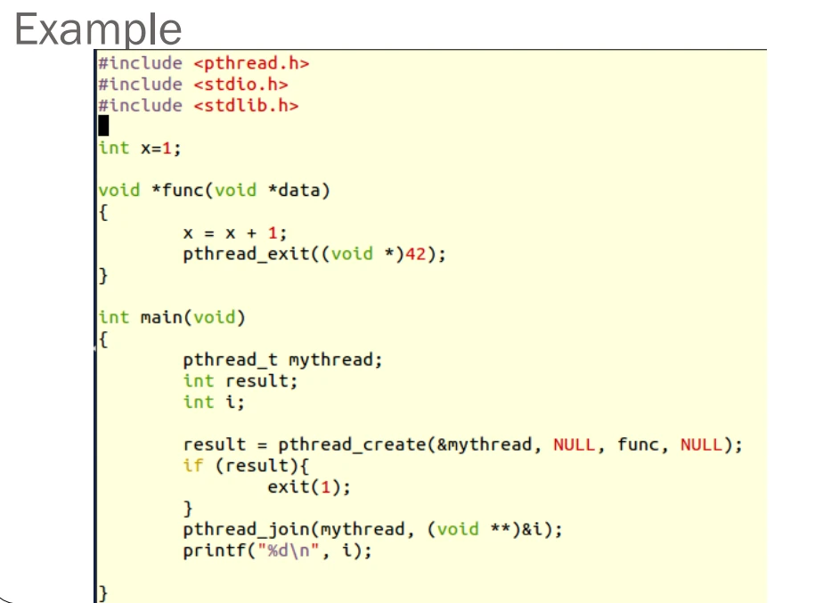

- main thread가 수행되고 있다가, func이라는 함수를 수행하는 쓰레드를 새롭게 만듦.
- main thread에서 pthread_join()을 통해 func를 수행하는 thread의 종료를 기다림.
- func thread에서 pthread_exit()를 통해 explicit하게 thread를 종료함. void pointer type으로 42라는 값을 return 해줌.
- pthread join에서 void pointer type으로 값을 받아와서 return 값을 사용할 수 있다.

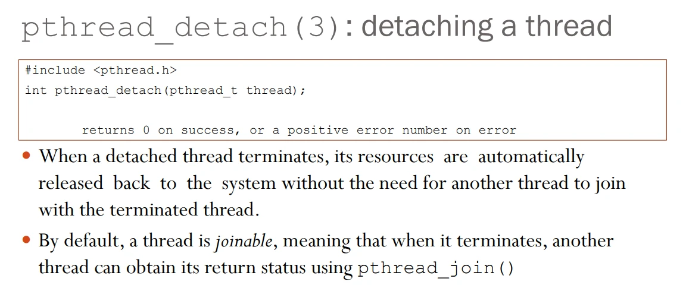

- 한 쓰레드가 종료되었을 때, 다른 쓰레드가 join을 해서 그 exit 값을 받아와야지 종료된 thread에 관련된 자원들(stack 등)이 release가 되는 것이다. 그런데, 이 thread 하나가 종료되면 기다릴 필요 없이 종료해버려라. 아무도 기다리지 않겠다. 라고 선언해줄 수 있는 함수가 있다. 바로, pthread_detach라는 함수이다. 이 함수를 이용하면, thread가 생성되고 종료되면 아무도 기다리지 않을 것이니 그냥 자원을 release하고 종료하라고 선언해줄 수 있다.

- pthread_create()를 이용해서 my_func()함수를 수행하는 스레드 만들기

```c
#include <pthread.h>
#include <stdio.h>
#include <stdlib.h>

void* my_func(void* arg) {
    printf("Hello, Thread!\n");
    pthread_exit(NULL);
}

int main(void) {

    pthread_t mythread;
    int result;
    result = pthread_create(&mythread, NULL, my_func, NULL);

    // 성공하면 0
    if (result) {
        printf("error!\n");
        exit(1);
    }

    pthread_join(mythread, NULL);
    printf("I am the main Thread!\n");

    return 0;
}
```

- pthread_create()으로 스레드를 만들고 나서 pthread_join()이나 pthread_detach()를 해주지 않으면 스레드의 종료를 기다리지 않고 main이 끝나게 되므로, 반드시  둘 중 하나를 해주도록 한다.
- thread 100개 만들어보기

```c
#include <pthread.h>
#include <stdio.h>
#include <stdlib.h>

#define NUM_THREADS 100

void* func(void* arg) {

    int value = *((int*)arg);

    printf("thread %d\n", value);
    pthread_exit(NULL);
}

int main(void) {

    pthread_t mythread[NUM_THREADS];
    int result;

    for (int i = 0; i < NUM_THREADS; i++) {
        
        result = pthread_create(&mythread[i], NULL, func, (void*)&i);
        
        if (result) {
            perror("pthread_create");
            exit(1);
        }
    }

    printf("creation finished\n");

    for (int i = 0; i < NUM_THREADS; i++) {
        pthread_join(mythread[i], NULL);
    }

    return 0;
}
```

- 이 예제도, 이전과 마찬가지로 스케쥴링에 의해 스레드 순서가 달라지므로 출력 순서는 다를 수 있음. 이 경우, func에서 printf 아래 fflush(NULL)을 넣어주면 원래대로 나올 가능성이 좀 더 높아짐.
- argument를 줘도 되지만, `./a.out | wc -l`을 사용하면 출력된 라인 숫자 체크 가능.
- `pthread_join`은 인자를 `pointer`로 받지 않는다. 값으로 줌.
- 두 개가 동시에 접근할 수 있는 데이터를 이용해 데이터 통신을 시도해보자.

```c
#include <pthread.h>
#include <stdio.h>
#include <stdlib.h>
#include <unistd.h>

// refactoring, 코드를 개선하는 과정.
#define NUM_THREAD 1

static long long counter = 0;
static char is_running = 1;

void* myfunc(void *arg) {

    while (is_running == 1) {
        counter++;
    }

    pthread_exit(0);
}

int main(void) {

    pthread_t mythread[NUM_THREAD];
    int sleep_counter = 0;

    for (int i = 0; i < NUM_THREAD; i++) {

        int result;
        result = pthread_create(&mythread[i], NULL, myfunc, NULL);

        if (result) {
            printf("error occurred!\n");
            exit(1);
        }
    }

    // for문으로 짜도 됨.
    while (sleep_counter < 10) {
        
        printf("COUNTER : %lld\n", counter);
        sleep(1);
        sleep_counter++;
    }

    is_running = 0;

    for (int i = 0; i < NUM_THREAD; i++) {
        pthread_join(mythread[i], NULL);
    }

    printf("Program Ended!\n");
}
```

- gcc mythread.c -pthread -O2 를 하면, 코드를 optimization할 수 있다.

그런데, 코드를 동작시키면 counter가 계속 0으로 나온다. 그리고, 프로그램이 종료되지 않는다. 이는 멀티 코어로 동작시키고 있기 때문이다.

counter, is_running 변수는 둘 다 memory 상에 존재한다. main thread가 변수값을 변경하면 new thread에서 그 값을 확인하고, 루프를 종료하는 구조이다. 컴퓨터에서 가장 느린 operation은 disk에서 값을 가져오는 과정이다. 그러므로 최적화를 하게 되면, 값을 cache에 갖다 놓거나, register에 값을 넣어놓는다. 이것은 main thread, new thread가 cache를 각각 가지게 되므로, 각각 cache에 존재하는 변수를 바꿔주는 거라서 올바른 동작이 안된 것이다.

프로그램의 최적화는 느린 작업을 빠른 작업으로 교체해주는 과정이다. 특히 memory accessing이 가장 느리기 때문에 이 과정을 바꿔준 것이다. L1 cache는 core 안에 있고, L2 cache는 메모리에 존재하는데, 이번 예제에서는 L1 cache를 사용했기 때문에 서로 통신이 불가능했던 것이다.

그렇다면 어떻게 할 것인가? cache값은 우리가 조절할 수 없다. cache는 숨어있는 장소라서, 우리에게 안보이기 때문에 컨트롤할 수 없다. cache에 있는 내용이 메모리에 다시 저장하는 경우는, 오직 cache를 써야하는데 cache 공간이 부족할 때 뿐이다. 정확히 cache를 언제 쓸지는 알 수 없다.

⇒ 그래서, 최적화에서 제외하는 옵션을 줘야한다. volatile

- volatile : memory access를 계속하는 값일 수 있기 때문에, 저장되는 위치를 바꾸거나 하는 걸 하면 안된다는 뜻. (multi-threading 환경에서 volatile이 중요하게 사용됨.)
- thread에 argument 넘겨주기 : 보통 쓰레드 번호를 넘겨주거나, 처리할 데이터의 범위를 넘겨주는 걸 많이 한다.

```c
#include <pthread.h>
#include <stdio.h>
#include <stdlib.h>
#include <unistd.h>

// refactoring, 코드를 개선하는 과정.
#define NUM_THREAD 1

struct thread_data {
    long long start;
    long long end;
    long long sum;
};

void* worker(void* arg) {

    struct thread_data* p = (struct thread_data*) arg;
    printf("%lld %lld\n", p->start, p->end);

    for (long long i = p->start; i <= p->end; i++) {
        p->sum += i;
    }

    printf("%lld\n", p->sum);
    pthread_exit(0);
}

int main(void) {

    pthread_t mythread;
    struct thread_data my_data;
    my_data.start = 0;
    my_data.end = 10;
    my_data.sum = 0;

    int result;
    // 뭘 넘겨줄지 모르기 때문에, void pointer를 넘겨준다.
    result = pthread_create(&mythread, NULL, worker, (void*)&my_data);
    // 포인터로 넘겨줘서 포인터로 값을 바꾸므로,
    // 원본의 데이터가 바뀐다...

    if (result) {
    printf("error occurred!\n");
        exit(1);
    }

    pthread_join(mythread, NULL);
    // pthread_join은 exit로 exit number를 받는다.

    // pthread_join이 return을 void** type으로 주므로,
    // (void**) type으로 casting해서 받아야 한다.

    printf("%lld\n", my_data.sum);
    printf("Program Ended!\n");
}
```
