# Thread Synchronization

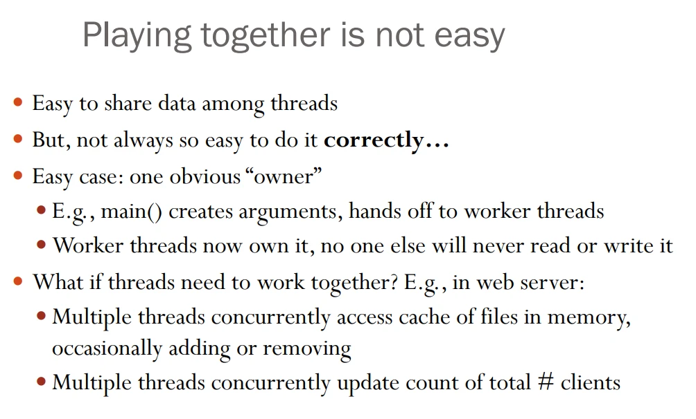

- `멀티 쓰레딩`으로 프로그램을 짤 때 가장 큰 장점은, 쓰레드와 쓰레드 간의 `데이터 공유`가 아주 쉽다는 것이다.
- 데이터가 `전역`으로 설정되어 있거나, `Heap` 영역에 데이터가 할당된 경우 쓰레드들이 서로 데이터를 주고받을 수 있게 된다.
- 하지만, 데이터를 쉽게 주고받을 수 있다고 해서 이것이 프로그램을 짜기 쉽다는 것은 아니다. 프로그램에서 한 데이터를 여러 쓰레드에서 접근할 때, 정확한 동작을 하도록 만드는 것은 굉장히 어려운 문제이다.
- 우리가 앞에서 살펴봤던 멀티 스레딩 프로그램들은 스레드로 데이터를 공유하기 쉬운 프로그램들이었다. 즉, 하나의 스레드가 어떤 메모리 영역에 대해서 확실하게 자기 것이라고 설정할 수 있는 경우였다. 예를 들면, 우리가 앞에서 짰던 멀티스레딩 프로그램은, 예를 들어 세 개의 스레드가 있다고 한다면 각각의 스레드에서 자신에게 할당된 부분에 대해서만 값을 처리(read, write)했기 때문에 스레드에서 데이터를 공유하는 부분이 없었고, 이것은 크게 문제가 될 일이 없었다.
- 하지만 많은 멀티스레딩 프로그램들은 스레드들이 같은 `메모리 영역`을 `동시에`  `읽고 써야`하는 경우가 많이 발생한다. `웹서버`는 대표적으로 스레드를 굉장히 많이 생성해야하는 멀티스레드 프로그램이다. 예를 들면, 웹페이지의 connection을 request할 때마다 스레드를 만들어내고, 그 스레드는 html file들을 메모리에 보관하게 되는데 이 캐시 형태의 메모리를 동시에 여러 개의 스레드들이 읽거나 쓴다. 추가를 하거나 제거를 하게 되는 것.
- 그런데, 이 과정에서 현재 몇 명의 클라이언트들이 접속해있는지를 저장하는 변수가 있다고 하면, 이 변수를 동시에 읽고 쓸 때 어떤 문제가 발생할 수 있는지 살펴보도록 한다.

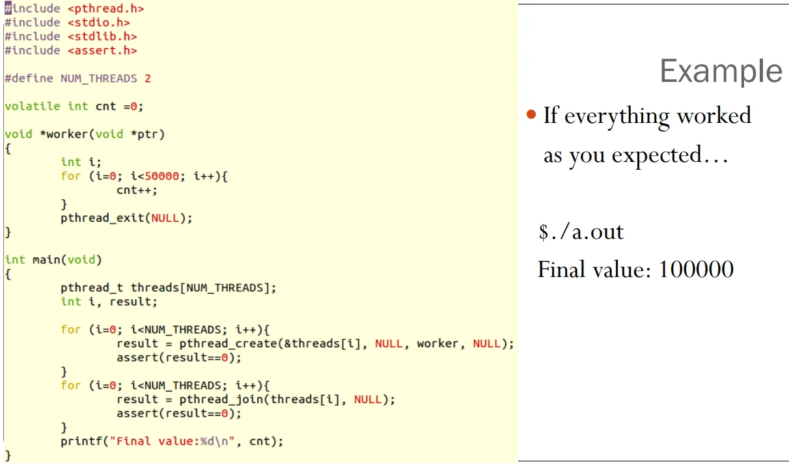

- 각각의 `스레드`에서 `cnt`라는 `volatile`  `전역 변수`를 `50000`씩 `증가`시키는 동작을 한다고 하면, 스레드의 동작이 끝난 이후에는 `cnt`의 값이 `100,000`이 될 것이다. 그런데 이 프로그램을 작성해서 돌려보면, 100,000이 나오는 경우가 있을 수도 있고, 대부분의 경우는 100,000보다 작은 값이 출력되는 것을 볼 수 있을 것이다.

> 왜 이런 현상이 발생할까?

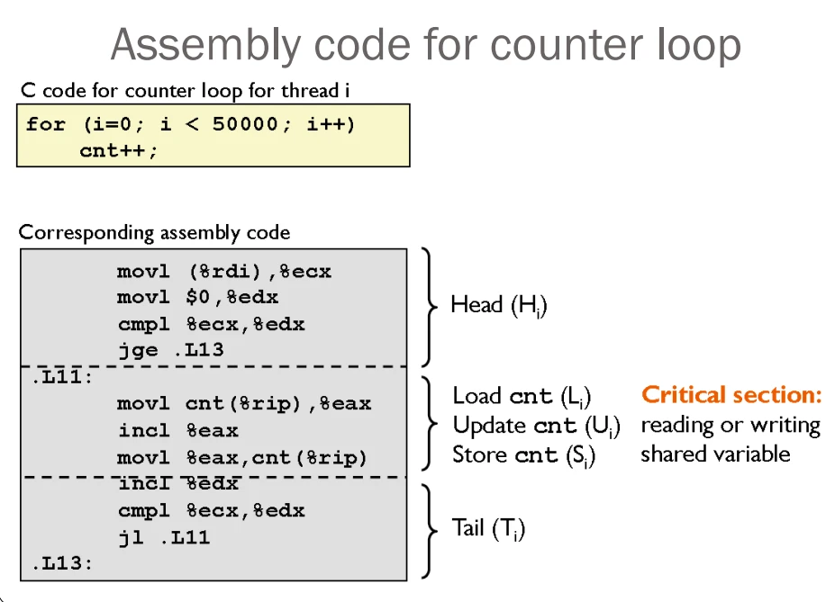

- 이것이 for loop를 어셈블리어로 변환한 코드이다. 여기서 중요한 부분은 바로 중간 부분이다.

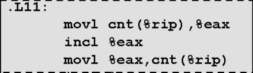

- movl cnt(%rip), %eax : Load cnt, `메모리`에서 `레지스터`로 읽어오기
- incl %eax : Update cnt, cnt값을 1 증가시키기
- movl %eax, cnt(%rip) Store cnt, 증가된 cnt값을 `레지스터`에서 `메모리`에 쓰기

⇒ 이처럼, `한꺼번에`  `수행돼야`  `하는`  `부분`을 `Critical Section`이라고 부른다.

즉, 순서는 H → |  L → U → S | → T 로 진행될 것이다.

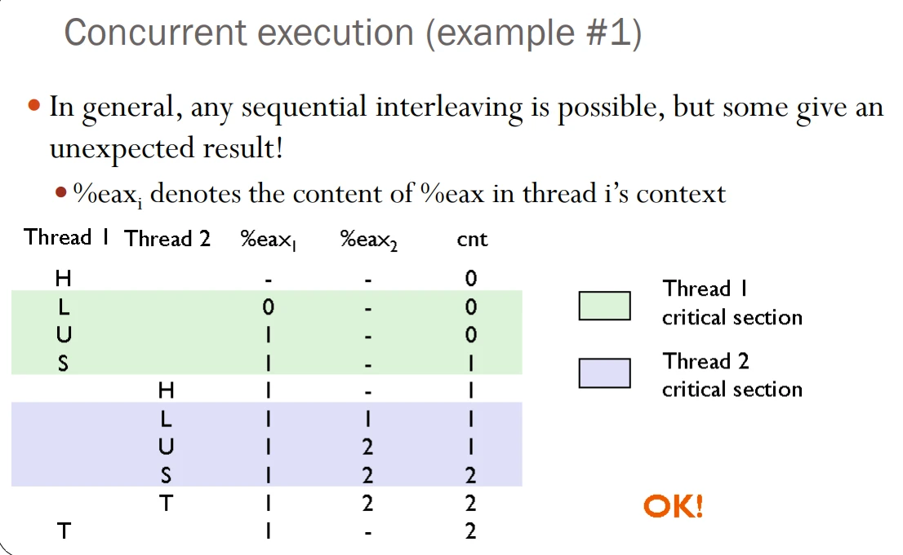

- Thread 1

L : 메모리에서 cnt의 값을 register로 읽어온다.

U : 레지스터에서 값을 증가시킨다.

S : 증가시킨 값을 메모리로 전달한다.

- Thread 2

L, U, S를 Thread 1과 동일하게 실행한다.

⇒ 이럴 경우에는 우리가 원하는 결과가 정상적으로 나온다.

- 잘못된 결과가 나오는 경우

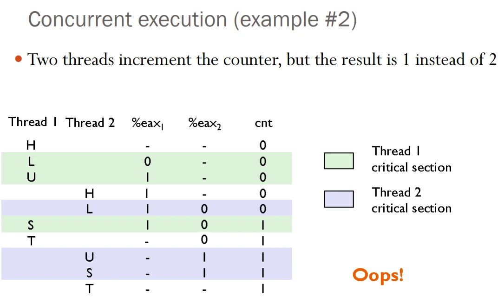

- Thread 1

L 실행.

U 실행.

Context Switching :: Thread 1 → Thread 2

- Thread 2

L 실행. ( 아직 Thread 1에서 S를 실행하지 않았기 때문에, cnt의 값은 0이다. )

Context Switching :: Thread 2 → Thread 1

- Thread 1

S 실행. ( 이전에 증가되었던 값인 1을 메모리에 저장한다. )

Context Switching :: Thread 1 → Thread 2

- Thread 2

U 실행.

S 실행. ( 이미 cnt가 1이지만, Thread 2에서 증가된 값인 1이 다시 저장된다. )

> 두 개의 스레드가 어떻게 `inter reading`되어 수행되냐에 따라서 cnt의 값이 1이 될 수도 있고, 2가 될 수도 있다. 이를 고려하지 않으면 굉장히 미묘한 문제가 발생해서 시스템에 큰 오류가 발생할 가능성이 있다.

---

- 이를 방지하려면, `Unsafe`한 `inter-reading`을 막기 위해 `스레드`를 `synchronize`해주어야 한다.

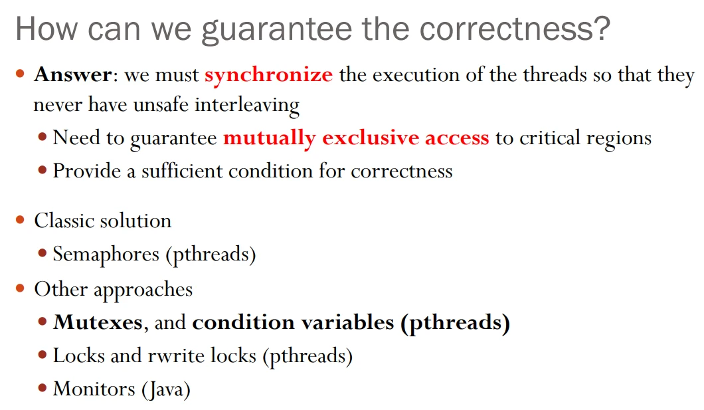

- 여러 스레드를 동시에 수행할 때 문제가 발생할 수 있는 코드 부분을 하나의 스레드만 수행하도록 `mutually-exclusive`하게 만들어주어야 한다. 즉, `코드`의 `특정 부분`을 `하나의 스레드`만 순서대로 `수행`하도록, 한 스레드만 그 코드를 수행할 수 있도록 만들어준다. 혹은 프로그램이 정확성을 유지할 수 있도록 코드를 작성한다.
- 이를 구현하도록 운영체제에서 여러 기능을 제공한다.

pthreads :

- Semaphores
- `Mutexes`, and `condition variables`
- Locks and read-wirte locks
- Java :

Monitors

⇒ synchronized run() { … } : 이 코드는 한 번에 한 스레드만 실행해야 된다는 뜻… (Monitors)

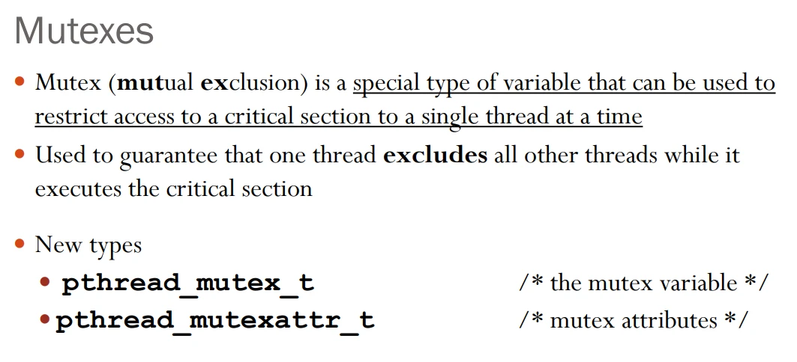

- Mutex (Mutual Exclusion) : 스페셜 타입을 갖는 변수. 바로, mutex type이다.

`pthread_mutext_t`

`pthread_mutexattr_t`

mutex는 어떤 코드가 있으면, 이 코드의 부분은 한 스레드만 한 번에 수행할 수 있도록 설정해야 할 때 사용한다.

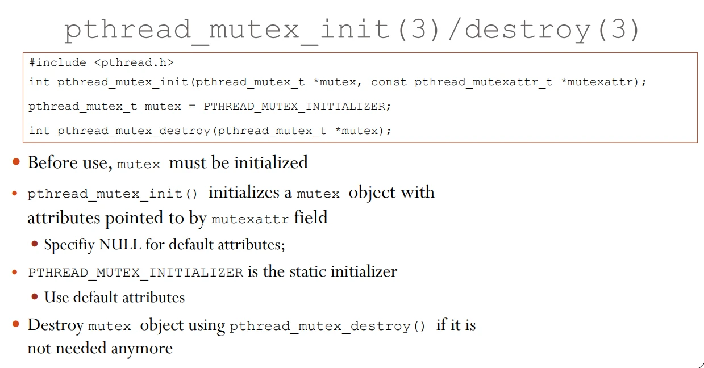

- `mutex`를 사용하려면, 반드시 `초기화` 해야한다. 초기화하는 방법은 `dynamic`하게 초기화하는 방법, `static`하게 초기화 하는 방법이 있다.

1) `dynamic` : `pthread_mutex_init()` 이라는 함수를 써서 원하는 `attribute`를 갖도록 초기화 함수를 불러주는 것이다. attribute는 나중에 고급 프로그래밍을 할 때는 중요한 의미를 갖지만, 현재는 NULL을 설정하면 된다.

2) `static` : `pthread_mutex_t mutex`  `=`  `PTHREAD_MUTEX_INITIALIZER;` 이와 같이 macro로 `pthread_mutext_t type`의 `변수`를 `초기화`하면 된다. mutex도 메모리를 잡아먹는 변수이기 때문에, 해제를 해주고 싶으면 `pthread_mutex_destory()`를 해서 없애고 싶은 변수를 써주면 된다.

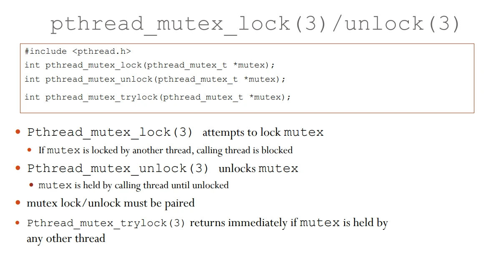

- 코드의 특정 부분을 한 스레드만 실행하도록 만드려면 pthread_mutex_lock, pthread_mutex_unlock 을 사용하면 된다.
- `lock`을 하게 되면, `Critical Section`에 들어가게 된다. 일단 한 `스레드`가 `lock`을 수행하게 되면, 다른 스레드가 Critical Section을 수행하려고 하면 lock을 호출하게 되는데, 이미 최초의 스레드가 실행하고 있기 때문에 `suspend` 상태로 기다리게 된다. 최초의 스레드의 수행이 끝나면 `unlock()`으로 해당 부분을 나가게 되고, lock에서 수행을 대기하고 있던 다른 스레드가 lock을 수행하게 된다. `new`와 `delete`처럼, `lock`과 `unlock`은 짝이다.
- `trylock`을 하게 되면, 한 스레드가 lock 파트를 수행하러 왔을 때 다른 것이 이미 lock을 점유하고 있다면, `suspend`하지않고 그냥 `return`해버리는 것이다.

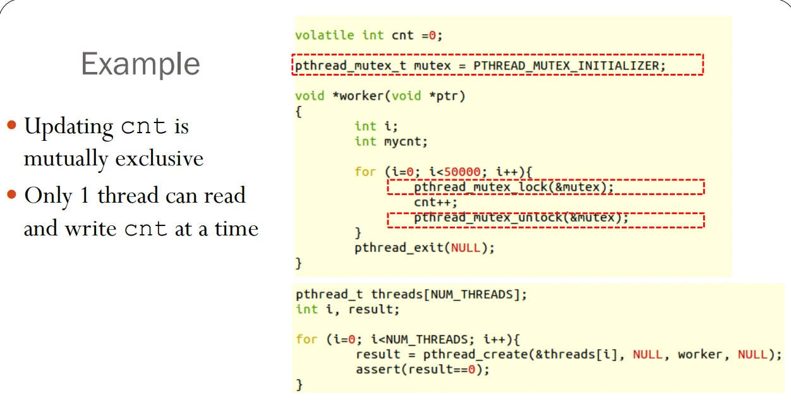

```c
#include <pthread.h>
#include <stdio.h>
#include <stdlib.h>
#include <assert.h>

#define NUM_THREADS 2

volatile int cnt = 0;
pthread_mutex_t mutex = PTHREAD_MUTEX_INITIALIZER;

void *worker(void *ptr) {
    int i;
    for (i = 0; i < 50000; i++) {
        pthread_mutex_lock(&mutex);
        cnt++;
        pthread_mutex_unlock(&mutex);
    }

    pthread_exit(NULL);
}

int main(void) {

    pthread_t threads[NUM_THREADS];
    int i, result;

    for (i = 0; i < NUM_THREADS; i++) {
        result = pthread_create(&threads[i], NULL, worker, NULL);
        assert(result == 0);
    }

    for (i = 0; i < NUM_THREADS; i++) {
        result = pthread_join(threads[i], NULL);
        assert(result == 0);
    }

    printf("Final value: %d\n", cnt);

}
```
