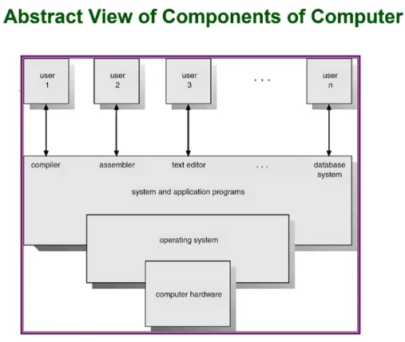
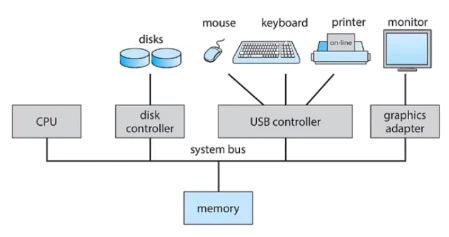
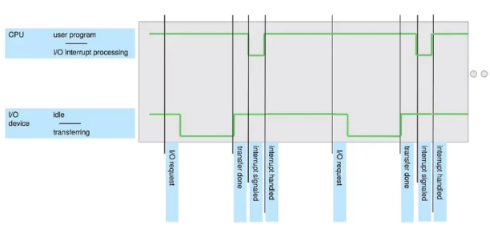
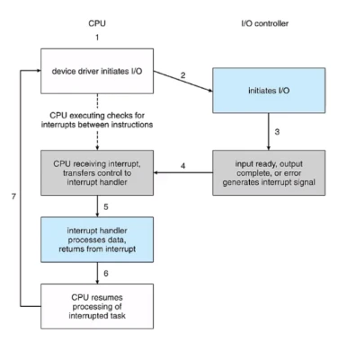
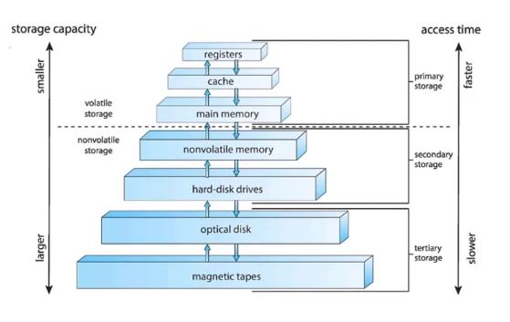

# 1주차: 컴퓨터 시스템 구조, 운영체제의 관점

작성일 2023-04-11 · 최종 수정일 2023-04-22
{ .post-date }

Operating Systems : an operating system is software that manages a computer’s hardware.

운영체제란? 컴퓨터의 H/W를 제어(관리)하는 S/W이다.

## Computer System Structure

- H/W : 컴퓨터 하드웨어는 크게  세 부분으로 나눠질 수 있다. 

    - CPU, memory, I/O devices

- Operating System : Controls and coordinates use of H/W among various applications and users

⇒ 운영체제는 사용자가 H/W를 비롯한 시스템 자원을 효과적으로 잘 사용할 수 있도록 지원하는 역할을 한다.                      

- Application Programs : Define the ways in which the system resources are used to solve the computing problems of the users  
    ⇒ 컴퓨터의 시스템 자원, 하드웨어 자원을 활용하여 유저가 컴퓨팅적 문제를 해결할 수 있도록 한다.
- Users : people, machines, other computers
- Network  

또한 컴퓨터 시스템은 H/W, S/W, Data로 구성된다고 볼 수도 있다. 컴퓨터 시스템에서 운영체제는 그 자체로는 어떠한 유용한 기능도 수행하지 못하며, 다른 프로그램들과 결합되어 유용한 동작을 할 수 있는 환경을 제공한다.

운영체제는 크게 두 개의 관점으로 바라볼 수 있다.

- **User View**(사용자의 관점)

    - 사용자의 관점에서 운영체제는 컴퓨터를 사용하기 편리하도록 하는 환경을 제공하는 역할을 한다. 이 과정에서 사용자는 성능과 보안에 대해서는 중요하게 고려하지만, resource utilization 자체에는 크게 주의를 기울이지 않는다.

- **System View**(시스템 관점)

    -  시스템 관점에서 운영체제는 하드웨어와 매우 밀접하게 관련된 프로그램이라고 볼 수 있다.

    - Resource Allocator의 역할을 한다.

        - Resources : CPU time, memory space, storage space, I/O devices 등등…
        - 운영체제는 이러한 Resource들의 관리자 역할을 수행한다.

    - 또 다른 관점에서 제시될 수 있는 관점중 하나는 다양한 I/O device와 user program을 관리하는 방법이다.

    - Control Program의 역할을 한다.

        - 운영체제는 유저 프로그램의 실행을 관리해서 에러를 방지하고 컴퓨터의 부적절한 사용을 막는다.
        - 이것은 주로 I/O device의 동작과 관련하여 고려되는 사항이다. (즉, 다양한 I/O와 유저 프로그램의 실행을 컨트롤해서 컴퓨터가 올바르게 동작할 수 있도록 한다.)

---

- Abstract View of Components of Computer       

운영체제는 어떻게 동작하도록 만들것인지에 대해 명확하게 정하기 때문에, 운영 철학에 대해 아는 것이 중요하다. 운영체제의 핵심적인 내용중 하나는 H/W를 사용자가 직접 Handle 하지 않도록 한다는 것이다. 유저는 실제로 H/W를 어떻게 Handle하는지 모르며, OS가 이를 처리하는 것이다.  
(Application으로 부터 사용 요청을 받고, OS가 최종 동작을 수행한다.)

⇒ 이것이 OS의 철학이다. 너는 H/W를 직접 다루지 못 해. 하지만, 잘 쓸 수 있도록 내가 중간에서 도와줄게. 넌 내가 도와주는 대로 따라오면 돼.

(반대로 말하면 H/W를 막아둔 대신 풍성하고 문제없이 사용하도록 지원해주는 것이 OS의 역할.)

⇒ H/W를 동작시키는 것과 더불어서 부가적인 서비스까지 잘 동작되도록 OS를 만들어야 한다.

---

- What is an OS?

A program that acts as an intermediary between a user of a computer and the computer H/W.

⇒ 운영체제는 H/W 위에 있으므로, 반드시 H/W를 완벽하게 제어해야 한다. 사용자가 H/W를 사용하지 못하도록 막기 때문에, 본인이 잘 제어해 주어야 하고, 이를 통한 서비스 (보이는것, 인지할 수 있는것 + 인지할 수 없는 것, 멀티 프로세스 등)를 제공해 주어야 한다.

- OS goals

    - Execute user programs and make solving user problems easier.  
        ⇒ 응용 프로그램의 실행을 도와 유저가 문제를 더욱 쉽게 해결하도록 돕는다.  
        (컴퓨터를 문제없이 사용하도록 돕는다.)
    - Make the computer system convenient to use.  
        ⇒ 컴퓨터 시스템을 사용하기 쉽도록 만든다.
    - Use the computer H/W in an efficient manner.  
        ⇒ 컴퓨터 하드웨어를 효율적으로 사용한다.

---

- What OS DO?

    - 관점에 따라 해석되는 방향이 다르다. (User View, System View)
    - 유저는 사용하기 편리함을 바라고, 좋은 성능이 나오길 바란다.  
        ⇒ 자원을 어떻게 활용하는지는 유저의 관심사가 아니다.
    - OS는 resource allocator이자 control program이므로, H/W를 효율적으로 사용할 수 있도록 하고 응용 프로그램의 동작을 돕는다.

- Users of dedicate systems such as workstations have dedicated resources but frequently use shared resources from servers.  
    ⇒ 워크스테이션과 같은 전용 시스템의 사용자는 전용 자원을 가지고 있지만, 빈번하게 서버의  공유 자원을 사용한다.

    - workstations : 특정 기능을 할 수 있도록 특정 기능을 강화한 컴퓨터
    - server : 여러 개의 네트워크 접속을 처리해줄 수 있는 컴퓨터. 스레드를 생성해서 사람마다의 데이터를 처리하도록 해준다.

- 스마트폰과 같은 모바일 기기는 저사양 resource를 갖지만, 사용성과 배터리 수명에 최적화 되어있다.
- 임베디드 시스템과 자동차와 같은 경우는 User Interface가 거의 없거나 존재하지 않기도 한다.

---

- 운영체제란? : 

    - Resource Allocator : Manages and Allocates resources.

        - 컴퓨터의 H/W, 마우스, 키보드 등까지도 모두 resource로 고려된다.

    - Control Program : controls the execution of user programs and operations of I/O devices.

        - Kernel : the one program running at all times.  
            (All else being application programs. 응용 프로그램이 아닌 모든 것.)

    - 운영체제란 컴퓨터에서 항상 동작하는 프로그램으로서, kernel이라고도 불린다. kernel은 다시 두 종류로 나뉘어지는데,

        - System programs : 운영체제에 연관되어 있지만 반드시 커널의 일부로 포함되지는 않는 프로그램들을 말함.
        - Application Programs : 운영체제 동작과 관련되어 있지 않은 모든 프로그램을 말함.

    - 모바일 운영체제는 kernel 뿐만 아니라 Middleware를 포함하기도 한다. Middleware란, 응용 프로그램 개발자들이 사용할 수 있는 추가적인 서비스로서, 데이터베이스나 멀티미디어, 그래픽 등을 다룰 수 있는 서비스를 말한다.

- 요약 : 운영체제는 컴퓨터가 동작되는 동안에는 항상 수행되는 kernel, 그리고 응용 프로그램 개발 등에 사용될 수 있는 미들웨어, 시스템 관리에 사용될 수 있는 여러 시스템 프로그램 등을 포함한다.

---

- 현대 컴퓨터 구조는 한 개 이상의 CPU와 많은 양의 device controller가 하나의 버스를 통해서 연결되며 shared memory를 공유하는 구조로 되어있다. 각각의 device controller는 특정한 타입의 device를 담당하고, 여기에는 상황에 따라 한 개 이상의 device가 연결될 수도 있다.
- CPU가 컴퓨터의 핵심인 이유는 데이터를 모두 읽고 처리하기 때문이다. 그리고 그 데이터는 모두 Memory에 있다.
- Program을 실행하려면 반드시 disk(보조 메모리)에 있는 데이터를 memory(RAM, main memory)에 올렸다가 CPU로 보낸다. (execution)
- 마찬가지로 mouse, keyboard, printer 등의 입력도 메모리에 올라가 있다가 CPU가 처리하게 되고, 모니터 또한 마찬가지이다.
- ***이 모든 장치를 하나의 bus로 연결해놓고 사용***하게 되는데, 실제로는 하나의 I/O 작업이 이루어지면 끝날 때까지 다른 동작을 처리하지 못한다. ⇒ 그러므로 스케쥴링을 통해 적절하게 프로세스(job) 별로 실행되도록 하는 것이 중요하다.
- ex) 1초는 1000ms. ⇒ 1초에 30프레임을 그리려고 하는데 1 프레임을 표현하는데는 실제로 1ms 정도밖에 필요하지 않기 때문에, 30프레임을 표현하면 9970ms가 남게 되고, 그 동안 다른 작업을 수행하게 된다. ⇒ 이를 Time sharing이라고 한다. (OS 기능) 즉, 시간을 쪼개서 사용하게 된다.

---

### 운영체제의 관점

- 윗쪽 관점(User Mode) : Application Software, User.
- 아랫쪽 관점(Kernel Mode) : H/W 관리가 필요한 영역
- I/O 디바이스와 CPU는 동시에 동작할 수 있다. (**Concurrently**)
- 각각의 Device Controller는 특정한 디바이스 종류를 담당하고 있다. (**in charge of**)
- 각각의 Device Controller는 **local buffer**를 가져서, 입력과 출력 상황에 맞게 데이터를 가지고 있다가 전송해줄 수 있다.

- 각각의 Device Controller는 device driver를 가지고 있어서, Controller를 관리할 수 있다.

    - Device Driver : 각각의 I/O Device를 처리하는 S/W

    > Plug & Play : 꽂기만 하면 알아서 디바이스 드라이버가 설치되는 기능.   
    > (OS & H/W 회사의 표준화로 인해 가능하게 된다.)  
    >   
    > 임베디드 시스템의 경우, 각 제조사 별로 원하는 대로 만들기 때문에 표준화를 하기는 어렵다. 하지만 최근에는 H/W 성능이 좋아져서 표준화되고 가격이 싼 걸 사용할 수 있게 되었다. (즉, 굳이 H/W를 새로 설계해서 임베디드 시스템을 만들 필요가 없어졌다. 최근에 그냥 성능 좋고 가격 싼 라즈베리 파이 등을 사용하는 것과 같은 흐름)  
    >   
    > 그러므로 다시 설계를 할 필요가 없고, 표준화를 다시 할 필요가 없는 흐름이다.

- CPU는 Main Memory와 Local Buffer 사이에서 데이터를 옮겨간다.
- I/O는 외부의 device에서 controller의 local buffer로 데이터를 전송한다.
- I/O 동작을 시작하기 위해서, 디바이스 드라이버는 디바이스 컨트롤러에 적합한 레지스터를 로드해야 한다. 그러면 디바이스 컨트롤러는 레지스터에 들어있는 내용을 분석해서 어떤 동작을 할지 알게되고, 가령 키보드로부터 character를 하나 읽어오라는 입력이었다고 한다면, 컨트롤러는 디바이스에서 로컬 버퍼로 데이터를 옮겨온다. 이 작업이 끝나면 디바이스 컨트롤러는 디바이스 드라이버에게 작업이 끝났다고 알려주게 된다. 그러면 디바이스 드라이버는 제어권을 운영체제의 다른 파트로 넘겨주게 된다.
- Device Controller는 데이터의 전송이 끝나면 CPU에게 전송 작업이 끝났다고 ***interrupt signal***을 전달한다.
- 하나의 device controller는 local buffer storage를 가져서 데이터를 전달받을 수 있고, special-purpose register 집합을 가진다. device controller는  peripheral과 local buffer storage 사이의 데이터 전송을 관장한다.
- 통상적으로 운영체제는 각 device controller마다 device driver를 가지는데, 이를 통해서 device controller와 다른 디바이스들이 일관적으로 인터페이스되도록 만든다.
- CPU와 디바이스 컨트롤러는 병행적으로 동작 가능하며, 메모리 사이클을 차지하기 위해 적극적으로 경쟁한다. 

---

- ***Interrupt*** : 시간을 쪼개서 사용할 수 있는 이유.

    ex) LCD에 출력하고 있을 때 소리를 출력해달라고 Interrupt가 오면, 소리를 출력하고 다시 돌아와서 LCD 출력을 처리한다.

    컴퓨터는 명령의 처리 속도가 매우 빨라서, 마치 퀵실버와도 같다. 처리해야 하는 많은 명령을 단기간에 처리함으로써 남는 시간에 모든 명령을 처리하게 되고, 이를 적당히 잘 이용해서 모든 요청이 개별로 이루어지지만 실제로 동시에 이루어지는 것처럼 보이게 컴퓨터 사용 환경을 지원하게 되는 것이다.

    - 일반적으로 Device Controller가 CPU에게 signal을 보내서 Interrupt가 발생했음을 알리는데, 이 때 어떤 종류의 인터럽트가 발생한 것인지 번호를 해석하게 된다. 이렇게 해석된 번호를 이용해서 Interrupt Vector Table에서 Hashing을 통해 매칭되는 vector에 접근하게 되고, Vector Table이 가리키고 있는 주소로 이동함으로써 ISR(Interrupt Service Routine)을 수행하게 된다. 

    - Interrupt의 종류

        - tip : **C언어에서 if를 쓰면 반드시 else를 사용하세요.**

            - ***interrupt***  : 외부에서 들어오는 인터럽트
            - ***trap***(exception) : 내부에서 발생하는 인터럽트, error 혹은 user request로 발생하는 interrupt를 말한다.

            ⇒ An operating system is interrupt driven

    

    - OS는 Registers의 정보와 Program Counter의 정보를 저장함으로써 CPU의 상태를 보존할 수 있다. ⇒ ISR로 이동하기 전에 이 상태를 기록해두어야 함.
    - 모든 I/O 장치는 하나의 버스(시스템 버스)로 처리되기 때문에 한 번에 하나의 요청만 처리할 수 있다. (들어오는 I/O 요청은 인터럽트 처리를 통해 들어오는 즉시 요청을 처리할 수 있도록 잘 제어하게 된다.)
    - CPU도 마찬가지로, 데이터를 메모리에서 가져와야 하므로 버스를 차지한다.

    - Interrupt Handling

        - polling : 이벤트가 발생하는지 계속 지켜보고 있다가 발생하면 처리해주는 것.
        - vectored : 기존의 인터럽트 방식, event-driven. 특정 이벤트가 발생하면 그것이 처리가 되는 방식이다. 상황에 맞춰서 구분되는 vector를 적용한다.  
            (만약 두 개의 인터럽트가 발생한다면 우선 순위, priority 에 의해 실행 순서가 결정된다.) 

        - Interrupt Request Line

            - CPU 하드웨어에는 interrupt request line이라는 것이 있는데, CPU는 매 요청을 수행한 이후에 이 라인을 확인하게 된다. 만약 한 컨트롤러가 CPU에 인터럽트 시그널을 보내게 되면 이 라인을 통해 시그널이 전달되고, CPU는 인터럽트를 해석해서 어떤 인터럽트가 발생한 것인지를 나타내는 번호를 확인하게 된다. 그리고 이 번호를 이용해 Interrupt Vector Table에서 인덱싱을 통해 실행할 인터럽트가 담긴 곳을 알게 되고, ISR을 찾아가서 수행하게 된다.
            - Maskable : maskable interrupt line은 device controller에 의해 시그널이 전달되는 라인으로서, 이 interrupt는 다른 interrupt에 의해 preempt될 수 있다.
            - Non-Maskable : Unrecoverable memory errors를 처리하기 위해 만들어짐. ⇒ 복구 불가능한 에러이기 때문에 즉시 알려줘야 하며, preempt 될 수 없음.
            - 일반적으로 컴퓨터에는 수많은 디바이스들이 있기 때문에, interrupt chaining 방식을 이용해서 interrupt vector table에서 여러 디바이스의 인터럽트 서비스 루틴을 모두 기록할 수 있다. 인터럽트 번호가 같지만 디바이스에 따라 실행되는 ISR이 다를 경우, 각 노드를 기준으로 포인터로 연결을 하면서 원하는 ISR을 찾아갈 수 있도록 만드는 형태이다.

        

    - 초기에 Device Driver가 registers를 load한다. 이후에 대기하고 있다가 특정 이벤트가 발생하면 Device Controller가 CPU에게 signal을 보낸다. CPU는 대기하고 있다가 한 instruction을 수행하고 라인을 통해 signal을 전달받는다(interrupt request line을 통해서…). 그러면 인터럽트 과정을 수행하고 다시 본래의 과정으로 돌아온다.

---

- Bootstrap : 컴퓨터를 켤 때, 최초에 실행되는 크기가 아주 작은 프로그램. 메인보드 ROM에 내장되어 있다. 실행시켜야 하는 프로그램의 위치를 기록해두었다가 컴퓨터가 켜질 때 찾아가서 실행하는 역할을 한다. (Boot startup을 바꾸면 멀티 OS 부팅을 실행할 수도 있다.)  
    ⇒ 최근에는 EEPROM 등에 넣어서 보관하기도 한다. EEPROM에는 부트스트랩과 필수적인 펌웨어들이 보관되어 있다.

- 폰 노이만 아키텍처를 기반으로 하는 일반적인 명령어 실행 사이클은 먼저 명령어를 메모리에서 fetch한 후, instruction register(IR)에 명령어를 저장한다. 그리고 그 명령어를 해석하게 되는데, 이 때 명령어의 종류에 따라 피연산자를 메모리로부터 가져와 internal register에 저장해야될 수도 있다. 이 피연산자에 대한 연산 명령어 실행이 끝난 후, 결과는 다시 메모리에 저장된다.

    폰 노이만 아키텍처에서는 메모리는 그 자신이 저장하고 있는 것들이 어떤 과정을 거쳐서 만들어지는지 알지 못하고, 데이터 각각이 명령어인지 값인지 등을 구분하지 않고 단순히 저장하기만 한다. 메모리는 누군가의 요청에 따라 데이터를 찾아 전송해주고 저장하기만 할 뿐이다.

- 프로그램을 수행하기 위해서는 반드시 메인 메모리에 프로그램이 올라가 있고 CPU가 이 프로그램을 하나씩 빼오면서 수행하도록 해야하기 때문에 우리는 메인 메모리에 항상 프로그램이 올라가있기를 바랄 수도 있다. 하지만 이것은 메인 메모리가 volatile하기 때문에 불가능하다. 따라서 우리는 non-volatile한 추가적인 저장 장소를 도입해야만 한다. (보조 메모리)
- Storage Structure : Storage(메모리 밖의 저장 장치)

- Caching : 컴퓨터 내부적인 관점에서 보면, 내가 자주 사용할 것 같은 작업을 미리 갖다 놓고 필요할 때 사용하는 것. CPU 내부 혹은 외부에 존재한다. 메인 메모리는 보조 메모리를 위한 일종의 cache memory의 역할을 한다고 볼 수 있음.

    - tip : C언어에서 goto를 사용하면 computer가 guess해서 cache에 넣어둔 내용을 무시하고 실행하게 되므로, goto를 사용하지 않는 것이 좋다.
    - tip : 이차원 배열이 있을 때 데이터는 한 행을 기준으로 먼저 읽는 것이 caching에 좋다. 그렇지 않고 열을 기준으로 읽으면 caching을 무시하고 배열을 읽게 되므로, 효율이 저하된다.
