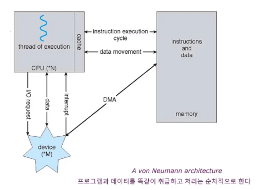
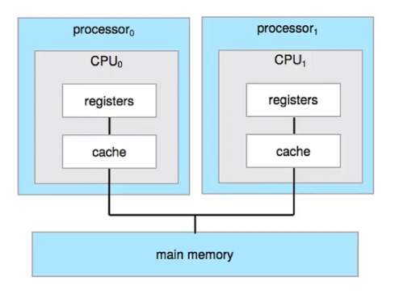
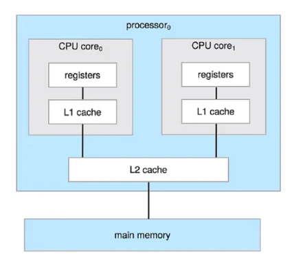
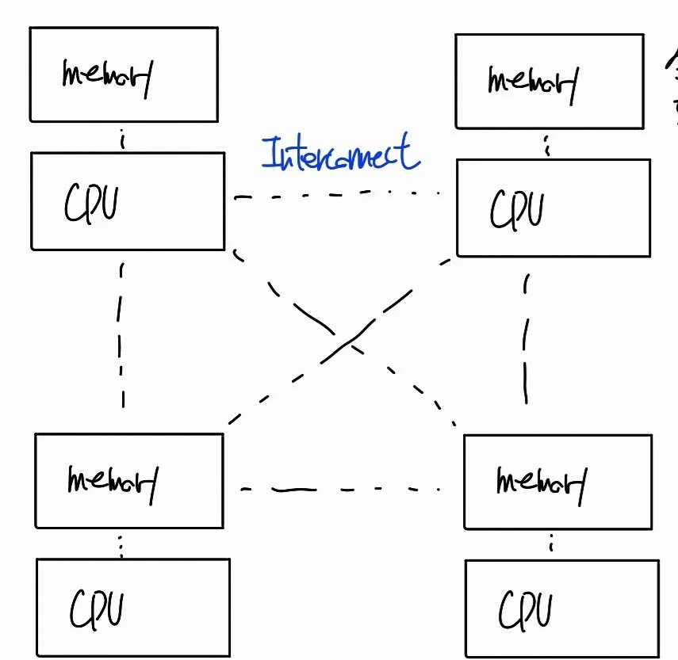
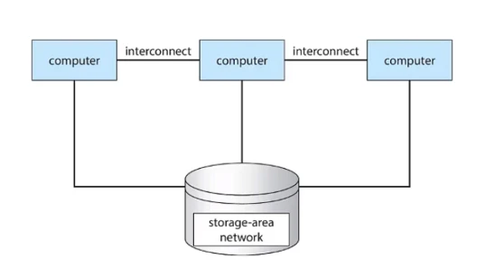
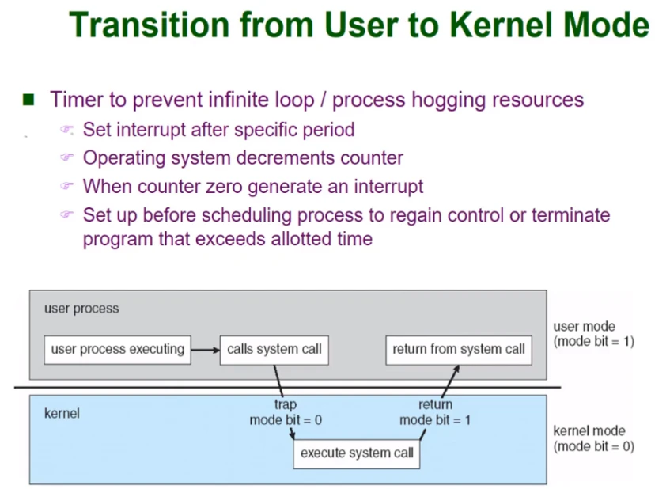
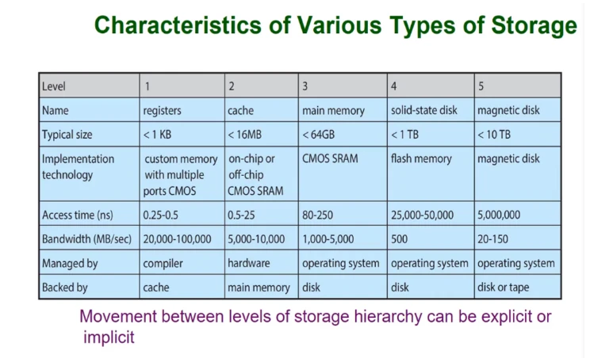
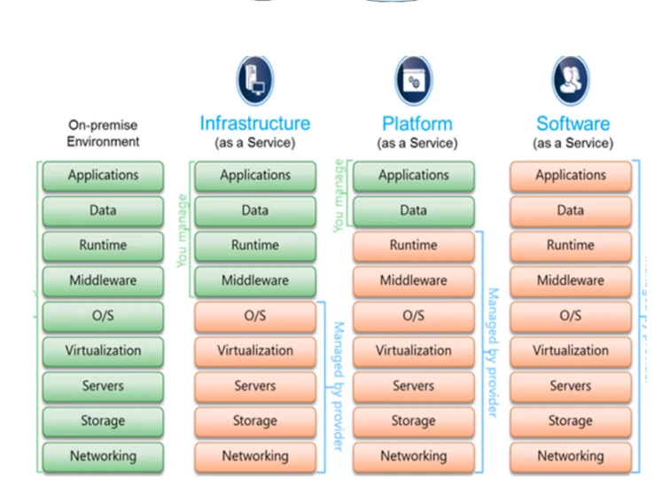

# 2주차: 현대 컴퓨터 구조, Multiprocessor

- How a modern computer works?

    

    - ***폰 노이만 구조***(현대 컴퓨터의 구조)

        - 이 방식은 메모리 상에서 프로그램과 데이터를 똑같이 취급하고, 처리는 순차적으로 하는 것을 말한다.

    - 일반적으로 메모리 상의 데이터가 CPU를 거쳐서 I/O로 가게 되지만, instruction이 아닌 데이터를 이동시킬 때는 CPU의 처리가 필요하지 않기 때문에 CPU가 관여하지 않아도 될 수 있다. 대량의 시간동안 데이터를 옮길 경우, 이 요청이 버스를 차지하느라 다른 명령어를 사용하지 못하게 될 수도 있으므로, DMA를 이용해 곧바로 데이터가 필요한 I/O device에 전달해줄 수 있다. DMA는 시스템 버스가 아니라 다른 추가적인 버스이므로, 이때 CPU는 버스를 차지해서 다른 동작을 수행할 수 있게 된다.

        - DMA를 사용하면 Device Controller는 CPU의 간섭없이 buffer storage에서  블록 단위로 데이터를 Main Memory에 전송할 수 있다. 
        - I/O 디바이스에서 buffer, pointer, counter에 대한 세팅이 끝나면, 디바이스 컨트롤러는 데이터 블록 전체를 메인 메모리로 옮기거나, 메인 메모리에서 데이터 블록 전체를 CPU의 간섭없이 디바이스로 옮겨준다. 이 블록 단위 하나에 대해서 단 하나의 인터럽트만 발생해 디바이스 드라이버에게 데이터 전송이 끝났다는 것을 알려주게 된다. (한 바이트 데이터 전송당 하나의 인터럽트가 발생하는 것은 overhead가 될 수 있음.)

- Multiprocessor : 원래 컴퓨터의 구조는 Mainboard + Single CPU 이지만, 여러 작업을 동시에 처리하고자 하는 요구가 발생되면서 Multi processor가 도입되기 시작했다.  
    ⇒ 그런데, 결국 메모리는 하나이고 버스도 한 개이므로 Processor를 여러 개 붙인다고 해서 메모리가 데이터를 한 번에 더 많이 보낼 수 있는 것은 아니다.

    - Also known as parallel systems, tightly-coupled systems

    - Advantages include

        - Increased throughput
        - Economy of scale
        - Increased reliability - graceful degradation or fault tolerance

    - Fault Tolerant System : CPU, Memory, Disk, Mainboard를 다 다른 보드에다가 설치한다. 이 과정에서 문제가 생긴다면 문제가 생긴 H/W를 빼내서 해결할 수 있는 시스템을 말한다. (문제가 생긴 H/W 하나를 빼낸다고 해서 시스템이 down되지는 않기 때문에, 문제가 되는 부분을 쉽게 교체할 수 있도록 설계된 시스템으로 동작할 수 있다.)

- Multi-processing

    - Symmetric

        - 모든 CPU가 모든 일을 수행할 수 있는 구조이다. 이때 모든 CPU는 각각의 register 집합과 private(혹은 local) cache를 가지고 있다. 그러나, 모든 CPU가 시스템 버스를 통해 실제 물리적인 physical memory를 공유하고 있다. (데이터 공유를 위해서 interconnection)
        - CPU가 분리되어 있기 때문에 한 번에 여러 개의 프로세스를 실행할 수 있다는 이점이 있지만, 동시에 특정 프로세서만 과부하가 되고 다른 프로세서는 idle 상태에 놓이는 비효율적인 상황이 연출될 수 있다. 이를 해결하려면 메모리를 공유하도록 해서 overload된 프로세서로부터 프로세스를 옮겨주는 방식을 도입할 수 있다.

    - Asymmetric

    

    ⇒ 요즘 나온 CPU는 CPU 자체는 하나이지만 그 안에 내부적으로 논리적 CPU의 기능을 하는 Multi-core를 도입하여 작업 처리 속도를 향상시킨다.

    

    ⇒ 각각의 코어는 S/W적인 CPU의 역할을 하지만, main memory는 결국 하나이고 버스도 하나로 연결되어 있기 때문에 한 번에 가져올 수 있는 데이터는 한정되어 있다. 위의 그림을 보면 각각의 코어가 L1 cache를 가질 뿐만 아니라 processor chip 내에 L2 cache를 가지고 있다. 이를 통해 데이터를 더욱 빠르게 공유하게 되는데, 캐시를 효율적으로 사용해서 최대한 warm cache를 이용하게 되면 결국 cache affinity 얻어 버스 병목현상을 해결하는데 도움이 될 수 있다. (현대 컴퓨터는 거의 이 구조를 채택한다.)

    실제 H/W적으로 멀티 프로세서를 도입할 경우, 설계는 가능하긴 하지만 메모리는 결국 하나의 버스를 사용하게 되므로, 병목현상(Bottle neck)이 발생하게 된다. 이 때, 각각의 CPU와 가깝게 일하는 **local memory**를 붙이고 효율적으로 관리할 수도 있다. (***Local Memory. 단, 다른 쪽 메모리로 접근은 가능, 관리만 효율적으로 하도록 한다.***)

    - Local memory와 Interconnection을 다루는 그림 (NUMA, non-uniform memory access)

    

⇒ NUMA는 **CPU**끼리 작고 빠른 local bus로 연결되어서 서로의 local memory를 공유할 수 있게 함으로써 필요할 경우 서로 접근해서 데이터를 공유할 수 있도록 만든다.

---

- Clustered Systems : 멀티 프로세서 시스템처럼 멀티 시스템이 서로 함께 일하도록 하는 것.  
    즉, 묶어두는 것이다. 기밀 데이터의 경우 Clustered 네트워크 안에서만 처리가 가능하다. 허가된 컴퓨터만 이용하여 외부와 통신이 가능하다는 것..

    

    - 주로 SAN(Storage Area Network)를 사용하여 storage를 공유한다.

    - 문제가 발생해도 동작 가능한 고가용성(high-availability) 서비스를 제공한다.

        - Asymmetric clustering : one machine in hot-standby mode  
            ⇒ 대기하다가 문제가 발생했을 때 동작
        - Symmetric clustering : 같은 동작을 하는 여러개의 노드가 있으며, 서로 모니터링을 한다.
        - 일반적으로 Symmetric clustering이 더 효율적이라고 하지만, Symmetric clustering은 추가적인 자원을 필요로 하므로 이를 고려해야 한다.

    - WAN (LAN을 묶어서 구성)

        - LAN(Local Area Network)
        - SAN(Storage Area Network) : LAN보다 좁은 영역

- Distributed Systems : WAN을 이용하여 각각의 지역에 있는 컴퓨터를 모아서 사용하는 것.  
    ⇒ ex) 거리가 떨어져 있는 각각의 컴퓨터가 동작을 나눠하면서 마치 여러 개의 CPU가 일을 하는 것처럼 처리하는 방식 (Distributed).

---

- Operating System Operation

    - Bootstrap Program : system을 초기화하는 간단한 코드로서, ROM의 초반부에 존재한다. 주요 역할은 Kernel을 메인 메모리(RAM)에 로딩하는 것이다.

    - Daemon : 메모리에 내장되어 어떤 특정한 일을 하는 프로그램으로서, 커널이 메모리에 로드되고 나면 주요 데몬들이 커널에 의해 실행된다.

        - ex) 서버에는 Daemon이 항상 돌면서 어떤 요청이 들어오는지 체크하고, 요청이 들어올 경우 그것을 처리해주는 역할을 한다. (특별한 작은 일을 처리하는 역할을 하며, 한 컴퓨터에 매우 많은 데몬이 동작한다.)

    - Kernel interrupt driven

        - 각각의 디바이스로부터 H/W Interrupt를 전달받을 수 있다.

            - Device Controller로부터 CPU에 전달되는 인터럽트

        - S/W 인터럽트는 Interrupt와 Trap이 있다.

            - interrupt

            - trap(or exception)

                - Software적인 Error
                - Request for operating system service - **system call**

    ⇒ 운영체제가 할 일 첫 번째 : H/W를 막아서고 사용자가 Application Program에서 H/W를 사용할 수 있도록 제어해야 되고, 사용자가 보내는 요청을 처리할 수 있도록 커널에 보내는 요청을 System Call이라고 한다.

- Multi-Programming(***Batch System***)

    - Single user cannot keep CPU and I/O devices busy at all times.
    - Multi-Programming은 code와 data를 조직해서 모든 CPU가 언제나 하나의 job을 수행하고 있도록 만든다. (Job Scheduling) 결과적으로 CPU utilization을 높일 수 있다.
    - 모든 job들은 시스템의 메모리 상에 보관되어 있다.

    - 여러 개의 작업을 순서대로 동작시키는 프로세스. (메모리 상에는 있지만, 실행은 순서대로)

        ⇒ 이 과정에서 어떤 것을 선택하고 얼마나 실행할 지를 결정한다. 

- Time Sharing(***Multi-tasking***) : Multi-Tasking은 Multi-Programming의 논리적 연장선에 있는 방법으로, CPU가 job을 빈번하게 스위치함으로써 유저가 빠른 response time을 제공하는 방법이다.  
    ⇒ 즉, 하나의 일만 계속 수행하는 것이 아니라 여러 개의 일을 짧은 시간동안 바꾸어가며 수행함으로써 컴퓨터에서 수행하고 있는 작업들이 실시간으로 처리되는 것처럼 느껴지게 하는 방법. 모든 프로세스들이 시간을 나눠가면서 수행되는 방법이기 때문에 Time Sharing이라고도 한다.

    - 여러 개의 프로그램을 동시에 수행할 수는 없다. 그러므로 Scheduling을 하는 프로세스.  
        ⇒ 시간을 쪼개서 사용하게 되는데, 여러 개가 되니까 Multi-tasking이 된다.  
        즉, 하나하나의 job을 매우 빠르게 돌리면 동시에 돌리는 것처럼 느껴진다.

- 만약 메모리가 꽉 차 있는 상황에서 새로운 작업을 수행하고 싶으면 기존에 올라가 있던 메모리의 일부를 보조 메모리로 내려버릴 수도 있다. ⇒ Swap-in (물론 버스를 통해서 메모리를 가져오면서 CPU 연산을 처리해야되기 때문에 속도는 느려지겠지만, 동작은 한다. 나중에는 블록 단위로 가져오면서 데이터를 처리하기도 한다.)

    - Virtual Memory : 메모리에 용량이 부족할 경우, 부족한 용량만큼 디스크를 활용하여 메모리로 사용할 수 있다.

- Dual mode : OS와 유저는 H/W, S/W 자원을 공유하고 있기 때문에, 운영체제는 잠재적 위협이 있거나 문제가 될 수 있는 프로그램이 동작하여 시스템이나 다른 프로그램에 영향을 끼치지 않도록 막는 역할도 수행해주어야 한다. 시스템의 정상적인 동작을 보장하기 위해, 우리는 operating-system code와 user-defined code를 구분할 수 있어야 한다. 이는 컴퓨터 시스템 내부의 하드웨어에서 지원되는 모드 구분을 통해 확인될 수 있다.

- 모든 I/O는 OS가 막고 있어서, 요청이 들어오면 모드를 바꿔 처리해준다.

    - 시스템에는 H/W 단에 Mode bit라는 것이 있어서, 현재 모드를 자동으로 설정하고 확인할 수 있게 된다. ⇒ 1일 경우 User, 0일 경우 Kernel 모드이다.
    - User : 평소 상태
    - Privileged(Kernel) : I/O 요청이 들어올 경우, 모드를 바꿔서 처리한 후, 다시 돌아간다.  
        ⇒ 커널 모드는 운영체제가 갖는 주요한 기능 중 **하드웨어 추상화**를 통해 하드웨어를 제한없이 사용할 수 있는 모드이다.

    

    application에서 프로세스 실행 → 시스템 콜이 실행됨(trap 실행) → kernel mode로 변경 →   
    시스템 콜을 수행함 → user mode로 변경, 시스템 콜의 결과를 application에 반환한다.

    - 컴퓨터를 처음 부팅할 때는 하드웨어가 kernel mode로 시작된다. 그리고 운영체제가 로딩되며 유저 모드로 전환되면서 응용 프로그램이 실행된다. 유저 모드에서 트랩(system call)이나 interrupt가 발생하면, 하드웨어는 user mode에서 kernel mode로 전환되며(1→0), 이때는 OS가 컴퓨터의 제어권을 갖게 된다. 그리고 트랩에 대한 결과(시스템 콜의 결과), 혹은 인터럽트에 대한 결과(I/O response) 등이 유저에게 반환되기 전에, 항상 모드가 유저모드로 바뀐 뒤에 값이 반환되고, 이 과정에서 제어권이 다시 유저에게 넘어가게 된다.

- 운영체제를 Resource Manager의 입장으로 볼 때, 운영체제에서 관리해야 되는 resource들

- ***Process Management***

    - Process는 Memory에 올라간 작업을 관리하게 되고, 각각의 Process 상태를 관리, Scheduling 한다. 프로그램은 그 자체로는 수동적인 존재이며, 시스템에서 일의 단위이자 실행중인 프로그램을 의미하는 프로세스가 되어야 능동적인(활동적인) 존재가 된다.
    - 프로세스는 작업을 끝마치기 위해서 CPU, memory, I/O, files 그리고 Initialization data와 같은 자원들을 필요로 한다.
    - 싱글 스레드 프로세스는 하나의 Program Counter(PC)만을 가지며, 이를 통해 다음에 수행할 명령어의 위치를 지정한다. ⇒ 프로그램은 반드시 순차적으로 진행된다.(Batch System)
    - 멀티 스레드 프로세스는 각 스레드마다 하나의 Program Counter(PC)를 가진다.

    - Process Management Activities

        - Creating and deleting both user and system(kernel) processes
        - Suspending and resuming processes
        - Providing mechanisms for process synchronization(Mutex Lock 등…)
        - Providing mechanisms for process communication(Messanger passing 등…)
        - Providing mechanisms for deadlock handling

- ***Memory Management***

    - 프로그램을 수행하려면 반드시 메모리에 저장되어 있어야 한다.
    - 데이터를 얻으려면 반드시 메모리에 올라와 있어야 한다.
    - Memory management는 메모리에는 무엇이 들어있으며 언제 들어가 있어야 하는지를 다루는 역할을 말한다.

    - Memory Management Activities

        - 현재 메모리의 어떤 영역이 사용되고 누가 사용하고 있는지를 계속 추적한다.
        - 어떤 프로세스나 데이터가 메모리에서 나가야하는 지를 결정한다.
        - 필요한 메모리 공간을 할당하거나 해제한다.

- ***File-System Management***

    - 모든 OS는 논리적 저장 단위인 파일의 개념을 가지고, 물리적인 저장 공간을 파일로 추상화하는 역할을 한다. 모든 OS는 파일로부터 시작되므로, 적절한 관리가 필요하다. 파일은 주로 디렉터리로 정돈된다.

    - EEPROM(Electronical Erasable Programmable Read Only Memory)

        - USB : Block 단위로 데이터를 읽음. (NAND 방식)

            - RAM을 붙여서 추가로 KB 단위로 읽게 하는 USB도 있음.

        - SmartPhone : Byte 단위로 읽음. (NOR 방식)

            - 명령어가 Byte 단위이기 때문에 스마트폰은 Byte 단위로 메모리를 읽어야 함.

- ***Mass-Storage Management***

    - disk는 주로 메인 메모리에 보관할 수 없거나 오랜 기간 동안 보관되어야 하는 데이터를 보관할 때 사용된다.
    - 컴퓨터의 동작 속도는 디스크 서브시스템과 알고리즘과 관련있다.

- ***Cache Management***

    - 멀티태스킹 환경은 가장 최근에 사용된 값을 조심히 다루어야 한다.
    - 멀티프로세서 환경은 반드시 cache coherence(캐시 일관성)을 제공하여 모든 CPU가 동일한 캐시 값을 사용할 수 있도록 해야한다.

- **I/O System Management**

---

- Protection and Security

    - Protection : 사용자가 H/W에 직접적으로 접근할 수 없도록 OS가 막아서는 것.
    - Security : 컴퓨터 시스템 내 외부적으로 발생가능한 공격이나 문제들을 방지하는 것.

---

- Client-Server

    - Compute-server system : 사용자가 요청을 보내면 그에 대한 response를 보내주는 형태의 서버를 말한다.
    - File-server system : 사용자가 데이터에 대해서만 처리할 수 있는 서버 형태를 말한다.

- Peer to Peer : 이전 서버의 개념처럼 서버와 클라이언트가 명확하게 나뉘는 것이 아니라 각 컴퓨터와 컴퓨터가 서버와 클라이언트의 역할을 직접 수행하면서 서로 데이터를 주고받을 수 있게 되는 것.

- Virtualization : 가상 machine을 띄워서 동작시킬 수 있는 것

    - Simulator
    - Emulator

- Cloud Computing

    - SaaS(Software as a Service)
    - PaaS(Platform as a Service)
    - IaaS(Infra as a Service)

    

↑ 쌈, 비종속적

> On-premise Environment(다 내 PC에서)   
> IaaS(OS까지 넣는 것) 
>
> PaaS(데이터와 프로그램만 갖고 있는 것) 
>
> SaaS(통째로 넣는 것)

↓ 비쌈, 종속적

- Real-time

    - Hard real time : 보조 메모리가 거의 없거나 제한되어 있으며, 데이터가 매우 짧게 사용되거나 ROM에서만 보관된다. Real-time이 strict하게 지켜져야 하는 것. 이는 time sharing과 충돌하기 때문에 General-purpose OS에서는 사용되지 못한다. (무조건, 거의 I/O를 갖지 않는다. 갖는다고 해도 내부적으로 동작하는 일부 I/O만 갖고, 외부와 연결되는 기계적인 I/O는 갖지 않는다.)
    - Soft real time : Real-time을 표방하나, 완벽하게 지켜지지 않아도 큰 문제가 발생하지는 않는 방식의 real-time

- Open source : 오픈소스로 풀어서 인공지능의 장악력을 높인다.
