# 3주차: OS 서비스, 시스템 동작

Operating Systems provide an environment for execution of programs and services to programs and users.

⇒ 운영체제는 유저와 응용 프로그램이 프로그램과 서비스를 실행할 수 있는 환경을 제공한다.

- 하나의 프로그램을 만들었을 때, PC상에서는 소스코드의 호환이 가능하지만, 환경(운영체제) 측면에서는 코드가 달라진다.
- Source, CPU가 같아도 사용되는 운영체제가 다르므로, 동작하는 환경이 달라질 수 있다. 물론, CPU가 달라지면 사용하는 Architecture가 달라질 수 있기 때문에 같은 소스가 동작하지 않을 수도 있다. ⇒ 이를 **동작 환경**이라고 한다.

- OS는 유저에게 다양한 형태로 제공된다. (유저에게 유용한 서비스들을 제공한다.)

    - **User Interface** : 거의 모든 OS는 UI를 제공한다. 

        - CLI(Command Line Interface)
        - GUI(Graphics User Interface)
        - 좀 더 발전된다면, 터치 스크린이나 호버링 등이 추가될 수 있음.

    - **Program Execution** : 프로그램을 메모리에 load하여 프로그램을 실행할 수 있어야 한다.

        - 프로그램을 읽으려면 메모리에 할당이 되어야 하고, 그 할당이 기존의 것들과 문제없이 이루어지도록 만들어야 하므로, 간단한 작업은 아니다. (보조 메모리에 저장된 프로그램을 메인 메모리 RAM으로 올려와서 지속적으로 읽으면서 실행을 하므로 매우 복잡한 과정이 벌어진다.)

    - **I/O operations**
    - **File-System Manipulation** : 프로그램은 파일이나 디렉터리를 읽거나 쓸 수 있어야 하며, 그것들을 생성하거나 지울 수 있어야 하고, 파일에 대한 정보를 출력하거나 권한을 관리할 수 있어야 한다.

    - **Communications** : 자기와 다른 것이 주고 받는 모든 과정을 Communication이라고 한다.

        - Shared Memory, Through Message

    - **Error Detection**

        - 불능 상황 : 계산이 불가능 한 경우. (Divide Zero Exception)
        - 부정 상황 : 너무 많아서 정하지 못하는 경우.
        - ⇒ 이런 상황들에 대해 미리 파악을 해서 정리를 해두고, detection해서 컴퓨터가 연산을 에러없이 수행할 수 있도록 해야 한다.
        - Bad Sector : 메모리에서 데이터를 읽으려고 했으나 실패했을 때, 어떻게 처리할 지 루틴이 모두 정해져 있어야 한다.

    - **여기 아래로는 유저에게 직접 제공되지 않고, 시스템의 효과적인 동작을 위해 사용되는 서비스들의 목록이다.**

    - **Resource Allocation** : 메모리를 사용하려는 요구가 많을 때 어떻게 할당하고 처리할 것인가?

        - I/O 장치가 하나의 버스를 차지하고 있으면 다른 I/O는 메모리 할당이 불가능한데, 이런건 어떻게 처리할 것인가?

    - ***Logging*** : 현재 컴퓨터 내에서 자원들이 어떤 방식으로 어떻게 사용되고 있는지 철저하게 파악하는 것.

    - ***Protection and Security***

        - Protection : 컴퓨터에서 사용되는 모든 리소스에 대한 접근을 통제하고 제어하는 것.
        - Security : 유저의 권한을 확인하고 외부의 위험요소에 대해서 차단하고 방지하는 것.

    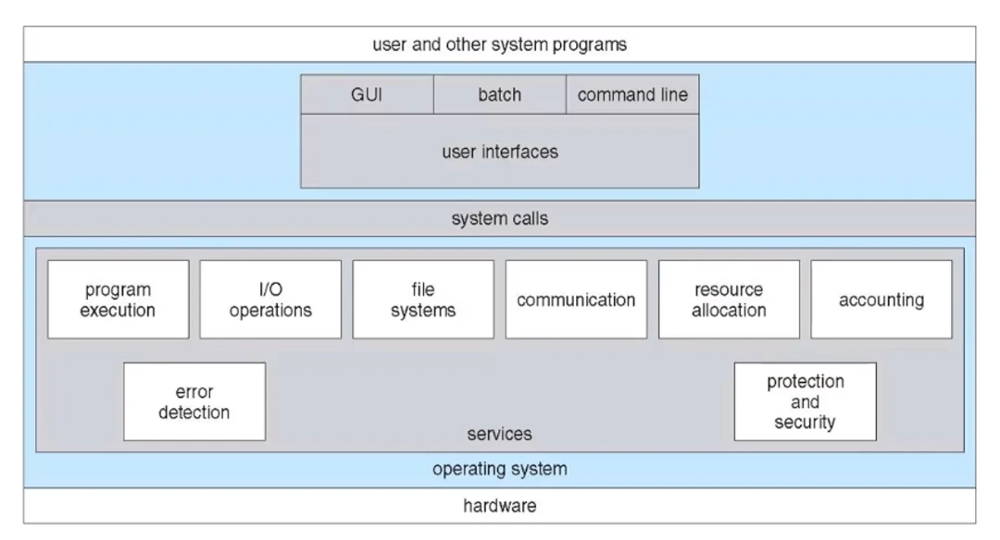

## A view of OS services

- 현대 Application Program들은 H/W를 직접 컨트롤 하지 못하고, System Call → System Service를 거친다. 이 요청에 대한 응답을 Application에 보내게 된다.
- 모든 것을 운영체제의 컨트롤 아래에 두겠다는 의도로 해석할 수 있다.

- CLI(Interpreter) : 대부분 Kernel 내에 구현되어 있다.  
    ⇒ ex) 파일 복사 : CLI에서 사용되는 CP(copy), dir 등의 명령어는 이미 CLI와 Kernel 안에 포함되어 있는 요소이다.

    - 하는 일이 특수하고, 운영체제 레벨에서 같이 만들어져서 제공되는 프로그램이다. 사용자가 간단한 명령어 처리를 할 수 있도록 커맨드 인터페이스를 통해 지원한다.

    - Windows와 Linux는 모두 내부/외부 명령이 있다.

        - Shell 또한 그 자체의 프로그래밍 방법을 가진다. (Shell Script가 호환이 될 수도 있고, 안될 수도 있다.)
        - 그런데, Shell Script 명령어를 사용하지 못하면 연속으로 여러 개의 프로그램을(에러 처리를 통해) 처리할 수 없다.

- GUI : 유저 친화적인 데스크탑 인터페이스를 말하며, 그래픽적인 요소로 표현되고 클릭 등의 직관적 동작을 통하여 컴퓨터와 상호작용 할 수 있다.

⇒ CLI와 GUI 모두 사람들이 직관적으로 사용할 수 있도록 지원한다.

> 최고의 인터페이스는 말만하면 알아서 헷갈리는 부분을 해결해주는 대화형 인공지능이 될 것이다.  
>   
> ex) chatGPT
>
> - 형식 언어 : 우리가 쓰는 프로그래밍 언어.
> - 개발의 방향은 점차 자연어로 처리하는 방향으로 나아갈 것이다.

---

## Computer-System Operation

- CPU는 I/O와 같이 일한다. (데이터, 명령어 등을 처리)

- I/O devices and the CPU can execute concurrently (**I/O와 CPU는 서로 경쟁관계에서 동작한다.**)

    - CPU, I/O는 동시에 수행되지만 **경쟁 관계**에 있다. 왜냐면, 작업을 수행하기 위해서는 반드시 컴퓨터 내부에 하나만 존재하는 Bus를 차지해야 하기 때문이다.

- Each device controller is in charge of a particular device type.

    - controller가 H/W, S/W적인 관점을 가짐. (기본적으로 H/W가 칩셋으로 처리하지만, S/W적으로도 처리가 가능하다.)

    - ex) USB Controller

- Each device controller has a ***local buffer***.

    - 들어온 데이터를 곧바로 CPU로 옮길 수는 없다. 내부적으로 다른 동작이 수행되고 있을 수 있기 때문이다. 그렇기 때문에 데이터를 잠시 보관하고 있는 역할을 하는 Buffer를 가짐으로써, 상황에 맞게 데이터를 옮겨준다.

- CPU move data from/to main memory to/from local buffers.

    - buffer는 stream 형태로(block) 오는 경우가 많기 때문에, 정해진 규격대로 오면 OS가 처리한다. (비트 단위로 끊어서 처리)

        - ex) 터치한 위치를 파악하고 싶다면? 정해진 규격의 데이터를 보내 처리한다.

    - 그런데, buffer에 데이터가 꽉 찼는지 안찼는지를 판단할 수 있는 가장 좋은 방법은 현재까지 ***Interrupt***를 사용하는 것이다.

        - ex) 외부에서 데이터가 들어올 경우, Interrupt가 발생하여 데이터 전송을 처리하게 된다. 그런데, Interrupt도 우선 순위가 있기 때문에 이 순서로 처리하게 된다.

- ***Interrupt*** : 인터럽트가 끝나고 이전에 수행하던 곳으로 돌아가려면 이전의 작업 상태. 즉, 메모리의 상태를 정확히 기억해 두어야 한다. (***Must save the address!***) 메모리의 상태를 기억함으로써 컴퓨터의 동작은 끊김없이, Seamless하게 이어나가야 한다.

    - 만약 인터럽트를 하나 처리하고 있는데 하나가 더 들어오면, 어떤 것을 먼저 처리할 지를 결정해야 한다. 만약 기존의 것이 우선순위가 높다면 뒤에 들어온 인터럽트는 Pending 상태가 된다. ⇒ Divide by zero interrupt가 가장 우선으로 처리되어야 함.

- ***Trap*** : 에러 처리나 유저의 요청에 의해 내부에서 S/W적으로 발생하는 모든 인터럽트를 말한다.

    (외부에서 들어온 인터럽트가 정말 Interrupt이고, OS가 S/W적으로 처리하는 것을 Trap이라고 한다.)

    - interrupt : 하드웨어적인 사건 (clock, 디스크 쓰기 완료, 패킷 도착 등)

    - trap : 소프트웨어적인 사건(페이지 부재 결함, divide by zero, System Call, Access Violation)

        - 사용자가 운영체제 내부로 서비스를 받기 위해 안으로 들어가는 절차인 시스템 콜도  trap의 일종이라고 본다.
        - 사용자 프로그램이 하기 어려운 일을 운영체제에게 부탁하기 위해 시스템 콜을 호출.
        - 대부분의 서비스는 trap, 시스템 콜의 형태로 넘어가게 된다.

> 인터럽트 : 비동기적  
> 트랩 : 동기  
>   
> 운영체제 전반에서 인터럽트, 트랩, 커널, OS 서비스 등이 연결되어 있다.

- OS는 Interrupt Driven System이다. Interrupt에 의해 제어될 수 있는 시스템이라는 뜻이다.

---

- 인터럽트는 어떤 순서로 처리되는가?

    - 커널 안에 Interrupt Vector Table이 존재하는데, 인터럽트로부터 일이 생기게 되면 일정한 크기를 지정하여 인터럽트에 대한 처리 방법을 지정한다. 그리고 들어온 인터럽트에 해당하는 vector를 통해 handler로 이동하게 된다. 

        (handler : Program이자 Interrupt Service Routine을 의미하며, 넘겨주는 vector의 번호를 handle이라고도 한다.)

        handler는 누군가가 만들어 놓은 프로그램이며, System Manual을 보면 인터럽트에 대한 설명도 나온다.

    - CPU는 항상 User Process 혹은 I/O Interrupt Processing을 실시한다.

    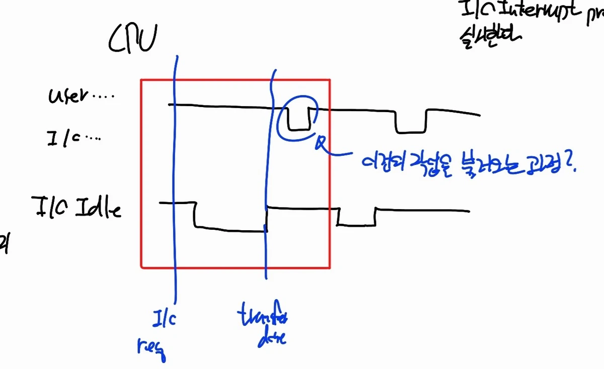

- DMA(Direct Memory Access Structure): 만약 copy와 같은 작업처럼 굳이 CPU가 확인하지 않아도 되는 단순한 데이터 전송 작업을 수행한다면, 메모리끼리 곧바로 데이터를 주고 받도록 만드는 것. (CPU의 간섭을 최소화 한다.) DMA는 메모리의 속도와 비슷한 속도로 정보를 전송할 수 있는 고속의 입출력 장치를 위해 사용된다.

    - Device Controller는 전체 자료블록을 CPU의 간섭 없이 직접 기억장치 → 버퍼 저장장치로 블록 단위로 전송한다. DMA를 사용할 때는 바이트당 하나의 인터럽트를 발생시키는 것이 아니라, 대량의 정보를 전송하는 것이기 때문에 블록 단위로 인터럽트를 발생시킨다.
    - 버퍼를 만들어 작업을 처리하고, DMA를 이용하여 스위칭만 함으로써 그래픽을 고속으로 그릴 수 있게 한다.
    - 컴퓨터 시스템 내에서 버스는 하나이므로 CPU가 버스를 쓰고 있다면 DMA의 사용은 불가능하다.

    - ***Cycle Stealing*** : Cache-Friendly하게 프로그램을 잘 만들면 데이터를 한 번에 가져오고, 이렇게 되면 데이터를 여러 차례 가져올 필요가 없게 되므로 I/O가 계속 데이터를 처리할 수 있게 된다.  
        CPU는 자기 일을 계속하면서, I/O는 CPU의 눈치를 보면서 Cycle을 가져오게 한다.

        ⇒ CPU 동작 시 CPU가 메모리와 관계없는 동작을 수행하는 사이클에만 DMA의 수행을 하게 되는데, 이를 **Cycle Stealing**이라고 한다. (그게 아니라면 DMA가 버스를 사용하는 동안 CPU가 버스를 차지하지 못해서 놀게되기 때문)

---

- Storage Structure

    - Main Memory
    - Secondary Storage
    - Else (Storage)

- Storage Systems Organized in Hierarchy

    - Speed
    - Cost
    - Volatility (휘발성)

CPU는 명령을 Byte 단위로 읽는다. 그게 아니라면 블록(512 byte) 단위이다. 단, 명령어는 반드시 n Bytes 단위로 읽는다. 메인 메모리는 바이트 단위여야만 한다.

(하드디스크는 물리적으로 돌아가지만 Byte 단위 접속이 불가능하다.)

⇒ SSD : EEPROM

- NOR memory (Byte 단위 접근 가능) : 보조 메모리, 스마트폰과 같은 경우는 메인 메모리와 더불어 NOR memory에 기억해야할 정보를 보관한다.
- NAND memory (Block 단위 접근 가능) : 외장 Memory, USB 등…

- 그렇다면, 왜 메인 메모리로 NOR를 사용하지 않는가?

    - RAM이 더 빠르기 때문이다. 그래서 메인 메모리로 RAM을 쓰고 보조 메모리로 NOR를 쓴다.

- Diagram(Storage-Device Hierarchy)

    - HDD : 플래터 + 암(헤드) + 서보 모터(정해진 각도 내에서 회전하는 모터)

        ⇒ 플래터를 늘리면 용량을 늘릴 수 있지만, 표준 크기가 존재하기 때문에 한정되어 있다.

    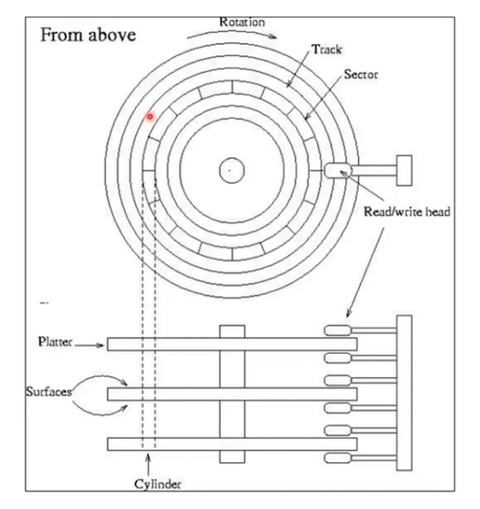

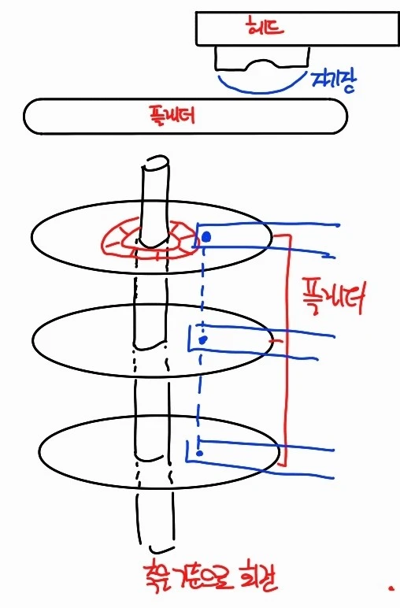

물리적인 접촉으로 헤드가 플래터에 닿으면 Bad Sector가 될 수 있다. 만약 그곳이 우연의 일치로 Windows가 설치되어 있는 곳이었다면 컴퓨터 실행이 불가능할 수도 있다.)

- 데이터 관리 방식

    - 동심원 방식
    - 나선 방식

주로 동심원 방식을 사용, 한 번에 읽어들이는 데이터의 최소 크기를 <em><strong>섹터(Sector)</strong></em>라고 한다. 그리고 섹터가 모이면 <em><strong>트랙(Track)</strong></em>이라고 한다.  
⇒ 동심원 방식일 경우, 플래터의 바깥으로 갈 수록 섹터의 양이 많아지는데, 어디에 어떤 데이터를 저장할 지는 컨트롤러가 조절한다.

- Sector를 묶어서 사용하고 싶다면, Sector를 묶어서 ***Cluster***로 지정해 사용한다.
- 플래터가 일할 때 Arm Assembly가 각각의 플래터에서 같은 위치를 읽게 되는데, 이를 ***Cylinder***라고 한다.
- 찾는 데이터가 있을 때 Arm Assembly가 원하는 track까지 옮기는 시간, 그리고 해당 sector가 돌아오는 시간이 지연됨.  
    ⇒ 합해서 평균 구하면 평균 지연 시간.

HDD에서 읽은 데이터를 버퍼에 넣었다가 CPU에 보내고, 이를 다시 메모리로 보낸다.

- 하드디스크에서 모터는 반 시계 방향으로 회전한다.  
    ⇒ 내가 데이터를 처리하는 속도가 맞으면 처리 속도가 읽는 속도보다 느려졌다고 해보자.

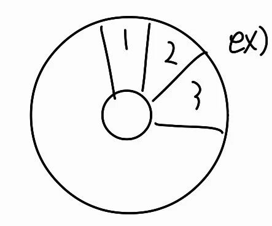

1번의 처리를 기다리고 버퍼를 다 비우고 하는 동안에, 다음에 처리해야 하는 2번을 지나가 버리면 다시 한 바퀴를 돌아야 하므로 매우 비효율적이 된다. ⇒ 이에 따라 ***인터리브 방식*** 도입 가능.

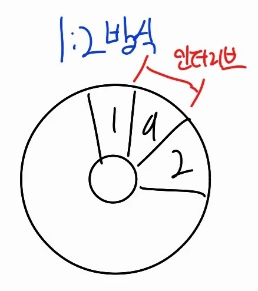

인터리브를 만들어서 처리 시간에 여유를 주고, 조금 더 효율적으로 데이터를 관리할 수 있게 된다.

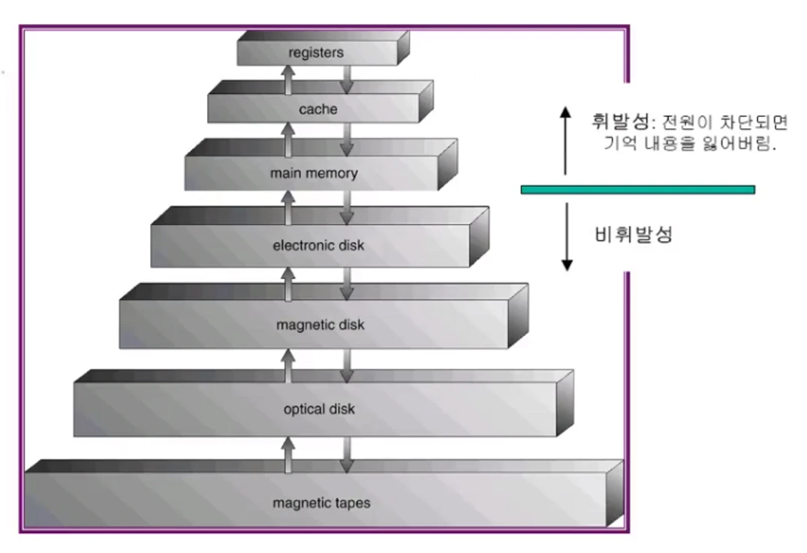

- **NAS**(외장형 하드디스크)

주로 **RAID**(Redundant Array of Inexpensive) 방식 사용. 무조건 하지는 않아도 되지만, 효율적이다.

여러 개의 물리적 디스크를 결합한다. 1TB 짜리 4개를 묶어서 사용. ⇒ 만약 네 개중 하나가 데이터가 깨졌는데, 다른 것들이 괜찮다면 비교하면서 값을 수정한다.

- RAID의 방식

    - RAID 0 : 빠르지만 안전 X (디스크를 여러 개로 나눠서 접근 속도를 매우 높임. 단, 안정성 X)
    - RAID 1 : 미러링, 각 디스크에 중복 저장 → 2 배의 공간이 필요, 읽기 빠름
    - RAID 4 : 블록 별로 패리티를 지정

---

- ***System Call***

    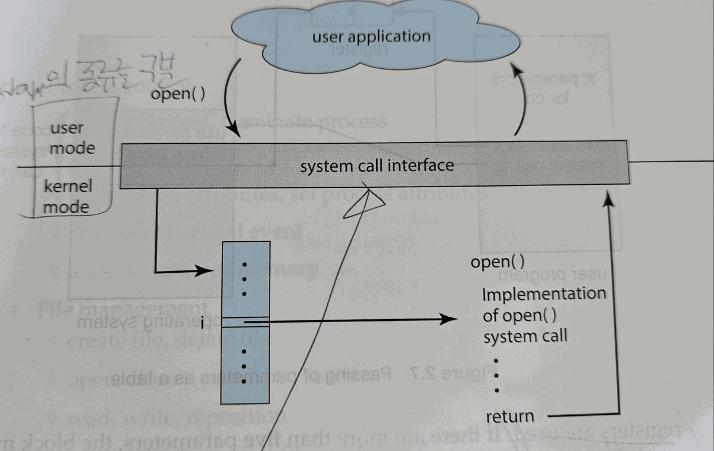

    - 유저가 커널에 접근하여 OS가 제공하는 서비스를  사용할 수 있도록 하는 프로그래밍 인터페이스이다. OS에 의해 유저가 H/W 및 컴퓨팅 자원에 대한 직접적인 제어 및 접근이 차단되기 때문에, 시스템 콜을 사용하여 H/W 및 컴퓨터 시스템의 각종 자원을 사용할 수 있다.

    - 대부분 C/C++ 으로 짜여져 있고, Low Level Language에서는 System Call을 사용, High Level Language에서는 API 형태로 사용한다.

        ⇒ 대부분의 응용 프로그램 개발자들은 시스템 콜 자체를 부르기 보다는 API 형태로 시스템 콜을 주로 사용하는데, 거기에는 다양한 이유가 있다.

        - 이식성 : API를 사용하면 작성한 프로그램을 컴파일하고 난 뒤에는 같은 API를 사용하는 어떤 시스템에서든지 사용할 수 있다.
        - 편리함 : 시스템 콜 자체를 사용하는 것은 API를 사용해서 응용 프로그램을 개발하는 것보다 다소 어렵고 복잡할 수 있다. (종종 시스템콜과 강한 연관성을 갖는 함수들이 API에 사용되기도 하는데, 이럴 경우에는 시스템 콜의 본래 모습과 유사하다.)

        - Run-Time Environment(RTE) : RTE는 시스템 콜 인터페이스를 제공해서 사용자의 요청에 의해 운영체제로부터 시스템 콜을 사용할 수 있게 해주는 역할을 한다. 시스템 콜 인터페이스는 사용자가 실행한 시스템 콜 API를 intercept하여 OS 내에서 실제 시스템 콜이 수행되도록 만든다. 
        - 통상적으로 시스템 콜은 table이 있어서, 시스템 콜이 실행되면 해당 번호를 indexing해서 테이블의 번호로 접근한다. 그런데, 시스템 콜의 종류가 많기 때문에 Linking 방식을 통해서 각 번호 별로 시스템 콜을 포인터로 이어붙이고, 이를 통해 시스템 콜을 찾을 수 있게 된다. 이는 Interrupt의 Vectored 방식과 유사하다.
        - 시스템 콜을 요청한 유저는 실질적으로 이것이 어떻게 동작하는지 하나도 알 필요가 없다. 차라리 API를 사용하는 법을 익히는 것이 좋으며, 시스템 콜의 결과로 어떤 결과가 나오게 되는지를 공부하는 것이 좋을 것이다. 결과적으로 시스템 콜의 실질적인 동작은 유저에게 제공되는 API로 가려져 있으며, 이는 RTE(Run-time Environment)가 제공하는 시스템 콜 인터페이스에 의해 관리 및 제어된다.

    - 모든 I/O 장치들이 막혀 있으므로, System Call을 사용해야 한다.

    ex) C언어에서 사용되는 read : system call의 일종.

    - 시스템 콜은 주로 번호가 부여되며, 역할에 따라 구분된다.

        - System call 10H (sub) function 2 ⇒ 이런 식으로 사용됨.

    - 시스템 콜은 사용자나 프로그램이 사용 목적에 따라 parameter를 보내 줄 필요가 있으며, 전달받아 사용하기도 한다. (parameter passing)

    - **시스템 콜**을 사용할 때, parameter로 passing한 값을 register에 쓰게 되고, OS가 이걸 읽어갔다가 처리되면 다시 register에 써서 돌려준다.

        - 그런데, parameter가 너무 많다면 register를 활용할 수 없기 때문에 memory에서 stack으로 활용하게 된다. (속도는 register보다 느려짐)

        ex) 스마트폰의 경우, parameter가 4개 이하일 때만 register를 사용한다.

    - Parameter를 OS에게 전달하는 일반적인 방법

        - **Simplest** : parameter를 CPU의 register에 직접 전달한다.

            - 일부 경우에는 레지스터가 받아들일 수 있는 수보다 많은 parameter가 전달 가능. 이럴 경우에는 다른 방법을 채용한다.

        - parameter가 block이나 table, 등의 형태로 메모리에 저장되고, 그 곳의 주소를 register로 전달.

            - Linux와 Solaris에서는 이 방식을 사용한다.

        - parameter를 stack에 보관하는 방식. push/pop을 이용해서 stack에 보관하게 되고, OS에 의해 조작된다.

        ⇒ 첫 번째 방법은 register의 수가 제한되기 때문에 한 번에 넘길 수 있는 parameter의 수가 제한되지만, Block 방식과 Stack 방식은 parameter의 수가 제한되지 않는다.

---

- **Type of System Call**

    - **process control**

        - 프로세스를 시작하고 끝내는 기능
        - 프로세스의 attribute를 얻거나 바꿀 수 있음
        - 프로세스를 다루기 때문에, event를 wait하거나 event를 signal할 수 있어야 함.
        - 메모리를 할당하고 해제할 수 있어야 함.

    - **file management**

        **content**

        create(), delete() 시스템 콜을 통해 파일을 생성하고 지울 수 있어야 함. 이때 각각의 시스템 콜은 파일의 이름이나 파일의 속성 등을 필요로 할 수도 있음. 한번 파일이 만들어지면 open()을 통해 그 파일을 사용할 수 있어야 하며, 또는 read()나 write(), reposition() 등을 사용할 수도 있어야 한다. 이는 디렉터리에 대해서도 동작할 수 있어야 한다.

        get_file_attributes(), set_file_attributes()를 통해 파일의 속성을 얻거나 수정할 수 있어야 하며, 일부 운영체제의 경우 move()나 copy() 등의 시스템 콜도 지원한다.

        - 파일을 생성하거나 지우고, 열고 닫을 수 있음.
        - 파일을 읽거나 쓰고, 위치를 변경하거나 파일의 attribute를 얻고 수정할 수 있음.

    - **device management**

        **content**

        프로세스는 메인 메모리, 디스크 드라이브, 파일 액세스 등과 같은 리소스의 사용을 필요로 할 수 있다. 만약 그 리소스들이 사용 가능한 상태라면, 이것들을 이용하면 될 것이고, 컨트롤이 유저 프로세스로 가게 될 것이다. (이 말은, 해당 프로세스가 CPU에 올라가 실행될 것이라는 뜻) 그렇지 않은 경우에는 해당 프로세스는 리소스가 사용 가능해질 때가지 대기해야만 한다. (ready에서 올라가지 못하거나, running이었다가 wait으로 가게됨.)

        운영체제가 제어하는 다양한 리소스는 대체로 디바이스의 형태라고 생각할 수 있다. 일부 디바이스는 물리적인 디바이스이기도 할 테지만, 다른 것들은 추상화된 가상 디바이스일 수도 있다. (예를 들면 파일들) 멀티유저 환경에서는 request() 시스템 콜을 통해 해당 파일을 독점적으로 사용할 수 있도록 할 수 있고, 디바이스의 사용이 끝나면 release()를 통해 독점 상태를 해제할 수 있다. 이는 파일에서 사용하는 open()과 close()와 비슷하다. 한 번 디바이스에 대한 사용이 요청되면 해당 디바이스를 read(), write() reposition()할 수도 있다. (마치 파일처럼) 사실 I/O device와 file은 운영체제의 기준에서는 매우 유사하게 다뤄진다. 그래서 실제로 I/O device와 file에 대한 시스템콜은 내부적으로는 유사하지 않지만, 유저에게 제공되는 인터페이스 단에서는 매우 유사하게 제공될 수 있다.

        - 컴퓨터 시스템에서 동작될 수 있는 하드웨어를 제어할 수 있음.

    - **information maintenance**

        **content**

        단순히 정보를 전송하기 위해 존재하는 시스템 콜도 많이 있다. 예컨대 time(), date() 시스템 콜이 그런 예이다. 혹은 OS의 버전 정보나 남은디스크 공간 등에 대한 정보도 받아올 수 있다. dump()와 같은 시스템 콜은 디버깅에 매우 유용하게 사용될 수 있다. 

        또한 모든 프로세스들에 대한 정보를 갖고 있고, 여기에 접근하고 수정할 수 있는 시스템 콜도 가지고 있다. 일반적으로, get_process_attributes()나 set_process_attributes()를 사용할 수 있다.

        - get time or date, set time or date
        - get system data, set system data
        - get process, file, or device attributes
        - set process, file, or device attributes

    - **communications**

        - Shared Memory와 Message Passing을 통해서 데이터를 주고받을 수 있음.

    - **protection**

        **content**

        컴퓨터 시스템에서 사용되는 리소스에 대한 접근을 제어할 수 있다. 이전에는 Multi User, Multiprogrammed 시스템에서만 이 문제가 다뤄졌지만, 인터넷이 발전하고 서버나 모바일 기기들이 많아지면서 중요한 부분으로 부상하게되었다.

        일반적으로 set_permission()이나 get_permission() 시스템 콜이 지원되어서, 파일이나 디스크와 같은 리소스에 대한 접근 권한을 설정할 수 있다. 또 allow_user()나 deny_user() 시스템 콜은 어떤 유저가 해당 리소스에 접근할 수 있고 없고를 결정한다.

        - 리소스에 대한 접근을 제어
        - 시스템 전반에 대한 권한 설정
        - 유저의 접근을 허용하거나 거부함.

---

- **Process Control**

    **content**

    - Program : 동작할 수 있으나, 아직은 디스크에 보관되어 있는 상태

        ⇒ 실행을 위해 Main Memory에 올리면 프로세스가 되고, 실행된다.

    - 프로세스들은 실행되지 못하고 대기하고 있을 때가 많은데, OS가 이런 것들을 관리한다.
    - 프로세스는 강제적으로나 정상적으로 종료될 수 있어야 하며, 만약 잘못된 동작이 생기면, dump memory에 현재 메모리 값을 모두 저장한다.
    - (블루 스크린) 그리고 이를 통해 문제의 원인을 규명할 수 있고, 시스템에 따라서는 전달된 에러에 따라서 다음에 대처할 동작이 자동적으로 정해지고 수행될 수도 있다.
    - 때로는 프로세스가 다른 프로세스를 load()하거나 execute()하고 싶을 수도 있을 것이다. 이는 Command Interpreter에 직접 실행시키거나, 아이콘 클릭 등을 통해 이뤄질 수 있다. 중요한 것은 이렇게 실행된 프로그램이 끝났을 때 다시 돌아갈 지점은 어떻게 찾는가? 인데, 이는 이전에 실행되던 프로그램이 어디서 실행을 멈추거나 저장되었는지 또는 새로운 프로그램이 동시에 실행되는 것을 허용했는지에 관련이 있다. 만약 새로운 프로그램의 실행이 종료되고 기존에 실행되던 프로그램으로 컨트롤이 돌아갈 때, 우리는 기존에 존재하던 프로그램의 메모리 이미지를 저장한다. 그러므로, 우리는 한 프로그램이 다른 프로그램을 호출하는 메커니즘을 이용할 수 있게 된다.  만약 두 개의 프로그램이 동시에 수행된다면, 새로운 프로세스와 함께 멀티프로그래밍되도록 만들면 된다. 이것을 수행하기 위해 create_process()와 같은 시스템 콜이 존재한다.
    - 만약 새로운 프로세스(들)이 만들어진다면, 우리는 그것의 실행을 제어할 수 있어야 한다. 이것은 프로세스의 우선순위나 최대 허용 수행 시간 등, 그 프로세스들의 특성을 결정하고 리셋할 수 있는 제어를 말한다. 또한 우리는 만들어진 프로세스가 잘못된 동작을 하거나 더 이상 필요가 없어지면 프로세스의 실행을 종료할 수도 있어야 한다.
    - 이렇게 새롭게 만들어진 프로세스가 수행을 끝날 때까지 우리는 그것을 기다려야 할 수도 있다. wait_time() 등의 시스템 콜을 통해서… 혹은 이벤트가 발생할 때까지 대기할 수도 있다. wait_event(). 그러면 수행되던 프로세스들은 이렇게 대기하고 있는 프로세스에게 signal을 보내서 수행을 재개할 수 있다. signal_event()
    - 프로세스들은 데이터를 공유할 수도 있는데, (shared data) 이때 데이터의 무결성을 보장하기 위해 lock을 실행할 수도 있어야 한다. 
    - 유저가 컴퓨터에 로그인하면 쉘이 실행돼서 유저의 입력을 대기하거나 유저의 요청에 따른 프로그램을 수행하게 된다. 그러나, FreeBSD와 같은 멀티태스킹 시스템에서는 command interpreter가 다른 프로그램이 실행되고 있는 도중에도 실행될 가능성이 있다. 새로운 프로세스를 시작하기 위해서 쉘은 fork() 시스템 콜을 사용한다. 그리고, exe() 시스템 콜을 통해 선택한 프로그램이 로드되고 프로그램이 수행된다. 어떤 커맨드가 입력되었는지에 따라, 쉘은 해당 프로세스가 끝나길 기다리거나 그 프로세스를 백그라운드에서 동작시킨다. 후자의 경우, 쉘은 즉각적으로 다른 커맨드의 입력을 기다리게 된다. (평상시와 똑같이 foreground에서 유저의 입력을 대기한다.)
    - 프로세스가 백그라운드에서 동작하고 있으면 키보드로부터 직접 데이터를 전달받지 못하게 되는데, 그 이유는 쉘이 리소스를 사용하고 있기 때문이다. (키보드) 그러므로 I/O는 GUI  인터페이스나 파일을 통해서만 이루어질 수 있다. 그와동시에, 유저는 쉘에게 다른 프로그램을 실행시키라고 요청할 수 있고, 현재 실행중인 프로세스들의 진척도를 확인할 수 있으며, 우선순위를 변경할 수도 있는 등의 동작을 할 수 있다.
    - 프로세스의 실행이 끝나면, 그 프로세스는 exit() 시스템 콜을 수행해서 동작을 끝마치게 되고, 자신을 부른 프로세스에게 status code 0 또는 non-zero error code를 반환하게 된다. 이 상태 코드는 쉘 또는 다른 프로그램에 대해서 사용 가능하게 된다.

- **Single Tasking vs Multi Tasking**

    - Single Tasking

    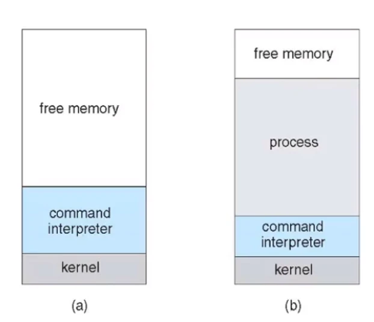

    (a) : 부팅 직후  
    (b) : 컴퓨터를 사용하는 도중(프로세스들이 memory를 차지하고 있다.)

    - Multi Tasking

    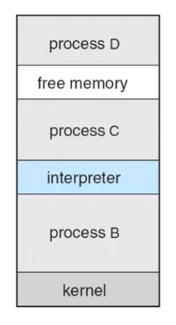

실제로 운영체제가 사용하는 것은 kernel 뿐이다. 새로운 프로세스의 생성이 필요할 때마다 fork()로 shell을 복제하고, → exec()로 역할을 부여한다.

- 운영체제를 거치지 않고 직접 CPU에 명령을 준다. (Assembly)

- Linkers and Loaders

    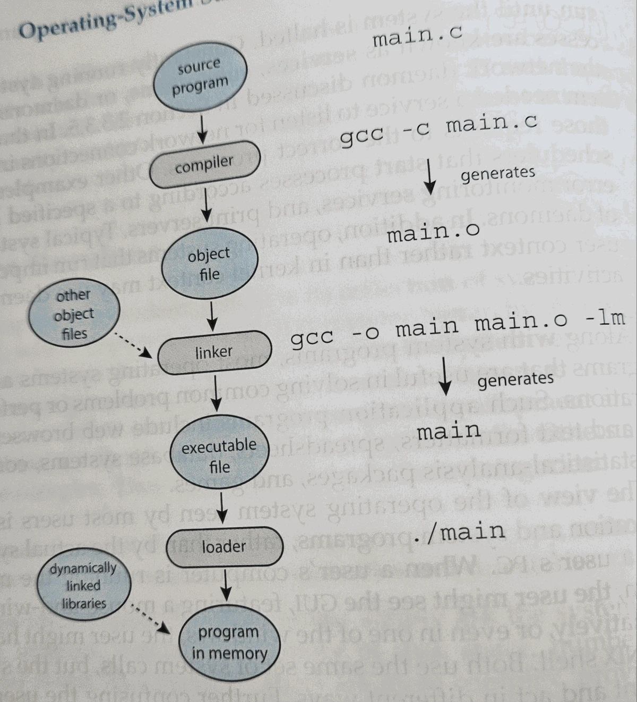

    - 소스 파일은 메모리 상에 올리기 위하여 object file로 컴파일된다. 이를 **relocatable object files**라고 한다. 그 다음에는 linker가 이 relocatable object file들을 실행 가능한 단일 이진 실행 파일로 결합한다. 이 linking 과정에서, standard C나 math library와 같은 라이브러리 파일이나 또다른 object file(relocatable object files)이 포함될 수 있다.  
        (specified with the flag -lm)
    - 로더는 바이너리 실행 파일을 메모리에 올리는데 사용된다. 
    - main.c → gcc -c main.c → main.o → gcc -o main main.o -lm → main.exe
    - 링킹과 로딩 과정에 관련된 활동은 relocation이 있는데, 이는 프로그램에 주소를 할당하고, 프로그램의 코드와 데이터에 할당된 주소와 맞게 조정하며 이를 통해 코드에서 라이브러리 함수를 부르거나 변수에 접근할 수 있도록 하는 것이다.
    - Loader가 실행 파일을 main memory에 올리는 과정… 커맨드 인터프리터에 실행 프로그램의 이름을 입력하면, shell은 먼저 fork()로 프로세스를 만들고 exec()을 통해 전달된 실행 파일의 이름을 넘긴다. 그러면 로더는 새롭게 생성된 프로세스의 주소를 통해 그 프로그램을 메모리에 올리게 된다. 

- DLL(Dynamic Linked Libraries) : 라이브러리를 너무 많이 넣게 되다보니 실행파일의 용량이 너무 큰 문제가 발생. 이에 따라 DLL은 라이브러리를 따로 보관하고 있다가 runtime에 필요할 때마다 사용하게 한다. (일종의 포인터 형식) 

    예를 들어, 위의 사진처럼 math 라이브러리를 Dynamically Linked 하면, math library 자체가 실행 파일 main에 링크되지는 않는다. 실행 파일 안에 라이브러리의 오브젝트 파일을 가리키는 포인터를 가져서 runtime 과정에서 필요할 때마다 참조해서 링크하고 메모리로 로드할 수 있다.

- VM(Virtual Machine) : 운영체제에 관계 없이, 특정 H/W에 종속되지 않는 프로그램을 제공한다.

    ⇒ 대부분의 운영체제는 플랫폼, VM을 제공하고 있다.

---

- 과거의 내용

    - Simple Structure : OS를 거쳐도 되고, 특별한 제한없이 H/W 제어 가능
    - Linux System의 구조 : Modular 방식 (Monolithic)

    - Layered Approach : Layer를 나눠두는 것으로 보인다. (이론적으로만 존재)

        - Microkernel : 꼭 필요한 만큼만 kernel을 만들고, 그 위에 shell 등을 따로 붙이는 방식으로 프로그램을 키워가는 것. (MAC)

    - Modules : Linux, Unix 계열
    - Hybrid Systems : 다른 내용을 혼용해서 쓰는 것

---

- Booting

    - Setup 프로그램이 BootLoader를 찾는다. (0번지)
    - Boot Loader가 하나밖에 없다면, 그 OS를 메모리에 올려 동작시킨다. (Multi booting 고려)
    - OS를 실행해서 컴퓨터를 사용하게 된다.
