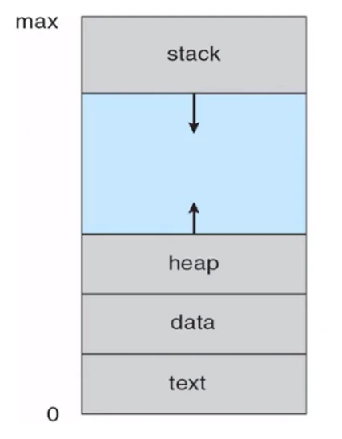
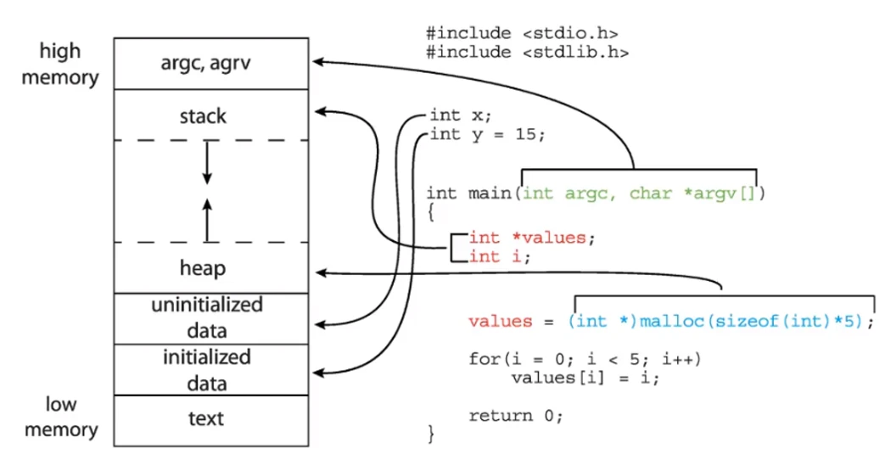
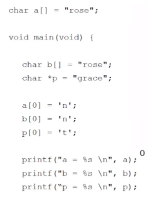
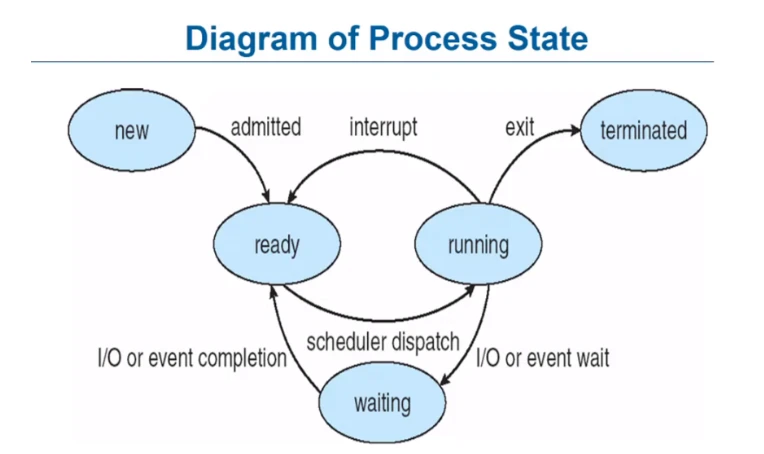
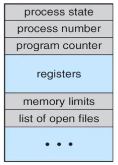
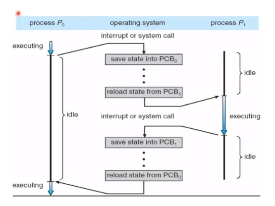
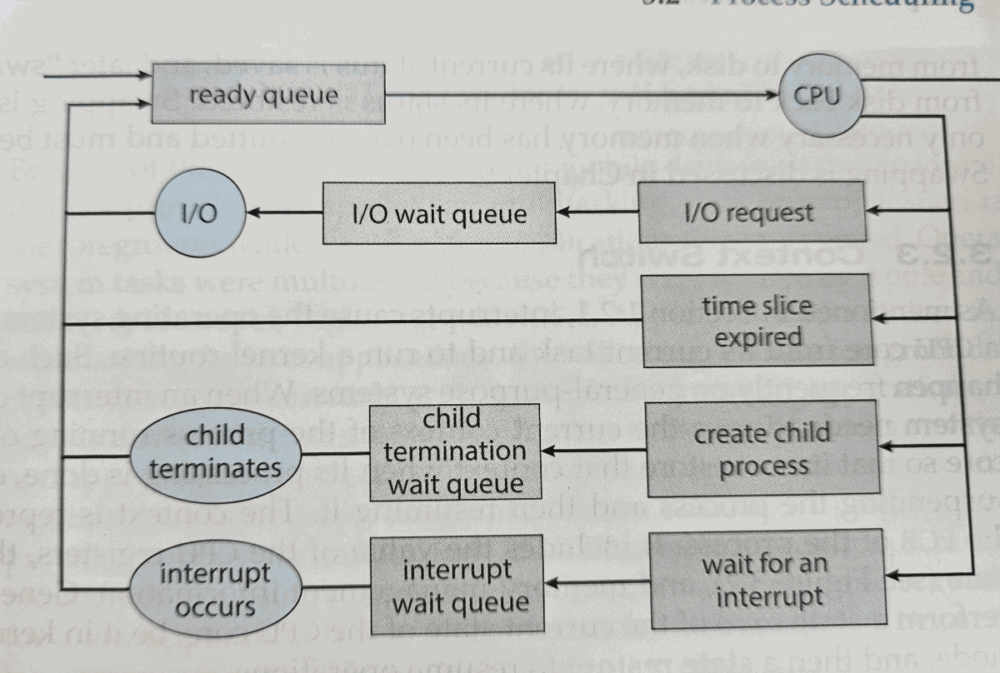
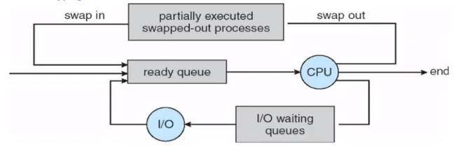

# 4주차-1: Process, Context Switching, Thread, 스케줄러

Chapter 3: Process

프로세스가 생기면 스케쥴링이 반드시 관여됨.

- Process Concept
- Process Scheduling
- Operations on Processes

## Process Concept

저장되어 있는 파일 형태 : Program

그 프로그램이 실행 가능한 형태로 메모리에 상주되면 : Process

내가 만드는 모든 프로그램이 프로세스가 되지는 못한다. → 메모리에서 돌아가면 프로세스가 됨.

⇒ 프로세스 관리는 메모리에 올리는 과정, 그리고 올린 후의 과정까지 모두 포함한다.

운영체제는 다양한 프로그램을 실행한다.

- Batch Process : 하나씩 하나씩 순차적으로 진행되는 프로그램. (일괄처리 시스템)
- 여러 개의 프로그램을 동시에 수행하는 것은 시분할 시스템(Time-Shared Systems). 사용자 프로그램이나 Task를 수행시킨다.
- 이 책에서는 job과 process는 같은 말로 사용된다.

Process : 수행 중인 프로그램; 프로세스의 실행은 순차적인 방식(sequential fashion)으로 진행된다.  
⇒ 어떤 시점에서든지 하나의 명령어만이 프로세스를 위하여 실행된다.

동시가 아님. 너무 빨라서 동시로 보일 뿐이다.

- 프로세스란 단순히 프로그램 그 자체를 의미하는 것이 아니라 다음을 포함한 능동적인 실체.  
    ⇒ 내가 만든 것 이외에도 프로그램을 돌아가기 위해 필요한 것이 매우 많으며, OS가 알아서 할당해주고 지정해주는 역할을 한다.

- 프로세스의 현재 상태는 Program Counter와 Processor 내의 register에 저장된 내용으로 확인.

    - Program Counter : 내가 지금 실행할 명령어 하나. 어디있는걸 수행할 것인지 가리키는 것.
    - Stack : 프로그램을 수행하는 과정에서 메모리가 필요할 때 사용.
    - Data Section : 데이터를 저장하는 공간
    - Register : CPU가 알아서 메모리 계산을 하는 Register
    - Program Code(text) : 그리고 마지막에 우리가 작성한 코드가 있다.

    ⇒ 나머지 것들이 더 많이 필요하고, 만들어지며, 그게 운영체제가 요청하는대로 틀을 갖추고 동작을 하게 된다.

    ⇒ 프로그램을 작성만 하고 돌아가게 하는 것은 빙산의 일각이다…

- Process In Memory

    

⇒ 논리적 메모리의 형태.

⇒ 한 프로세스가 실행된다는 것은 이러한 블록 형태의 메모리에 프로세스를 할당하는 것으로 시작한다. 제일 밑에 text 영역이 만들어지고, 이는 내가 작성한 소스코드이다. 기계어로 번역된 형태이다.

heap ~ stack 까지 나눠져서 쓰게 되는데, **heap**도 메모리 관리 방법이고, **stack**도 메모리 관리 방법이다. heap이라는 구조로 관리되는 메모리 구조는 아래에서 위로 차는 형태이고, stack이라는 구조로 관리되는 메모리 구조는 위에서 아래로 차는 형태이다.

보통 C언어에서 사용되는 로컬 변수, 중괄호 사이에만 존재하는 변수 등은 stack에서 관리된다. 왜냐면, 만들고 지우는 작업이 빈번하게 일어나기 때문으로 보인다. 운영체제가 관리해준다. (임시적, 함수 파라미터나 리턴 값, 그리고 로컬 변수를 말한다. 함수 파라미터와 리턴 값도 모두 복사되어서 전달되는 값이기 때문에 stack 내에 저장이 되어야 함.)

**heap**과 같은 변수는 한 번 만들면 지워지지 않는 변수들. (영구적, 특히 동적 할당된 변수들을 말한다. 프로세스 실행 중에는 계속 남아있는 변수들, malloc과 같은 동적 할당을 말함.)

⇒ 서로 다른 방향으로 데이터를 저장하기 때문에, 공간을 최대로 활용할 수 있다.

text 영역과 data 영역은 프로그램 run time 동안에 변하지 않기 때문에 사이즈가 변하지 않지만, stack과 heap은 변할 수 있다.

프로그램 실행 중에 함수가 호출되면, function parameters, local variables, return address가 stack에 들어가게 된다. 이 함수의 수행이 끝나게 되면 stack에서 해당 값들이 나오게 된다.

- Memory Layout of a C Program



```c
int x; // uninitialized data
int y = 15; // initialized data

int main(int argc, char*argv[]) { // ___ => local의 시작 변수이기 때문에 high memory
	int *values; // stack
	int i; // stack

	values = (int*)malloc(sizeof(int)*5); // heap
	
	for (int i = 0; i < 5; i++) {
		values[i] = i; 
		// value라는 포인터는 stack에 저장되어 있고,
		// 그 포인터는 heap에서 할당된 부분 가리킨다.
	}

	return 0;
}
```

- argc, argv는 stack 윗부분에 구분되는 영역에 저장된다.
- text 영역 : 내가 작성한 코드(C언어)가 기계어로 변환되어 들어감.
- 만약 text 영역의 어떤 메모리 공간에서 임의의 메모리 주소를 다른 값으로 바꿨는데, 그러면 내가 작성한 코드가 다른 코드로 바뀌게 된다.
- 그러므로 운영체제는 Process memory에서 text를 read-only로 설정하여 코드를 manual하게 수정할 수 없게 한다.
- 램에 데이터가 올라간다고 해서, 데이터를 원하는대로 다 수정할 수는 없다. 운영체제가 수정할 수 있는 데이터와 수정할 수 없는 데이터 공간을 설정한다. (Process 상태)
- 만약 내가 만든 코드가 .exe 상태로 존재하는 경우에는, 코드가 어셈블리 상태로 존재하게 된다. 이를 수정하면 코드의 동작을 다르게 만들 수도 있다. (프로세스 형태로는 힘들지만, 이게 프로그램으로 저장되어 있는 상태에서는 수정이 가능할 수도 있다.)
- 요즘에 나오는 운영체제는 시스템 파일(시스템 소프트웨어)이 변경되지 않도록 해시 값 등을 저장하여 실행되기 전에 비교해서 이를 알아챌 수 있다.
- 다만, 사용자 애플리케이션은 대처가 쉽지 않을 수 있다.

---

- C 코드 예제



- 텍스트 세그먼트

    - 코드
    - 상수 : 항상 같은 값.

- 데이터 세그먼트

    - 전역변수 (위의 C 코드에서 x와 y는 전역변수이므로 데이터 세그먼트에 보관됨)  
        ⇒ initialized, un-initialized.
    - 정적변수

- 스택

    - 함수가 사용하는 메모리(혹은 지역 변수)

- 힙

    - 포인터로 접근하는 메모리(동적 할당)

프로그램 내에서 쌍따옴표를 썼다는 것은 String이라는 것이고, String이 있다면 이것을 텍스트 세그먼트에 우선 상수(text)로 보낸다. 그중에 같은 값이 있다면, (예컨대 a와 b) (ex. “rose\\0”) 그것을 하나의 값. 상수로 만들고 다른 변수에 할당해준다. (나중에 할당). (ex. “grace\\0”)도  상수로 만들고 나중에 할당한다.

printf에서 사용되는 “…”도 마찬가지, 상수로 텍스트 세그먼트에 저장된다.

char a[] = “rose”

a는 상수. (그 자체로는 배열의 이름으로, 주소를 가리키기 때문에, 포인터 상수이다.) rose는 text 영역으로부터 복사되어 a 배열에 저장된다. a의 rose는 데이터 세그먼트에 저장된다.(왜냐면, a 배열은 전역변수이기 때문이다. 데이터 세그먼트는 전역변수와 정적변수를 보관한다.) b도 마찬가지로 복사되어 저장되지만, 스택에 저장된다. b도 마찬가지로 이름으로 따지면 포인터 상수이다. char \*p = “grace”;에서 p는 포인터 변수. 그렇다면 grace는 어디에 저장되는가? p는 포인터 변수이므로 stack에 저장, “grace”는 텍스트 세그먼트에 있다. 복사하지 않는다.

b는 rose를 자기 자신이 가지고, p는 멀리있는 grace를 가리킨다… a와 b의 rose는 값을 바꿀 수 있지만, p의 grace는 텍스트 세그먼트(상수영역)에 있으므로, 읽을 수는 있지만 값을 바꿀 수는 없다.

> a 배열에서 a는 배열의 이름이기 때문에 메모리 상에 존재하는 배열의 첫 시작 주소를 가리키는 상수이다. 초기에 컴파일 과정에서 “rose”와 “grace”는 text 영역에 상수로 저장된다. (실제로는 string이므로 뒤에 null이 하나 포함된 데이터일 것이다.)  
>   
> 배열 a에는 text 영역에 상수로 존재하는 “rose”가 복사되어 저장되고, 배열 a는 전역변수이므로 데이터 세그먼트에 저장된다. (text 영역은 상수 데이터와 코드를 보관, 데이터 세그먼트는 전역변수와 정적변수를 보관한다.) 배열 b도 a와 마찬가지로 배열의 이름인 b는 메모리 상에 존재하는 배열의 첫 시작 주소를 가리킨다. b도 배열이므로 a와 마찬가지로 text 영역에 존재하는 “rose”가 복사되어 저장되고, b는 main에 존재하는 지역변수이기 때문에 stack 영역에 저장된다.  
>   
> char의 포인터 p도 b와 비슷하게 지역변수이기 때문에 stack 영역에 저장된다. p는 배열 a, b와는 다르게 값을 복사하지 않는다. 포인터이기 때문에 text 영역에 “grace”가 존재하는 영역의 첫 시작 주소를 가리키게 된다.   
>   
> 따라서 a와 b는 text 영역에 존재하는 값을 복사한 값이기 때문에 상수가 아니라서 값을 수정할 수 있는 반면, char 포인터 p가 가리키는 값은 text 영역에 존재하는 상수이기 때문에 값을 수정할 수 없다.

C언어 지식, 메모리 지식, 약간의 운영체제 지식

---



---

- Process State

    - Process는 상태를 가진다. (state) 프로세스는 상태를 바꿔가면서 관리된다.

        - new : The process is being created.
        - running : Instructions are being executed. (현재 그 프로세스의 명령어가 현재 CPU에 의해서 해석되고 있는 중이다. ⇒ CPU가 하나라면, 한 순간에 단 한 개의 프로세스만 실행될 수 있다.)
        - waiting : The process is waiting for some event to occur. (I/O로부터 무언가를 받아야해서, 그걸 전달받지 못하면 기다리고 있어야 하는 상태)
        - ready : The process is waiting to be assigned to a processor. (CPU가 자신을 데려가기를 원하면서 기다리고 있는 상태)
        - terminated : The process has finished execution.

        ⇒ 일반적으로 분류되는 고전적인 state

- Diagram of Process State, 천이도(Automata 이론 → 컴파일러 이론 → …)

    - running에 있다가 I/O가 필요해지면 waiting으로 이동, (I/O event wait)
    - waiting 하면서 컨트롤러가 일을 다하면 interrupt로 신호를 보내준다.  
        (데이터를 받았다고 알려줘서 ready 상태로 옮기고, 다시 running으로 갈 수 있게 함.)
    - 이후에 interrupt에 의해 ready로 이동  
    - 스케쥴링 타임이 되면 running으로 다시 가게 된다.

---

- Process는 운영체제에서 **프로세스 제어 블록**(PCB, Process Control Block)에 의해 표현된다.

- 프로세스 제어 블록은 특정 프로세스에 대하여 많은 정보를 갖는 데이터 블록이나 레코드들로서 다음과 같은 것들이 있다.

    

    - process state : new, ready, running, waiting, terminated 다섯 개의 상태.
    - process number
    - program counter : 다음에 실행될 명령어의 주소를 가리킨다. (프로세스 별로 가지고 있는 register)

    - CPU registers : (이 process가 CPU를 차지했을 때, register가 갖는 값을 따로 기억해두는 것.)  
        ⇒ CPU가 가진 기억장치는 register밖에 없고, 프로세스가 실행될 때 각 register에 들어있던 값들. 그 값이 무엇이었는 가를 registers에 저장한다.

        interrupt가 실행될 때 해당 값을 반드시 저장해 두어야만 다음 실행을 이어갈 수 있게 된다.

    - memory limits
    - list of open files
    - …

- 추가로 갖는 정보

    - CPU 스케줄링 정보(CPU Scheduling Information) : 프로세스 우선 순위, 스케줄 큐의 포인터와 다른 스케줄 매개변수들을 포함한다.
    - 메모리 관리 정보(Memory-management information) : 기준과 한계 레지스터의 값, 운영체제가 사용하는 기억장치 시스템의 페이지 테이블 또는 세그먼트 테이블의 정보를 포함한다.
    - 계정 정보(Accounting information) : CPU가 사용된 실시간의 양, 시간 범위, 계정 번호, 작업 또는 프로세스 번호를 포함한다.
    - 입출력 상태 정보(I/O status information) : 입출력 요구들, 입출력 장치들과 open된 파일의 목록 등을 포함한다.

⇒ 간략히 말해, PCB는 프로세스가 시작되거나 재시작되기 위해 필요한 모든 데이터를 보관하는 저장소의 역할을 한다.

- 텍스트 세그먼트, 데이터 세그먼트, 스택, 힙 등은 메인 메모리에 이미 존재하는 것이고, 그 위치가 어디인가? 그것만 기억하고 있으면 된다. **그 정보는 memory limits에 저장**된다.

⇒ 프로세스가 갖는 텍스트 세그먼트, 데이터 세그먼트, 스택, 힙 등은 메인 메모리에 이미 존재하기 때문에 각각의 프로세스는 memory limits에서 메인 메모리에 존재하는 내 프로세스의 데이터가 어디에 위치하는지, 그 데이터만 보관하면 된다.

---

## Context Switching(문맥 교환)

- 인터럽트가 발생하면 OS는 CPU 코어에서 현재 실행되고 있는 프로세스를 내려버리고, 커널 루틴을 실행한다. (정해진 ISR) 이런 동작은 general-purpose system에서는 매우 빈번하게 발생한다. 인터럽트가 발생하면 현재 CPU core에서 동작되고 있는 프로세스의 context를 저장해야 하며, 그럼으로써 이후에 다시 해당 프로세스가 실행될 차례가 될 때 context를 복원하여 다시금 원활하게 프로세스를 수행할 수 있도록 한다. 
- 일반적으로, State Save를 수행하여 현재 CPU core의 상태를 저장하고, 커널 모드에서 루틴을 수행하거나 유저 모드에서 특정 동작을 수행하고, 다시 그 state를 복원하여 동작을 이어나간다.

- CPU에서 실행되는 프로세스가 교환될 때, 반드시 이전에 수행되던 프로세스의 수행 상태를 저장해야 한다. 그리고 CPU에 올라가게될 프로세스에 대해서 기존에 저장되었던 정보를 불러와야 하는데, 이 과정을 **Context Switching**이라고 한다. (PCB, Process Control Block을 save하고 load)

    - Process의 Context는 PCB이다.
    - Context Switching에 걸리는 시간은 일종의 Overhead, 낭비되는 시간이라고 볼 수 있으며, 그 동안에는 유의미한 동작을 수행하지 못한다.
    - 일부 하드웨어는 각 CPU에 여러 레지스터의 집합이 있어서, 한 번에 여러 context를 불러올 수도 있다.

- PCB는 Context Switching에 사용된다.

    - 문맥 : 글의 흐름
    - 프로세스의 흐름. 그 흐름에서의 문맥인 context가 바로 PCB이다.



- CPU Switch From Process to Process (Context Switching)

    - interrupt or system call (어떠한 이유가 생겨서 P0가 ready로 가게 됨)  
        ⇒ system call은 **trap**을 사용하는 것. trap은 interrupt의 일종으로, 시스템에서 error(웹 페이지의 부재 등)가 발생하는 경우 또는 사용자가 시스템 콜을 요청하는 경우에 발생한다. 이 때, **system call** 또한 S/W적인 인터럽트의 한 종류로서, 사용자에게 값을 돌려줄 때까지 시간이 걸리기 때문에 process가 waiting 상태로 가게 되고, 따라서 process의 context가 PCB에 저장된다.
    - process P0 (running → ready로 넘어갈 process)의 **context**를 기억해야 한다.
    - save state into PCB0
    - … (시간이 흐름)

    - reload state from PCB1 (or load state from PCB1)

        - P1의 스케쥴링 차례가 되자, 이전에 PCB1에 저장되어 있던 context를 불러오게 된다.

    - … executing (P1이 실행된다.)
    - interrupt or system call (어떠한 이유가 생겨서 P1이 ready로 가게 됨)
    - save state into PCB1
    - … (시간이 흐름)
    - reload state from PCB0

⇒ 스케쥴링 또는 인터럽트에 의해 발생하는 dispatching 과정에서 기존에 실행되던 프로세스의 PCB를 저장하고 실행될 프로세스의 PCB를 다시 불러오는 것을 **Context Switching** (문맥 교환)이라고 함.

---

## Threads(스레드)

- 현대 CPU와 현대 운영체제는 모두 Thread를 가지며, 컴퓨터에서 일을 처리하는 가장 작은 단위는 Thread이다. (동작하는 최소 단위) 현대의 모든 운영체제는 한 프로세스가 다수의 스레드를 가져서 한 번에 여러 개의 일을 수행할 수 있도록 하는 방법을 도입했다.

- 각 프로세스에 여러 개의 Program Counter가 있다고 생각해보자.

    - 한 번에 여러 개의 부분이 동작될 수 있을 것이다. (Thread는 컴퓨터에서 일을 처리하는 가장 작은 단위이기 때문에 각각의 동작을 수행할 수 있다. Process는 컴퓨터 시스템에서 일을 처리하는 단위 중 하나로 보인다.)

- 윈도우 thread는 그냥 동작할 것이고, pthread는 추가로 설치를 해야될 수도 있다.
- 함수를 thread로 만들고 일단 실행만 해준다. 그 뒤에는 때가 되면 알아서 실행되도록 둔다.
- 그 안에서 돌아가는 순서는 어떻게 돌아갈 지는 모른다. 그러나, Thread 간의 실행 순서를 정해줄 수는 있다.

---

## Process Scheduling

- Multiprogramming의 목적은 프로세스가 항상 수행되도록 만들어서 CPU utilization을 최대화 하는 것이다.
- Time sharing(Multitasking)의 목적은 유저가 모든 프로그램과 동시에 상호작용 할 수 있도록 CPU가 실행하는 프로세스를 빈번하게, 계속해서 바꿔가면서 수행하는 것이다.
- 최대 성능을 내기 위하여 이 두 개를 결합하게 된다. CPU을 최대한 활용하기 위하여 time sharing을 하면서 모든 CPU가 계속해서 process를 수행하도록 만들어준다.
- **Process Scheduler**는 다음 CPU에서 실행될 프로세스를 선택한다. Ready 상태에 있는 프로세스들 중 하나만 Running으로 가게 되는데, 누구를 보낼 것인가? 현재 Running에 있는 프로세스를 ready에 내리는 것은 언제 내릴 것인가? 이렇게 Process의 교환에 관여되는 것이 Scheduling이다.
- Single CPU core 시스템에서는 한 번에 하나의 프로세스만 수행할 수 있지만, 멀티코어 시스템에서는 한 번에 여러 개의 프로세스를 수행할 수 있다.

- 일반적으로 대부분의 프로세스는 두 개로 설명될 수 있다.

    - I/O-bound process : 프로세스를 수행하는 데 필요한 시간을 대부분 I/O처리로 보내는 것.
    - CPU-bound process : 프로세스를 수행하는데 I/O 처리가 매우 적게 필요한 프로세스.

- Scheduling을 하기 위해서 각 프로세스 별로 queue를 만들어 사용하게 된다.

    - **Ready Queues** : 메인 메모리에 위치하면서 처음 들어온 프로세스나, 실행되기를 대기하고 있는 프로세스들이 대기하고 있는 큐. 대체로 링크드 리스트의 형태로 표현된다. 레디 큐의 헤더는 첫 PCB에 대한 포인터를 가지고, 각각의 PCB는 다음 PCB를 가리키는 포인터를 가짐.  
        **(ready queue에 들어있는 값들이 포인터로 연결되어 있다고 해서, 반드시 순서대로 앞쪽부터 나가는 것은 아니다.)**

    - **Wait Queues**  : 프로세스가 수행되다가 종료되거나, 인터럽트가 발생하거나, I/O 입력과 같은 특별한 Event의 실행 등을 위해 대기하고 있는 프로세스들이 대기하고 있는 큐.  
        ⇒ I/O 입력 혹은 System Call의 값 반환

        - 예컨대 한 프로세스가 디스크에 데이터 정보를 요청하는 I/O 요청을 보냈다고 하자. 디스크는 CPU보다 처리속도가 매우 느리기 때문에 I/O가 이루어지고 데이터가 전달될 때까지 대기해야만 한다. 이 경우의 프로세스들이 대기하는 장소가 wait queues이다.
        - wait queues도 ready queues와 마찬가지로 포인터를 통한 Linked List 방식으로 데이터를 보관하고 있는다.

    - **Device Queues** : I/O device를 기다리고 있는 프로세스들이 대기하고 있는 큐  
        ⇒ Device Queues란, I/O queue로도 알려져 있으며, I/O 요청이 완수되기를 기다리고 있는 프로세스들을 말한다. 모든 디바이스들은 자신만의 디바이스 큐를 가진다.

        디바이스는 대부분 H/W적인 디바이스 컨트롤러를 가지고, S/W적인 디바이스 드라이버를 가져서, 운영체제의 일부로서 동작하게 된다. 많은 디바이스 드라이버가 I/O 요청을 처리하기 위하여 device queue를 가진다.

- CPU에서 Running이던 Process가 CPU를 떠나는 이유는 매우 다양하다.  
    terminate, I/O request 등…

- Queueing Diagram

    

    - 만약 한 프로세스가 최초에 레디 큐에 들어오게 되면, 이 프로세스는 선택되기 전까지 (즉, dispatch돼서 CPU에 의해 실행되기 전까지) ready queue에서 대기하게 된다. 일단 프로세스가 CPU에 의해 실행되기 시작하면, 다음 몇몇의 이벤트들이 발생할 수 있다.

        - **I/O request** : 만약 프로세스에 I/O가 필요하게 된다면, 프로세스는 I/O request를 요청할 것이다. 그런데 I/O request는 언제 요청이 들어올지 모르므로, 해당 프로세스를 무조건 내려서 I/O queue로 넣어야 한다.
        - **time slice expired** : 프로세스에 정해진 수행 시간이 지나면 나오게 된다.
        - **interrupt**가 발생하기를 기다리기 위하여 wait queue에 들어가게 될 수도 있다.
        - **create a child process** : 다른 분기, 다른 상황이 생긴다면 내려오게 된다. 자신이 만든 자식 프로세스의 실행이 끝날 때까지 wait queue에서 대기하다가, child process가 끝나서 interrupt signal을 보내주면 다시 ready queue에 들어가게 된다. 혹은, 만약 현재 프로세스보다 우선순위가 높은 프로세스가 나타난다면 내려오게 된다.

---

## Schedulers

- swapping : 실행 중인 프로세스는 메모리에서 내려와 디스크로 들어갈 수 있으며, (swapped-out, 스왑아웃) 이후에 디스크에서 다시 메모리로 올라가 이전의 실행 상태를 복구하고 실행을 이어나갈 수 있는 방법. (swapped-in, 스왑인)
- 단기 스케줄러 : 메인 메모리에 올라가 있는 프로세스들 중에서 실행 준비가 되어 있는 프로세스 중에서 하나를 선택하여 CPU에 할당하고, 실행되던 프로세스를 내리는 과정. 단기 스케줄러는 실행 빈도수가 milliseconds 단위이므로, CPU에 의해 매우 빈번하게 선택되기 때문에 아주 빠르게 일어나야 한다.
- 장기 스케줄러 : 올려야될 Process가 많은데 그걸 모두 메인 메모리에 올릴 수는 없을 때. 어떤 것을 메모리에 올릴 것인가를 결정하는 것이 **장기 스케줄러**이다. 하지만 최근에는 하드웨어 스펙이 상승해서 장기 스케줄러를 잘 사용하지는 않는다. ⇒ 장기 스케쥴러는 단기 스케쥴러가 할 일의 양을 적절하게 만들어준다.

- 중기 스케줄러 : 대부분 다 단기 스케줄러에 올려서 처리할려고 하는데, 아무래도 메모리가 모자라서 다 올리지는 못하는 경우. 메모리를 dump해서 다른 메모리에 저장하게 된다. 보조기억장치 등등에… 메인 메모리에 다 올릴 수 없는 것은 결국 보조 메모리를 사용할 수밖에 없다. 보조 메모리에 마치 메인 메모리가 있는 것처럼 할당을 해서, 내가 메인메모리로 사용하는 것이다. 하지만, HDD를 가상 메모리로 잡아 사용하게 될 경우, 메인 메모리보다는 상대적으로 처리가 조금 더 오래 걸릴 것이다. 이처럼 보조메모리에 잡은 가상 메모리를 어떻게 잡고 처리할 것인가를 중기 스케줄러가 결정한다.

    - 프로세스에 대한 중기 스케줄러는, 기억장치에서 CPU에 할당받기 위해 적극적으로 경쟁하는 프로세스들의 수를 줄여 다중 프로그래밍의 수를 바람직하게 완화시키고자 도입한 개념이다. 이때 중기 스케쥴러는 이 경쟁하는 프로세스들의 수를 줄이기 위한 특정한 방법을 이용한다. 이를 Swap Out이라고 한다.

    

- Multitasking in Mobile Systems

    - 모바일 OS는 컴퓨터 OS의 방식으로 Context Switching을 지원할 수 없다.
    - 그래서 모바일 디바이스는 중기 스케줄러도 쉽게 사용할 수 없다.
    - 이에 따라 모바일 디바이스는 너무 오래 기다리게 된 프로세스는 terminate 시켜버린다.  
        (방법이 다르다.)
