# 4주차-2: 프로세스 연산, IPC, Thread 모델

작성일 2023-04-01 · 최종 수정일 2023-04-20
{ .post-date }

**Process**

## Operations on Processes

시스템은 반드시 프로세스를 생성하고, 종료하는 등의 디테일한 메커니즘을 제공해야만 한다. 만드는 것과 종료하는 것에서 내부적으로 어떻게 동작하는지 살펴보도록 한다.

- 생성 중인 프로세스를 부모 프로세스라고 한다. (Parent Process)
- 생성된 프로세스를 자식 프로세스라고 한다. (Children Process)

커널이 동작할 때 제일 처음 만들어지는 프로세스가 하나 존재한다. 생성하고 나면, 그 다음부터는 그 프로세스가 다음 프로세스를 만들고, 다시 프로세스를 만들고… 이런 방식으로 진행된다.

- 프로세스는 실행 도중에 프로세스 생성 호출을 통해 여러 개의 새로운 프로세스들을 생성할 수 있다. 실제로는 유저 모드에서 생성을 하기 때문에, 생성 요청이라고 표현하는 것이 맞다. 요청을 받은 커널 모드에서 생성 과정을 거친 뒤에, 생성된 프로세스를 돌려주게 된다.

- 자원의 공유(Resource sharing)

    - 부모와 자식 프로세스가 모든 자원을 공유하는 경우 (public)
    - 자식 프로세스가 부모의 자원을 일부 공유하는 경우 (protected)
    - 부모와 자식이 자원을 공유하지 않는 경우 (private)

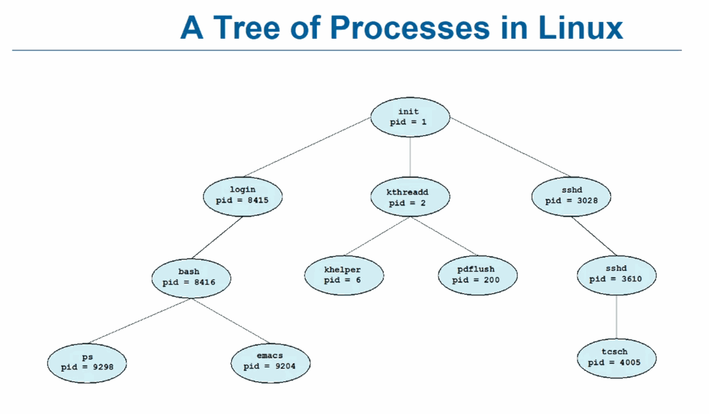

제일 처음 커널에서는 pid가 1인 init이 만들어진다. (옛날 자료여서 init process라고 되어있지만, 대부분 현재의 리눅스 시스템은 systemd라는 프로세스를 root process로 만들어낸다.) init은 자식 프로세스를 만들면서, 부팅 과정을 이어나간다. 부모-자식 관계를 이어나가면서 process tree가 만들어진다.

- login(현재는 logind) : logind는 사용자가 시스템에 로그인하는 과정을 담당한다. 그러고나면 bash shell(command interpreter)를 사용해서 사용자 어플리케이션 동작을 수행한다.

    ⇒ 그리고 이를 통해서 여러 프로세스를 만들어낼 수 있고, 예컨대 pid 9204를 갖는 vim을 실행시킬 수도 있을 것이다.

- sshd : sshd는 ssh(secure shell)를 사용하여 사용자가 안전하게 시스템에 연결될 수 있도록 도와주는 역할을 한다.

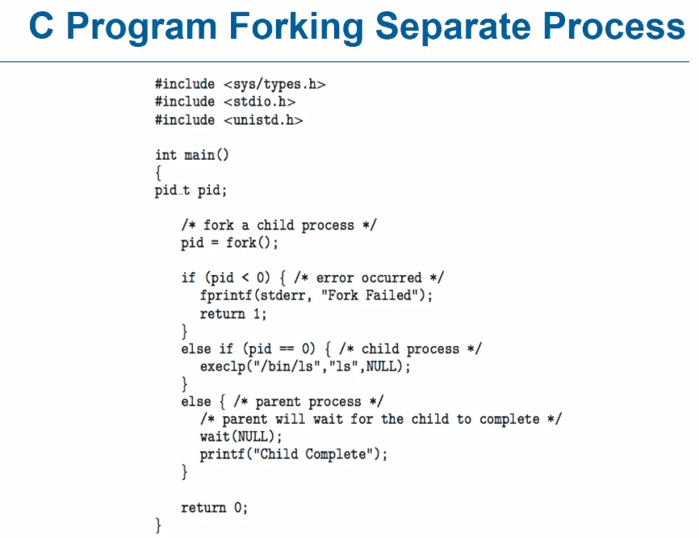

프로세스의 생성에 사용할 수 있는 함수들 중, 유닉스 계열의 운영체제에서는 fork가 사용될 수 있다. fork는 자식을 하나 만들어주는 함수이다. fork는 시스템으로 들어가서 커널 모드에서 나중에 동작이 되며, 만들고 나서 만들 결과를 pid에게 돌려주게 된다.

```c
#include <sys/types.h>
#include <stdio.h>
#include <unistd.h>

int main()
{
    pid_t pid;

    /* fork a child process */
    pid = fork();
		// 여기서 fork를 만나게 되면, 여기를 하나 두고
		// 밑에 있는 것을 메모리에 또 복사한다. (똑같은 것을 두 개로 만든다.)
		// 그리고 둘 중 하나를 부모로 만들고, 다른 하나를 자식으로 만든다.
		// 단, 그 중 하나의 pid에는 0을 돌려주고 다른 하나에는 0이 아닌 값을 준다.
		
		// 만약 pid가 0보다 작은 값이 나온다면 잘못 만들어졌다고 생각할 수 있다. (에러)

    if (pid < 0)
    {
        fprintf(stderr, "Fork failed");
        return 1;
    }

		// pid가 0인 것은 자식 프로세스이다.
    else if (pid == 0)
    {
        execlp("/bin/ls", "ls", NULL);
    }
	
		// pid가 0이 아닌 것은 부모 프로세스이다.
    else
    { /* parent process */
        /* parent will wait for the child to complete */
        wait(NULL);
        printf("Child complete");
    }

    return 0;
}
```

응용프로그램을 만들 때는 이렇게 새롭게 프로세스를 만드는 일은 거의 없지만, 운영체제가 돌아가는 상황에서 생각해보자. 컴퓨터를 사용하려면 전원을 켜고 로그인을 해야 한다. 로그인을 하려면 커널(init)로부터 login 프로세스가 만들어져야 하고, 그 다음에는 사용자로부터 입력을 받기 위해 shell이 만들어져야 하기 때문에 bash가 만들어진다. 이 과정까지만 해도 프로세스가 두 번 만들어지는 것이다.

여기서 어떤 프로그램을 새롭게 실행하면, bash(shell)이 새롭게 자식 프로세스를 만들어서 프로그램을 실행해 주는 것이다. 사실 자기 자신이 분기를 해서 하나를 더 만드는 것이다.

일반적으로 운영체제 레벨에서 따로 만드는 것들은 만들고 나서 무언가 실행을 추가로 해준다. exec이라고 하는데, 이것을 실행함으로써 서로 다른 길(다른 동작)을 걷도록 만들어준다.

우리가 만드는 응용프로그램은 보통 이런 길을 가지는 않고, 어떤 일을 분기를 하거나 exec를 실행하지 않는 경우도 있을 수 있다. 하지만, 일반적으로 운영체제는 위와 같은 방식으로 exec를 사용한다.

- 새로운 프로세스는 부모 프로세스의 내용과 똑같은 내용을 갖도록 메모리 공간을 할당받게 된다. 그러므로 실행 내용도 똑같을 것이다. 다만, 새로운 프로세스는 fork()의 반환값으로 0을 받게 되고, 반면에 부모 프로세스는 자식 프로세스의 pid를 반환받는다. 이를 통해 같은 내용을 수행하는 두 프로세스에서  자식 프로세스와 부모 프로세스를 구분할 수 있게 된다.

    이후에 exec() 시스템콜을 사용하면 프로세스의 메모리 공간을 새로운 공간으로 바꿔버리며, 기존에 들어있던 메모리 내용은 사라지고 실행할 프로그램의 이진 파일이 메모리 공간에 들어가게 된다.

    자식 프로세스는 초기에 부모 프로세스로부터 만들어질 때 부모 프로세스의 모든 속성을 상속받는다. (PCB를 똑같이 상속받는다고 생각하면 될듯. resources, open files 까지… 등등)

- 자식 프로세스를 만들게 되면, 다음 두 개의 과정 중 하나로 이루어질 수 있다.

    - The parent continues to execute concurrently with it’s children.
    - The parent wait until some or all of its children have terminated.

    ⇒ 즉, 자식을 기다리지 않고 같이 돌아가거나, 자식이 다 끝날 때까지 기다리는 것.(wait)

    wait 시스템 콜을 사용해서 ready queue 내에서 자식 프로세스의 termination을 기다릴 수도 있다.

- 그리고 새로운 자식 프로세스는 다음 두 개 중 하나의 동작을 하게 된다.

    - The child process is a duplicate of the parent process (it has the same program and data as the parent).
    - The child process has a new program loaded into it.

    ⇒ 자식 프로세스가 부모 프로세스와 완전히 똑같은 동작을 하고 pid만 다른 경우이거나, 자식 프로세스가 부모 프로세스와는 완전히 다른 새로운 프로그램을 로드해서 실행하는 경우. (exec 계열의 시스템 콜을 사용함)

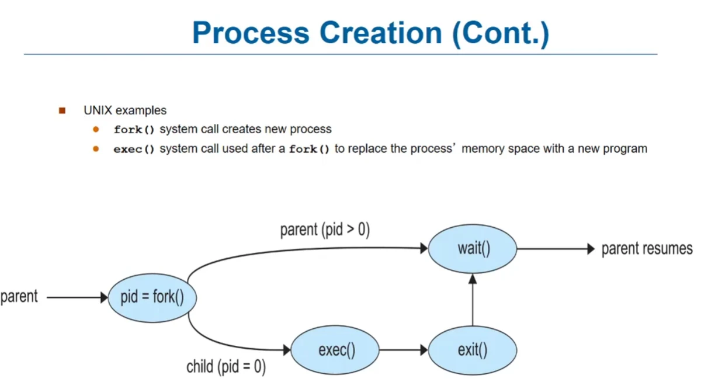

parent가 fork 명령어를 수행, 이렇게 되면 두 개의 프로세스로 나누어지게 된다. (완전히 동일한 프로세스) 돌려받는 값인 pid가 0보다 크면 원래의 프로세스(부모 프로세스)이며, pid가 0인 것은 새롭게 만들어진 프로세스(자식 프로세스)가 된다. 자식 프로세스의 경우에는 운영체제가 exec를 실행해서 다른 기능을 하도록 만들고, 동작이 끝나면 원래의 부모에게 inform, 신호를 Signal로 보내주어서 동작이 끝났음을 알려준다. 그러면 자식 프로세스가 끝나기를 wait으로 기다리고 있던 부모 프로세스는 시그널을 전달받아 자식 프로세스가 끝났음을 전달받고 동작을 재개하게 된다.

그런데, 부모 프로세스가 반드시 기다리지는 않을 수도 있다. 부모 프로세스는 끝나야 되는데 자식 프로세스는 Signal을 보내야 되는 상황이 있을 수 있다. 실제로는 끝났지만 끝나지 못하고 exit를 받도록 남아있게 된다. 유령 프로세스라고 부르기도 한다. ⇒ 좀비 프로세스

---

**Zombie Process**

어떤 프로세스가 child process를 생성해서 두 개가 수행되고 있는데, parent process가 child process가 exit될 때까지 기다려줘야되는데 child process보다 먼저 수행이 종료된 경우이다. 이렇게 되면 child process는 parent process가 없는 process가 되는데 리눅스에서는 이를 어떻게 처리하냐면, 이 프로세스의 ppid를 1로 세팅해버린다. (Init process가 parent가 되도록 만든다. 일종의 입양, adopt) 

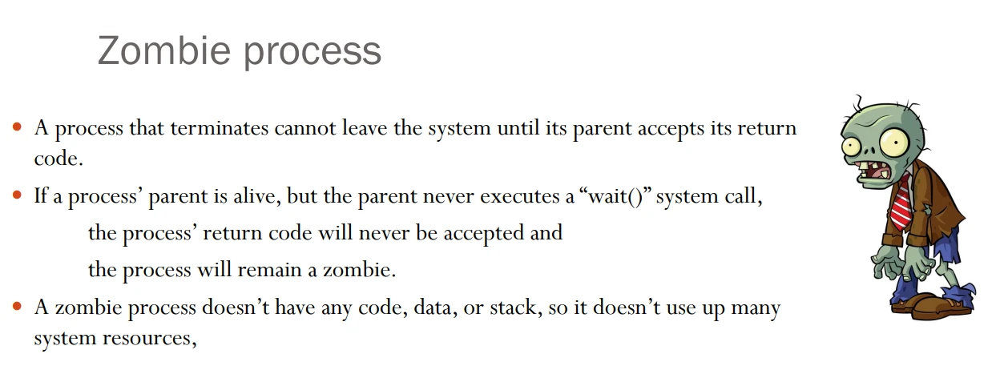

child process가 생성되어 수행이 되고 있는데, child process가 exit를 수행했다고 하자. 그런데 사실, exit를 했다고 바로 끝나는 것은 아니고 현재 wait하고있는 parent process가 exit code를 가져가야만 제대로 끝이 나는 것이다. 그렇게 되면 메모리에 로드되어 있던 child process의 데이터나 시스템 리소스가 모두 제거된다. 따라서 parent process는 반드시 wait() 상태에 있어야만 한다. 그런데 child process는 exit를 하긴 했는데 만약 그 때 parent process가 wait상태가 아니라 다른 작업을 수행 중이었다고 한다면, child process의 데이터는 제거가 되었는데 완벽하게 종료가 안된 상태인 zombie process 상태가 된다. 

---

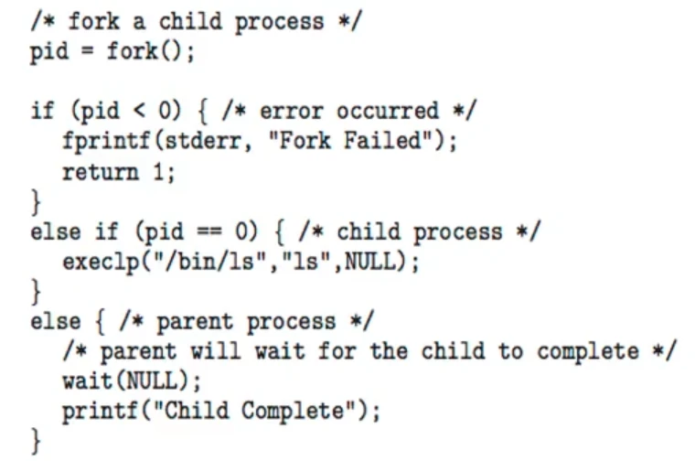

자식 프로세스가 return을 하게 되면 운영체제가 자식 프로세스의 실행이 끝났다고 부모 프로세스에게 Signal을 전달해 준다. (이때 exit() 시스템 콜이 사용된다.)

- Windows에서의 프로세스 생성

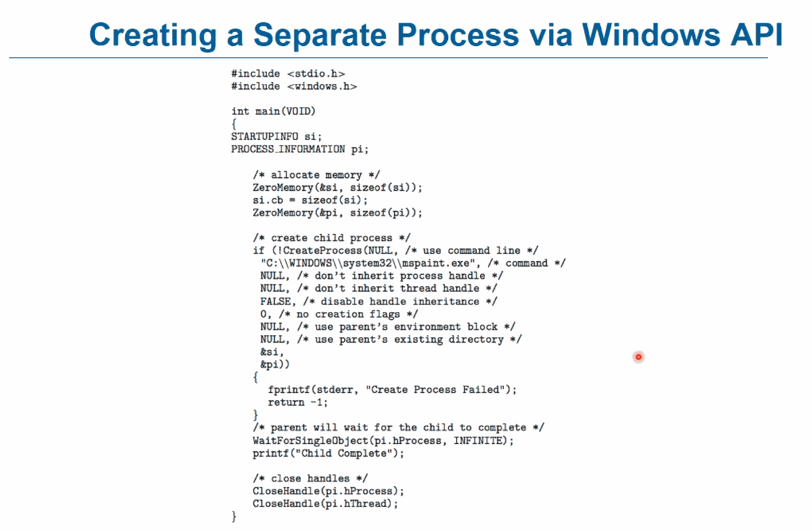

윈도우즈에서는 동작이 좀 다르다. 프로그램이 좀 더 복잡하고 함수 이름이 더 길다.

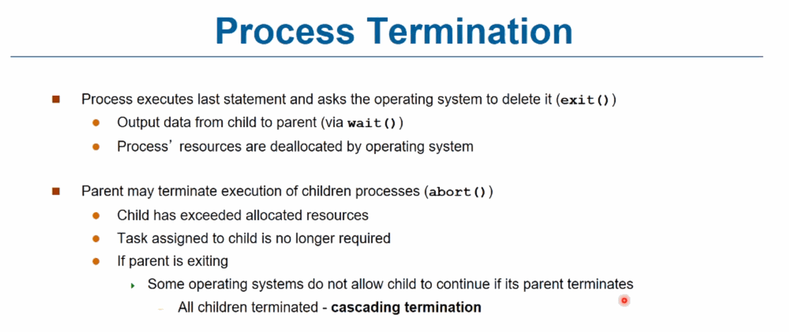

만들어진 프로세스(자식 프로세스)는 끝이 나면 termination이 된다. 이 때 <strong>exit()</strong>라는 시스템 콜을 사용해서 운영체제에게 프로세스의 삭제를 요청하게 된다. 자식 프로세스는 부모 프로세스에게 wait() 시스템 콜을 통해 데이터를 전달하게 되고, 부모 프로세스는 이것을 모두 기다렸다가 다음 동작을 수행하게 된다.  
⇒ exit()가 수행되면 해당 프로세스에 할당되었던 모든 리소스들이 해제된다.  
(physical and virtual memory, open files, I/O buffers and so on…)

- 부모 프로세스는 abort()를 사용하여 자식 프로세스의 수행을 종료할 수 있다.

    - 자식 프로세스가 할당된 자원을 초과하여 사용할 경우
    - 자식 프로세스에 부여된 job이 더 이상 필요하지 않을 경우

    - 부모 프로세스가 종료될 경우

        - 운영체제는 부모가 종료되면 자식이 계속 수행되는 것을 허용하지 않는 것이 일반적이다. 부모 프로세스가 끝나면 자식 프로세스도 끝나야 한다. 이런 것을 cascading termination 이라고 한다.

- 만약 부모 프로세스가 자식 프로세스를 wait하고 있지 않으면, 자식 프로세스가 실행을 마치고 exit() 시스템 콜을 수행했을 때 시그널을 전달하지 못한다. 이럴 때는 init process(systemd)가 자식 프로세스를 입양해서 부모 프로세스가 되기를 자처한다. 어떻게 하는 것이냐면, init 프로세스가 주기적으로 wait() 시스템 콜을 호출하면서 부모 프로세스가 없어진 자식 프로세스를 자신의 자식 프로세스로 데려오는 과정을 거친다. 이때 init의 밑으로 들어간 프로세스를 **orphan process**라고 한다.

---

## Interprocess Communication(IPC)

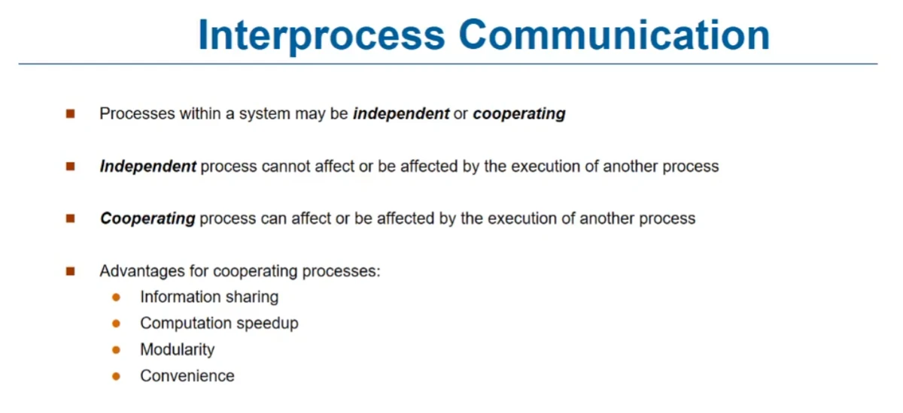

프로세스들이 무언가를 주고 받을 수 있다. 그래야 두 개 이상의 프로세스들이 협업을 할 수 있을 것이다. 협업을 하지 않는 프로세스를 Independent Process라고 하고, 협업을 하는 프로세스를 Cooperating Process 라고 한다. 프로세스가 협업을 하면 다음과 같은 이점을 얻을 수 있다.

- Information Sharing
- Computation speed-up (상대적으로 작업 속도가 높아짐)
- Modularity (모듈화 기능)
- Convenience (편리성이 높아짐)

⇒ 다만, Information Sharing을 하는 과정에서 문제가 발생하지 않도록 하기 위해 고려할 사항들이 여러가지 있다.

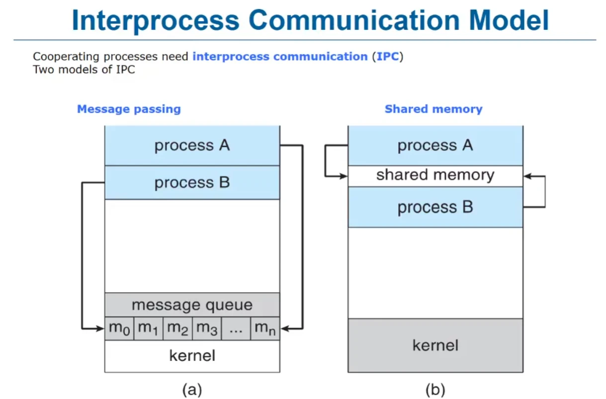

Communication하는 모델은 크게 두 가지가 있다. 하나는 신호를 주고받는 것(**Message passing**)이고, 다른 하나는 메모리 공유(**Shared Memory**)이다.

- **Message Passing**

두 개의 프로세스가 정해진, 약속된 Queue를 갖는다. 운영체제를 통해서 전달받아도 되고 본인들끼리 Queue를 만들어서 사용해도 되는데, 보통은 운영체제의 시스템을 이용한다. 거기에다가 Queue를 만들어 놓고, Queue에다가 집어넣고, 다른 프로세스에서 데이터를 가져가는 방식이다.  
message passing 방식은 적은 양의 데이터를 전송하기에 좋은 방식인데, 충돌이 발생할 이유가 없기 때문으로 보인다.

- **Shared Memory**

두 프로세스 사이에 공유할 수 있는 메모리 공간을 만든다. (물리적으로 실제 사이는 아니어도 됨. 실제로 두 프로세스만 공유할 수 있는 논리적인 메모리 공간을 설정해 두면 된다.) 그 메모리를 같이 쓰고 읽으면서 두 프로세스가 데이터를 공유할 수 있다. Shared Memory 방식은 Message Passing 방식에 비해 속도가 더 빠를 수 있는데, 그 이유는 Message Passing은 보통 시스템 콜을 이용하기 때문에 커널의 개입이 발생하여 더 많은 시간이 소요될 수 있다.

이와 다르게 Shared Memory에서는 Shared Memory 영역을 만드는 과정에서만 시스템 콜이 사용되기 때문에 소요되는 시간이 더 적다. 이 방식은 주기적으로 메모리에 액세스를 하게 되는 방식이기 때문에 (무한루프를 돌면서 가져올 데이터가 있거나 데이터를 넣을 공간이 있는지를 체크하기 때문) 시스템 콜을 사용할 필요가 없어서 커널의 개입이 생기지 않음.

---

## Shared Memory

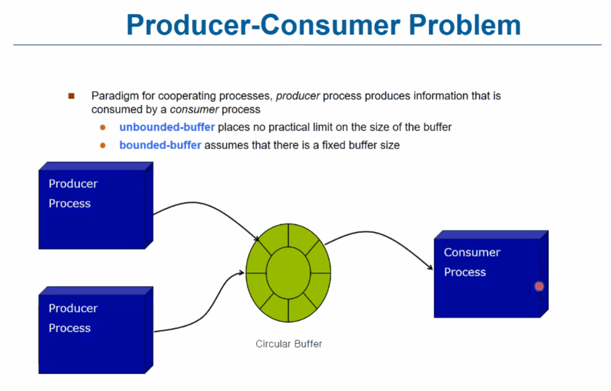

Shared Memory 방식을 이해하기 위한 Model, Producer-Consumer Model이다. 여기서는 기본적으로 공유를 하는 방법을 설명한다. 공유하는 과정에서는 Synchronization 문제가 발생한다.

producer는 아이템을 생산하고 consumer는 아이템을 소비한다. 이 과정에서 producer와 consumer는 반드시 synchronized(동기화)되어야 한다. 즉, producer가 아이템을 생산하기 전에 consumer가 소비를 할 수 없고, 아이템이 꽉 차있을 때는 consumer가 소비하기 전에는 producer가 아이템을 생산할 수 없다는것이다.

- Producer Process (생산자) : 생산자들은 데이터를 만들어내는 역할을 한다. 그렇게 만들어진 데이터는 Consumer로 전달된다. 데이터는 보통 변수의 값 등이 될 수 있다.
- Consumer Process (소비자) : 전달받은 데이터를 사용하는 역할을 한다.

데이터를 전달하고 받아서 소비했으면, 그 과정이 어떻게 이루어지는지를 알기 위해 중간에 매개체가 있어야만 한다. 일반적으로 쓰기 쉬운 것은 Circular Queue이다. 

- Bounded Buffer : Fixed Size Buffer
- Un-Bounded Buffer : No practical limit on the size of the buffer.

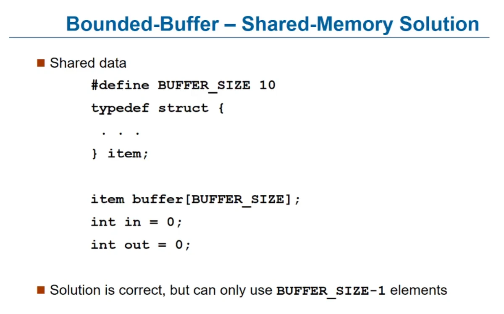

```c
#define BUFFER_SIZE 10

typedef struct {
// ...
} item;

item buffer[BUFFER_SIZE];
int in = 0; // rear
int out = 0; // front
```

Circular Queue에 데이터를 10개 넣을 수 있는데, 이를 가리키는 포인터는 총 두 개가 필요할 것이다. (front, rear) 원형 큐는 추가적인 뒷처리가 필요하지 않기 때문에 매우 편리하지만, 한 칸을 비워두어야 한다는 한계가 있다. (BUFFER_SIZE - 1개의 elements만 사용할 수 있다.)

- 생산자(Producer)

```c
item next_produced;
while (true) {
	/* produce an item in next produced */
	while (((in + 1) % BUFFER_SIZE) == out);
	/* do nothing */

	buffer[in] = next_produced;
	in = (in + 1) % BUFFER_SIZE;
}
```

생산자는 데이터를 만들어서 원형 큐에 그 데이터를 넣는 역할이다. 원형 큐이기 때문에 데이터를 넣고 나면 in 포인터의 값을 1 증가시킨다. 그 뒤에 Modulo 연산이 붙은 것은 원형 큐이기 때문에 순환을 시키기 위하여 만들어준 것이다.

그 위에 while (((in+1) % BUFFER_SIZE) == out); 파트가 있는데, 만약 in+1이 되었을 때의 값이 out과 같다면 버퍼가 꽉 찬 것이므로 값을 넣을 수 없다. 그렇기 때문에 무한 루프를 걸어서 BUFFER가 빌 때까지 기다려주는 것이다.

공유 메모리는 생산자가 만들고 소비자가 소비하는 구조이기 때문에, 소비자가 전달된 데이터를 모두 소비해서 버퍼에 빈 공간이 생길 때까지 기다리게 되는 구조이다.

- 소비자

```c
item next_consumed;
while (true) {
	while (in == out);
	/* do nothing */

	next_consume = buffer[out];
	out = (out + 1);
	/* consume the item in next consumed */
}
```

소비자는 buffer에서 값을 하나 빼오고, out의 값을 1 증가시켜서 buffer를 비워줄 수 있다. 

두 프로세스가 동시에 돌아가고 있는데, 버퍼가 가득 차서 while 루프에 걸려있다고 하자. 이 과정에서 out이라는 변수는 공유 변수이기 때문에 소비자가 하나를 써버리면 out의 값이 바뀌게 되고, 생산자에서 걸려있던 while 루프의 condition이 바뀌게 되면서 다음으로 진행하게 된다.

반대로 소비자의 경우, 빼낼 것이 없다면 (즉, in == out인 경우) 데이터를 빼내지 못한다. 그리고 이전의 경우와 똑같이 생산자에서 데이터를 원형 큐에 집어넣어 in의 값이 바뀔 경우 in ≠ out이 되기 때문에 while 루프를 빠져나가 데이터를 소비하게 된다.

이것이 중간에 공유 메모리를 두고 돌아가는  Producer-Consumer Model이다.

---

## Message Passing

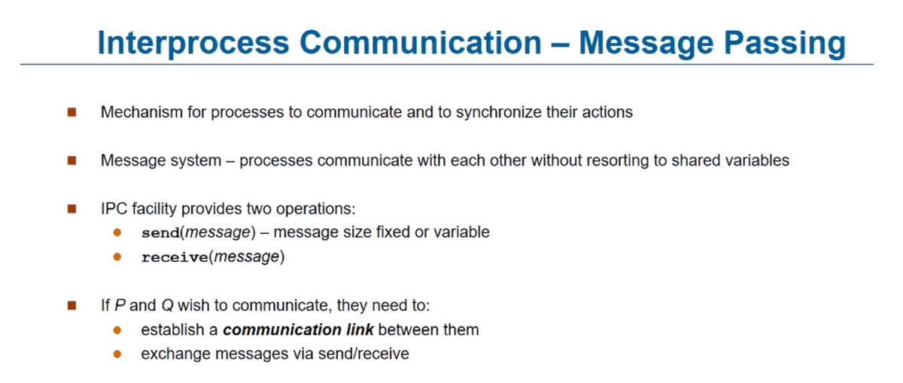

공유 메모리가 아닌 방식으로는 Message Passing이 있다. 이 방식은 운영체제가 갖고 있는 Message Queue 시스템을 사용하며, 동일한 데이터 공간을 공유하지 않으면서 데이터를 공유할 수 있는 synchronized 방식을 제공한다.

- 데이터를 보내는 것은 <strong>send(message)</strong>를 이용하여 정해진 크기의 데이터를 어딘가로 보낸다. 실제로 Signal 등을 보내게 된다.  
    (데이터의 크기가 정해져 있을 수도 있지만, 정해져 있지 않을 수도 있음.)
- 보내는 것을 받는 쪽은 <strong>receive(message)</strong>를 이용하여 받게 된다. 
- 보내는 쪽과 받는 쪽은 반드시 communication link가 존재해서 서로 데이터를 주고 받을 수 있어야 한다. 이것은 실제로 물리적으로 연결될 수 있는 연결점이 존재해야 된다는 점을 시사한다.

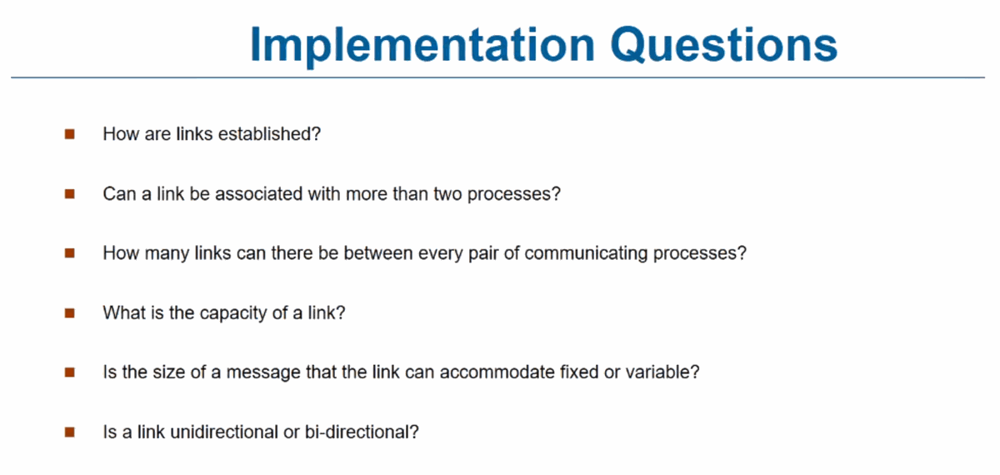

이런 시스템을 구현할 때는 사실 고민할 것이 매우 많다. 

- 두 개 이상의 프로세스와 연결할 수 있도록 만들어야 하는가? 
- 한 쌍의 프로세스 사이에는 Queue가 하나만 있는가?
- 그 Queue의 용량은 어떻게 설정되어 있는가?
- 단방향, 양방향?
- 크기는 가변적으로 해야하는가? 고정적으로 해야하는가?

⇒ 이와 같이 많은 고려 사항들이 있지만 실제로 만들 때는 가장 적절한 형태를 선택하여 만든다. 다만, 정답은 없고, 절충해서 만들면 된다.

---

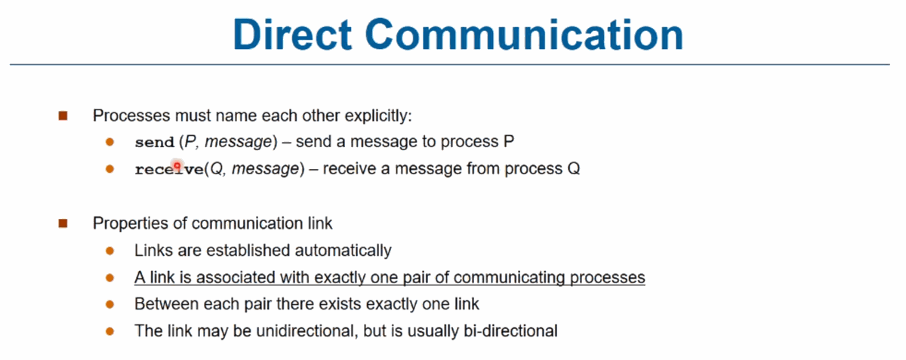

데이터를 보내고 받는 방식에도 방법에도 direct/indirect 두 개의 방식이 있다. 

- **direct**

    - send(P, message) : 프로세스 P에게 메시지를 보내겠다고 명시를 하는 전달 방식.
    - receive(Q, message) : 프로세스 Q에게 메시지를 받겠다고 명시, 다른 것은 기다리지 않는다.
    - 데이터를 주고받고자 하는 두 프로세스 간에 자동으로 링크가 생성되고, 이 링크는 오직 두 프로세스와만 관련된다. 연결지어진 두 프로세스 간에는 반드시 하나의 링크만 존재할 수 있다. 이 링크는 일방향적으로 생성될 수도 있지만, 보통은 양방향적으로 생성된다.

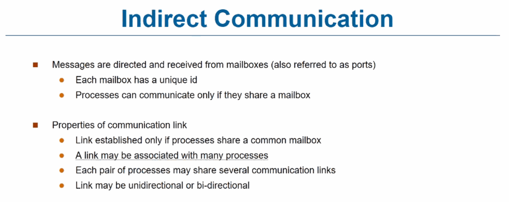

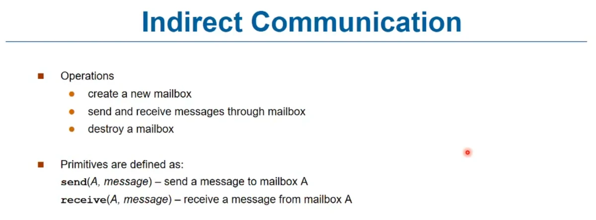

- **indirect**

    - mailbox에 데이터를 전달하고, 거기서 꺼내 쓰는 방식이다.
    - 이렇게 하면 데이터를 공유하는 모든 사람이 찾아보면서 데이터를 넣고, 꺼내가는 방식이 사용될 수 있다.
    - send(A, message) : 데이터를 보내긴 하는데, A라는 이름의 mailbox에 전달한다.
    - receive(A, message) : mailbox A로부터 데이터를 전달받는다.

⇒ 조금 더 보편적으로 사용할 수 있는 방식이다. 맞고 틀린 것은 없고, 상황에 맞추어서 사용된다.

- Communication Link

    - 페어로 선택된 프로세스가 공유 메일박스를 가져야만 링크가 형성될 수 있다.
    - 링크는 두 개 이상의 프로세스와 이어질 수 있다.
    - 각각의 프로세스는 여러 개의 communication link를 가질 수 있다.

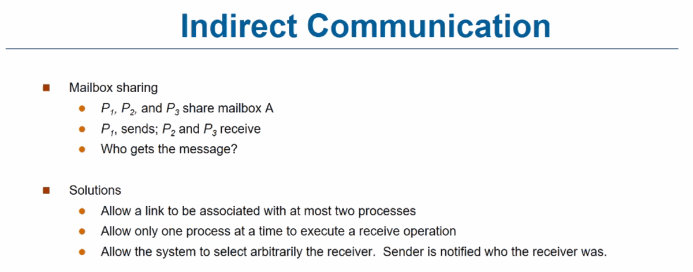

- P1, P2, P3가 mailbox A를 공유한다고 할 때, P1이 A에 데이터를 보내면 P2, P3 중 어떤 것이 데이터를 전달받을 것인가?

- Solution

    - 두 프로세스 간의 link를 설정한다.
    - link된 프로세스 간에는 동시에 한 프로세스만 receive를 수행할 수 있도록 한다.
    - 시스템이 임의로 Receiver를 선택할 수 있도록, Round Robin 등의 알고리즘과 같은 임의의 알고리즘을 적용한다. 이 과정에서 Sender는 어떤 Receiver가 데이터를 전달받았는지를 알림받는다.

---

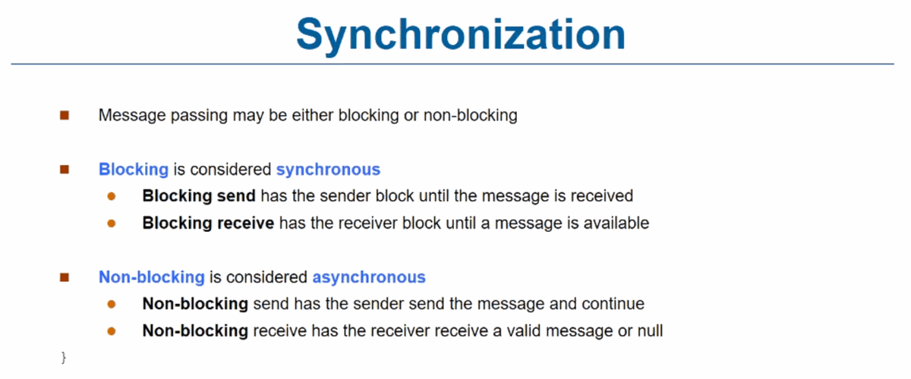

이전에 Shared Memory 방식에서도 Synchronization 문제가 발생한다고 했는데, Message Queue 방식에서도 마찬가지로 Synchronization 문제가 발생한다. 단, 뜻이 조금 다르다.

- 메시지를 주고받을 때의 Synchronization은 기다린다는 뜻이다. send, receive를 할 때 Blocking하는 것과 Non-blocking 두 개가 있다.

    - Blocking(Synchronous)

        - Blocking Send : Receiver가 데이터를 전달받을 때까지 대기한다.
        - Blocking Receive : 메시지가 활성화될 때까지 대기한다.

    - Non-blocking(Asynchronous)

        - Non-blocking Send : 프로세스가 일단 데이터를 보내면, 기다리지 않고 필요한 동작을 수행한다.
        - Non-blocking Receive : 메시지 전달을 대기하지 않는다.

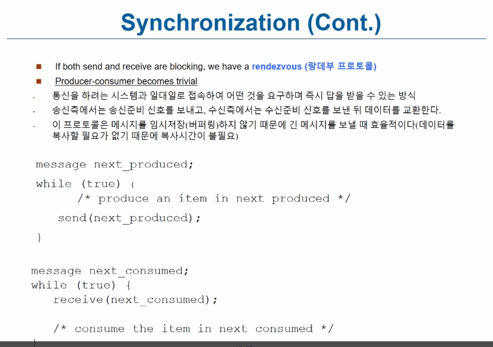

```c
message next_produced;
while (true) {
	/* produce an item in next produced */
	send(next_produced);
}

message next_consumed;
while (true) {
	receive(next_consumed);
	/* consume the item in next consumed */
}
```

Sender와 Receiver가 모두 Blocking일 때, 랑데부 프로토콜(rendezvous)이라고 한다. 일대일로 연결되어야 보내는 쪽과 받는 쪽이 명확해진다. 이렇게 되면, 버퍼가 없어도 된다는 장점이 생긴다.

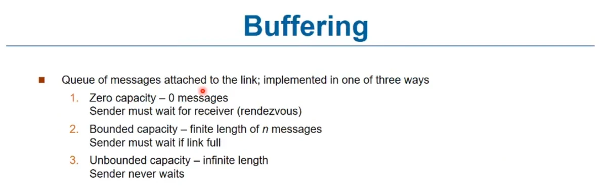

- 이를 Zero capacity라고 한다. (즉, 랑데부 프로토콜은 Zero capacity라고 한다.) 
- 일반적으로는 mailbox가 필요하므로, 어느 정도 크기의 Bounded capacity, 즉, 용량이 있는 Buffer가 필요하다.

---

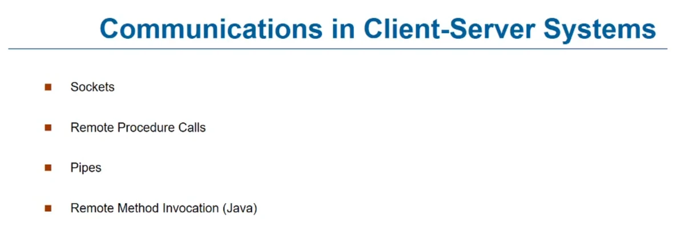

프로세스 간의 통신은 컴퓨터 내에서만 일어나는 것은 아니다. 컴퓨터 간에도 통신을 수행할 수 있다.

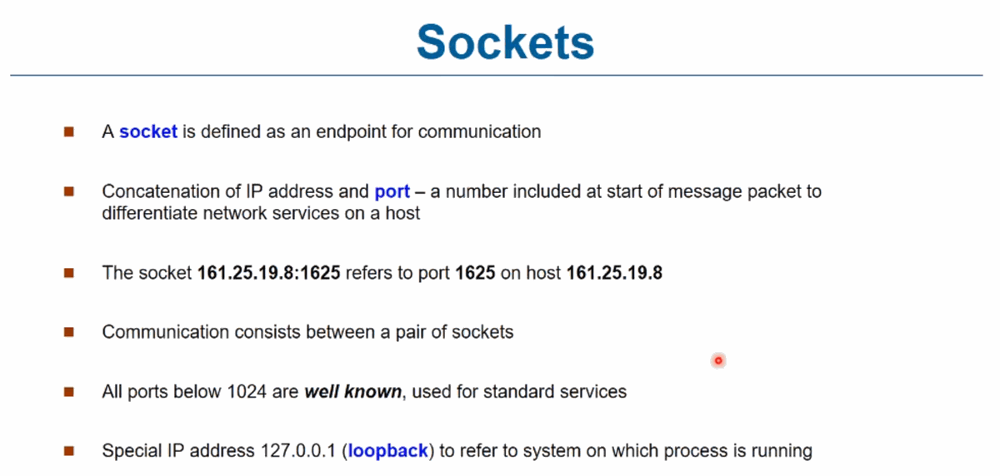

소켓은 상대방 컴퓨터와 연결이 될 때 사용될 수 있는 것이다. IP 주소와 포트번호를 묶어 표현하는 것을 소켓이라고 한다. IP를 갖는 컴퓨터의 몇 번 포트를 사용하는 프로세스에게 데이터를 보내겠다. 라고 한다면, 받는 쪽 프로세스도 해당 IP:포트를 열고 있으면 데이터를 전달받을 수 있다. 

127.0.0.1 : Localhost, loopback to refer to system on which process is running.

네이버와 같은 서비스의 경우, 웹브라우저를 사용해 http protocol을 이용한다. 그 프로토콜은 8080, 8088, 80같은 정해진 포트번호 중 몇 개를 골라 사용하게 되므로, 묵시적으로 해당 포트를 확인하면 된다.

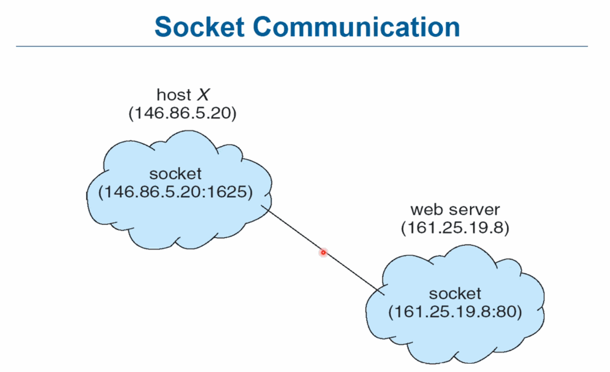

146.86.5.20:1625와 161.25.19.8:80이 연결되어 있다고 볼 수 있다.

**Threads**

이전까지는 프로세스가 싱글 스레드에서만 수행될 수 있다고 생각했다. 그러나 실제 모든 현대적 운영체제에서는 한 프로세스가 다수의 스레드를 컨트롤할 수 있도록 한다.

스레드의 사용을 통한 parallelism의 구현은 다수의 CPU를 제공하는 현대 멀티코어 시스템에서 매우 중요하게 작용하고 있다.

## Threads

- 스레드는 CPU 사용의 기본 단위이다. thread id, program counter, a register set, stack을 가진다. 

    - 다른 스레드들과 동일한 code section, data section, operating-system resources such as open files and signals를 공유한다.

- 현대 컴퓨터와 모바일 디바이스에서 동작하는 모든 프로그램은 대부분 멀티스레드로 동작한다. 한 애플리케이션 프로그램은 통상적으로 몇몇 개의 스레드를 가지는 분리된 프로세스를 통해 동작한다. (멀티프로세스 멀티프로세스 시스템) 이로써 한 번에 다수의 프로그램을 수행할 수 있게 된다.

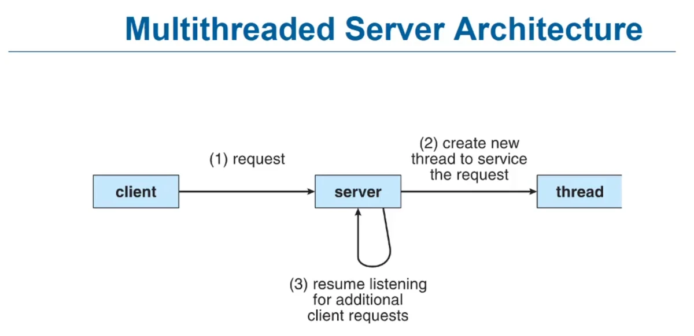

이 그림은 서버와 같은 시스템에서 Multithread가 어떻게 유용하게 사용될 수 있는지를 나타내는 그림이다. 서버라는 것은 사용자로부터 요청이 있으면, 그 요청에 맞는 응답을 만들어 보내주는 역할을 하는 것이다. 

ex) 100명의 사람이 서버에 접속한다고 해보자. 서버에 접속해서 어떠한 동작을 하거나, 무언가를 클릭해서 다른 페이지를 로드하는 등의 행위를 하고 있다. 그리고 이 모든 동작은 불특정하게 이루어 진다. (Asynchronous) 여기서 100명의 동작은 모두 다를 것이지만, 동일한 것은 하나의 주소와 연결이 되고, 연결된 서버가 들어온 요청을 처리해서 클라이언트로 보내준다는 것은 같다. 서버에서는 요청된 페이지가 있다면 결과를 만들어내고, 만들어낸 결과를 요청한 곳으로 보내주는 역할을 한다.

같은 일을 하기 때문에 하나의 프로세스에서 처리될 수도 있지만, 그런 프로세스를 매 번 새롭게 띄우고 하는 것은 비효율적일 수 있기 때문에 일정한 요청에 대해서 응답할 Thread를 만들어두면 효율적으로 동작할 수 있을 것이다.

- 애플리케이션이 여러 CPU 코어를 사용하도록 프로그램을 작성할 수도 있고, 실제로 이런 경우도 있다. 이런 상황에서는 단일 애플리케이션이 동일한 작업을 여러 개 수행해야 될 수도 있다. 예를 들어, 웹서버가 클라이언트로부터 웹페이지, 이미지, 사운드 등을 달라는 요청을 전달받을 수도 있다. 이런 경우 웹 서버는 동일한 작업을 수행하는 여러 명의 클라이언트로부터 요청을 받을 수도 있을 것이다.

    만약 전통적인 싱글 스레드 프로세스라면, 한 번에 한 명의 클라이언트에 대한 요청만 처리해줄 수 있을 것이다.

    이에 대한 하나의 해결책 중 하나는, 서버가 요청을 받으면 그 요청을 수행할 또다른 별개의 프로세스를 만드는 것이다. 사실, 이 프로세스 생성 방법은 계속해서 사용되어오던 방법이지만, 많은 시간과 자원이 소요되는 작업이다. 

    그러므로 일반적으로는, 다수의 스레드를 갖는 프로세스를 사용하는 것이 효율적이다. 만약 웹서버가 멀티스레드 환경이라면, 서버는 클라이언트의 요청에 따라 개별적인 스레드를 만들어낼 것이다. 

- Multithread

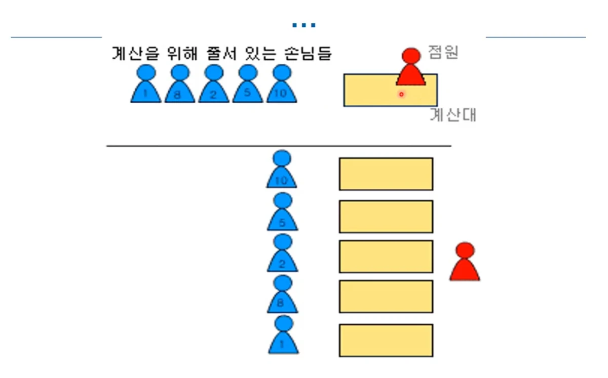

첫 번째 모델은 점원이 한 명이고, 계산대도 하나이다. 한 번에 한 손님만 처리할 수 있다.

두 번째 모델은 점원이 한 명이지만, 계산대가 여러 개이다. 여전히 한 번에 한 손님만 처리할 수 있지만, 동시에 일을 처리할 것이며, 손님이 미리 대기할 수는 있다.

- 맨 마지막에 있는 손님의 처리 시간은 ‘1’이다.

첫 번째 모델의 경우는 맨 마지막 손님이 처리되려면 총 ‘26’의 시간이 소요되지만, 두 번째 모델은 각 손님마다 ‘1’씩 처리를 하게 되므로 처리시간이 ‘5’ 소요된다. 좋은 것처럼 보일 수도 있지만, 장점도 있고 단점도 있다.

총 처리 시간은 대기시간 + 처리 시간이다. 각 손님의 처리 시간을 구해보자.

1. [26] [25], [17], [15], [10] ⇒ 93,  평균 : 18.6
2. [26] [12] [8] [24] [5] ⇒ 80, 평균 : 15

첫 번째 손님의 경우에는 첫 번째 모델을 사용하는 것이 더 좋겠지만, 그 외의 경우에는 평균적으로 두 번째 모델이 더 좋을 것이다. 이 데이터를 가장 빠르게 처리하려면, 정렬되어 있으면 좋을 것이다.

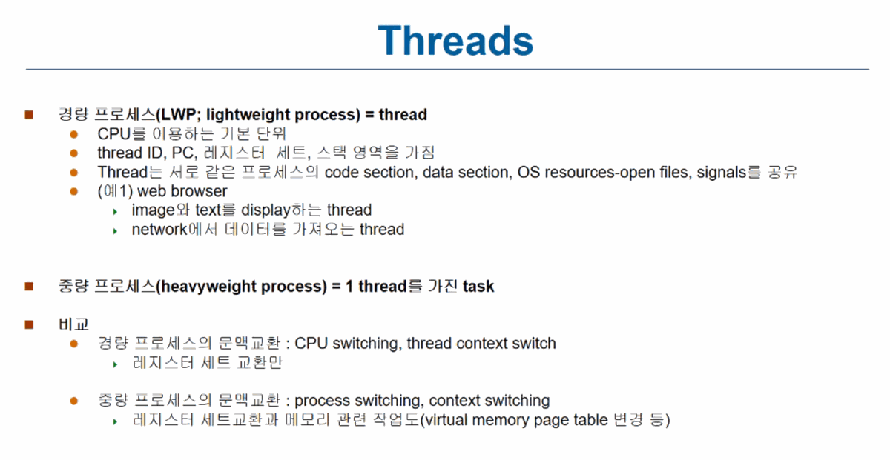

**쓰레드**란, 실질적으로 CPU를 차지하는 실행 단위이다. 내가 특별하게 쓰레드를 나누지 않으면 프로그램을 만든 프로세스 자체가 하나의 쓰레드가 된다. **이런 것을 중량 프로세스(heavyweight process)라고 한다.** 그리고 <strong>중량 프로세스를 여러 개로 나눈 프로세스를 일반적으로 경량 프로세스(lightweight process)</strong>라고 한다. 

**중량 프로세스에서의 context switching**은 프로세스 자체가 쓰레드이기 때문에 **process switching**이 되는 것이고, **경량 프로세스에서는** **thread context switching**이라고 할 수 있다.

쓰레드는 프로세스보다 상대적으로 가벼운 개념이다.

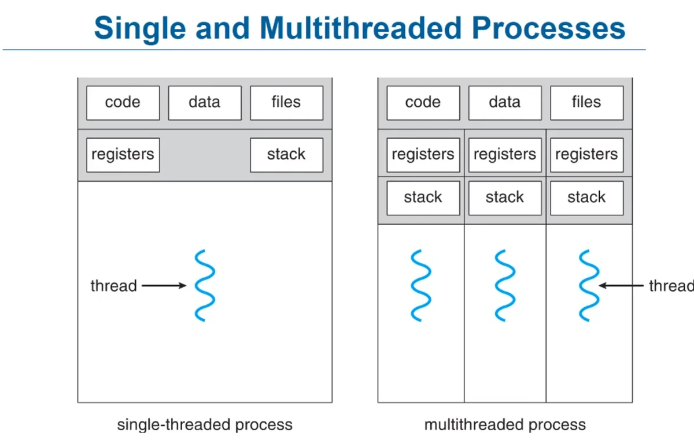

왼쪽에 있는 것이 프로세스이자, 쓰레드가 하나밖에 없는 단일 쓰레드 모델이다. (single-threaded process) 프로세스는 code, data, files, stack, register, PC 등등을 모두 가지고 있다.

그런데 쓰레드라고 하는 것은, 일부를 공유를 한다. 쓰레드는 보통 프로그램 내에서 함수를 떼내서 쓰레드라고 하는 경우가 많다. 하나의 프로세스 안에 함수가 10개 있으면, 프로세스에서 돌아가는 흐름 함수가 10개가 있다고 볼 수 있다. 그 함수 10개를 다 뜯어내서 동시에 동작시킬 수만 있다면, 각각을 쓰레드로 만들 수 있다고 생각할 수 있는 것이다. 그러면 10개의 함수가 아니라 10개의 쓰레드가 있다고 볼 수 있는 것이다. 차이는, 함수는 부르는 대로 순서대로 하나씩 하나씩 실행이 되지만, 쓰레드는 일단 만들어지면 자기가 알아서 돌아가게 되는 것이다. 자기 차례가 되면 알아서 동작시켜 준다. 모든 함수가 무조건 쓰레드가 되는 것은 아니고, 쓰레드에 맞게 구현을 해야 된다. 단, 함수가 뜯어져서 쓰레드가 된다라고 생각하면 편리하니까, **함수 전체가 프로그램에서 공유하는 것이 있다.** 바로, <strong>전역 변수(data)</strong>나 **외부에 연결되어 있는 입출력 파일들(files)**, 그리고 <strong>프로그램(code)</strong>은 같이 사용한다. 이것을 제외한 나머지 registers, stack은 쓰레드가 독립적으로 가지게 된다.  

- 쓰레드 내에서의 데이터 공유가 프로세스 간의 공유보다 좋은 이유.

    - 프로세스 간의 공유는 Message Passing 혹은 Shared Memory를 사용해야 한다. 이 방법은 오버헤드가 있는 경우가 있기 때문에 그 자체로 데이터를 공유하는 스레드 내에서의 데이터 공유가 프로세스 간의 데이터 공유보다는 overhead가 적은 동작이 된다.

**만약 쓰레드끼리 데이터를 공유해야 하는 상황이 온다면, 훨씬 효율이 좋아질 수 있다. 쓰레드가 모든 데이터를 다 갖고있는 것은 아니기 때문에, 상대적으로 가볍기 때문이다.**

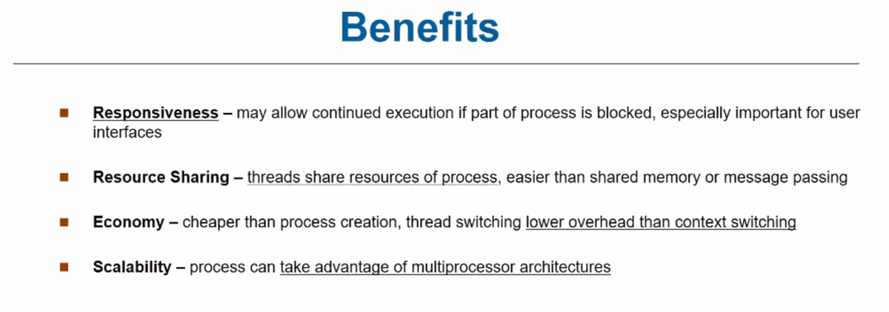

쓰레드를 사용하는 이유

- **응답성** : 멀티스레딩을 통해서 소요 시간이 오래 걸리는 작업을 수행할 때도 다른 스레드를 통해 유저와 상호작용을 할 수 있다는 점에서 응답성 관점의 이득을 얻는다.

- **자원 공유** : 프로세스들은 Shared Memory 혹은 Message Passing을 통해서 자원을 공유할 수 있다. 하지만 이런 테크닉들은 프로그래머에 의해 만들어져야만 한다. 하지만 스레드의 데이터 공유는 메모리를 통해 직접적으로 연결되어 있는 방식이기 때문에 기본적으로 가능하다.

    또한 코드와 데이터를 공유함으로써 한 애플리케이션이 한 프로세스 내에서 여러 개의 스레드를 활동하게 할 수 있다는 이점이 있기 때문에, 자원 공유의 관점에서 이득을 얻는다.

- **경제성** : 프로세스를 새로 만들 때 메모리와 자원을 할당하는 과정이 있게 된다. 하지만 스레드는 자원을 공유하기 때문에, 프로세스에 비해서 생성하는 과정이 간단하고 context-switching을 하는 것도 간단하다.
- **확장성** : 멀티프로세서 환경에서 적용하면 더욱 많은 동작을 실행할 수 있게 된다.

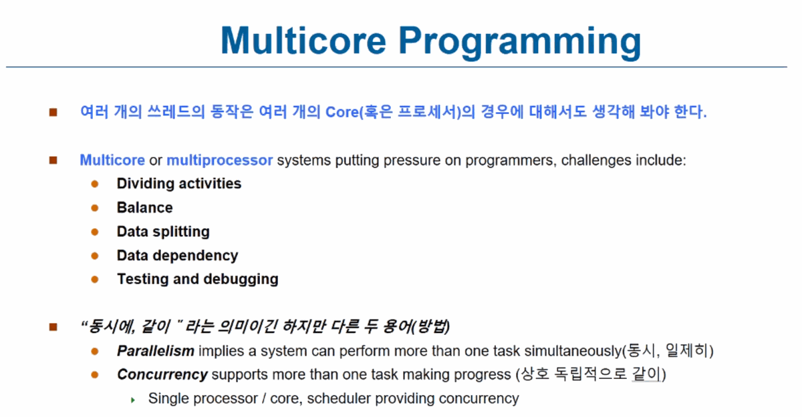

일반 개인용 PC는 프로세서는 하나이지만, 대부분 멀티코어를 지원한다. 이 경우, 각 코어에 프로세스나 쓰레드를 어떻게 할당할 것인지, 너무 한 쪽에 치우쳐지지는 않을지, 데이터의 독립성은 어떻게 할지 등을 고민해볼 필요가 있다. 이 과정에서 고려해볼 용어가 크게 두 개 있다.

- **Parallelism** : 하나 이상의 Task를 동시에 처리할 수 있다.

⇒ 실제로 물리적으로 두 개 이상의 Task가 병렬적으로 수행되고 있다.

- **Concurrency**  : 하나 이상의 Task가 함께 있다. 그러나, 독립적으로 모두 진행되고 있다.

⇒ 동시에 두 개가 선택되는 것이 아니라, 여러 개가 조금씩 나눠서 진행되고 있다. 물리적으로 동시에 진행되는 것은 아니다.

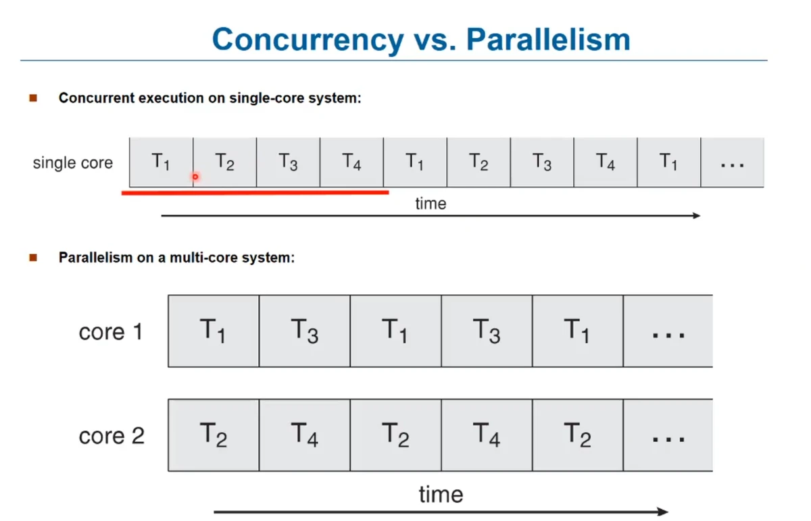

싱글 코어 시스템에서는 concurrency가 단순히 다수의 스레드 작업을 시간을 나눠가면서 하나씩 처리하는 것을 의미하게 된다. 그러나 멀티 코어 시스템에서의 concurrency는 일부 스레드가 동시에 병렬적으로 수행될 수 있다는 것을 의미한다. 

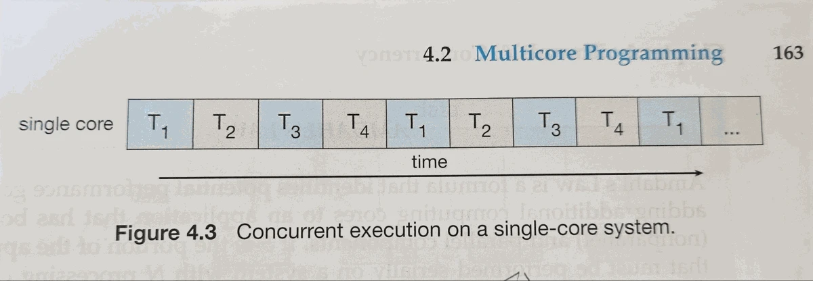

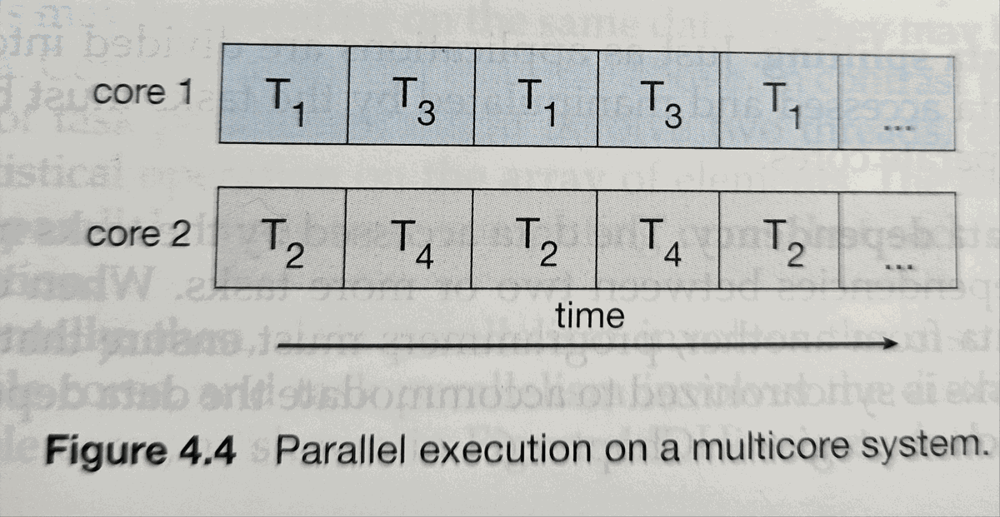

Concurrent는 프로세스가 조금씩 할당량을 나눠 갖으면서 수행되면서, 동시에 처리하는 것을 말한다. (Scheduling을 통해서)  
⇒ Single Core

Parallelism은 프로세스들이 실제 물리적으로 서로 동시에 수행되는 것을 말한다.  
⇒ Multi Core

즉, Concurrent는 각 프로세스들이 동시에 실행될 수 있는 지를 말하는 것이다. 프로세스들이 조금씩 할당량을 나눠 갖으면서 스케쥴링을 통해 Concurrent하게 수행될 수 있다. 그러므로 Concurrent System은 Parallelism 없이도 구현될 수 있다.  
⇒ 스케쥴링을 통해서 Concurrent System을 구현할 수 있지만, 이런 환경이 Parallel System은 아니다. Parallel System은 실제로 여러 프로세스가 동시에 수행되어야 하므로, 논리적 CPU가 두 개 이상 존재해야만 한다.

Parallelism은 실제로 프로세스들이 물리적으로 동시에 수행될 수 있는 것을 말한다. 그러므로 반드시 Multicore 환경이어야만 한다. 

**Multi-Processing, Multi-Tasking, Multi-Core, Multi-Threaded**

- 멀티프로세싱 : 멀티프로세싱은 독립적인 프로세서를 여러 개 사용하여 프로세스를 처리할 수 있는 환경을 말한다. 각각의 프로세서는 별개의 프로세스를 수행하거나 큰 프로세스의 일부를 수행할 수 있고, 이를 통해 parallelism(여러 개의 프로세스가 실제 물리적인 프로세서 상에서 동시에 처리될 수 있는 환경)과 향상된 프로세싱 효율을 얻을 수 있다.

    멀티프로세싱은 컴퓨터에 여러 개의 CPU를 부착하거나 여러 대의 컴퓨터가 함께 일하는 분산 시스템(distributed system)에서 이뤄질 수 있다.

- 멀티태스킹 : 멀티태스킹은 운영체제가 다수의 프로세스를 동시에 수행할 수 있는 능력을 말한다. 멀티태스킹 환경에서, 운영체제는 매우 빠르고 빈번하게 CPU를 차지하고 있는 프로세스를 바꿔가면서 각각의 프로세스가 작은 시간을 할당량으로 가져 수행되도록 한다. 이는 컴퓨터를 사용하는 유저에게 마치 각각의 프로그램들이 동시에 동작하는 것처럼 보이게 하고, concurrent한 환경을 제공할 수 있게 된다.

    멀티태스킹을 통해 컴퓨터 자원을 효율적으로 사용할 수 있게 되며, responsiveness를 향상시킬 수 있다.

- 멀티코어 : 멀티코어 프로세서는 단일 CPU가 다수의 프로세싱 유닛(코어)을 가지는 구조이다. 각각의 코어는 독립적으로 프로세스를 실행할 수 있다. 멀티코어 프로세서를 통해 다수의 프로세스가 동시에 동작하도록 함으로써 parallelism을 얻을 수 있다. 이를 통해 프로세서의 전체적 성능과 효율성을 증대할 수 있다. 현대의 프로세서들은 대부분 멀티 코어 프로세서를 사용하여 프로세싱 능력을 확보한다.

- 멀티스레드 : 멀티스레딩은 단일 프로세스나 애플리케이션이 여러 개의 스레드로 나뉘어지는 것을 말한다. (이를 lightweight process라고 하며, 동시에 실행될 수 있는 실행 단위가 된다.) 각각의 스레드는 프로세스의 서로 다른 부분을 수행할 수 있고, 이를 통해 parallelism과 향상된 성능을 확보할 수 있다. 멀티 스레딩은 멀티스레드를 사용하는 프로세스에 의해 S/W적으로 구현될 수도 있고, 멀티스레드를 지원하기 위해 H/W 레벨에서 만들어진 프로세서를 통해 구현될 수도 있다. (ex. 인텔의 하이퍼 스레딩)

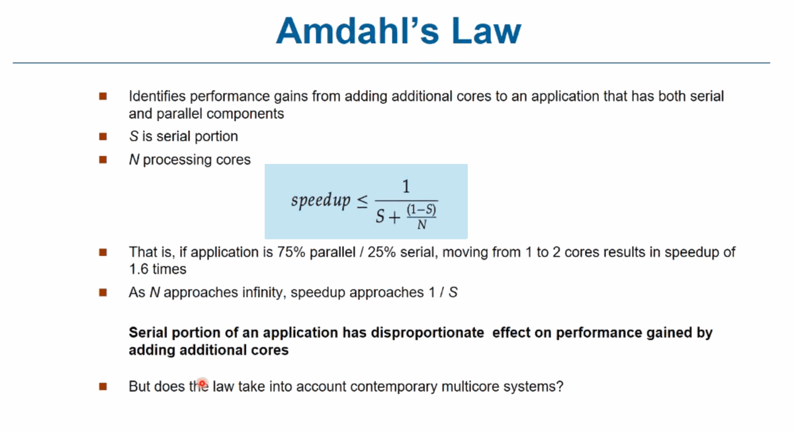

그런데, 코어가 많아지면 무조건 빨라지는가? 라고 묻는다면, 그건 아니다. Amdahl’s Law가 있는데, 암달 병렬 컴퓨팅의 선구자와 같은 사람이다. 재미있는 것은, 사람들이 이것을 암달의 법칙이라고 부르지 않고, &lt;암달의 저주&gt;라고 부른다.

$$
speedup <= 1/(S+(1-S)/N)
$$

이 법칙은 컴퓨터 시스템의 일부를 계산할 때, 전체적으로 얼마만큼의 최대 성능이 향상될 수 있는지를 계산할 수 있는 간단한 식이다. 이 법칙에 따르면,  전체 작업의 S%의 부분이 Serial하게 이루어지고, 나머지 부분은 Parallel하게 했을때, N배의 성능이 향상되었다고 하면, 최대로 향상 가능한 속도는 위의 값과 같다. 다시 말하면, S = 1 - P가 될 수도 있고, 1 - S = P로 표현될 수도 있다.

ex) 전체에서 75%가 병렬 수행되고, 25%가 직렬 수행된다. 이 과정에서, 코어를 1개에서 2개로 늘렸다고 하면, 다음과 같이 계산된다.

1/(0.25+0.75/2) = 1.6

따라서, 위와 같은 조건일 때, 성능이 1.6배 빨라진다고 볼 수 있다.

만약 프로그램을 모두 Serial하게 짠다면, 당연히 Parallel한 동작은 0이 되므로, 컴퓨터의 속도는 이전의 속도와 같은 1배속을 유지할 것이다.

반대로, 프로그램을 모두 Parallel하게 짠다면, 당연히 Serial한 동작이 0이 되므로, 컴퓨터의 처리 속도는 N배 빨라진다고 볼 수 있다.

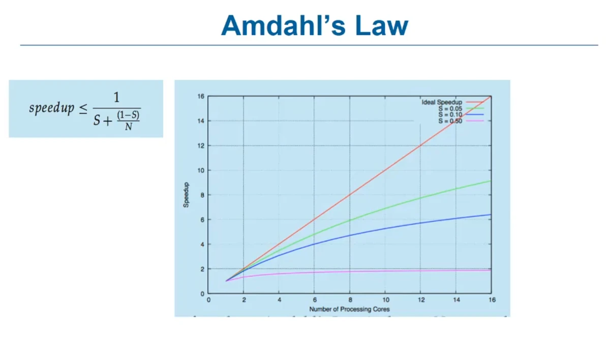

이를 그래프로 표현하면 위와 같이 표현된다. 

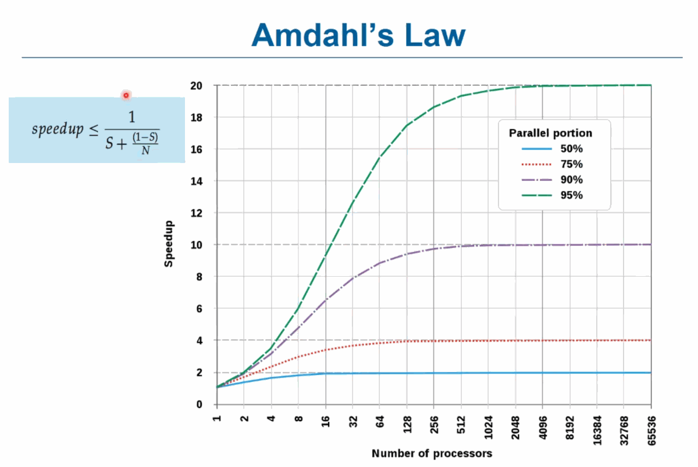

이 그래프를 확대해보니, 다음과 같은 모습이 나왔다. (Processor의 개수를 무한대로 보내봄)

이렇게 하면, N이 아무리 커져봤자 도달할 수 있는 정도가 존재함을 알 수 있다. (점근선이 나타남) 암달의 법칙은 병렬처리를 아무리 잘하고 코어의 개수를 아무리 늘려봐야 최대 20배밖에 늘릴 수 없다고 생각할 수 있다.

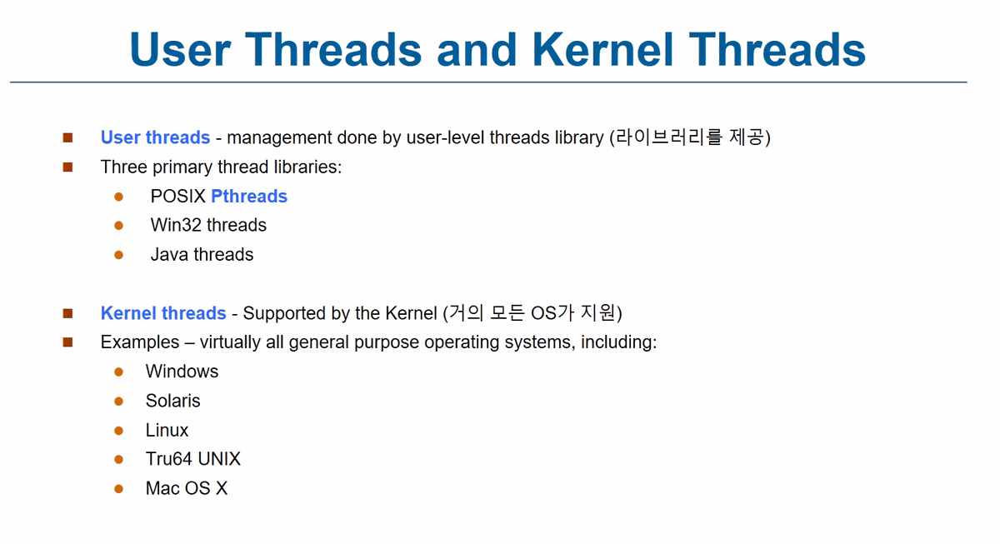

쓰레드는 처리되는 위치에 따라 유저 쓰레드가 있고, 커널 쓰레드가 있다.

- User Thread : 라이브러리에 의해 쓰레드 형태로 만들어지는 모든 모양. 유저 스레드는 커널 위에서 지원되며, 커널의 도움 없이 관리된다.
- Kernel Thread : 실제로 kernel에서 처리되는 쓰레드 형태 (거의 모든 OS가 지원한다.) 커널 스레드는 운영체제에 의해 직접적으로 관리된다.

유저 쓰레드가 유저 모드에서 동작하려면, 프로그램처럼 돌아가야 하기 때문에 라이브러리가 있어야만 하며, 그 라이브러리 동작하는 하나하나의 쓰레드는 커널 쓰레드와 결합해서 최종적으로 커널 함수로 돌아가게 된다.

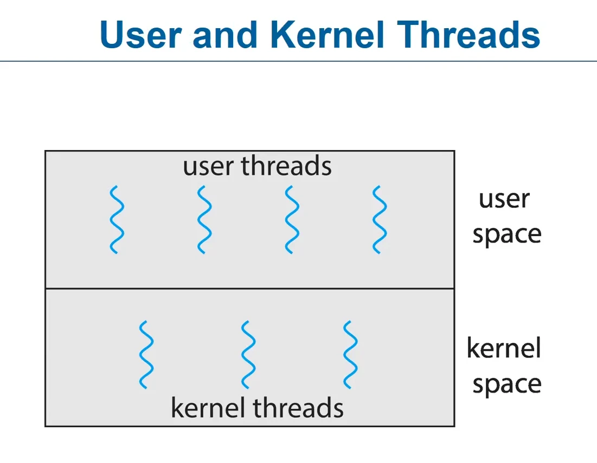

User Space는 내가 응용프로그램으로 만든 부분이고, 라이브러리의 도움을 받아 쓰레드를 만들고 돌아가는 형태로 코딩을 해두면, 원래 함수에 있던 것들이 떨어져서 쓰레드로 나오게 되는 것이다. 그리고 각각의 쓰레드는 이후에 Kernel Space에 있는 커널 쓰레드들과 결합해서 돌아가게 된다. (그 이유는 아마도 각 스레드별로 시스템 콜을 보내면 이를 처리해주기 위해서 커널이 동작해야 할 것이고, 커널도 일종의 S/W이기 때문에 이런 요청이 여러 개가 들어오면 동시에 처리하기 위해서 스레드로 분리되어야 하기 때문일 것이다.)

유저 쓰레드는 라이브러리를 제공받아서 만드는 것이고, 커널 쓰레드는 운영체제가 만들어준다.


동시에 여러 개의 쓰레드가 독립적으로 동시에 돌아가도록 할려고 하는데, 멀티쓰레드의 동작 모델 또한 여러 개가 있다.

Usermodel - Thread

- **Many to One** : 유저 모드에는 많이, 커널에는 한 개
- **One to One** : 유저 모드의 하나의 쓰레드가, 커널 모드에서도 하나의 쓰레드
- **Many to Many** : 많은 쓰레드가 많은 쓰레드와 결합된다.

---

## Many-to-One

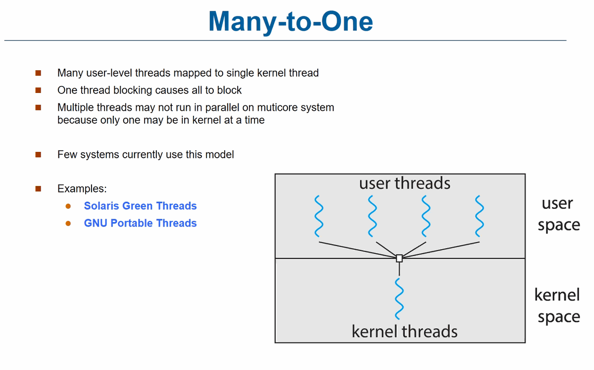

여러 개의 유저 쓰레드가 하나의 커널 쓰레드와 연결이 되어서 동작을 하는 형태이다. 커널 쓰레드가 많이 만들어지지 않은 경우에 이와 같이 사용할 수 있을 것이다. 유저 스페이스에서는 스레드 관리가 스레드 라이브러리에 의해 이루어진다. 그러나, 단일 스레드가 block 시스템 콜을 수행하면 프로세스 전체가 block된다. 

또한 Many to One 모델은 커널에 한 번에 하나만 접근할 수 있기 때문에 다수의 스레드가 동시에 접근할 수 없어서 여러 개의 스레드가 동시에 커널에 접근할 필요가 있는 멀티코어 시스템에서는 사용될 수 없다.

---

## One-to-One

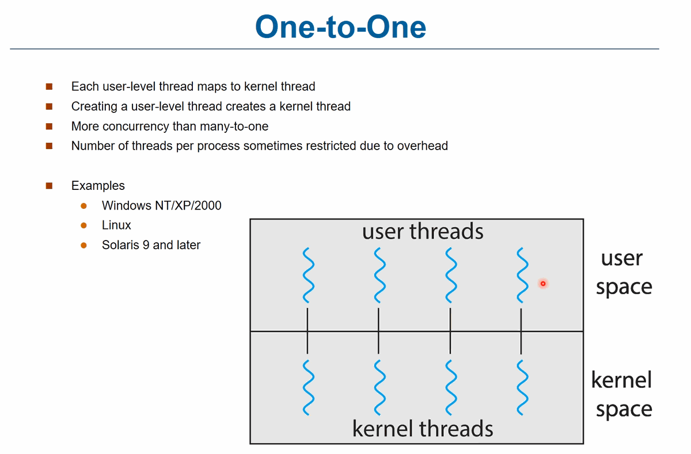

유저 쓰레드의 쓰레드 하나가 커널 쓰레드에서의 하나의 쓰레드와 결합되는 것이다. 유저 스페이스에서의 스레드가 커널 스페이스에 존재하는 커널에 각각 하나씩 매칭되기 때문에 Many To One 모델보다는 향상된 concurrency를 제공하지만, 커널 레벨에서 쓰레드가 많아지면 커널의 동작에 부담이 되고 성능이 저하될 수 있기 때문에, 무작정 커널 쓰레드가 많이 만들어지는 것이 좋은 것은 아니다.

---

## Many-to-Many

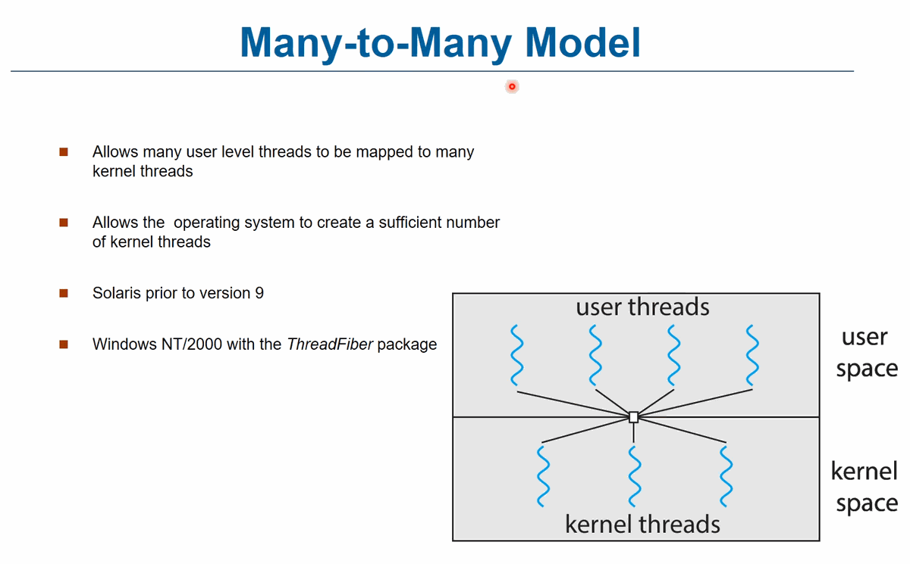

Many To Many 모델은 여러 개의 유저 스페이스 스레드를 같은 수나 더 적은 수의 커널 스레드와 묶는 것이다. 

---

## Two-level

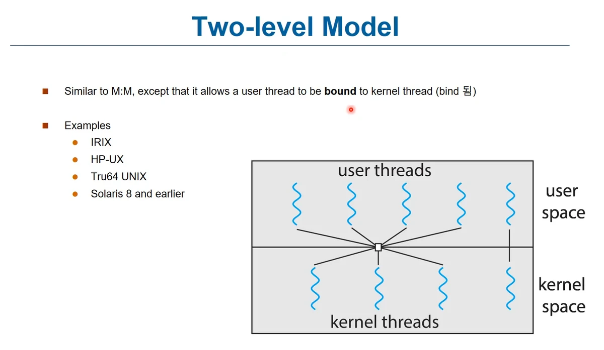

**Many To One** 모델은 개발자가 원하는 만큼 스레드를 만들 수 있도록 해주지만, 커널 스페이스에서는 한 번에 하나의 커널 스레드만 동작할 수 있기 때문에 실질적으로 parallelism이 생기지는 못한다. 

**One To One** 모델은 유저 스레드와 커널 스레드가 모두 매칭되기 때문에 상대적으로 뛰어난 concurrency를 확보할 수 있지만, 개발자는 하나의 애플리케이션 내에서 너무 많은 스레드를 만들지 않도록 주의해야 한다. 왜냐하면, 실제로 만들어질 수 있는 커널 스레드와 유저 스레드의 양에는 한계가 있기 때문이다. 

**Two Level Model**은 **One-to-One, Many-to-Many** 모델이 섞여있는 방식이다. 어떤 것은 실제로 binding이 돼서 One-to-One으로 가고, 다른 것은 Many-to-Many로 결합되는 것이다. 실제로는 Many To Many Model이 가장 효율적인 모델로 평가되지만, 실질적으로 이를 구현하는 것은 쉽지 않다. 게다가, 프로세스 내에 코어 수가 많아지고 있기 때문에 커널 스레드의 개수를 줄이는 것은 점차 사소한 문제가 되어가고 있다.

결과적으로, 대부분의 운영체제는 One To One Model을 사용한다. 하지만 현대의 concurrency 라이브러리 개발자들은 스레드를 Many To Model 모델로 만든다.

---

- 쓰레드를 만들고 사용하는 방법

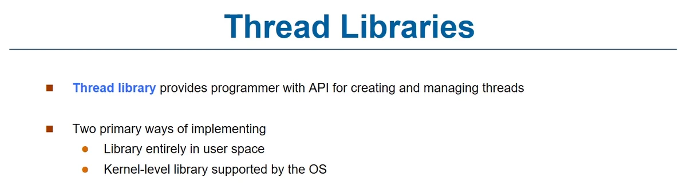

- pthread : POSIX라고 하는 운영체제 표준안을 만드는 그룹이 있으며, 모든 운영체제는  그 표준을 준수하면서 만들어진다. 이 때 유저 레벨에서 사용할 수 있는 것이 두 개가 있다. 하나는 표준안을 가지는 pthread라는 것이 있고, 다른 하나는 윈도우즈에서 사용하는 windows thread가 있다.

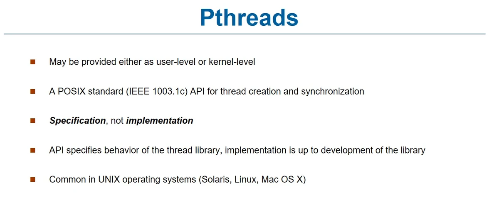

- Linux

```c
#include <stdio.h>
#include <pthread.h>

int thread_args[3] = {0, 1, 2};

// void* 라는 것은, 모든 형태의 포인터가 될 수 있다는 것이다.
// 함수일 때는 void*가 동작한다. void*는 주소는 가지지만, 값은 갖지 않는 것이다.
// argument도 주소로 전달받는다.
void *Thread(void *arg)
{
    int i;

    for (i = 0; i < 5; i++)
    {
				// (int*)arg를 통해 int* 타입으로 캐스팅하고, dereferencing을 통해 값을 가져온다.
        printf("thread %d : %dth iteration\n", *(int *)arg, i);
    }
	
		// thread의 동작을 마친다.
    pthread_exit(0);
}

void main(void)
{
    int i;
		// pthread_t라는 구조체를 사용. xxx_t 형태이면 구조체.
    pthread_t threads[3];

    for (i = 0; i < 3; i++)
    {
        printf("Thread Num %d Create!!!\n", i);
				// pthread 형태의 thread를 create해 주는 library이다.
				// Thread 함수를 쓰레드로 만들 것이며, 그 함수의 인자는 thread_args[i] 이다.
        pthread_create(&threads[i], NULL, (void *(*)(void *))Thread, &thread_args[i]);
    }

    pthread_exit(0);
}
```

(gcc -o name name.c -lpthread로 pthread library를 link해주어야만 실행된다.)

쓰레드를 잘 이용하면 프로그램의 일부 기능이 쓰레드로 분리되어서 각각 독립적으로 동작될 수도 있다. 위 프로그램을 통해 Thread라는 함수를 독립적으로 수행할 수 있다. 즉, main에서 함수를 호출하지 않는다는 것이다. 일반적인 프로그래밍에서는 우리가 어떤 함수가 다른 함수를 호출하는 형태인데, 위의 예제는 어떤 함수를 쓰레드로 만들어서 독립적으로 수행이 되도록 만들어준다는 것이다. main 전체가 하나의 프로세스인데, 이 프로세스가 세 개의 쓰레드를 만들게 되고, main 쓰레드는 세 개의 쓰레드를 만들면 끝나게 된다. 

이 과정에서 세 개의 쓰레드는 스케쥴링에 따라서 순차적으로 실행될 수도 있고, 병렬적으로 실행될 수도 있다. 이것은 상황에 따라서 다르기 때문에 예측할 수는 없다. 중요한 것은, 각각의 쓰레드가 독립적으로 실행될 수 있는 상황을 만들어주는 것이다. (어떤 우선 순위를 갖고, 어떻게 스케쥴링이 될 것이며, 언제 Context Switching이 될 것인지 등에 따라 달라질 수 있다.)

- Windows

```cpp
#include <conio.h>
#include <iostream>
#include <Windows.h>

using namespace std;

// Thread로 만들 Function의 prototype
DWORD __stdcall ThreadFunc(LPVOID Param);
// LPVOID는 void*와 같은 말이다. Define된 것인듯.
// 보통 이런 함수들은 parameter를 void*로 전달해주고
// 원하는 형태로 캐스팅해서 쓰기 때문에, void*(LPVOID)를 많이 넘겨준다.

// Thread로 넘길 Parameter. 구조체로 만든다.
typedef struct stThreadParam {
	int id;
	int sleeptime;
} ThreadParam;

// 
DWORD WINAPI ThreadFunc(LPVOID Param) {

	ThreadParam* tp = (ThreadParam*)Param;

	for (int i = 0; i < 10; i++) {
		cout << endl;
		cout << "Thread " << tp->id << ":" << i << endl;

		// 이 프로그램에서 Sleep은 스케쥴링을 요청하는 역할이다.
		// 나는 쉴테니, 나 아닌 다른 것이 동작할 것이라면 시켜도 된다는 뜻.
		// Sleep(1)이라고 쓸 때도 있는데, 이것은 쉰다는 의미라기 보다는
		// 잠깐 동작을 멈춰서 ready queue로 옮기고, 다른 것을 올리라는 의미이다.
		Sleep(tp->sleeptime);
	}

	return 0;
}

int main() {
	HANDLE hThread[4];
	DWORD ThreadID[4];
	ThreadParam tp[4];

	for (int i = 0; i < 4; i++) {
		tp[i].id = i;
		tp[i].sleeptime = i * 200;

		// 쓰레드를 만들어준다.
		hThread[i] = CreateThread(NULL, 0, ThreadFunc, &tp[i], 0, &ThreadID[i]);
	}

	// WaitForMultipleObjects를 통해 네 개의 쓰레드가 모두 끝날 때까지 대기한다.
	WaitForMultipleObjects(4, hThread, TRUE, INFINITE);

	// 키보드 입력을 대기
	_getch();

	return 0;
}
```
