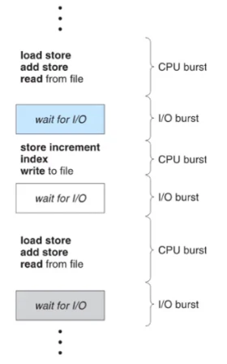
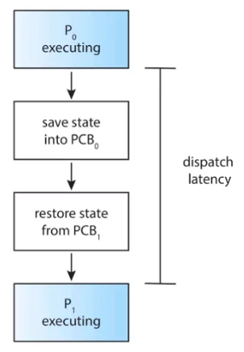
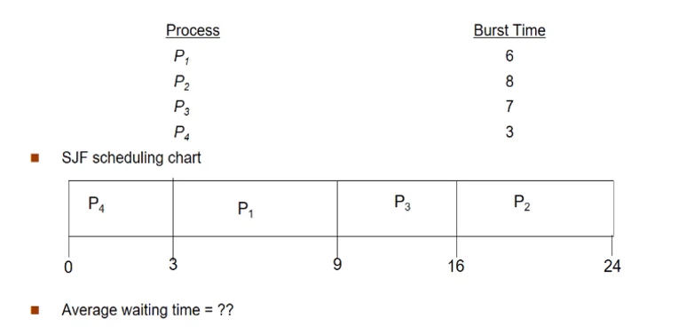
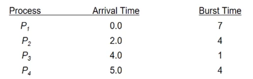
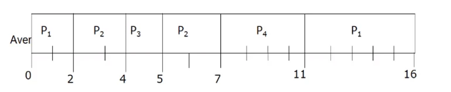
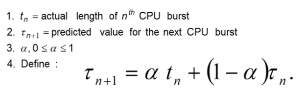
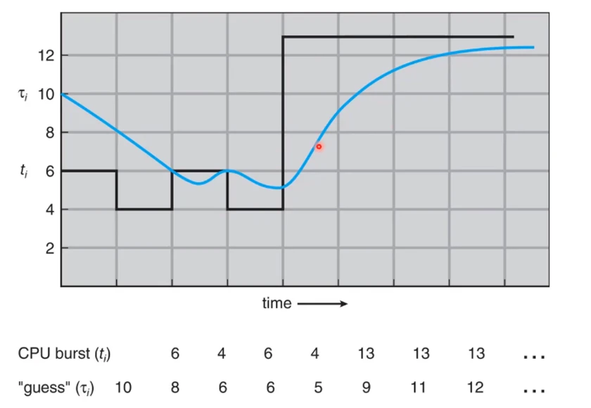

# 5주차-1: CPU Scheduling 기본 개념과 평가 기준

작성일 2023-04-03 · 최종 수정일 2023-04-20
{ .post-date }

## Chapter 5: CPU Scheduling

운영체제가 하는 여러가지 목표나 기능들 중 최우선 목표는 CPU를 잘 이용하자는 것이다.

CPU가 알아듣는 명령어를 넣어서 할 수 있다면 좋겠지만, CPU가 알아먹을 수 있는 언어를 써서 코딩할 수 없기 때문에 OS가 반드시 있어야 하고, 여러가지 프로그램들이 H/W, I/O를 잘쓰게 해주자는게 목표이다.

- 멀티태스킹, 멀티프로세싱, 멀티프로그래밍

[운영체제 멀티프로그래밍, 멀티프로세싱, 멀티태스킹이란?](https://up-to-date-items.tistory.com/71)

**Basic Concepts of Scheduling**

싱글 CPU 코어에서는 한 번에 하나의 프로세스만 동작할 수 있다. 다른 프로세스들은 CPU 코어가 빌 때까지 기다려야 하고, 그 이후에 스케쥴링 되어서 CPU에 들어가야만 한다. 멀티프로그래밍의 목적은 프로세스가 항상 수행되도록 해서 CPU의 utilization을 높이는 것이다. 아이디어는 상대적으로 간단하다. 한 프로세스가 실행되고 I/O 입력 등이 필요하기 때문에 기다려야 할 때가 생기는데, 간단한 컴퓨터 시스템에서는 I/O 입력이 도착할 때까지 CPU가 그냥 idle 상태에서 놀고있게 된다. 이 시간 자체가 낭비되는 시간이므로, 어떠한 유용한 동작도 수행되지 못한다. 그러므로 멀티프로그래밍 환경에서는 이 남는 시간을 유용하게 사용하고자 한다. 한 프로세스가 실행되다가 대기해야할 때가 생기면, 운영체제는 해당 프로세스를 CPU에서 내려버리고, 그 CPU에게 다른 프로세스를 주게 된다. 이 패턴이 계속해서 반복된다. 프로세스가 CPU에서 대기해야하는 매 순간마다 다른 프로세스를 CPU에게 전달해주면 된다. 멀티코어 시스템에서 이 개념은 모든 프로세싱 코어를 바쁘게 사용할 수 있는 개념이 된다.

- CPU burst : 프로그램 안에는 공간을 많이 차지하는 burst가 있다. CPU burst란 프로세스가 CPU 내에서 처리되는 시간을 말한다. (처리되어야 하는 전체 시간을 말하기도 함.)
- I/O burst : I/O를 처리하는 시간

프로그램을 보면, CPU burst, I/O burst가 번갈아가면서 일을 하게 된다. 내용은 관계 없다. (I/O를 사용하지 않는 것은 없으므로, 필연적으로 번갈아 사용될 수밖에 없다. CPU burst → I/O burst로 가는 것, 그 반대도 모두 스케쥴링이다. 프로세스를 내리고 다른 프로세스를 올리는 것을 Context Switching이라고 하며, 메모리에 올라가 있는 메모리 블록을 store하고, 디스크에 store되어 있던 것을 다시 메모리에 올리는 것…)

- I/O burst가 되는 순간, 다른 프로세스가 와서 CPU를 차지하게 해주어야 한다. 그 빈자리를 누가 채울 것인가? 아니면, 남는 프로세스가 하나밖에 없어서 그 프로세스가 올 것인가? … 현재 컴퓨터는 프로세스가 엄청나게 많아서, 누가 그걸 차지하게 할지를 결정해야 한다. (이것이 스케쥴링 방식이고, 특히 단기 스케쥴러가 하는 일이 메인 메모리에서 실행을 대기하고 있는 프로세스들 중에서 어떤 것을 실행시켜줄지 정하는 것이다.)

---

- 스케쥴링

    - 단기 스케쥴링 : 메모리에 이미 올라온 것들 중에서 스케쥴링 하는 것

        - 단기 스케쥴링은 ready queue에 있는 프로세스들 중에서 어떤 것을 CPU에 할당할 것인지를 고르는 과정을 말한다.

    - 중기 스케쥴링 : Swap-in, Swap-out (메모리를 써야되는데, 다 쓰기가 힘든 경우. 올려는 주지만, RAM이 부족하기 때문에 디스크에다가 올려놓고 동작시키는 것)
    - 장기 스케쥴링 : 디스크에 들어있는 것들 중에서 어떤 것을 CPU에 올릴 것인가를 다룸

- 프로그램을 만들어보면, burst duration이 생각보다 짧았다. 즉, change가 생각보다 자주 생기게 되며, CPU burst만 계속 처리하지는 않는다. (I/O burst와 CPU burst가 번갈아가면서 발생)

    - 이런 역할을 담당하는 것을 통틀어서 Scheduler라고 한다.
    - 그리고 메모리에 데이터를 올리고 내리는 것을 dispatch, 담당하는 것을 dispatcher라고 한다.

- 결국 Context Switching을 하려면 Process들은 정해진 순서대로 대기해야 하므로, Ready Queue를 만들어 대기하고 있다. 한 번에 CPU에 들어갈 수 있는 프로세스는 단 하나이며, CPU에 올라갈려면 Queue에 들어가있어서 Ready State에 있어야 한다. 동작되는 것은 Running…

---

- 언제 스케쥴링이 생기는가?

    - 확실한 것, CPU burst와 I/O burst가 교대될 때(자발적으로 내려오는 경우)

    <!-- -->

    1. Switches from running to waiting state(돌아가던 프로세스가 I/O 입력을 받기 위해서)
    2. Switches from running to ready state(공평성 때문에 하나만 동작할 수는 없으므로…)
        ⇒ 프로세스 하나만을 계속 수행할 수는 없다. 공평성과 효율성.
    3. Switches from waiting to ready(I/O를 대기하던 것이 입력을 받은 경우)
    4. Terminates(프로세스가 일을 다 해서 끝나는 경우, running이 비었다.)

1), 4)는 자발적으로 내려오게 된다. (**nonpreemptive**, 자발적인, 비선점)

이와 다르게 2), 3)는 비자발적으로 내려오게 된다. (**preemptive**, 선점)

그런데, 선점형 스케쥴링은 데이터를 공유하는 프로세스 간의 race condition을 만들 수도 있다. 두 개의 프로세스가 서로 데이터를 공유한다고 가정해보자. 만약 한 프로세스가 데이터를 업데이트하고 있는 동안에 선점되어서 다른 프로세스가 실행된다고 해보자. 그러면, 두 번째 프로세스가 그 데이터의 값을 읽으려고 한다면, 본래 예상했던 값이 아니게 될 것이다.

---

- **Dispatcher** (Load & Save)

스케쥴러가 하는 일 중에 프로세스의 데이터(PCB)를 저장하고, 불러올 데이터를 가져오는 것을 dispatch라고 하며, 이를 담당하는 것이 **Dispatcher**이다. (단기 스케쥴러가 선택한 프로세스에게 CPU의 제어를 부여하는 모듈이다.)

⇒ Dispatch란, **단기 CPU 스케쥴러**에 의해 선택된 프로세스에게 CPU 코어의 컨트롤을 넘기는 역할을 하는 모듈을 말한다.

- switching context
- switching to user mode
- jumping to the proper location in the user program to restart that program

- 프로세스에는 register에 PCBn(Program Counter)가 있어서, 프로세스가 어디부터 다시 시작될 것인지를 기억하고 있으므로 해당 부분에서 다시 수행될 수 있다.

    - **dispatch latency** : dispatching에 걸리는 시간

    

- dispatch가 많이 일어났다는 것은, 실제로 해야되는 일 보다 load & save가 더 많이 일어났다는 것이다. 그만큼 스케쥴링이 빈번하게 일어난다는 것이고, 그 시간동안 CPU는 일을 못하게 된다.

    - P0 executing → save state into PCB0 → restore state from PCB1 → P1 executing 
    - 따라서, load & save가 많이 발생하는 만큼 지연시간이 발생하여 실질적인 프로세스의 동작은 줄어든다고 볼 수 있다.

---

### Scheduling Criteria(기준)

- 중앙처리장치 이용률(CPU utilization)  : 가능한 CPU를 바쁘게 이용한다. (↑)
- 처리율(Throughput) : 단위 시간당 실행 완료된 프로세스의 개수 (↑)
- 반환시간, 소요시간(Turnaround time) : 프로세스를 실행하는데 소요된 시간, 즉, 진입한 시간과 완료된 시간의 차이. (↓)
- 대기시간(Waiting Time) : Ready Queue에서 대기하면서 보낸 시간 (↓)
- 응답시간(Response time) : 하나의 작업을 요청한 후, 첫 번째 응답이 나올 때 까지의 시간, 출력이 아니다. (↓)

---

- ***First-Come, First-Served (FCFS) Scheduling***

    - 그 프로세스가 I/O를 제외하고 소요한 Burst Time을 조사할 수 있다. 대략적으로도 가능하고, 자세하게도 가능하다. 이를 통해 에뮬레이터도 만들 수 있다. (물리적인 시간이 아니라, 전기적인 시간은 계산할 수 있다. 즉, I/O는 불가능, 단, 명령어들은 전기적으로 동작하는 시간 체크가 되므로 처리 시간 예상 가능)
    - 심플하고 간단하다. 요청이 끝나면 terminates, load & save (dispatching)이 필요 없다.

    P1: 24 (Waiting Time : 0)

    P2: 3 (24)

    P3: 3 (27)

    ⇒ Average Waiting Time : 17

    그런데, 순서를 바꿔보자.

    P1: 3 (0)

    P2: 3 (3)

    P3: 24 (6)

    ⇒ Average Waiting Time : 3

    - 프로세스의 순서를 바꾸는 것에 따라 Waiting Time이 획기적으로 개선되는 것을 확인할 수 있다.

    > Convoy(호위) effect : 프로세스의 처리 순서를 잘못 정하면, 그 하나 때문에 전체적인 처리 속도가 저하되는 현상을 말한다. 이런 현상이 생기지 않도록 스케쥴링 방법을 잘 만들어야 한다.

⇒ 이러나 저러나 처리하는 시간은 30으로 똑같지만, waiting time에 대해 고려해보면 처리 시간이 짧은 Job을 먼저 처리하는 것이 더 효율적이라고 생각할 수 있다. (이를 적용한 것이 SJF)

---

- ***Shortest-Job First (SJF) Scheduling***

    - SJF는 처리시간이 짧은 Job의 waiting time이 줄어드므로, 스케쥴링 효율이 상승한다.

    - SJF (Non-Preemptive)

        - P1: 6(Burst Time), 3(Waiting Time)
        - P2: 8, 16
        - P3: 7, 9
        - P4: 3, 0

        

    ⇒ 이를 선택하는 것은 Scheduler이고, 프로세스를 가져오는 것은 Scheduler에 포함된 Dispatcher의 역할이다.

    - 그런데, 프로세스가 항상 Ready Queue에 똑같이 도착할 수는 없다. 그러므로 Arrival Time을 도입해서 확인해보자.

        - P1: 0.0(Arrival Time), 7(Burst Time)
        - P2: 2.0, 4
        - P3: 4.0, 1
        - P4: 5.0, 4

        

    ⇒ 만약 이전의 SJF를 적용하여 생각해보면, P1의 실행 7초가 다 지나기 전에 이미 P2~P4는 Ready Queue에 도착해서 대기하고 있다.

    ⇒ 이번엔 다르게, 스케쥴링은 Ready Queue에 변화가 생기면 발생한다.

    - SJF (Preemptive) ⇒ 이렇게 하면 오히려 효율이 좋아지더라… 단, 끝나는 시간은 똑같다.

        - P1 2초
        - P2 2초
        - P3 1초 (Terminate)
        - P2 2초 (Terminate) [선착순으로 진행, ***Q. 줄어든 시간 반영 X ? ⇒ Yes! SJF는 안함.***]
        - P4 4초 (Terminate)
        - P1 5초 (Terminate)

        

    - Gantt Chart ⇒ 프로세스의 스케쥴링 과정을 그린 것.

\* 프로젝트를 진행할 때 역할을 어떻게 나눌 것인가도 중요한 토픽.   
(MS의 프로그램 Gantt Chart 그리는 프로그램이 있음.)

---

- Determining Length of Next CPU Burst(CPU의 Burst Time을 예측하는 방법)

    - 결국 스케쥴링을 하는 기준은 CPU 처리 시간이다.
    - 그러므로 현재 프로세스의 CPU Burst, 그리고 다음에 처리될 프로세스들의 CPU Burst를 하는 것이 매우 중요하다. 정확히 알 수는 없지만, 예측을 할 수는 있다.
    - t(n) = actual length of n(th) CPU burst
    - T(n+1) = predicted …

    T(n+1) = at(n) + (1-a)T(n) [근거는 없지만, 일단 해보는 것]

    이런 식으로 예측이 가능하다.

    - 근거는 없으므로, 절대 정확하지는 않다. 단, 틀렸음에도 불구하고 실제 측정된 현재의 값을기준으로 업데이트 하기 때문에, 실제 전체 흐름을 비슷하게 쫓아간다고 볼 수 있다. (경향성을 따라가게 되므로, 점차 burst time을 예측할 수 있게 된다. 즉, 책에 나오는 Burst의 값은 예측 값이라고 생각할 수 있다.)

