# 5주차-2: SRTF, Priority Scheduling

작성일 2023-04-04 · 최종 수정일 2023-04-20
{ .post-date }

SJF는 Burst Time만으로 비교를 하고, 줄어든 시간에 대해서는 반영을 하지 않았다. 어떻게 보면 불합리하다고 보이기 때문에, Shortest-Remaining Time First를 도입한다.

- SRTF(Shortest-Remaining Time First)

이 방법도 선점형, 비선점형이 있다. (비선점형은 한 번 차지하면 실행 종료까지 내려가지 않는 것)  
남아있는 시간은 정확히 알 수 없으므로, 예측값을 이용하여 전체적 흐름을 반영해야 한다.

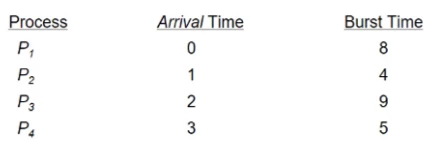

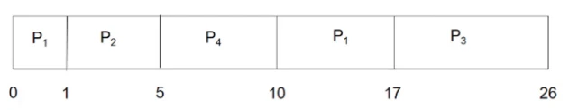

---

- Priority Scheduling

    - 스케쥴링을 할 때 우선순위를 정하기 위하여 우선순위 숫자를 부여해야 한다. 단, 시스템마다 다를 수 있기 때문에 운영체제에 따라 확인을 해야한다.
    - 프로세스가 생성될 때 우선순위를 부여하게 되며, 저절로 되기도 하고 프로그래머가 직접 지정할 수도 있다.
    - Preemptive, Non-preemptive 방식도 존재.
    - Starvation : low priority processes may never execute (새롭게 전달되는 프로세스의 우선순위가 항상 나보다 높아서 영원히 실행되지 않을 수도 있다.)
    - Aging(Solution) : as time progresses increase the priority of the process (대기를 오래 할수록 우선순위를 높여주어서 처리가 될 수 있도록 만들어 줌)

ex)

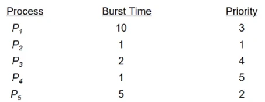

P1: 10(Burst Time) 3(Priority)

P2: 1(Burst Time) 1(Priority)

P3: 2(Burst Time) 4(Priority)

P4: 1(Burst Time) 5(Priority)

P5: 5(Burst Time) 2(Priority)

P2→P5→P1→P3→P4

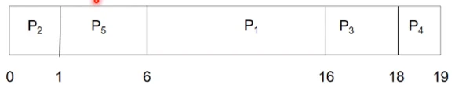

(이미 있는 것에서만 하는 예제이므로, preemptive한 동작이 없다. 만약 우선순위가 더 높은 프로세스가 들어오게 된다면 선점이 일어날 것.)

---

- Round Robin (RR)

Time Quantum을 정해서, 모든 Process에 시간을 부여한다. 즉, 내가 설정한 Quantum만큼이 지나면 줄을 서서 뒤에서부터 다시 기다리는 것이다. (FIFO, First Come First Served)

ex) Time Quantum = 20

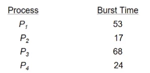

P1: 53(Burst Time)

P2: 17(Burst Time)

P3: 68(Burst Time)

P4: 24(Burst Time)

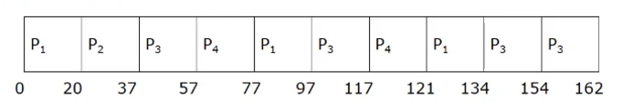

들어온 순서대로 처리가 되지만, Quantum만큼 처리되고나면 뒤로가서 줄을 서게 된다.

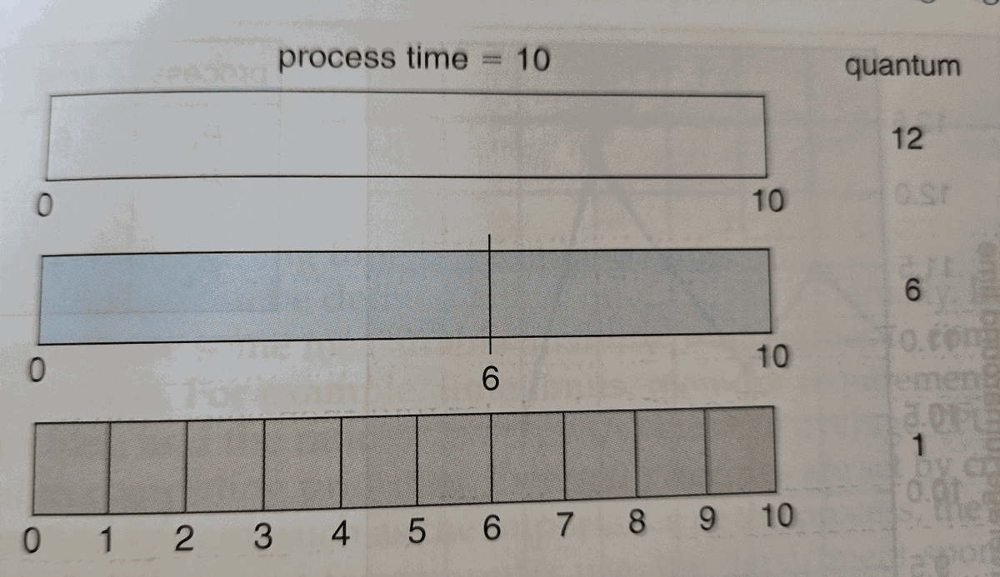

- FCFS와 RR의 차이는, 단지 공평성에 대한 문제다. 최종 처리 시간은 같음. 하지만, 실질적으로 처리해보면 **Context Switching이 더 적은 FCFS가 더 빠르다**.(그래서 Time Quantum을 너무 짧게 잡으면 안됨. 그렇게 되면 Context Switching 시간 때문에 오히려 느려질 수 있음.) 지연 시간이 더 있긴 하지만 RR에서 발생하는 delay는 실제 사용자에게는 무시될만한 수준이고, 프로세스 입장에서도 RR이 더 공평하고 잘 되는 것처럼 보일 것이다.
- Quantum이 낮으면 낮을 수록 사용자에게는 매끄러운 동작 환경을 제공할 수 있다. 그러므로 Quantum은 1이 되면 가장 좋다. 물론 효율은 떨어지겠지만, dispatch latency가 대부분 마이크로 단위, 혹은 그 이하로 들어가기 때문에 무시할만하다. 따라서, 그 수준이 얼마나 되는지를 판단하는게 중요하고 이를 적절하게 타협해서 정해야 한다.
- 실제로 프로그래밍을 할 때는 프로세스, 쓰레드를 만들고 Priority와 Quantum을 정해줄 수도 있다. (실제로는 무시할 수 없는 수준이다. 그리고, 만약 실제 물리적 동작에서 RAM이 아닌 하드디스크(가상 메모리)에 옮기면 Swap-in, Swap-out이 생겨서 매우 느려진다. RAM에서의 dispatch latency는 거의 ns이지만, HDD의 dispatch latency는 ms 단위이다. 즉, 100만배 느린 것이므로, 무시할 수 없다…)

- ex) Time Quantum = 4

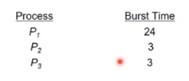

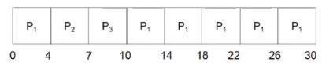

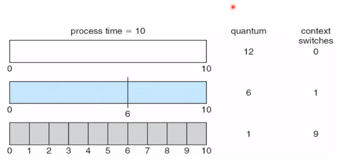

- Turnaround Time Varies With The Time Quantum

    - 총 처리시간을 구해보자

        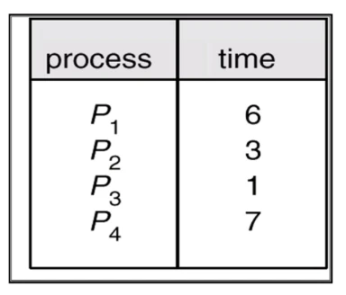

    - Q = 1일때 총 처리시간을 같이 구해보자.

        ```text
        P1    P1
         P2    P2
          P3
           P4   P3
        ```

    P1~P4의 총 처리시간은? (Quantum에 따라 비교)

    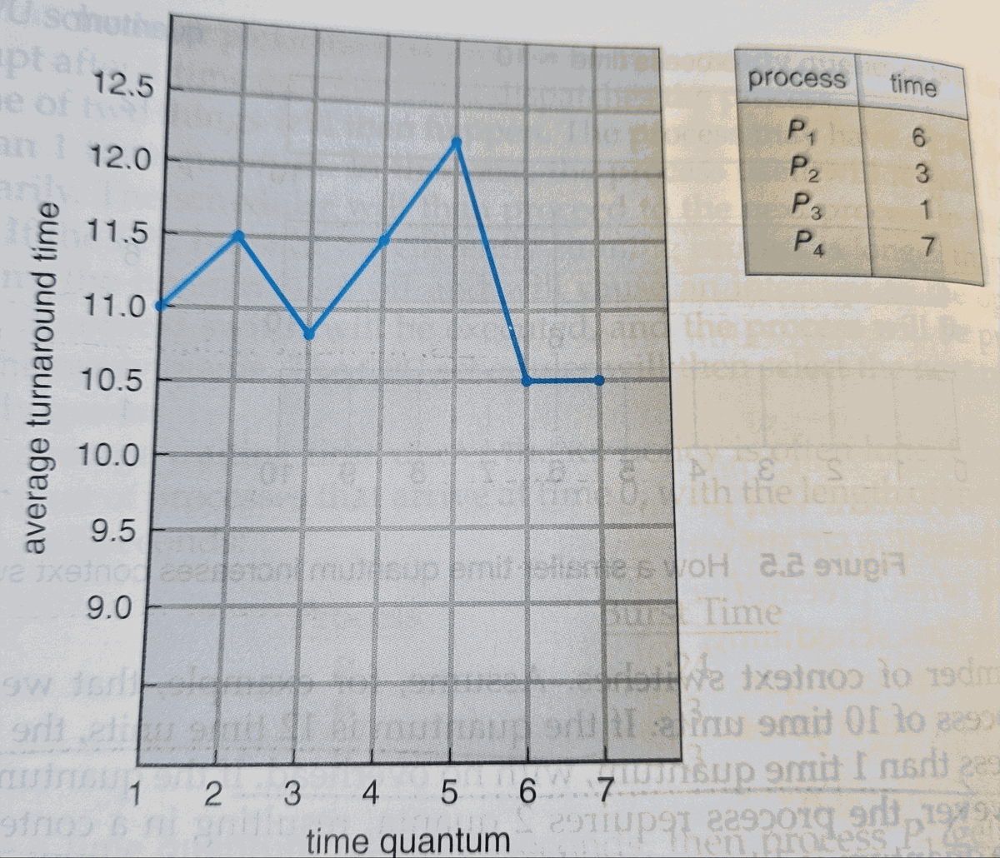

    ⇒ 여기서 얻을 수 있는 사실은, Time Quantum에 따라 average turnaround time이 영향을 받긴하지만, 크다고해서 무조건 개선되거나 나빠지지는 않는다. 즉, 비례나 반비례 관계는 없다.

    (80%, 거의 대부분이, of CPU bursts should be shorter than q.)  
    ⇒ 효율적으로 잘 돌아간다. 그리고 많은 프로세스들이 모두 I/O 입력없이 사용되기는 힘들기 때문에, 어느정도 한계는 있는 것으로 보인다.

    ---

- Priority Scheduling w/ Round-Robin

    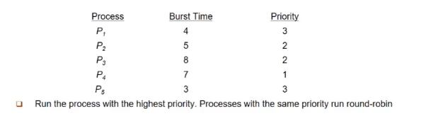

    P1: 4(Burst Time), 3(Priority)

    P2: 5(Burst Time), 2(Priority)

    P3: 8(Burst Time), 2(Priority)

    P4: 7(Burst Time), 1(Priority)

    P5: 3(Burst Time), 3(Priority)

    

    우선순위가 같은 것은 **RR**을 적용, 그 외에는 **Priority**를 적용. 그리고 **Aging**을 적용할 수도 있다.

    ---

- Multilevel Queue

    - Queue를 하나만 두지 않고, 애초에 priority에 따라 Ready Queue를 구분하는 방식
    - 프로세스가 새로 생성되면 Priority를 정하고, 해당하는 Queue에 넣어준다. 그 안에서는 RR을 적용하는 방식. 한 Priority가 돌아가면, 다음 레벨로 간다.

    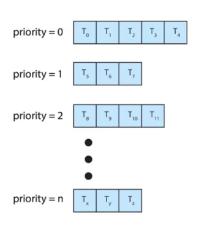

---

- Multilevel Feedback Queue

    - 앞에서 진행되는 상황을 보면서 Feedback을 받고, 이에 따라 뒷 부분의 기준을 바꾸는것.

        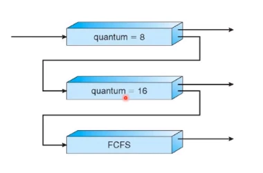

        - Q0 : RR with time quantum 8 milliseconds
        - Q1 : RR time quantum 16 milliseconds
        - Q2 : FCFS

        (RR도 q가 무한대로 커지면 결국 FCFS와 같아진다.)

        - 예시 모델

        Q0를 먼저 돌리면, 적당하게 설정해둔 q때문에 Burst가 작은 것들은 다 끝날 수 있다.(라이트) 그 이후에는 Q1에서 큰 것들이 남았으므로, q를 2배 올려서 돌려준다. (미들) 그리고서도 남은 것들은 FCFS로 돌려버린다. (헤비) 하지만, FCFS는 Q0, Q1이 비었을 때만 실행해준다.

        starvation을 막기 위해서 낮은 우선순위를 갖는 큐에서 너무 오래 있는 프로세스는 높은 레벨의 큐로 이동시켜줄 수도 있다. (일종의 Aging)

        ⇒ 이것은 예시일 뿐이고, 이런 식으로 예시를 줄 수 있다는 것이다. 매 순간 프로세스가 계속 생겨나기 때문에 현실적으로 도입하기는 힘들다.

- [Assignment: FCFS와 스케줄링 평가 기준](12-week-05-2-assignment.md)
