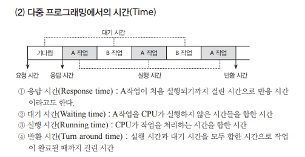

# Assignment: FCFS와 스케줄링 평가 기준

- FCFS(First Come First Served)

우선 데이터 셋을 가진다. CPU Burst를 갖는 Process data set있을 것이다.

Burst Time

- P1: 6
- P2: 8
- P3: 7
- P4: 3

순서대로 온다고 가정, 성능을 분석해야 한다.

- 중앙처리장치 이용률(CPU utilization)  : 가능한 CPU를 바쁘게 이용한다. (↑)
- 처리율(Throughput) : 단위 시간당 실행 완료된 프로세스의 개수 (↑)
- 반환시간, 소요시간(Turnaround time) : 프로세스를 실행하는데 소요된 시간, 즉, Queue에 진입한 시간과 완료된 시간의 차이. (↓)
- 대기시간(Waiting Time) : Ready Queue에서 대기하면서 보낸 시간 (↓)
- 응답시간(Response time) : 하나의 작업을 요청한 후, 첫 번째 응답이 나올 때 까지의 시간, 출력이 아니다. (↓)

