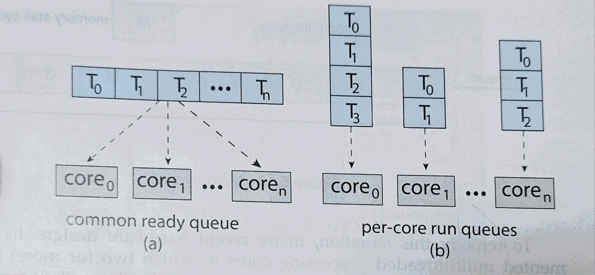
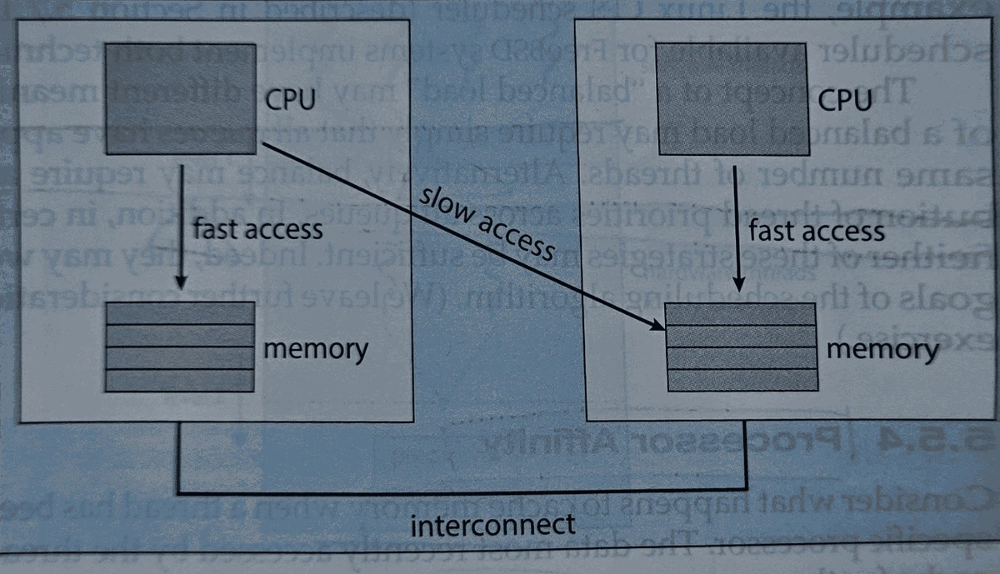
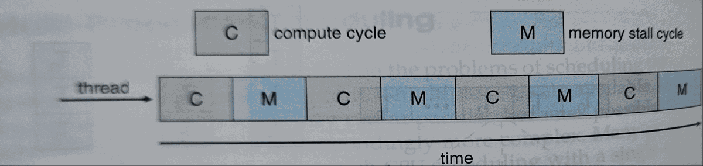
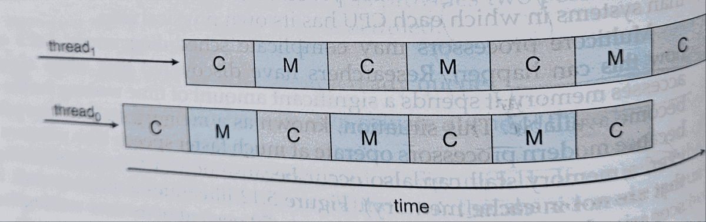
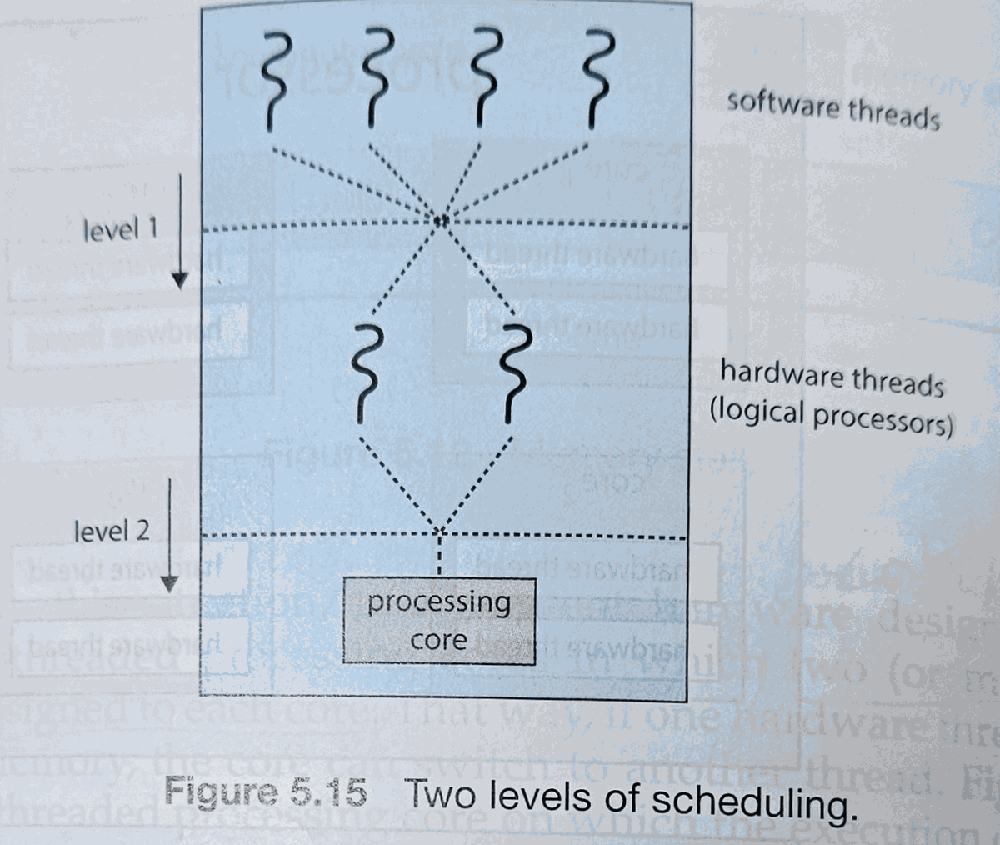
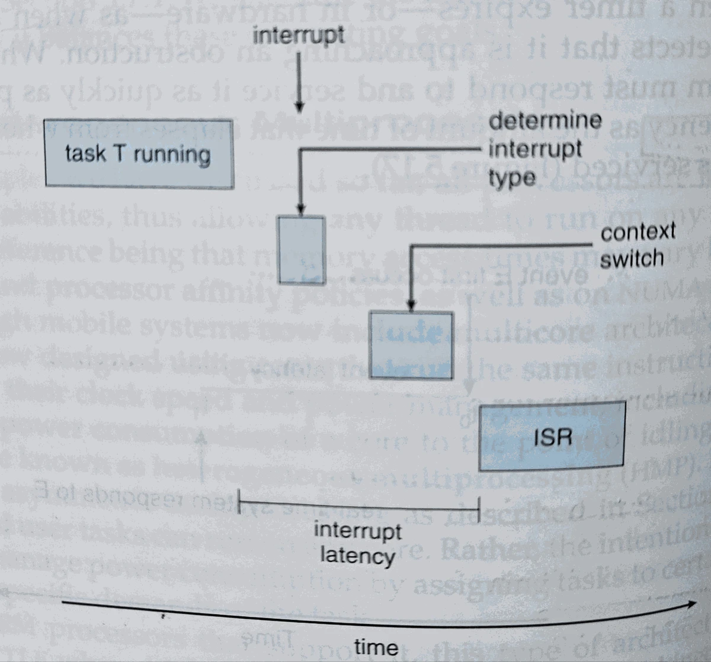
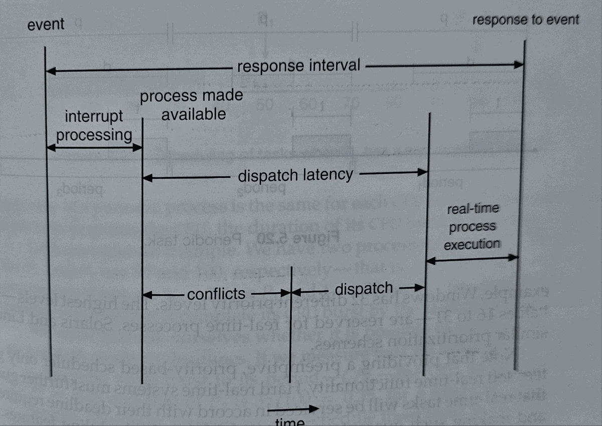
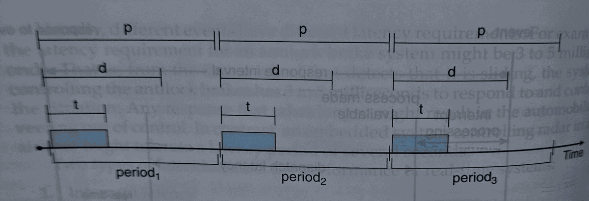

# 6주차-1: Multiple-Processor Scheduling, Real-Time CPU Scheduling

이전에는 Single-Processor를 다뤘었으나, 실제 컴퓨터는 Multi-Processor가 대부분이다. Multiprocessor는 다음 시스템 아키텍처의 관점에서 적용될 수 있다.

- Multicore CPUs
- Multithreaded cores
- NUMA systems
- Heterogeneous multiprocessing (서로 종류가 다른 CPU를 사용하는 멀티 프로세싱으로 보인다.)

동일한 종류의 프로세서를 사용하는 처음 세 개의 경우에는 그들의 기능에 집중해서 살펴본다. 이 경우에는 queue에 들어가 있는 프로세스를 사용 가능한 어떤 CPU에서든지 수행할 수 있다. 마지막은 서로 다른 종류의 프로세서를 사용하는 시스템을 살펴본다.

---

## Multiple-Processor Scheduling

전통적으로는 SMP가 실제로 physical processor를 여러 개 다는 방식으로 구현되었지만, 현재의 SMP 방식은 single processor에 multiple core를 사용하는 방식으로 이를 구현한다. 이로서 OS는 마치 구별이 가능한 논리적 CPU를 여러 개 갖는 것처럼 인식하게 된다. 하지만 이렇게 되면 스케줄링은 조금 더 어려워질 수 있다.

여러 개의 (단일도 마찬가지) CPU가 꽂혀있으면, 모두 다 바쁘게 만들어주어야 한다.

- Homogeneous processors within a multiprocessor 

    (동종의 프로세서로 멀티프로세서로 구성) or (별도 컴파일러 지정)

    서로 다른 CPU를 올려서 구성할 수는 있지만, 그렇게 하는 사람은 거의 없다. 보통은 동종의 프로세서를 여러 개 달아놓는다. 하드웨어 구조상, 여러 종류의 CPU를 달아놓으면 결국 버스 때문에 한 번에 하나의 데이터밖에 못가져온다.

- Symmetric multiprocessing (SMP)

    모든 프로세서가 모든 일을 다 할 수 있도록 해주는 것. 일반적인 경우는 SMP이다. SMP에서 모든 프로세스는 common ready queue에서 대기하거나, 각각의 독립된 private ready queue를 가질 수 있다. ASMP를 사용할 수도 있다. 우리가 사용하는 컴퓨터는 대부분 싱글 프로세서, 멀티 코어로 동작한다. 

    **SMP**는 ready queue를 조사하고 어떤 thread(s/w)를 수행할지 결정하고 조사하는 독립적인 프로세서가 있어서 스케줄링을 진행할 수 있다. 이 관점에서 thread를 스케줄링하는 방법에 두 개의 방법이 제시될 수 있다.

    1. 모든 쓰레드가 공통의 ready queue에서 대기한다.

        - 이 방법은 공유되는 ready queue에서 어떤 쓰레드를 먼저 동작시키고 어떤 core에서 동작시킬 지 **race condition**을 갖게 되므로 두 core가 똑같은 thread를 처리하는 일이 발생하지 않도록 잘 조정해야 한다. 
            (mutex lock을 이용해 이러한 현상이 발생하는 것을 막을 수 있다.)
            그러나 이 방법은 처리하는 모든 thread에 대하여 locking이 필요하게 되고, 이는 병목 현상을 불러올 수 있다.

    2. 각각의 프로세서가 독립적인 thread(s/w) queue를 갖는다.

        - 이는 독립적인 thread queue를 가져서 common ready queue에서 발생할 수 있는 문제를 없앨 수 있다. 그러므로 현재는 이 방법이 SMP에서 통상적으로 사용되는 방식이다. 그리고 사실 이런 식으로 per-processor run queue를 두면, cache memory를 더 효율적으로 사용할 수도 있다. (affinity 향상)

    

    윈도우 운영체제에서 잘 살펴보면, 특정 코어에 특정 프로그램만 할당한다는 설정을 할 수 있다. 그래서 마치 ASMP처럼 특정한 역할을 특정 코어에 할당해 줄 수도 있다. 

    만약 프로세서가 어떤거는 놀고, 어떤거만 일하고 있다면 작업 처리가 효율적이지 못하다는 것이다. 프로세서들은 일을 골고루 처리해야 한다. 그리고 이 용어를 **Load Balance**라고 한다.

    운영체제는 멀티프로세서의 이점을 십분 활용하기 위해서 thread를 적절하고 균등하게 분배해야만 한다. 그렇지 않으면 특정 프로세서가 idle 상태에 들어가게 되어서 부하가 발생할 수 있다.

- **Load Balance** : 특정 프로세서에 일이 몰리게 되면 부하가 생길 수도 있으므로, 요청이 들어가기 전에 골고루 분배하기 위해 거치는 Load Balance가 존재한다. 
- Common Ready Queue를 공유해서 Task를 보관하고, 여기서 Task를 분배해서 접근함으로써 Balancing을 할 수 있다. ***common ready queue를 사용하는 시스템에서는 한 프로세서가 idle이 되면 그 즉시 common ready queue에서 runnable한 thread를 빼기 때문에 꼭 필요하지는 않다.*** 
- ***특정 cpu가 비게 되면 common ready queue는 바로바로 queue에서 deque해서 core에 thread를 넣어주면 된다. 하지만, per-core run queues에서는 일종의 ASMP 방식이 되므로, 어떤 queue에는 스레드가 아무것도 없고 어떤 queue에는 스레드가 매우 많이 있을 수도 있다. 이 경우 Load Balance가 무너진 것이므로, balancing을 해줄 수 있다.*** 
- Processor affinity(친화성) : 어떤 프로세스가 무언가를 돌리다가 다른 걸 돌리려면 dispatch, context switching 등이 필요하다. 이 때 이동하는 것이 context이다.

어떤 프로세스가 특정 프로세서에서 돌다가, 어떠한 이유에 의해서 **context switching**이 발생해서 다른 프로세서로 가고, 또 다른 프로세서로 가고, … 이런 식으로 가게 되면 작업이 비효율적으로 된다.

컴퓨터는 코드 하나를 읽으면 guessing을 통해 실행할 곳을 예측하고 미리 cache에 갖다 놓는다. 그런데 만약 실행하는 프로세서가 바뀌게 된다면 cache에 가져온 것을 버리게 된다. cache를 쓰지 않는다면 버스를 사용해서 외부에서 데이터를 가져와야 하는데, 외부 버스는 I/O가 언제 들어올지 모르기 때문에 작업이 더 길어질 수 있다. 하지만 cache를 쓰면 굳이 버스를 쓰지 않아도 되고 그러면 버스는 사용권이 남기 때문에, 다른 프로세서가 사용할 수 있다는 장점이 생긴다. 프로세서가 필요한 데이터를 외부 버스를 사용해서 메모리에 접근함으로써 가져오는 것이 아니라 근처에 있는 cache에서 가져오는 것을 warm cache라고 한다. SMP를 사용하는 시스템은 최대한 스레드의 실행이 다른 스레드로 옮겨가는 것을 지양하고, warm cache를 활용하기 위해 노력한다.

이것을 바로 Processor Affinity(친화성)이라고 한다.

프로세스를 실행하던 프로세서를 바꾸면 데이터도 모두 무효화되기 때문에 처리하던 것을 똑같은 프로세서에서 실행하도록 하는 것이 좋다. (cache 덕에 효율이 증가하기 때문)

- soft affinity : 지키려고 노력하지만 보장하지는 않음
- hard affinity : 프로세서를 옮기지 않도록 지정 가능

⇒ 동시에 사용할 수도 있음.

그렇다면 가능하면, SMP 환경에서 Affinity를 지켜주는 환경이라고 한다면, 이를 지켜주도록 노력하는 것이 더 좋을 것이다. 버스를 덜 쓰기 때문에, 불필요한 작업을 하는 횟수가 줄어들기 때문이다.  **하지만, 중요한 대전제는 모든 CPU가 골고루 사용돼야 한다는 것**이다. 특정 CPU만 바쁘게 돌리면 안된다.

(per-processor ready queue를 사용하는 시스템에서는 thread가 항상 같은 프로세서에서만 실행되기 때문에 warm cache를 추가적인 비용 없이 얻을 수 있게 된다.)

- SMP에서의 성능 향상

    - 여러 개의 프로세서는 BUS를 통해 하나의 메모리에 액세스 한다.

    - Single Processor(혹은 Core)의 경우

        - 실행되던 프로세스는, 인터럽트 처리를 위해 Switching 되어야 한다.
            ⇒ Context Switching이 반드시 필요
        - I/O 처리하는 동안 CPU는 Idling
        - 비용 발생

    - SMP의 경우(Symmetric Multi-processing)

        - 인터럽트 처리를 하는 core를 별도로 지정해서 처리 가능
        - 기존의 프로세스는 그대로 계속 동작 가능

---

## NUMA(Non-uniform Memory Access)

- CPU의 처리 (메모리 관점에서)

    - 메모리에서 dispatch를 통해 데이터 가져옴 → 데이터 분석 → 명령어 처리 → 메모리 접근

        - 사실 CPU는 가져온 것이 데이터인지 주소인지 모른다.

    - CPU 내의 처리보다는 메모리에서 데이터를 가져오고 저장하는데 훨씬 많은 시간이 소비된다. 따라서 일반적인 처리에서도 CPU Idling이 생길 수 있다. ⇒ CPU와 Memory의 clock 수가 다르기 때문이다. 그렇기 때문에 이 상황이 가능한 발생하지 않는 것이 좋으므로, **cache**를 활용해야 한다. (메모리에서 가져오는 속도를 줄이기 위해서)
    - 이러한 이유 때문에 **memory stall**(메모리에서 데이터를 가져오는 것)은 스케줄링에서 매우 중요한 이슈가 된다. memory stall은 cache-missing에 의해서 발생할 수도 있다.

- SMP에서의 처리 (메모리 관점에서)

    - 여러 개의 CPU가 하나의 메모리에 버스를 통해 액세스
    - 따라서 BUS에 병목현상이 발생한다.
    - 이는 성능의 손실을 일으킨다.

    ⇒ 이를 H/W적으로 처리하고자 한 것이 NUMA이다. (local memory 개념을 도입해서 접근할 수 있는 영역을 지정, 이를 통해서 **특정 코어**와 **메모리**를 **node**화 한다.)

- **NUMA**

    - 프로세서 별로 특정 메모리 영역을 할당 (1번 프로세서는 A 메모리 구역, 2P-B 구역 등, …)
    - CPU와 메모리를 묶어(Pairing) 하나의 것처럼 구조화(Node 구조, 프로세서와 메모리를 하나로 묶은 것), 타 Node로 요청 가능.
        ⇒ 묶인 것들 끼리 모여있기 때문에 일반 버스 라인을 타지 않으므로 매우 빨라진다.
    - 그러나 메모리는 interconnect되어 여전히 Shared 상태이다.

- NUMA(Non-Uniform Memory Access)의 구조

Memory ↔ (fast access) CPU → (slow access) memory  ↔ CPU

⇒ Fault Tolerant System : CPU↔Memory가 bank로 묶여서 Pair가 고장나도 모듈형식으로 컴퓨터 동작이 가능하다.

- **Load balancing** : 모든 프로세서들에게 프로세스가 잘 분산되도록 하는 것이다.

    ⇒ 핸드폰의 메시지 시스템은, Daemon이 돌면서 계속 메시지가 오는지 체크하다가, 메시지가 왔으면 시스템에서 알려주는 것.

    OS가 프로세서에게 일을 할당해주는 방식이 두 가지 있다. (Push, Pull)

    - **Push migration** : 특정 task가 주기적으로 프로세서에 할당된 일을 체크하면서 만약 불균형한 프로세서가 발견된다, 그 프로세서에서 다른 lesser busy한 cpu에 일을 밀어주는 방식.
    - **Pull migration** : idle 상태에 있는 프로세서가 바쁜 프로세서로부터 job을 당겨오는 방식.
    - Migration은 프로세서를 다른 프로세서로 이동시키는 것
    - 두 방법은 상호 병렬적으로 구현된다. (하나만 사용할 필요는 없음.)
    - Processor Affinity와 상충된다. (migration 시키는 순간 cache 정보는 무효화 된다.)

    - 얼마나 balanced load 되었는가?에 대한 관점을 크게 두 가지이다.

        - 모든 스레드가 거의 동일한 수의 일을 처리하고 있는가?
        - priority가 적절하게 분배되어 일을 수행하고 있는가?

- 상황에 따라 전체적으로 효율적인 방법을 찾아내야 한다.

    - 최선의 방법은 없음.

- 프로세서를 골고루 사용하기 위해 Load Balancing 실시 → Affinity와 상충된다.  

    - 왜냐하면 스레드가 똑같은 프로세서에서 돌도록 만드는 것의 이점은 캐시 메모리에 데이터를 위치하도록 해서 처리속도의 향상을 불러올 수 있지만, 동시에 이는 load balancing을 무너뜨리는 행위가 될 수도 있기 때문이다. (한 cpu에서만 일을 시키게 되므로)
    - 뿐만 아니라, 한 스레드를 다른 프로세서로 옮기는 것은 NUMA 시스템 상에서도 패널티가 발생하게 되는데, 그 이유는 스레드가 본래의 데이터가 저장되어 있는 local memory에서 도는게 아니기 때문에 interconnect를 통해 데이터에 접근하여 더 오랜 시간이 걸리기 때문이다.

---

- Multicore Processors

    - 쓰레드의 종류 : H/W적인 쓰레드, 운영체제(thread)관점의 S/W적인 쓰레드
    - 멀티코어는 멀티프로세서보다 하드웨어 설계가 훨씬 편하다. NUMA를 쓴다고 하더라도 하드웨어가 매우 복잡해진다. 하지만, Multicore는 일단 밖에서 보면 하드웨어는 기존과 똑같다. 내부적으로 멀티프로세서인 것처럼 돌아간다. (효율은 떨어지긴 하지만, 좋긴하다.)
    - 코어의 클럭을 20% 정도 낮추면 성능은 13% 저하, 전력소비도 50% 정도 줄어든다. (효율은 떨어지긴 하지만, 전기는 엄청 덜 먹는다.)
    - 두 개의 코어를 쓰고 동일 전력을 사용할 경우, 성능을 174% 정도까지 높일 수 있다.
    - 멀티 프로세서를 사용할 때보다, 하드웨어 구성(메인보드)이 간단해질 수 있다.

## S/W 관점, Multithreaded Multicore System

- 싱글코어 싱글쓰레드

    **C**(compute cycle, CPU 연산을 처리하는 시간), **M**(memory stall cycle, 메모리를 사용하는 시간. 프로세서가 데이터를 전달받기 위해 걸리는 시간을 말한다.)  
    ⇒ 각각의 처리 시간은 다를 수 있지만, 번갈아가면서 수행된다.

    ex) CPU는 A + B = C를 수행하기 위해서 메모리를 세 번 수행해야 한다. I/O는 세 번 수행되고, 연산은 하나인데, 그동안 CPU는 사실 상대적으로 일할 것이 없다. CPU가 훨씬 빠르기 때문에 I/O를 가져올 때 CPU는 논다. (Single core에서 이거는 어쩔 방법이 없다.)

thread → C → M → C → M → C → M → … → C → M → …

Memory Stall에서는 위에서 보듯이 약 50% 정도의 효율이 저하될 수 있다. 명령어 처리하면 다음 명령을 가져와야 하니까, Cache로 효율저하가 적어지게 노력할 수는 있지만, memory stall이 생기는 것은 어쩔 수 없다. 이를 해결하기 위해 최근에 설계되는 하드웨어는 멀티스레드 코어를 지원한다. 이 방식을 사용함으로써, 한 스레드(h/w)가 memory stall 과정에 있으면 다른 스레드가 연산을 수행하는 방식으로 memory stall에 의한 문제를 해결할 수 있다. 여기서 각각의 스레드(h/w)는 instruction pointer, register set 등과 같은 구조적 상태 정보를 모두 갖고 있으므로 논리적 CPU의 역할을 하게 된다. 이를 chip multithreading(CMT)이라고 한다. 인텔은 이를 hyper-threading이라는 기술로 명명했다. 

- chip multithreading

thread1 → x → C → M → C → M → … → C → M

thread2 → C → M → C → M → C → … → M → C

⇒ 버스 관점에서는 한 번에 하나의 CPU밖에 사용하지 못하지만, 위와 같이 구성하면 버스가 쉬지 않고, 즉, 메모리를 효율적으로 사용하고, 연산을 쉬는 프로세서가 없어지므로 전체적으로 효율이 매우 높아진다고 볼 수 있다.

**Multithread processing core를 구현하는 방법**

일반적으로 multithread processing core를 구현하는 방법은 크게 두 가지가 있다.

1. coarse-grained : memory stall과 같이 latency가 긴 event가 발생할 때까지 한 코어에서 동작한다. latency가 긴 이벤트가 발생할 경우, 코어는 스레드를 스위치해서 연산을 이어나간다. 그러나, 스레드간의 스위치는 많은 비용이 요구되는데, 다른 스레드가 execution을 이어나가기 위해서는 먼저 instruction pipeline이 flush되어야 하기 때문이다.

    - instruction pipeline : 명령어를 병렬적으로 실행하는 것. 파이프라인 수행 중에 분기가 발생할 경우, 분기 전에 명령 수행 과정에 있던 명령어들은 버려지게 된다. 새로운 스레드가 execution을 시작하게 되면, 파이프라인에 instruction을 채우게 된다. 

2. fine-grained : fine-grained는 instruction cycle 영역에서 좀더 세분화해서 multithreading switching을 하게 된다. 이 때 thread switching을 하기 위한 로직이 존재해서 switching 비용이 좀 더 적다. 중요한 것은 하나의 코어에 들어있는 스레드들은 cache나 pipeline 등을 공유해야 하므로, 한 코어는 한 번에 하나의 스레드만 동작시킬 수 있다. 결과적으로, 멀티스레드 멀티코어 프로세서는 실제로는 두 개의 단계를 갖는 스케줄링을 필요로 한다.

- 첫 번째 단계의 스케줄링은 어떤 software thread를 hardware thread에서 돌리게 될지 결정하는 과정이다. 이 단계의 스케줄링은 os가 어떤 스케줄링 알고리즘을 선택할지 고르게 되는 단계라고 할 수 있다.
- 두 번째 단계는 코어가 어떤 스레드를 동작시킬지 결정하는 단계이다. 여기서 결정할 수 있는 방법이 여러가지 있는데, 하나는 Round-Robin을 통해 동작시킬 하드웨어 스레드를 결정하는 것이다. 다른 방법은 각각의 h/w thread에 **urgency value**를 매기는 것이다. urgency value는 0~7의 값을 가지며, 높을 수록 urgent 한 job인 것이다. 이 방법은 thread switch를 발생시키는 다섯 개의 이벤트를 정리해두었다. 이 이벤트 중 하나가 발생할 경우, thread-switching logic이 두 스레드 간의 urgency를 비교하여 더 높은 urgency를 갖는 스레드를 동작시킨다.

⇒ 중요한 것은 두 개의 단계가 상호 배타적인 것은 아니라는 것이다.(***서로 연관되어 있음.***) 첫 번째 단계에서 운영체제 스케줄러가 프로세서의 자원을 잘 파악하고 있다면, 스케줄링을 더욱 효과적으로 진행할 수 있다. 예를 들어, 현재 두 개의 s/w thread가 있고, single core가 두개 있고, 각각에 두 개의 h/w thread가 있다고 할 때, 같은 코어에서 두 개의 thread를 모두 돌려버리면 하나의 core 자원을 공유해야하기 때문에 상대적으로 비효율적일 것이다. 그렇기 때문에 스케줄러가 이를 미리 파악하고 각각의 s/w thread를 서로 다른 core의 thread에서 동작하도록 함으로써 독립적으로 core 자원을 사용하게 하고, 이를 통해 더욱 효율적으로 process를 처리할 수 있다.

> 운영체제가 스케줄링의 각 단계에서 사용될 수 있는 자원을 잘 파악하고 있으면,  s/w thread 들을 서로 자원을 공유하지 않는 (즉, 서로 다른) logical processor에 스케줄링 할 수 있다.

---

## Real-Time CPU Scheduling

- Real-Time CPU Scheduling 
    (Real-Time은 I/O와는 상극이다. 보통 임베디드시스템에서는 I/O를 interaction하게 두면 안된다. I/O를 쓰더라도 내부적으로 전기적으로 돌아가도록 만든다.)

    - Soft real-time systems : Real-time이 되기를 표방하지만, 안될 수도 있는 것.
    - Hard real-time systems : 반드시 Real-time을 지원해야 하는 서비스(반드시 마감 시간 내에 끝이 나야한다는 것)

    Real-time에서 Process는 보통 periodic하게 일을 한다. (주기적으로 일을 처리한다.) 일반적으로 Real-time CPU Scheduling은 이런 주기적인 프로세스의 스케쥴링을 담당한다.

    - Real-time 시스템은 반드시 우선순위를 기반으로 돌아가야 하며, 그 우선순위를 결정하는 방법도 중요하다.
    - 시스템콜이나 I/O 결과를 처리 시에는 우선순위를 높이게 되므로 이 경우는 일반적으로 선점이 되지 않게 된다. 따라서 이 경우에 해당하는 프로세스의 지연시간이 아주 길어질 수 있다.(지연시간이 너무 길어질 수 있음. latency를 줄여야 한다.) 리얼타임 스케쥴링을 위해서는 이런 경우의 선점도 고려해야 한다.

    <!-- -->

    1. Interrupt latency : Interrupt Latency란, 인터럽트 신호가 CPU에 도착하고, ISR이 수행될 때까지의 시간 간격을 말한다.
        task T가 돌아가고 있을 때 interrupt가 발생, 현재 실행하고 있는 instruction의 수행을 마치고, 들어온 interrupt의 type을 확인(확인하는 과정 또한 일이다.)한다. 그러면 그 interrupt에 대한 context가 필요하므로, context switching을 하고, (현재 실행중인 프로세스의 context를 저장, 인터럽트 context를 가져와야 함) ISR을 수행한다. (이 때 determine interrupt type + context switch의 과정이 interrupt가 발생할 때만 생기는 latency라고 해서 interrupt latency라고 한다.)

        ⇒ 커널이 업데이트 되는 동안에는 interrupt가 disable될 수도 있다.

        

    2. Dispatch latency

        이전에는 한 프로세스가 내려가고 다른 프로세스가 올라갈 때 바꾸는 그 상황을 기다려야 하므로 생기는 latency가 Dispatch latency였는데, Real-time에서는 조금 더 구체화 된다. 

        

        - conflict phase of dispatch latency in real-time scheduling

        - **dispatch latency**에서 **conflict phase**는 다음 두 개의 요소를 가진다.

            1. 커널에서 실행 중인 프로세스를 선점하는 단계/시간, 실시간 처리를 하려면, 시스템 콜과 커널 전체를 선점할 수도 있어야 한다. 만약에 필요하다면 dead line을 맞추기 위해서 kernel 까지도 선점할 수 있다. (상황에 따라서 dead line을 맞추고 지연 시간을 줄이기 위해서, 심지어는 인터럽트에 대한 선점이 발생 가능)
            2. 자원 회수 (우선 순위 낮은 프로세스는 우선 순위 높은 프로세스가 요구하는 자원을 놓아줌, OS 관점에는 회수한다고 말하기도 한다.) 단계/시간

            ex) 한 프로세스가 USB를 쓰고 있다. USB 데이터를 쓰고 있는 도중에 인터럽트가 걸렸다. 만약 다른 프로세스에서 USB를 사용해야 하는 경우, USB에 대한 자원을 이전 프로세스가 모두 잡고 있다면 사용할 수 없게 되므로, 이전에 사용되던 자원을 운영체제가 회수해야 한다. 내가 이후에 쓸 거라고 기록만 해두고, waiting하는 동안 사용권을 모두 전달해 주는 것이다.

        이런 과정을 거치면서 dispatch phase에 우선순위가 높은 프로세스를 할당할 수 있게 된다.

    <!-- -->

    - Real-time operating system에서 스케줄러는 priority를 기반으로 하는 preemption을 지원해야만 한다.
    - Dispatch는 일반적인 dispatch이다.

    - 이와 같이 실시간 스케줄링에서 dispatch latency를 최소화 시키려면

        - interrupt는 deadline이 있으므로, 심지어는 다른 인터럽트나 시스템 콜이나 커널도 선점하고 그걸 회수할 수 있어야 한다. (데드라인을 맞춰주기 위해서.) 즉, preemption kernel을 사용해야만 한다.

- Priority를 기반으로 하는 실시간 스케줄링의 기본 개념

단순히 preemptive priority-based scheduler는 soft real-time의 기능까지만 guarantee 한다. 그러므로 hard real-time 시스템을 지원하려면 반드시 deadline 요구를 충족해야만 한다.

- 0 ≤ t ≤ d ≤ p

반드시 t가 deadline인 period 안에서만 끝나면 된다. period와 period 사이에서 수행이 되면 안된다. p안에서 task가 수행되어야 하므로, 적어도 d(deadline) 전까지는 끝나는 것이 좋겠더라. 이런 식으로 설정을 해두는 것이다.

이 스케쥴링 방식에서 중요한 것은 데드라인에 대한 정보를 스케쥴러에게 전달해주어야 한다는 것이다. 그러면 admission-control 알고리즘을 이용하여 스케쥴러가 두 개의 동작 중 하나를 하게 된다.

그 종류에는 프로세스가 데드라인 안에 끝날 수 있다고 확신하여 process를 accept 것과, 데드라인 안에 끝내는 것이 불가능하다고 판단하여 reject하는 것이 있다.
