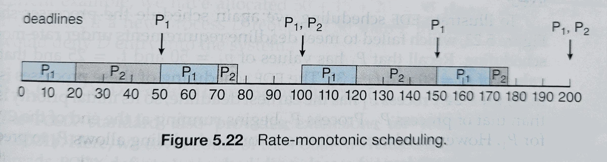
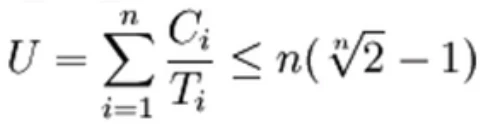

# 6주차-2: Real-Time Scheduling, Rate Monotonic

- ***Real-time scheduling***

    - 어떤 일을 주기적으로 실행할 때, 그것에 대한 스케쥴링을 다룬다. (periodic)
    - I/O는 외부와 상호작용하는 기계적인 I/O가 아닌, 내부적 I/O를 가질 수 있음
    - 데드라인을 가진다.

- p는 프로세스가 실행되는 시간이고, d는 수행이 끝나야 하는 시간을 말하는 것으로 보인다.

    - 일반적으로 t, d, p 세 가지를 따진다.
    - 데드라인이 될 때까지 자원요구량은 미리 제시되어야 한다. (철저하게 계획하여 운용하기 위해서이다. 그래야 사전에 언제 끝날지 확실히 확인 가능)
    - period가 정해져 있으면, 1/p를 **rate**라고 한다. (p : process가 반복해서 일어나는 시간)

- ***Rate Monotonic Scheduling*** : real-time scheduling에서 periodic task에 대해 적용되는 방법

    - 왜 여기에 Rate Monotonic이라는 단어를 붙였을까?
        ⇒ Rate : 1/p, Monotonic : 단순하다는 뜻. 즉, Rate에 비례해서 스케쥴링을 실시하는 방식.
    - p가 크다면 주기가 길다(급하지 않다)는 것이고, p가 작다면 주기가 짧다(급하다)는 것이다. 
    - 즉, rate는 p가 짧을수록 커지고, p가 길수록 작아진다. (단순히 비례해서 진행)
    - real-time scheduling은 반드시 priority를 기반으로 동작되어야 하며, rate가 클수록 Priority가 높다. 즉, 수행 주기가 가장 짧은 것에 대해서 우선 순위를 높게 주겠다는 뜻.

- ex) 각 피리어드는 p (50, 100), 각 수행시간은 t (20, 35)으로 한다. 
    ⇒ 데드라인은 p와 같다고 여기서는 일단 가정.

    - P1은 50의 시간안에 20이 수행되어야 하고, P2는 100의 시간안에 35가 수행되면 된다.

    ⇒ 굳이 연속적으로 갈 필요는 없고, 나눠서 주어진 시간 안에 수행만 되면 된다.

Deadlines

- P1은 50초 안에 20이 수행되어야 하므로 처음에 20 수행(rate가 더 크므로, 우선순위가 더 높기 때문에 먼저 수행된다.) 그리고 P2은 100 안에 35가 수행되어야 하므로 우선 30 수행, 그런데 P1의 p는 50이므로, 다시 우선순위가 높은 p1이 수행되어야 함. 다시 p1을 20 수행하고, p2에서 남은 5를 수행, 그리고 남은 25초는 대기한다… 여기서 P2의 period는 100이기 때문에 문제없이 스케쥴링이 된 것을 알 수 있다. (이렇듯, Rate Monotonic Scheduling은 스케쥴링이 가능한 프로세스의 집합에 대해서는 효과적인 것을 알 수 있다.)

    - 공식(CPU 사용률) 

    

    C/T ⇒ 20/50, 35/100 을 모두 더해보면, 0.75가 된다. 그 값은 공식에 대하여 계산해서, 작거나 같아야 한다. ⇒ 그러면 Rate Monotonic Scheduling이 가능하다. 라고 판단할 수 있다. 그러면 Rate Monotonic을 수행할 수 있다.

ex) P1의 수행시간이 25가 된다고 해보자. 그러면 어떻게 되는가? 계산해보면 총 CPU 사용률의 합이 0.85가 되므로, 값이 공식보다 커지기 때문에 불가능하다.

공식에서는 안되는데, 실제로 간트 차트로 만들어 보면 스케쥴링이 가능함.   
⇒ 필요충분조건에서 생기는 문제이다. 스케쥴링이 안되는 것은 저 공식을 만족하지 않지만, 저 공식을 만족하지 않는다고 해서 무조건 스케쥴링이 불가능한 것은 아니다.

- P(p, t)

P1(50, 25), P2(35,80) ⇒ 이러면 안되더라…

정해진 규칙을 따라가니까 물리적인 시간에서 문제가 발생하더라. 이것은 앞에서 SJF에서와 비슷한 문제로 보인다. 그리고 우리는 이것을 Remaining Time이 짧은 것으로 우선순위를 바꿈으로써 해결했었다. 여기서도 비슷하게 적용할 수 있다.

---

- ***Earliest Deadline First Scheduling*** (여기서는 deadline이 period와 같다고 가정)

P1(1/50), P2(1/80)

⇒ 처음에는 P1이 우선순위가 높다고 판단했는데, 50초 후에는 P2의 남은 시간이 더 짧아서 P2를 먼저 돌리게 된다. 즉, 데드라인이 임박할수록 더 높은 Priority를 부여한다.

이전의 문제 P1(50, 25), P2(35, 80)을 그대로 다시 적용해보자. Rate Monotonic Scheduling의 경우, 단위 시간 50이 지나면 다시 P1을 스케쥴링 해야하고, 그 때 우선순위는 P1이 높기 때문에 preempt가 일어나 P1이 수행되었다. 하지만 P2의 deadline이 80이기 때문에 P2는 모든 작업을 수행하지 못하고 deadline을 넘기게 된다. 이를 해결하기 위해 EDFS는 스케쥴링 타임이 되면, 다시 한 번 새롭게 deadline을 계산해준다. 이렇게 계산을 진행하고, deadline이 가장 임박한 순서대로 priority를 다시 부여해준다. 그렇게 진행하면 우리는 스케쥴링에 성공할 수 있다.

RMS의 경우는 각각의 프로세스의 CPU Burst Time이 항상 동일해야 한다는 조건이 필요했지만,  EDFS의 경우는 그런 가정이 필요하지 않으며, 프로세스가 periodic하지 않아도 된다. EDFS에 필요한 요구사항은 단지 프로세스가 runnable 상태가 될 때, 프로세스의 데드라인을 스케쥴러에게 전달해주어야 한다는 것이다.

- 중간중간 스케쥴링을 하는가? X → 정해진 스케쥴링 타임에만 계산해준다. 이 데이터는 처음에 스케쥴러에게 전달되는 정보를 바탕으로 진행된다. admission control을 통해 얻을 수 있다. 미리 전달받는다.
- ***EDFS는 어떻게든 사용률(total CPU utilization)이 1이하이기만 하면 실행이 가능하다.*** (guarantee 가능, 그러나 Rate Monotonic은 안될 수도 있음.)

⇒ 최근에 적용되는 스케쥴링 알고리즘은 더 복잡한 방식을 쓰며, 연구도 활발하게 진행 중이다.

---

- Windows Scheduling

    윈도우도 Priority 기반으로 스케쥴링을 하며, dispatcher도 다 존재한다. 스레드를 만들 때 마다 이 스레드는 얼마짜리인지와 생성되는 방법에 따라 블록을 나눠버린다.

    - Thread runs until (1) blocks, (2) uses time slice, (3) preempted by higher-priority thread
        ⇒ 블록에 따라 우선순위의 최대-최소치를 정해놓았음.
    - variable class is 1-15, real-time class is 16-31 (Priority)
    - Window 프로그램은 모든 변수를 Define해서 작성한다.
        (Hungarian Notation ⇒ 개발자의 디버깅을 위해서 변수의 이름을 직관적으로 쓰는 것…)

---

- ***Algorithm Evaluation***

    - Deterministic Modeling : 알고리즘의 상황을 만들고 직접 코드를 돌려보는 것. 그리고 이를 통해 값이 어떻게 나오는지 확인해보는 것이다. 간트 차트도 그리고, 비교도 한다. 

    - Queueing Models : 보통 알 수 있는 (측정 가능한) 값들로 비교하는 것.

        - Little’s law(Little’s Formula)

            - 공간 내에 머무는 개체수(동시에 처리할 수 있는 수) = 유입량(처리율, t/c) * 머무는 시간(처리 응답시간)
            - For example, if on average 7 processes arrive per second, and normally 14 processes in queue, then average wait time per process = 2 seconds 
                (14 = 7 * x, x = 2)
                ⇒ 회전율 구할 때 사용됨. 한정된 공간이 있고, 머무는 시간이 있고, 그 비율을 안다면, 이걸 구할 수 있게 된다.

    - simulations (가상으로 돌려보는 것)

        - 스케쥴링도 simulation이 가능하다.

    - implementation (실증) Test bed

        - High cost, High risk

        아무리 제대로 만들고 물리 엔진을 잘 만들어도 현실과는 차이가 있을 수 있기 때문에 일단 만들어봐서 테스트하는 것.

---

- 과제

    - 과제1

        - 스케쥴링 방법 (Evaluation 여러 개 있는데, Deterministic하게 해보자는 것)
        - 실시간과 실시간이 아닌 것은 구별 필요. 간트 차트도 만들어야 함.
        - 입력은 JSON
        - 구현은 Python, JSON을 list화 하는 것도 쉽고 display도 쉽다.
        - \*.ipynb으로 MarkDown 문서로 작성.

    - 과제2

        - WINDOWS 프로그램 템플릿은 이용 가능
        - 위 아래로 움직이기. 공의 속도는 더욱 빨라지도록? 컴퓨터는 공의 움직임을 잘 따라가도록 알아서 알고리즘을 잘 짜볼 것…
