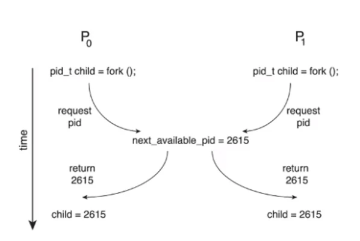

# 7주차-1: Process Synchronization

## Chapter 6 : Process Synchronization

- Objectives

    - Describe the critical-section problem and illustrate a race condition.
    - Critical-Section을 해결하기 위한 S/W적 관점, H/W적 관점
    - Illustrate hardware solutions to the critical-section problem using memory barriers, compare-and-swap operations, and atomic variables.
    - Demonstrate how mutex locks, semaphores, monitors, and condition variables can be used to solve the critical-section problem.
    - Evaluate tools that solve the critical-section problem in low-, moderate-, and high-contention scenarios. (Critical Section을 해결하기 위한 몇가지 방법론들을 살펴본다)

- Background : 야구게임 프로그램

    - 실제 필드에서 일어나는 야구 게임을 생각해보자. 야구는 수비하는 사람의 위치가 거의 정해져 있고, 투수와 포수, 타자가 모두 한 명씩만 있어야 한다. (18명이 게임을 진행)
    - 그런데 이런 게임에도 일종의 순서와 규칙이 있더라.
    - 투수가 포수에게 던지고, 포수는 공을 받아야 하며, 그 공간 안에 공이 들어간다면 Strike, 나가면 Ball, 그리고 타자는 투수가 공을 던져야만 공을 칠 수 있다.

    ⇒ 이걸 그대로 컴퓨터에 적용해보자.

    - 한 개의 데이터나 메모리를 두 개 이상의 프로세스가 공유해서 사용한다고 해보자. 두 곳 이상 모두에서 데이터를 읽고 쓰고 할 수 있다는 것이다.
    - 쓰고 읽는 것과 읽고 쓰는 것이 같은가? ⇒ 다르다. 값이 바뀔 수도 있기 때문. 서로 다른 프로세스는 그 데이터가 바뀌고 어떻게 되고 그런걸 모른다. (폰노이만 구조) 좀 더 디테일하게 쓰면, 데이터를 다 쓰지 못했는데 다른 곳에서 데이터를 가져가버릴 수도 있다. 그러자고 기다렸다가 가져가기에는 비효율적이다.

---

- 협력 프로세스(cooperating process)란, 한 시스템 내에서 다른 프로세스들에게 영향을 줄 수 있거나 영향을 받을 수 있는 프로세스를 말한다.

    - 협력 프로세스들은 직접적으로 논리적 주소 공간(code이던, data이던, 폰 노이만 아키텍처에서는 구분되지 않는다. 즉, 메모리 공간을 직접 공유할 수 있다는 뜻)을 공유하거나 Share Memory, Message Passing을 통해서만 이루어질 수 있다. 
    - 그러나, **공유 데이터에 동시에 접근하게 되면 데이터를 일관적으로 사용하지 못하게 될 수도 있다.**

- **Bounded-Buffer :** 동시에 최대 BUFFER_SIZE - 1개의 데이터를 보관할 수 있는 구조

    - Shared Data : 크기가 10인 Circular Buffer(Shared Data)가 있다고 하고, 버퍼에 데이터를 집어넣는 것은 Producer(2개), Consumer(1개)가 있다고 하자. 해당 buffer에는 item이라는 데이터 타입을 갖는 데이터가 들어간다.

        ⇒ 문제가 발생하는 상황을 가정하기 위해 Queue에서 두 개의 pointer를 사용하지 않고 현재 데이터의 위치(개수)를 가리키는 counter 변수만 사용한다고 해보자. ⇒ (다시, in, out 포인터가 있다고 생각)

    - Producer

    ```c
    item nextProduced;

    while (1) {
    	while (counter == BUFFER_SIZE); 
    	// 가득차면 데이터를 넣을 수 없으므로.
    	// Do nothing...
    	// counter가 공유 변수이기 때문에,
    	// 다른데서 값이 변할 수 있다.
    	// 따라서 해당 loop는 탈출할 수 있다.	

    	buffer[in] = nextProduced;
    	in = (in + 1) % BUFFER_SIZE;
    	counter++;
    }
    ```

    ⇒ counter는 volatile 변수여야 한다. 

    ⇒ 데이터를 넣는 함수는 static 함수여야 한다.   
    (의미 X, 접근은 다 가능하므로… 원래 의도했던 것은 한 번에 함수가 한 번만 수행될 수 있도록 하는거였는데, 코드는 그냥 데이터에 불과할 뿐이므로, static이더라도 지정한 주소에서 데이터를 가져와 코드를 수행할 수 있게 된다.) 

    - Consumer

    ```c
    item nextConsumed;

    while (1) {
    	while (counter == 0); 
    	// 비어있으면 데이터를 빼낼 수 없으므로,
    	// Do nothing...
    	// counter가 공유 변수이기 때문에,
    	// 다른데서 값이 변할 수 있다.
    	// 따라서 해당 loop는 탈출할 수 있다.	

    	nextConsumed = buffer[out];
    	out = (out + 1) % BUFFER_SIZE;
    	counter--;
    }
    ```

---

- 그런데, 이 상황은 각각 분리되어서 문제가 없이 잘 동작할 수 있을 것으로 생각할 수도 있지만, 실제로는 문제가 발생할 수 있다. counter++, counter-- 를 하면 값은 당연히 원래 값이랑 똑같다고 생각할 수 있지만, 서로 다른 프로세스에서 접근하면, 아닐 수도 있다는 것이다!

    - C언어에서 C++과 C--를 뜯어서 분리해보면, 하나의 명령어가 아니다.

    ```nasm
    // count++의 Assembly Code
    register1 = counter // I/O
    register1 = register1 + 1 // CPU 내부 ALU에서 일어남
    counter = register1 // I/O

    // count--의 Assembly Code
    register2 = counter // I/O
    register2 = register2 - 1 // CPU 내부 ALU에서 연산이 일어남
    counter = register2 // I/O
    ```

    ⇒ register2는 CPU의 로컬 register 중 하나이다. 만약 register1과 register2가 실제 물리적으로 같은 레지스터라고 하더라도, 둘다 프로세스로서 동작하기 때문에 중간중간 스케쥴링이 발생할 수도 있다. 

    즉, 여기서도 I/O가 관여하게 되는데, 카운터 변수의 값을 register1에 저장하는 것은 메모리로부터 버스를 사용해 데이터를 가져오고 이를 register1에 저장하는 것이므로 I/O가 관여되는 것이다. register1의 값을 1 증가시키는 것은 CPU 내부에서 일어나는 것이고, counter에 다시 register1의 값을 넣는 것은 또 다시 버스를 이용하여 데이터를 메모리로 전달하는 것이므로 I/O가 관여하게 된다. 

    여기서 I/O가 관여한다는 것은 버스를 통해 데이터가 전송된다는 뜻이다.) 

    그렇기 때문에 중간중간에 스케쥴링이 생길 수도 있다. 즉, 명령이 섞일 수도 있다는 것이다.

    ```nasm
    register1 = counter (register1 = 5)
    register1 = register1 + 1 (register1 = 6) <= 여기서 스케쥴링이 일어남.
    register2 = counter (register2 = 5)
    register2 = register2 - 1 (register2 = 4)
    counter = register1 (counter = 6)
    counter = register2 (counter = 4)
    ```

    ⇒ 예컨대, 이렇게 될 수도 있다는 것이다. 어셈블리 단계에서 명령이 섞여서 생길 수 있고, 이것이 섞여서 일어나지 않는다고 보장할 수도 없다. 이것을 해결하려면, 서로 독립적으로 이루어질 수 있도록 만들어주어야 한다. (이를 atomically, 원자적이라고 한다.)

- 경쟁상태는 아래와 같이 새로운 프로세스를 생성(fork)할 때도 발생할 수 있다.

    - fork를 했는데, 두 개의 프로세스가 모두 next_available_pid = 2615라고 동시에 읽어버릴 수도 있다. ⇒ 프로세스가 하나의 프로세스를 만들었는데, 서로 같은 프로세스 번호를 갖게되는 경우이다. (2615라는 값을 가지는 next_available_pid가 shared 된다.)
    - 이런 경우를 ***경쟁 상태***(**race condition**)라고 한다. 그래서 이런 상황에서는, 반드시 동기화(***synchronization***)을 해주어야 한다.
    - ***race condition***

    다수의 프로세스가 똑같은 데이터에 동시에 접근하거나 조작할 수 있는 경우, 이 과정에서 발생하는 결과는 공유 데이터에 접근하는 순서에 영향을 받을 수 있다는 것을 말한다.

    이러한 현상을 방지하기 위해서 우리는 count라는 변수에 한 번에 한 프로세스만 접근할 수 있도록 보장해야하며, 이를 synchronization이라고 한다.

    이러한 현상은 우리가 count라는 변수를 서로 다른 두 개의 프로세스에서 접근하여 조작할 수 있도록 설정했기 때문에 발생하게 된다.

---

- Critical Section (임계 영역)

    - 특정 공간이 뜯어지지 않도록, 해당 부분을 atomic하게 만들자!
    - 코드의 일부분을 block으로 설정해서 atomic하게 만드는 것이다.
    - 여러 개의 프로세스가 있을 때, 각각 자기만의 Critical Section이 있을 수 있다.
    - 그런데, 이렇게만 하면 또 다시 문제가 발생한다.

    ```c
    do {
    	// entry section : 크리티컬 섹션에 들어가기 전에 필요할 설정을 하는 구간,
    	// 0줄일 수도 있고, 코드가 매우 길 수도 있다.
    	// 여길 거쳐서 critical section에 한 프로세스가 들어가게 되면
    	// 다른 프로세스는 통과하지 못하고 기다리게 된다.
    		critical section
    	// exit section : 크리티컬 섹션에 들어가기 전에 했던 설정들을 정리해주는 구간.
    		remainder section
    } while (true);
    ```

    - entry section
    - critical section
    - exit section
    - remainder section

- Critical Section Problem : 프로세스들이 critical section을 형성해 synchronization을 이룸으로써 데이터를 안전하고 협동적으로 공유할 수 있게 된 상태가 되도록 하는 문제.

    - 다음 세 개가 보장되어야만 Critical Section이 올바르게 동작된다.

        - Mutual Exclusion(상호 배제) : 하나의 크리티컬 섹션에는 한 번에 반드시 하나의 프로세스만 들어갈 수 있어야 한다.
        - Progress(진행) : 아무도 크리티컬 섹션에 없는 경우, remainder section을 수행하고 있지 않은 어떤 프로세스가 이곳에 들어갈려고 한다면 입장을 허용하고 들어올 수 있도록 해주어야 하며, 한 번 결정되면 이 것을 지연할 수 없도록 만드는 것을 말한다.
        - Bounded Waiting : 한 프로세스가 크리티컬 섹션에 들어갈려고 하는데 다른 프로세스가 그 크리티컬 섹션을 쓰고 있다면 기다리게 될 것이다. 이 때, 기다리는 시간이 유한해야 한다.

    - 운영체제가 동작하고 있는 동안에는 많은 커널 모드 프로세스들이 운영체제에서 돌아가고 있는데, 이 프로세스들(kernel code)은 race condition의 대상이 될 수 있다. 
    - ex) 시스템에서, 현재 열려있는 모든 파일들을 모아둔 커널 리스트 데이터 구조를 예로 들어보자. 이 리스트는 현재 열려있는 파일이 닫히거나 새로 열리게 되면 반드시 수정되어야 할 것이다. 만약 동시에 두 개의 파일이 열린다고 한다면, 리스트를 업데이트 하는 각각의 업데이트는 race condition이 될 수도 있을 것이다.
    - 또 다른 예는 아래 그림에서 확인할 수 있다.

    

    이 예제에서, 개별적인 프로세스 P0와 P1이 각각 fork 시스템 콜을 통해 child process를 생성하고 있다. fork()는 새롭게 만들어진 프로세스의 구분자를 부모 프로세스에게 전달한다. 이 예제에서는 다음에 사용 가능한 process id를 갖고 있는 가변적인 커널 변수 next_available_pid라는 변수에 대하여 race condition이 적용된다. Mutual Exclusion이 제공되지 않는 이상, 새롭게 만들어진 두 개의 자식 프로세스에 같은 이름의 PID가 적용될 수도 있는 것이다.

    ⇒ 이 뿐만 아니라 다양한 kernel data structure에 race condition이 적용될 수 있으므로, 커널 개발자들은 race condition이 발생하지 않도록 주의해야 한다.

- Single Core 환경에서는 단순히 Shared Variable이 수정되고 있는 동안에는 인터럽트가 발생하지 않도록 막음으로써 Critical Section Problem을 방지할 수 있다. 이 과정에는 명령어들이 preemption 없이 실행되도록 해야 한다. 다른 명령어들은 수행되지 않을 것이고, 그렇기 때문에 예기치 못한 데이터의 수정이 일어나지 않을 것이다.

    - 그러나 이러한 해결책은 멀티프로세서 환경에서는 유효하지 않다. 이 환경에서는 모든 프로세서들로부터 메시지들이 전달되기 때문에 인터럽트를 막는 것은 time consuming하다. (즉, 효율적이지 못하다.) 이 message passing은 각 critical section으로의 진입을 지연시키고, 시스템의 효율성을 떨어트린다.

- Critical Section 문제를 해결하기 위한 일반적인 접근법은 크게 두 가지가 있다.

    - preemptive kernels

        - preemptive kernel은 커널모드에서 동작되고 있을 때, 프로세스가 선점되도록 함.

    - nonpreemptive kernels

        - nonpreemptive kernel은 커널모드에서 동작되는 프로세스가 선점되지 않도록 함.
        - 커널모드에서 동작되는 프로세스는 커널모드를 나가거나 CPU 컨트롤을 자원해서 양보할 때까지 실행된다.

    - preemptive kernels : 당연하게도 커널에서 한 번에 하나의 프로세스만 활성화되기 때문에 race condition에서 자유롭다. 그런데, 이 방법은 SMP architecture와 같이 두 개의 커널 모드 프로세스가 동시에 서로 다른 프로세서에서 동작돼야 하는 경우에서는 구현되기 어렵다.
    - 하지만, nonpreemptive는 다르다. 그렇기 때문에 nonpreemptive kernels는 신중하게 다루어져야 한다.

    ⇒ 실제로는 preemptive kernels가 더욱 선호된다. 왜냐면, 이 방법이 더욱 반응이 잘 나오고, 커널모드 프로세스가 대기하고 있는 프로세스들에게 프로세서를 넘겨주기 전에, 임의로 긴 주기로 동작할 가능성이 적기 때문이다.

---

- Algorithm 1
- Process Pi

```c
// i
do {
	while (turn != i);
		critical section
	turn = j;
		remainder section // 남은 영역
} while (1);

// j
do {
	while (turn != j);
		critical section
	turn = i;
		remainder section // 남은 영역
} while (1);
```

- i 입장 : 공유 메모리가 turn이며, turn은 i 또는 j를 가진다. (turn은 직관적으로 차례를 의미)

    - entry section을 해석하면, i가 아닐 경우에는 대기하고, i여야만 실행한다.
    - critical section이 끝나면, turn을 j로 바꿔준다.
    - j의 turn이 되고, j가 exit section에서 turn = i로 바꿔주면 다시 i의 turn이 된다.
