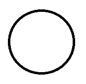
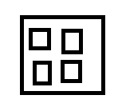
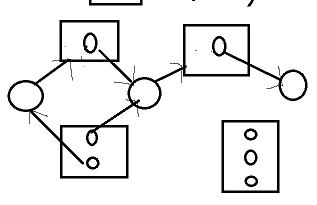
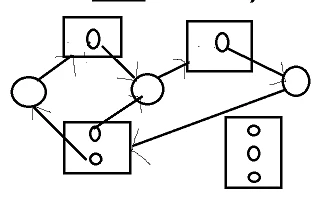
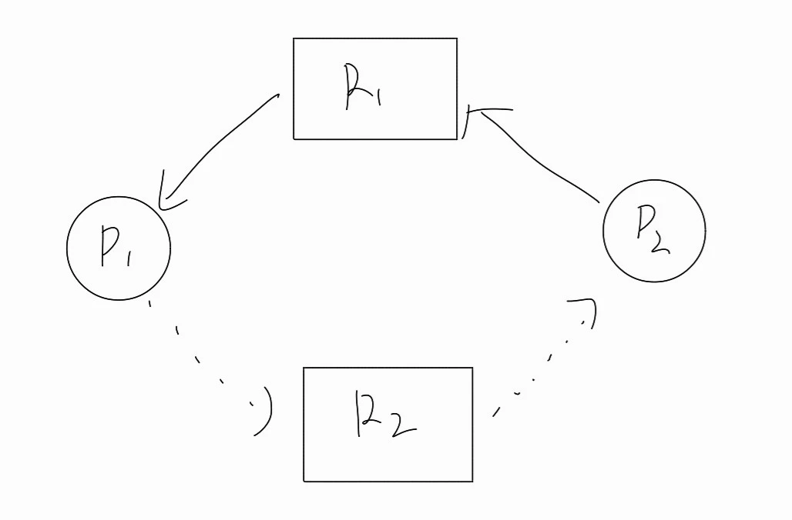
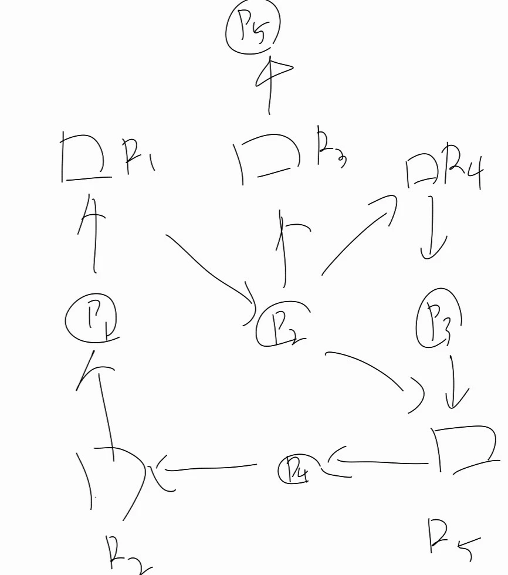
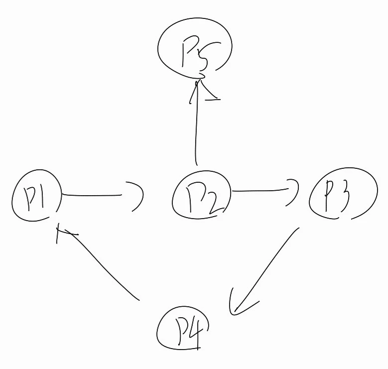

# 10주차: Deadlock

작성일 2023-05-08 · 최종 수정일 2023-06-05
{ .post-date }

- Deadlock

안된다. 여러 개가 돌아갈려고 하는데 안된다. 서로가 탁 걸려가지고 자존심 싸움을 하고 있는 것이다. 예를 들어 골목 하나에 양쪽에서 자동차가 들어와서 서로 비키라고 주장하고 있는 것. 그 상황이 바로 Deadlock이다.

모든 컴퓨터 관련한 것들에서 문제에만 집중하기 위해 체계적으로 만드는 것을 ‘모델링한다.’라고 말한다.

- 데드락의 기준

    - 데드락의 처리
    - 데드락의 예방(Prevention)
    - 데드락의 회피(Avoidance)
    - 데드락의 탐지(Detection)
    - 데드락의 회복(Recovery)

우리가 사용하는 모든 OS는 Deadlock이 생긴다. Deadlock이 생기지 않도록 만들 수도 있으나, 그렇게 하지 않는 이유가 있다.

---

- Example 1

    - 컴퓨터는 프로세스가 있고 그 프로세스들이 사용하는 리소스들이 있다. 리소스는 메모리 버스, CPU 등 모든 것을 포함한다.
    - 시스템은 두 개의 리소스가 있다고 가정, P1, P2는 각각 하나의 리소스를 가지고 있다고 하자.
    - 이때, 서로가 두 개의 리소스를 모두 탐하려고 한다. 그리고 하나의 프로세스가 두 개의 리소스를 가져야만 다음 단계로 넘어가게 된다.
    - 이렇게 되면 절대 다음 단계로 넘어갈 수 없다. (서로 소유권을 주장하기 때문이다.)
    - 하나가 안쓰고 있으면 둘 다 쓸 수 있는데, 지그재그로 갔다면, 처리가 불가능하다. 위와 같은 경우를 말한다.

    ```text
    P0         P1
    wait(A); wait(B);
    wait(B); wait(A);
    ```

    - 이 상태에서는 무한 대기상태에 빠지기 때문에 Starvation(기아상태)이 발생하게 된다. 앞서 스케쥴링에서 발생했던 것처럼. 하지만, 스케쥴링에서처럼 우선순위에 의한 Starvation이 아니라 서로 충돌 상태에 봉착해서 진행되지 못하기 때문에 발생한다.
    - 이를 설명하려면 모델링을 통해 System Model을 만들어야 한다.

- System Model

    - Resource types R1, R2, …, Rm
    - CPU cycles, memory space, I/O devices… Computer에서 돌아가는 모든 것이 resource이다.
    - Each resource type Ri has Wi instances. (하나의 resource도 여러 개의 instance 존재 가능.)

    - Each process utilized a resource as follows (프로세스와 리소스의 관계)

        - request : 사용 요청
        - (allocation) : 할당
        - use : 사용 (사실상 allocation과 같은 표현)
        - release : 해제 (할당을 해제 함)

    - Deadlock의 특징

        - Deadlock 상태에 들어가면 어김없이 아래 네 가지 상태가 발생하더라.

            - 데드락일 때는 네 개가 발생하더라. 만약 네 개 중 하나라도 발생하지 않으면 절대로 데드락이 발생하지 않더라. (필요충분조건)

        - Mutual Exclusion : 하나의 리소스는 한 번에 하나의 프로세스만 사용할 수 있게 된다. (만약 동시에 사용하고자 한다면 리소스가 해제될 때까지 대기해야 한다.)
        - Hold and Wait : 적어도 하나 이상의 리소스를 가진 프로세스가 또 다른 리소스를 사용하기 위해 대기하게 된다.
        - No preemption : 리소스를 뺏지는 않고 계속 대기하고 있게 된다. 
        - Circular wait : 꼬리에 꼬리를 물고 기다리게 되는 경우. A → B, B → C, C → A 이런 식으로 waiting을 하는 상황

    - **Resource-Allocation Graph**(Vertex & Edge)

        - Vertex는 Process이거나 Resource이다.

        - Request Edge(directed edge) : Pi → Pj 

            - (Pi가 Pj를 원한다.)

        - Assignment Edge(directed edge) : Rj → Pi 

            - (Rj가 Pi에 할당된다. 어떠한 리소스가 특정 프로세스에 할당된다.)

    - Process

        

    - Resource Type with 4 instances

        

    - Pi requests instance of Rj
    - Pi is holding an instance of Rj
    - 이 상황은 Deadlock의 조건 1, 2, 3이 부합되는 조건이지만, 4번 Circular Waiting이 없기 때문에 하나가 완료되면 모두 Waiting이 해결될 수 있다.

    

    - 하지만, 하나의 프로세스가 Circular하게 request를 하게 될 경우, Deadlock이 발생할 가능성이 있게 된다.

    

    - 하지만, Circulation이 있다고 해서 무조건 Deadlock이 발생하지는 않는다. 만약 특정 Resource에 instance의 여유분이 있다면, 여유분이 생겨났을 때 그 instance를 assign 해줌으로써 Deadlock을 해결할 수 있게 된다.
    - 실제 사용되는 OS는 Deadlock이 존재하기는 하나, 없다고 주장함. 실제로 Deadlock은 운영체제의 문제가 아니라, 프로세스 간에 발생하는 문제이다. 

    - Deadlock이 발생하지 않으려면 OS가 매순간 관여를 해야만 한다. 그리고 너는 돼, 너는 안돼 이런걸 체크해주어야 한다. 이 말은 즉슨 OS가 리소스를 많이 사용하게 되고, 그렇게 되면 OS의 효율이 감소하게 되는 것이다. 일일이 Deadlock의 생성을 체킹하고 있으면 OS의 프로세싱이 너무 많아지게 된다.

        - 즉, 사고(Deadlock)가 발생하지 않도록 할 수는 있지만, 효율이 너무 떨어지기 때문에 그냥 모른척하고 있다가 생기면 처리만 해준다.
        - 프로세스가 리소스를 요청하는 것은 예측할 수 없으므로, Deadlock은 항상 생길 수 있다.

- 예방(Prevention) : 데드락이 생기지 않도록 해보자.

    - Mutual Exclusion : 공유 자원을 요구하지 않는다. 즉, 비공유 자원을 전제로 한다. → 현실적으로 불가능. 비현실적이다. 하드웨어 리소스가 제한되어 있기 때문이다.

    - Hold and Wait : 프로세스가 시작되기 전에 어떤 리소스를 사용할지 미리 체킹을 하고 모든 리소스를 한 번에 가질 수 있는 경우에만 가지게 한다.

        - 프로세스가 자원을 전혀 갖지 않을 때만 자원을 요청할 수 있도록 허용한다.
        - 효율이 굉장히 떨어지는 단점. 일부 프로세스 때문에 효율이 매우 떨어지고, Starvation이 발생할 수 있음.

    - No Preemption : 선점을 다 허용해주면, 질서가 너무 사라지기 때문에 비현실적 
    - Circular Wait : 순환대기가 발생하지 않도록 하는 것. 한가지 방법은 모든 자원 형태들에게 전체 순서를 부여하고, 각 프로세스가 열거된 상태에서 순서를 정해 자원을 요청하는 프로토콜 사용 → 낭비가 심함

    ⇒ 위의 네 가지 방법 모두 데드락이 생기지 않도록 할 수는 있으나, 비효율적이므로 그냥 데드락이 생기도록 해버리고 대처를 잘 해준다.

- 예방은 많은 비용(시간/계산 등 모든것)이 발생하므로, 데드락이 발생할 것 같으면 회피시켜 보는 방법.  (Safe Status)

- 회피(Avoidance)

    - Safe Status(안전 상태) : 상태를 두 개로 나눈다. unsafe/safe. safe한 상태에서는 절대 데드락이 발생하지 않으며, unsafe한 상태에서는 데드락이 발생할 수도 있는 상태이다. 그러므로, 가능한 safe한 상태가 유지되도록 해보자는 것. 노력은 하지만, 비용이 너무 많이 발생할거 같으면 그냥 unsafe에 갈수는 있도록 하는 것.
    - 모든 프로세스에 안전 순서(Safe Sequence)가 존재하면 시스템은 안전 상태에 있다.
    - 프로세스를 스케쥴링에 의해 동작시켜 버리면 데드락이 발생할 수 있기 때문에, Safe한 상태를 유지할 수 있도록 스케쥴링의 순서를 조금씩 바꿔줄 수 있다.

    - **안전한 상태**(Safe State)

        - 일련의 순서대로 자원을 할당해도 교착상태가 없는 상태
        - deadlock 상태 = unsafe state : safe sequence가 없는 상태
        - 어떤 시스템에 12개의 instance가 있다. (Resource : Magnetic Tape)
        - 프로세스는 세 개가 있다. (P1, P2, P3)
        - P0 : 최대 수요 (10), 현재 할당 (5)
        - P1 : 최대 수요 (4), 현재 할당 (2)
        - P2 : 최대 수요 (9), 현재 할당 (2)

        이 상황에서 세 개의 프로세스가 최대 수요만큼 동시에 요청하면 23개의 MT instance가 필요하므로, 현재 12개의 instance가 있기 때문에 Deadlock이 발생할 수 있게 된다.

        이것은 safe하지 않다. 하지만 실제로 동시에 모든 프로세스가 최대 수요만큼 요청하는 일은 적다.  (가장 좋은 것은 한 개의 resource만 가지고도 모든 요청을 동시에 처리할 수 있는 시스템이다. 하지만 현실적이지는 않음.)

        이래서 대기를 시킨다. 예를 들어, P1의 최대 수요를 먼저 할당해주고 나머지 P0과 P2는 기다리게 한다. 처리가 다되면, 다섯개의 instance를 받게 된다. 그러면 P0에 다섯 개를 주고, P2는 다시 기다리게 한다. P0의 처리가 끝나면 10개의 instance를 받게 되고, 이 instance들에서 필요한 만큼 P2에 다시 할당해주면 된다.

        이렇게 safe하게 만들 수 있는 방법이 있다면, safe state에 있다고 말할 수 있으며, safe sequence가 있다고 말할 수 있다.

        - 장점 : Deadlock이 안생길 수 있음.
        - 단점 : 특정 프로세스가 기다려야할 수 있음. (bank run이 안생기도록 함.)

---

- Deadlock은 해결하기 위해 필요로 하는 자원이 너무 많기 때문에 실제로는 잘 사용하지 않는다.

- Resource-Allocation Graph Algorithm

    - Resource와 Process 간의 관계를 보면서 이것이 Deadlock이 되는가 안되는가를 파악해본다.
    - safe한 status는 절대 deadlock이 생기지 않지만, unsafe status는 deadlock이 앞으로 생길 가능성이 있거나 이미 생긴 경우.

    

    - 여기서 실선 중 하나가 ‘요청’되면, unsafe status가 된다.

- 20년 전까지만 해도 인공지능은 매우 높은 수준의 연산 능력, 매우 큰 메모리가 필요했기 때문에 그 당시의 기준으로는 처리하기 힘들었다. 즉, 이론과 실제의 영역은 차이가 있던 것이다.
- 하지만 점차 하드웨어가 발전되면서 인공지능도 함께 발전할 수 있게 되었다. 이론은 그대로지만, 기술의 발전으로 안되던 것들이 해소되기도 한다. 
- 지금으로부터 2~30년 뒤도 마찬가지로, Deadlock과 같이 해결 불가능한 것이 기술의 발전으로 해결될 수도 있다.

---

- Banker’s Algorithm

    - Safe Status를 유지하려면, Safe Sequence가 반드시 필요하다.
    - 현재 가진 것보다 많이 처리할 수 있는 방법을, 위험없이 찾아내는 것이 매우 중요.

- 다섯 개의 프로세스(P0, P1, P2, P3, P4)가 있고, 세 개의 리소스(A, B, C)가 있다.

    - 각각의 프로세스는 운용하는 과정에서 리소스를 쓸 수도 있고, 안쓸 수도 있다.
    - 모든 프로세스는 하다보면 쓸 수도 있고 안쓸 수도 있지만, 그 프로그램이 한 번에 사용하는 최대 리소스의 수는 먼저 선언되어야 한다. (리소스의 최대 할당량을 파악해야 함.)
    - A(10 instances), B(5 instances), C(7 instances)

    ```text
         Allocation     Max        Available
          A B C         A B C          A B C
    P0  0 1 0          7 5 3           3 3 2
    P1  2 0 0          3 2 2
    P2  3 0 2          9 0 2
    P3  2 1 1          2 2 2
    P4  0 0 2          4 3 3
    ```

위와 같은 상황에서는 어떻게든 처리할 수는 있지만, 만약 B의 경우. 현재 instance가 총 5개 있는데, 특정 프로세스에서 한 번에 최대로 필요한 instance의 수가 B의 instance 수를 초과할 경우 처리가 불가능할 수 있다. 하지만, 최대보다 작은 것들이 여러개 있을 수는 있음. 위와 같은 경우.

- Max는 n x m matrics이다. 각 프로세스가 resource 별로 한 번에 최대로 요청할 수 있는 instance의 수를 담은 행렬이다.
- Allocation도 비슷하게 T0(특정 시각)에서 현재 각각의 프로세스가 resource의 instance들을 쓰고있는 수를 담은 행렬이다. 위의 예시에서 현재의 Allocation Data라고 할 때, A는 7개가 할당되어 있으므로, A는 3개가 남아있기 때문에 Available에서 A는 3이다. 똑같이 B는 현재 2개가 사용 중이므로 3개가 남고, C는 5개가 사용중이므로 2개가 남는다.
- 따라서 Available은 n x 1의 vector이다. (순서가 있는 숫자들의 나열)
- 이제 여기서 Safe Sequence를 찾아보자. Safe Sequence란, 이 순서대로만 사용하면 현재 갖고있는 instance의 수가 over되어 allocate 되는 경우가 없이 처리될 수 있도록 하는 것이다.
- 실제 은행에서도 손님을 어루고 달래고 뭘주고 뭘 설명해주면서 기다리게 하기 때문에 Banker’s Algorithm이 된 것으로 추측된다.

위의 예시에서 A, B, C가 한화, 엔화, 달러라고 생각해보고 요청은 P0부터 진행된다고 생각해보자. P0는 한화, 엔화, 달러를 더 필요로 할 수도 있기 때문에, 더 요구할 수도 있다. 만약 P0가 원화(A)를 갑자기 3을 초과하여 요청하면, 은행에 부도가 발생해버린다.

P1은 A(1) B(2) C(2)를 요청할 수도 있다. 그래서, P0부터 얘기를 들어주면 부도가 날 수 있고, P1부터 들어주면 모두 처리를 해줄 수 있다. P1을 처리해주고 있는 상황에서 뒤의 프로세스. P2 이상의 고객이 요청을 하면 대기시키게 되고, 이 순간에는 P1이 열심히 일을 처리하고 있다.

이후에 P1의 동작이 끝나고 모든 instance를 해제해주면, Available이 다시 5, 3, 2가 될 수 있다.

이후에 다시 P2를 보면, 요청을 들어줄 수 없다. 왜냐면 P2가 갑자기 원화(A)를 6 더 요청하게 되면, 현재 갖고있는(Available) 원화(A)가 5이기 때문에 요청을 들어줄 수 없다.

⇒ 이와 같이 어떤 케이스는 되고 어떤 케이스는 안되는 경우가 발생하게 되고, 되는 순서(Safe Sequence)를 따라 운용하기만 하면 모두 처리해줄 수 있다. 즉, 이 순서만 따라가면 Deadlock이 발생하지 않을 것이다. 하지만 이 순서대로 하지 않으면 언제든지 Deadlock이 발생할 수 있다.

Available에 맞춰 instance를 할당해 처리할 수 있는 것부터 처리해줘라! 이런 방식으로 운용을 해줘서 부도가 나지 않도록 해보자.

&lt;P1, P3, P4, P2, P0&gt;의 순서로 처리하면 Unsafe status가 되지는 않을 수 있음. 그리고, Sequence는 여러 개가 될 수 있음. (현실적으로는 이런 상황이 맞지는 않을 수 있지만, 이론적으로 모델링을 해서 만들 수는 있다.

- 순서가 없다면, (safe sequence가 없다면) deadlock이 생기지 않는 것을 보장 불가하다.

---

- Deadlock Detection

    - 안생기게 하거나 대처할 수도 있지만, 생길지 안생길지 모르는 것을 찾기 위해 노력하는 것보다 가만히 무시하는 방법도 있다. Detection해서 처리하는 것은 나중 문제고, 일단 있는지 없는지만 체크하는 것이다.

- Detection을 하기 위해서는 새로운 모델링이나 방법이 필요하다.

    - Resource-Allocation Graph : 리소스와 프로세스간의 요청-할당 관계를 표현한 그래프

        

    - Wait-For Graph : 리소스 요청은 배제하고, 프로세스 간의 관계만 본다. 이렇게 하면 Circulation이 존재하는지 볼 수 있다. 

        

    - 그런데, 각 resource 별로 instance의 개수는 표시하지 않았다. 하지만 실제로는 대부분 다중 instance로 resource가 구현되므로, 이를 처리하는 알고리즘도 필요하다.

- 언제 Detection 알고리즘을 호출할 것인가?

    - 교착 상태의 발생 빈도수 파악

    - 교착 상태가 발생했을 때, 영향을 받는 프로세스의 수

        - 교착 상태가 자주 발생되면, 탐지 알고리즘도 더 자주 호출해야 한다. (효율이 저하)

    - 운영체제가 하는 일이 눈에 드러나지 않을 수록, 더 잘 안드러나면서 적절한 기능을 할 수 있게 해야한다.
    - 만약 Deadlock이 발생한 것이 탐지되면, 가장 좋은 것은 어떤 프로세스에 의해 Deadlock이 발생되었는지 체크하고, 이걸 바탕으로 범인 프로세스를 초기화하는 것이다. 하지만, 이것이 실제로는 찾아내기가 어렵다. (그래서 그냥 강제종료 시키는 극약처방)

    ⇒ 큰 시스템이 있어서 Deadlock이 생긴다. 그 중 하나를 탁 없애버리면, 나머지 프로세스는 happy하다. 즉, 그 victim을 찾고 결정하는 것이다. 하지만 이전에도 말했듯이 그걸 일일이 찾고 계산하는 것이 쉽지 않기 때문에, 일이 생긴 그 순간에 몇가지 근거를 따져가면서 희생자를 찾아볼 수 있다.

    - victim을 찾는 과정

        - Priority of Process (우선순위) : 우선순위가 높으면 Abort 안시킴.
        - 그렇다면 그 victim은 어떻게 될까? → victim인 프로세스 A를 terminate 시켰다. 그러면, 전체 시스템을 기준으로 문제가 발생하면 똑같은 A가 거의 대부분 계속해서 문제가 된다. 
        - 이는 프로세스 A의 Starvation으로 이어질 수도 있다. 
        - 그래서 프로세스 A에 Aging을 준다거나, 위로 올라갈 수 있는 방법을 만들어주지 않으면 A의 Starvation은 계속해서 일어날 것이다.

        - 실제 운영체제는 위의 여러가지 방법을 종합적으로 사용하려고 하지만, 엄밀하게는 Deadlock이 안생기게 하지는 않는다. (그 비용이 너무 많이 들기 때문에 일단 발생하도록 둬버리고, 생겼을 때 victim을 찾아서 처리하는 것이 비용이 훨씬 적기 때문이다.)

            - 그러나 10년 뒤 쯤에는 바뀔지도 모르겠다. 앞서 얘기했듯이 기술의 발전을 통해서 해결될 수 있음.

- Critical Section은 모든 프로세스에 존재할 수 있다. 그 프로세스가 필요하면 갖게 되는 것.
