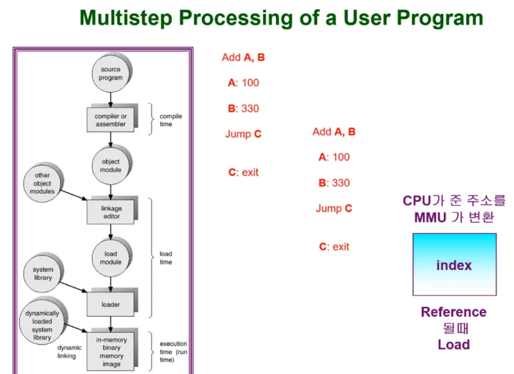

# 11주차: Memory Management, 주소 바인딩

## Memory Management

- 프로그램이 실행되려면 반드시 메인 메모리 내에 들어와 있어야 한다. 여기서는 디스크에 있는 것을 메모리에 올리는 걸 queue에 넣는다고 표현한다.
- 각 스텝(시점)에 Binding이라는 것을 해야 한다. (주소를 정해주는 과정) 왜냐면, 프로그램을 프로세스로 가져올 때 메모리에 무언가를 넣겠다고 하는 순간에는, 주소가 정해진다. 디스크, USB에 있는 것은 Block이 있을 뿐. 주소가 없다. 하지만 RAM에는 주소가 있고, 그 주소를 정해주는 과정이 바로 Binding이다.
- 초창기의 컴퓨터나 임베디드 시스템은 올라오는 과정에서 바로 주소를 할당하지만, 복잡한 시스템에서는 그렇게 단순하게 관리하지는 못한다.

---

- 주소 바인딩

    - 한 주소 공간에서 다른 주소 공간으로의 사상(mapping)을 의미
    - 프로그램을 작성할 때 대부분 실제 주소를 쓰지는 않고, 주소가 필요한 곳에는 이름(기호)을 사용한다. 그 모든 것은 변수도 마찬가지이다. 그동안 사용했던 변수들도 사실은 다 기호이다. 프로그램이 실행될 때 그 기호들은 모두 사라지고 실제 주소나 값만 남게 된다.
    - 우리가 실제 주소는 모르지만 기호로서 그것을 표현하고 있는데, 운영체제가 컴퓨터를 많이 관리하는 시스템에서는 하드웨어 보호를 하기 위해 컴퓨터가 제시한 특정한 실제 주소가 사실은 ‘정말로 존재하는 그 번지’는 아닐 수도 있다. 사용자는 300번지에 있다고만 알고 있으라고 제시될 수 있지만, 실제 번지는 아니고, 이 300번지를 통해 처리하면 운영체제가 대신 안전하게 처리해주는 역할을 한다.

- **컴파일 시간 바인딩**(Compile Time Binding)

    - 컴파일(내가 만든 프로그램을 기계어로 변환하고 라이브러리와 링킹해서 실행파일로 만드는 과정)을 할 때, 그 순간 실제 주소가 바로 정해지는 것을 말함.
    - 즉, 이 프로그램을 컴파일할 때 반드시 정해진 위치에만 프로그램을 할당하겠다고 지정해버리는 것을 말한다. 이런 상황에서 만들어지는 코드를 **절대 코드**(Absolute Code)라고 한다.
    - 내용을 바꿔야 한다면 처음부터 컴파일을 다시 해야한다.
    - PC와 같은 대규모 서비스에는 어울리지 않고, 운영체제가 거의 없거나 없는 작은 임베디드시스템에 적합한 방식이다. (단, 모든 임베디드시스템이 이런 것은 아니다.)

- **적재 시간 바인딩**(Load Time Binding)

    - 프로그램이 메모리 상에 Load될 때 주소가 정해지는 것. 로드되는 과정에 Loader가 주소를 부여한다. 초기에 컴파일될 때 가상 주소를 적용했다가, 로드될 때 실제로 계산해서 적용함.
    - 대부분 이 방식을 상식적인 수준으로 생각하게 되지만, 실제로는 현재 운영체제는 실행 시간 바인딩을 사용한다.
    - 컴파일러는 일단 **재배치 가능 코드**(Relocatable Code)로 만들어서, 주소가 변경될 수 있도록 한다.

- **실행 시간 바인딩**(Execution Time Binding)

    - 실행될 때, 프로세스의 적재 위치가 확정되는(바뀌는) 경우, 그 때 바인딩이 실행된다.
    - CPU가 주소를 생성할 때마다 **Binding**을 점검 (**Address Mapping Table**)
    - 바인딩이 반드시 실행 시간까지 연기되어야 함(Binding → Run Time)
    - 즉, 실행될 때마다 주소가 바뀔 수도 있다. (항상 그런건 아님)
    - 이것이 가능하려면, 특별한 하드웨어를 이용해야 함

---

- 컴파일과 링킹

    - source program
    - compile or assembler : 소스를 실행가능한 명령으로 바꿔주는 과정. 이때 주소가 정해지는 것이 compile time binding (compiler가 아니라면 interpreter)
    - object module : 각 언어별로 특징이 다르기 때문에 여러 언어가 존재하는 건데, 그런 언어들의 특징을 모두 없애버리고 컴퓨터가 이해할 수 있는 중간 언어로 바꿔버리는 것이다. 서로 다른 언어를 특징을 이용해 코딩하도록 만들고, 중간에 object를 만들어내면 object module을 형성해서 하나로 뭉쳐줄 수 있다. 이것을 실행하도록 만들 수도 있고, 그게 아니라면 object가 뭉쳐진 형태로 묶어서 라이브러리로 만들 수 있다. 이게 있으면 이미 한번 컴파일이 된 것이므로 가져다가 소스 코드 없이 사용할 수 있게 된다.
    - other object modules
    - linkage editor : binary module과 library를 합쳐서 실행 파일(.exe) 생성
    - load module : 실행 파일을 loader가 운영체제에게 요청해서 프로그램을 메모리에 로딩한다.
    - system library
    - loader

    …

이 코드에서 A, B 값이 저장된 실제 번지 수를 언제 정해줄 것이냐? 그 블록이 읽힐 때 실제로 할당을 해주는 것이다. 마지막 정해지기 전까지 모든 번지는 기호이거나 상대번지로 정해져야만 한다. (상대번지로 표현하면, 기준 번지가 정해질 때 그 번지를 기준으로 번지 수가 할당된다.)

Add A, B

A: 100

B: 330

Jump C

C: exit

- MMU(Memory Management Unit) : 메모리를 관리하는 모든 형태의 장치를 말함.

---

- Logical Address

    - 실제 RAM에 배치되어 있는 주소가 아니라, 가상 주소이다. 그럼 이걸 누가 쓰느냐? 프로그래머와 컴퓨터가 사용한다. 즉, 컴퓨터와 프로그래머는 속고 있다. 우리가 사용하는 것이 예컨대 300번지라고 한다면, ‘실제 물리 주소’는 3000번지 일수도 있다는 것이다. 우리는 이걸 절대 알지 못한다. 단, 300번지에 대한 처리가 들어오면 3000번지로 처리해주는 것이다.
    - 메모리 주소 공간은 실제 1차원적으로 연속된 공간이 아니라, 여기저기 떨어져 있지만 논리적으로 붙어있는 것처럼 사용하게 될 수도 있는 것이다.

- Physical Address

    - 실제 컴퓨터이던, 임베디드시스템이던, 실제 메모리 값을 말한다. 정말 저장되어 있는 값. 그것이 Physical Address이다.

---

- Address Mapping Table

| Logical Addr | Physical Addr |
|---|---|
| 0번지 | 500번지 |
| x번지 | y번지 |
| a번지 | b번지 |
| 500번지 | 20000번지 |

공간적인 효율을 위해 이와 같이 Mapping Table을 사용하게 된다. 주소를 변환하는 관점이 무조건 고정적인 것이 아니라, 상황에 따라 다르다. 예를 들어 4GB RAM을 쓴다면, 공간을 있다고 가정은 하고 잡아는 둔다. 실제로 RAM은 없지만, 있다고 가정은 하는 것이다. 그럼 그 공간은 어딨는거냐? SSD, HDD를 쓸 수도 있고, RAM을 계속 번갈아가면서 쓰게할 수도 있다.

예컨대 HDD를 쓴다고 한다면, 계속해서 Swapping을 하게 되는데, RAM의 속도를 도저히 따라가지 못해서 프로그램이 죽어버릴 수도 있다.

---

- MMU(Memory Management Unit)

CPU → Logical Addr → [Hashing Algorithm 등이 적용됨] → Physical Addr → Memory

여러가지 알고리즘이 적용되어 실제 메모리와 매핑된다.

---

- **Dynamic Loading**

    - Routine이 호출되기 전까지는 로딩이 되지 않는다. Disk에서 RAM으로. 다시 말하면, 프로그램 전부를 한 번에 다 올리지는 않고 실제로 실행되는 부분만 올리고, 이후에도 실제로 실행되는 부분만 올리는 것이다.
    - 메모리 공간은 아직까지도 한정적이다. 그러므로 모든 프로그램을 올리지 않고 있다가 내가 필요하다고 판단될 때만 메인 메모리에 올리자는 것이다.
    - 설계나 운영은 프로그램 자체가 하지만, 주소의 할당은 로더의 도움을 받아야 한다.
    - 현대의 복잡한 운영체제에는 맞지 않고, 작은 시스템이나 소규모의 운영체제에 적용될 수 있다. (메모리를 효율적으로 사용할 수 있음.)

- **Dynamic Linking**

    - Static Linking : Static Library는 하나의 함수를 사용하려고 해도 라이브러리 전체를 갖다 붙이게 된다. 나는 라이브러리 전체에서 일부만 필요한데, 모든 것을 갖다 붙이면 메모리를 많이 차지하게 된다. 그런데 이것은 중복이 발생할 수 있다. 그 중복을 해결하는 방식이 Dynamic Linking(Dynamic Library)이다.

    - Dynamic Linking : 메모리에 있기는 한데, 공유하는 것이다. 즉, 연결을 공유하는 것이다. A 프로그램에서 쓰는 printf와 B 프로그램에서 쓰는 printf는 Linking을 다르게 하는 것. 동적으로 연결을 하는 것이다. 

        - stub : 내가 필요한 함수에 대한 코드를 라이브러리로서 가지고 있다고 가정하는 것. 그 함수가 존재하는 위치에 작은 공간을 만들어서 그것이 실제 함수라고 속이는 것이다. 그래서 stub이 사용되면 연결되어 있는 부분으로 이동해서 원하는 결과를 반환해주게 된다. 만약 stub이 사용됐는데 메모리에 실제 코드가 로딩이 되어있지 않다면 로딩을 해주고, 로딩이 되어 있다면 연결만 새롭게 지어준다.

Dynamic Loading은 프로그래머가 직접 코드를 설계해서 필요할 때만 Load될 수 있도록 해야 한다.

Dynamic Linking은 자주 쓰던 안쓰던 공유될 수 있는 것은 공유를 하자는 것이다. 표준적으로 공유되는 것을 반복하면 공간의 낭비가 매우 심해진다. (Dynamic Linked Library)

업데이트가 편하다. (라이브러리가 업데이트되면 그냥 DLL만 바꿔주면 됨. 혹은 버젼 별로 나눠서 DLL을 사용할 수 있도록 할 수 있음.)

---

- **Overlays**

    - 어떤 주어진 시간에 필요한 명령어나 데이터를 특정 메모리에 유지하도록 만드는 것이다. 유저에 의해 implement되고, OS에 의해 지원되지는 않는다.
    - 예컨대, 어떤 프로그램이 있는데, 특정 프로그램 영역은 항상 수행되고, 코드 영역 1, 2는 동시에 필요한 경우는 없다고 판단되면, 둘 중 하나의 영역을 다른 쪽이 쓰도록 주는 것이다. 그리고 1, 2가 필요할 때마다 올리고 내리고를 반복하면서 사용할 수 있게 된다.
    - 마치 닌텐도의 게임 칩이나 페미콤의 게임 칩. 게임은 한 번에 둘 중 하나만 하기 때문에 overlay가 된다고 생각할 수 있다. 같은 위치에 여러 개를 두고, 그 중에 하나를 선택하는 방식을 의미한다.
