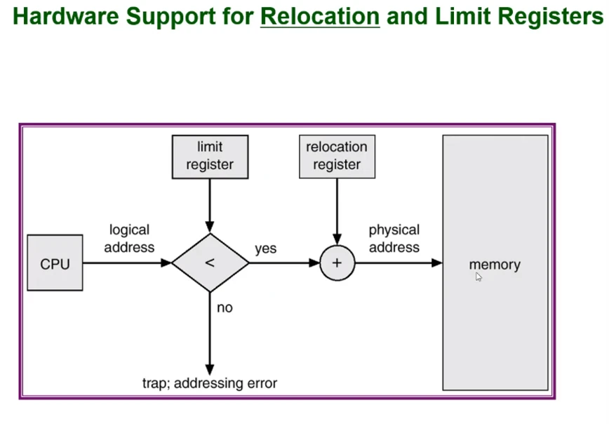
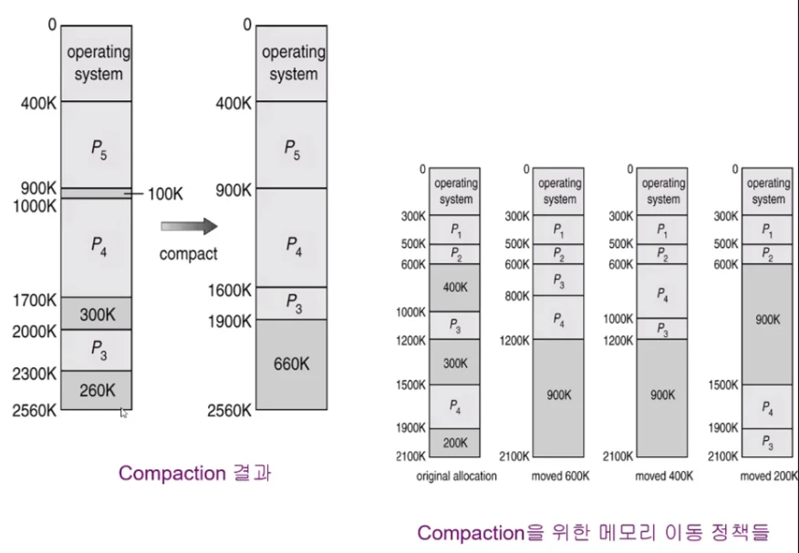

# 12주차: Contiguous Allocation

## Contiguous Allocation (인접할당)

메모리를 인접해서 할당시키는 것으로 보인다. 인접하다와 연속적이다는 의미는 실제로는 다르지만, 인접하다는 것은 연속적인 것이라고 생각할 수 있다.

- 메모리의 관점

    - 운영체제가 사용하는 것
    - 운영체제가 할당한 Application Program

메모리에 할당된 Application Program이 운영체제의 메모리 공간을 건드리면 안된다. (침범 불가능) 그런데 침범하게 두는 경우가 있다. 운영체제도 S/W이기 때문에 취약점이 존재한다. kernel의 super user 권한을 도난당하는 등의 문제가 발생할 수도 있고, 그렇게 되면 Application의 권한이 운영체제와 같아져서 Application에서 H/W를 사용하게 될 수도 있다.

그래서 **사용자 프로세스는 운영체제의 메모리 영역을 Handling 하거나 침범**하면 안된다. 그러므로 사용자 메모리를 할당해 주면, 정해진 메모리 Boundary 안에만 존재할 수 있게 만들어보자. 그래서 Contiguous(인접, 연속적)이라고 표현한다.

- Base and Limit Registers

    - Base : 어디서부터 시작한다.
    - Limit : 어디를 넘지 못한다.

    ⇒ 이를 통해 제한 구역을 설정할 수 있다. 대부분 이런 역할을 수행할 수 있는 Register가 존재한다. (Assembly에서 Code Segment를 지정하고, Offset을 정해주는 방식처럼…)

    ⇒ OS는 이런 기능을 이용해 Application이 해당 부분을 넘어서지 못하게 만든다.

- Base보다 크고, Base+Limit보다 작은 범위에 들어있는가를 검사하는 것으로 보인다.
- ex) 100번지를 읽는다면, 100번지를 읽는게 타당한가?를 먼저 검사한다는 뜻으로 보인다.
- 주소를 만들어 내는 과정이 relocation register

- 하나의 프로세스는 앞과 같이 연속적이지만, 여러 프로세스는 분할된다.

    - 즉, 하나의 프로세스의 다음 공간에 바로 다른 프로세스가 올 필요는 없다는 것이다.
    - 다른데 있을 수 있다. (그래서 문제가 발생할 수도 있다.)

ㅡㅡㅡㅡ

OS

ㅡㅡㅡㅡ

process5

ㅡㅡㅡㅡ

process8

ㅡㅡㅡㅡ

process2

ㅡㅡㅡㅡ

이렇게 할당되어 있을 때, 8이 끝난다면 다른 프로세스를 할당해야 하기 때문에 8번의 메모리를 쓸 수 있게 해줘야 된다. 그런데, 모두 0으로 바꿔주면 그 바꾸는 시간도 오래걸리기 때문에 비효율적이다. 그냥 나중에 덮어 씌우면 된다. 

Hole : 어떤 프로세스의 동작이 끝났을 때 그 프로세스의 시작점과 끝점의 위치를 Hole이라고 한다. 운영체제는 이를 관리해서 새로운 프로세스의 할당이 가능하도록 해야 한다.

ㅡㅡㅡㅡ

OS

ㅡㅡㅡㅡ

process5

ㅡㅡㅡㅡ

Hole

ㅡㅡㅡㅡ

process2

ㅡㅡㅡㅡ

메모리 크기가 작아지면 관리가 복잡해지고, 커지면 낭비가 심해진다. 메모리 크기가 고정이면 낭비가 심하고, 가변이면 생각할게 많아진다.

Fit? : Hole의 크기에 맞춘다. n 개의 Hole이 있다고 할 때, n 개 중에서 새로운 프로세스를 어디에 넣는 것이 좋을까?

- First-Fit : Process를 담을 수 있는 첫 번째 Hole에다가 Process를 할당하는 것.

- Best-Fit : Best한 Hole을 찾는 것. 예를 들어 100KB라고 한다면, 가장 근접한 Hole에 할당하는 것.

    - 쪼개지는 걸 막는 것으로 보인다.
    - 항상 비교를 해야하기 때문에 굉장히 어려운 방법이다. 

- Worst-Fit : 크기가 가장 큰 Hole을 할당하는 것.

대부분의 경우 성능은 Best-Fit &gt; First-Fit &gt; Worst-Fit 이 되지만, 모든 경우에 그렇지는 않다. 성능이 모두 똑같다면 First-Fit이 가장 좋다.

남아있는 Hole은 크게 유지하는 것이 좋다. 왜냐면, 다양한 프로세스를 할당할 수 있기 때문이다. ⇒ 그래서 Worst-Fit이 그렇게 좋지는 않다.

OS

ㅡㅡㅡㅡ

process5

ㅡㅡㅡㅡ

process9

ㅡㅡㅡㅡ

ㅡㅡㅡㅡ

process2

OS

ㅡㅡㅡㅡ

process5

ㅡㅡㅡㅡ

process9

ㅡㅡㅡㅡ

process10

ㅡㅡㅡㅡ

ㅡㅡㅡㅡ

process2

⇒ 계속해서 할당되다보면 Hole이 곳곳에 작은 크기로 떨어지게 되면서, 전체 합친 공간은 충분하지만 각각의 Hole 크기가 작아서 프로세스를 할당하기 힘든 경우를 말한다. 이를 **Fragmentation** 이라고 한다. 하드디스크도 이와 마찬가지라서, 계속해서 사용하다보면 디스크가 작은 크기의 Hole이 여러 곳에 생기게 돼서, 효율이 떨어지게 된다. 그래서 하드디스크 기능에는 ‘단편 제거’ 라는 것이 있다.

- Worst-Fit이 꼭 나쁜 것만은 아니다.

ex) memory가 2160K

ㅡㅡㅡㅡ 0

OS

ㅡㅡㅡㅡ 400k

2160k

ㅡㅡㅡㅡ

P1 600k 10

P2 1000k 5

P3 300k 20

P4 700k 8

P5 500k 15

|  |  |  |  |  |
|---|---|---|---|---|
| ㅡㅡㅡㅡ 0 OS(400k) ㅡㅡㅡㅡ P1(600k) ㅡㅡㅡㅡ &nbsp; P2(1000k) &nbsp; ㅡㅡㅡㅡ P3(300k) ㅡㅡㅡㅡ (260k) ㅡㅡㅡㅡ | ㅡㅡㅡㅡ 0 OS(400k) ㅡㅡㅡㅡ P1(600k) ㅡㅡㅡㅡ (1000k) ㅡㅡㅡㅡ P3(300k) ㅡㅡㅡㅡ (260k) ㅡㅡㅡㅡ | ㅡㅡㅡㅡ 0 OS(400k) ㅡㅡㅡㅡ P1(600k) ㅡㅡㅡㅡ P4(700k) ㅡㅡㅡㅡ (300k) ㅡㅡㅡㅡ P3(300k) ㅡㅡㅡㅡ (260k) ㅡㅡㅡㅡ | ㅡㅡㅡㅡ 0 OS(400k) ㅡㅡㅡㅡ (600k) ㅡㅡㅡㅡ P4(700k) ㅡㅡㅡㅡ (300k) ㅡㅡㅡㅡ P3(300k) ㅡㅡㅡㅡ (260k) ㅡㅡㅡㅡ | ㅡㅡㅡㅡ 0 OS(400k) ㅡㅡㅡㅡ P5(500k) ㅡㅡㅡㅡ (100k) ㅡㅡㅡㅡ P4(700k) ㅡㅡㅡㅡ (300k) ㅡㅡㅡㅡ P3(300k) ㅡㅡㅡㅡ (260k) ㅡㅡㅡㅡ |

1) 에서 새롭게 들어올 프로세스 P4가 700k라면, 바로 들어가지는 못한다.

2) P2 (1000k)가 종료되고, 1000k 크기의 Hole이 생겨난다.

3) 이제 이 자리에 다음 프로세스인 P4 (700k)가 할당되어 실행된다.

4) 이후에 P1 (600k)가 종료되고, 600k 크기의 Hole이 생겨난다.

5) 그 다음 프로세스인 P5 (500k)가 첫 번째 Hole에 할당되어 실행된다.

- if) 3)에서 100짜리를 할당한다면, First-Fit은 위로, Worst-Fit은 위로, Best-Fit은 아래로 간다.

3) 상태에서, 100, 100, 200, 160 프로세스가 순서대로 네 개가 생성된다면, 할당을 어떻게 하는 것이 좋은가?

- First-Fit

a) 200 (-100)

a) 100 (-100)

b) 60 (-200)

160은 할당 불가.

- Worst-Fit

Worst-Fit으로 하면,

a) 200 (-100)

b) 160 (-100)

a) 0 (-200)

b) 0 (-160)

모두 딱 맞춰서 할당 가능

- Best-Fit

b) 160 (-100)

b) 60 (-100)

a) 100 (-200)

160은 할당 불가

⇒ Worst가 더 좋은 경우가 존재함.

- Fragmentation

프로세스를 수행하다 보니, 1 Byte로 읽고 쓰는게 아니라고 한다면 Fragmentation은 반드시 생긴다. 메인 메모리는 Block으로 나눠서 (Base, Limit 등으로) 관리하기 때문에, Fragmentation이 발생할 수밖에 없다. (1 Byte로 관리하면 효율이 매우 떨어짐)

- Fragmentation의 종류

    - Internal Fragmentation : 블록을 만드는 것 그 자체 때문에 문제가 발생하는 것. 자신보다 큰 Hole에 Process를 할당했을 때, 어쩔 수 없이 그 남은 공간만큼 사용하지 못하게 되는 곳이 발생하게 된다. 이것은 할당하는 크기를 줄이면 감소시킬 수 있지만, 너무 줄이면 오히려 효율이 떨어지기 때문에, 결국 이것은 어쩔 수 없는 것이다. 그러므로 External Fragmentation에 집중해야 한다.
    - External Fragmentation : 메모리가 충분히 있기는 하지만, Hole이 서로 떨어져 있어서 할당할 수가 없는 경우. 서로 떨어져 있는 Fragmentation을 모아서 하나의 Hole로 만들어서 해결할 수 있다. 이를 <strong>압축(Compaction)</strong>이라고 한다.

ㅡㅡㅡㅡ 0

 OS(400k)

ㅡㅡㅡㅡ 

P5(500k)

ㅡㅡㅡㅡ

  (100k)

ㅡㅡㅡㅡ

P4(700k)

ㅡㅡㅡㅡ

  (300k)

ㅡㅡㅡㅡ

P3(300k)

ㅡㅡㅡㅡ

  (260k)

ㅡㅡㅡㅡ

이 상황에서 Hole은 100k, 300k, 260k가 있고, 총합은 660k이다. 지금은 세 개로 나뉘어져 있기 때문에, 660k보다 작은데, 각 홀보다 큰 프로세스가 들어온다면 할당이 불가능해진다. 이럴 때는 여유있는 홀이 생길 때까지 대기해야 하지만, 100k, 300k, 260k를 합쳐서 660k로 만든다면 400k 정도의 프로세스도 들어갈 수 있을 것이다.

그렇다면, 남은 공간을 어떻게 만들 것인가? 즉, 어떻게 세 개의 홀을 합칠 것인가? 사실, 아래에서 위로 쭉 밀어올리면 문제는 없지만, 이걸 S/W로 처리해야 하기 때문에, 총 1000k의 데이터를 복사해서 위로 올려주어야만 한다.이것은 모두 I/O이다. 이걸 할려면 버스를 계속해서 차지하게 되므로, CPU가 다른 연산을 수행하지 못하게 된다. 그러므로 매우 비효율적인 작업이다.

- 방법

    - 아래부터 위로 쭉 올리기 (전체 데이터 모두 복사 필요, 600k)
    - 아래에서 옮길 수 있는 만큼만 옮겨주기 (400k)
    - 위에서 아래로 내릴 수 있는 만큼만 내려주기 (Hole이 중간에 생겨버리지만, 컴퓨터 입장에서는 큰 문제가 발생하지는 않는다. 200k)

 ⇒ 그런데, 이 작업들은 아이디어는 매우 좋으나, 결국에는 운영체제가 작업을 모두 처리해 주어야 하기 때문에, 배보다 배꼽이 더 커진다.

그래서, 이 방법을 배제할 수 있는 방법을 찾아보고자 했고, 지금 이 사건의 근본적인 원인인 Contiguous를 없애고 다른 개념인 **Paging**을 도입한다.

- Paging : Memory Block 단위를 좀 더 효율적으로 만드는 것. 앞에서 부정했던 것을 가져와보자. 모든 프로세스가 연속적으로 있지는 않지만, 유저와 프로세스, CPU가 생각하는 입장에서는 연속적으로 있다고 Hallucination을 시켜보자.

    - Physical Address는 연속적이지 않을 수도 있다. (Logical Memory는 CPU가 계산하는 메모리. 그걸 계산하는 툴을 지나서 실제 메모리가 나오는데, 실제 RAM에 저장되어 있는 순서가 Physical Memory.)
    - 이제부터는 CPU가 100번지를 달라고 한다고 해서, 그게 실제로 RAM에 있는 메모리 번지가 100이 아니고, 예를 들면 1700번지일 수 있다는 것이다. 이걸 가능하게 하는 것이 Paging이다.

|  |  |  |
|---|---|---|
| ㅡㅡㅡㅡ 0 page 0 ㅡㅡㅡㅡ 1 page 1 ㅡㅡㅡㅡ 2 page 2 ㅡㅡㅡㅡ 3 page 3 ㅡㅡㅡㅡ 4 | 0 [1] &nbsp; 1 [4] &nbsp; 2 [3] &nbsp; 3 [7] | ㅡㅡㅡㅡ 0 ㅡㅡㅡㅡ 1 page 0 ㅡㅡㅡㅡ 2 ㅡㅡㅡㅡ 3 page 1 ㅡㅡㅡㅡ 4 page 2 ㅡㅡㅡㅡ 5 ㅡㅡㅡㅡ 6 ㅡㅡㅡㅡ 7 page 3 ㅡㅡㅡㅡ 8 |

이전에는 프로세스를 연속적으로 할당하기 위해 Hole의 위치를 바꾸고, 그런걸 했었다. 그런데 Paging을 도입하면 Logical Memory 상에서는 Contiguous라고 생각하게 되지만, 실제 Physical Memory에서는 그렇지 않을 수 있다. 이를 도입하면, 프로세스를 수행하기 위해 억지로 Hole을 맞추는 Compaction을 안해도 된다.
