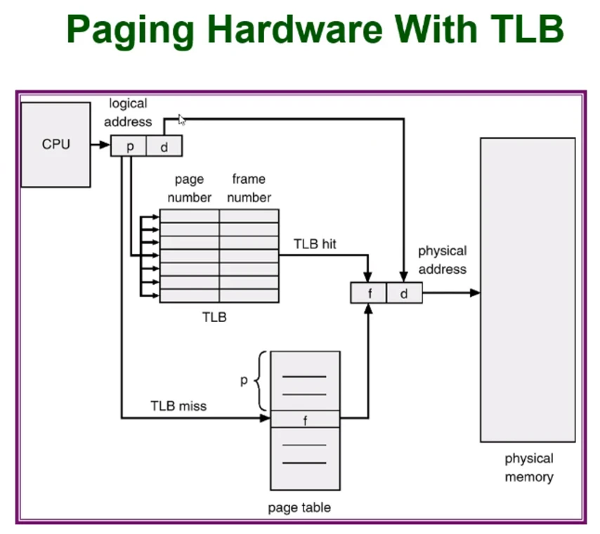
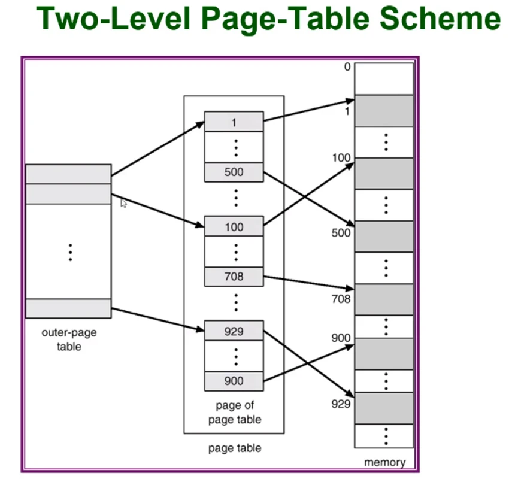
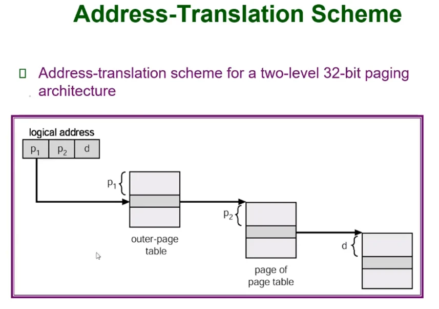
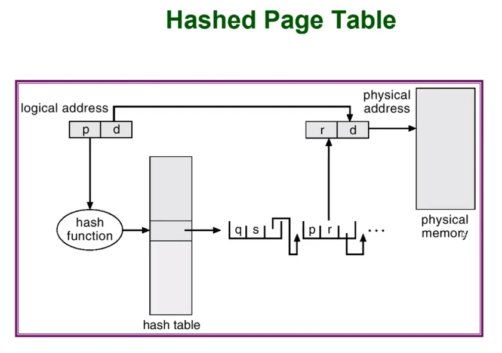
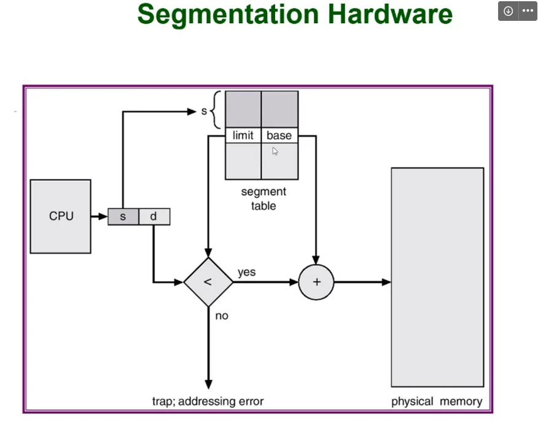

# 14주차: Page Table, Segmentation, Virtual Memory

작성일 2023-06-05 · 최종 수정일 2023-06-06
{ .post-date }

## Page

Page와 Frame이라는 논리/물리 메모리를 연결해주기 위해서 Table을 사용하고, 이를 Page Table 이라고 한다. (사용자가 쓰려고 하는 메모리를 실제 Frame으로 바꿔주는 역할. 그렇게 하기 위해서 보통 두 개의 H/W register를 사용하게 된다.

- 페이지 테이블 기준 레지스터(Page-Table Base Register, PTBR)
- 페이지 테이블 길이 레지스터(Page-Table Length Register, PTLR)

- 이 방식의 문제점 : 메모리 접근 횟수 증가로 인해 액세싱 속도의 저하

    - 기억장치의 접근 시간(i 번지에 있는 정보를 접근하기 위해서 두 번의 기억장치 접근이 필요하게 된다. 즉, 페이지 테이블을 위해 한 번, 그 메모리 자체를 위해 한 번)이 두 배로 느려짐.
    - 그리고 이 동안, 버스를 차지하기 때문에 다른 처리도 불가능해진다.

- 따라서 이걸 빠르게 해결하기 위해서 캐시를 도입한다. (TLB)

    

    - page number/frame number가 매칭되는 Table을 캐시로 만들어서 모아둔다.

    - 최상의 경우, page table을 읽지 않고 TLB를 통해 데이터를 바로 읽을 수 있게 된다.

        - 그러면 거기서 계산해서 메인 메모리를 바로 읽으면 된다.

    - 최악의 경우, 캐시를 읽었으나 TLB에 데이터가 없어서 Page Table을 읽게 되고, 이를 통해 메인 메모리에서 데이터를 읽게 된다.

> 그런데, TLB에 원하는 데이터가 있어서 TLB hit가 될 확률이 그렇게 높지는 않을 것이다… 확률을 높이려면 TLB의 크기를 늘려야 할 것이다.  
>   
> 그리고 이 확률을 이용하면 아래와 같이 계산이 가능하다.

- Effective Access Time (EAT)

Hit ratio : a (있을 확률)

Memory cycle time : m (memory를 읽는 시간)

Associative Lookup = 입실론 E (cache를 읽는 시간)

EAT = (m + E)a + (m*2 + E)(1-a) [논리적 수식]

---

- 그리고, 중간에 테이블을 한 번 거치고 메모리를 액세스하게 되므로 무언가 계산이 잘못된다면 메모리 블럭 전체가 잘못 될 수도 있다. 따라서, 최소한의 Protection을 도입한다.

    - Protection Bit : Page Table에 하나의 bit를 추가한다. (valid : v, invalid : i)
    - 즉, v가 있다면 읽어도 되는 값이고, i가 있다면 쓰레기 값이므로 읽으면 안된다는 뜻.
    - Protection을 위해서, 먼저 v-i bit를 읽어주고 유효성을 판단해준다.

---

32비트 컴퓨터를 쓴다면 메모리에 최대 4GB까지 접근이 가능하고, 64비트 컴퓨터를 쓴다면 거의 무한대로 쓸 수 있다. 그런데, 64비트를 쓴다면 Memory가 커지는 만큼, Page Table도 매우 커지게 된다.

- Hierarchical Paging(계층구조 페이징)
- Hashed Page Tables(Hashing 페이지 테이블)
- Inverted Page Tables
- Shared Page Tables

---

## Hierarchical Paging(계층구조 페이징)

Table의 레벨을 나누어 본다. 레벨은 관리만 가능하다면 계속 커져도 되지만, (depth를 늘림) 여기서는 2레벨로 설정한다.

만약 32bit machine을 다룰때, 2레벨로 나누면 (page number) 10 | 10 | 12 (page offset) 로 나누어진다. → 그냥 이렇게 만들어짐.

그런데, 왜 10 | 10 | 12 인가? 한 페이지 크기를 12bit에 할당한다. 

원래 CPU가 outer page table (2^10)을 거치고, 그 다음에 page table (2^10)을 거치고, 그 다음에 실제 메모리에 접근하도록 한다는 것이다.

32bit : 메모리 버스의 크기가 4 Byte, 명령어의 크기가 4 Byte라는 뜻. 

어떤 페이지 프레임에 데이터가 있는데, 그 데이터를 4 Byte 단위로 처리한다. 2^12만큼 세로로 나열하고, 32bit 컴퓨터는 옆으로(가로로) 네 바이트를 읽으니까, 2^10의 크기로 줄어든다. 그러므로 전체 개수는 2^12지만, 4Byte씩 읽으니까 실제 크기는 2^10이라고 생각하는게 좋다.

⇒ 그러므로 크기가 모두 딱딱 떨어지게 된다. (Two level에서는)

단계는 많아질 수 있고, 숫자는 달라질 수 있다. Logical Address → Outer Page Table → Page Table → Main Memory를 따라가면서 계층적으로 들어가게 된다.

- 이후에는 Multi-level로 적용할 수 있다. 

    - 이상적인 경우 : Logical Address와 Outer Page Table 사이에 있는 TLB의 TLB hit 98%

    - 4단계이고, 캐시는 20ns, 메모리는 100ns 이다.

        - 0.98 \* 120 + 0.02 \* 520 (캐시 접근 + 네 번의 Table 접근, 마지막 메모리 접근)

            = 128 ns

    - 주소 예측을 잘하면 속도가 나쁘지 않다. hit ratio가 높을수록 EAT가 빨라지므로, 프로그램을 만들 때 하드웨어를 잘 이해하고 만드는 것이 매우 중요하다.

---

## Hashed Page Tables(Hashing 페이지 테이블)

해싱을 할 때는 collision이 발생할 수 있다.

- p | d → r | d

    - logical address → physical address
    - 이 과정을 그냥 table로 적용하는게 아니라, hash function을 넣고 hash table을 적용한다.
    - 그런데, collision이 발생할 수 있으므로 그러면 linked list로 연결하자.

    ⇒ 이렇게 하면 hash table의 관리가 편해진다. 크기를 줄일 수 있으면서도, Random Search가 가능해진다. Hash의 장점을 그대로 가질 수 있고, Hash Function은 어렵게 만들지는 않아도 되기 때문에 쉽게 구현도 가능하다.

---

## Segmentation

메모리의 덩어리를 의미한다. 그 안에서 offset을 적용해서 메모리를 access 하게 된다.

code 영역, text 영역, data 영역, heap 영역, stack 영역 등… 다양한 메모리 영역이 존재할 수 있는데 이것들이 실제로는 메모리 상에 연속적으로 할당되어 있을 것이다. 이것을 잘 관리해보자.

- Segment를 구분해주는 위치를 가지고 있고, 각 Segment마다 길이가 다를 수 있기 때문에 어떤 Segment의 시작위치와 Length를 구분해주는 Table이 있다면 Segment를 관리하기가 어렵지 않을 것이다.
- segmentation H/W

CPU → s/d(offset) → segment table에서 base(어디서부터) limit(얼만큼)을 가져온다. 그걸 가져와서, 현재 offset(d)가 base+limit 사이에 있어야 하므로 이것이 limit보다 작은지 체크해야 한다.

체크 후, limit을 넘지 않는다면 base + d를 쓰면 된다. 현재 실제 컴퓨터에서는 이와 같이 쓰지 않지만, 임베디드시스템과 같은 간단한 컴퓨터는 여전히 이 방식을 쓴다. 다만 지금은 메모리가 너무 커져서 페이지와 같은 개념을 적용하게 된다.

- 장점

    - 주소를 계산하는 법은 base + limit(d) 이걸 통해 주소를 얻어낸다. (Page와는 다름)
    - 이 테이블만 잘 관리하면, 메모리를 손쉽게 관리할 수 있다.
    - 메모리 관리가 손쉽게 된다는 것이 매우 큰 장점이다.
    - 공유가 될 수 있다.
    - 예를 들어 메모장을 여러 개 썼다면, 내용은 다르겠지만 프로그램은 같을 것이다. 이때 여러 개의 프로그램을 올려줘야 하는 것일까? 그렇지 않다. 변하지 않는 것은 공유해서 끄고 변하는 것만 새롭게 만들면 된다.
    - 예를 들어 동일한 프로그램이 P1, P2라는 프로세스로 열렸다고 해보자. 이때 Logical Memory는 P1(segment0[editor], segment1[data1]) P2(segment0[editor], segment1[data2])이와 같이 만들어서 실제 editor segment는 같은 segment table을 사용하도록 매치해서 공유해서 사용할 수 있게 된다.

---

- 메모리 관리 방법 두 가지

    - Page

        - 논리 메모리와 물리 메모리는 일대일관계이다. 1GB, 128GB의 RAM을 쓰는 두 개의 컴퓨터가 있다면, 128GB 이상의 프로그램이 둘다 돌아가기는 한다. 그러면 우리는 여기서 두 가지 의문을 가져야 한다.

            - 왜 돌아갈까? 1GB 뿐인데…
            - 왜 속도가 느릴까? 1GB 짜리는 굉장히 느리다.
            - 1GB 짜리는 부족한 127GB의 메모리 크기를 HDD, SSD(Secondary Storage)에서 빌려준다. 그러므로 Storage에 올려놓고, 1GB만 올려놓고 처리하다가 처리할 것이 바뀌면 메인 메모리에서 올려준다. (그러므로 속도가 매우 차이난다.)

    - Segmentation

---

## Virtual Memory(가상 메모리)

그림이 하나 추가된다. 기존의 Virtual Memory(유저가 사용하는 영역)는 매우 길어질 수 있다. 그러나, 실제 물리 메모리는 그렇게 길어지지 못한다. 이를 극복하기 위해 Page 개념을 유지한 채, 확장시켜보자.

Virtual Memory → Memory Map(Table) →  여기까지 읽어봤는데, 페이지에 매칭되는 내용이 Physical Memory에 없을 수도 있다. 이때, storage에서 그 데이터를 Frame에 재빠르게 복사해서 올려준다.

⇒ Storage(backing store)와 Memory의 액세스 속도 차이가 있기 때문에 속도 차이가 발생할 것이다. 이런 방식을 적용하면, 사용자의 Virtual Memory에서 표현 가능한 모든 길이가 Storage를 통해 표현이 가능해진다.  

그러면 어떠한 기준 하에서, 자주 쓰는것은 Memory에 두고, 자주 안쓰는 것은 Backing Store(Storage)에 둬서 보관할 수 있을 것이다.

- 만약, Logical Memory에서 Table을 탐색했는데 Table 내에 매칭되는 데이터가 없다면, PC는 그것을 알아야 한다. Storage에서 데이터를 가져와야 하기 때문. 근데 그러면 가져오는 동안 CPU는 기달려야 한다. 우리가 Storage에서 데이터를 읽고 가져오는 과정은 결국 I/O 작업이기 때문에 interrupt를 동작해서 CPU가 다른 일을 처리하도록 하고, 데이터를 가져오면 다시 interrupt를 보내서 CPU가 일을 처리할 수 있도록 한다. (Swapping, Swap-in, Swap-out과 같다. 다만, 여기는 프로세스에 관계 없이 페이지 단위로 동작하는 것이라는 차이가 있다.)
- 이를 `Demand Paging` 이라고 한다.

- `Page Fault` : 읽으려고 하는 Page가 Main Memory에 Frame으로 존재하지 않을때, interrupt(Trap)을 발생시켜주어야 한다. 이를 Page Fault 라고 한다.

    - 우선, 요청된 주소가 정말 맞는지 검사를 해본다. → 만약 없다면, abort
    - Just not in memory → 그러면 Storage에 들어 있으므로 처리함.
    - 그러면 Hole, Free Frame을 가져온 프레임 데이터를 찾아서 집어넣어준다.
    - 그런데, CPU 입장에서 생각해보자. 예컨대 100번지를 읽으라는 명령이 수행됐을 때, Page Fault가 발생해서 못읽었다고 해보자. 그러면 이때 Trap이 발생하는데, 명령 하나는 원자적이라서 뜯어질 수가 없다. (100번지에서 읽어서 어디다가 넣어라. 이게 뜯어질 수는 없음. 그러므로 실제로 인터럽트가 걸릴 수는 없음. 즉, 하나의 명령어는 인터럽트로 뜯어질 수는 없다.)
    - 중간에 인터럽트는 발생할 수 없기 때문에, 데이터를 한번 가져오고 나면 이후에 `re-start`를 해서 중단됐던 명령을 다시 시작해준다.
