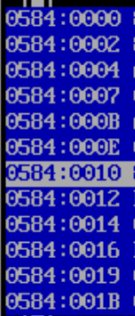
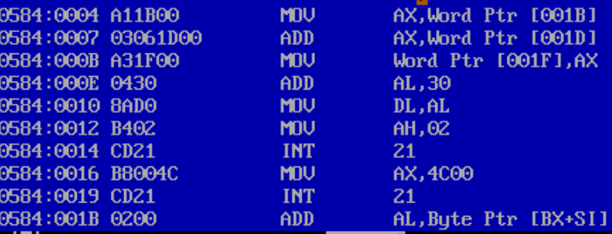

# 9주차 (Assembly)

작성일 2023-05-01 · 최종 수정일 2023-06-05
{ .post-date }

- 어셈블리를 통해서 인터럽트(시스템 콜)에 대한 동작을 살펴본다.

---

코드작성 - 구조이해 - 코드리뷰 - 실행 - 디버깅 - 디버거 구조 설명 - 코드수정

```nasm
MAIN SEGMENT ; 메모리 관리를 세그먼트처럼 한다.
; 여러가지 메모리 관리 방법 중, 세그먼트는 하나의 방법이다.
	ASSUME CS:MAIN, DS:MAIN ; PSEUDO CODE
	; 이 프로그램에는 데이터와 코드가 같이 들어있기 때문에
	; 어떤 방식으로 프로그램을 돌릴지 설정해 주는 것이다.
	; CS(프로그램 영역) DS(데이터 영역)
	; 즉, 두 개의 영역이 같은 세그먼트인 MAIN을 쓰도록 요청하는 것이다.
	; 코드는 코드 세그먼트에, 데이터는 다른 세그먼트에 넣을 수도 있다.
	; 우리는 폰노이만 방식을 쓰기 때문에 구분이 안되므로
	; 해당 방식을 사용하는 것으로 보인다.

	; 위의 ASSUME 요청을 하기 위해 필요한 부분
	; REGISTER란? CPU 내에 존재하는 메모리로, 가장 빠르고 고속인 메모리
	; 인텔 계통의 CPU는 그 안에 레지스터 이름이 있고,
	; ARM 같은 경우도 레지스터 이름이 있다.
	; 그러지 않고 레지스터를 외부 메모리에 매핑 시켜서 어떤 특정 번지에
	; 매핑시켜 레지스터를 쓸 수도 있기는 하다.
	; 우리가 쓰는 구조는 이름이 정해져있으며, AX, CS, DS 등이 있는 것.
	MOV AX, CS ; PSEUDO CODE 
	MOV DS, AX ; PSEUDO CODE
	; CS는 컴퓨터가 자동으로 읽고, DS는 내가 수동으로 세팅을 해줘야 함.
	; 따라서 CS, DS가 같은 세그먼트를 쓴다고 얘기해주는 것.

	; MOV는 복사하는 것. 즉, copy이지만 명령어는 MOV이다.
	; ADD는 더하는 것. 
	; 연산의 방향은 <- 이며, OPERATE, OPERAND로 나눠진다.
	MOV AX, A ; 따라서 MOV AX, A는 A에서 AX로 COPY하는 것.
	; 즉, 옮기더라도 A의 값은 변하지 않고 AX만 변하게 된다.
	; 첫 번째 자리에 나올 수 있는 OPERAND와 두 번째 자리에 나올 수 있는
	; 그런 OPERAND 쌍이 정해져있다. 매칭이 될 수 있는 것은 POSITIVE 방식
	; 메모리 A의 값을 AX에 복사한다. => 결과적으로 AX는 2가 됨. (A == 2)
	ADD AX, B ; ADD AX, B는 B의 값을 AX에 더하는 것이다.
	; 여기까지 왔다면 AX는 7이 되고,
	; SUM은 7이 된다.
	MOV SUM, AX

	; AL은 2 byte인 AX에서 하위인 AL을 쓴다는 의미.
	ADD AL, '0' ; AL은 AX의 하위 바이트. 기존에 값이 들어있음.
	; 이전에 넣었던 하위 바이트의 값이 AL이고, 거기에 '0'의 ASCII를 더함.
	; 0에서 AL은 7이니까 결론적으로 문자 7이 출력된다.
	MOV DL, AL
	MOV AH, 2 ; 시스템 콜의 SUB FUNCTION 2번
	INT 21H  ; 시스템 콜 21H
	; 시스템 콜 21H는 DL에 들어있는 값을 ASCII로 취급하여 화면에 출력.
	; DL에 들어있는 값은 AL이고, '0' + 7이 되었으니까 문자 7이 출력될 것.

	; INT는 인터럽트. 시스템 콜을 의미한다.
	; H는 16진수를 의미한다. 에디터에서 쓰는 것은 10진수이고
	; 디버거에서는 16진수를 사용하게 된다. (바꿔보면 33)

	MOV AX, 4C00H
	INT 21H

; DW에서 W는 word이고, 16 bit CPU이기 때문에 2 byte 인 것으로 보인다.
A 	DW 2 ; 아래는 데이터를 설정하는 부분
B 	DW 5 ;
SUM 	DW ? ; 변수를 선언만 하고 값은 할당하지 않는 것.

MAIN ENDS ; 프로그램의 끝에는 반드시 ENDS END가 있어야 함.
	END 
; 이 두 줄은 C언어의 exit()와 같은 말이고,
; END가 수행되어야만 현재 프로세스를 종료하고 제어권을 OS에 넘긴다.
```

- 서로 다른 프로그램의 기계어가 만들어질 수만 있다면 프로그램을 묶을 수 있다.

---

- 디버깅

    - cv /s t1.exe : 8086 레벨에서 실행파일을 디버깅 할 수 있는 작은 프로그램이다. code view

    현재는 IP, AX, DX를 살펴보면 된다. (local과 command는 사용하지 않음.)

    

    - 왼쪽 : 세그먼트 주소
    - 오른쪽 : 오프셋 주소

    ⇒ 이를 통해 유효주소를 만든다. 세그먼트 주소는 바뀌지 않고 오프셋 주소에 의해 주소 차이를 확인할 수 있다.

    즉, 첫 번째 명령의 시작 번지는 0000, 그 다음은 0002이다. 그러므로 첫 번째 명령의 길이가 2바이트라고 생각할 수 있다. 즉 MOV AX, CS를 번역하면 8CC8이 나오게 되고, 이것은 2바이트이기 때문에 0000부터 2바이트가 실행되는 것.

    ⇒ 나눠진 짧은 자료를 보면 어셈블리 명령을 기계어로 바꿀 수 있으며, 반대로 기계어를 어셈블리로 바꿀 수도 있다.

    

    - 세 번째 줄을 보면, 001B 번지의 데이터를 옮기라는 뜻이다.
    - 어셈블리는 코드와 데이터를 구분하지 못한다.
    - 그런데 001B 번지가 맨 밑에 있음. (맨 밑 줄)
    - 인텔은 리틀 엔디안이므로 바이트 순서가 바뀌어서 들어간다. 마지막 줄을 보면, 세그먼트 내에서 코드와 데이터를 구분하지 못하기 때문에 0200이 코드일 것이라고 생각하고 억지로 코드를 만들어낸 것이다. 그게 ADD AL, Byte Ptr [BX+SI]이며, 즉 읽어내면 0002가 있다는 뜻일 것.
    - 네 번째 줄도 비슷하게 동작하게 될 것. 

    - 0584:000E 

        - AL에 ASCII 48을 넣는다. (30H)

    - 나머지는 대부분 똑같은 내용.

    ---

    - 이제 처음부터 수행을 봐보자. 처음에는 IP의 값이 0000이다. 그러므로, 0000부터 수행을 시작한다는 것이다. CS는 0584인데, 이것이 코드 세그먼트 이므로 여기를 기준으로 계산을 하기 시작한다는 것. 그런데 DS는 초기에 0574라고 되어있고, 데이터도 CS와 같은 세그먼트를 사용해야 되기 때문에 이를 맞춰주는 설정을 해야 한다. CS:MAIN, DS:MAIN

    - 한 줄씩 실행하면서 이것이 맞춰지는 것을 확인한다.

        (F10을 누르면 한 줄 실행, 바뀐 것이 밝아진다.)

    - 그러면 IP는 0002가 되고, AX는 0584가 된다. FL도 바뀌는 것으로 보인다.
    - 한 번 더 수행하면 DS가 0584가 될 것이고, IP는 0004가 될 것.
    - 그렇게 되면 DS도 0584가 되어서 이 메모리 세그먼트부터 시작으로 읽게 된다. 폰 노이만 구조에 의해 데이터와 코드를 같은 세그먼트를 기준으로 시작하게 만들어준 것.
    - 그 다음 줄은 001B에 있는 값을 읽어서 그걸 AX에 copy 해준다. 그러면 AX는 0002가 될 것이고, IP는 0007이 될 것이다. (수행해보면 예상한대로 나오게 될 것)
    - 한 번 더 수행하면 AX는 0007, IP는 000B가 된다.
    - 이전에 21H 인터럽트는 DL에 들어있는 값을 출력한다고 했는데, DL은 8비트 짜리고 AX는 16bit이기 때문에 16bit에 8bit를 넣지 못한다. 값이 넘어가면 동작이 되지 않게 될 것. 

    - 출력하는 것의 sub function이 2가 되어야만 하기 때문에…
    - 0037에서 0237이 된다. 인터럽트 21H를 호출하면, 이때 딱 멈추고 시스템 콜이 동작한다. H가 2이고 DL이 7이므로, 화면에 7을 써준다. (F10을 누르고 F4를 누르면 output 확인 가능
    - 그래서 그 뒤에 계속 수행하면 프로그램이 종료됨. 만약 종료를 추가하지 않으면, 프로그램이 끝나는 부분을 찾기 위해서 계속 내려가면서 수행하게 된다. (그래서 악성 프로그램이 있다면 이런 방식으로 해킹당하게 됨)

    - 그런데 만약, ‘0’이 아니고 ‘a’를 넣으면 어떻게 될까? 결과는 거의 비슷하고, ‘h’가 출력될 것이다.

        (추가로, alt를 누르면 메뉴로 이동 가능)

    - 이 프로그램에는 3줄/4줄/2줄의 프로그램으로 이루어진다. 나머지는 기본적인 설정 부분.
