# Assembly-1: 시스템 콜, 명령어 사이클, 8086 레지스터

작성일 2023-05-01 · 최종 수정일 2023-06-05
{ .post-date }

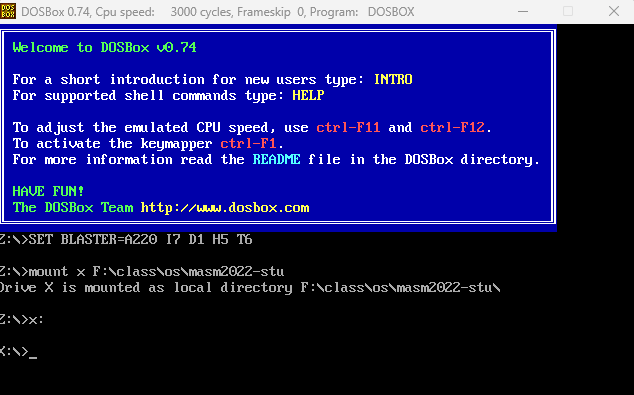

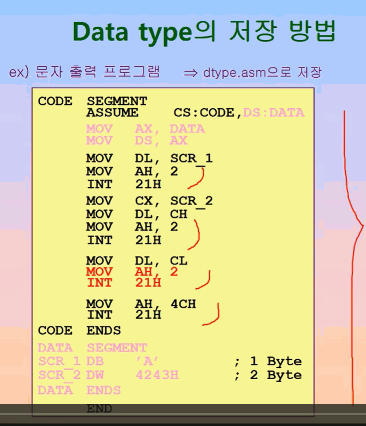

- 빨간줄로 이은 것들이 모두 시스템콜이며, 프로그램에서 시스템 콜이 상당히 자주 사용된다.

- ASCII.asm

    - 어셈블리 코드를 짤 때 직접적인 코드부 빼고는 약간 방식이 다른 두 형식을 사용할 수도 있다.

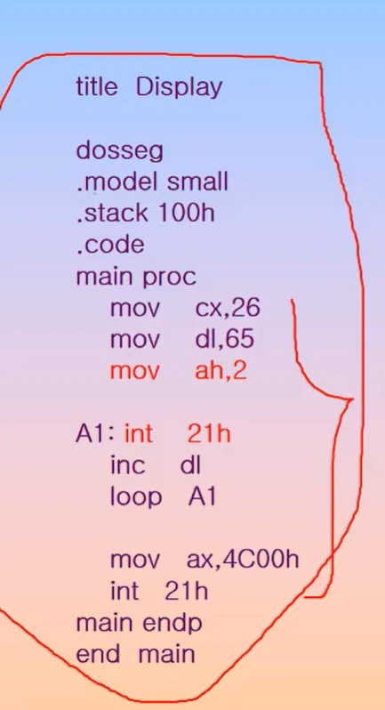

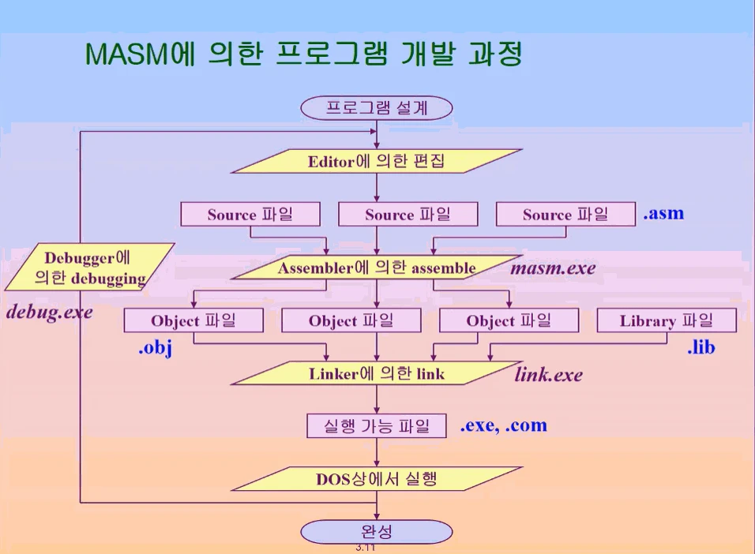

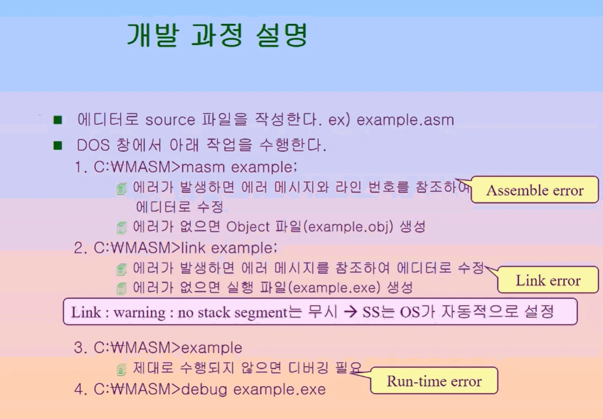

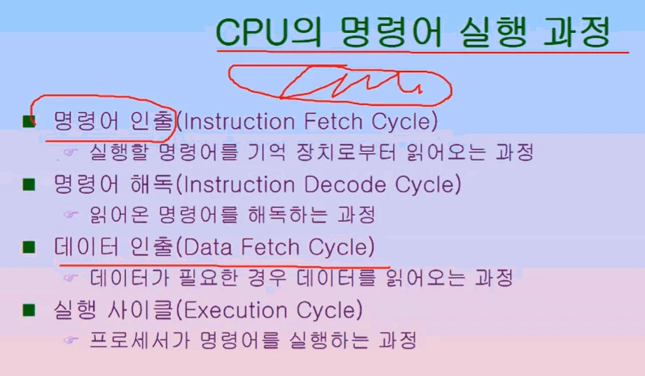

- 명령어 인출 : 실행할 명령어를 기억 장치로부터 읽어오는 과정
- 명령어 해독 : 읽어온 명령어가 어떤 명령어인지, 필요한 것은 무엇인지 확인하는 과정
- 데이터 인출 : 명령어 해독이 끝난 이후에 해당 명령어를 수행하는데 필요한 데이터를 읽어오는 과정(어떤 명령어는 데이터가 필요할 수도 있고 필요하지 않을 수도 있기 때문에, 해독을 한 이후에 가져오는 것이 좋다.)
- 실행 사이클 : 가져온 데이터를 바탕으로 처리하면서 데이터를 다시 저장할 수도 있고 데이터의 값이 변할 수도 있다.

---

- Intel의 가장 기본이 되는 8086 계열 기본 Register를 다루게 된다.
- 8086 계열의 주소 지정 방식

- Register : CPU는 내부에 여러 종류의 Register를 가지고 있다.

    - Data를 저장, 연산 등을 하는 임시 기억 장치
    - 각 register는 자체의 특수한 용도와 제한점이 있다.
    - 장점 : 외부 버스를 사용하지 않기 때문에 Memory(변수)보다 Access 속도가 빠르다.
    - 단점 : 개수가 한정되어 있고, 용도가 제한적이다. (현실적으로 많아질수록 설계가 어렵고, 비용도 높아지기 때문이다.)

- 종류(8086)

    - 범용 register : 8개
    - 세그먼트 register : 4개 (메모리 공간을 나타내기 위한 레지스터)
    - 프로세서 컨트롤 register : 2개

    ⇒ 총 14개 정도의 레지스터를 이용해 프로그램을 동작시키기 때문에 용도가 제한적이고 한정되어 있을 수밖에 없다.

---

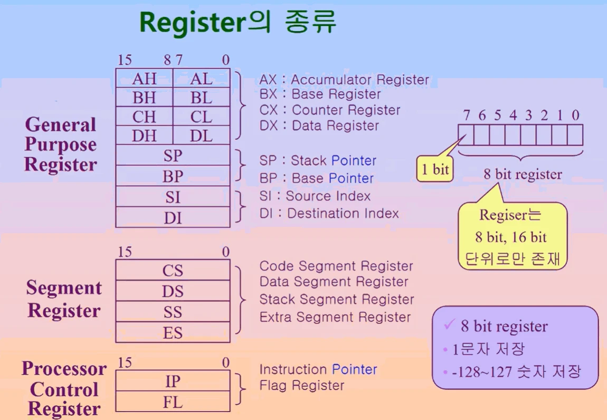

- General Purpose Register

    - 범용적인 Register는 각각 16bit의 크기를 가진다. 이것을 다시 8bit, 1 Byte짜리로 쪼개서 사용해야 할 때가 있을 수도 있기 때문에 반으로 쪼개서 이름을 또 붙이게 된다.
    - 그래서 낮은 바이트를 AL, 높은 바이트를 AH라고 부르게 된다. 다른 범용 레지스터도 마찬가지로 H/L로 나눠지게 된다. (C언어에서 공용체의 사용이라고 보면 된다.)
    - 각각 특별한 용도가 있다.
    - AX : Accumulator Register
    - BX : Base Register
    - CX : Counter Register
    - DX : Data Register

    ---

    - 포인터를 사용하기 위해 필요한 레지스터
    - SP : Stack Pointer
    - BP : Base Pointer
    - SI : Source Index
    - DI : Destination Index

- Segment Register : 주소 공간을 나타내기 위한 레지스터

    - (CS) Code Segment Register : 우리가 만든 프로그램이 들어가는 위치 
    - (DS) Data Segment Register : 따로 쓸 데이터가 들어감. (필요에 따라 Code, Data는 묶어서 사용할 수도 있다.)
    - (SS) Stack Segment Register : 프로그램이 수행되다 보면 필연적으로 데이터를 넣고 빼는 Stack이 사용된다. 그 Stack을 관리하기 위해서 사용된다. 
    - (ES) Extra Segment Register : 혹시 데이터가 더 필요할 경우를 대비하여 Extra Segment Register가 사용된다. Stack이 될 수도 있고 Code 또는 Data가 될 수도 있다.

- Processor Control Register : 특별한 용도의 프로세스를 위한 레지스터.

    - (IP) Instruction Pointer : 어떤 위치의 명령을 수행할 것인가를 가리킨다.
    - (FL) Flag Register : 레지스터의 상태가 변함에 따라, 어떤 이유로 변했는지를 알려주는 플래그를 가진다. 최대 16bit

---

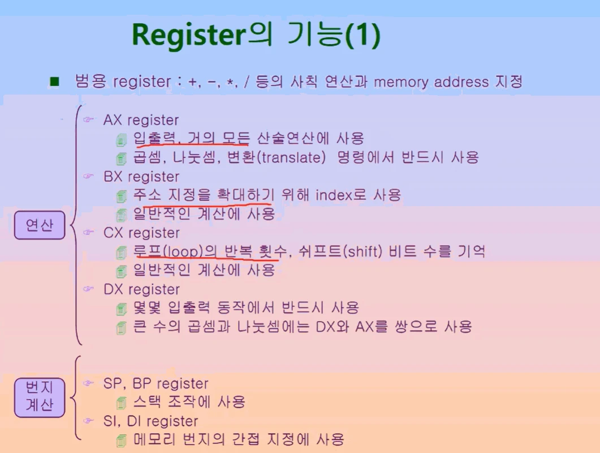

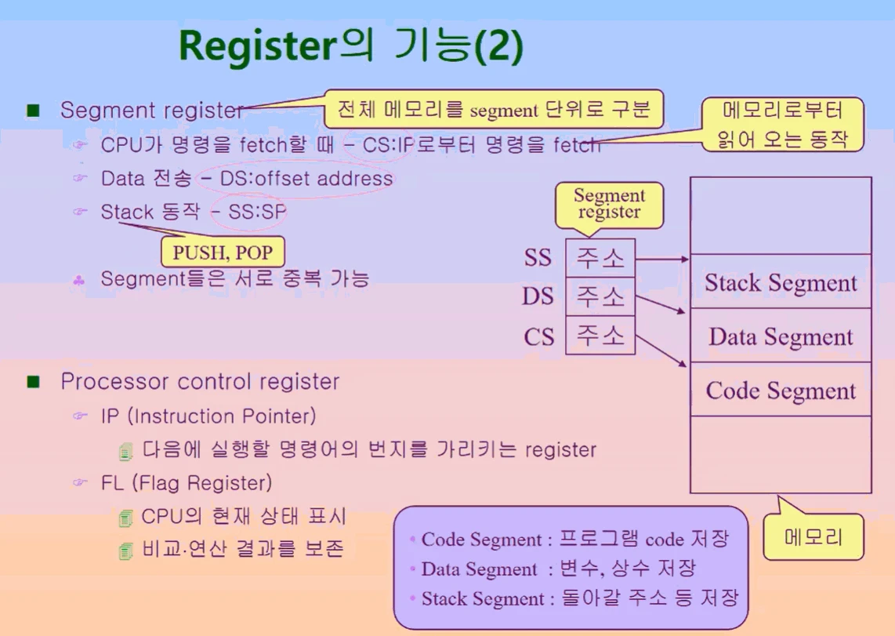

- `Segment Register` : 전체 메모리 공간을 나타낼 때 사용된다.

    - 어떤 공간을 나타내는 `Segment`와 그 다음에 그로부터 얼마나 떨어져있는가를 알려주는 `offset`이 있는데, 명령은 코드 세그먼트(Code Segment)라는 주소 덩어리 시작 주소에서 `IP`(Instruction Pointer)라는 것이 가지고 있는 위치를 실제 주소로 계산한다.

        - CS:IP 

    - Data는 데이터 세그먼트(Data Segment)가 가지고 있는 값에서 offset 값. 즉, 위치, 변위 값을 계산해서 쓰게 된다.

        - DS:offset address

    - Stack 동작은 스택 세그먼트(Stack Segment)가 가지고 있는 값에서 SP(Stack Pointer)가 가지고 있는 값을 통해 계산해서 동작하게 된다.

        - SS:SP

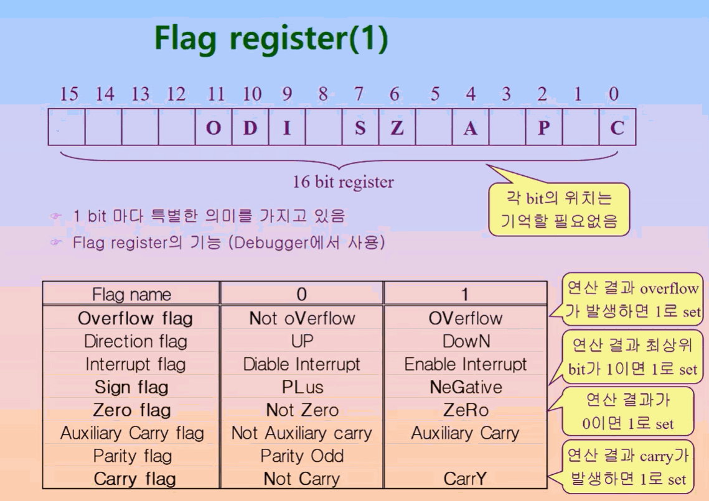

- 16개가 있는데 일반적으로 다 쓰는 것은 아니고, 위치가 정해진 것에 따라 명령어나 내가 필요한 데이터를 체크할 수 있다.

    - 예를 들어, 어떤 연산을 했는데 바이트가 넘어가서 overflow가 생긴다면 CPU가 자동으로 overflow된 위치를 확인하게 된다. 만약 11번 비트가 0이라면 overflow가 생기지 않은 것이고, 1이라면 overflow가 생긴 것이라고 볼 수 있다.
    - 6번 비트의 경우는 어떤 연산의 결과가 1이라면 CPU가 해당 비트를 1로 만들어준다. 모든 연산에 대해서 다 갖는건 아니고, 연산과 명령어에 따라 Zero Flag를 건드리고 건드리지 않는 것이 나뉘어져 있기 때문에 확인이 필요하다.

---

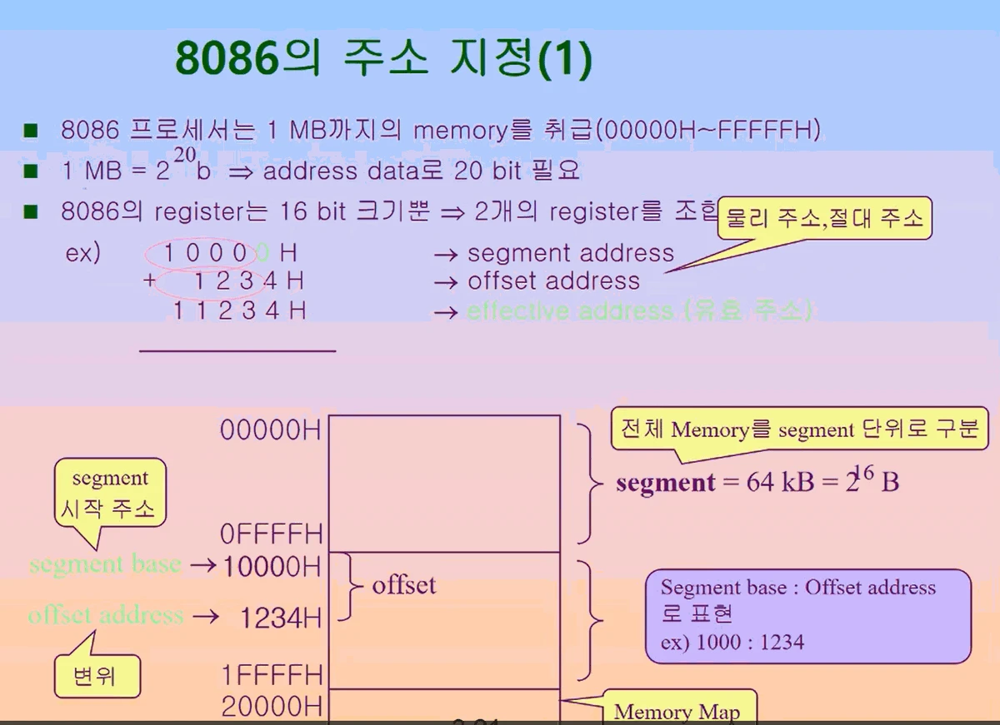

- 8086은 16bit를 이용하는데, 8086 프로세서는 1MB 까지의 memory를 취급하기 때문에 약간의 아이디어가 추가되어야 한다. 
- 16bit 짜리 두 개를 가지고 20bit를 만들게 되는데, 이를 어드레싱 하면 1MB가 된다.

- 하나는 segment, 하나는 offset이라고 해서, segment의 자리를 왼쪽으로 하나 밀어주면 된다. 예컨대, 1000 + 1234를 더한다면 2234가 될 것이다. (16비트로 계산) 하지만 이를 가상의 0이 존재한다고 생각해서 10000 + 1234로 더해서 11234로 만드는 것이다.

    - 이때 첫 번째에 0을 붙이는 것을 segment라고 하고 두 번째에 있는 것을 offset이라고 한다. 두 개를 위와 같은 방식으로 계산하면 20bit를 처리할 수 있는 유효주소가 나오게 된다. (effective address)
