# Assembly-2: Segment와 Offset, 명령어 형식

작성일 2023-05-15 · 최종 수정일 2023-06-05
{ .post-date }

8086 프로세서는 기본적으로 16bit 이지만, (2^16 = 64kB가 나온다. 이게 메모리의 크기) 메인 메모리를 1MB까지 addressing 하도록 설계가 되어 있다. 1MB는 2^20이고, 4bit가 더 많다. 16bit로는 20bit를 addressing 할 수 없기 때문에 추가로 도입한 것이 segment와 offset이라는 개념이었다.

16bit짜리 두 개를 가지고 20bit를 만들어낸다. 그것을 addressing하면 1MB가 된다. 그걸 하기 위해서 어떠한 방법을 사용했냐면, 하나는 segment, 하나는 offset을 이용, 한 자리를 비튼다. (segment addresses를 &lt;&lt; bit shift를 하는 것) 가상으로 다섯 자리라고 생각하면 된다. 이와 같이 계산하면 20bit를 처리할 수 있는 addressing이 계산된다. 그래서 8086 프로세서는 이와 같이 계산한다.

---

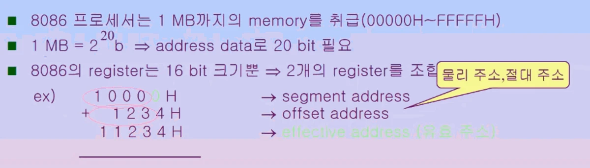

그 중에 Segment를 나타내는 역할을 CS라고 하며, Data의 경우는 DS라고 한다. Code Segment는 0000이나 1000, 이런 방식으로 나타내지만, 실제로는 0이 하나 붙어있기 때문에 만약 0000에서 0001로 늘어났다는 것은 16이 늘어났다고 생각하면 된다. (bit shift 돼서 오른쪽에 bit가 하나 생겨있는 상태이기 때문이다.) 이와 같이 Segment를 비틀어놓고 그 안에 offset으로 위치를 나타낸다.

ex) CS가 1000 offset이 1000이다. 이걸 나타내는 실제 메모리 번지는 몇 번인가? 그리고 그 위치를 나타내는 CS와 offset의 조합은 몇 개나 있을 수 있는가?

⇒ CS 1000과 offset 1000을 더하면 11000이 될 것이다.

ex) CS가 1100이고, offset이 0000이면 위와 마찬가지로 11000이 될 것이다. 즉, CS와 offset의 값이 달라도 같은 물리번지를 가리키게 될 수도 있다.

---

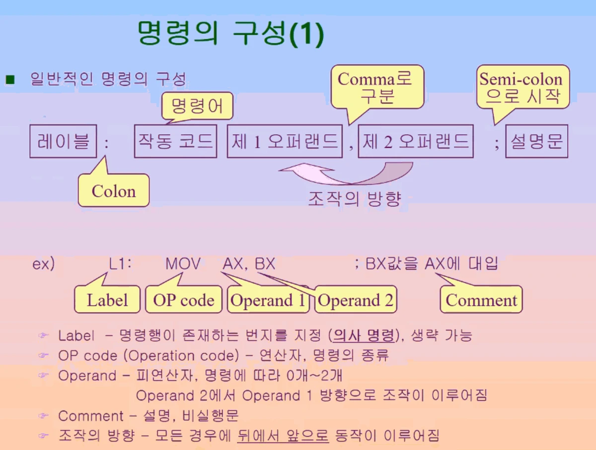

- 일반적인 명령의 구성

레이블: opcode(명령어) 1-operand, 2-operand ; 설명문

인텔 계열 CPU를 사용하는 Assembly에서는 명령어의 해석이 오른쪽에서 왼쪽으로 간다.

operand는 없을 수도 있고, 1~2개일 수도 있다.

ex) L1: MOV AX, BX ; BX값을 AX에 대입

Label : 명령행이 존재하는 번지를 지정 (의사 명령, Pseudo Code), 생략 가능하다.  
⇒ 실제 명령어에 영향을 주지는 않지만, 실제 프로그램이 전체적으로 어느 형식에 맞춰 돌아가도록 해주는 나머지를 코드에 필요하다고 해서 Pseudo Code라고 한다.

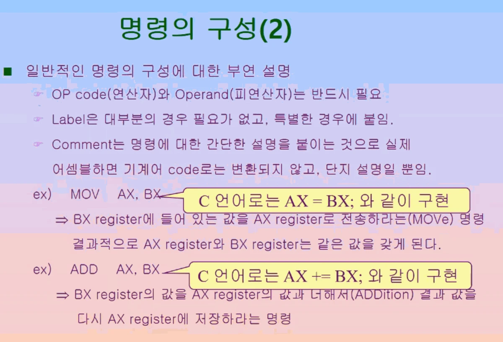

- 일반적인 명령의 구성 (2)

Opcode는 반드시 있어야 하지만, Operand는 필요에 따라 없을 수도 있다.  
Label은 대부분 필요 없고, 특별한 경우에 사용  
Comment는 개발자의 필요에 따라서 사용한다.

---

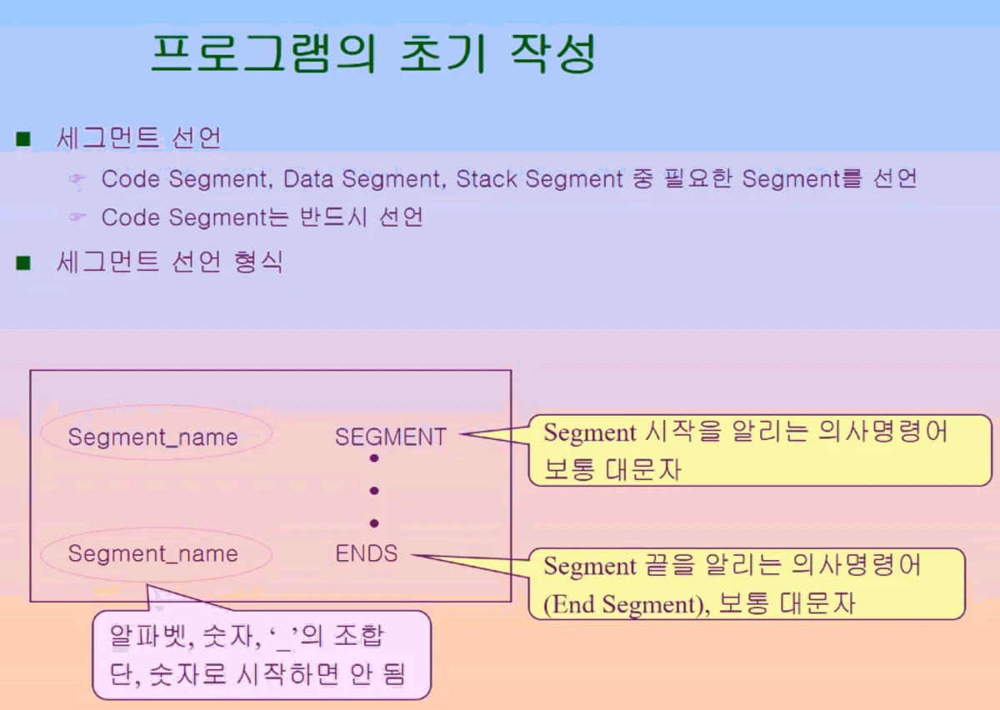

프로그램을 만드는 방법은 크게 두 가지가 있다.   
프로그램은 기본적으로 세그먼트라는 구분 동작으로 영역이 나누어진다. 코드는 Code Segment, 데이터는 Data Segment, 스택은 Stack Segment에 있다. 프로그램은 반드시 있어야 하니까 Code Segment는 항상 필요하고, 데이터를 사용한다면 Data Segment도 반드시 필요하다.

---

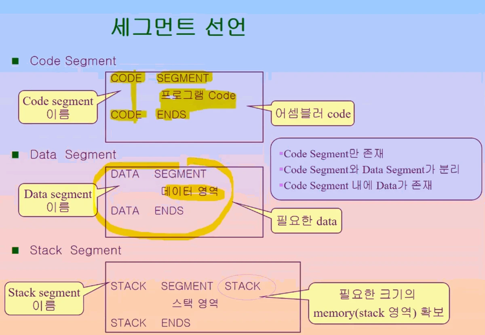

- Code Segment

```nasm
CODE SEGMENT
; PROGRAM CODE
CODE ENDS ; 위에서 시작한 것과 같은 이름으로 ENDS 해주어야 함.
```

- Data Segment

```nasm
DATA SEGMENT
; 데이터 영역
DATA ENDS
```

만약 사용하는 데이터의 크기가 적다면, 추가적인 Segment 영역을 나누지 않고, 프로그램 안에서 데이터를 사용할 수도 있다. 그러면 데이터가 프로그램 영역 안에 있다고 알려주어야 한다.

CODE SEGMENT, DATA SEGMENT와 같은 부분은 의사 명령이다.

의사 명령(Pseudo Code)은 프로그램을 만들어가는 과정에 사용되는 것이고, 그것이 프로그램에 적용될 때는 필요한 부분을 추가로 써야 한다.

---

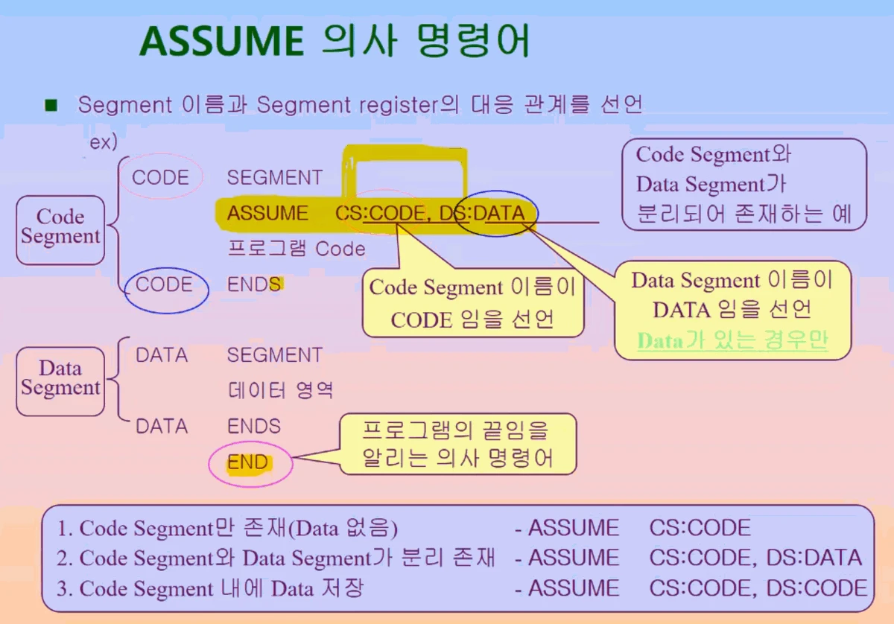

내가 SEGMENT를 하나 만들었는데, CODE SEGMENT 안에 코드를 넣으려고 하고 DATA SEGMENT 안에 데이터를 넣으려고 한다. 이렇게 되면 현재 영역이 CODE SEGMENT이다, DATA SEGMENT이다. 이와 같이 알려주기 위해서 두 가지 과정이 필요해진다.

```nasm
ASSUME CS:CODE, DS:DATA ; CS에 코드가 들어있고, DS에 데이터가 들어있다고 가정한다.
; 컴파일러에게 알려주는 것. 
; 하지만 실제로 프로그램을 만들 때는 컴파일러가 만들어주지 않는다. 그러므로 내가 직접
; CS, DS를 지정해 주어야 한다.

CODE ENDS ; ENDS는 SEGMENT가 끝났다는 뜻.
END ; 이후에 END를 써서 프로그램이 끝났음을 알려주어야 한다.
```

---

- sample1.asm

```nasm
CODE	 SEGMENT ; 이 프로그램에서는 Data Segment, Stack Segment, Extra Segment 사용 X
ASSUME CS:CODE

	MOV AH, 12H ; CS는 이 부분을 시작으로 자동으로 잡힌다. 하지만 DS는 자동으로 잡히지는 X
	MOV AL, 34H
	ADD AH, AL

	MOV AH, 4CH
	INT 21H

CODE	 ENDS ; CS 끝
END
```

---

- 명령어의 구성과 기계어 구성

    - 8086이 어떠한 명령어를 사용하고 있는지 알아볼 수 있다.
    - www.intel.com

- MOV 명령어의 예

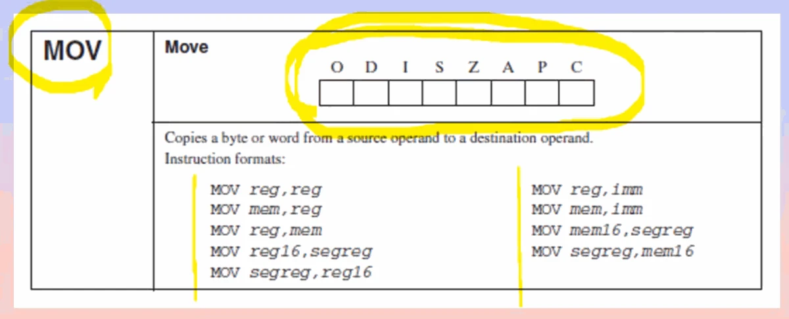

반드시 위 아홉 가지의 형태로만 사용되어야 한다. MOV는 값을 복사하라는 뜻이다.

ex) MOV imm1, imm2 ; 이것은 불가능하다.

MOV reg1, reg2 ; reg2의 값을 reg1으로 복사하라.

MOV reg, imm ; imm(실제 값, immed)을 reg로 복사하라.

ex) 어떤 메모리 번지의 값을 다른 메모리 번지의 값으로 넣어라!

MOV mem1, mem2 ; 이건 불가능하다. 이걸 하려면,

MOV reg, mem

MOV mem, reg

위 두 개의 과정을 거쳐야 한다. 일부러 이렇게 설계한 것.

ex) 세그먼트 레지스터의 값을 세그먼트 레지스터로 복사하라.

MOV segreg1, segreg2 ; 이것 역시 불가능하다.

MOV reg16, segreg2

MOV segreg1, reg16

위의 예시와 같이, 일부러 이렇게 설계되었음.

---

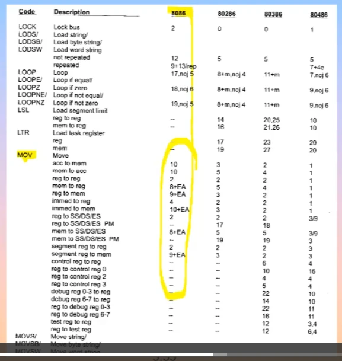

위의 예시를 보면, reg to reg는 8086 프로세서에서 두 클럭에 실행된다. 다른 명령어 형태들도 사용되는 클럭의 수가 정의되어 있다.

실제로 같은 MOV를 쓰더라도 허용되는 클럭의 수가 다르다. 즉, 내가 명령어를 이해하는 거에 따라 성능이 다섯 배 이상 차이가 날 수도 있다. 물론 버스를 기다리는 시간은 별도의 시간으로 추가 될 것이다. 이를 이해하는 것이 내가 고급 프로그래밍을 하는데 중요하다.

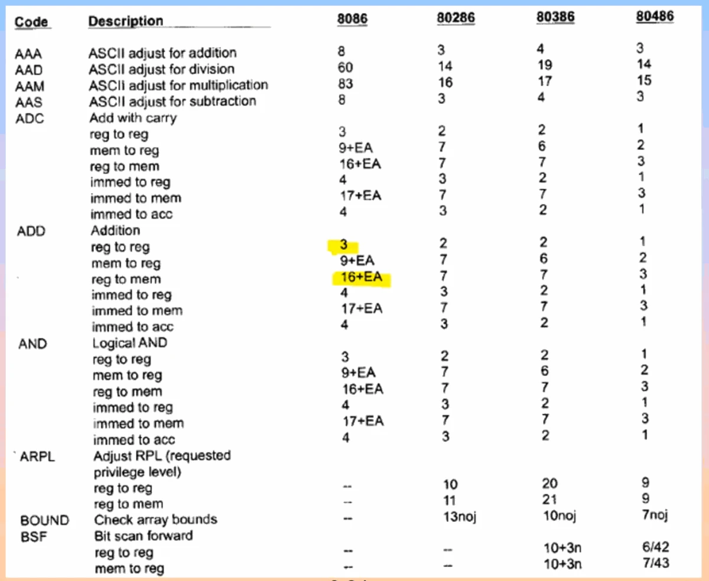

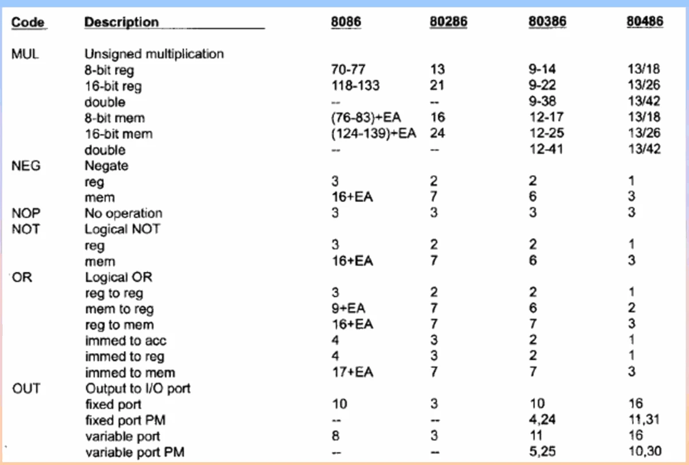

위의 예시에서 MUL은 multiply, 곱하기인데, 16-bit reg의 곱하기를 사용하면 118~133 클럭이 사용되는 것을 알 수 있다. 이것은 굉장히 오랜 시간이 걸리는 것이기 때문에 곱하기는 거의 사용하지 않고 Shift와 같은 단순 연산을 주로 사용한다.

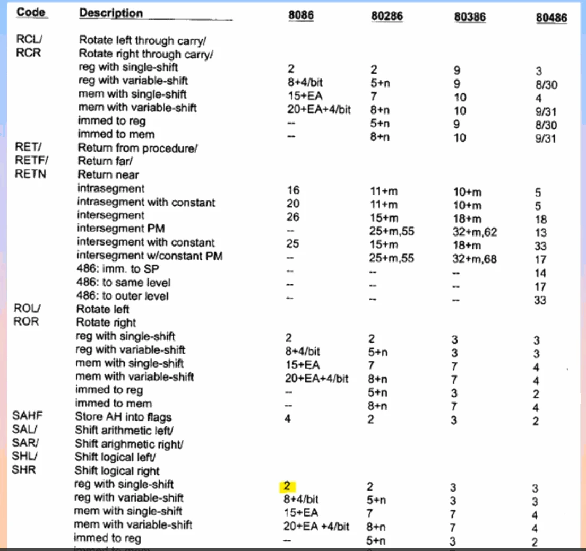

reg with single-shift는 곱하기 2와 같은 효과인데, 두 클럭만에 해결된다. 이것이 왜 그렇게 bit 연산을 잘 알아야 된다고 강조하는지. 그 이유이다.

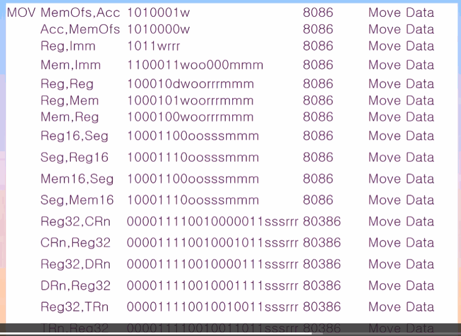

명령어들은 fetch를 하고 가져와서 해독을 한다고 했는데, 해독을 할 때. 예를 들면 MOV의 경우는 사용할 수 있는 방법이 9가지 정도가 있다고 했는데, 아홉 가지의 경우에서도 세부적으로 여러 가지의 형태로 format이 달라질 수도 있다. 

opcode가 어떻게 생겼고, 데이터에 따라 어떻게 바뀌고, 이런 것들이 된다.

왜냐하면, 메모리에 저장되는 값은 실제 숫자이고 그것은 명령으로 이해가 돼야 하니까 그 사이에 이 과정을 해석하는 것이 필요하다.

---

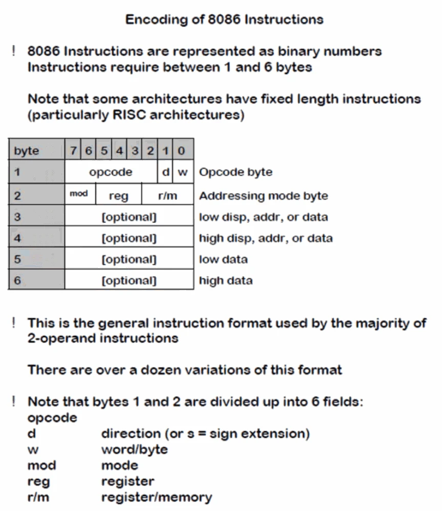

- 8086이 명령어를 만드는 기본적인 방법

    - opcode byte : 그 중에 여섯 개의 bit를 opcode가 쓴다. d, w가 각각 한 비트를 가진다. d는 direction이고, w는 word/byte이다.
    - Addressing mode byte : 두 번째 바이트는 mod라는 것을 쓴다. mod는 모드로, 뒤에 있는 내용들을 어떻게 읽을 것인가? 를 의미한다. 그리고 남은 여섯 개의 비트를 반으로 쪼개서 reg, r/m으로 사용한다. reg는 register이고, r/m은 register 또는 memory이다. 그래서 모드에 따라 이 것들이 처리되는 방식이 다르다는 것이다.

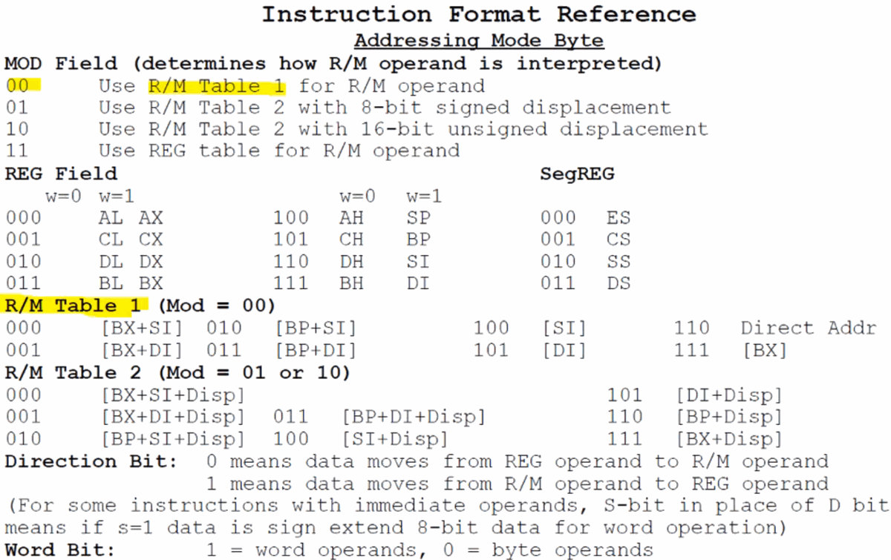

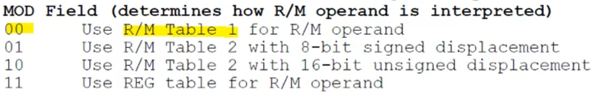

mod 자리에 00을 쓰면, R/M table에 1을 쓴다.

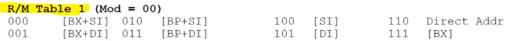

그러면 이와 같은 R/M Table에서 골라쓴다는 것이다.

마찬가지로 mod 자리에 01을 쓰면 R/M Table 2에서 골라 쓴다는 것이고, 8bit이다.  
10이면 R/M Table 2에서 골라 쓰는데, 16bit를 쓴다.  
mod가 11이면 register table을 가지고 쓴다.

- register table

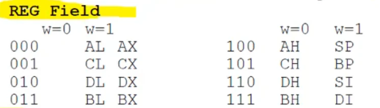

예를 들어 mod가 00이라면, 그 뒤에 나오는 세 비트(reg), 세 비트(R/M)는 R/M Table 1에서 골라 쓴다는 것이고, mod가 11이라면 REG Field에서 골라쓴다는 것이다.

즉, 이것이 주소 지정 방식을 정하는 방법으로 보인다.

---

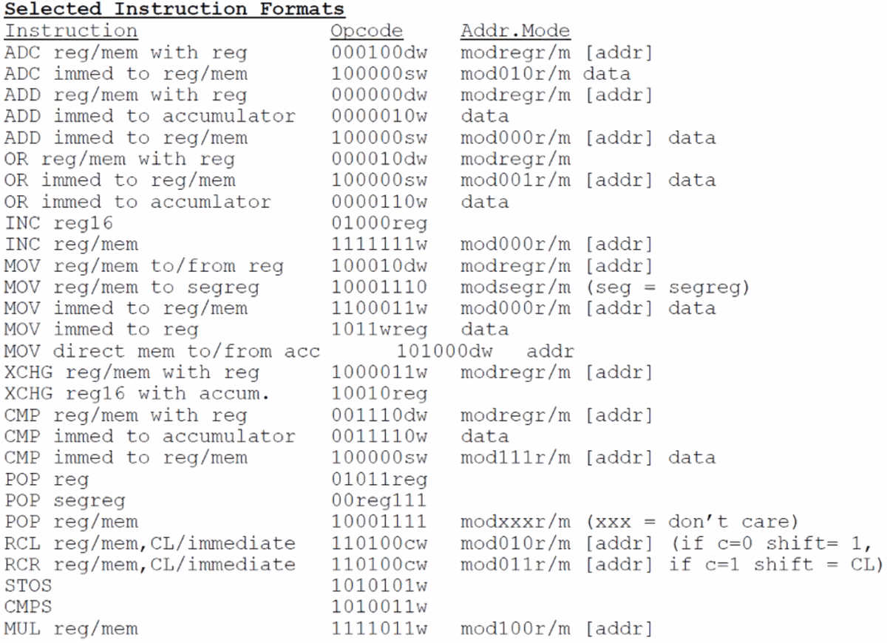

이것이 요약된 것. 이걸 펼쳐놓고 해석해보면 된다.

---

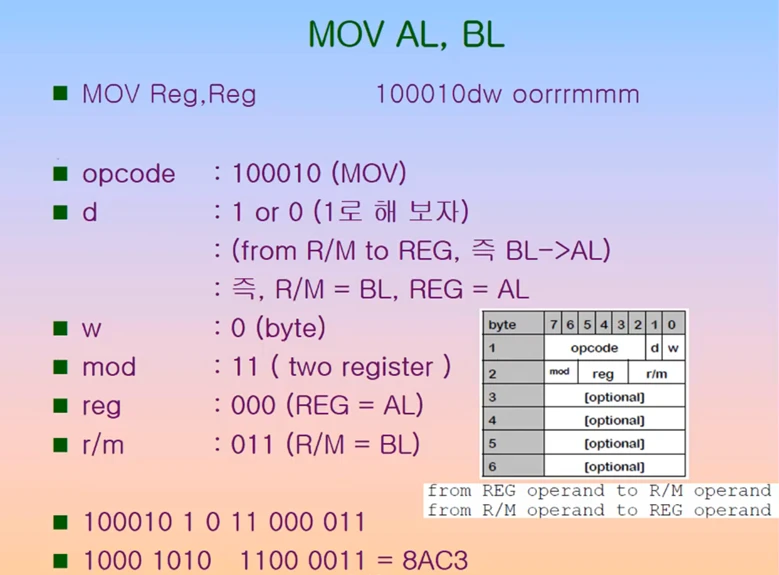

MOV라는 명령이고, AL은 나왔던 것처럼 AX 16bit 중에서 하위 8bit register를 나타낸다. BL도 BX 16bit 중에서 하위 8bit register 나타낸다. 

MOV 명령어 중에서 Reg, Reg에 대한 MOV는 100010 이라는 opcode로 매칭된다.

d는 direction인데, d가 1이냐 0이냐에 따라 어디서 어디로 연산되는지를 정할 수 있다. d가 0이면 Reg에서 R/M으로 연산이 이루어지고, d가 1이면 R/M에서 Reg로 연산이 이루어진다.

현재 MOV가 AL, BL을 하는 것인데, BL에서 AL로 연산이 되고자 하는 것이다. 만약 d를 0으로 잡으면, Reg에서 R/M으로 연산이 되니까, BL → AL. Reg → R/M이 되는 것이다.

만약에 d가 1이면, R/M → Reg로 연산이 된다. 이것은 거꾸로 R/M이 BL, Reg가 AL이 된다는 것이다.

둘 다 Register이기 때문에 둘다 가능하다.

일단 d를 1로 설정해서 R/M에 BL이 들어가고, Reg에 AL이 들어간다고 생각해보자.

이걸 찾아보면? 우리는 현재 AL, BL. Low Byte를 사용하니까 w는 0이다. BL은 011이고, AL은 000이다. 

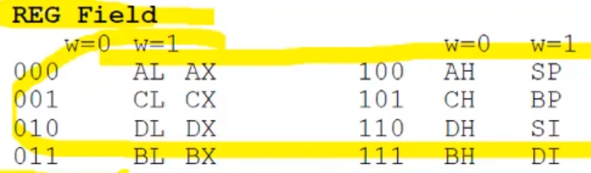

근데 BL이 from이고, AL이 to 니까, R/M 자리에 BL을 써야하고, Reg 자리에 AL을 써야한다. 현재 mod는 reg to reg니까 11이고, reg는 000(AL) R/M은 011(BL)이 될 것이다.

현재 w는 word가 아니라 byte로 쓰고 있으므로 0이다. (word/byte 1이면 word이고 0이면 byte인 것으로 보인다.)

나열해보면, opcode는 100010이고, d는 1, w는 0. mod는 11, register는 000 011.

그래서 읽어보면, 100010 1 0 11 000 011

1000 1010 1100 0011 = 8AC3

CPU가 이 두 바이트를 읽어와서 해석을 하면 BL register의 값을 AL로 복사하라는 뜻이구나. 하고 이해한다는 것이다.

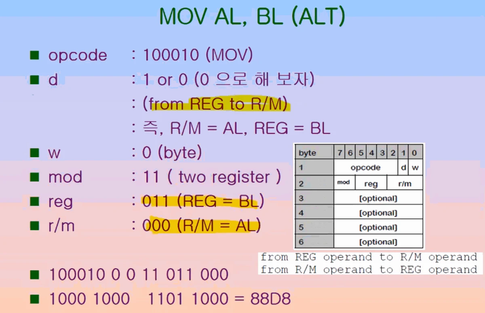

반대 방향으로 d를 0으로 해보면, from Reg to R/M이다. 다른 것들은 똑같지만, Reg, R/M의 값이 바뀌게 될 것이다.

100010 1 0 11 000 011

1000 1010 1100 0011 = 88D8

---

- 예제 : 인코딩하면 어떤 값이 될까?

    - MOV AX, BX : Reg, Reg
    - MOV CL, 9 : Reg, imm
    - MOV DX, 20 : Reg, imm


