# Assembly-3: 간단한 프로그램 구조, 데이터 정의

작성일 2023-05-15 · 최종 수정일 2023-06-05
{ .post-date }

간단한 어셈블리 프로그램을 살펴보고 시스템 콜의 실체에 대해서도 살펴보도록 한다.

- 첫 번째로, 데이터가 없이 코드 세그먼트만 존재하는 프로그램을 살펴본다.

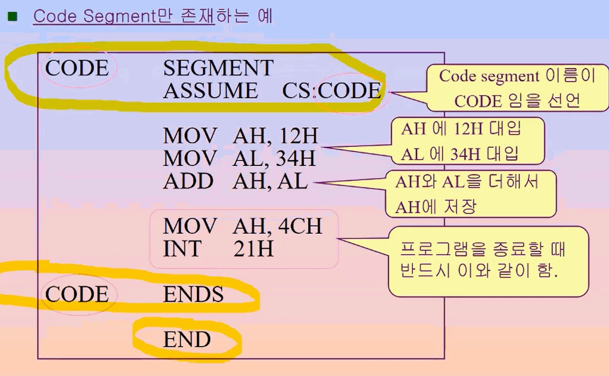

```nasm
CODE SEGMENT ; code segment의 이름을 'CODE'라고 지정한다.
	ASSUME CS:CODE ; CODE를 CS로 지정한다.

	; 일반적인 프로그램 부분
	MOV AH, 12H ; AH에 12H 대입. AH는 AX의 상위 1 byte
	MOV AL, 34H ; AL에 34H 대입. AL은 AX의 하위 1 byte
	; AH, AL에 값을 복사해 넣은 것과 같음.
	; 따라서 AX는 1234H가 될 것이다.

	ADD AH, AL ; AH에 AL의 값을 더한다. 그 결과를 AH에 저장한다.
	; 따라서 AH는 46H가 될 것이며, AX는 4634H가 될 것이다. 
	
	; 시스템 콜 호출부
	MOV AH, 4CH ; AH에 4CH를 복사한다.
	INT 21H ; 21H는 10진수로 33이고, trap(S/W interrupt) 호출이다.
	; 이 trap(21H)이 발생하면 자동으로 AH를 검사하게 된다.
	; interrupt 21H의 subfunction 4CH를 실행하게 된다.
	; AH가 trap의 subfunction 역할을 한다.
	; 위의 두 줄이 하는 역할은 이 프로그램을 종료하고, 다시 핸들권을
	; 운영체제 넘겨주는 역할을 한다.

CODE ENDS
	END
```

어셈블리 코드를 짠다는 것은 데이터들을 조합하고, 인터럽트 서비스 루틴을 필요한만큼 호출하여 사용하는 것으로 이루어진다. 우리가 다루는 C언어도 상위 레벨에서는 여러가지 알고리즘이 있겠지만, 하위 레벨에서는 이러한 시스템 콜을 다루게 된다.

---

- 데이터 정의 의사 명령어

데이터를 정의하려면 지시자가 필요하다. 모두 D로 시작한다.

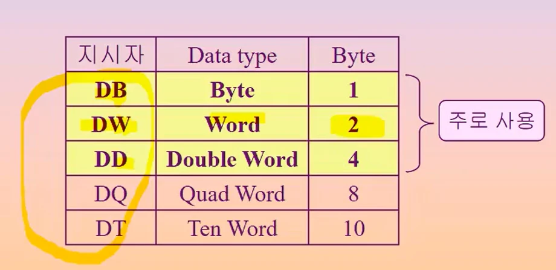

- DB : Byte 단위의 데이터를 정의한다.
- DW : Word 단위의 데이터를 정의한다.
- DD : Double Word 단위의 데이터를 정의한다.

⇒ 16bit 짜리 프로세서를 대상으로 하기 때문에, 여기서의 Word는 두 바이트를 의미한다. 네 바이트가 아니다.

- 사용법

```nasm
; Variable_name 지시자 초기값
SUM DW 0

; 데이터는 여러 개를 할당해도 되며,
; 아래와 같이 콤마를 통해 이어가며 선언해도 된다.
; 이렇게 되면 시작점의 이름이 SUM이 된다.
SUM DW 0, 1, 2, ...

; 초기값이 없을 경우에는, 위의 코드에서 0 자리에 ?을 써주면 된다.
```

---

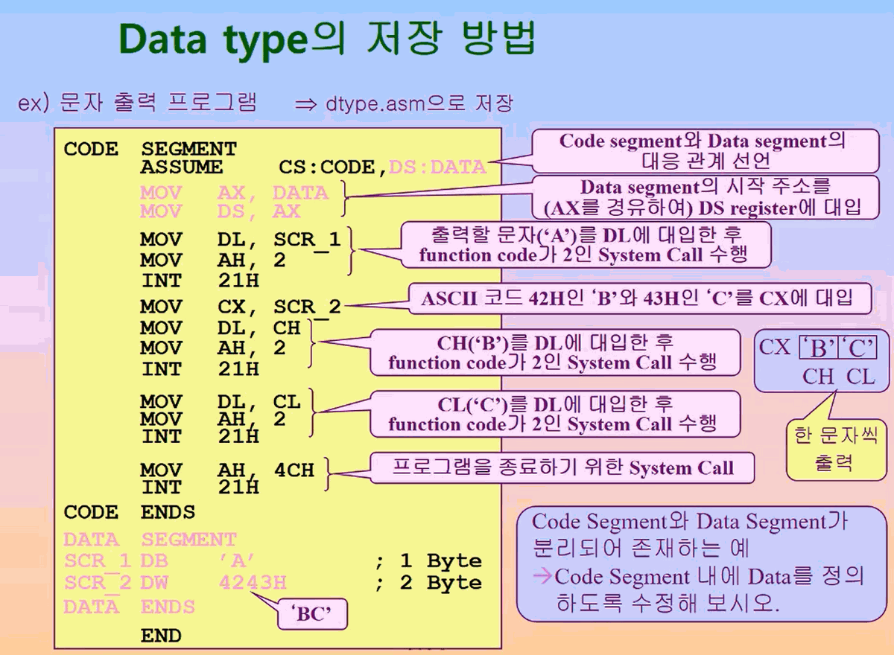

- 위의 어셈블리 코드는 상단의 Code Segment와 하단의 Data Segment로 이루어짐.
- END가 나오면 모든 프로그램이 종료되는 것이다.
- 상단을 보면 ASSUME CS:CODE, DS:DATA 라고 선언했고, 이에 따라 Code Segment의 이름이 CODE, Data Segment의 이름이 DATA이다.

- 다만, ASSUME을 했다고해서 DATA SEGMENT가 자동으로 설정되는 것은 아니다. CS는 Code Segment의 주소값이 자동으로 전달된다. 하지만 DS는 올바르게 실행하려면 DATA SEGMENT에 있는 것을 제대로 Access하려면 DS의 시작값이 전달될 필요가 있는데, 이를 담당하는 부분이 상단에 나온 다음 부분이다.

    ```nasm
    MOV AX, DATA
    MOV DS, AX
    ```

    이를 통해서 DATA SEGMENT의 위치를 정확히 전달할 수 있다.

- 그렇다면 왜 DATA를 AX로 경유해서 넣는 것일까? MOV 명령을 찾아보면 되겠지만, DATA의 이름을 바로 Segment로 쓰는 명령은 기계어로 존재하지 않는다. 번역이 불가능하기 때문. 따라서 번역이 될 수 있는 AX와 같은 범용 레지스터를 활용해, 두 단계로 거쳐서 실행하는 것이다.
- 이렇게 만든 이유는 혹시나 프로그램이 잘못돼서 Data Segment와 같은 중요한 Segment의 값이 변화가 되는 것을 막기 위해서이다.

```nasm
CODE	SEGMENT
	ASSUME	CS:CODE, DS:DATA

	MOV	AX,	DATA
	MOV	DS, AX

	MOV DL,	SCR_1
	MOV AH, 2 ; 21H trap의 인자가 2이다.
	INT 21H ; 21H trap
	; 21H subfuncction 2의 역할은 ASCII 문자 하나를 출력하는 것이다.
	; 그 대상을 DL Register에 저장한다.
	; 따라서 DL에 저장된 값에 대한 ASCII 문자를 화면에 출력하는 trap인 것이다.

	MOV CX, SCR_2 ; 변수 SCR_2에 저장된 값을 CX(16bit)에 저장
	MOV DL, CH ; CX의 상위 8bit인 CH에 저장된 값을 DL에 저장. (ASCII 'B')
	MOV AH, 2
	INT 21H

	MOV DL, CL ; CX의 하위 8bit인 CL에 저장된 값을 DL에 저장. (ASCII 'C')
	MOV AH, 2 
	INT 21H 

	MOV AH, 4CH ; 21H trap의 인자가 4CH이다.
	INT 21H ; 21H trap
	; 통제권을 다시 운영체제로 넘겨주는 시스템 

CODE ENDS
DATA SEGMENT
SCR_1 DB	'A' ; Byte 변수. 'A'에 해당하는 ASCII 값이 저장됨. 65
SCR_2 DW	4243H ; Word 변수 (2 Byte)
DATA ENDS
	END
```

---

- 주소 지정 방식

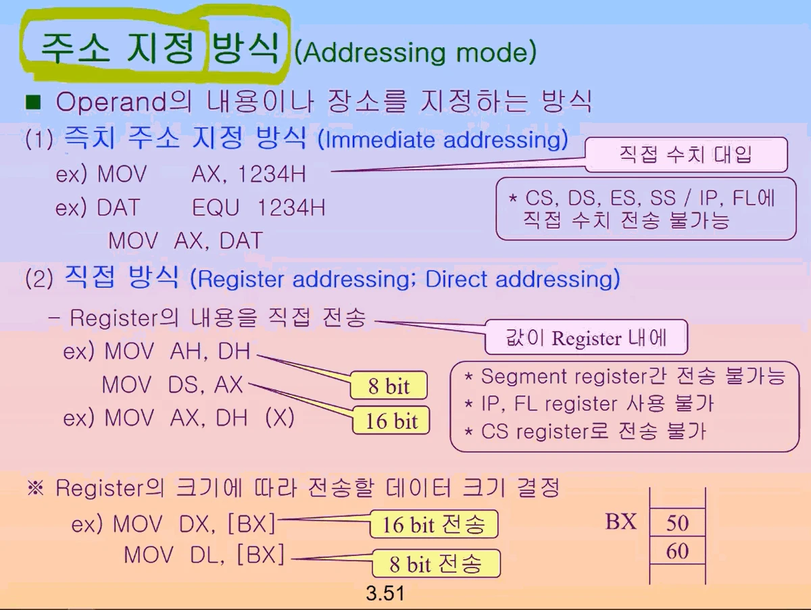

- 즉치 주소 지정 방식

    - Register에 곧바로 쓸 수 있는 값을 넣어주는 방식

    ```nasm
    MOV AX, 1234H ; AX에 1234H를 복사
    DAT EQU 1234H ; 지시자에 대하여 값을 대체할 수 있는 매크로로 지정.
    ; 이후에 DAT가 나오는 곳은 1234H로 대체된다.

    MOV AX, DAT
    ```

- 직접 방식

    - 레지스터의 내용을 직접 전송
    - 단, 전달하려는 레지스터 간의 크기가 맞아야 한다.

    ```nasm
    MOV AH, DH
    MOV DS, AX
    MOV AX, DH ; (X), 16bit <- 8bit은 불가하다.

    ; Register의 크기에 따라 전송할 데이터 크기 결정
    MOV DX, [BX] ; 16bit 전송
    MOV DL, [BX] ; 8bit 전송
    ; 위에 나오는 Bracket은 주소를 의미. 유효주소이다.
    ```

- 간접 방식

    - 유효주소에 원하는 값을 더해가면서 계산해 나가는 방식

    ```nasm
    MOV AX, DAT ; 변수이름 = 데이터가 들어있는 번지
    MOV AX, [BX+DI+4] ; 번지의 내용 - Pointer 개념
    ; BX에 DI와 4를 더해서 주소를 계산하는 방법
    ```

    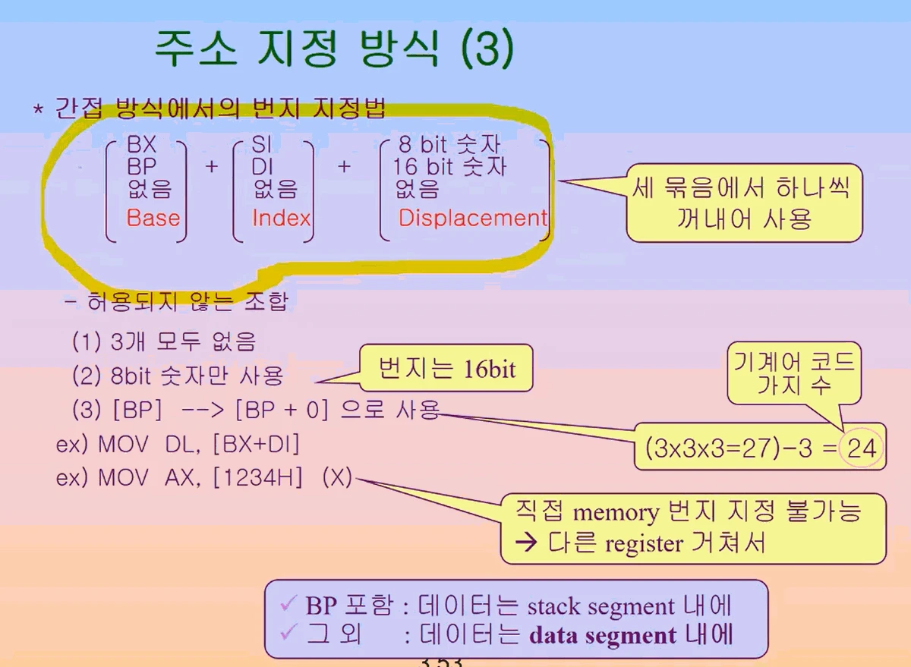

    - Base + Index + Displacement(변위) : 세 묶음에서 하나씩 꺼내어 사용

        - BX + SI + 8bit 숫자
        - BP + DI + 16bit 숫자
        - 없음 + 없음 + 없음

    - 단, 셋 중에 한 개 이상은 반드시 있어야 한다. (안그러면 0이 돼서 연산 불가능)
    - 8bit 숫자 하나만 단독으로 사용하는 것은 불가능하다. (번지는 16bit이기 때문이다.)
    - ex ) MOV DL, [BX + DI] ; BX의 값 + DI의 값을 더하고 그 번지 내의 데이터를 DL로 복사.
    - ex) MOV AX, [1234H] ; (X) 직접 memory 번지 지정 불가능함. 다른 register를 거쳐야 한다.

---

```nasm
CODE SEGMENT
	ASSUME CS:CODE, DS:CODE ; CS와 DS가 모두 CODE로 지정되도록 함.
	; 그런데, 이것은 프로그램을 '만들 때' 쓰는 것이고, 실제로 프로그램이 실행되는 쪽에는
	; 추가적인 설정이 필요하다.

CR EQU 0DH
LF EQU 0AH

	; DS를 사용하기 위해
	; 반드시 프로그램 시작부에
	; 이와 같은 설정이 필요하다.
	MOV AX, CODE
	MOV DS, AX

	; 어딘가에 BUFFER라는 것이 있을텐데,
	; OFFSET BUFFER는 그 BUFFER라는 것의
	; 주소, OFFSET을 복사하라는 것이다.
	; 현재 DATA도 CODE로 지정되어 있으므로,
	; CODE의 시작주소에서 BUFFER가 떨어져있는 위치를
	; 반환하라는 것이다.
	; BUFFER가 어디 저장되어 있는지는 몰라도,
	; 그 값을 OFFSET으로 얻어낼 수 있다는 것이다.
	MOV BX, OFFSET BUFFER
	MOV SI, 2

	; MOV AH, 2
	; INT 21H
	; 이것은 모두 출력하는 trap
	MOV DL, [BX+SI] ; BX는 'e'를 가리키고, 2를 더하니까, DL은 'a'를 가리키게 될 것.
	MOV AH, 2
	INT 21H

	MOV DL, [BX+SI+1] ; 'm' 출력
	MOV AH, 2
	INT 21H

	MOV DL, CR ; CR은 현재 0D. 이것은 Carriage return이다.
	MOV AH, 2
	INT 21H

	MOV DL, LF ; LF는 현재 0A. 이것은 Line Feed이다.
	MOV AH, 2
	INT 21H

	MOV DL, [BX+SI+2] ; 'p' 출력.
	MOV AH, 2
	INT 21H

	MOV AH, 4CH
	INT 21H

BUFFER DB 'example.'

CODE ENDS
	END
```

---

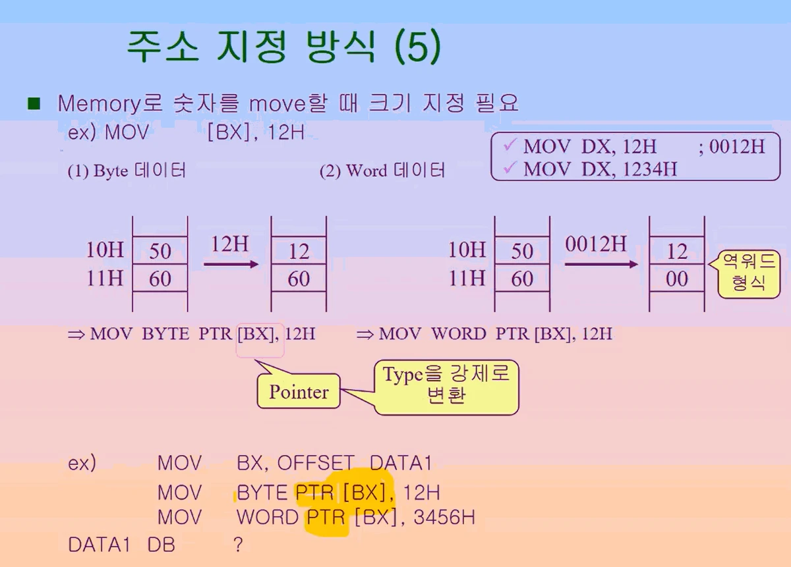

어떤 값을 주소를 나타내는 위치에 쓰려고 하면, 사이즈를 알 수 없으니 크기를 지정해 주어야 한다.

```nasm
MOV BYTE PTR [BX], 12H ; BX가 가리키는 위치에 데이터를 복사하는데, 1 BYTE로 써라.
MOV WORD PTR [BX], 3456H ; BX가 가리키는 위치에 데이터를 복사하는데, 2 BYTE로 써라.
```

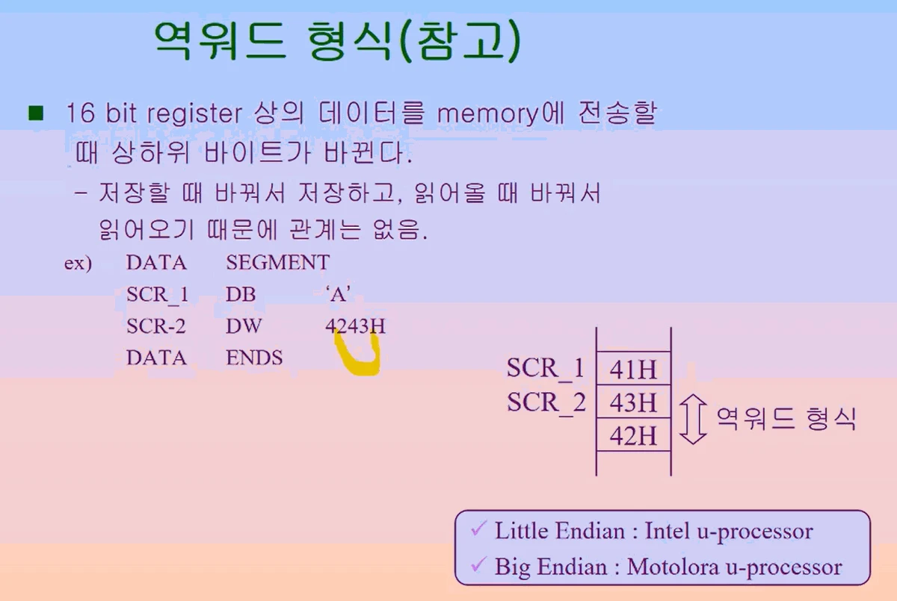

인텔 계열 CPU는 역워드 형식. Little Endian을 사용한다. SCR_2 DW 4243H라고 값을 쓰면, 실제로 저장되는 것은 앞에 43이 먼저 저장되고, 42가 저장된다. 단, 저장할 때 바꿔서 저장하고, 읽어올 때 바꿔서 읽어오기 때문에 크게 관계는 없지만, 디버깅하기 위해서는 알고있어야 한다.

---

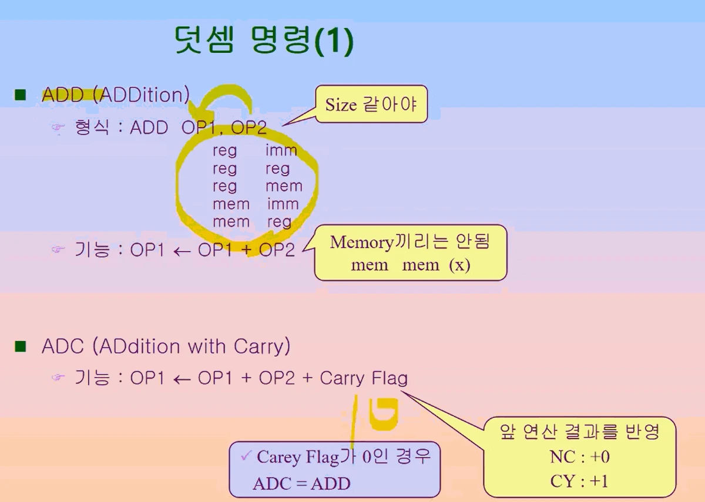

ADD라는 명령이 있으며 아래 다섯 가지 방법을 지원한다.

- ADD OP1, OP2

    - reg imm
    - reg reg
    - reg mem
    - mem imm
    - mem reg

- 기능 : OP1 ← OP1 + OP2

유사한 기능으로 **ADC**(ADdition with Carry)가 있다.

- 기능 : OP1 ← OP1 + OP2 + Carry Flag

    - Carry Flag가 0이라면, ADC = ADD와 같다.
    - 그렇다면 언제 캐리가 필요하게 되는가? (아래에서…)

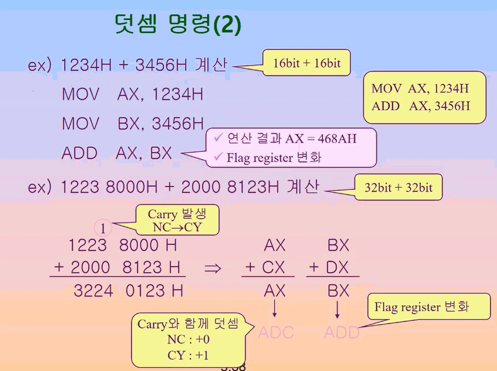

- 1234H + 3456H를 계산하면 468AH가 되고, 그 값이 AH에 계산될 것이다.
- 그런데, 1223 8000H + 2000 8123H를 계산하려고 한다면, 32bit + 32bit의 계산이기 때문에 더할 방법이 없다.

- 이럴 때는 16비트 16비트 각각의 자리를 만들어서 더해주는 수밖에 없다.

```text
    1
1223 8000H
2000 8123H
----------
3224 0123 H
```

이와 같이 계산하게 되면, 아래 자리에서 8 + 8에 의해 Carry가 발생하게 된다. 이런 경우에는 ADC를 이용하여 계산하는 것이 맞다.

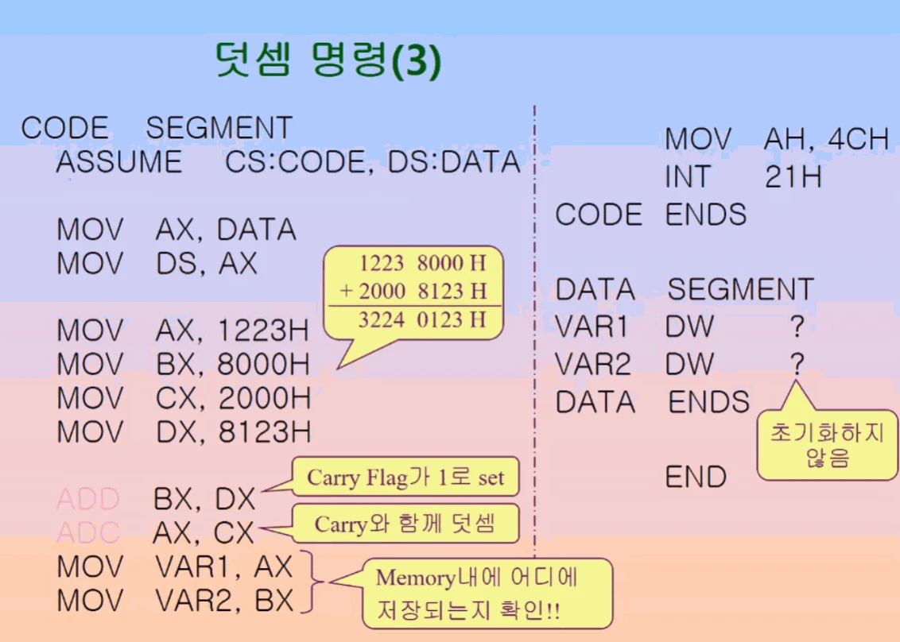

실제 예를 봐보자.

```nasm
CODE SEGMENT
	ASSUME CS:CODE, DS:DATA

MOV AX, DATA
MOV DS, AX
```

먼저 ASSUME을 통해 CS와 DS를 설정하고, DS에 데이터를 설정해준다. 이와 같이 해주는 이유는 레지스터의 안정성을 확보하기 위해서이다.

```nasm
MOV AX, 1223H
MOV BX, 8000H
MOV CX, 2000H
MOV DX, 8123H

ADC BX, DX
ADC AX, CX
```

이와 같은 계산의 결과는 아래 방식으로 계산하는 것과 같은 효과를 가진다. 이때 Carry Flag가 1로 set, Carry와 함께 덧셈을 한다.

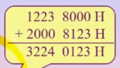

```nasm
MOV VAR1, AX
MOV VAR2, BX
```

이후, 각각의 계산 결과 Memory내에서 어디에 저장되는지 확인한다.

```nasm
	MOV AH, 4CH
	INT 21H
CODE ENDS

DATA SEGMENT
VAR1 DW ?
VAR2 DW ?
DATA ENDS
		END
```

interrupt를 수행하며 프로그램 종료. Handle을 운영체제에게 넘긴다. Code Segment가 끝난 이후에는 Data Segment가 정의되어 있는데, 프로그램에서 필요한 데이터를 선언하고 사용하면 된다.

---

- 응용

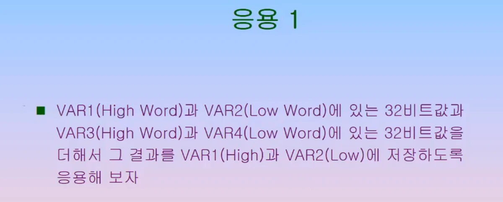

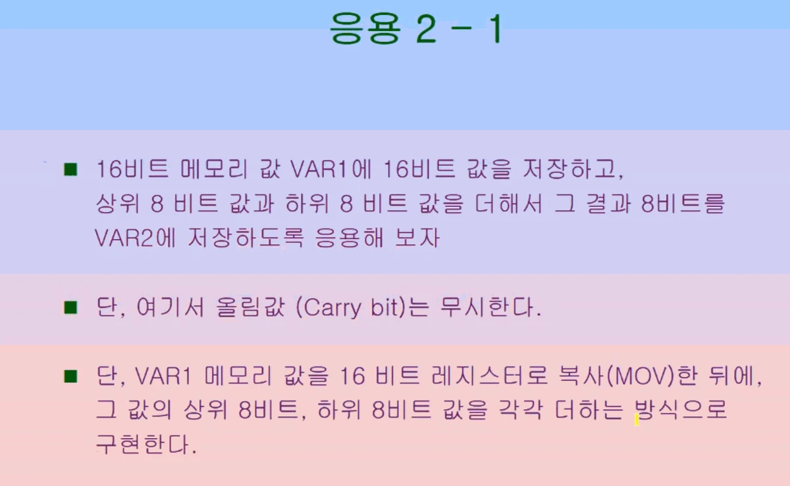

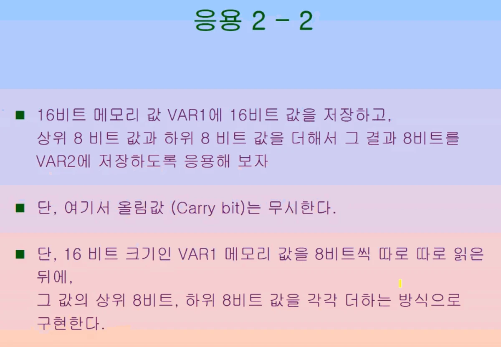

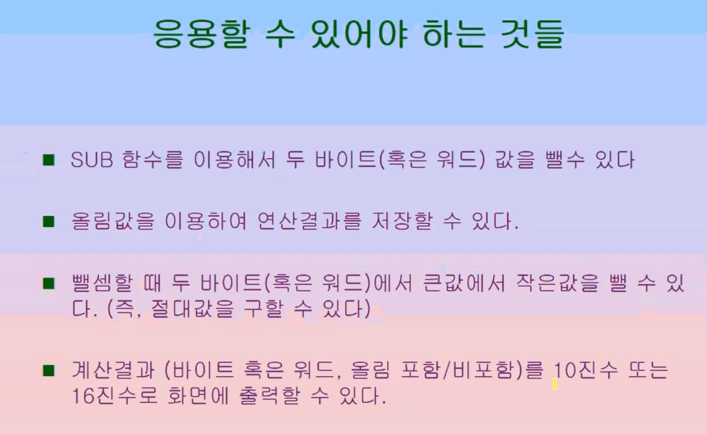
