# Assembly-4: 비교와 분기, 반복

## 비교와 분기, 반복

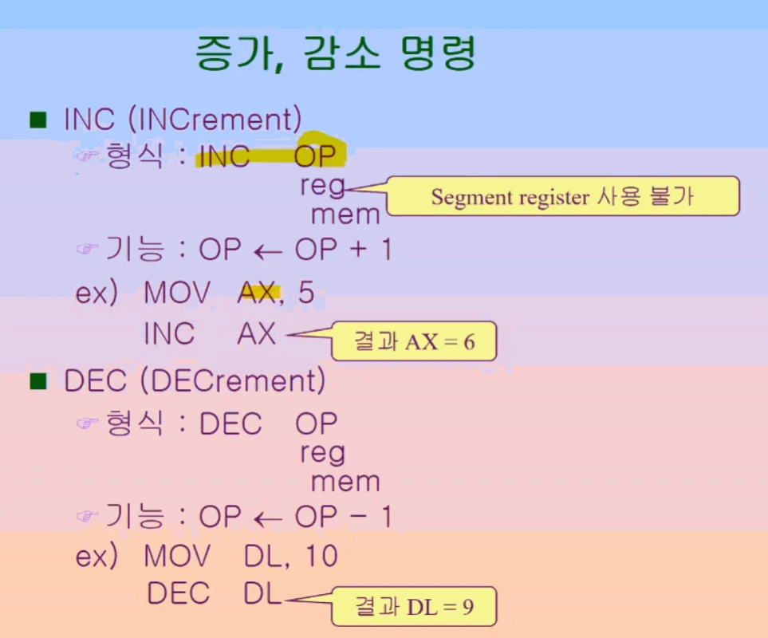

- INC (INCrement)

    - 형식 : INC OP(reg, mem등이 될 수 있으나, Segment Register는 사용 불가)

ex) MOV AX, 5

INC AX ; 결과 AX = 6

- DEC (DECrement)

ex) MOV DL, 10

DEC DL ; 결과 DL = 9

16bit와 8bit 모두 적용될 수 있다.

---

- 키 입력을 받는 방법 (System Call)

- 에코(echo) 있는 입력

    - Function code가 1인 System Call 21H
    - 입력된 문자의 ASCII 코드를 AL에 저장하고 이를 화면에 출력한다.

MOV AH, 1

INT 21H

- 에코(echo) 없는 입력

    - Function code가 8인 System Call
    - 입력된 문자의 ASCII 코드를 AL에 저장하나, 출력은 하지 않음.

MOV AH, 8

INT 21H

```nasm
CODE	SEGMENT
	ASSUME	CS:CODE, DS:CODE

	MOV	AX, CODE
	MOV	DS, AX

	MOV AH, 1
	INT 21H ; 키보드 입력을 대기하게 됨.
	MOV KEEP, AL ; AL에 저장된 값을 변수 KEEP에 복사함.
	; 입력의 결과를 AL에 자동으로 저장하는 것은 시스템 콜의 역할
	; AL을 KEEP에 옮기는 것은 프로그램의 역할이다.

	MOV DL, KEEP
	ADD DL, 1
	; 인터럽트 21H subfunction 2번을 이용하면
	; DL에 저장된 값(ASCII)을 출력할 수 있다.

	MOV AH, 2
	INT 21H

	MOV AH, 4CH
	INT 21H

KEEP	DB ?

CODE	ENDS
	END
```

만약 위의 프로그램에서 1번 subfunction 대신 8번을 쓰면, 입력을 받을 수는 있지만 그것이 echoing 되지는 않는다. 이런 시스템 콜들을 활용하면 scanf나 printf를 만들 수 있게 된다. 기본적인 시스템 콜을 사용하고, 포맷을 만들기 위해서 필요한 것들을 설정한 뒤에 차례로 출력하는 것이다.

---

- 비교

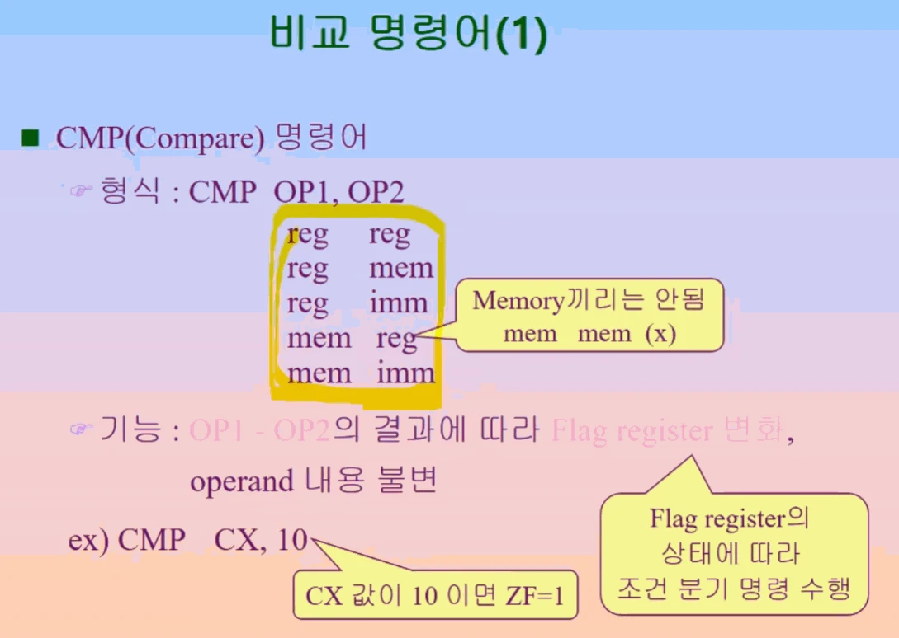

- CMP(Compare) 명령어

    - 형식 CMP OP1, OP2

    ⇒ 가능한 경우와 불가능한 경우를 매뉴얼을 보고 파악하면 된다.

    ⇒ 우선 메모리끼리는 비교 불가능.

ex) CMP CX, 10 ; 10진수 10

⇒ 보통 비교를 하고 분기를 수행하게 된다. 비교를 하게 되면 몇몇 flag가 영향을 받게 되는데, 그 flag들을 이용해서 그 다음에 어떻게 할지를 결정하게 된다.

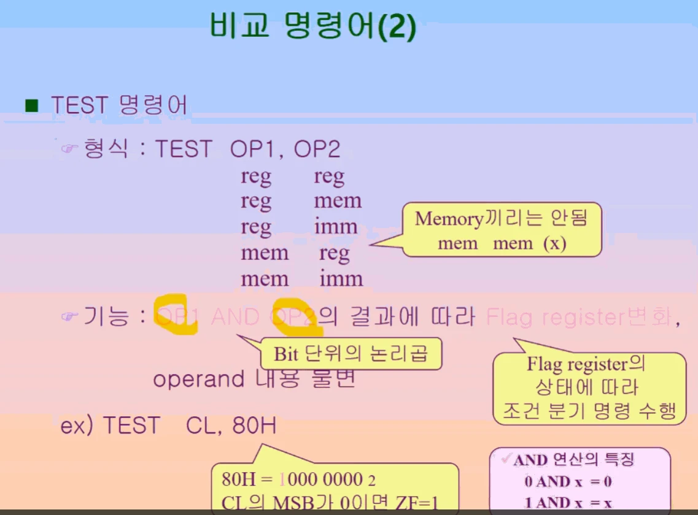

- TEST 명령어

    - 형식 TEST OP1, OP2

    ⇒ 메모리끼리는 사용 불가능

ex) TEST CL, 80H

⇒ bit 단위의 논리곱을 하고, Flag Register의 상태에 따라 조건 분기 명령을 수행한다.

80H : 1000 0000 인데, 만약 TEST를 수행하는 CL의 MSB가 0이라면 ZF = 1이 되고, 이에 따라 분기를 수행하게 된다.

---

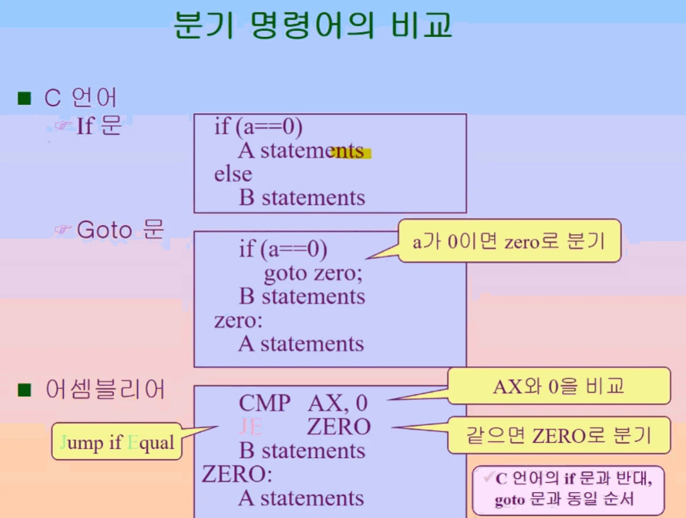

어셈블리에서는 먼저 비교를 수행한 후, 분기문을 통해 분기하게 된다.

```nasm
CMP AX, 0
JE ZERO
B statements

ZERO:
	A statements
```

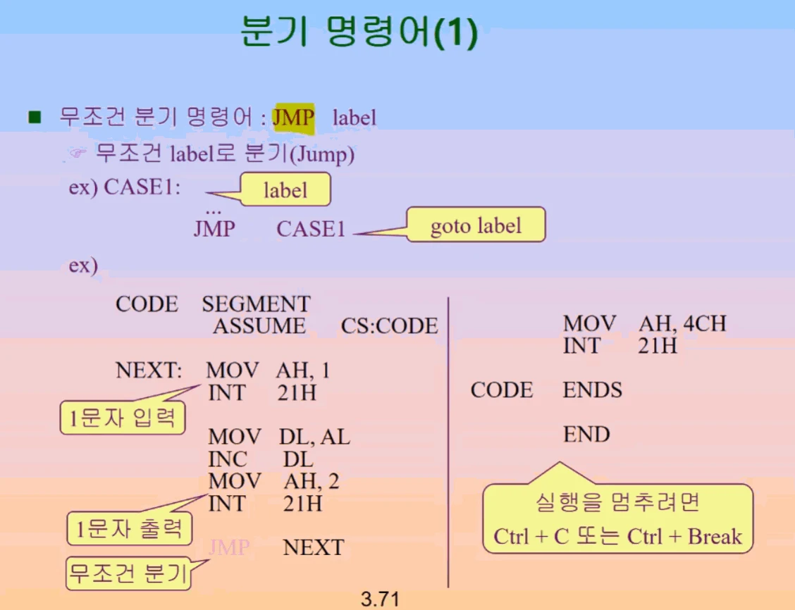

- 무조건 분기 명령어 : JMP label

    - 무조건 label로 Jump하게 된다.

```nasm
code  segment
			assume cs:code ; 사용하는 Segment는 Code Segment만 있다.

next: mov ah, 1 ; echo 있는 입력을 받는 시스템 콜 
			int 21h

			mov dl, al ; al에 저장된 값을 dl에 저장
			inc dl ; dl에 저장된 데이터를 증가시킴
			mov ah, 2 
			int 21h ; dl에 저장된 값을 출력 

			jmp next ; next:로 무조건 분기. 무한 loop를 하게 된다.

			mov ah, 4ch ; 프로그램의 종료를 위한 시스템 
			int 21h

code  ends ; Code Segment가 종료되는 부분
			end ; 프로그램이 종료되는 부분
```

---

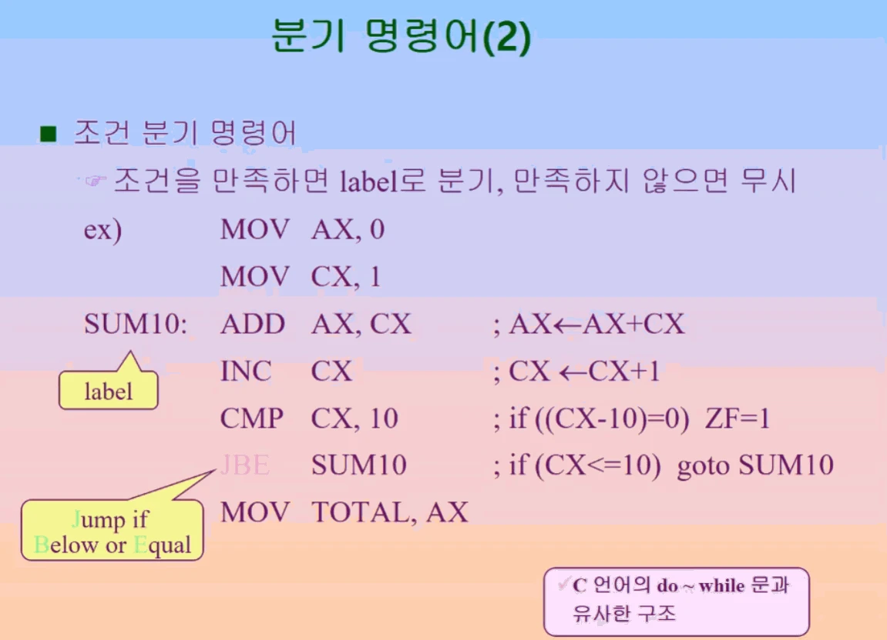

- 조건 분기 명령어

    - 조건을 만족하면 label로 분기, 만족하지 않으면 무시

```nasm
; ex)
				mov ax, 0
				mov cx, 1

SUM10 : add ax, cx ; ax = 0 + 1
				inc cx ; cx = cx + 1, cx == 2
				cmp cx, 10 ; 비교 결과 데이터가 같으면 zero flag가 1로 set 된다.
				jbe SUM10 ; jump below equal, 같거나 작으면 jump한다는 뜻이다.
									; 여기에 해당되지 않으면 그냥 아래로 내려간다.
									; 현재는 2 <= 10 이므로, jump하게 된다.

				mov total, ax
```

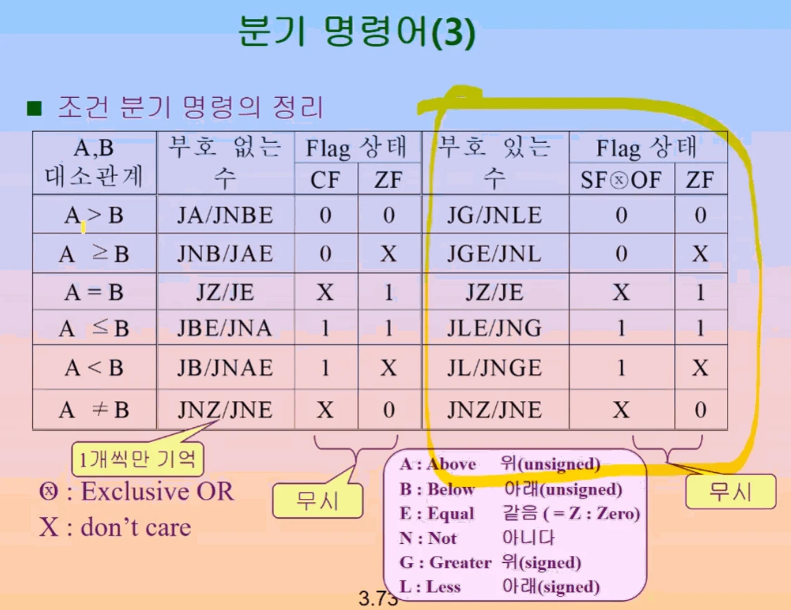

컴퓨터는 비교의 결과를 통해 만들어지는 Flag를 보고 결과를 확인하게 된다. (CF/ZF)

- J Above / J Not Below Equal (왼쪽이 큰가?)
- J Not Below / J Above Equal (왼쪽이 크거나 같은가?)
- J Zero / J Equal (왼쪽과 오른쪽이 같은가?)
- J Below Equal / J Not Above (왼쪽이 크지 않은가? 왼쪽이 작거나 같은가? )
- J Below / J Not Above Equal (왼쪽이 작은가?)
- J Not Zero / J Not Equal (왼쪽과 오른쪽이 다른가?)

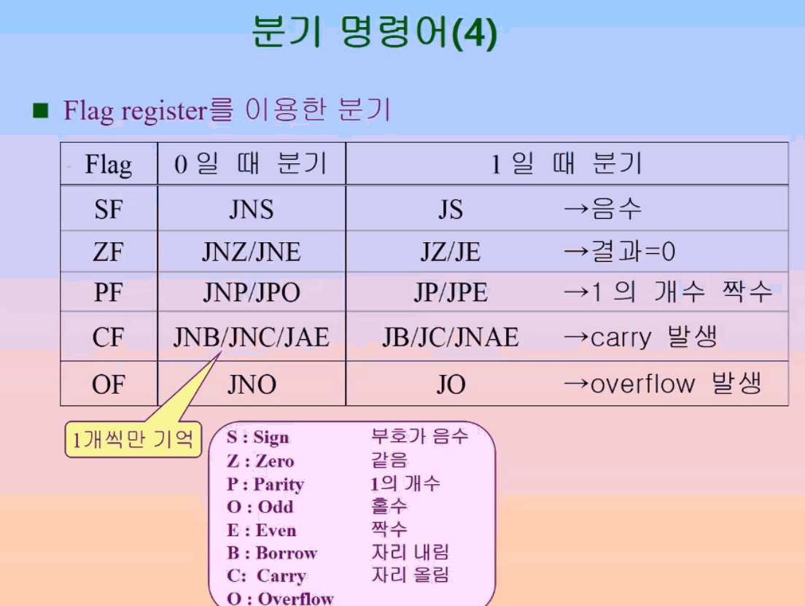

---

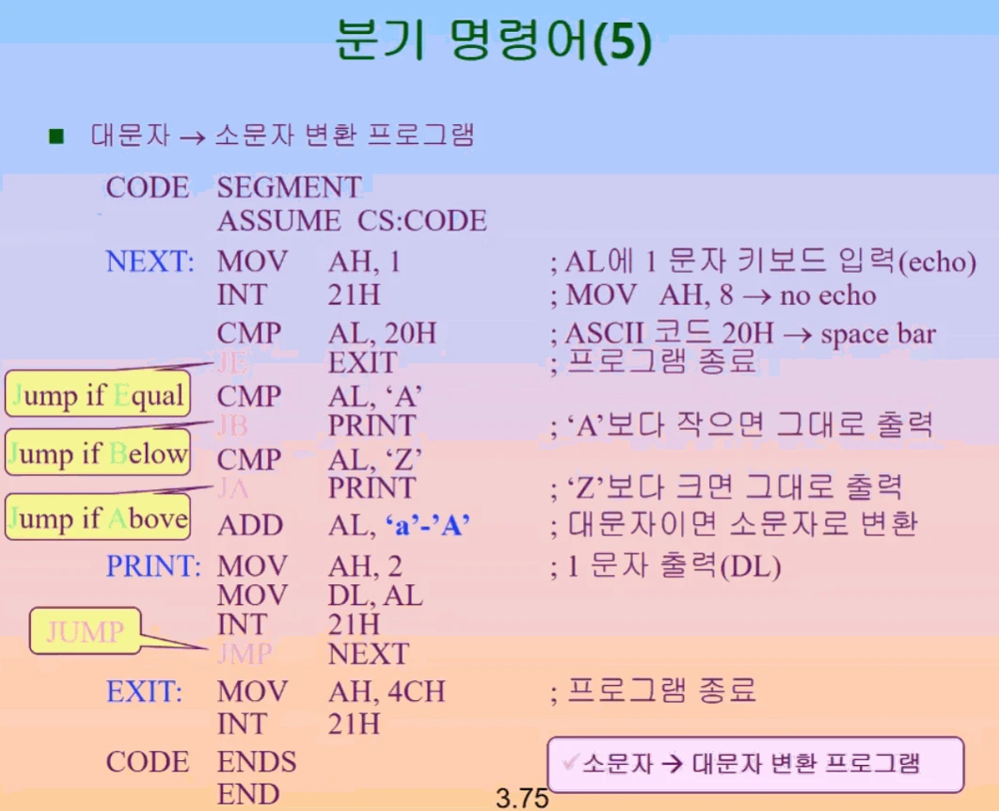

```nasm
; 소문자 알파벳을 대문자로 바꿔서 출력하는 프로그램

code  segment
	assume	cs:code

next:		mov	ah, 1
		int	21h

		cmp	al, 20h
		je	exit

		cmp	al, 'A' ; A보다 작으면 그대로 출력
		jb	print

		cmp al, 'Z' ; Z보다 크면 그대로 출력
		ja	print

		add al, 'a'-'A'
	
print: 	mov	ah, 2
		mov	dl, al
		int	21h
		jmp	next

exit:		mov	ah, 4ch
		int	21h

code	ends
			end
```

---

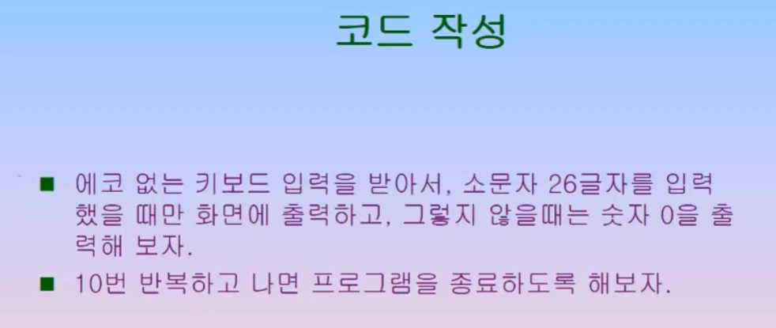

```nasm
; 에코없는 키보드 입력을 받아서 소문자 26글자 중 하나를 입력했을 때만 화면에 출력해주고,
; 그렇지 않을 때는 숫자 0을 출력하는 프로그램을 만들어보자.
; 10번 반복하고 나면 프로그램을 종료한다.

CODE SEGMENT
	ASSUME CS:CODE, DS:CODE

	MOV AX, CODE
	MOV DS, AX

MAIN:
	CMP COUNTER, 10
	JE EXIT

	MOV AH, 8
	INT 21H ; 입력한 값이 AL에 저장됨

	; 우선 한 번 반복 했으므로, COUNTER를 증가시킴
	INC COUNTER

	; 소문자 판별
	CMP AL, 'a'
	JB MAIN

	CMP AL, 'z'
	JA MAIN

	; 여기까지 왔다면 소문자 알파벳이므로, 출력해줘야 함.
	MOV DL, AL

	MOV AH, 2
	INT 21H
	
	JMP MAIN

EXIT:
	MOV AH, 4CH
	INT 21H
	

COUNTER DB 0

CODE ENDS
	END
```

- 이 코드는 Code Segment에 데이터까지 담은 것이다.

---

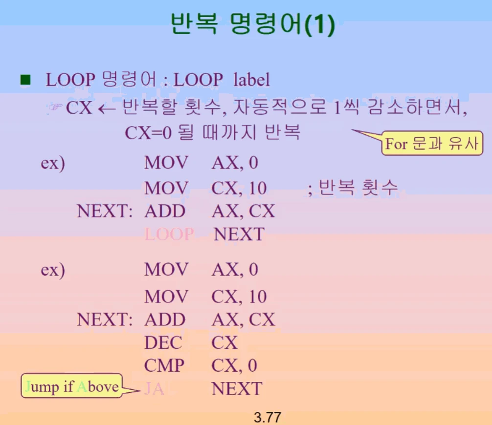

- LOOP 명령어를 통해 for문 처럼 동작시킬 수 있다. LOOP는 범용 레지스터 AX, BX, CX, DX 중에서 CX를 필수적으로 사용한다. 이때 CX는 counter의 역할을 한다. 다만 중요한 것은, 프로그램 중간에서 CX를 바꿔버리면 안된다는 것이다. (루프가 망가질 수 있음)
- 꼭 루프를 쓰지 않더라도, JMP로 표현할 수도 있음.

```nasm
; ex)
MOV AX, 0
MOV CS, 10
NEXT: ADD AX, CX
LOOP NEXT

; ex)
MOV AX, 0
MOV CX, 10
NEXT: ADD AX, CX
DEC CX
CMP CX, 0
JA NEXT
```

---

- 응용 코드 작성

```nasm
.model small ; 모델 선택
.stack 100h ; 스택의 시작 주소 선택
.data ; data segment 선언. 하지만, segment라고 쓰지는 않는다.
	prompt db 'enter a lower case letter : $'
	msg    db 0Dh,0Ah, 'in upper case it is: '
	char   db ?, '$' ; 초기값 없이 빈 칸 생성.
.code ; cod segment 선언.
main proc

	; data segment를 쓰겠다, 그걸 ds에 알려주는 것.
	mov ax,@data ; get data segment, data가 있으면 이걸 쓴다.
	mov ds, ax
	
	; dx에 prompt의 시작 주소 offset을 전달.
	mov dx, offset prompt
	mov ah, 9 ; string을 출력
	int 21h ; display prompt

	mov ah, 1
	int 21h ; char in AL
	
	sub al, 20h ; converts to upper case
	mov char, al ; store char

	mov dx, offset msg ; msg라는 데이터의 offset을 가져온다.
	; 해당하는 데이터(msg)의 시작 주소를 얻을 수 있다.
	; 이 예제에서는 0DH, 0AH를 출력하고 (Carriage Return, Line Feed) 이후에 $가 나올 때까지
	; string을 출력하게 된다. (interrupt 21H의 subfunction 9번을 사용해서)

	mov ah, 9 ; 9번 interrupt는 string을 출력하는 것.
	int 21h ; final message display
	; offset 주소에서부터 $가 나올 때까지 출력한다.
	; msg 바로 뒤에 char 라는 변수가 선언되었고, 여기에 입력한 값이 들어가 있다.
	; 그러므로 9번 subfunction에 의해 계속해서 출력되고, $를 만나 출력이 종료된다.

	mov ah, 4ch
	int 21h

main endp
end main
```

위의 코드는, 프로그램 영역은 똑같지만, 지시자와 Pseudo Code 부분이 다르다.

interrupt 21H의 subfunction 9는 string을 출력하며, \$가 나올 때까지 출력한다. 

---

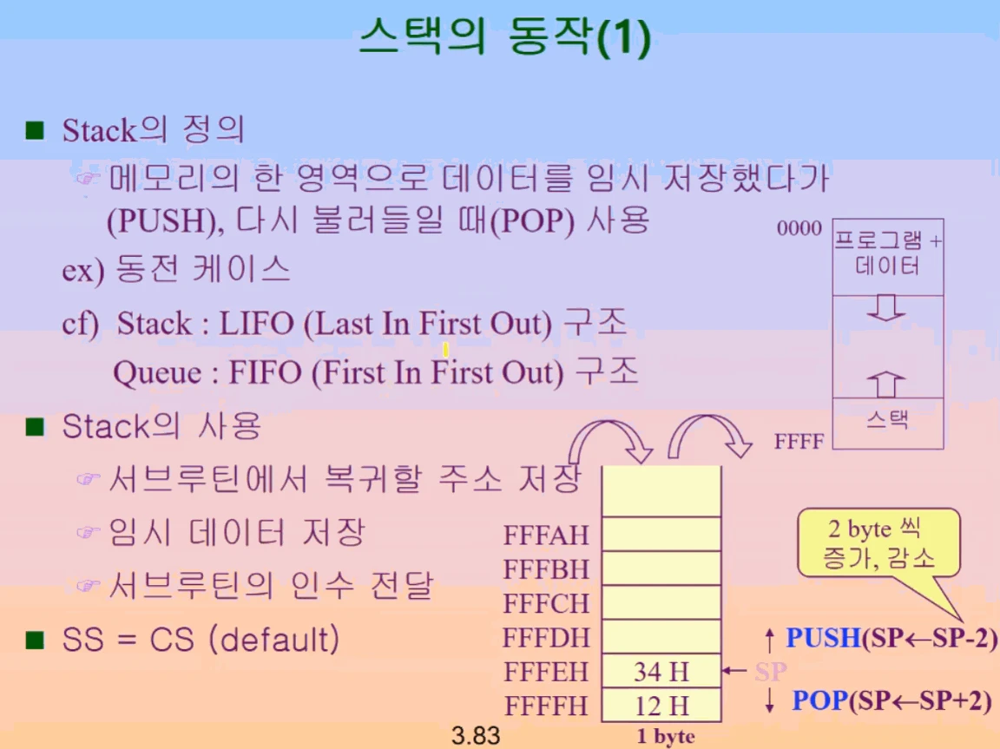

8086 Processor에서 Stack의 Push와 Pop은 16bit, 두 바이트를 기준으로 이루어진다. 즉, 데이터를 하나 넣으면 두 바이트가 들어가는 것이고, 하나 빼면 두 바이트가 빠져나온다.

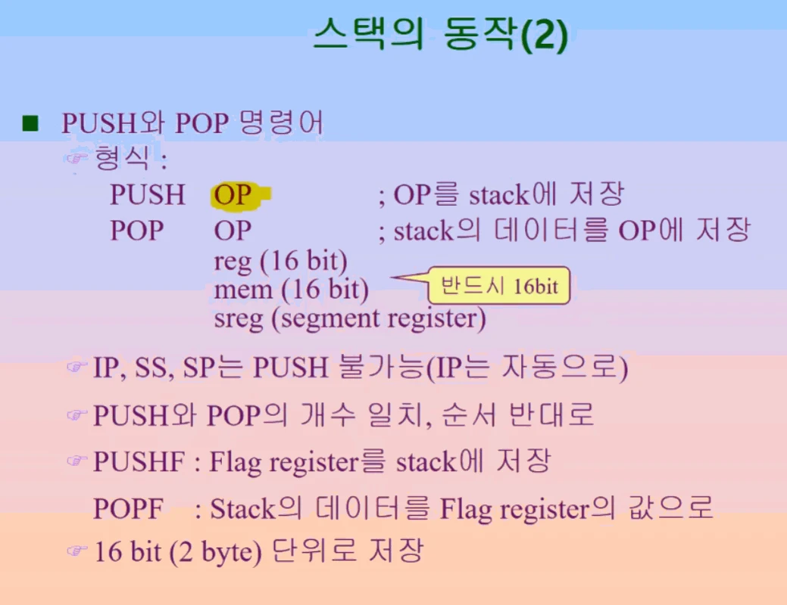

PUSH OP ; OP를 stack에 저장

POP OP ; stack의 데이터를 OP에 저장

⇒ 이때, OP는 반드시 16bit여야 한다.

---

```nasm
CODE SEGMENT
		 ASSUME CS:CODE

		MOV AX, 1234H
		MOV BX, 5678H

		PUSH AX ; AX의 값을 PUSH
		PUSH BX ; BX의 값을 PUSH
		PUSHF ; flag를 push 한다는 뜻. register로부터 Flag(1bit)를 쌓는다.
		; 현재 상태의 flag register 값들을 push 한다는 뜻으로 생각된다.
		; flag register는 두 바이트이기 때문.

		MOV AX, 2468H
		MOV BX, 2468H
		SUB AX, BX

		POPF ; 들어 있는 값을 끄집어 내서 flag register에 저장하라.
		POP BX
		POP AX

		MOV AH, 4CH
		INT 21H

CODE ENDS
		 END
```

---

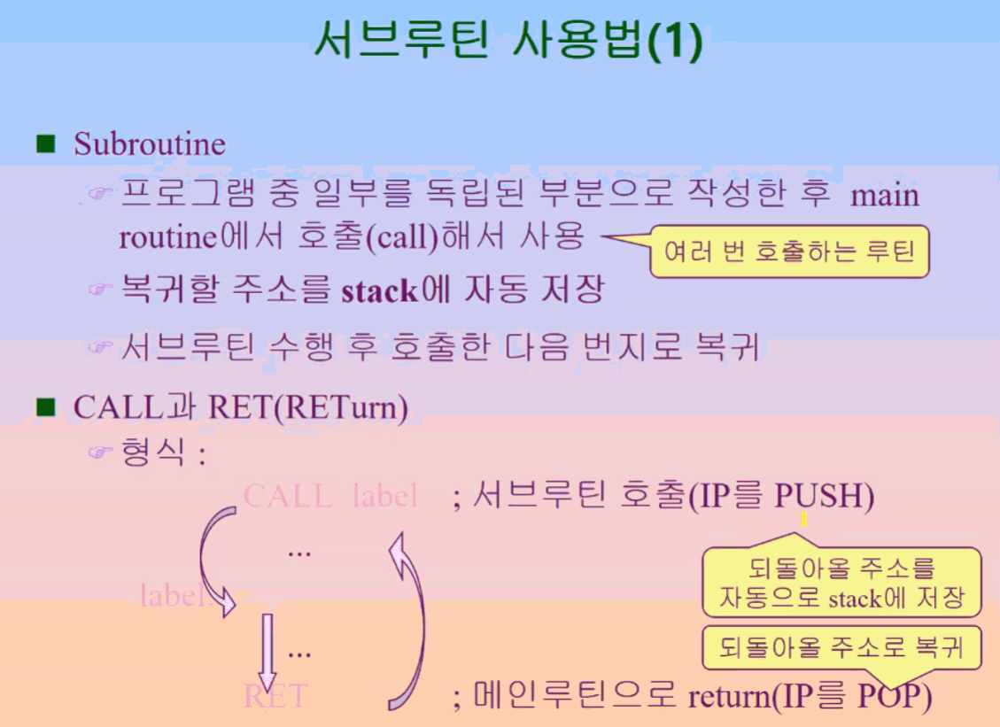

서브루틴은 C 언어에서와 마찬가지로 프로그램 중 일부를 독립된 부분으로 작성한 후, main routine에서 호출(call)해서 사용하는 것이다.

복귀할 주소를 stack에 자동으로 저장해 준다. 즉, CALL은 해당 서브루틴을 실행한 후 저장해 두었던 주소로 되돌아온다.

```nasm
CODE SEGMENT
		 ASSUME CS:CODE
		 MOV CL, 0 ; 초기화

NEXT: CALL PUTNUM ; subroutnie 호출, CL을 가지고 PUTNUM으로 JMP하라.
			INC CL ; CL = CL + 1
			CMP CL, 10 ; CL이 10보다 작은지 비교해서 JMP
			JB NEXT ; NEXT로 JUMP
			MOV AH, 4CH
			INT 21H

PUTNUM:
			MOV DL, CL
			ADD DL, '0' ; 문자 0에 숫자 1을 더함. DL은 문자 0이 된다.
			MOV AH, 2
			INT 21H ; 출력하는 인터럽트
			RET ; RET를 하면 JMP로 뛴 곳의 바로 다음으로 돌아감.
					; 즉, INC CL로 돌아가게 될 것. 마치 함수처럼 활용 가능.

CODE ENDS
		 END
```

---

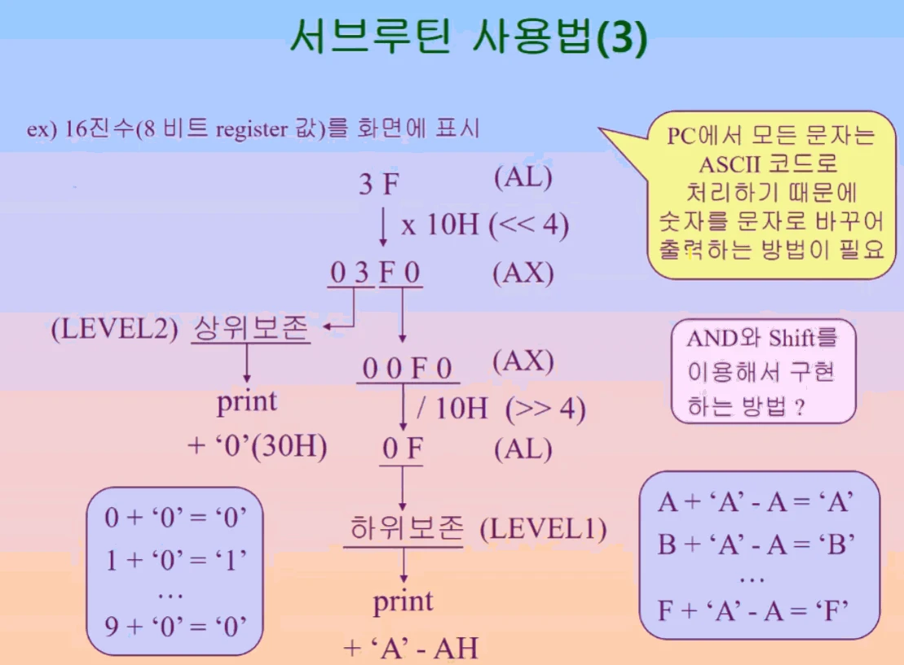

서브루틴을 이용하면 복잡한 기능을 구현할 수도 있다. 

```nasm
CODE SEGMENT
           ASSUME CS:CODE, DS:CODE

           MOV    AX, CS
           MOV    DS, AX
        
           MOV    AL, 3FH
           CALL   PUTAL
           MOV    AH, 4CH
           INT    21H

    PUTAL: 
           MOV    BL, 10H
           MUL    BL
           MOV    LELEL2, AH

           MOV    AH, 0
           DIV    BL
           MOV    LEVEL1, AL

           MOV    DL, LEVEL2
           CALL   PUTHEX

           MOV    DL, LEVEL1
           CALL   PUTHEX
           RET

    PUTHEX:
           CMP    DL, 0AH
           JAE    HEX

           ADD    DL, '0'
           JMP    PRINT

    HEX:   
           ADD    DL, 'A'-0AH

    PRINT: 
           MOV    AH, 2
           INT    21H
           RET

    LEVEL1 DB     ?
    LEVEL2 DB     ?

CODE ENDS
     END
```

레지스터의 값을 16진수로 출력하는 프로그램이다.

---

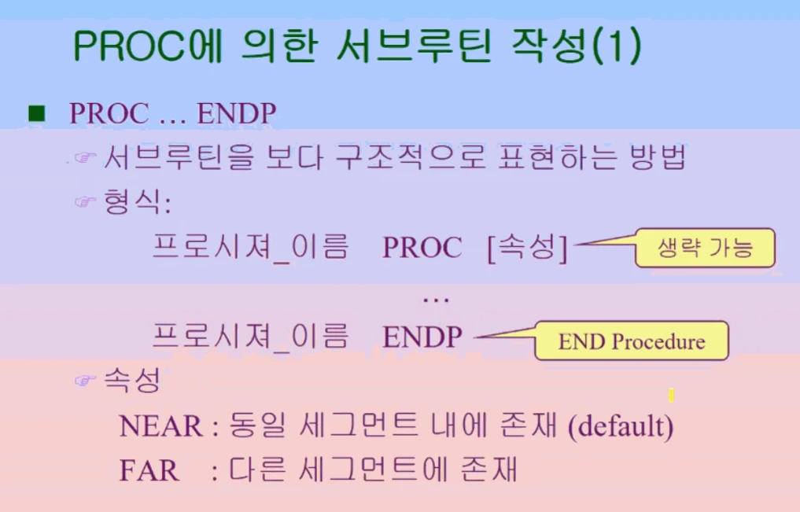

Procedure를 할 때 속성이 같은 Segment 내에 있는 것도 있고, 멀리있는 것도 있다. C언어에서도 원래는 Near Pointer와 Far Pointer가 있었다.

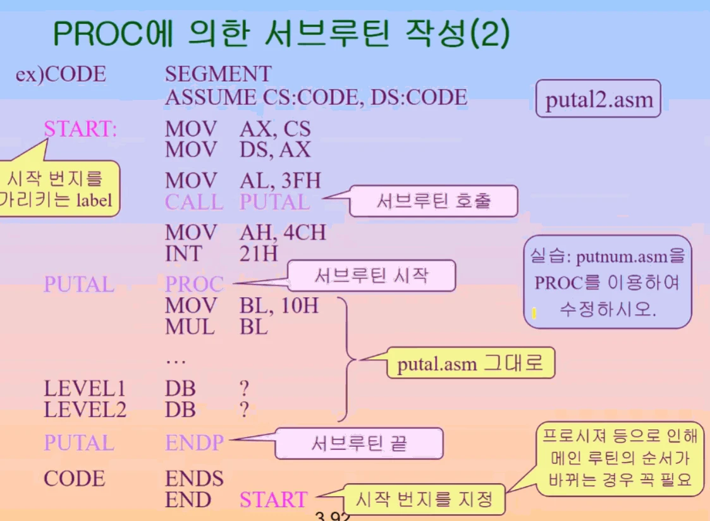

혹은 Procedure를 위와 같이 만들어서 할 수도 있다. 

---

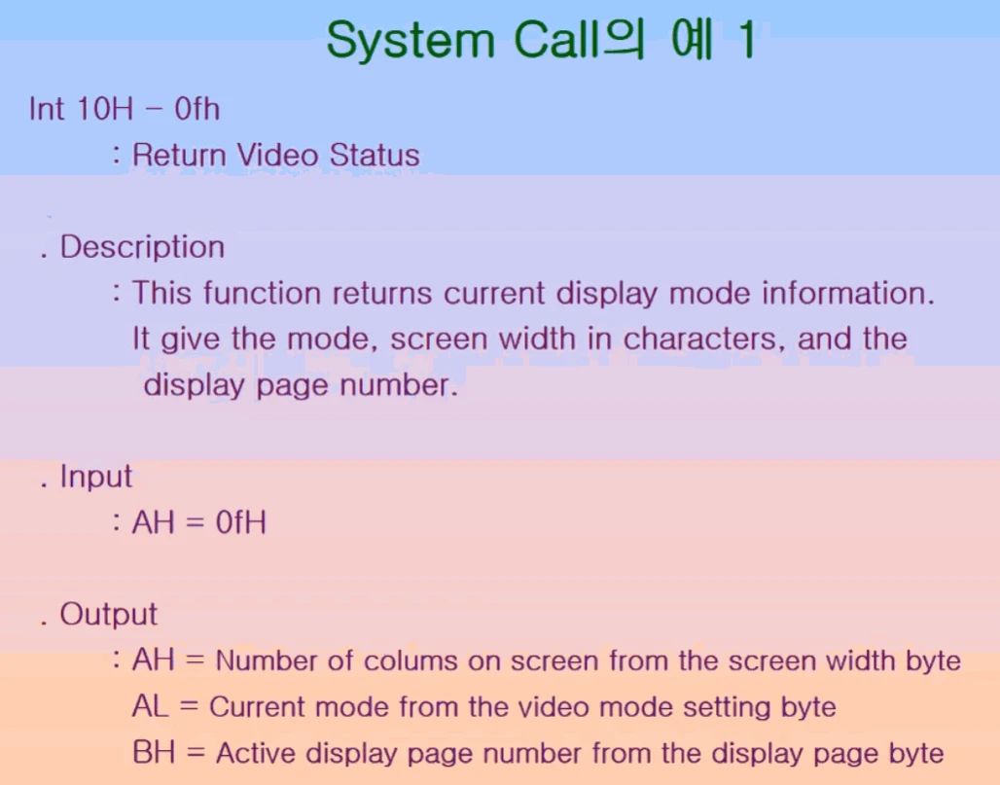

그동안은 interrupt 21H만 사용했지만, 하드웨어 시스템 콜, 그래픽 카드를 이용한 10H도 있다. Video Status를 return한다. 

Description, Input, Output이 Manual에 정리되어 있다.

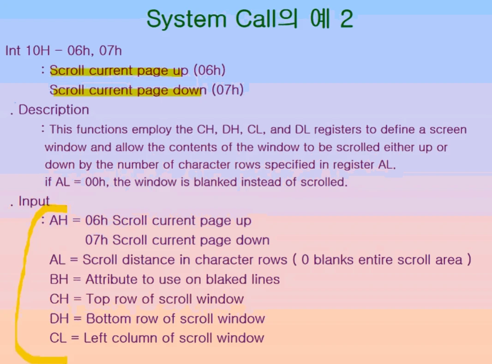

다른 시스템 콜로는 interrupt 10H, subfunction 06H, 07H가 있다. 이것은 현재 페이지에서 스크롤을 업/다운 하는 역할을 한다. 역시 마찬가지로 Description과 Input이 정리되어 있다.

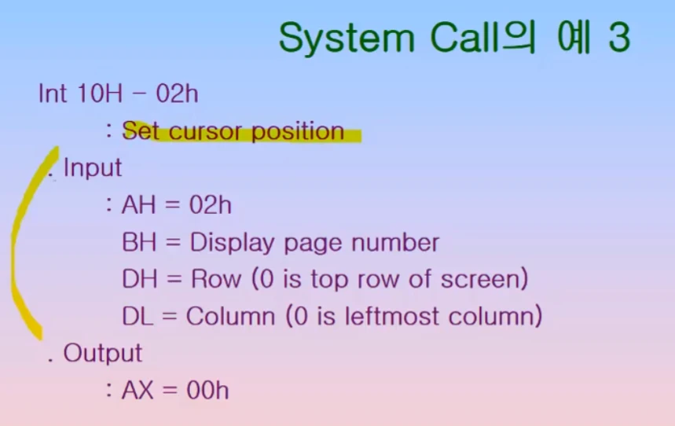

마우스 커서를 옮겨주는 시스템 콜

---

- 예제 1

```nasm
; Title Scrolling n lines by input

.model small
.stack 100h
.code
main proc

         mov dx, offset mesg
         mov ah, 9h
         int 21h

         mov ah, 7
         int 21h                                ; key input
         sub al, '0'                            ; ASCII input에서 '0'을 빼면 숫자를 얻을 수 있음.

         mov ah, 06h                            ; al = number of lines to scroll
         mov bh, 7                              ; bh = attribute to be used on blank line
         mov cx, 0000h                          ; scroll (ch, cl) - (ch, dl) (y, x)
         mov dx, 194fh                          ; = scroll (0h, 0h) - (19h, 4fh)
         int 10h                                ; make a box blank and scroll it up

    stop:
         mov ax, 4c00h
         int 21h

    mesg db  "Line number for scrolling : $"
main endp
    end main
```

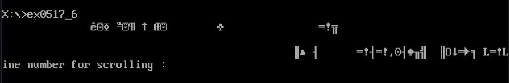

- 예제 2

```nasm
code segment
          assume cs:code, ds:code
          org    100h

    start:
          mov    ax, cs
          mov    ds, ax

          mov    bx, 0

          mov    dx, table[bx]
          mov    ah, 9h
          int    21h

    stop: 
          mov    ax, 4c00h
          int    21h

    m1    db     'message 1', '$'
    m2    db     ' message 2', '$'
    m3    db     '  message 3', '$'
    m4    db     '   message 4', '$'
    m5    db     '    message 5', '$'
    table dw     offset m1, offset m2, offset m3, offset m4, offset m5

code ends
    end start
```

Reserved word used as symbol: TABLE warning이 발생한다.

- 예제 3

```nasm
code segment
    assume cs:code, ds:code
    org 100h

start:
    mov ax, cs
    mov ds, ax

    mov di, 0
increase:
    mov bx, di
    shl bx, 1

    mov dx, table[bx]
    mov ah, 9h
    int 21h

    inc di
    cmp di, 5
    jl increase

stop:
mov ax, 4c00h
    int 21h
```

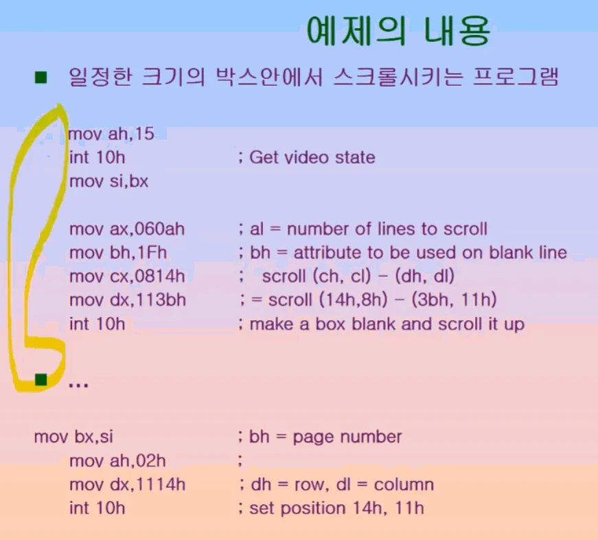

ax에 06을 넣으면 스크롤 up을 시키는 것. 07은 스크롤 down이다. 출력을 하고 스크롤, 출력을 하고 스크롤… 이런 식으로 프로그램을 만들 수도 있을 것이다.

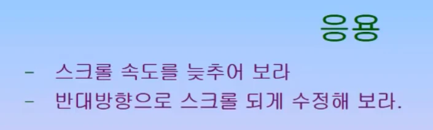
