# Assembly-5: 컴파일과 디버깅 과정

작성일 2023-05-16 · 최종 수정일 2023-06-05
{ .post-date }

- 컴파일 과정, 디버깅 과정에 해당하는 부분을 간단하게 확인해 본다.

```nasm
MAIN 	SEGMENT
			ASSUME CS:MAIN, DS:MAIN

	MOV AX, CS
	MOV DS, AX

	MOV AX, A
	ADD AX, B
	MOV SUM, AX

	MOV AX, 4C00H
	INT 21H

A	DW	2
B	DW 	5
SUM 	DW	? ; 초기값 없음

MAIN 	ENDS
			END
```

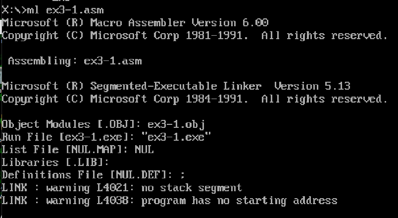

- Stack Segment를 사용하지 않음. CS와 DS만 가지고 프로그램을 다룬다.
- 프로그램의 시작 주소가 지정되지 않았음. 없으면 처음부터 코드를 실행한다. 중간에 어딘가나 세그먼트를 다르게 하거나, procedure를 새롭게 만들고 싶다면, end 뒤에다가 써주면 된다.

dir ex3-1.\*

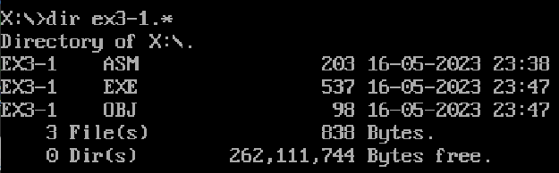

- 디버거 화면

cv /s ex3-1.exe

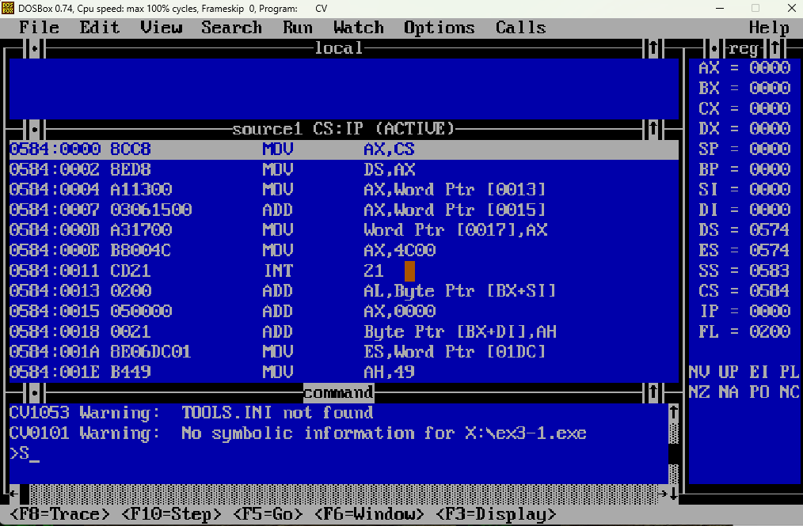

- 우측(reg) : 16bit processor가 쓰고 있는 모든 Register

    - AX, BX, CX, DX : 범용 레지스터
    - SP, BP
    - SI, DI
    - DS, ES, SS, CS : Segment
    - IP : Instruction Pointer, 현재 어디에 있는지
    - FL : flag, 아래 따로따로 나와있는 것들을 합쳐서 넣어둔 것.

    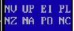

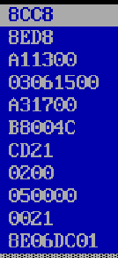

명령어를 따라 만든 결과. 컴퓨터가 처리하게 된다.

디버거는 해당 숫자를 보고 명령어를 만들어낸 것. 우리도 이 두 개의 과정을 모두 할 수 있다.

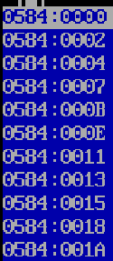

세그먼트 주소 : offset 주소

- MOV AX, CS
- MOV DS, AX

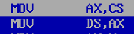

똑같이 나온다.

- MOV AX, A


다르게 나온다. [0013] 번지에 값이 있으며, Word 타입. 두 바이트 라는 뜻이다. 0013이 어딨냐면, 좌측의 오프셋 주소에서 찾아가면 된다.


인텔 계열 CPU에서는 Little Endian을 사용하기 때문에 값이 뒤집어져서 저장되므로, 0200. 즉, 0002 : ‘2’라는 값이 저장되어 있다. 여기서 나오는 모든 수는 16진수이다.

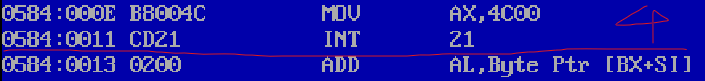

0013번지의 위를 보면 interrupt를 수행해서 프로그램을 종료하고 있으므로, 프로그램 코드와 데이터가 섞이지 않는 것을 알 수 있다. 데이터의 위치가 프로그램 중간에 존재하면 명령어로 해석이 될 수도 있기 때문에 주의해야 한다. 코드와 데이터는 똑같다. 쳐다보기에 따라 다르다.

15번지에는 뭐가 있을까? 0005가 있을 것이다. 그런데, 뒤집어져서 0500으로 저장되어 있다.

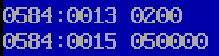

그런데, 이후에 나오는 변수 SUM은 초기값이 없다. 그래서 위의 0015번지의 숫자가 050000이 된 것이다. 디버거가 자신이 해석할 수 있는 형태로 바꿔준 것이다.

---

프로그램 실행은 F10을 누르면 Line by Line으로 수행할 수 있다. F10을 한 번 누르면 Register의 값이 다음과 같이 바뀌게 된다.

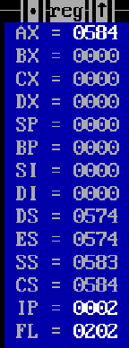

코드 세그먼트가 현재 0584로 되어 있고, AX에 CS의 값을 복사하므로 AX가 0584가 되었다. IP는 0002가 되었고, 이는 이제 실행할 주소가 0002라는 것이다. FL이 바뀐 것은, 이 명령 하나를 수행하면서 Flag 중에서 해당하는 비트의 값이 바뀌었다는 것이다. 0200에서 0202가 되었으므로, 하위 바이트에서 하위 두 번째 비트가 1이 된 것이다. 즉,

0000 0010 0000 0000 ⇒ 0000 0010 0000 0010 이 된 것이다.

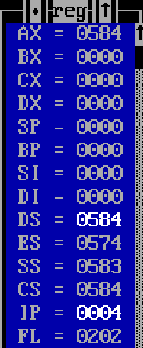

한번 더 수행해보면, DS의 값이 0584가 되고, IP도 증가한다.

다음 줄은 MOV AX, Word Ptr [0013]을 수행하는데, 이는 0013번지의 값을 Word 단위(두 바이트)로 읽어서 AX에 복사하라는 뜻이다. Word 단위로 읽게 되면 현재 0013 번지에 저장되어 있는 값인 0200을 거꾸로 뒤집어서 0002를 복사하게 될 것이다.

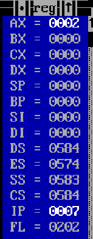

예상한 것과 같이, AX의 값이 0002가 되었으며, IP는 0007이 된다. 왜냐면, 이전에 수행한 명령은 세 바이트를 차지하는 명령이었기 때문이다. 주소가 두 바이트이기 때문이다.


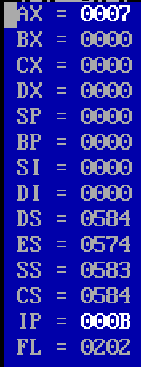

명령을 한 줄 더 실행하면 ADD AX, Word Ptr [0015]를 수행한다. 이렇게 되면 0015번지의 값을 AX에 더하게 된다. 0015 번지의 값은 0005 이므로, 0002 + 0005를 해서 AX = 0007이 된다.

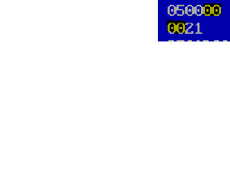

그 다음 줄은 MOV Word Ptr [0017], AX를 수행한다. 현재 0015번지에서 0500이 15, 16번지이고, 그 다음이 0017번지이다. (상단 이미지의 첫 번째 줄에서 형광펜이 칠해지지 않은 부분)

그리고 그 밑의 0018 번지에서 형광펜이 칠해진 00이 0018번지이므로, 두 개가 0017번지의 Word이므로 해당 부분에 값이 저장될 것이다.

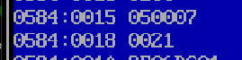

확인해보면, AX에 저장되어 있던 값 0007이 0017 번지부터 거꾸로 들어간 것을 확인할 수 있다. (0700으로 들어가게 됨.)

그 다음 줄은 MOV AX, 4C00 이다. 이것은 AX에 4C00을 넣고, 21H번 interrupt를 수행하는 것이다. (21H는 33이고, 운영체제가 가지고 있는 S/W적인 interrupt. 즉, trap을 실행하는 것이다.)

만약 코드를 아래와 같이 바꾼다면?

```nasm
MAIN 	SEGMENT
	ASSUME CS:MAIN, DS:MAIN

	MOV AX, CS
	MOV DS, AX

	MOV AL, A
	ADD AL, B
	MOV SUM, AL

	MOV AX, 4C00H
	INT 21H

A	DB	2
B	DB 	5
SUM 	DB	? ; 초기값 없음

MAIN 	ENDS
			END
```

- DW(Word 단위)에서 DB(Byte 단위)로 교체했다. 이에 따라 AX(두 바이트)도 AL(한 바이트)로 교체했다.

혹은 아래와 같이 한다면?

```nasm
MAIN 	SEGMENT
	ASSUME CS:MAIN, DS:MAIN

A	DB	2
B	DB 	5
SUM 	DB	? ; 초기값 없음

	MOV AX, CS
	MOV DS, AX

	MOV AL, A
	ADD AL, B
	MOV SUM, AL

	MOV AX, 4C00H
	INT 21H

MAIN 	ENDS
			END
```

- 이렇게만 하면, Data Segment 파트가 실행이 되어버리기 때문에, 잘못된 결과가 발생할 수 있다. 그러므로 아래와 같이 수정해 주어야 한다.

```nasm
MAIN 	SEGMENT
	ASSUME CS:MAIN, DS:MAIN

A	DB	2
B	DB 	5
SUM 	DB	? ; 초기값 없음

start:	MOV AX, CS ; start
				MOV DS, AX

				MOV AL, A
				ADD AL, B
				MOV SUM, AL

				MOV AX, 4C00H
				INT 21H

MAIN 	ENDS
			END start ; start end
```

이와 같이 레이블을 설정하면 시작부를 정할 수 있다.

혹은, 현재는 CS와 DS가 같은  Segment를 사용하고 있는데, DS가 다른 Segment를 사용하도록 만들 수도 있다.

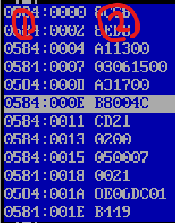

코드 세그먼트 안에 있는 오프셋은 숫자가 어떻게 변한다? (1) 세그먼트 하나가 바뀌면 (2) 뒤는 16이 바뀐다. (2)가 17이 되면 (1)이 1 증가된 것과 똑같은 효과를 나타낼 수 있다.
