# Assembly-6: 세그먼트 구성과 프로그램 시작점

작성일 2023-05-17 · 최종 수정일 2023-06-05
{ .post-date }

- 코드를 바탕으로 컴퓨터 아래의 구조에 대해서 살펴본다. (어떻게 메모리가 할당되고 코드가 어떻게 운용되는지, 내가 만든 코드를 프로그램의 실행 파일에 어떻게 메모리 할당을 하는지 등을 조금씩 변형하면서 확인한다.)

---

```nasm
main segment
          assume cs:main, ds:main

    start:mov    ax, cs
          mov    ds, ax

          mov    ax, A
          add    ax, B
          mov    sum, ax

          mov    ax, 4c00h
          int    21h

    A     dw     2
    B     dw     5
    SUM   dw     ?

main ends
    end
```

- 이 코드를 구조 관점에서 살펴보자. 현재 segment는 두 개를 사용하고 있다. 그런데, 하나의 이름으로 선언했다. 바로 main이라는 이름으로 선언했다. segment가 같다는 소리는, assembly 코드도 main segment 안에 들어있고, data도 main segment 안에 들어있다는 것이다.
- 코드와 데이터가 한 곳에 혼용되어 있음. 데이터와 코드는 숫자로만 들어가기 때문에 실제로는 구분되지 않는다. (폰 노이만 구조) 내가 코드라는 영역의 위치와 데이터의 위치를 알지 못하면 이를 구분하지 못한다는 것이다.
- 그래서 이를 명확히 나타낼 필요가 있다.
- 코드에서 억지로 구성하지 않는 이상, 프로그램이 mov ax, 4c00h int 21h에 의해 끝나기 때문에 data가 코드로 인식될 일은 없다. 그런데, 데이터를 앞에다가 옮기면 어떻게 될까?

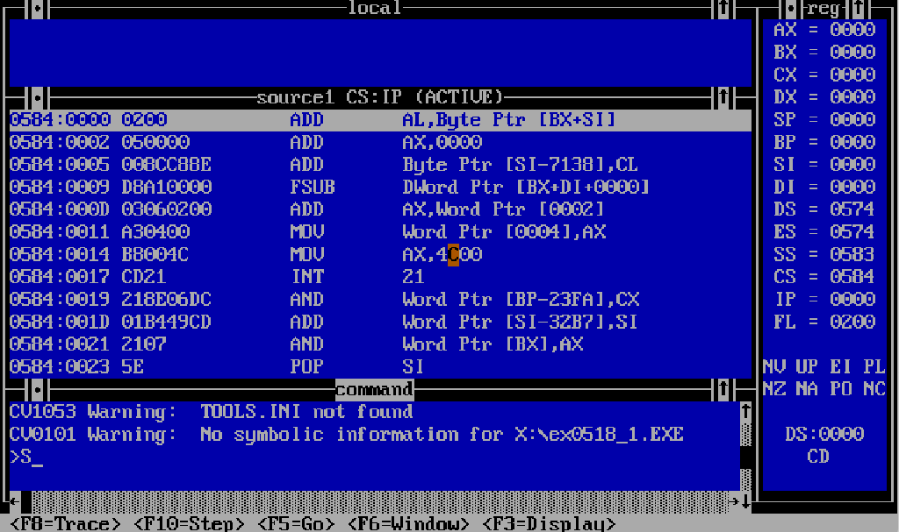

코드를 수정한 후 디버거를 켜보니, 코드의 첫 부분이 약간 이상한 것을 알 수 있다. 0200, 050000, 008CC88E와 같은 값이 들어가 있다. 이는 **데이터 영역이 코드로 해석된 것**이라고 볼 수 있다. 숫자로 저장되고 나면 실행되는 입장에서는 **프로그램인지 데이터인지 구분하지 않고 명령어로 인식**해서 실행하기 때문에 의도하지 않은 결과가 나오게 되는 것이다.

그러므로 코드가 어떤 영역에서 시작되는지 명시해 줄 필요가 있다. 이를 Label(레이블)이라고 하고, Procedure를 추가할 수도 있다.

```nasm
main segment
assume cs:main, ds:main

A     dw     2
B     dw     5
SUM   dw     ?

start:mov    ax, cs
      mov    ds, ax

      mov    ax, A
      add    ax, B
      mov    sum, ax

      mov    ax, 4c00h
      int    21h

main ends
	end start ; start가 코드의 시작점이라고 알려줌.
```

현재 start:의 자리에는 Label이 올 수도 있고, Procedure(함수)와 같은 것이 여러 개 있다면 그 함수의 이름을 써줘도 괜찮다.

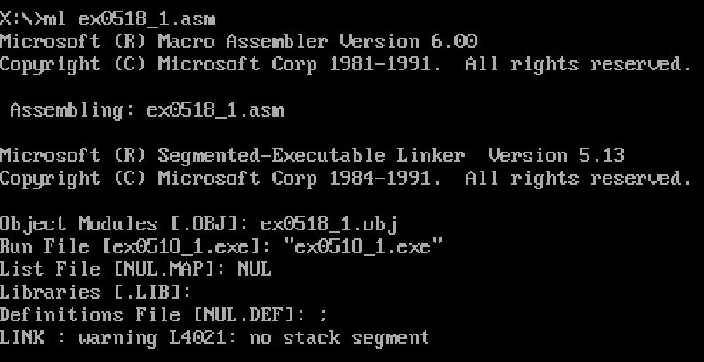

코드를 위와 같이 수정하고 나면, 이전에 뜨던 ‘시작점이 지정되지 않았음’ warning이 뜨지 않게 된다. stack은 사용하지 않으므로 stack warning은 그대로 둔다.

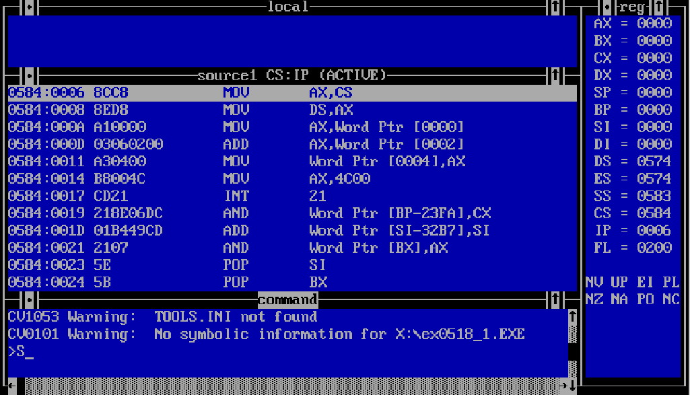

우리가 만들었던 변수 A, B, SUM은 어디로 갔는가? 디버거의 첫 시작점의 offset을 보면, 0006이 시작점이다. 이는 우리가 만든 변수 세 개가 각각 DW(두 바이트)이기 때문에 첫 시작점으로부터 두 바이트씩 만들어진 것이라고 볼 수 있다. 

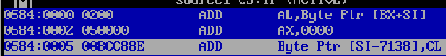

위로 올라가보면 데이터 세 개가 존재함.

0200

0500 | 00

00 (이건 초기값이 없어서 이전 바이트에 붙어서 만들어지게 됨, 0000임)

이 올바르게 만들어진 것을 알 수 있다.

그런데, 코드의 오프셋 주소가 약간씩 바뀐 것을 확인할 수 있다.

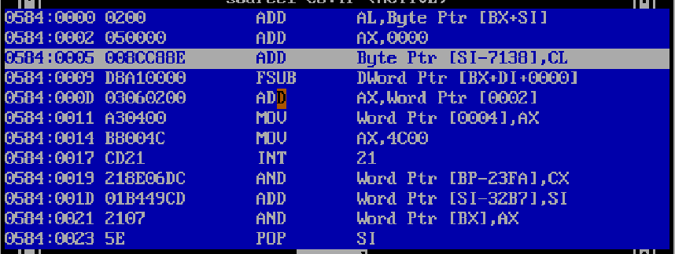

이는 실제 시작점인 0006부터가 아니라 0000부터 출력하려다 보니 약간의 조정이 생긴 것인데, 0005번지를 보면 00 | 8CC88E로 되어 있는데, 저기가 실제 시작점이라고 볼 수 있을 것.

0000부터 시작한다고 재해석을 해서 보여주기 때문에 디버거가 이렇게 바꿔버린 것. F10을 누르면 다시 정확히 실행된다. (0006번지부터)

- 코드 영역과 데이터 영역을 같이 썼는데, **코드의 시작 번지를 지정**해주면 **IP**(Instruction Pointer)가 거기로 세팅이 되니까 **앞 쪽(데이터)은 코드로 처리되지 않는다.** 디버거가 보는 과정에서 재해석 하더라도, 실제 코드는 실행되지 않는다는 것을 알 수 있다.

임베디드 시스템은 구조를 크게 잡지 못하는 경우가 많기 때문에, 메모리를 작으면 몇 백, 몇 만 Byte 내로 해결해야 될 수도 있다. 이런 경우에는 이와 같은 메모리의 사용을 이해하는 것도 중요하다. (영역을 구분하지 않고 넣는 경우가 많음. 영역을 구분하면 메모리가 많아지게 됨.)

---

다시 데이터 영역을 아래로 내려서 확인해보자!

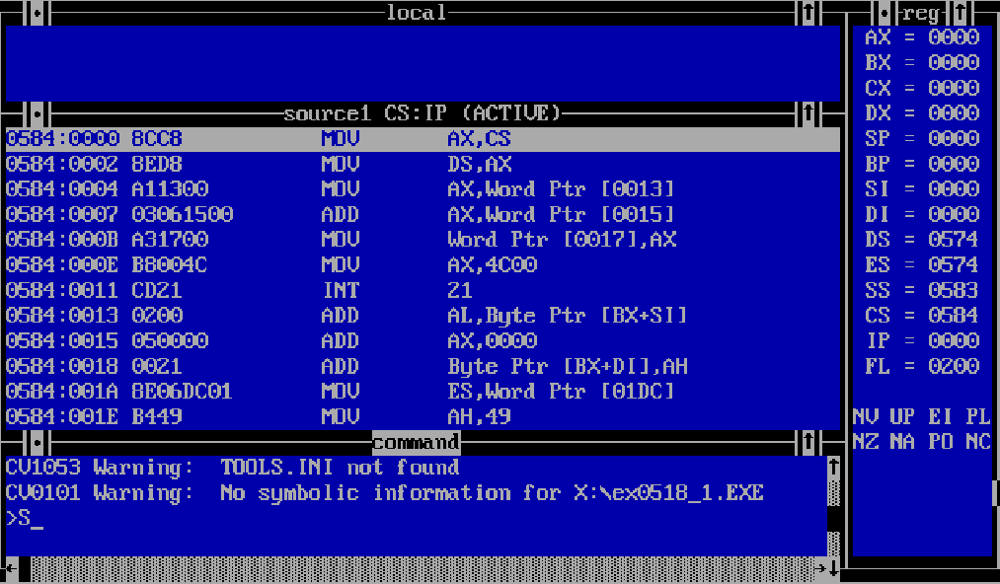

현재 A라는 변수는 DW(두 바이트)로 선언이 되어 있는데, 0004번지의 명령을 보면 **0013번지의 데이터를 AX로 MOV**하겠다고 나와있다. 그런데 그것이 **Word 단위의 데이터**이다. (두 바이트)

**0013**번지를 가보면 **0200**(Little Endian. 실제 값은 0002)가 있다. 이걸 **Byte 단위**로 바꿔보자.

현재 명령어에 할당된 크기를 보면,

MOV AX, A ; 3 바이트, 0013번지

MOV AX, B ; 4 바이트, 0015번지

MOV SUM, AX ; 3바이트, 0017번지 (?로 선언되어서 0016번지 이후에 이어져서 나옴)

이걸 DB로 바꿔보자.

```nasm
main segment
          assume cs:main, ds:main

start:    mov    ax, cs
          mov    ds, ax

          mov    ax, A
          add    ax, B
          mov    sum, ax

          mov    ax, 4c00h
          int    21h

    A     db     2
    B     db     5
    SUM   db     ?

main ends
    end start ; 코드의 시작점이라고 알려줌.
```

그런데, 이렇게 하면 AX는 두 바이트이기 때문에 값이 제대로 들어가지 않는다. 그러니까 AL(AH를 써도 관계는 없음)을 사용해보자.

```nasm
main segment
          assume cs:main, ds:main

start:    mov    ax, cs ; 여기는 segment를 알려주는 부분이므로 ax
          mov    ds, ax

          mov    al, A
          add    al, B
          mov    sum, al

          mov    ax, 4c00h ; 여기서 ax의 값을 바꿔도 지장없다.
          int    21h

    A     db     2
    B     db     5
    SUM   db     ?

main ends
    end start ; 코드의 시작점이라고 알려줌.
```

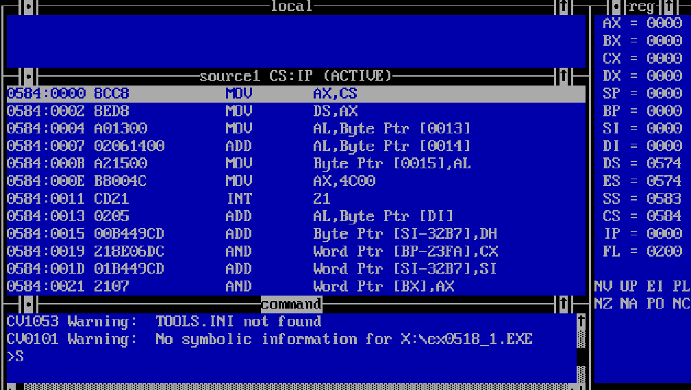

MOV와 ADD에서 차이가 발생하는데, 바이트 단위로 줄었기 때문에 접근하는 주소가 1씩 줄어든 것을 볼 수 있다. 0013, 0014, 0015 그리고 MOV, ADD에서 가리키는 것도 Word Ptr에서 Byte가 되었다.

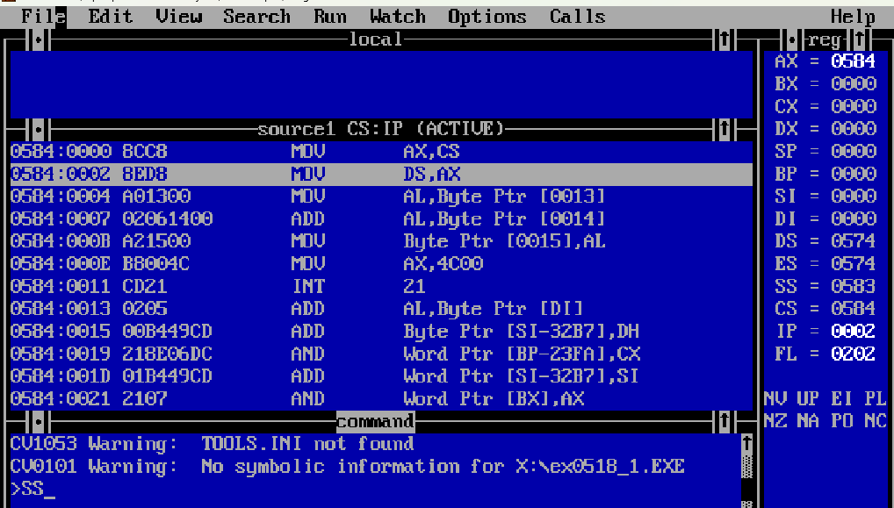

F10을 눌러 첫 줄을 실행하면 IP가 0002가 되고, CS가 0584이기 때문에 MOV AX, CS를 수행하면 AX는 0584가 된다. 

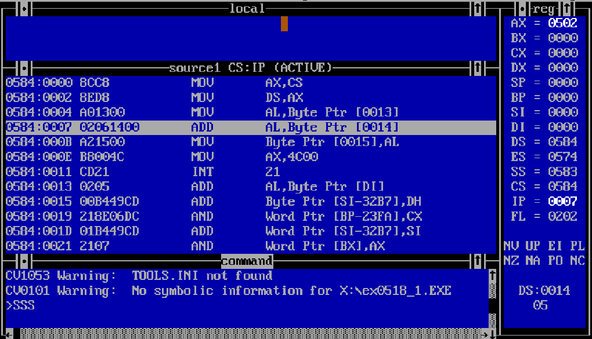

이후에 세 번째 명령까지 수행하고 나면 AX는 0502가 되는데, 이는 AL에 0013번지의 한 바이트 값을 MOV해 주었기 때문이다. 그 다음 줄까지 수행하면 AX는 0507이 된다.

이후에 한 줄을 더 수행하면, 0015번지의 값이 07이 된다.

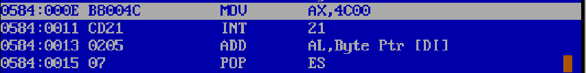

0015번지가 POP ES가 된 것은, 07에 맞는 코드로 디버거가 해석한 것이다.

---

> 그런데 만약 더한 값이 FF를 넘으면, 어떻게 될까?  
>   
> OverFlow Flag가 생기고, 올라간 값이 저장된다.

```nasm
main segment
          assume cs:main, ds:main

start:    mov    ax, cs
          mov    ds, ax

          mov    al, A
          add    al, B
          mov    sum, al

          mov    ax, 4c00h ; 여기서 ax의 값을 바꿔도 지장없다.
          int    21h

    A     db     0ffh
    B     db     1
    SUM   db     ?

main ends
    end start ; 코드의 시작점이라고 알려줌.
```

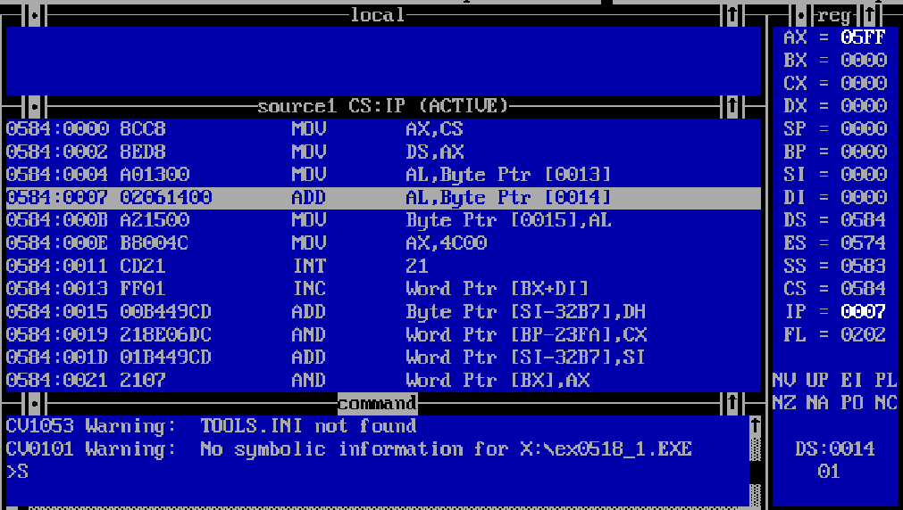

세 번째 줄까지 수행하면 AX는 05FF가 되고, 이제 다음 줄에서 1을 더한다.

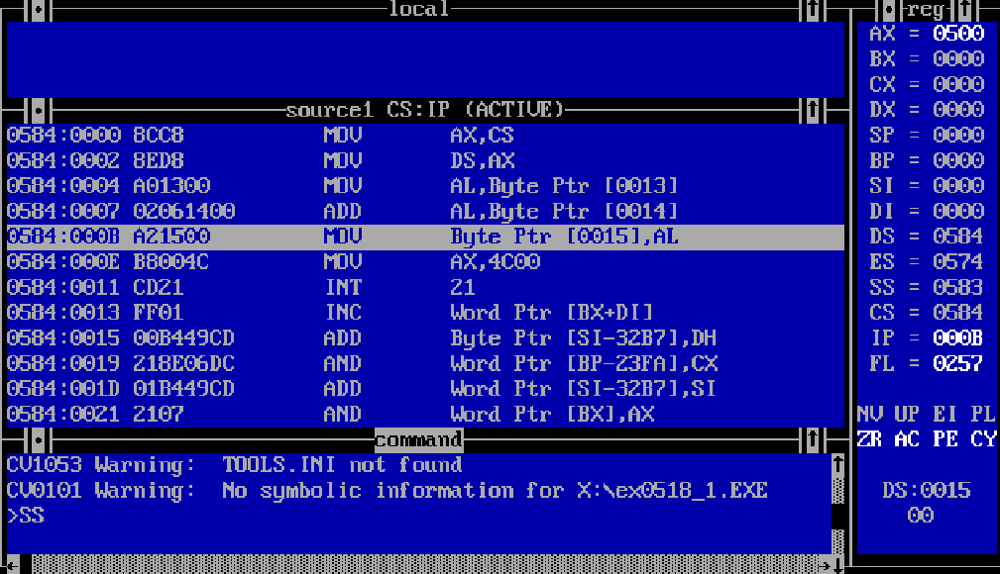

AX는 0500이 되고, FL값이 바뀌게 되는데, Overflow Flag라는 것이 있다. 그것 때문에 FL 전체 값이 바뀌었다. AX에서 AH의 값까지 바뀌지는 않는다. 

**만약 AX를 바꾼다면, AH에 영향이 가겠지만, AL을 바꾼다고 해서 AH까지 영향이 미치지는 않는다.**

---

- 이번에는 Data를 저장하는 Segment를 별도로 사용해보자.

```nasm
main segment
          assume cs:main, ds:data

start:    mov    ax, ds
          mov    ds, ax

          mov    al, A
          add    al, B
          mov    sum, al

          mov    ax, 4c00h ; 여기서 ax의 값을 바꿔도 지장없다.
          int    21h
main ends

data segment
    A     db     0ffh
    B     db     1
    SUM   db     ?
data ends

    end start ; 코드의 시작점이라고 알려줌.
```

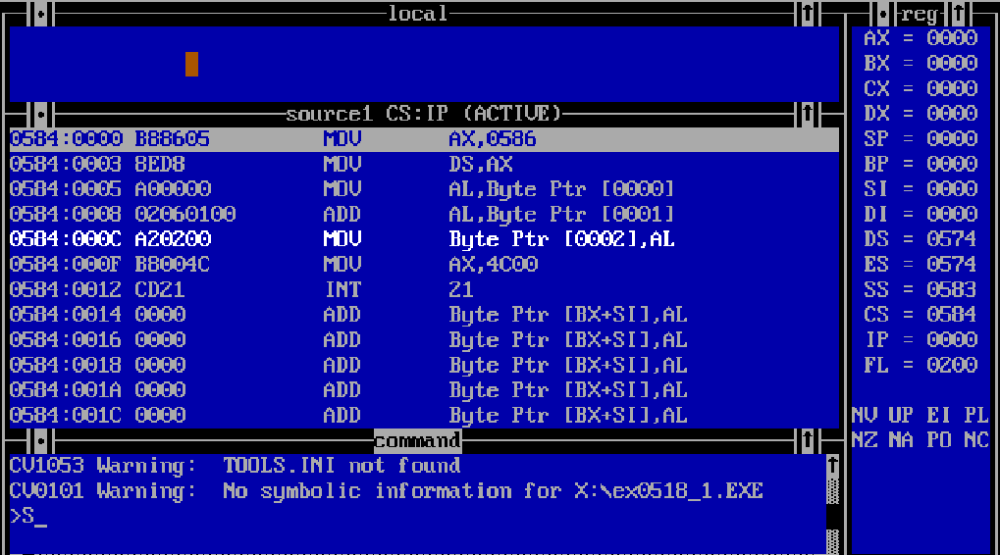

이전에는 데이터 A, B, SUM이 0013, 0015, 0017이었지만 지금은 0000번지에 존재하게 된다.

- 첫 번째 줄

MOV AX, 0586 ; 0586은 Data Segment가 현재 Code Segment 밑에 밑에 블록으로 잡힌 것.

- 두 번째 줄

MOV DS, AX ; 이렇게 하면 DS는 0586이 된다.

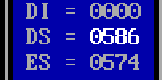

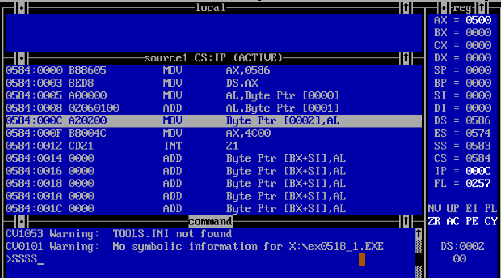

계속해서 연산하다보면 AX는 0500 (FF에서 1을 더함)이 된다. 그런데, A, B의 번지가 [0000], [0001]이다. 어디에 있을까? 

다음 줄을 수행하면, SUM에는 AL의 값. 즉, 00이 저장된다.

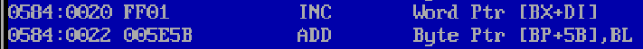

찾아가면 있음. 0586에 있어야 하는데, 왜 0584에 0020번지에 있을까?! 잘못된 건가? 아니다. 이유가 무엇이냐면, 세그먼트가 0584에서 0586으로 바뀐 과정을 보면, 물리번지를 계산할 때 0584에 0을 하나 더 붙이게 된다. 그리고 거기에 offset을 더하면 물리번지가 된다. 그럼 05840과 05860의 차이는 20만큼 난다. 10진수로 하면 36의 차이. 즉, segment가 하나 커진다는 것은 16바이트가 커진다는 것이고, 이 말은 즉슨 32바이트 밑에다가 데이터 세그먼트를 만든 것이다.

⇒ 왜 이렇게 만든 것인가? 코드는 20바이트가 채 안되는 정도로 끝났기 때문에, 해당 블록이 끝나는 블록의 바로 다음에 잡으면 0020이 된다.

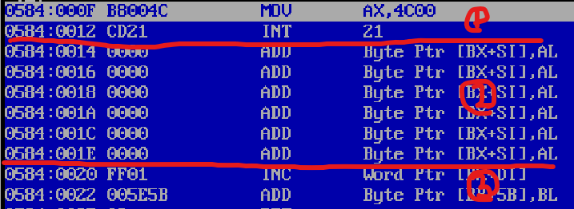

1) 코드 실행 끝. MOV AX, 4C00H는 세 바이트 명령이므로 실제로는 0011까지 데이터가 존재.

2) 쓰레기값.

3) 이 블록의 바로 다음 부분이 0020부터 시작. 그러므로 데이터 영역을 0584 : 0020으로 잡아줌.
