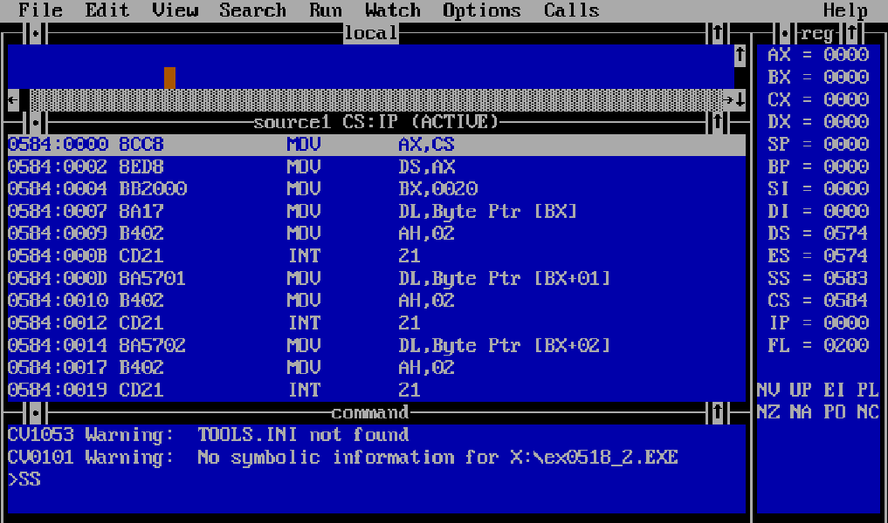
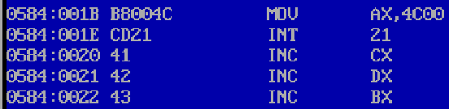
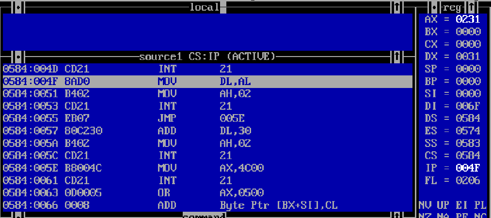

# Assembly-7: Offset 접근과 숫자 출력

작성일 2023-05-18 · 최종 수정일 2023-06-05
{ .post-date }

```nasm
MAIN SEGMENT
	ASSUME CS:MAIN, DS:MAIN ; 데이터도 main에 쓰겠다
	
	; data segment 지정
	MOV AX, CS
	MOV DS, AX
	; mov ds, cs는 막혀있음. 혹시나 잘못될까봐.

	MOV BX, OFFSET L1 ; L1의 offset 주소를 얻어온다.
					  ; segment로부터 얼마나 떨어져있는가.
	MOV DL, [BX]
	MOV AH, 2 ; 문자 하나를 출력하는 시스템 콜
	INT 21H

	MOV DL, [BX+1] ; 1바이트 증가. ADD를 해도되고, INC를 해도 됨.
	MOV AH, 2 ; 문자 하나를 출력하는 시스템 콜
	INT 21H

	MOV DL, [BX+2] ; 1바이트 증가. ADD를 해도되고, INC를 해도 됨.
	MOV AH, 2 ; 문자 하나를 출력하는 시스템 콜
	INT 21H

	MOV AX, 4C00H
	INT 21H

L1 DB 'ABC'

MAIN ENDS
	END ; 어디서 시작할지 label이나 procedure를 써줌.
```

DB변수의 offset을 얻어서 연속적으로 생성된 변수 ‘ABC’에 하나씩 접근해 나간다.





프로그램이 끝나는 부분 다음으로 41, 42, 43 (‘A’, ‘B’, ‘C’)가 올바르게 저장되어 있다. 

---

```nasm
title ex0518_3.asm ; 써도 되고 안써도 됨

.model small ; 옛날에 프로그램 만들 때는 작은 프로그램을 만들 때 small 설정을 해줬었다.
.stack 100h ; 지금은 stack을 쓰지는 않지만 나중에 쓸거라 small 설정, 시작 위치 지정.
.data ; data가 들어간다.
a	db	2
b	db	5
sum	db	?

.code ; code가 들어간다.
main proc ; procedure를 사용.
	mov	ax, @data ; @data라고 쓰면 data 영역을 말하는 것.
	mov	ds, ax ; 이전에 segment를 지정해준 것과 같은 역할.

	; 진짜 프로그램 영역.
	mov al, a 
	add al, b ; 굳이 mov bx, b를 하지 않고, add를 바로 해버릴 수 있음.
	mov sum, al

	add al, '0'
	mov dl, al
	
	mov ah, 2
	int 21h

	mov ax, 4c00h
	int 21h

main endp ; 이전에는 end segment로 ends를 썼지만, 현재는 procedure기 때문에 endp
	end main ; 프로그램의 시작점을 지정.
```

이 template에서 .stack 설정을 해주면, stack warning이 뜨지 않는다.

어셈블리에서의 한 줄 한 줄이 CPU가 처리하는 하나의 명령이 된다.

---

```nasm
MAIN SEGMENT
	             ASSUME CS:MAIN, DS:MAIN

	             MOV    AX, CS
	             MOV    DS, AX

	             MOV    DI, OFFSET ARRAY
	; DI와 SI는 주소를 가질 수 있음. 현재로서는 특별한 명령어를 쓰는게 아니라 상관 X
	             MOV    AX, [DI]           	; 15
	             MOV    LARGEST, AX
	             MOV    SMALLEST, AX
	             MOV    CX, 6

	A1:          
	             MOV    AX, [DI]
	             CMP    AX, SMALLEST
	             JGE    A2                 	; AX가 더 크거나 같으면 넘어감
	             MOV    SMALLEST, AX

	A2:          
	             CMP    AX, LARGEST
	             JLE    A3
	             MOV    LARGEST, AX

	A3:          
	             ADD    DI, 2              	; 현재는 데이터 단위가 DW이기 때문에 2 증가.
	             LOOP   A1                 	; CX의 값에 따라 LOOP 동작

	; OFFSET을 가져와서 앞의 한 바이트의 값만 가져옴
	             MOV    DI, OFFSET SMALLEST
	             MOV    DL, [DI]
	             ADD    DL, '0'
	             MOV    AH, 2
	             INT    21H
 
	; OFFSET을 가져와서 앞의 한 바이트의 값만 가져옴
	             MOV    DI, OFFSET LARGEST
	             MOV    DL, [DI]
	
	             CMP    DL, 10
	             JB     LESS_THAN_10
	; 만약 10보다 크다면 출력을 다른 방식으로 해야 함.
	
	             SUB    DL, 10
	             ADD    DL, '0'
	             MOV    AL, DL

	; 기존의 DL에서 10을 뺀 값을 AL에 임시로 저장해 놓음.

	             MOV    DL, '1'
	             MOV    AH, 2
	             INT    21H
	; 먼저 앞자리 수. 1을 출력하기 위해 DL에 ASCII '1'을 복사함.
	; 1이 출력됨
	
	             MOV    DL, AL
	             MOV    AH, 2
	             INT    21H
	; 잘렸던 값을 출력함

	             JMP    EXIT

	LESS_THAN_10:
	             ADD    DL, '0'
	             MOV    AH, 2
	             INT    21H

	EXIT:        
	             MOV    AX, 4C00H
	             INT    21H

	ARRAY        DW     13, 5, 8, 9, 6, 2
	LARGEST      DW     ?
	SMALLEST     DW     ?

MAIN ENDS
	END
```

- 코드에서 문제 발생? 위와 같이 코드를 짜면 13이 제대로 나오지 않음.

LARGEST의 OFFSET을 DI에 얻고, 이를 통해 접근해서 데이터를 DL에 넣으면, 한 바이트 데이터가 들어가게 된다. 이를 통해 숫자를 얻을 수 있게 된다.

그런데, 10보다 큰 숫자일 경우에는 두 자리를 출력해야 하기 때문에 10을 뺀 값을 AL에 저장해두고, ‘1’을 출력한 다음에 MOV DL, AL을 한 뒤 MOV AH, 2 INT 21H를 하려고 했다. 그런데 AL에다가 하면 값이 제대로 안나옴?! AL을 쓰지 않고 BL을 쓰면 가능하다.

이유가 뭘까? 디버깅이 필요해 보임.



확인해 본 결과, MOV AH, 2 INT 21H를 하면 출력된 결과가 AL에 저장되는 것으로 보임. 원래 AL의 값이 33으로 ‘3’이었는데, ‘1’을 출력하고 나니 ‘1’이 되었음. 그래서 ‘1’을 출력하고 나서 AL에 저장해두었던 값을 DL에 MOV하고 다시 출력하면 또다시 ‘1’이 나오는 것이었음…
