# 1주차(센서의 기본)

**2023.03.07**

- 4차 산업 혁명의 핵심은 AI에 있다. chatGPT? → 로봇에 적용하면 나보다 지능이 높은 로보틱스 사물이 존재하게 되는 것.
- 대량 생산 시스템에 AI가 들어가게 되면서, 사람은 생산 과정에서 사라지게 된다.

---

- 인간의 뇌는 이성 → 감정 → 본능과 같은 방향으로 활동하게 된다. 나이가 어릴 때는 본능으로 살아가다가 점차 어른이 되면서 사회화가 되고, 이성으로 감싸진 사람이 된다.
- 일론 머스크가 AI가 두렵다고 하는 것은 누군가가 만약, 감정과 본능을 갖게 되는 것을 두려워하는 것 같다.
- 산업 혁명

1차 : 노동으로부터의 해방

2차 : 전기를 이용한 효율적인 동작

3차 : 정보의 혁명

4차 : 사람이 사라짐?

---

- 임베디드시스템공학과에서 가장 중요한 것은 머신 러닝이다. 
- AI시스템에서 향후 가장 중요해질 것은 바로 Robotics이다.
- ex) 아파트 단지 별로 하나씩 로봇이 있다고 할 때, 택배왔을 때 트럭에서 단지 별로 구분해서 하차한 다음, 택배 기사는 가고 알아서 갖다주는 방식의 로봇?
- 정해진 로직대로 움직이는 것이 아니라, 학습을 하면서 변해가는 상황에 맞게 대처하는 똑똑한 AI 로봇.

---

- 인간의 편의를 위해서 기계에게 어떻게 일을 시킬 것인가? 기계가 실제 Real World를 이해하기 위해서는 센서에 대한 이해가 필요하다. 기계는 센서를 통해 Real World를 이해하고, 이를 통해 Actuator를 움직인다. 즉, 이 과목은 인간과 컴퓨터 간의 인터페이스를 위해서 쌓아왔던 지식을 이해하고 공부하는 것이다.
- 자율주행 자동차에서 센서를 통해 데이터를 가져왔을 때, 이 데이터를 기반으로 얼마나 밟을 것인가? 휠을 얼마나 돌릴 것인가? 브레이크를 어떻게 밟을 것인가? 이런 것을 판단하는 것이 결국 전부이다.
- Neural Network가 자율주행에 맞게 사용될 수 있도록 개발해야 한다. 흰선, 노란선 등을 정확하게 인지하고 제어할 수 있도록 학습을 시켜야 한다. 
- 자율주행과 연관된 기술의 경쟁은 매우 치열하고, 산업의 판도를 바꿀만큼 영향력이 크다. 세계적 기업들은 대부분 IT 기업이고, 이들은 모두 자율주행자동차를 연구하고 있다. 대외적으로 공개를 안할 뿐이지 모두 연구하고 있으며, 이를 놓치면 앞으로 먹거리가 사라지게 되므로 매우 중요하다.

- Research Trends - Tesla

    - Tesla, 자율주행 인공지능 개발 및 지속적 업그레이드…
    - 차에 달린 카메라를 통해 차가 운행하면서 지도를 그리는 기술 (Tesla 만의 벡터공간을 그리는 벡터 레이블링 모델을 개발)

    ⇒ 차의 눈높이에서 보는 8개의 카메라를 이어붙여서 하늘에서 보는 지도로 만드는 기술은 테슬라만 가능함. (라이다가 아닌, 카메라로…)

- 내가 만들려는 시스템에 어떤 센서가 필요한지를 파악하는 것도 중요. (특성에 맞춰서) 

---

## 센서공학 강의 내용

- Rule based Robot Control : 짜놓은 시나리오 대로 움직이도록 로봇을 컨트롤 하는 것. 하지만 이 것은 좋은 방식은 아니고, 인공지능한테 학습을 시켜서 모든 상황에 대처하도록 할 수 있도록 하는 것이 좋은 방식인데 이걸 어떻게 시킬지도 중요하고, 어렵다. (이전에는 Rule based로 일종의 Show를 보여주는 존재였다면, 이제는 주체적인 존재가 된다.)
- AI 학습을 누가 시키냐에 따라 결과가 달라질 수 있다. AI와 AI의 학습에 대해 우려해야 되는 상황이 코앞까지 다가왔다.

⇒ 이런 학습을 어떻게 시키는가? 를 파악하는 것이 중요하다.

---

## 센서의 기초

- 센서

    - 외부자극을 받아 이것을 전기신호로 변환하는 소자
    - 외부자극이란 우리가 검출 또는 측정하고자 하는 양, 특성 또는 상태를 의미한다.

입력 에너지 ⇒ 변환(물리적 수단, 화학적 수단, 생물학적 수단 등) ⇒ 출력 신호

최근에는 많은 연구자들이 사람이 가진 오감을 AI 로봇에게 그대로 적용시키고자 노력하고 있다.  
⇒ Biologically Inspired Sensors (반도체를 이용해서 생물의 신체 센서와 똑같은 기능을 하는 센서를 만드는 것)

- **Examples**

    - contact → switch
    - distance → ultrasound, radar, infra red(적외선)
    - magnetic field → compass, hall effect
    - light level → photo cells, cameras
    - sound level → microphones

    - strain(장력 센서) → strain gauges

        - 매우 얇은 막처럼 된 센서. 부착된 물체가 얼마나 늘어나는지 체크할 수 있는 센서이다. (strain gauge) 이를 이용하면 로봇이 들 수 없는 무게의 물체를 들 때, 놓도록 하는 로직을 만들 수도 있다.

    - rotation → encoders, switch, potentiometer
    - temperature → thermometer
    - gravity → inclinometers(경사계)
    - acceleration → accelerometers(가속계)
    - rotational acceleration → rate gyroscopes(회전가속도)
    - flames → UV detector(자외선)

- **Sensor Types**

    - **Passive** : received energy only (수동적인 존재)

        - Human vision, hearing… (들어오는 데이터, 감지되는 데이터를 통해 센싱하는 센서)

    - **Active** : emitted energy (능동적인 존재)

        - sonar, ladar, structured lighting, human touch

- **Based on data source**

    - **Proprioceptive** : 내부의 특성을 센싱하는 것(내 자신의 상태를 계속해서 센싱하는 것)

        - sensing internal properties

            - ex) battery level, wheel encoders

    - **Exteroceptive** : 외부의 특성을 센싱하는 것

        - sensing external properties

            - ex) vision, ranging

- **Levels of Processing**

    - **Electronics** : determine position of switch from voltage in circuit.
    - **Signal processing** : Using a microphone, separate voice from noise.
    - **Computation** : Using a camera, find people in the image and recognize “persons of interest”

Example: Measuring Distance

- 만약 동굴 탐사에서 드론을 쓰는데, 센서를 어떻게 활용할 것인가?
- Two cameras can give you distance/depth
- Ultrasound sensors(sonar) give distance directly (time of flight)
- Infrared provides return signal intensity
- Use perspective projection with 1 camera
- Use structure light; overlying grid patterns on the world
    ⇒ LIDAR의 대체품. 빛이 나가게 하는데 격자 무늬를 앞에 놔서 물체에 닿을 때 만들어지는 모양으로 모양, 거리 등을 파악 가능하다.

Example: Detecting People

- 사람을 탐지하려면, 어떻게 해야 되는가?

적외선 센싱을 통한 체온 구분, 움직임 포착, 옷의 차림새나 색깔, 신체의 모양 등으로 구분할 수 있다. 즉, 사전에 정해진 데이터를 통해 찾아낼 pattern을 정하고, sensing 데이터를 통해 정해진 pattern과 일치하는지 체크한다.

- temperature: pyro-electric sensors detect special temperature ranges
- movement: if everything else is static or slower/faster
- color: if people wear uniquely colored clothing in your environment
    ⇒ Dressed, Color
- shape : now you need to do complex vision processing

- 센서, 센서 시스템, 트랜스듀서

    - 센서 시스템

        - 센서 및 그것과 관련된 신호처리 하드웨어
        - 시스템은 측정 시스템, 데이터 획득 시스템, 공정 제어 시스템 등

    - 트랜스듀서(Transducer)

        - 에너지 형태(신호)를 다른 에너지 형태(신호)로 변환하는 소자를 총칭하는 용어

        - 때때로, 센서 시스템을 의미하기도 함

            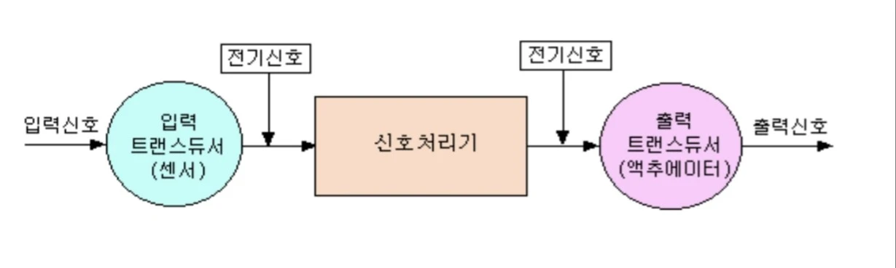

        - 입력 신호로 Real World의 Information을 detect한다. (ADC를 이용해서 측정된 데이터를 디지털 데이터로 변환)

        Real World → ADC → Sensor → Measured Value → Auto Driving Logic → DAC → Actuator

        - Accelerator
        - Brake
        - S/W

        출력신호 위와 같은 요소를 조절하는데 사용될 수 있음.

    - 트랜스미터(Transmitter)

        - 4-20mA의 출력전류를 갖는 센서 시스템의 일종으로, 센서 정보를 확도의 손실 없이 먼 거리로 전송할 수 있다. (확도 : accuracy)

    - LOC(Lab On A Chip) : 작은 크기의 센서가 필요할 때, 여러 종류의 센서를 하나의 칩으로 만들고 사용하는 것. ⇒ 진짜 고가의 센서는 의료 장치에 들어갈 것이고, 이를 로봇에도 바로 적용이 가능하다. (반도체 이용)

        ex) 뉴럴 링크 : 원숭이의 뇌에 LOC를 탑재하여 뇌파로 게임을 하도록 만든 것으로 보인다.

        냄새를 감지하는 센서를 통해 냄새를 전기 신호로 바꾸어 전송, 이를 뇌로 전달하면 냄새를 감지할 수 있게 된다.

    - 마이크로 센서(Microsensor)

        - Microfabrication 기술을 사용해서 만든 센서

    - 집적화 센서(Integrated sensor)

        - Single monolithic chip에 하나 이상의 센서와 적당한 interface circuitry을 결합한 센서

- 센서의 구조

Real World → Sensor(ADC) → Measured Value → Auto Driving Logic → DAC → Actuator

이것이 간략화된 구조이며, 정밀하게 그리면 아래와 같다.

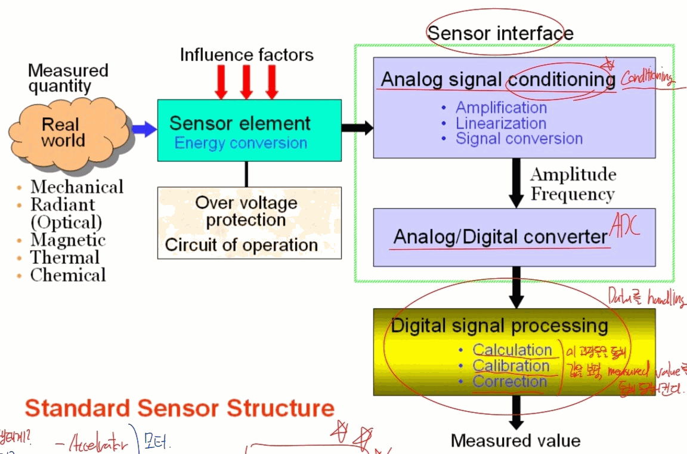

Real World → (Sensor element → Sensor interface → Digital signal processing) → Measured value → **Auto Driving Logic** → DAC → Accelerator/Brake/SW

- **Real World**

    - 실제 데이터가 센서에 측정됨.

- **Sensor element**

    - 데이터가 측정되는 과정에서 여러 환경적인 요소의 영향을 받음 (**influence factors**)
    - Sensor element (Energy conversion, 물리적, 화학적, 생물학 원리 등 다양한 원리를 거쳐 실제 측정값을 전기로 변환함.)
    - Over voltage protection (과전류로 오동작이 발생하지 않도록 보호함)

- **Sensor interface**

    - Analog signal **conditioning** 
        (조절, 신호를 사용할 수 있는 신호로 바꾸는 조절하는 과정이다.)

        - Amplification(확대)
        - Linearization(선형화)
        - Signal conversion(시그널 컨버젼, 변환)

    ⇒ Amplitude(진폭), Frequency(주파수) (진폭과 주파수가 ADC로 넘어가게 됨)

    - Analog/Digital Converter(ADC)

- **Digital Signal Processing** 
    (조절된 신호가 실제로 나타내고자 하는 수치와 비슷해지도록 값을 보정하는 단계이다.)

    - Calculation
    - Calibration
    - Correction

    ⇒ 이 과정들을 통해 값을 보정, measured value를 통해 동작시킨다.

- measured value
- Auto Driving Logic
- DAC
- Motor(Accelerator, Brake, S/W)

---

- **지능화 센서**(Intelligent or smart sensor)

    - 컴퓨터 기술의 결합에 의해서 센서가 지능을 갖도록 한 센서

    - 스마트 센서에 필요한 기능

        - **자동교정/보상기능** : 자기진단 기능을 통해 자동 교정 및 보상
        - **데이터 처리기능** : 새로운 데이터를 취득하고 처리할 수 있음.
        - **주위환경 변화에 대한 유연한 대응 기능** : 어떤 데이터를 전송할 것인지 스스로 선택.
        - **메모리 기능** :  취득되고 처리된 결과를 메모리에 저장함.
        - **다른 센서 (시스템)과 통신 기능** : 다른 센서와 대화 기능(정보교환의 기능)

- 테슬라의 배터리 관리 시스템

Battery 

↓

BMS(Battery Management System)

↓

MCU → GPU

↓

MOTOR

---

## 센서의 기본 특성

- 센서의 특성

    - 정특성 (static characteristics)

    - 입력이 시간적으로 변하지 않을 때의 특성

        - 감도(sensitivity) : 하나의 값을 일정하게 출력하는 것
        - 직선성(linearity) : 아날로그 값의 변화와 같은 비율로 디지털 값이 변화하는가?
        - 히스테리시스(hysteresis)

    - 동특성 (dynamic characteristics)

        - 입력이 시간에 따라 변할 때의 특성 : 입력값이 급하게 변해도 잘 따라가야 한다는 특성
            ⇒ 일반적으로 주파수가 너무 높으면 Guarantee가 안될 수도 있다.
        - 시간응답(Time Response)
        - 주파수 특성(Frequency Characteristics)

---

- **교정**(calibration)

    - 센서에 기지의 입력 값(known value)을 인가하여 출력을 측정하는 과정.
    - 교정에 사용되는 기지의 입력 값을 표준(standard)라고 부름.
    - 교정에 의해서 입력과 출력 사이에 관계가 수립되며, 
        이때 얻어지는 곡선을 <strong>교정 곡선(calibration curve)</strong>이라고 한다.

    ex) (온도) 20도의 데이터를 넣으면 3V가 나오는게 정상이라고 할 때, 이 범위를 벗어나더라도 환산표를 제시해서 ‘교정’한다. ⇒ 모든 센서는 calibration 없이는 믿을 수 없다.

    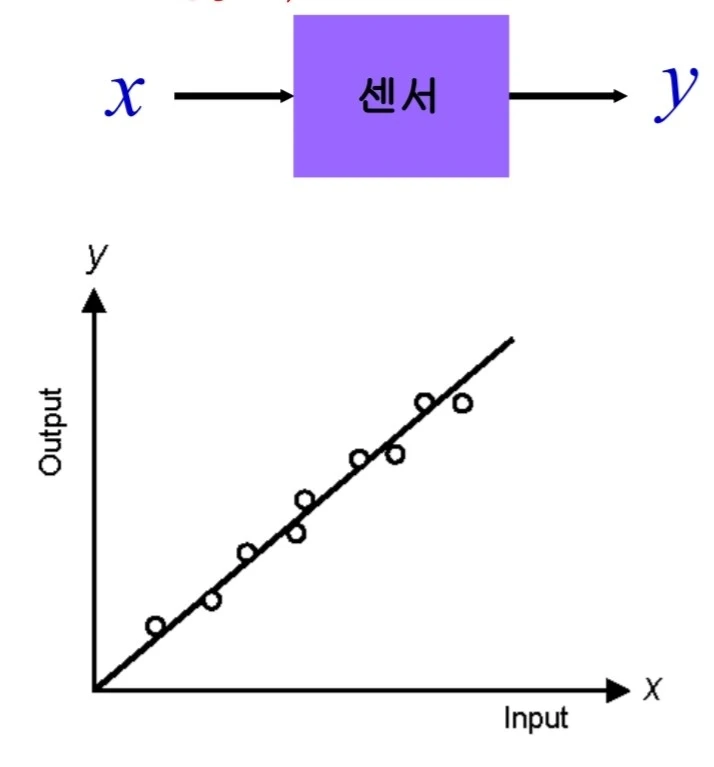

---

- **전달함수** (transfer function)

    - 센서의 입력 물리 신호(피측정량)와 출력 전기신호 사이의 함수적 관계를 말하며, 이 관계는 그림과 같이 입력신호와 출력신호의 관계를 보여주는 그래프로 나타낼 수 있음.

    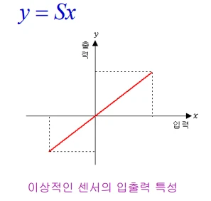

---

- **감도** (sensitivity)

    - 입력 물리신호의 미소 변화에 대한 출력 전기신호의 미소 변화의 비율

    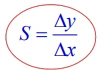

    - 감도는 전달함수의 미분으로부터 얻어질 수 있음. (그러므로, 전달함수의 기울기는 감도)

    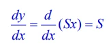

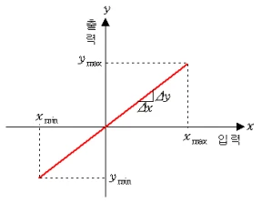

---

- **풀 스케일**(스팬)과 **풀 스케일 출력**

    - 풀 스케일 입력(full scale input) 또는 스팬(span) or dynamic range

        - **풀 스케일** : 센서가 신뢰도를 유지할 수 있는 범위

        - 입력동작범위 : 의미 있는 센서출력을 발생시키는 최대 입력과 최소 입력 사이의 범위

            - 이것을 **풀 스케일 입력** (full scale input : FS), **스팬** (span), 
                **다이나믹 레인지**(dynamic range), **풀-스케일 레인지** (full-scale range)라고 함.

            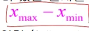

            ⇒ 값이 급격하게 많이 변하는 경우, Full Scale이라고 많이 쓴다.

            ⇒ 측정값이 풀 스케일을 벗어나면, 최대, 최소값으로 표현된다.

            (dynamic range, full scale. → 풀 스케일이 클수록 좋은 것.)

        - 많은 경우 (+)측정 범위와 (-)측정 범위가 다름. 만약 x(min)이 0이면 스팬은 0~x(max)로 된다.

        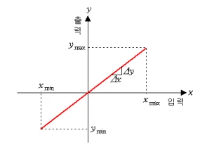

    - **풀 스케일 출력**(full-scale output : FSO)이란, 최대 입력시 전기적 출력과 최소 입력시 전기적 출력 사이의 대수적 차

        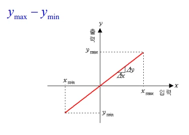

    - **풀 스케일 입력**과 **풀 스케일 출력**은 **정격 입력** 또는 **정격 출력**이란 용어도 함께 사용한다.

---

- **감도오차**와 **오프셋 오차**

    - **감도오차**(sensitivity error) 또는 **감도변동**(sensitivity drift)

        - 센서의 입출력 특성의 기울기가 이상적인(정상적인) 직선의 기울기로부터 벗어나는 것을 의미.

        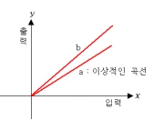

    - **오프셋**(offset) 또는 **영점 변동**(zero or null drift)

        - 입력(x)이 0일 때 센서출력(y)이 0이 되지 않는 것.

        y = Sx + C (이때 C가 offset)

        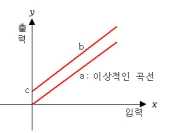

    - **감도변동**과 **영점변동** 동시 발생

        - 감도변동과 영점변동이 동시에 발생하면 그림과 같이 오차는 더 커짐

        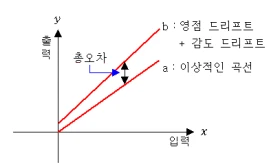

    - 감도로 인해 잘못 출력되고 있는지를 테스트할 수 있는 **Reference Sensor**가 필요.

---

- **직선성**(linearity)

    - 직선성은 **교정 곡선과 특정 직선과의 가까움의 정도**를 나타낸다. 여기서 특정 직선은 여러 가지로 그릴 수 있으며, 따라서 직선성의 정의도 다양하다.

    - 이론적인 직선성 : 이 직선은 센서를 설계할 때 이론적인 예측에 의해서 결정.

        - ex) 그림과 같이 이상적인 직선 (y = Sx)을 가정하면, 이 센서의 이론적 직선성은 실측치(교정곡선)가 이상적인 직선으로부터 벗어난 정도.

        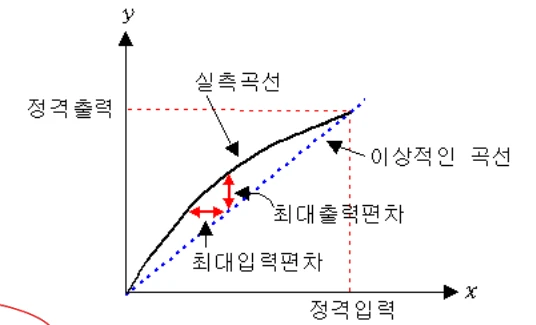

    - 센서의 직선성은 자주 비직선성(nonlinearity)의 백분율로 나타냄.

        - 직선성(%) = 최대출력편차/정격출력 * 100% FS = 최대입력편차/정격입력 * 100% FS

            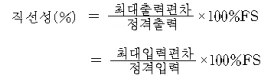

    - 센서의 직선성을 측정하는 한 방법은 **최소 자승법**을 사용해 가장 잘 일치하는 직선(best fit straight line)을 구하는 것. 이 경우 직선성을 **independent linearity** 라고 함.

        - 관측치와 예측치 사이의 차이(잔차)의 제곱합을 최소화하는 방법을 사용하여 데이터에 가장 적합한 모델을 찾는다. (최소자승법을 통한 커브 피팅을 할 수 있는 것이다.)

        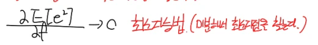

        - curve fitting : 센서 입력에 대한 출력이 점으로 찍혀있는 데이터에서 각 점들로 가장 거리가 가까운 직선을 찾는것. 즉, 가장 오차가 적은 직선을 찾는 것이다.

        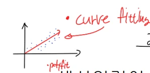

    - 센서의 직선성과 실측된 데이터를 나타낸 그래프

    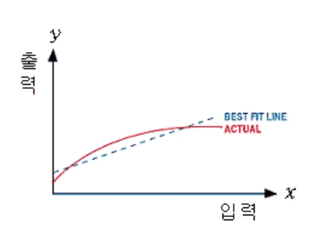

    - 센서입력이 허용한계를 초과하면 출력이 포화(saturation)되기 시작하여 응답의 직선성을 상실하기 때문에 동작범위의 상한 또는 정격을 정함.

        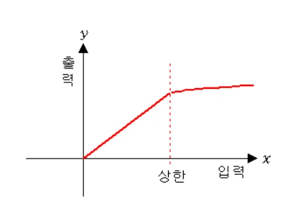

    - 센서소자 자체의 특성이나 변환원리 자체가 직선으로 되지 않는 경우에는 (즉, 1차 함수의 형태로 결과가 나오지 않는다면) 변환회로를 사용해서 센서 전체의 입출력이 직선성을 갖도록 한다. 센서소자를 직선성이 우수한 범위에서 사용하여도, 변환회로나 증폭기의 직선성이 좋지 않으면 센서 전체의 직선성은 나빠짐.

---

- **히스테리시스**(hysteresis)

    - 입력 x를 증가시켜가면서 출력을 측정할 때와 감소시켜가면서 출력을 측정하였을 때 동일한 입력에서 출력이 같지 않는 현상 (올라갈 때와 내려갈 때가 다른 현상)
    - 히스테리시스 차(y2 - y1)는 입력 변화의 진폭과 입력 크기에 의존

    - 센서의 히스테리시스 특성은 FSO에 대한 비율로 나타냄.

        - 히스테리시스를 잡는 것은 어려우며, 센서를 다뤄본 사람은 calibration chart를 보지 않으면 센서를 신뢰하지 않는다.

        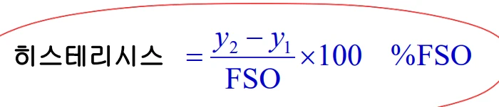

        (입력 x1에 대한 두 출력 y2 및 y1의 차이가 최대일 때)

        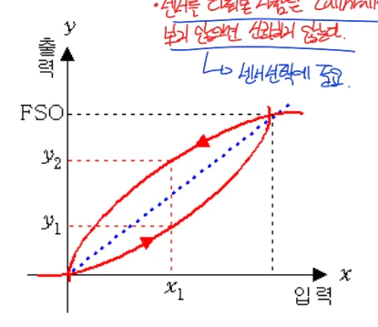

---

- **(정)확도**(accuracy)와 **정(밀)도**(precision)

    - (정)확도

        - 센서 출력이 참값(true value)에 얼마나 가까운가를 나타내는 척도

        - Error가 0에 수렴하는가?를 나타냄.

            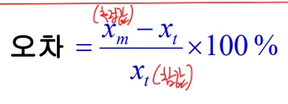

        - 실제로, 오차는 정격출력(FSO)의 백분율로 나타낸다.

    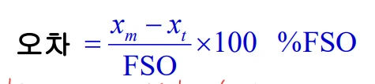

    (특별한 언급이 없다면 FSO, Full Scale Output으로 계산)

    - 반복성

        - 동일한 양을 동일조건(환경, 사람 등)하에서 동일방법으로 단기간에 연속 측정할 때 측정값들이 서로 얼마나 일치하는가를 나타내는 것

    - 재현성

        - 동일한 양을 같은 방법으로 장기간에 걸쳐 측정하거나 다른 사람에 의해서 측정되거나 또는 다른 실험실에서 측정될 때 측정값 사이에 일치하는 정도를 나타냄

    - 정(밀)도(precision)

        - 측정의 반복성이나 재현성의 척도 : 즉, 연속 측정값들 사이의 일치성

        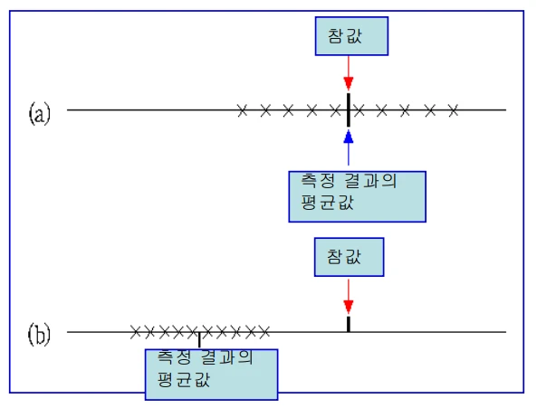

    - Error, Accuracy and Precision

    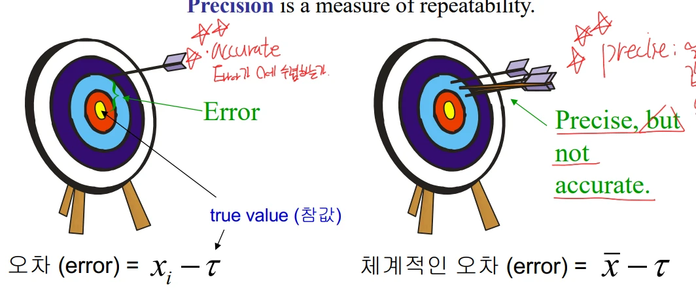

    Accuracy는 오차가 없는 지를 검사하는 거고, Precision은 측정 값들 사이의 편차를 조사해서 얼마나 퍼지는 지를 검사하는 것이다.

---

- **선택성**(selectivity) : 하나를 측정할 때 다른 요소가 영향을 주는 정도

    - 센서에 입력되는 여러 변수 중에서 원하는 변수만을 선택적으로 검출하는 성질
    - 센서는 원하는 현상만을 검출하고, 다른 현상의 영향을 받지 않는것이 바람직 함.

---

- 잡음

    - **SNR**(Signal to Noise Ratio)

        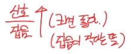

        SNR = 신호 / 잡음 (클 수록 본래 신호와 비슷하다는 뜻)

        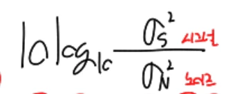

        - 분산(variance) : 데이터가 퍼져있는 정도를 의미한다.

    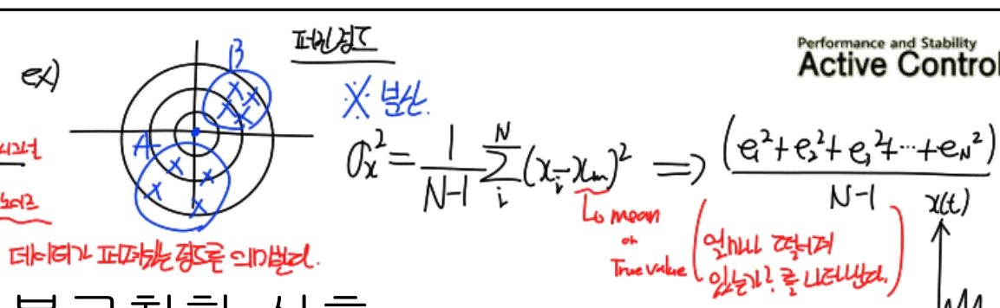

    - 분산은 위와 같이 구한다.

    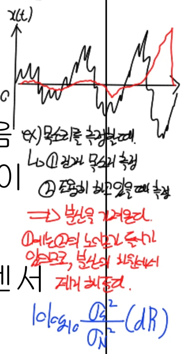

- deciBel : 기준 대비 측정값을 나타내는 비교 기법. Bel (상대적인 단위)

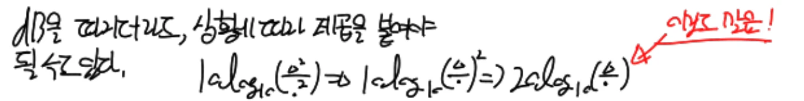

---

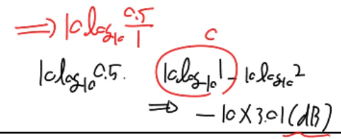

---

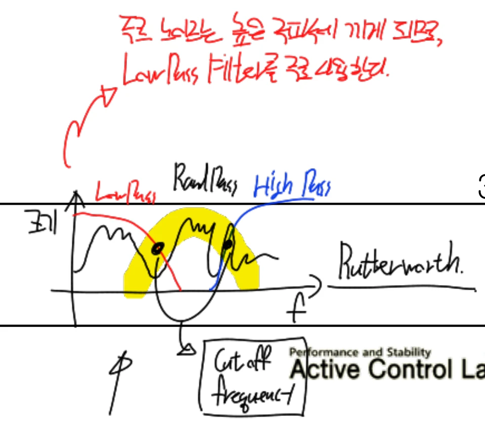

- Butterworth filter : Low Pass Filter와 High Pass Filter를 적용하여 신호를 얻어내는 필터

---

- **분해능**(resolution)

    - 검출할 수 있는 최소입력 증분(smallest increment) 또는 최소입력변화.

- 분해능을 제한하는 원인

    - 입력의 변화분이 센서내부에서 흡수되어 출력으로 나타나지 않는 경우
    - 센서내부에서 발생하는 잡음(noise)

- 분해능은 작을수록 좋음

    - 아날로그 센서에서는 0.1%FS 정도 ⇒ FS에서 0.1% 단위로 표현 가능하다는 뜻.

    - 디지털 센서(digital sensor)에서는 비트(bit)로 정해짐.

        - 예를 들면, 12 bit의 경우 분해능

        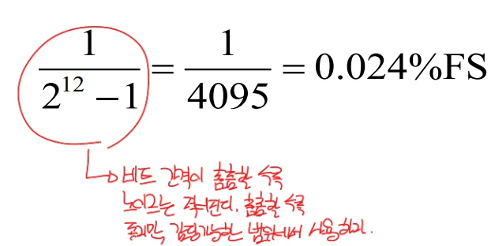

---

- 동특성

    - 시간응답특성(과도특성)

    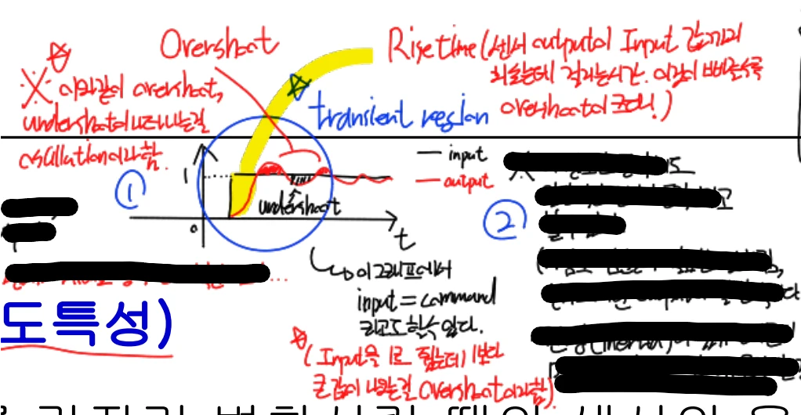

    - 이와 같은 자료에서, input을 1로 줬는데 1보다 큰 값이 나오는 현상을 overshoot이라고 한다. 또는 input을 1로 줬는데 1보다 작은 값이 나오기도 하는데, 이를 undershoot이라고 하며, overshoot과 undershoot이 번갈아서 나타나는걸 **oscillation**이라고 한다.
    - input 값을 1을 줬을때, 센서 output이 input값까지 치솟는데 걸리는 시간을 **Rise Time**이라고 한다. 이것이 빠를수록 overshoot이 크다.
    - 그런데, 사실 이정도만 동작해도 일반적인 센서의 동작이라고 볼 수 있다. 마치 사람에게 암순응이 필요한 것처럼 센서도 이런 output이 일반적이다. 관성(inertia)이 있기 때문에 갑자기 상태가 변화는 것을 오차없이 유지하는 것은 어렵기 때문이다. 멈춰있는 로봇팔을 갑자기 움직이는 것도 쉽지 않고, 일단 움직이면 동작시키기 쉽다.

    - **시간 응답**이란 무엇인가?

        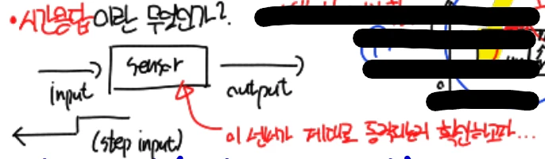

        - 어떤 센서가 제대로 동작하는지 확인하기 위하여 step input을 넣어서 출력을 확인해보는 것을 말한다.
        - 다시 말하면, 입력의 크기를 갑자기 변화시킬 때의 센서의 응답 특성을 말한다.
        - 입력에 계단함수(step function)을 인가하여 측정한다.

    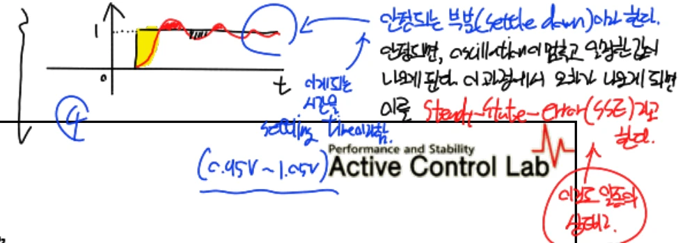

    입력을 주었을 때 처음에 Oscillation이 생기다가 점차 안정되는 부분을 **settle down**이라고 한다. 안정되면, oscillation이 멈추고 일정한 값이 나오게 된다. 이 과정에서 오차가 나오게 되면 이를 <strong>Steady-State-Error(SSE)</strong>라고 한다. 그리고 settle down이 되는데 걸리는 시간을 **settling time**이라고 한다. (현재는 출력으로 1V를 줬으므로, 0.95V~1.05V 사이 정도를 말하게 될 것.)

---

- **주파수 특성**

    - 정현파 입력에 대한 센서 특성
    - 입력 주파수에 대해서 출력이 -3 dB로 될 때의 주파수 범위를 응답 주파수

    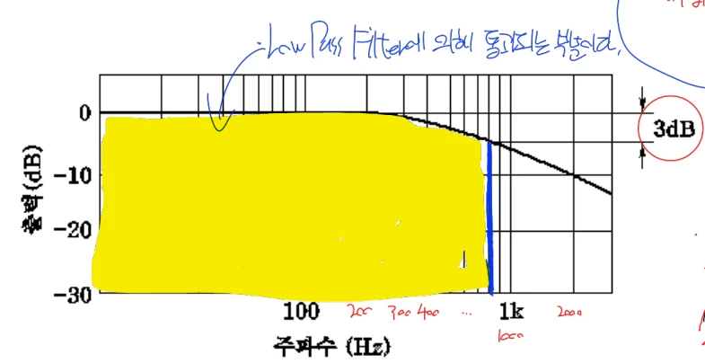

    - -3dB는 입력값의 1/2이 되는 지점이다.
    - 크기가 절반이 되는 부분이고, cut off frequency의 기준은 크기가 절반으로 줄어드는 부분.
    - LowPass Filter를 걸면, 고주파도 저주파가 남도록 바뀐다.

    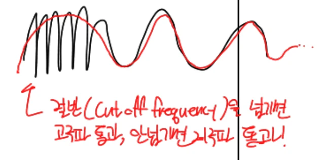

    - cut off frequency를 넘기는 주파수는 고주파를 통과하고, 넘기지 못하면 저주파를 통과.

---

- 환경 영향

    - 센서가 사용되는 환경 조건, 특히 온도, 습도 등은 센서의 정특성과 동특성에 매우 큰 영향을 미친다.

---

- **출력 임피던스**

    - 출력 임피던스란, 출력 측에서 본 센서의 임피던스를 말하며, 센서에 필요한 인터페이스 회로의 입력 임피던스를 결정.

    - 출력신호의 일그러짐(distortion)을 최소화하기 위해서는

        - **전압출력 센서** (그림 a) : V = Vs로 되기 위해서는 센서의 출력 임피던스(Z0)는 가능한 작아야하고, 회로의 입력 임피던스(Zi)는 가능한 커야함.
        - **전류출력 센서** (그림 b) : I = Is로 되기 위해서는 센서의 출력 임피던스(Z0)는 가능한 커야하고, 회로의 입력 임피던스 (Zi)는 가능한 작아야함.

        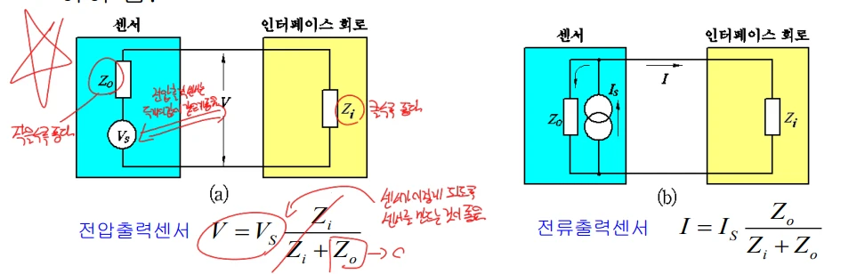

---

- 신뢰성

    - 높은 신뢰성이란, 원하는 성능을 수행할 확률이 1에 가까운 것을 의미. 즉, 규정된 기간 동안 센서가 고장 날 확률이 거의 없음.
    - 고장율(failure rate)은 다음과 같이 정의.

    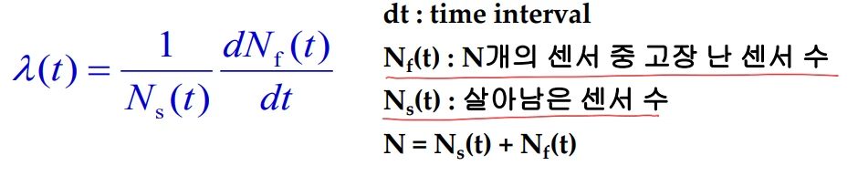

    - 그러므로 신뢰성은 고장율로부터 계산.

    - 고장율은 MTBF(mean time between failures)를 결정.

        - MTBF : 집어넣은 부품이 고장나는 시간을 계산하는 방법. (길면 길수록 좋음)
            ⇒ 얼마 지나면 고장날지 설계한다.

    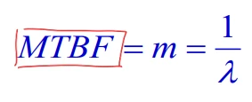

- Example

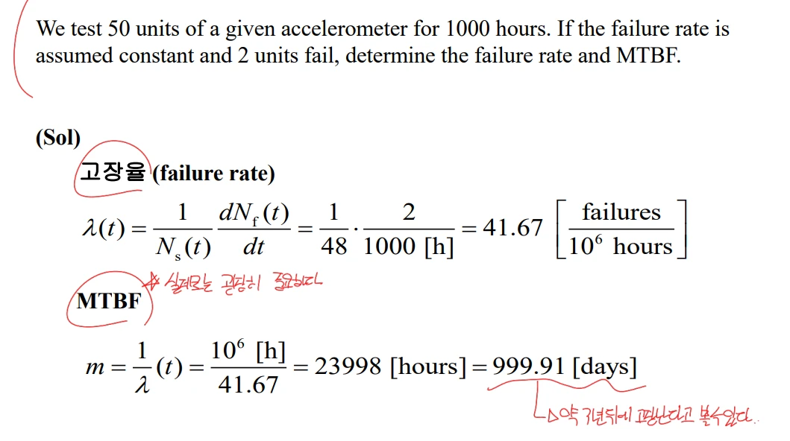

---

- Bathtub curve

    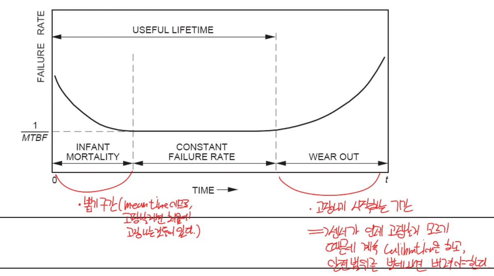
