# 2주차(광센서/자기센서/위치-변위센서)

작성일 2023-04-20 · 최종 수정일 2023-04-23
{ .post-date }

## 광센서

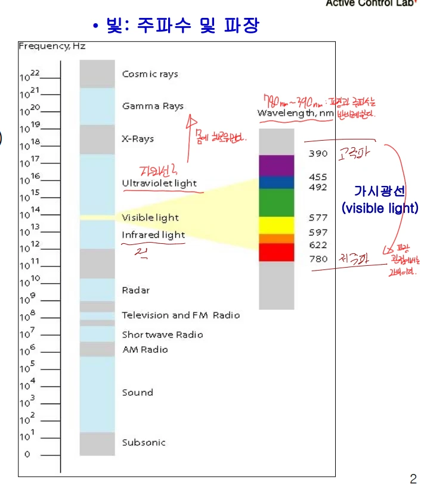

- 빛의 성질

    - 빛은 파(wave)와 입자(particle)의 성질을 모두 가짐.

- 가시광선

    - 780nm~390nm
    - 파장관점에서는 저주파가 고주파의 2배의 파장을 가지고 있다.

---

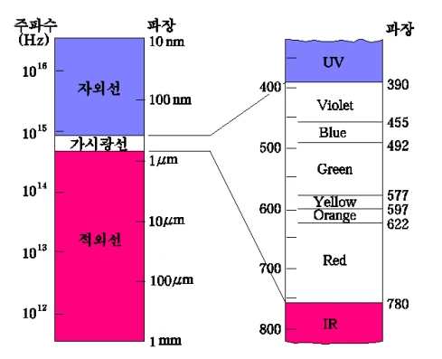

- 광 센서의 주 검출 대상

    - 가시광, 적외선, 자외선을 검출한다.
    - 가시광선(visible light) : 파장이 약 390[nm] ~ 780[nm] 사이의 전자파

    - 적외선(infrared; IR) : 가시광선보다 긴 0.78[μm] ~ 1000[μm] 파장의 전자파

        - 0.78[μm] ~ 2.5[μm] : 근적외선
        - 2.5[μm] ~ 50[μm] : 적외선
        - 50[μm] ~ 1000[μm] : 원적외선

    - 자외선 : 가시광선보다 단파장의 전자파(1~400[nm])

---

- 빛의 흡수

    - 물체가 빛(전자파)을 흡수하면, 전자는 기저상태에서 여기 상태로 올라간다.
    - 빛(전자파)을 방출하는 물체는 에너지를 상실하고, 흡수하는 물체는 에너지를 얻는다.

    - 발광현상

        - 루미네슨스(luminescence) : **열을 수반하지 않는 발광**

            - 물체나 분자를 구성하는 원자가 빛, x선, 전자선, 방사선, 전기 또는 화학 반응 등의 에너지를 흡수하여 여기 상태로 된 후 다시 천이하여 발광하는 현상.
            - ex) 발광 다이오드(LED), 레이저(Laser)

        - 열방사(thermal radiation) : **열을 수반하는 발광**

            - 연속 스펙트럼의 빛이 방출된다.
            - 저온에서는 적외선이 방사되며, 고온으로 감에 따라 방사량이 증가되는 동시에 단파장의 가시광 쪽으로 이동하여 휘도를 증가시킨다.

- 광 센서의 분류

    - 양자형

        - 전자파의 양자를 흡수해서 전하 케리어로 직접 변환하는 광 센서
        - 광도전 셀(photocell), 포토다이오드(photodiode), 포토트랜지스터(phototransistor) 등
        - 양자형은 자외선에서 중적외선 범위에서 동작한다.

    - 열형

        - 적외선을 흡수한 소자의 온도가 변화, 그 결과로 소자의 전기적 특성(저항, 열기전력 등)이 변하는 효과를 이용하는 광 센서
        - 서미스터(thermistor), 볼로미터(bolometer), 서모파일(thermopile), 초전센서(pyroelectric detector)
        - 중적외선부터 원적외선 범위를 검출하는데 유용하다.

---

- **광센서 종류**

    - 광센서 : 광에너지를 전기 신호로 변환하는 트랜스듀서

    - **광도전 셀**(Photoconductive Cell) : 광도전 효과 이용

        - 광도전 효과 : 광에너지에 의해 캐리어가 발생하고 물질의 도전성, 즉, 내부 저항값이 변화하는 현상
        - 광도전 효과를 이용한 광 센서를 광도전 셀 또는 포토셀 이라고 부른다.
        - 저가의 센서로, 널리 사용된다.

        - 포토셀은 다음과 같이 분류된다.

            - 가시광 검출 : CdS photocell, CdSe photocell
            - 적외선 검출 : PbS, PbSe, InSb, InAs, MCT(HgCdTe)

        - **CdS** 소자의 특성(사람 눈과 비슷하게 밝다, 어둡다를 판단할 수 있는 포토 셀)

            - 빛의 밝기에 비례하여 내부저항(광 저항)이 저하되어 일종의 **광 가변저항기**와 같다.
            - 자신만의 기전력을 갖고 있지 않아, **회로 구성에서 반드시 전원이 필요**하다.
            - **가시광선에 아주 민감**하여 **인간의 눈으로 느끼는 빛깔은 거의 감지**할 수 있다.
            - **감도가 높아** 0.1 룩스 이하의 **어두운 빛에서도 감지**할 수 있다.
            - 매우 저렴하다. 단순한 물질은 발광이 힘들기 때문에 대부분 합성 물질이다.

        - **분광감도** 특성

            - CdS 셀의 최대 감도 = 565[nm] 부근의 파장
            - CdS 셀은 인간의 눈과 매우 유사한 분광감도특성을 나타낸다.
            - CdSe 셀의 최대 감도 = 735[nm] 부근

        - CdS는 고감도인 반면, 응답시간(response time)이 늦고, 히스테리시스(hysteresis)가 큰 결점을 가진다.
        - 일반적으로 CdS의 응답시간은 10~100[ms]이다.

    - **포토 다이오드**(Photo Diode) : 광기전력 효과 이용

        - 광기전력 효과 : **광에너지에 의해 반도체 접합부에 전압이 나타나는 현상**

        - Pulse Monitor (finger probe) : 혈액 순환으로 생기는 혈압을 체크하여 심박, 맥박을 체크할 수 있는 기능의 회로.

            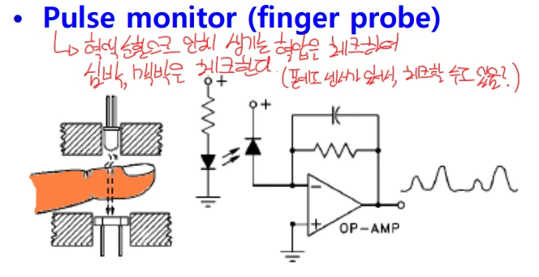

        - Smoke Detector : 화재 발생시, 입자들이 들어오면 난반사가 발생하게 된다. 그런데서 발생하는 차이를 Detect해서 화재 감지.

            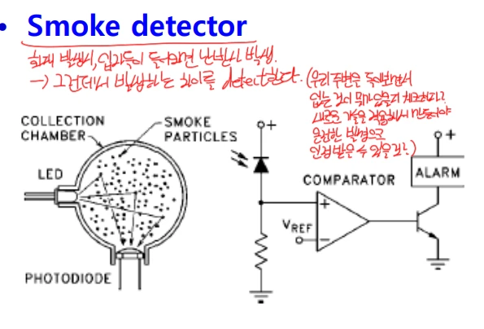

    - **포토 트랜지스터**(Photo Transistor)

        - 포토 다이오드 + 트랜지스터

            - 트랜지스터의 증폭작용에 의한 고감도의 광센서

    - **복합 광센서**

        - **발광소자**와 **수광소자**(광센서)를 조합시킨 것
        - 수광소자 : **phototransistor**와  **달링톤**을 접속한 것이 보통

        - 포토 인터럽터 (Photo Interrupter)

            - 물체의 유무와 위치검출을 목적으로 한다.
            - 구조에 따라 **투과형**(transmissive)과 **반사형**으로 구분한다.

        - 포토 커플러 (Photo Coupler)

---

- **트랜지스터의 응용**

<!-- -->

1. **달링턴 회로**

**트랜지스터**

회로를 제어하는 스위치 역할을 하거나 신호를 증폭시킬 수 있다.

트랜지스터에는 E(Emitter), B(Base), C(Collector)라는 세 개의 핀이 있다.

즉, 이미터, 베이스, 집전기의 역할을 하는 핀 세 개가 있다.

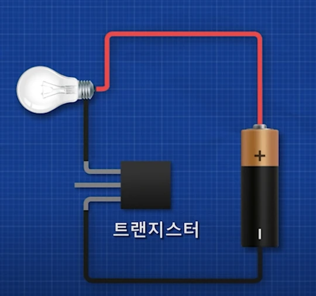

이와 같은 회로에서 트랜지스터를 부착하면 트랜지스터가 전류를 차단하여 조명이 꺼지게 된다.

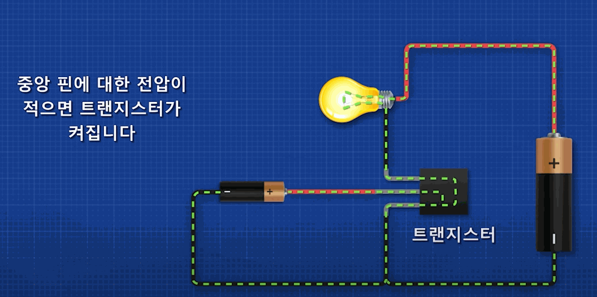

그리고 이와 같이 베이스 핀에 대한 전압이 적으면 트랜지스터가 켜지게 된다. 이 다음 제어회로에 스위치를 사용하여 원격으로 제어하거나, 제어 자동화를 위한 센서를 달 수도 있다. 일반적으로 트랜지스터가 켜지려면 베이스 핀에 최소 1.6V ~ 1.7V를 적용해야 한다.

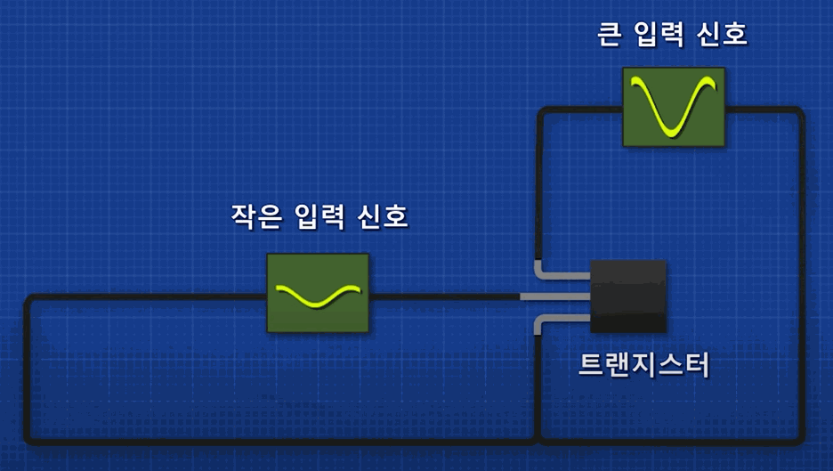

즉, 베이스 핀에 작은 입력 신호를 넣음으로써 트랜지스터가 앰프 역할을 하게 된다.

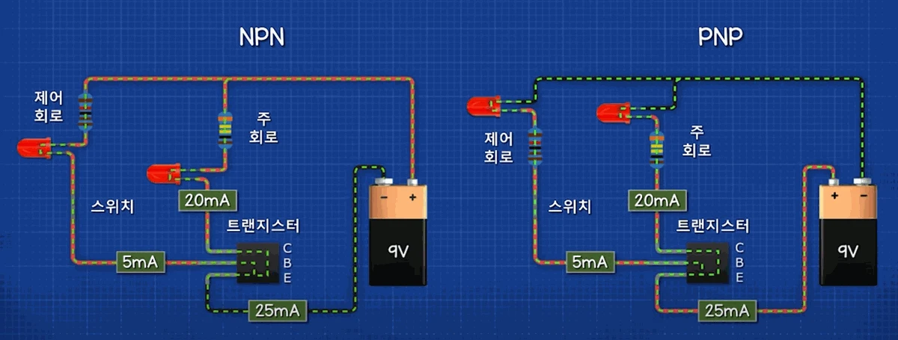

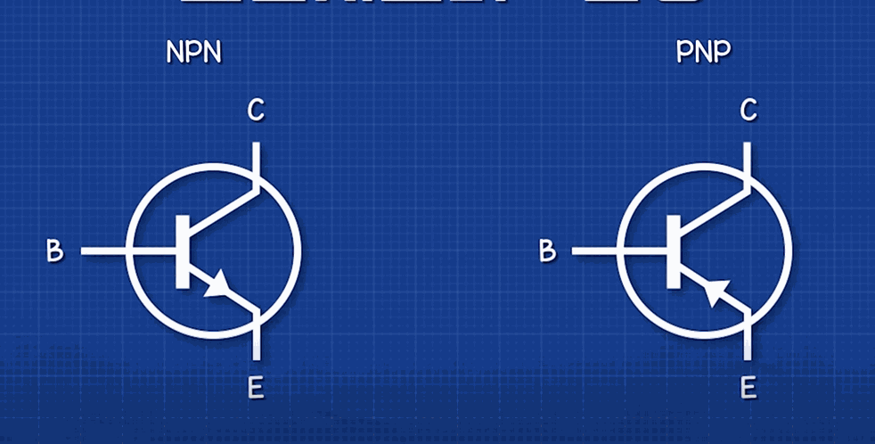

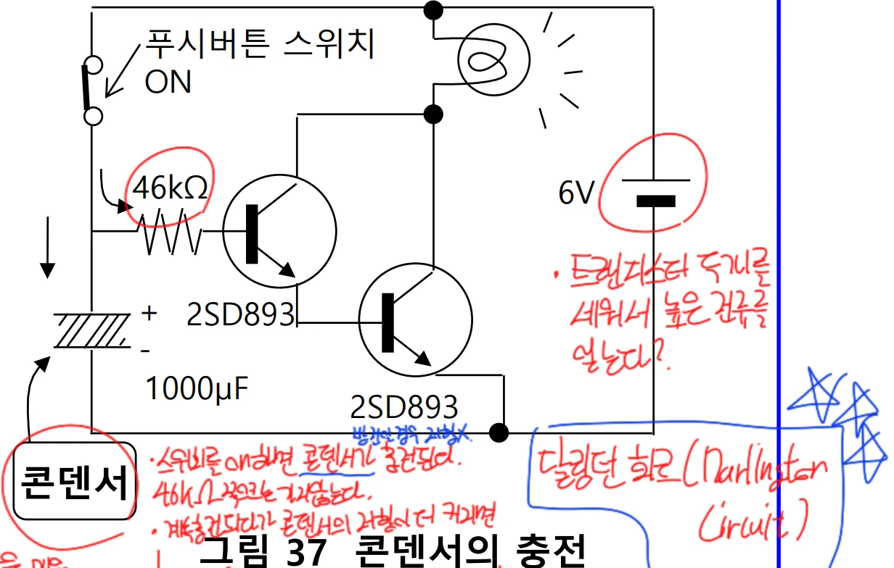

- 스위치를 ON하면, 콘덴서가 충전된다. (콘덴서는 방전 상태일 경우 저항이 생기지 않는다.) 46k ohm 저항 쪽으로는 당연하게도 전류가 흐르지 않을 것이다. (전자는 (-) → (+)로 흐르게 되므로, 파워에서 나온 전자가 스위치를 통해 이동하면서 콘덴서를 충전하게 된다.)
- 계속 충전되다가 콘덴서의 저항이 더 커지게 되면 점차 46k ohm 저항 쪽으로 전자가 가게 되면서 전류가 흐르다가 전구에 불이 켜지게 된다.
- 스위치를 OFF하면, 콘덴서에서 전류가 46k ohm 쪽으로 흐르게 되는데, 베이스에 전류가 가해지면 트랜지스터가 전류를 통과시킬 수 있게 되므로 콘덴서의 전하가 다 소진되기 전까지 램프에 불이 켜지게 된다.
- 위와 같이 콘덴서를 접속한 달링턴 접속의 파일럿 램프 점등회로에서 푸시 버튼 스위치를 ON으로 하면, ON으로 한 순간에 전해 콘덴서가 충전됨과 동시에 파일럿 램프가 점등된다.
- 그 후는 스위치를 OFF해도 아래의 그림과 같이 콘덴서로부터 베이스에 전압이 가해져 콘덴서에 비축된 전하가 어느 정도 방전될 때까지의 시간동안 파일럿 램프가 계속 점등해 있다. 전해 콘덴서의 용량을 변화시킴에 따라 푸시 버튼 스위치를 끊고 난 후 파일럿 램프의 점등시간을 조절할 수 있다.

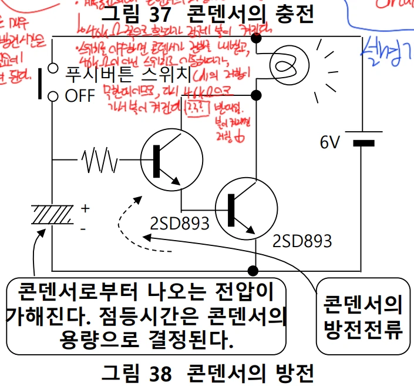

---

1. **응용회로2**

<!-- -->

- CdS 센서는 빛의 세기에 의해 저항치가 직선적으로 변하게 된다.

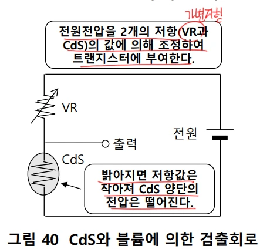

센서의 입력 신호에 의해 트랜지스터를 ON, OFF 할 수 있으며, 또한 트랜지스터의 응용범위는 매우 넓어진다.

위의 회로는 CdS 센서를 이용한 것으로, 밝기에 따른 CdS 저항값의 변화를 그림과 같이 가변 저항기와 조합하여 트랜지스터에 가해지는 전압을 제어할 수 있는 원리이다.

---

1. **응용회로 3**

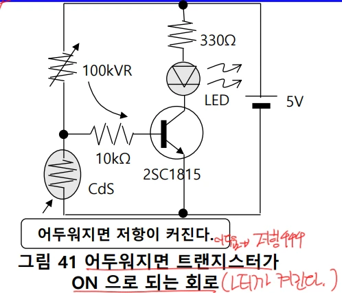

위의 그림의 회로에서 CdS에 빛을 쪼이면 저항은 작아지게 되고, 베이스에 걸리는 전압도 작아지게 된다. 빛을 차단하면 CdS의 저항은 커지고, 베이스에 걸리는 전압도 커진다. 트랜지스터는 ON이 되고, LED는 점등된다.

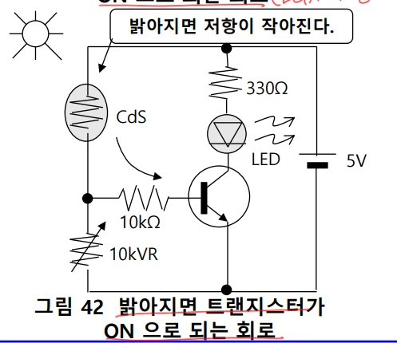

위의 그림의 회로에서는 **빛을 받게 되면 CdS의 저항값이 작아지며 베이스에 걸리는 전압이 커짐**으로써 트랜지스터는 도통(전류가 흐르게 되고)하고 **컬렉터 전류가 흘러 LED는 점등**한다. 

**빛을 차단**하면 **CdS의 저항은 커지고**  **베이스에 걸리는 전압은 작아지게 되어** 트랜지스터는 도통하지 않고 **LED는 점등하지 않게 된다.**

---

## 자기센서

- 자기력이 작용하는 공간을 자계라고  부르며, 도선에 흐르는 전류에 의한 자계는 도선 주위를 둘러싸는 폐회로를 형성한다.

- 암페어의 법칙(오른나사 법칙)

    - 도선에 전류를 흘리면 도선 주위에 자기장이 형성된다.

    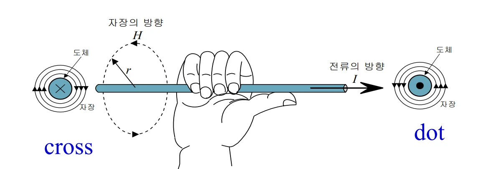

- 자속의 단위 : Wb [Weber] = [N/A.m]

    - 자속 : 단위 면적에서 얼마나 많은 자기장이 펼쳐져 있는가

- 자속밀도의 단위 : 1 Wb/m^2 = 1 T [Tesla]

---

- **자기센서의 분류**

    - **약자계 센서**(low field sensor) : 고가의 센서

        - 1[μG](마이크로가우스) 이하를 검출
        - 의료용, 생체자기계측, 군용으로 사용.
        - ex) SQUID, 탐색코일 등
        - SQUID : 뇌에 이상이 있다거나 질병이 있다면 사용. 굉장히 미세한 자기장의 변화를 탐색한다. (SQUID를 이용하면 막힌 혈관 등을 찾을 수 있다.)

    - **중자계 센서**(medium field sensor)

        - 1[μG] ~ 10[G] 범위를 검출, 지자기 센서라 불림.
        - ex) 자속게이트, 자기유도 센서, AMR 센서 등

    - **강자계 센서**

        - 10[G] 이상의 자계를 검출
        - 대부분의 산업체에서는 검출 자계원으로 영구자석을 사용
        - ex) 리드 스위치, MR 센서, **홀 소자**, GMR 센서 등

---

- **홀 센서**

    - **홀 효과**(Hall Effect)

        - 광센서가 빛의 강약에 따라 내부저항이 변화하듯이, 자계의 세기에 따라 내부저항이 변화하는 현상을 말한다.

        - 자기장 내에서 전하가 움직이면 이동방향에 수직으로 힘을 받는다.

            - **로렌츠의 힘** (플레밍의 왼손 법칙)

                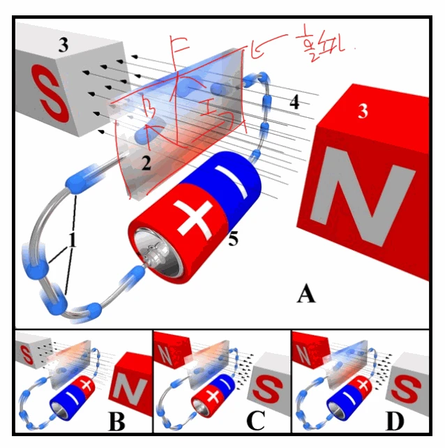

        - 전류가 흐르는 도체에 자기장을 가하면 도체 내부를 흐르는 전하가 진행방향에 수직으로 힘을 받아 도체의 한 쪽으로 치우쳐 흐르게 된다. 이렇게 전하가 한 쪽으로 치우침으로 인해 전위차가 발생하면서 전압이 발생하는 현상.

            - 즉, 로렌츠의 힘에 의해 전하의 들림 현상이 나타나고, 이에 따라 전압이 발생함.

            

    - 홀 센서 : 홀 효과를 이용한 센서

    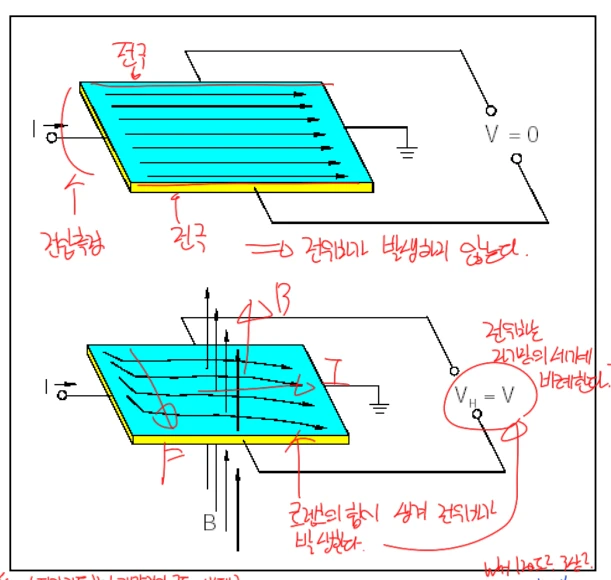

    - 전류 I를 흘리게 되면 전극에 전류가 흐르게 된다. 그런데 이 때는 홀 효과가 발생하지 않으므로 전압차가 발생하지 않아 V(H) = 0이 된다. (즉, 자계가 없는 경우, V(H) = 0)
    - 이때 자계가 생기게 되면 홀 효과에 의해 전극을 타고 흐르는 전자가 힘을 받게 되어 한 쪽으로 치우치게 되고(로렌츠의 힘), 이에 따라 전압차가 발생하게 되고 홀 센서는 이 전압차를 센싱하게 된다.

---

- 전기 자동차의 개략적인 구동 시스템

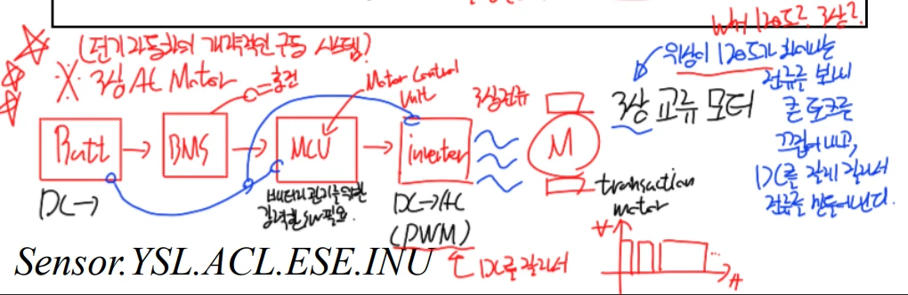

- 진행 순서

Battery(DC)

▽

BMS(Battery Management System)

▽

MCU(Motor Control Unit) ⇒ 배터리 관리를 위한 강력한 SW가 필요하다.

▽

Inverter(DC → AC, PWM, Pulse Width Modulation) ⇒ 전기를 변환하는 데 쓰이는 도구. 어떤 환경에서 다른 환경의 장비를 사용 가능하도록 전력을 변환할 때 사용하거나, 특별하게 특정 기기를 적절하게 가동할 때 쓴다. 특히 출력 전원이 AC일 때 인버터라고 부른다.

인버터가 동작을 해서 전류가 제대로 동작이 되는지 체크하려면, 인버터와 모터 사이에 홀 센서를 설치해서 전위차를 체크할 수 있다.

▽

3상 전류

▽

3상 교류 모터   
(위상이 120도가 차이나는 전류를 보내 큰 토크를 만들고, DC를 잘게 잘라서 전류를 만들어낸다. 대한민국의 모든 송전선은 3상 교류 전류를 보내는 형태를 사용한다. 각각의 위상은 +, - 220V로 보내지게 되지만, 두 선을 뽑아 그 차이를 보면 380V가 되어 표기는 3상 380V가 된다.)

- 왜 3상 교류를 사용하는가?

    - 3상 교류 전기는 산업용 모터를 가동하는데 큰 이점이 있다. 교류로 전송하기 때문에 전력 손실도 적다는 이점이 있다.

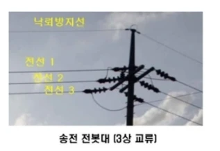

---

- **홀 센서**

    - 슈미트 트리거 (\*)

        - 입력 진폭이 소정의 값을 넘으면 급격히 작동하여 거의 일정한 출력을 얻고, 소정의 값 이하가 되면 즉시 복구하는 동작을 하는 회로

- **Unipolar Switch** (단극 스위치 타입 홀센서)

    - 출력 트랜지스터가 S극에 노출되었을 때 (동작점 또는 Bop) : 도통 상태.
        만약 S극을 제거하여 자속이 감소되면 : 출력은 비도통 (release point or Brp)
        정의에 의해서, S극의 자계는 (+), N극의 자계는 (-)부호로 표시.
    - 이 과정은 Analog 신호를 Digital로 바꾸는 과정이라고 볼 수 있다.
    - 자속 : 어떤 면을 통과하는 자기력선의 집합/다발

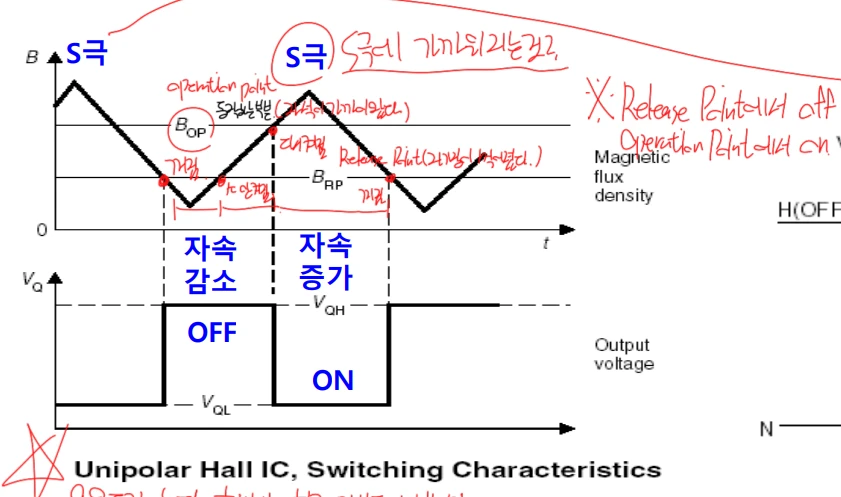

B(op) Operating Point : 동작하는 부분(자석이 가까이 있다.)

B(rp) Release Point : 동작이 멈추는 부분(자기장이 멀어졌다.)

(\*) Schmitt Trigger : 자속이 일정 값 이하(Brp)로 떨어지면 급격하게 일정한 H 출력을 얻고, 자속이 일정 값 이상(Bop)이 되면 다시 급격히 동작하여 일정한 L 출력을 얻게 된다.

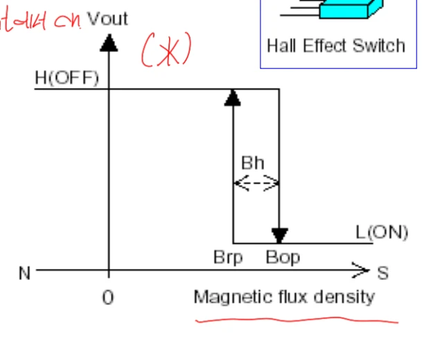

- **Magnetic Flux Density** : 자속 밀도(즉, 홀 센서와 자석이 얼마나 가까이 있는가)

---

- **Bipolar** 또는 **Latching Switch**

    - S극에 노출되었을 때 동작 : On 상태.
        그러나 스위치는 S극이 제거된 후에도 On 상태 유지.
        Release Point에 도달하려면 (Switch Off 되려면) **N극에 노출 필요**.
        대칭적, 주기적 S-to-N 반복 : 50%의 duty cycle의 주기적 출력 얻음.

    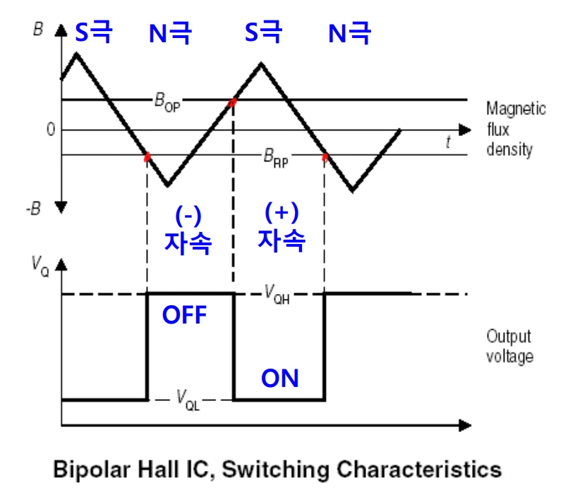

    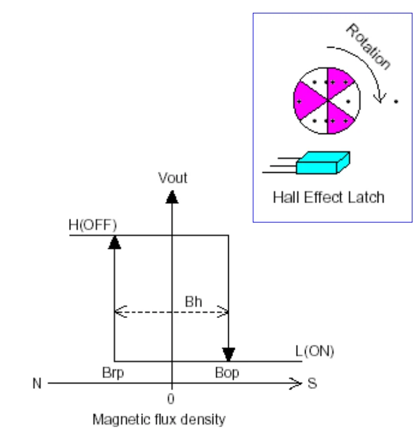

---

- 홀 센서 활용 분야

    - Flow Meter

    음료수 디스펜서에서 적당량이 나가는걸 캐치하는 기능

---

## 위치/변위센서

- 포텐쇼미터(가변저항기, 위치/변위 얼마나 움직였는가?를 체크한다.)

    - 변위를 직접 전기저항의 변화로 변환하고, 부가회로에 의해서 이 저항변화를 전압 또는 전류변화로 다시 변환하는 센서이다.
    - 포텐쇼미터는 직선변위와 회전변위를 측정한다.

- 직선변위 검출용 포텐쇼미터

    - 저항체와 그 위를 직선적으로 이동하는 와이퍼(wiper)로 구성

    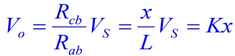

    - 변위에 비례하는 출력전압이 얻어진다.
    - 직선 변위센서의 검출 범위는 수십mm ~ 수백mm정도이다.

    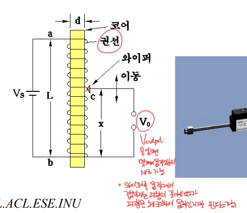

V0 (V output을 읽으면 몇mm 움직였는지 체크가 가능하다.)  
와이퍼를 움직여서 겹쳐지는 저항의 길이에 따라 저항을 체크해서 움직인 거리를 판단 가능.  
간단하게 계산하면 V0 = Rcb/Rab * Vs = x/L * Vs = Kx 라고 할 수 있다.

---

- **회전변위 검출용 포텐쇼미터**

    - 회전축이 회전하면 내부의 와이퍼가 저항체 위를 이동하고, 저항 값은 회전각에 비례하여 변화한다.
    - 와이퍼가 세타만큼 회전할 때, 저항 값 및 출력전압은 아래와 같다.

    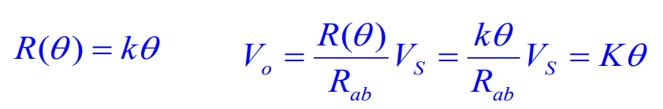

    - 각 변위에 비례하는 출력전압이 얻어진다.

    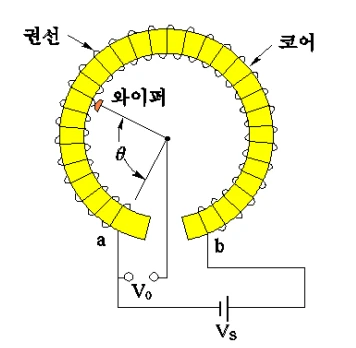

---

- **포텐쇼미터**

- **광학식 포텐쇼미터**

    - 광학식 포텐쇼미터는 비접촉식으로, 원리에 따라 두 종류가 있다.
    - 축의 각도에 따라 광센서(포토다이오드, 포토트랜지스터 등)가 받는 광량이 직선적으로 변하도록 설계된 기구를 이용하는 것.
        광센서가 받는 광량에 비례하는 출력전압을 발생시킨다. 그러나, 현재 이 방식을 이용한 광학식 포텐쇼미터는 그리 많지 않다.

    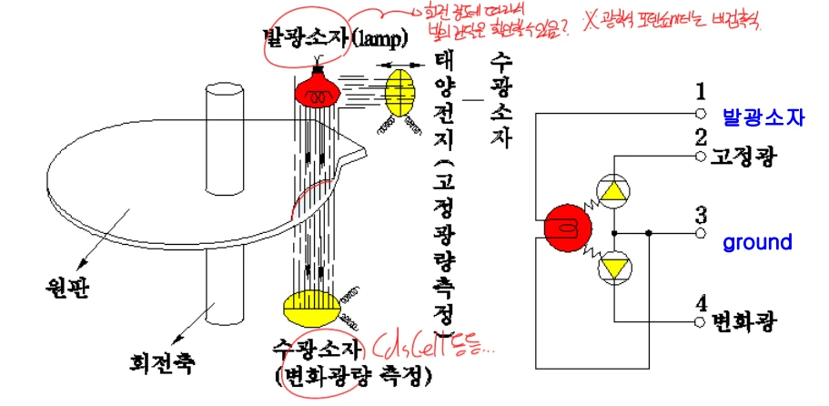

    - 수광소자가 변화광량을 측정하고, 발광소자가 빛을내게 되는데, 이때 원판이 회전하는 정도에 따라서 빛의 전달을 확인할 수 있으므로 회전량을 계산할 수 있게 된다.

---

- **로터리 인코더**

    - 인코더(encoder)란, ‘부호화’하는 것을 의미하며, 출력이 펄스 신호로 나오게 된다.
    - 로터리 인코더는 회전각을 전기 펄스로 변환하여 출력하는 디지털식 회전위치(변위) 검출기이다. 현재 회전 각도를 데이터로 전달하는 것이므로, 고가의 센서이다.

- **광학식 인코더**(모터에 붙어있다. 붙어있어야 회전각도 파악 가능)

    - **증가형**
    - 발광 소자(LED)와 수광소자(포토다이오드, 포토트랜지스터) 사이에 회전원판(rotating disk 또는 code disc)과 고정 마스크(stationary mask)가 있다.
    - 회전원판에는 일정 간격의 슬롯(slot)이 만들어져 있다.
    - 고정 마스크에는 **위상이 90도만큼 다른 2상의 슬롯 A, B**와 **회전의 원점을 결정하기 위한 제로펄스 슬롯 Z**가 있다.
    - 발광소자로부터 나온 빛은 회전슬롯과 고정슬롯을 통과하여 수광소자 A, B에 들어가면 전기펄스를 발생시키고, 이것을 계수하여 회전위치를 결정한다.
    - 기준위치를 임의로 선택할 수 있고, 회전량을 무한히 계측 가능하다.

    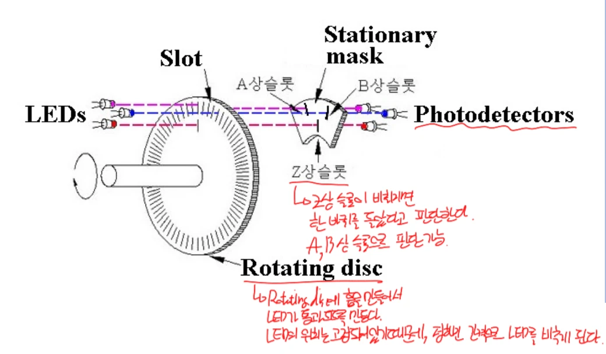

    - Rotating disc에 홈을 만들어서 LED가 통과될 수 있도록 만든다. LED의 위치는 고정되어 있기 때문에, 정해진 간격으로 LED를 비추게 된다.
    - z상 슬롯에 LED가 비춰지면 한 바퀴를 돌았다고 판단한다.
    - A상과 B상의 위상 차로부터 축의 **정회전**(시계 방향)과 **역회전**(반시계 방향)을 판별 가능.
    - 원판이 **시계방향**(CW)으로 회전하면 B상 상승시점에서 A상은 “1” (즉 A상은 진상, B상은 지상)로 되고, 반대로 **반시계반향**(CCW)으로 회전하면, B상 상승시점에서 A는 “0”(즉, A상은 지상, B상은 진상)으로 되어 회전방향을 결정할 수 있다.

    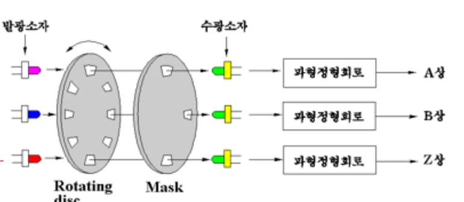

    - Z상은 1회전에 1개의 원점신호를 발생시키고, 주로 카운터의 리셋 또는 기계적 원점 치 검출에 이용된다.
    - 증가형 인코더는 동작 중 정전이 되면 현재 위치를 알 수 없다.
    - 일반적으로 증가형 인코더는 절대치형 인코더에 비해 저가이며, 분해능이 높다.
    - 인코더가 있으면 센서 정확도가 좀 더 올라가기 때문에 좀 더 쉽게 모터를 컨트롤 할 수 있다.

    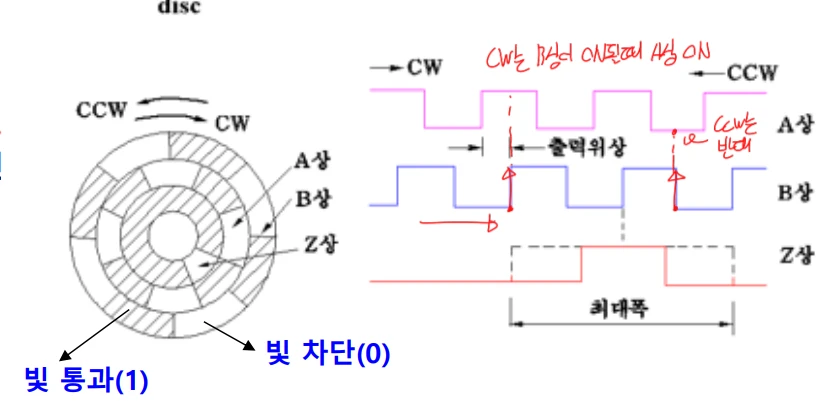

---

- **인코더를 이용한 모터 컨트롤 시스템(Feedback Control System)**

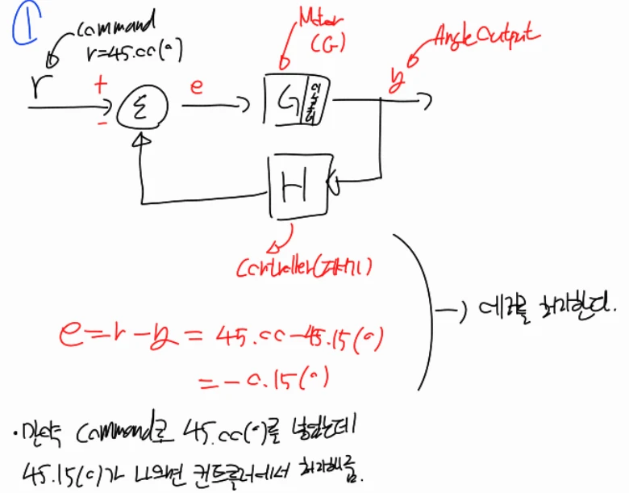

- command로 45.00도를 넣었는데, 모터에서 동작시켜보니 45.15도가 동작했음. 인코더에서 이걸 캐치하면 컨트롤러에 이 값을 넣어줘서 에러를 처리해준다.

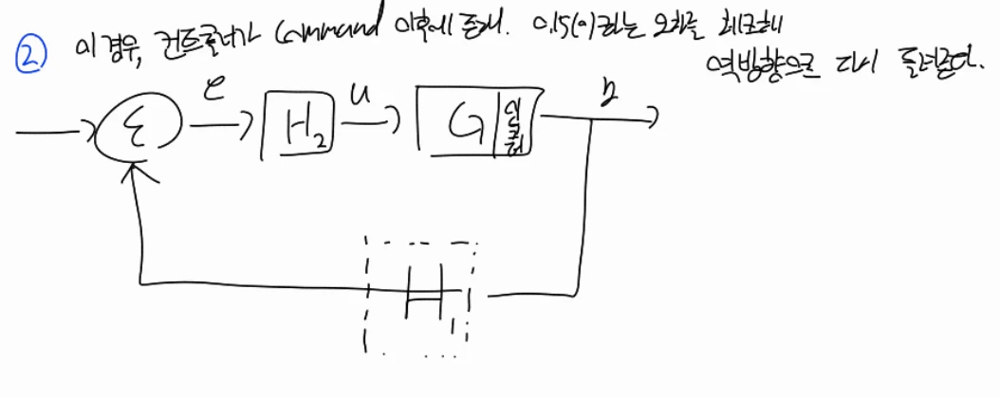

- 이 경우에는 컨트롤러가 커맨드 이후에 존재해서, 오차를 체크한 다음 역방향으로 다시 돌려주는 역할을 한다.

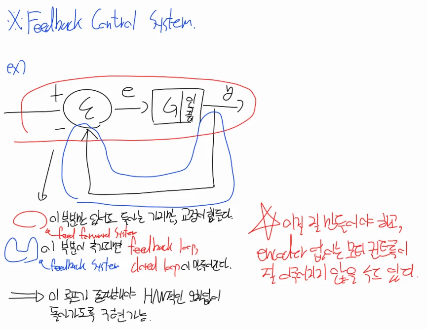

- 위의 그림에서 빨간색 부분을 Feed Forward System이라고 한다. 이 부분만 있어도 시스템을 동작 시킬 수는 있지만, 실제로 모터가 원하는 만큼 동작하지 않을 수도 있기 때문에, 파란색 부분이 뜻하는 Feedback System이 있어야 한다.

    이를 통해 **feedback loop**, **closed loop**가 만들어진다.

⇒ 이 루프가 존재해야 H/W적인 오차없이 돌아가도록 구현할 수 있다.

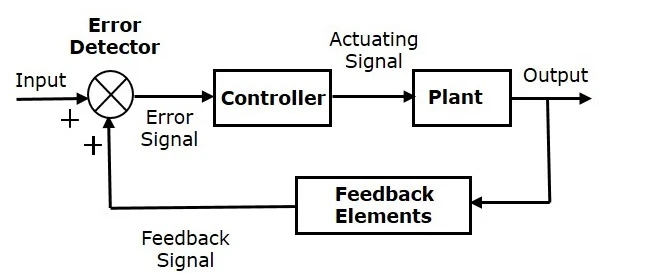

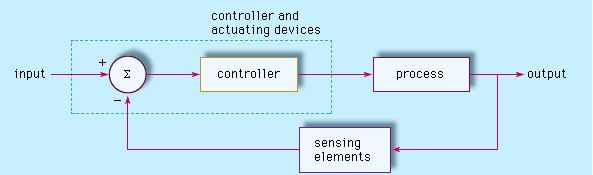

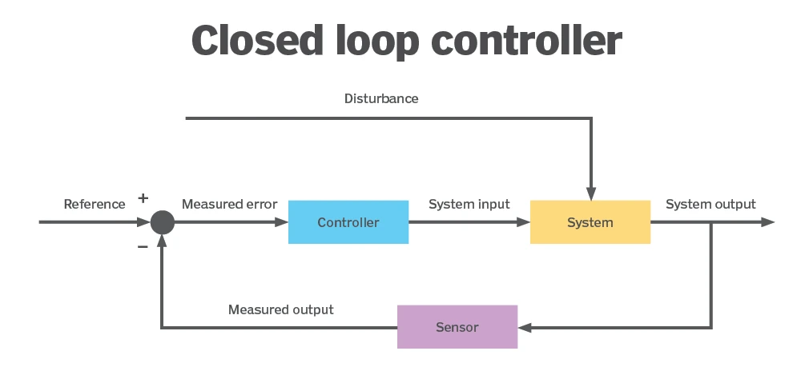

[피드백 제어 시스템(Feedback control system)이란](https://qkqeo.com/272)

---

- **절대치형**(Absolute Encoder)

    - 절대치형은 디스크가 회전하지 않고, 빛이 들어오는 위치에 따라 현재 각도를 파악함.
    - 절대치형 인코더는 금속 회전원판에 **슬롯을 2진 부호로 만들어 회전 각도에 따라 2진 코드가 출력**되는 것으로, **절대 위치를 상시 검출** 가능하도록 한 것이다. (즉, 증가형과 달리 절대위치를 항상 판단할 수 있음.)
    - 예를 들면, 그림과 같이 세 개의 슬롯을 통해 빛을 통과 또는 차단하도록 부호를 형성하면 1회전마다 8개의 2진 부호 패턴을 만든다. 그러므로 **그림의 경우 360/8 = 85도의 분해능이라고 할 수 있다.**  **통상 분할 단위는 1도 정도**가 많다.
    - 그러나 그림과 같은 순2진부호형은 어떤 수에서 다음 수로 이동할 때 2개의 비트가 동시에 변화하기 때문에 애매한 부호가 되는 문제가 있다. 예를 들면, **3에서 4로 이동 시 011에서 100로 변하지만, 순간적으로는 111, 즉 7이 생길 수 있다.** (마치 스케쥴링할 때 공유 변수가 바뀌기 전에 변수에 접근하여 사용하는 것을 예로 들 수 있을듯.)

    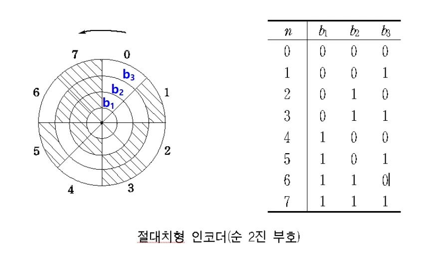

    - **그레이 코드**(gray code)

        - 순 2진부호의 문제점을 해결하기 위해서 **수가 변할 때 항상 1비트의 부호만 변하는 그레이 코드가 사용**된다.
        - 이 인코더는 **절대위치를 검출할 수 있어 편리**하지만 **복잡한 슬롯모양을 제작해야 되기 때문에 고가**로 만들어진다.

        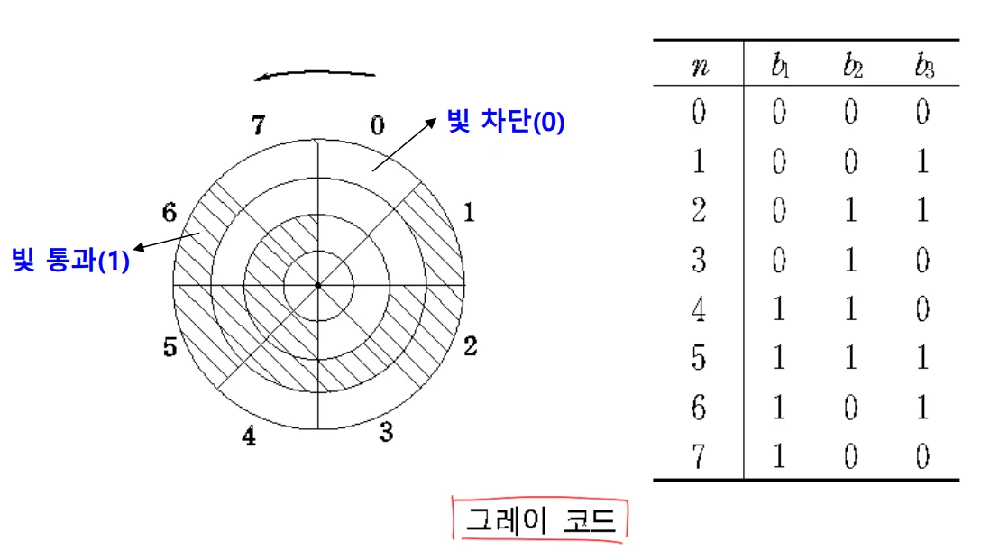

    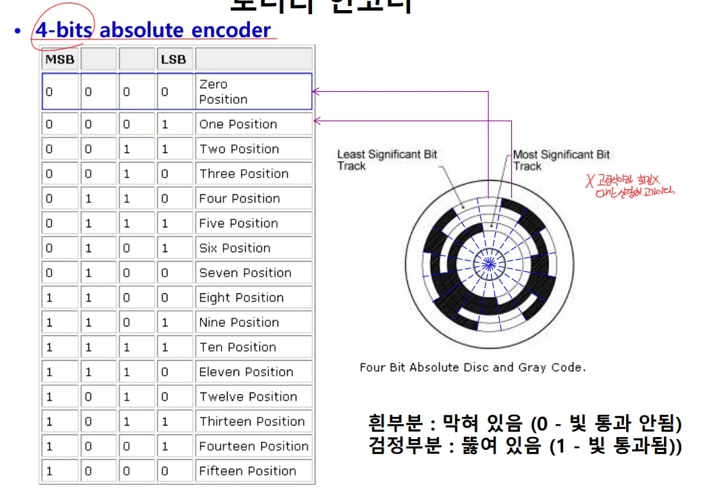

---

- 초전형 이동 검출기

    - 초전현상을 이용해서 사람 또는 물체의 이동을 검출하는 수동형 적외선 이동 검출기
        (passive infrared motion detector, 간단히 PIR sensor) ⇒ 초음파 센서는 Active 센서임.
    - 초전센서는 열 에너지를 검출하는 센서 중 가장 간단하고 저가이면서도 응답도가 우수해서 사람의 이동검출에 가장 널리 사용된다.

- 초전소자를 이용한 PIR 센서의 원리

    - 사람이 접근하게 되면, 초전소자 A는 인체로부터 방출되는 열에너지를 흡수하여 전압을 발생시킨다.
    - 초전소자 표면에 유기된 전하는 서서히 중화되기 때문에 피크 전압을 유지할 수 없으며, 그림 (a)에서와 같이 서서히 감소한다. 따라서 정지해 있는 사람은 검출할 수 없음.
    - 이러한 문제를 해결하기 위해서 쵸퍼(chopper)를 사용해 인체로부터 방출되는 적외선을 펄스 형태로 만들어 초전소자 A에 입사시키며, 이 경우 출력파형은 그림(b)와 같이 시간의 함수로 되어 쉽게 측정할 수 있음.

    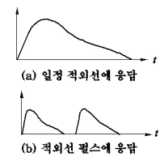
