# 3주차(초음파센서)

## 초음파센서

- 매질(고체, 액체, 기체)의 탄성적 진동을 음파 또는 탄성파라고 부른다.

- 음파는 인간의 귀가 들을 수 있는 가청 주파수(20~20,000 Hz)를 중심으로 다음과 같이 분류한다.

    - 음파(가청음) : 20 ~ 20,000 [Hz]

    - 초저주파음(infrasound) : 20 [Hz] 이하

        - 초저주파음의 검출은 빌딩 구조의 해석, 지진 예측 등에서 매우 중요하다. 우리가 초저주파음을 들을 수는 없지만, 그 진폭이 비교적 강하여 인간에게 공포, 두려움과 같은 아주 자극적인 심리적 효과를 주기 때문에 느낄 수는 있다.

    - 초음파(ultrasound, ultrasonic) : 20,000 [Hz] 이상

---

- 주파수, 주기, 파장, 음속

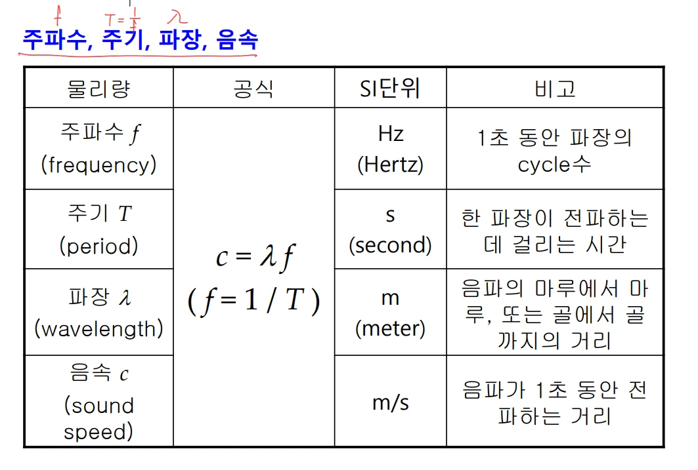

---

- decibel (dB)

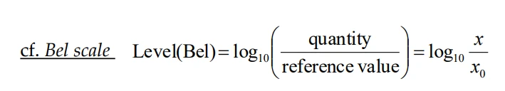

1. 위의 식에서 Level은 decibels를 말한다.
2. quantity는 어떤 것이든 될 수 있다.
3. 비교될 수 있는 기준점의 값이 필요하다.
4. 보통은 기본 비교 값이 존재한다.

<!-- -->

- 벨의 정의 : dB = log10(대상값/기준값)

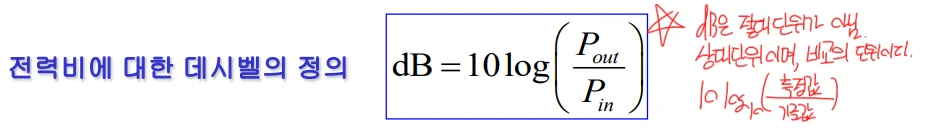

dB은 절대 단위가 아닌 상대 단위이며, 비교의 단위이다.

- decibel은 비율이기 때문에 어떠한 물리적 단위도 존재하지 않는다. 가장 중요한 전력비로는 1:2를 말할 수 있는데, 이것은 **-3 dB frequency**라고 불린다. (**half-power**)

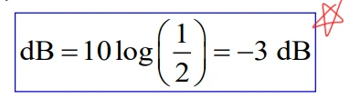

- 전압비를 나타낼 때는 이와 같이 나타내곤 한다.

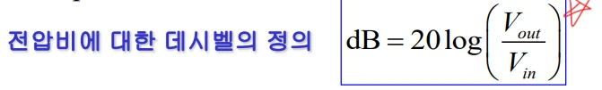

---

- Sound Pressure Level (Lp or SPL)

    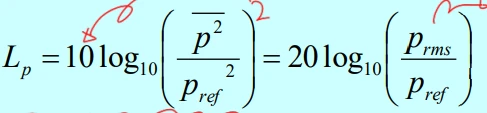

    ⇒ 제곱해 주는 이유는, 압력은 아래와 같은 형태로 나오기 때문이다.

    ⇒ Pref는 보통 2\*10^-5 Pa (혹은 20 * 10^-6) Pa) 이다. (사람이 들을 수 있는 최소한의 압력)

    ⇒ 제곱이 밖으로 빠져나와서 앞의 계수로 나올 수도 있다.

    - rms(standard deviation) ⇒ 만약, 평균이 0에 가까워지면, 값이 standard deviation과 비슷하게 나오게 된다. 이를 Prms로 설정, Pref는 사람이 들을 수 있는 최소 소리의 압력이다.

    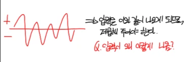

    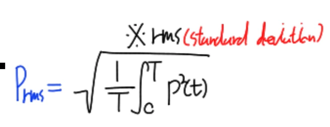

    Prms는 다음과 같이 표현될 수 있다.

    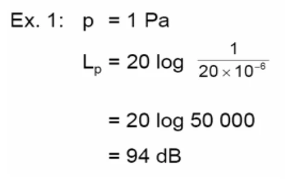

    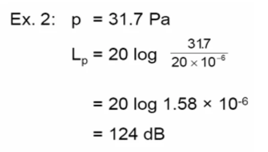

    ---

    - Multiple Sound Sources (addition: Uncorrelated)

        - 여러 개의 서로 관련없는 음원이 존재할 때 계측되는 전체음압레벨은 어떻게 될까?
        - 단순히 음압레벨 두 개를 그냥 더해서는 안된다.

        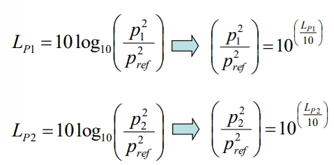

        Lp1과 Lp2에 대해서 값을 정리해보면, 위와 같은 식이 나오게 된다.

        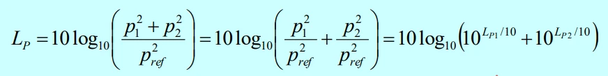

        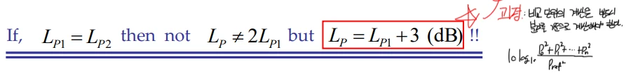

        만약 Lp1과 Lp2가 같다면, Lp = 2Lp1이 아닌, Lp1 + 3 (dB)이 된다. 식을 풀어보면 그렇게 나오게 된다.

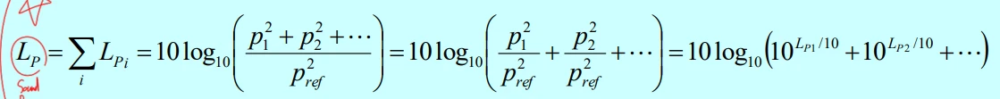

- cf) 만약 서로 별개인 N개의 sound source가 있다면, total sound pressure level은?

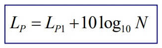

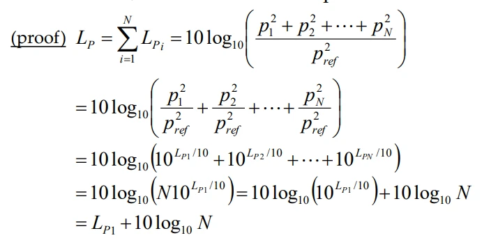

---

- 초음파 센서의 종류

    - 수신기(receiver) 또는 마이크로폰 : 음파나 초음파를 전기신호로 변환하는 장치

        - 마이크로폰 : 고체에서 공기파나 진동을 감지하는 경우는 센서를 마이크로폰이라 함.
        - 하이드로폰 : 액체 속에서 동작하는 경우.

    - 송신기(transmitter) 또는 스피커 : 전기 신호를 음파(초음파)로 변환하는 장치
    - 두 변환기는 동일구조로 음파의 발생과 검출이 가능하며, 합하여 초음파 트랜스듀서 또는 진동자(oscillator)라고 부른다.
    - 마이크로폰은 넓은 주파수의 음파를 변환하기 위한 압력 변환기이다. 그러나, 압력센서와는 달리, 마이크로폰은 정압 또는 매우 느리게 변화하는 압력을 측정하지는 않는다. 즉, 마이크로폰의 동작 주파수는 보통 수 Hz에서부터, 초음파 응용에서는 수 MHz, 표면 탄성파(SAW) 소자의 경우에는 GHz 범위에 이른다.

- 콘덴서 마이크로폰 : 커패시터에 기본을 두는 마이크로 폰. 그래서 콘덴서 마이크로폰을 정전용량형 마이크로폰이라고 부른다.

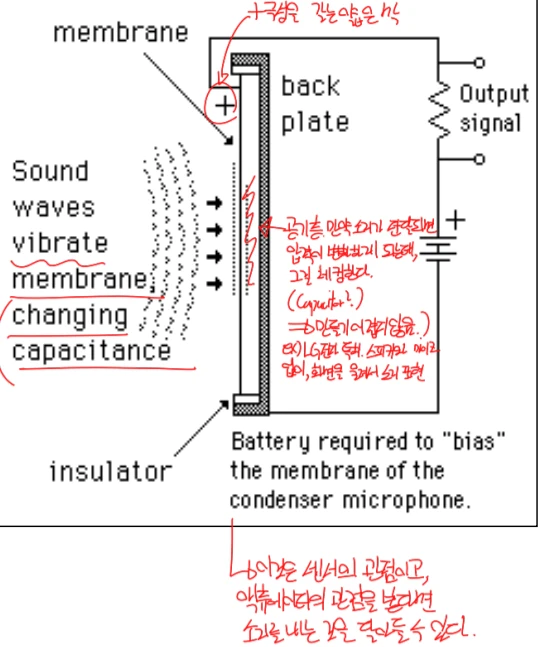

극성을 갖는 얇은 막을 설치해두는데, 그 사이에 공기층이 있어서 만약 소리가 전달되면 압력이 변화하게 된다. 그 압력 변화를 체크한다. 

- 초음파의 특징

    - 초음파의 속도는 전파보다 느리다.

    - 초음파의 파장이 짧다. 

        - 음속이 전자파의 속도보다 10^5정도 늦으므로, 파장도 필연적으로 짧아진다. 그 때문에 분해능이 높아진다.

    - 매질의 다양성

        - 기체 뿐만 아니라 액체, 고체도 대상이 된다. 특히, 액체, 고체 내에서는 전파보다 잘 통하게 된다.

    - 사용이 용이하다

        - 인체에도 해롭지 않기 때문에 특히 의료 분야에서 앞으로보다 더 많이 사용될 것이다.

---

- **압전 현상**

    - 초음파를 발생하고 검출하는 초음파 트랜스듀서로 가장 널리 사용되고 있는 원리는 **압전 진동자**이다.
    - 수정(quartz crystal), 산화바륨(BaTiO3)등과 같은 결정에 힘을 가하면, **내부에서 전기 분극(polarization)이 발생**하여 **결정 표면에는 그림 (a)와 같이 전하가 나타난다.**
    - 또 역으로, 그림 (b)같이 **전계를 가하면 결정이 기계적 변형을 일으킨다.** 이때 **기계적 변형의 방향은 인가전계의 방향(인가전압의 극성)에 의존**한다.
    - 이와 같은 두 효과를 **압전기**(piezoelectricity)라고 부른다.

    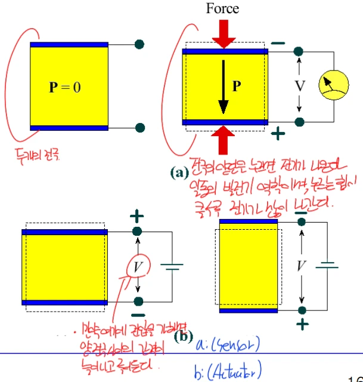

    a는 센서, b는 액츄에이터에 해당하는 것으로 보인다.

---

- 초음파 센서

    - 아래 그림은 공기 중에서 동작하는 **압전식 초음파 변환기**의 일례

    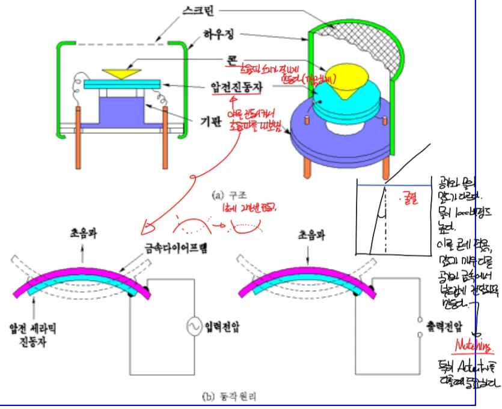

    - 그림 (a)

        - 유니모프형 압전 세라믹 진동자 사용. 이 진동자에 전압을 인가하면 중심부와 주변부가 반대방향으로 그림 (b)와 같이 상하 진동하게 된다.

            - 압전진동자를 진동시켜서 초음파를 내보내는 역할을 한다.

    - 진동자 중심에는 <strong>콘(cone)</strong>이라고 하는 **정합기**가 부착되어 있는데, 음향기기에서 사용하는 **직접 방사형 스피커**와 동일한 작용을 하여 **공중에 초음파를 유효하게 방사**한다.

        - 초음파 소리가 잘나게 만드는 부분. 매질의 밀도 차이를 이용해서 밀도가 매우 다른 공기와 금속에서 부드럽게 전달되도록 만든다.

---

- 초음파 센서

    - 초음파 센서에서, 측정회로가 펄스 모드로 동작하면 하나의 압전 엘러먼트로 초음파 송수신을 행한다.
    - 초음파를 연속적으로 송신하는 시스템에서는 송신과 수신에 별도의 압전 엘레먼트가 사용됨. 이는 실습 때 사용했던 초음파 센서의 동작과 같다고 할 수 있을듯.

    - 아래 그림은 초음파 센서의 임피던스와 감도의 주파수 의존성을 나타낸 것.

        - **송파 감도** : 임피던스가 최소가 되는 **공진(resonance) 주파수**에서 최대

            - **공진** : 임피던스가 감소하는 주파수, **초음파를 멀리 보내고 싶다면**  **공진 주파수**를 이용하면 된다.

        - **수파 감도** : 임피던스가 최대로 되는 **반공진(antiresonance) 주파수**에서 최대

            - 반공진 : 임피던스가 최대가 되는 주파수, **Sensing 하기에 좋은 주파수**이다.

        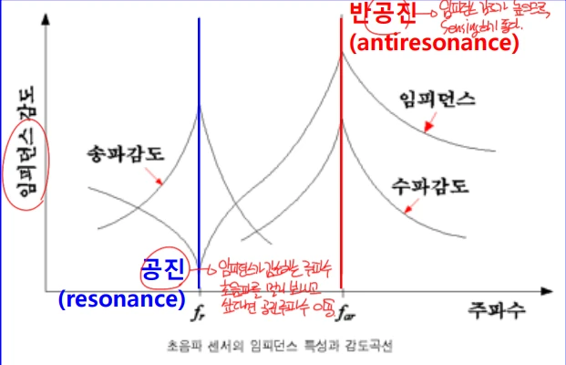

        - 주파수에 따른 임피던스 측정이 가능하며, 나에게 필요한 환경에 맞춰 주파수를 설정하는 것이 중요하다.

---

- 소나(Sonar : Sound Navigation and Ranging)

    - 소나는 초음파를 발사해서 그 반사파를 수신하는 항해용 수중 음향기기의 총칭

    - 수중에서 음속을 c라고 하면 수심 h는 다음 식으로 구해진다.

        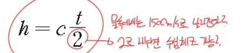

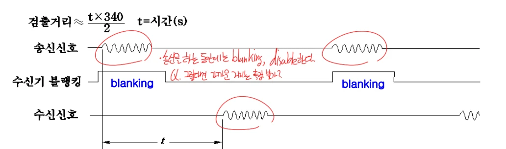

송신을 하는 동안에는 blanking, 수신기를 disable한다.

---

- **SAW**(Surface Acoustic Wave, 표면탄성파) 센서

    - 여러 개의 센서를 달아서 가스 분자 등이 부딪히면, 신호가 바뀌어서 체크가 가능해짐.

    - 그림 (a) : SAW 소자의 전극구조를 보통 IDT(interdigital transducer)라고 부른다.

        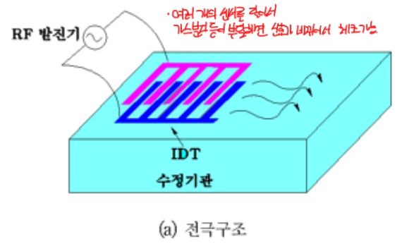

    - 송신 IDT와 수신 IDT 사이의 공간은 검출 하고자 하는 양(즉, 압력, 점성 유체, 온도, 가스분자, 생체분자 등)과 작용(반응)하는 영역.
    - 송신 IDT에서 Wave를 생성 후 수신 IDT로 쏘게 되는데, 이 때 센싱 영역에 가스 분자가 존재하게 되면 신호가 변화해서 송신 IDT에서 이를 알아챌 수 있다.

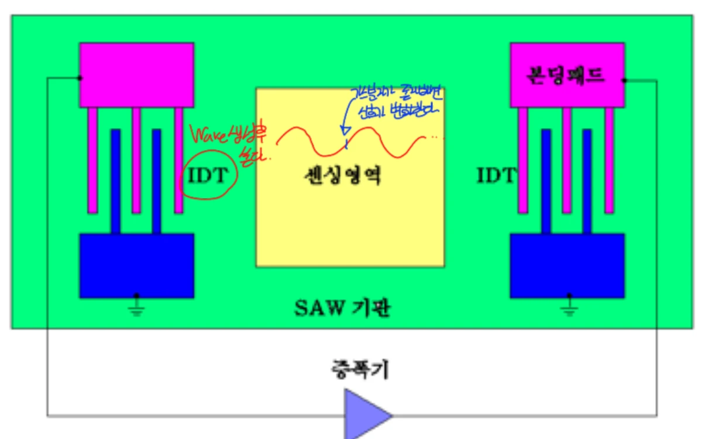

---

- **IMU sensor**

    - 일반적으로 움직이는 물체에는 모두 필요한 센서. (가속도 신호의 체크가 가능하다.)

        - x, y, z 세 축에 대하여 체크가 가능함.
        - 가속도계는 직선적인 가속도만을 체크할 수 있다. (x, y, z)
        - 자이로는 움직이는 각도를 체크한다.

    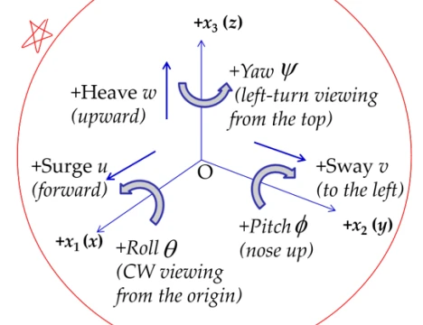

    - 가속도계(Accelerometer)

        - 가속도를 직선 값으로 측정한다.

        - 가속도를 적분하면 속도, 속도를 적분하면 거리가 나오므로 이를 통해 직선 운동에 대한 정보를 얻을 수 있음.

            - 그런데, 거리 센서 구해서 미분하면 되는거 아닌가? 왜 가속도 센서를 쓰는가.
            - 왜냐면, 미분이 회로로 구성되기가 어렵기 때문…
            - 또한 작고, 싸고, 고장이 잘 나지 않고, 사용이 쉽다.

    - Gyroscope (각속도 센서)

        - 각가속도는 체크하지 않는다.

        - 각변위센서 쓰면 안되나?

            - 드론, 비행기 등의 빠른 속도를 따라갈 수 없음.
            - 회전을 센싱하는 것은 매우 어렵다.
            - 비행체의 경우, 세 개가 동시에 나타나면서, 혹은 두 개가 같이 나타나면서 측정이 어려워질 수 있다. (cross effect)
            - 이 때문에 가속도 + 각속도 정보를 받아서 가속도 센서가 보충.

            ⇒ 이를 칼만필터를 통해 보정해야 함.

        - 자동차의 중심에 IMU가 있고, 그 데이터를 IMU에 담는다. 그리고 우리는 필요한 IMU 데이터를 CAN으로 받아 사용한다.
