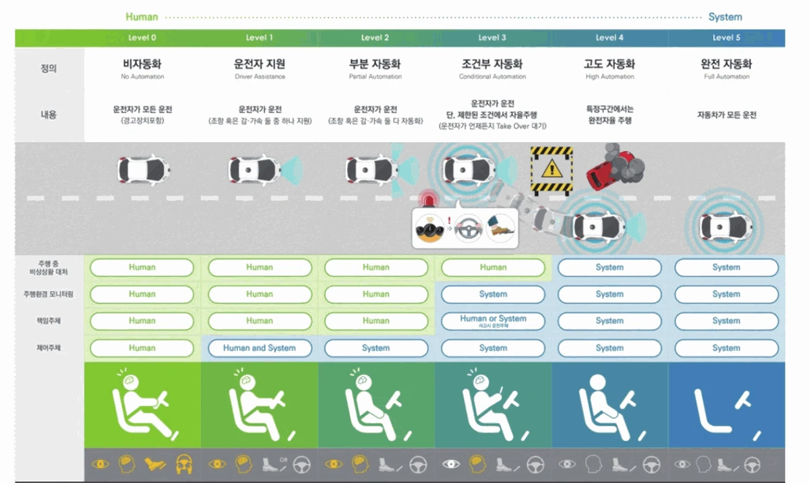
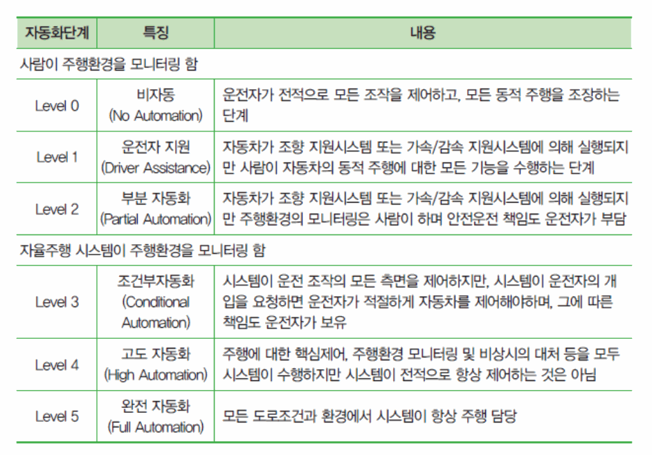

# 4주차(자율주행자동차 기본)

기존의 자동차. Car → Mobility로 급격하게 이동하고 있다. ex) 음식 전달하는 로봇, 드론, 로봇 등등…

- TESLA

    - Model X
    - Model S
    - Model Y
    - Model 3

    ⇒ Plaid, Normal, … 이런 추가 타입이 있음.

    - Optimus : 테슬라에서 만들고 있는 로봇.

---

- 자동차 사고의 대부분은 사람에 의해 발생한다. (Human Error)

    사고 원인의 90% 이상은 운전자 과실. 이에 따라 인간을 운전으로부터 배제시키고자 한다. 안전한 운전을 위해서. 하지만, 운전을 하다보면 인간의 의지를 무시할 수도 없기 때문에 컴퓨터가 헷갈리는 경우가 발생하기도 한다. → 하지만 이 운전자가 졸면서 실수로 운전권한을 가져오려고 하는 것일 수도 있음.  
⇒ 이에 따라 운전을 완전 자율주행화 시키려고 한다.

- **ADAS** (Advanced Driver Assistant System)

    - 차선 유지 지원 시스템

    - 자동 긴급 제동 시스템

        - **AEBS** (Automatic Emergency Braking System) : 계속해서 레이저를 쏘면서 앞에 차가 올 경우, 자동적으로 긴급하게 제동해주는 시스템 (가장 중요한 시스템)

    - 샤시 통합 제어 시스템
    - 스마트 후측방 경보 시스템
    - 주차 조향 보조 시스템
    - 경사로 밀림 방지 시스템

---

- 자율주행자동차의 기능 네 가지

주어진 목적지까지 갈 효율적인 경로를 결정(GPS, 기지국과의 상호 관계를 통해 내 위치를 추정할 수 있음. 폰을 이용하는 경우 거의 정확하게 나온다. 그리고 기본적으로 Map이 있어야 경로 생성이 가능하다.)하고, 

주변 환경을 인식(주변에 다른 차가 있느냐, 비가 내리냐 등)하고, 

주행 상황을 판단(신호등과 같은 신호)하며, 

차량을 제어하여 주행(Accel, Break, Steering Wheel ⇒ Surge, Sway, Heave)하는 자동차

- 자율주행으로 인한 사회적 혜택

    - 라스트 원마일 : 알아서 내려주고, 태우러 오는 기능 (ex. 마트 쇼핑)
    - 운전수 부족 문제 해결 및 사람의 운전으로 인한 사고 감소 ⇒ 효율적인 운전 가능
    - 군집주행 : 배송과 같은 것을 한 번에 효율적으로 처리해 줄 수 있음.
        (ex. 사람이 lead 차로 운전하면 뒤에서 로봇들이 운전하면서 따라옴)
    - 데드맨 시스템 : 급한 컨디션 악화에 대처 가능
    - 자동 운전을 통한 서투른 운전 능력 보완 가능.

⇒ 이러한 장점에 의해 더욱 성장하게 될 것

---

- 자율주행자동차의 기술은 6단계

    - 과거에는 **NHTSA** : National Highway Traffic Safety Administration (USA, 교통안전국)이 자율주행자동차는 총 5단계로 나눠진다고 말했지만, 이제는 6단계로 변경되었다.

    - **SAE** : Society of Automotive Engineers (미국자동차공학회) 세계 최고의 자동차 공학회

        

    **Level 0**. 비자동화

    (눈, 뇌, 발, 손) 운전자가 전적으로 모든 조작을 제어, 모든 동적 주행을 조장함.

    **Level 1**. 운전자 지원

    (눈, 뇌) 자동차가 **조향 지원시스템** 또는 **가속/감속 지원시스템**에 의해 실행되지만, 사람이 자동차의 동적 주행에 대한 모든 기능을 수행하는 단계

    **Level 2**. 부분 자동화

    (눈, 뇌) 자동차가 **조향 지원시스템** 또는 **가속/감속 지원시스템**에 의해 실행되지만 주행환경의 모니터링은 사람이 하며 안전운전 책임도 운전자가 부담

    **→ 3단계부터는 자율주행 시스템이 주행환경을 모니터링 함.**

    **Level 3**. 조건부 자동

    (뇌) **시스템이 운전 조작의 모든 측면을 제어**하지만, **시스템이 운전자의 개입을 요청하면 운전자가 적절하게 자동차를 제어**해야하고, 그에 따른 책임도 운전자가 보유.

    **Level 4**. 고도 자동화

    주행에 대한 **핵심 제어**, **주행환경 모니터링** 및 **비상시의 대처 등을 모두 시스템이 수행**하지만 시스템이 전적으로 항상 제어하는 것은 아님. **일부 환경에서는 사람의 개입이 필요**할 수 있음.

    **Level 5**. 완전 자동화

    **모든 도로 조건과 환경에서 시스템이 항상 주행을 담당**한다. 

    ⇒ 완벽한 구분이 아니기 때문에 바뀔 수도 있다.

    ⇒ 2와 3에서 큰 격차가 있다. **레벨 2까지는 사고가 나면 사람의 책임이지만, 레벨 3부터는 차를 판매한 회사의 책임**이다.

    

    - 어떤 인간도 완전한 운전을 구사할 수 없다. 그러므로, 자율 주행은 100% 완벽한 운전을 하지 못한다. 자율주행자동차는 99.999…%의 완벽함을 추구하며 발전해 나간다.
