# 5주차(자율주행자동차의 기본-2)

- AGI(Artificial General Intelligence) : 해당 부분으로 연구와 트렌드가 매우 활발하게 이루어지고 있다. 2023서울모빌리티쇼

    - Generalist는 필요하지 않다. (Transformer 기반)

- TESLA FSD Beta ver. 11.3.5 (Single Stack)

    - AGI 트렌드
    - 모빌리티 트렌드
        ⇒ 가장 큰 돈이 걸려있고, 가장 큰 산업의 미래이다.
    - 완전자동화 가장 가까워진 모델. FSD Beta ver. 11.3.5

---

- 자율주행자동차는 6개의 레벨이 있고, 눈, 뇌, 발, 손이 관여된다.
- 현재 미국은 자율주행자동차가 많이 풀려있는데, 우리나라는 FSD Beta ver. 11.3.5가 도입조차 안되어있다. 이것이 문화 수준의 차이를 만들어낸다.

> 레벨3부터는 운전자의 책임이 사라지고 제조사의 책임이 된다. 그래서 테슬라는 사실상 레벨5에 가깝게 개발하고 있지만, 레벨3 이상이라고 절대 얘기하지 않는다.

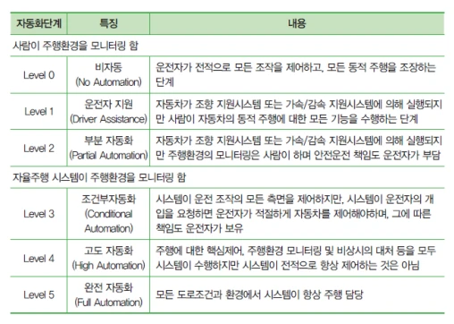

- 현대 모비스 남양연구소 ⇒ 현대 판교 연구소(모빌리티 연구소, SW)

    - SDV(Software Defined Vehicle) : 앞으로는 S/W가 자동차를 굴러가게 한다. 기계에 의한 동작은 사라질 것.
    - 고급 인력의 수요는 더욱 높아질 것이고, 점차 AGI에 의해 영어를 더 잘하는 것이 중요해지고 있다. (영어로 명령을 잘 내리는 능력)
    - 인간의 머리에서 창조적인 생각을 내는 것이 더 중요해지고 있다.

- 삼성 종기원

⇒ 진짜 research가 이루어지는 환경이다.

- 이제 Car ⇒ Mobility의 시대로 넘어가고 있다. Shift되는 타이밍에 기회가 생기게 된다.
- Google-웨이모

- MobilEye : 인텔에서 인수한 회사 (IT 역사상 최대 규모의 M&A)
    ⇒ 이스라엘 대학교의 연구실에서 만들어낸 회사

    - 카메라 기반 자율주행자동차 기술 제공

- DARPA(Defence Advanced Research Projects Agency) : 미국 국방성 산하 기관으로 보인다. 자율주행자동차를 만들라고 과제를 내놨는데(Grand Challenge)
    스탠포드 대학과 타 대학이 연합해서 Stanley라는 자동차를 만들어서 성공

    ⇒ 이 과정에서 확률로봇학(Probabilistic Robotics)가 만들어짐.

    자율주행자동차의 카메라 시선은 매우 낮기 때문에 앞에 차가 하나만 있어도 다음에 있는 차를 파악하지 못한다. 사람은 기억하지만, 자동차는 그걸 모두다 파악하고 기억하지 못하기 때문에 결국 조건부확률을 통해 모든 상황에 대한 확률을 계산한다.

    ⇒ Thrun이라는 박사가 관련한 내용으로 책을 쓰고, 구글에서 이를 연구하는 대학 사람들을 모두 스카우트해서 웨이모를 만들어냄. 선두주자였지만, 테슬라에 의해 좌절되었다.

---

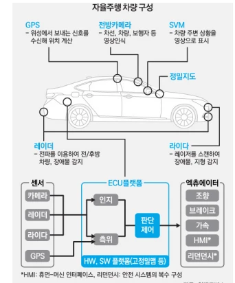

- 센서 → 센싱 데이터를 바탕으로 엑츄에이터를 얼마나 동작시킬지 결정한다.

- ECU(Electronical Control Unit, 전자 제어 장치)에서 센싱된 값을 바탕으로 S/W를 통해 엑츄에이터에 전달해줄 값을 연산한다. (이 과정에서 다양한 H/W, S/W 플랫폼이 사용되고, 고정밀 지도와 같은 S/W 플랫폼이 필요할 수 있음.)

    - HMI : High Definition Map, 현대차는 개발 자체가 HMI가 없으면 불가능. Map이 없는 곳에서는 차가 갈 수 없다는 한계 존재.

- 전달된 value를 바탕으로 엑츄에이터로 동작시킨다.

    - 엑츄에이터에서 중요한 것은 조향, 브레이크, 가속, HMI(Human-Machine Interface), 
        리던던시(안전 시스템의 복수 구성)

---

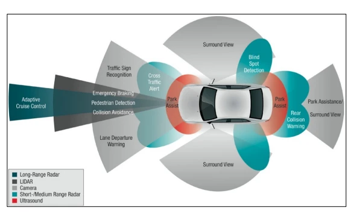

- Cross Traffic Alert : 사람이 건너는 것을 주시
- 속도가 빠르면 멀리까지보고, 느리면 짧게 본다. 탐지 범위를 줄이고 멀리까지 감지하도록 할 수도 있다.
- Rear Collision Warning : 전혀 안보이는 곳에서 오는 차를 본다.
- Park Assistance/Surround View : Bird Eye View

- **Long Range Radar**

    - 탐지 범위를 줄이고 멀리까지 감지할 수 있도록 만들어서 Cruise-Control에 사용하는 기능

- **LIDAR**

    - LIDAR는 중거리 탐지에 가장 능하므로, 라이다를 사용하여 아래와 같은 사항 감지

        - Emergency Braking
        - Pedestrian Detection
        - Collision Avoidance

- **Camera**

    - 카메라는 이미지 프로세싱을 통해 학습된 AI를 이용하여 근거리, 중거리에 대하여 자동차가 상황 파악을 할 수 있도록 함.

        - Traffic Sign Recognition (교통 신호를 인지한다.)
        - Lane Departure Warning (차선을 넘어갈 경우 경고해 주는 시스템)
        - Surround View (자동차의 양 옆을 볼 수 있도록 함.)
        - Park Assistance/Surround View (후방, 현재도 후방 카메라는 사용 중.)
            ⇒ 특히 Surround View는 Bird Eye View를 제공하여 주차에 도움을 주는 기능을 함.

- **Short/Medium Range Radar** (중/단거리 레이더)

    - 중/단거리에 사용될 수 있는 레이더를 도입하여 다양한 데이터 탐색에 활용

        - Cross Traffic Alert : 횡단보도 등에서 건너는 사람이나, 작아서 보이지 않는 물체 탐지
        - Blind Spot Detection : 자동차의 사각지대에서 물체 및 장애물 탐지
        - Rear Collision Warning : 자동차의 뒤에서 부딪힐 수 있는 물체 및 장애물 탐지

- **Ultrasound**

    - 근거리에서 부딪힐 수 있는 물체나 장애물을 탐지

        - Park Assistance

---

- V2X : 자율주행자동차와 모든 환경과의 통신

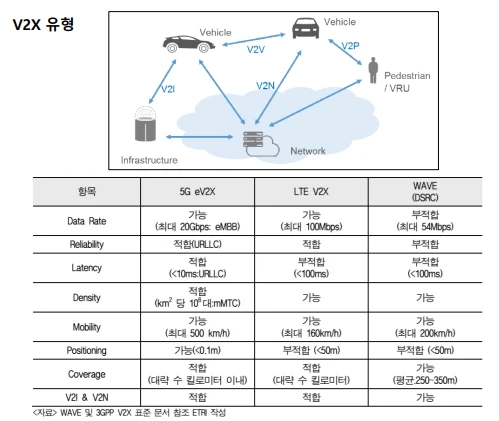

- 네트워크를 통해 필요한 데이터를 자동차에게 전달하면서, 자동차가 판단하는데 큰 도움을 준다. 다만, 자동차가 외부에 높은 의존성을 가진다.
- 하지만 테슬라는 V2X에 의존하지 않는다.

- Pedestrian/VRU(Vulnerable Road Users) : 자전거를 타는 사람, 유모차를 끌고 가는 사람, 노인, 아동 등…

    - 만약 자동차 근처에 핸드폰이 사용되고 있다면 관련 정보를 Vehicle에 쏴주는 것 V2P(pedestrian)
    - 또, V2V(vehicle)을 통해서 앞 차가 브레이크를 밟는 등의 동작도 통신이 가능하다.

---

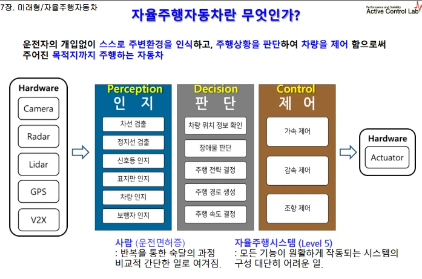

- 인지, 판단, 제어가 자율주행의 핵심이다. (많은 부분을 AI로 처리하고 있고, 테슬라는 거의 완성 단계에 들어갔다.)

---

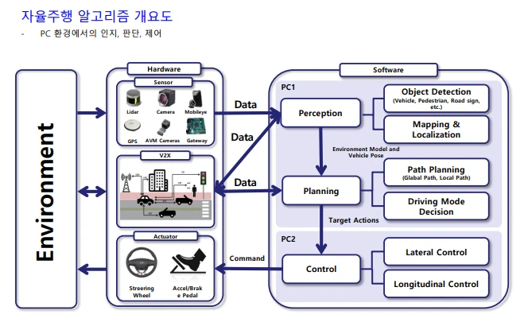

- S/W가 자율주행자동차의 핵심

    - **Perception**  

        - Object Detection(자동차 판단 등등)

        - Mapping & Localization (내 차량의 위치를 찾는 것)

            - 모비스의 경우에는, 모비스의 정밀맵 위에서 내 위치를 찍을 수 있다면 그것이 Localization이다. V2X
            - Mapping은 직접 센서를 통해 맵을 만들어내는 능력이라고 보면 된다. 한 번도 가보지 못한 길의 지도를 그릴 수 있다.

    - **Planning**

        - Path Planning(Global Path, Local Path)

            ⇒ 가고자 하는 도착점이 있고, 여러가지 조건을 충족하면서 그 경로를 어떻게 만드는가? (High Definition Map을 이용)

            ⇒ dijkstra, A\* 문제와 부딪히게 된다.

            - Global Path도 때때로 새롭게 만들어야 될 때도 있다.

    - **Control**

        - Lateral Control : Steering Wheel, yaw (차량의 조향에 의해 발생되는 횡 방향 운동 제어)
        - Longitudinal Control : Accel - Break, Surge (차량 제어 시스템에서 주로 사용되는 용어로, 차량의 앞뒤 움직임(즉, 가속 및 감속)을 제어하는 것)

---

- **LIDAR 기반 자율 주행**
- AI의 대표적인 기술은 **Neural Network**
- Supervised Learning, Unsupervised Learning, Reinforcement Learning 등
- 딥러닝 학습을 위한 양질의 센싱 데이터 필요

- **LIDAR** : 빛을 쏴서 돌아오는 시간을 측정하고 맵을 만드는 센서
    ⇒ One channel LIDAR : 한 바퀴 도는 센서

    - **64채널로 날려서 취합된 데이터로 맵을 생성** (거리가 멀면 멀수록 포인터와 포인터 사이의 거리가 멀어지므로, 멀리 있는 것은 데이터가 자세히 나오지 않는다.)
    - **Point Cloud**(LIDAR로 포인터를 쏴서 생기는 점의 집합, 하나하나의 점에 대한 x,y,z 정보를 갖게 된다.)
    - 1도씩 쏘면서 초당 5바퀴를 돌리면, 엄청나게 많은 정보를 전달받는다.

    ⇒ 이를 통해 **Object Detection**을 수행한다.

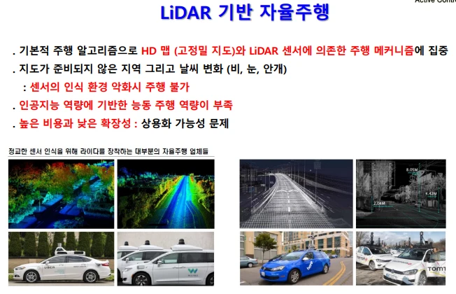

- HD 맵을 이용하면 엄청난 양의 데이터가 필요해지므로, 통신 트래픽이 엄청나게 발생한다. 그리고 HD 맵은 지속적인 업데이트를 통해 replacement가 되어야 하므로 한계가 존재
- 대부분의 자율주행자동차는 **센서, 맵, 라이더를 기반으로 주행하는 메커니즘에 집중**한다.
- **인공지능 역량에 기반한 능동 주행 역량이 부족**(LIDAR로 맵을 얻는다고 해도 실질적인 데이터 처리가 쉽지 않다.)
- **높은 비용과 낮은 확장성**

⇒ 웨이모가 이 방식으로 연구를 하지만, 현재 좌절 단계에 있음. (한계 분명)

---

- **Camera 기반 자율주행**

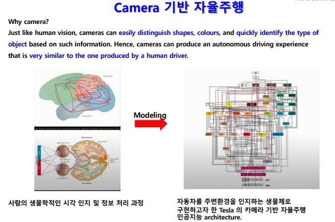

- 웨이모 같은 경우는 눈을 연구해서, LIDAR로 맵을 만드는 방식을 선택.
- 이와 다르게 테슬라는 뇌를 연구 시작. 카메라 기능은 떨어지더라도 뇌로 커버를 하면 된다고 선택. (다른 기업들은 포기)
- **Camera를 통해 Virtual LIDAR를 구현**. 이를 통해 **Object Detection**을 구현함.
- 그래서 모든 자동차에 넘버링을 한다. YOLO 도입해도 가능은 하지만, 정확도가 매우 떨어진다.
- **테슬라**는 8개의 카메라를 이용하여 맵 데이터를 만들어 낸다. 즉, Mapping을 한다. (도로 그림 예측 및 지도 상에 3D 물체 BOXEL 생성)
    ⇒ **카메라 데이터를 통해 3차원 Vector 공간 생성**

- 테슬라의 격차를 왜 못따라잡고 있는가?
    ⇒ Real World AI가 뒤떨어지기 때문이다. Cyber World AI는 애플이 치고나가면 구글이 바로 치고나가고… 이런 식으로 추격이 가능했지만, Real World(특히 자율자동차)의 데이터를 얻으려면 자동차가 있어야만 하기 때문이다. Dojo 컴퓨터로 학습 시키는게, 수백만 마일이다. 그걸 고사하고, 다른 자율주행자동차는 단 1마일의 데이터도 못가져간다.

    테슬라는 Single Stack으로 완전한 시스템을 만들었다. 다른데는 이 서비스를 하고 싶어도 못한다. 

    일론 머스크는 개발자였고, Paypal을 만들 때도 직접 코딩했다. 항공우주공학을 공부했고… 그래서 어떤 식으로 만들어야할 지 잘 아는 것이다. 테슬라의 연구소는 S/W 개발자가 50%이다. 반면 현대는 약 5% 정도로 보인다.

    현재 미국에서 최상위권 대학의 취업 목표는 1등이 SpaceX, 2등이 Tesla… 그리고 3등이 Apple… 그래서 인재를 다 쓸어가고 있다.

---

- **자율주행자동차의 보안**

    - 차량과 클라우드
    - 탑승자의 개인용 장치
    - V2X

    등의 차량에 연결되는 모든 부분에서의 보안문제가 발생 가능하므로, 부분에서 각별한 보안 필요

---

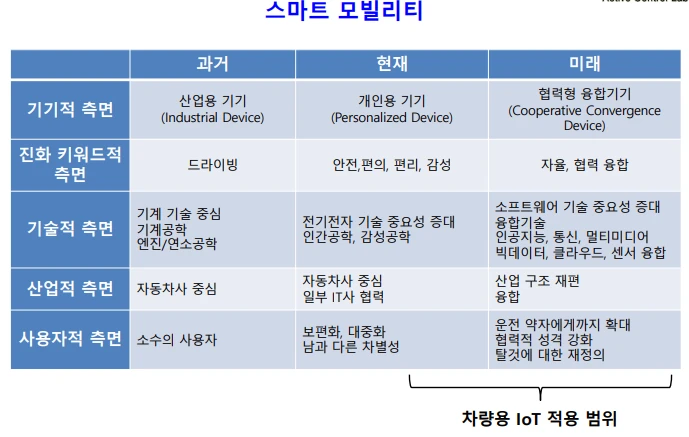

- 쿠팡 물류센터, 마켓컬리와 같은 곳에 많은 로봇이 활동하고 있다. (운송로봇 뿐만 아니라 선반 자체도 로봇인 것으로 보인다.)

    자동차는 독자적인 엔진의 역할이 있어야 굴러간다. 그래서 고위직이 다 기계를 전공한 사람들이었는데, 지금은 시대가 다 끝났다.  ⇒ IT로 넘어감

- 인구는 줄어들지만, 자동차 판매량은 연당 2000→8000까지 늘어날 것으로 예상되고, 현재 가정집에 사람보다 핸드폰이 많은 것처럼 로봇의 판매량도 사람보다 많아질 것이다. (이것도 결국 다 Mobility)

    올해 1분기 순이익 1등도 현대자동차가 차지, 삼성의 순이익은 순이익 90%가 감소했다. 삼성은 TOP 10에 들이밀 수 있는 수준이고, 현대자동차는 70~80위 수준인데도 순이익을 추월했다. 앞으로 모빌리티의 산업성은 더욱 대두되고 드러나게 될 것이다. 

- 자율주행자동차 산업의 구조(로드맵 전망)

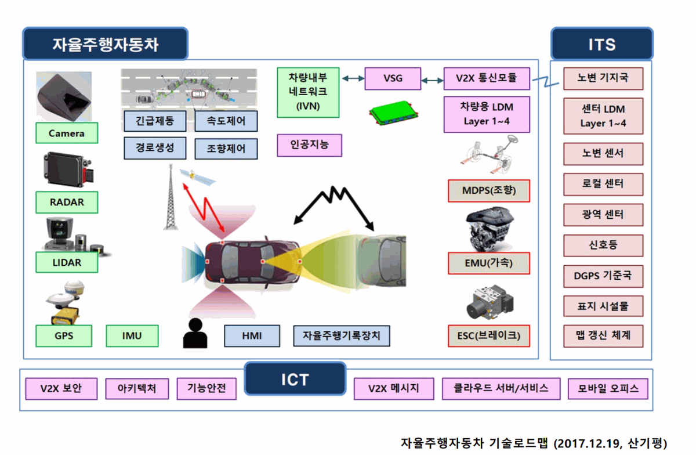

⇒ 따라가면서 바뀌어야 할 것

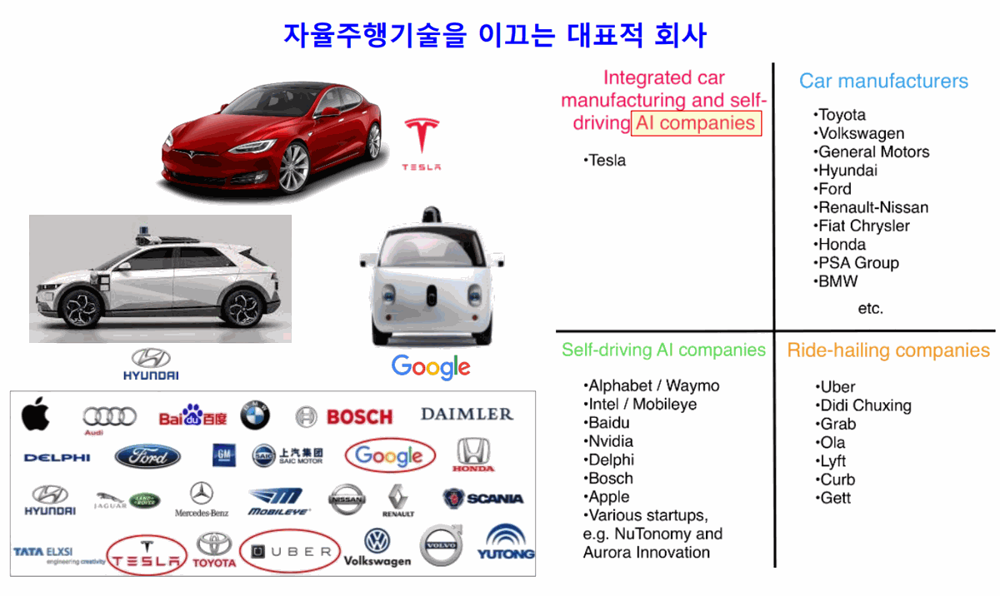

- 테슬라는 자동차 회사가 아니며, AI 회사이다. 단지 그들의 수익이 아직까지는 자율주행자동차 분야에서 가장 많이 발생하는 것일 뿐이다.
- 현재 Car manufacturers와 Self-Driving AI companies가 협업해서 일을 많이하고 있다.

---

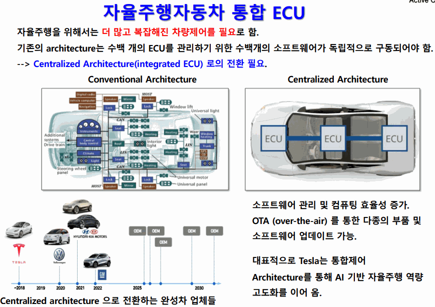

- 이전의 전통적인 자동차는 OS가 없어서 관리가 힘들었고, 자동차에 존재하는 수백 개의 ECU를 관리하기 위해 수백 개의 소프트웨어가 독립적으로 구동되어야 했다.

- 테슬라의 자동차는 **중앙집중식의 아키텍처**를 구현, H/W의 개수도 줄이고 모두 코딩을 자체적으로 하고, 설계도 모두 직접하고 Integration을 해서 시스템을 만들어냄. → **OS와 ECU(Engine Control Unit)가 컴퓨터를 집중적으로 제어**

    ⇒ 전통적인 자동차는 덩치가 너무 커서(붙어있는 회사가 너무 많아서) 떨어트리기가 너무 힘듦.

- 이런 장점이 있기 때문에 **OTA를 통해 소프트웨어 업데이트 가능**, 전통적인 자동차는 S/W를 바꾸려면 자동차를 다시 사야함.

---

- **전기차 플랫폼**

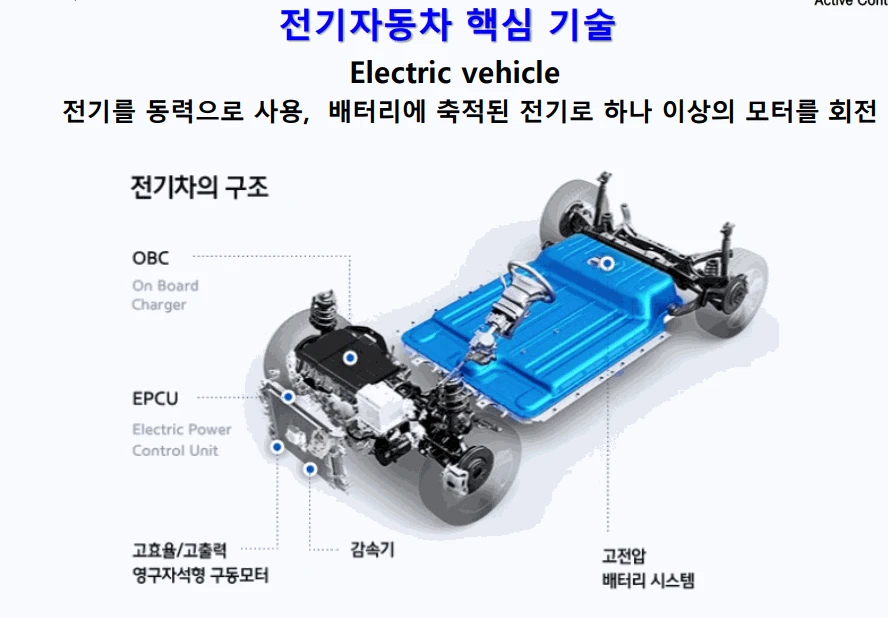

- **OBC**(On Board Charger) : 모터에 의한 충전기
- **EPCU**(Electric Power Control Unit) : 전기를 컨트롤 하는 유닛
- **감속기**(Reducer) : 모터의 속도가 바퀴의 속도보다 빠르기 때문에 속도를 조절해 줌. 전기를 동력으로 하기 때문에 바퀴의 속도가 과도하게 빨라질 가능성이 있기 때문임.

---

- 전기 자동차의 핵심 기술

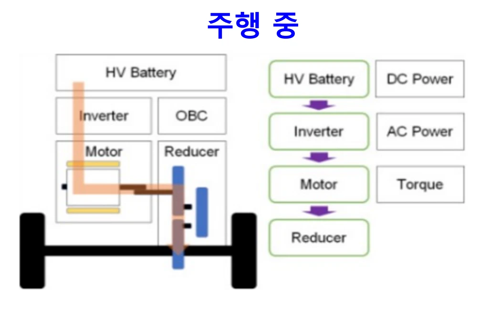

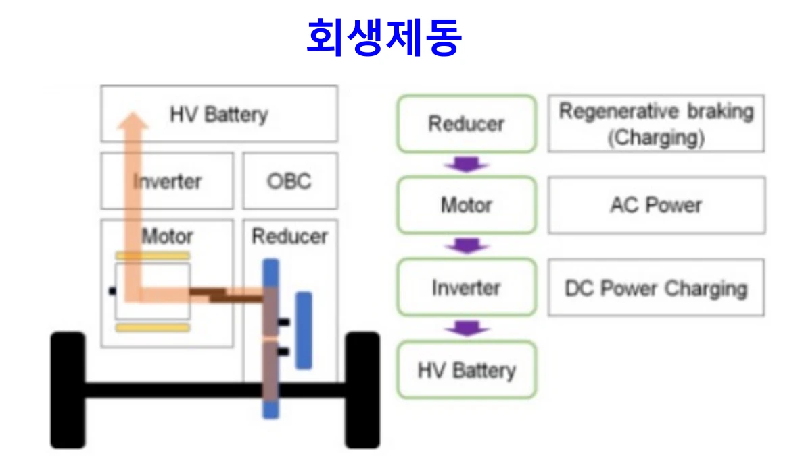

- 주행중

    - HV battery(고전압 배터리) → Inverter(전류 전환, DC⇒AC, PWM) → 모터(AC모터, AC 모터를 사용해야 원하는 동작을 잘 수행할 수 있음. 제로백도 잘 나옴) → Reducer(모터 속도가 너무 고속이기 때문에 속도를 감소시켜 바퀴에 전달함)

    - 회생제동

        - 모터를 강제로 돌리면 전기를 발생시킬 수 있다. 그래서 연비가 많이 좋아진다. (위치에너지를 전기에너지로 전환 가능)

    - **OBC** : On Board Charger, 충전 시에 배터리가 충전되는 부분, **회생제동을 하면 OBC를 통해 배터리가 충전**될 수 있다.

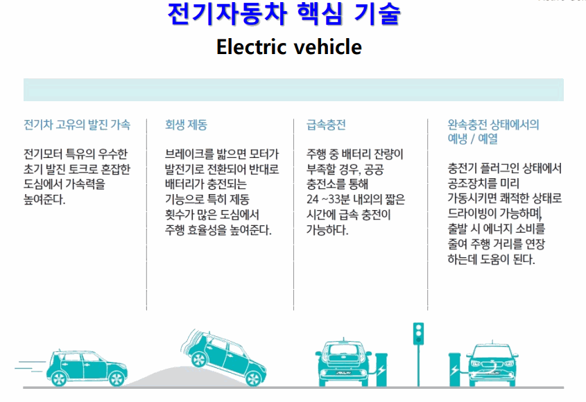

- 전기차는 제로 백이 매우 빠르다. **발진 가속**이 매우 빠름.
- **회생 제동**
- **급속 충전**(현재 5분내로 70~80%까지 충전하는 기술도 있음. 배터리 수명을 위해서라면 20~80% 내로 유지하는 것이 좋다. 배터리 가격이 차량의 60% 정도를 차지하기 때문에 조심히 사용해야 함)

- **완속충전 상태에서의 예냉 / 예열**

    - 배터리의 온도가 높을 수록 관리하기 쉽다. 추운 날씨에는 배터리의 효율이 저하됨.
