# 6주차-1(GPS)

- 자율주행자동차의 핵심적인 기술

    - GPS, Lidar, Sonar and Radar

## GPS

- GPS : 미국이 군사 목적으로 만든 기술. 

    - 위성에서 보내는 신호를 수신해 사용자의 현재 위치를 계산하는 위성 항법시스템
    - 현재 내가 어디있는지를 확인할 수 있는 중요한 데이터를 얻을 수 있다.
    - 자율주행자동차에서는 **Localization**이 매우 중요하다. (내 위치 정보를 찾는 역할) 
        ⇒ 지표면을 다니는 ground vehicle은 위치를 찾기 수월하다. (Localization). 하지만, 비행기나 드론과 같은 mobility는 Localization이 어렵다.
    - **총 궤도는 6개**, **각도는 60도씩**, **1개의 궤도면 당 4개의 위성**이 위치하고 있다. (**6 * 4 + 예비 6 = 30개의 위성이 존재한다.**)

    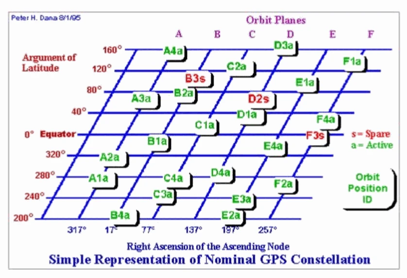

    - **GPS Control Stations 존재**

    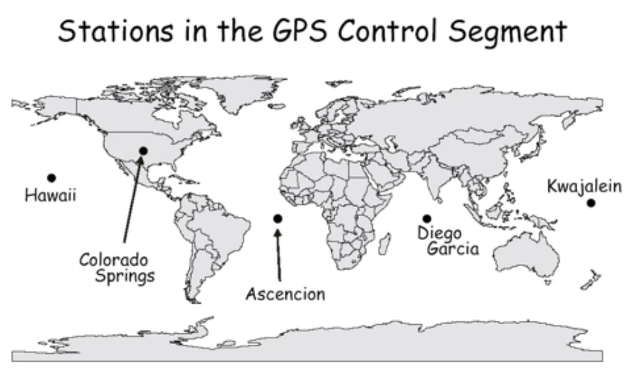

- GPS의 기본 원리

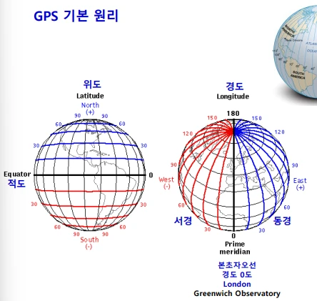

본초자오선(영국 그리니치 천문대), 경도 0

- GPS 기본 원리

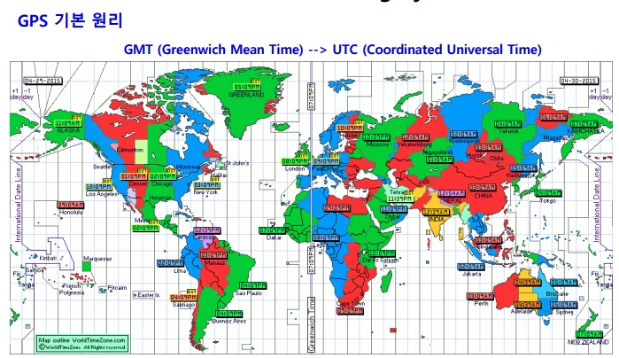

전세계가 공통된 시간을 사용할 수 있게 함

**GMT**(Greenwich Mean Time) → **UTC**(Coordinated Universal Time) : 컴퓨터 상에서 이용됨.

우리나라는 +09:00, 영국이 summer time을 쓰면 +08:00로 줄어든다. summer time은 3월 말~ 10월 말 정도의 기간으로 적용된다. normal은 +09:00 이다.

---

- **GNSS**(Global Navigation Satellite System) : **전 지구적 위성 항법 시스템**

    - 미국의 GPS, 러시아의 GLONASS, 유럽의 GALILEO, 중국의 BeiDou.
    - 미국의 GPS는 신뢰도가 매우 높지만, **다른 국가의 위성항법시스템은 국가적 긴장 상태 등에 의해 다소 영향을 많이 받게 된다.**
    - GPS(미국기준)를 사용하려면 위성이 **최소 네 개 필요**하다.

    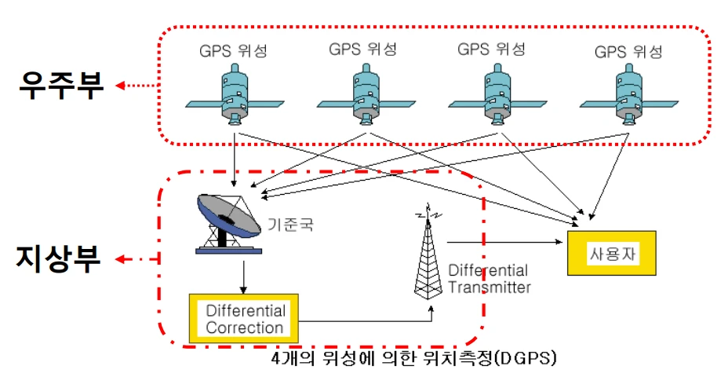

    <strong>기준국(base station)</strong>에서 데이터를 받아오고, 기준국은 땅에 고정되어 있다. 이 데이터를 중간에서 **repeater**를 거쳐 뿌려주는 것이다. 사용자의 GPS 센서가 저가형이면 정확한 데이터를 받기 힘들어진다.

    ---

    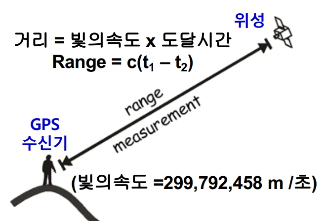

    - 지상에 고가의 수신기가 있다고 가정하자. 이 수신기에서는 내부적으로 Clock이 돌아간다. (표준시를 유지할 수 있는 장치가 수신기 내부에 들어있다고 생각한다. 위성 내부에도 수신기가 들어있다고 생각하면 된다. 그래서 수신기와 위성이 서로 Synchronized되어 있다고 생각하면 된다.)
    - **지상 GPS 수신기**와 **위성 GPS**는 <strong>시간 발생기(Clock)</strong>가 있고, 똑같은 신호를 발생시킨다고 생각한다. 이 데이터가 조금이라도 틀어지면 가치를 잃는다.

    - L = v\*t (속력 * 시간 = 거리)

        - **삼각측량법(측위 방법)**

            - gps는 encode된 값을 쏘는데, 이걸 decode해서 확인할 수 있음.

            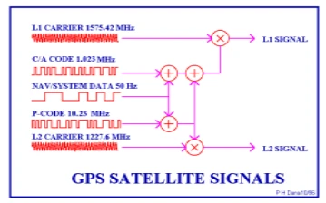

    - 이런 방식으로 최소 세 개의 서로 다른 위성에서 내가 있는 지점에 대하여 거리를 각각 구할 수 있게 된다. 이를 통해 내가 위치하고 있는 좌표를 알 수 있게 된다.
    - 정확도를 높이기 위해 위성을 하나 더 사용하기도 한다.

    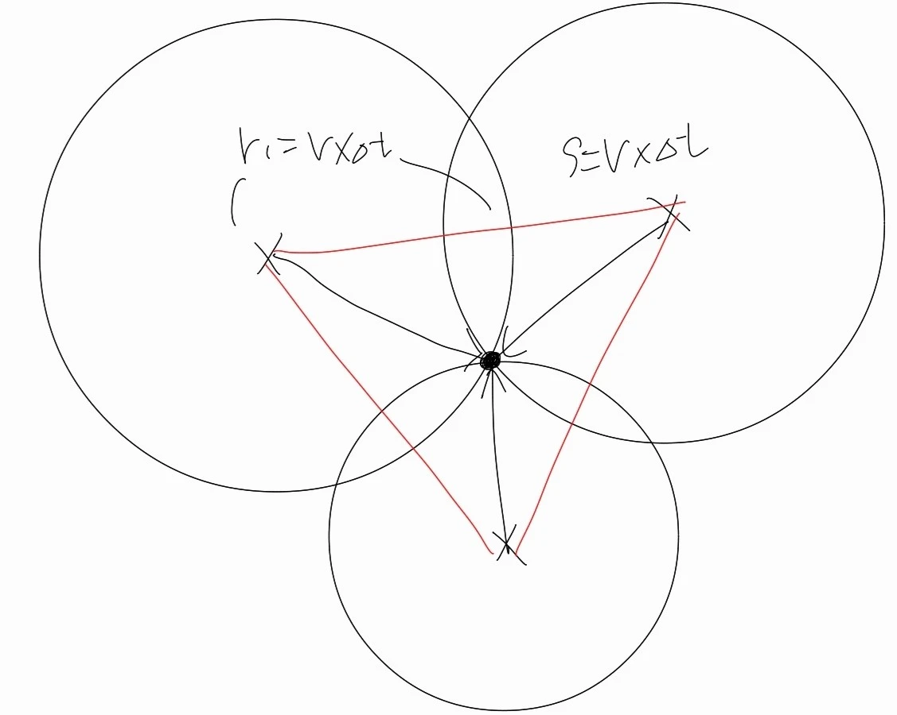

---

- GPS 측량

    - **단독 측위** (Standard Positioning System, GPS), **수신기 1대**를 사용해서 위치를 측정 [정밀도 : 100m]
    - **상대 측위** (Differential GPS, DGPS) : DGPS는 서로 가까운 거리에 위치한 두 수신기가 공통 오차를 상쇄하여 정밀한 데이터를 얻는 기술. 일반적으로 **기준국**에서 오차의 범위 등을 포함한 보정신호를 <strong>이동국</strong>(Rover, 저가형 GPS가 깔려있음. 즉, 이동하는 자동차를 의미한다. 일종의 Repeater의 역할로 보인다.)<strong>에 전송</strong> [정밀도 : 1m - 5m], Differential GPS. 기준국을 사용하기 때문에 오차의 범위가 약 1~5m로 정도로 단독 측위보다 훨씬 작은 편이다.
    - **실시간 이동 측위** (Real-Time Kinematic, RTK) : RTK의 기본 개념은 **오차보정을 위해 기준국에서 전송되는 데이터가 반송파 수신 자료**라는 것을 제외하고는 **DGPS**의 개념과 통일

    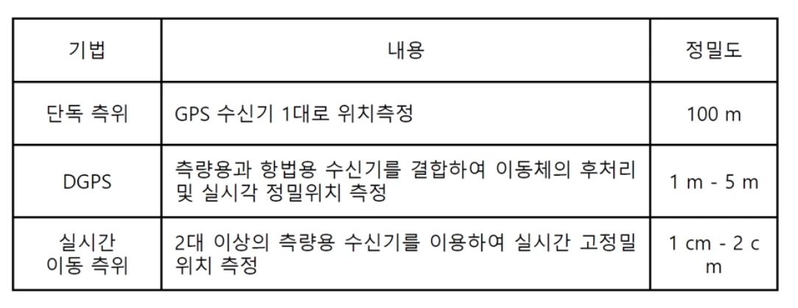

    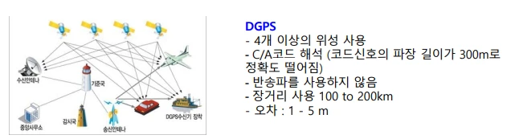

    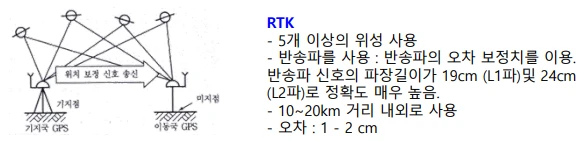

    - A real-time speed autonomous driving based on a low-cost RTK-GPS ⇒ Software적으로 구현함.

        RTK GPS를 이용해서 내 차가 어디로 가는지 찾아냄. Global Path를 설정하고, Reasonable하게 경로가 맞는지 알아내는 것으로 보인다. 클릭하면서 좌표를 다 찍어냄. 여러번 찍어서 평균을 내서 가장 오차가 적은 Path를 생성. (Target Speed : 달리는 속도, Target Position : 다음 위치) 이런 것은 레이싱을 위해서 만든 것이므로 가능한 것이다.

        GPS 신호가 잘 안잡힐 때도 있음, 잘 잡히는 시간이 있고 아닌 시간이 있음. 한 경도에 위성 4개를 배치하므로, 시간에 따라 달라질 수 있음. 

    - 문제는 기준국도 받고, 나도 받고 … 둘다 GPS를 받는데 정해진 경로를 달리고 있음에도 불구하고 여러가지 문제들 때문에 위치가 잘못됐다고 나올 수도 있는 것. ex) repeater가 1초에 10번 업데이트를 하는걸로 localization 실시. **Kalman filter**를 통해서 위치 데이터를 보정할 수 있다. 마구마구 튀고 있는 신호를 안정적으로 던져줄 수 있다. 만약 달리던 도중에 신호가 끊겨서 데이터가 없다고 해도 kalman filter를 통해서 달리는 위치를 추정할 수 있게 된다. (이게 꽤 정확함) 데이터를 받지 못해도 스스로 localization 정보를 만들 수 있음.

    ---

    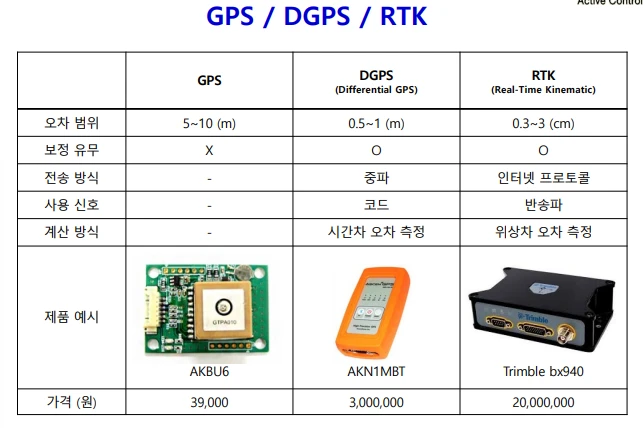

- GPS 오차와 해결 방안

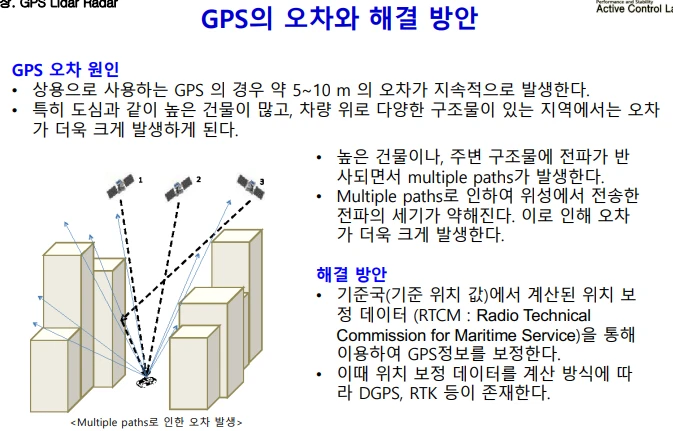

인공위성에서 시간을 발생시켜서 쐈는데, 하나가 튕겨서 들어오면 반지름이 더 크게 측정돼서 세 개의 원이 만나는 점이 바뀜. → 여기서 오차 발생. multiple paths가 발생한다.

보정이 여전히 잘 되지는 않음.

---

- 실습(wgs84) : gps로 latitude, longitude, altitude 데이터를 가져온다.
- 자율주행을 할 때는 UTM 좌표계로 변환해서 사용하게 된다. 지구를 평평한 그림으로 펼쳐서 격자무늬로 좌표를 만들어서 사용하는 방법.
