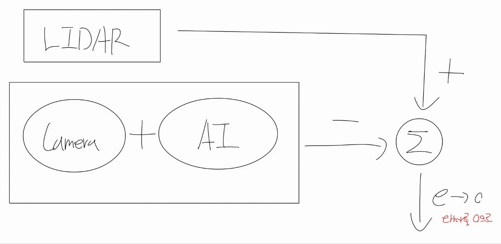
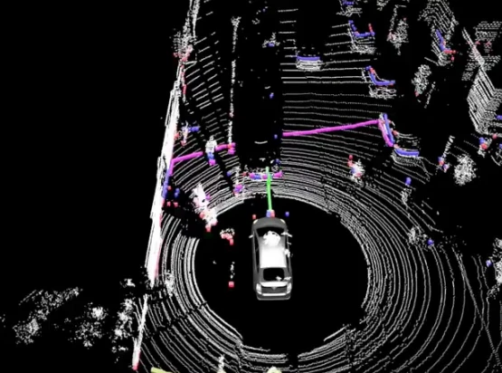
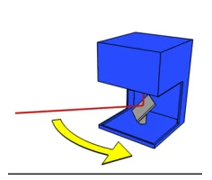
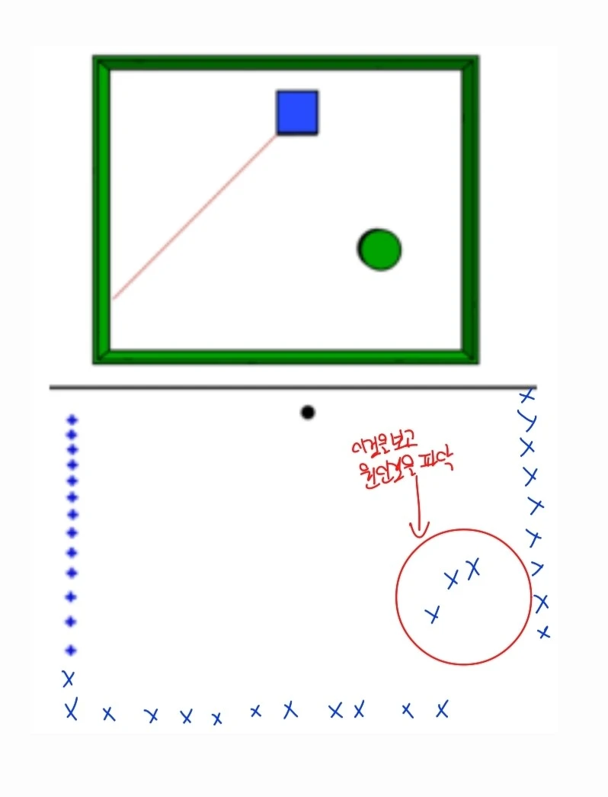
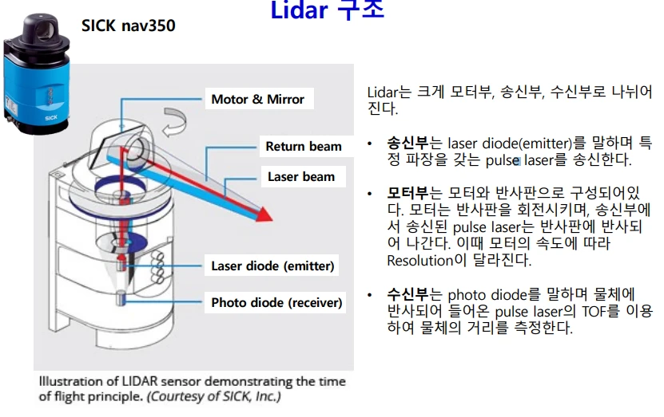
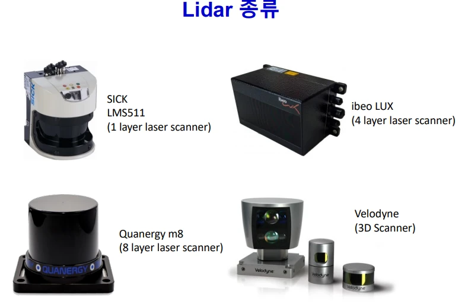
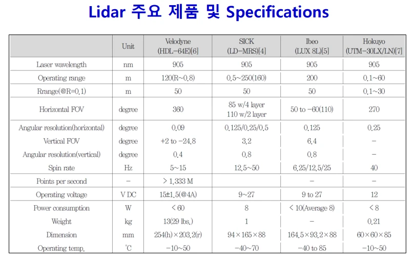
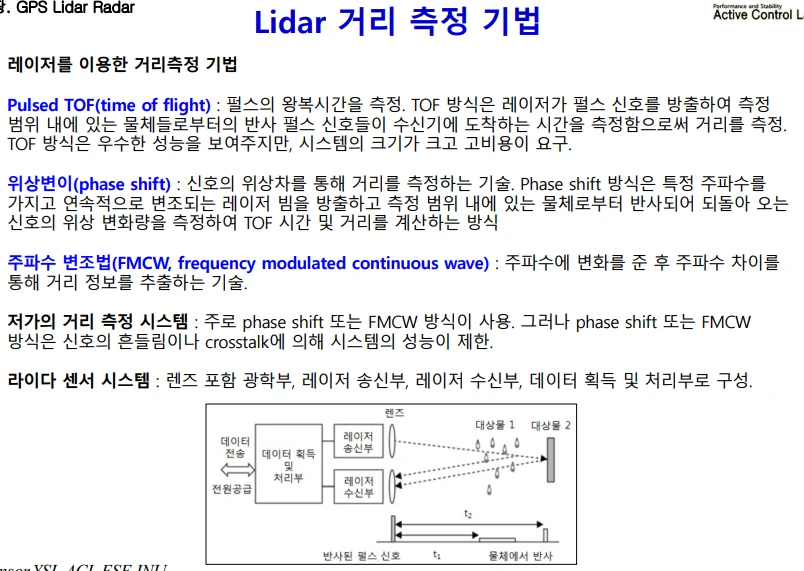
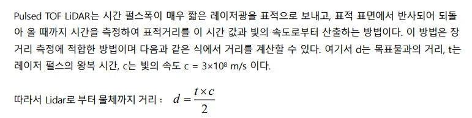
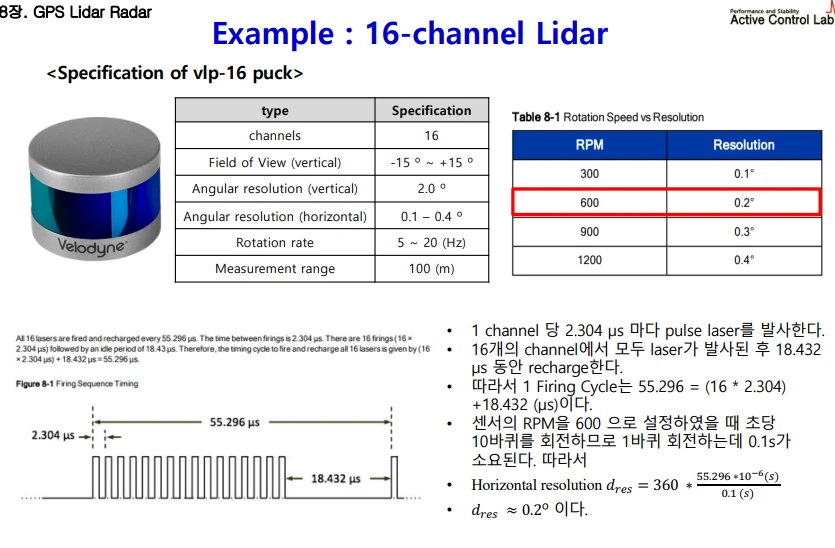

# 6주차-2(LIDAR)

- Virtual Lidar(Light Detection and Ranging)

⇒ 카메라를 이용해서 라이다의 역할을 대체. Camera + AI

이미지 정보를 카메라에서, 그리고 라이다에서 신호를 전달받아 에러 신호를 0으로 만들고자 함.

저가형 Camera를 사용하여 이미지 데이터를 전달받고, AI를 통해 거리를 파악함. ⇒ 여기에 LIDAR 데이터로 보정을 하면서 학습을 진행, error를 0으로 줄이는 것을 목표로 한다. (여기서 AI가 “Core”)

- L : Light이라고 봐도, Laser라고 봐도 됨. Laser에 준하는 Light을 쏘는 것이다. Laser를 이용해 거리를 체크하는 것은 대체로 군사용을 목적으로 사용되곤 했다. (Laser를 날려 각 지점마다 점을 찍음. Point Cloud) 지상을 촬영하는 정찰용 비행기가 레이저를 이용해서 (적외선, 레이저 등을 통해) 지상의 사진을 얻는다. (레이저가 되돌아오는 시간을 측정)

    지형의 고저를 나타내는 등고선 지도 등도 LIDAR를 이용해 레이저로 훑어 만들 수 있는 것.

- LIDAR의 근처로 수많은 원들이 펼쳐져 있는데, 이건 선이 아니고 점들이 모인 집합이 원으로 표시되는 것이다. 이 점들이 각각 위치 정보를 모두 가지고 있기 때문에 거리, 위치 파악에 활용할 수 있다.

- LIDAR의 동작 원리

밑에서 거울 같은 것이 모터를 통해 돌아간다. 이렇게 하나의 점을 쏘는 것을 1채널 LIDAR라고 하고, 뒤에가 막혀있어서 약 180도 정도를 커버할 수 있게 된다. 0도 ~ 180도를 돌게 되고, 그 과정에서 한 번 쏘고 반사된 것을 받으면 다시 끄고, 특정 각도를 돌고 쏘고 끄고를 반복하다가 180도에 도착하면 라이다가 꺼졌다가 다시 0도로 돌게되면 LIDAR가 켜진다.

- 수신부가 중요한 이유 : 도로의 한 구역에 라이다를 사용하는 자동차가 많다면 ***신호에 혼동이 발생***할 수 있다.(신호에 노이즈가 발생할 수 있음.) 
    → 그래서 레이저 빛을 encode하여 구분할 수 있도록 만든다. 

    라이다가 1채널만 있다면 큰 문제가 안될 수 있지만, 64 + 32 채널의 라이다를 다는 자동차들이 많아지면 매우 문제가 된다. (층별로 쌓아서 올린다.)

    ⇒ 길거리에 나갈 때 레이저 보호 안경을 끼고 나가야 하는 시대가 도래할 수도 있음…

⇒ Velodyne이 LIDAR의 최고 수준 (128채널)

⇒ Quanergy m8 (64채널 정도)

- Hokuyo(드론용)
- Velodyne(자동차용)
- SICK은 250m까지 동작하는데, 이것은 레이저의 세기가 매우 세다는 것.

- Horizontal FOV(Field of View) : 볼 수 있는 영역

    - Velodyne은 360도로 레이저 광선을 쏘는 것
    - SICK은 4 layer를 쓰면 85도, 2 layer를 쓰면 110도가 된다.
    - Ibeo(8채널 추정) 좌측 50도, 우측 60도 총합 110도

- Angular Resolution : 레이저를 쏘는 각도 (Horizontal 관점)

    - Velodyne : 0.09도 간격으로 쏜다.
    - SICK은 선택 가능, 0.125/0.25/0.5 (Optional)

    ⇒ Vertical FOV : 수직적으로 Nose up +2도, Nose down -24.8도로 쏜다.  
Velodyne의 경우, 이 범위 내에 64개의 빛이 들어가는 것.

    26.8 / 64를하면 약 0.4가 나오고, 이것이 Angular Resolution(vertical)이다.

    Spin rate : 0.09도마다 측정, 64개의 채널, 수직적 데이터, 초당 5바퀴(15바퀴까지) 이런걸 모두 곱하면 초당 1,333M 개의 데이터를 전달받게 된다.

- Lidar 분류

    - Lidar
    - Laser Scanner

    ⇒ 두 개는 거의 같음

    - Flash Lidar : 빛을 순간적으로 여러 방향으로 쏴서 돌아가는 걸 통해 거리를 측정하는 것.

- TOF(Time of flight) : 돌아오는 시간은 돌아온 신호의 위상으로 파악할 수 있다. 보낸 신호가 주파수 신호로 바뀌고, 이것은 복소수 형태로 나오게 된다. 복소수는 real, imaginary 파트가 존재하는데 여기서 위상각을 얻어낼 수 있다. (타임 도메인의 관점에서) …

- 라이다는 적어도 4채널 정도는 가져가야 어느정도 측정이 가능하다…  항상 멀티플 채널을 쓸 수밖에 없음.

⇒ 몇 개의 Point Cloud가 만들어지는지 그런걸 계산할 수 있을 것.
