# 7주차-1 (LIDAR 실습)

- 라이다 실습

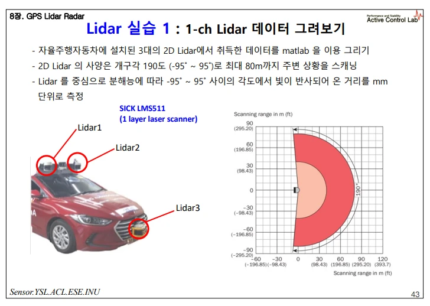

- 개구각 190도 정도로, 각도를 스캔할 수 있는 One layer LIDAR
- 분해능에 따라, -95도 ~ +95도 사이의 각도에서 빛이 반사되어 온 거리를 mm 단위로 측정한다.

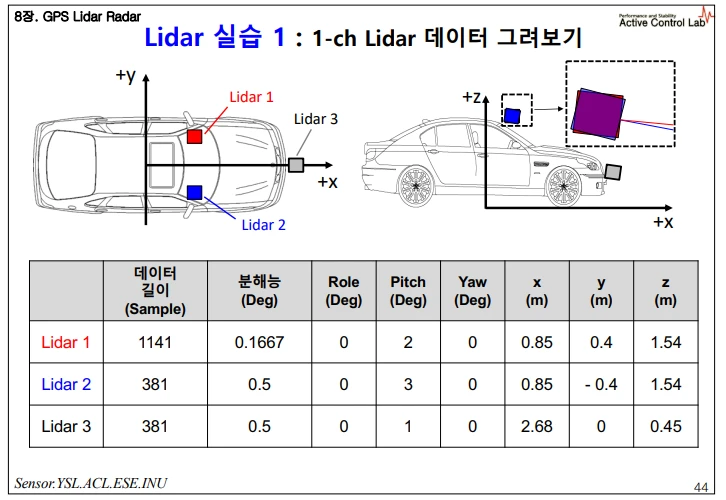

- Lidar1, Lidar2, Lidar3의 데이터 길이와 분해능 등이 모두 주어짐.
- Lidar는 모두 정방향으로 설치하지 않고, 상황에 따라 roll, pitch, yaw에서 기울어 지도록 만든다.

⇒ 기울어진 정도는 우측 상단의 직선 각도를 통해 차이를 확인할 수 있다.

2도, 3도의 차이가 큰게, 각도 차이가 작더라도, 평행선을 쭉 그리면 먼 거리에서는 볼 수 있는 범위에 큰 차이가 생기게 된다.

- 2번, 3번은 스펙이 같고, x, y위치는 차의 중앙을 기준으로 정해진다.
- 1번은 스펙이 좀 다르고, x, y위치는 마찬가지이다.

## 실습1

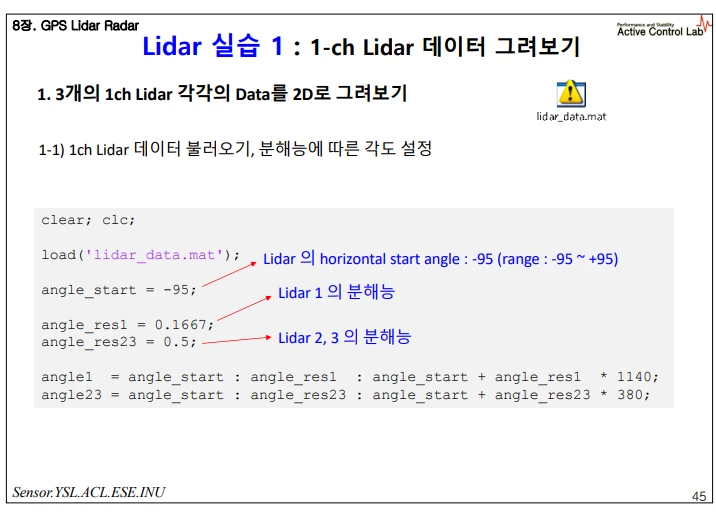

- angle1은 angle_start를 기준으로 angle_res1 간격으로 데이터 생성. 뒤에 1140을 곱하는 것은, angle_res1을 한 번 더했기 때문에 1140을 곱해줘야 1141개가 되기 때문이다.

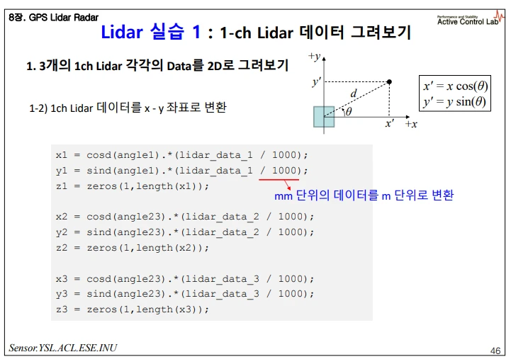

- 회전 변환 실시. angle은 앞에서 다 정해져있기 때문에 각각의 포인트에 대하여 Linear Transform을 실시한다.
- Lidar는 빛이 반사되어온 거리 데이터를 mm로 입력받는데, 가지고 있는 것은 거리 뿐인데, 거리 데이터만 가지고 이것을 그릴 수는 없을 것이다. 이 거리가 어느 각도의 지점에서 도달한 것인지를 모르기 때문에 그걸 표현하기 위해서 회전 변환을 실시한 것이다.
- 회전 변환의 원리는, 라이다의 개구각이 -95~+95라는 것을 알고 있기 때문에, 

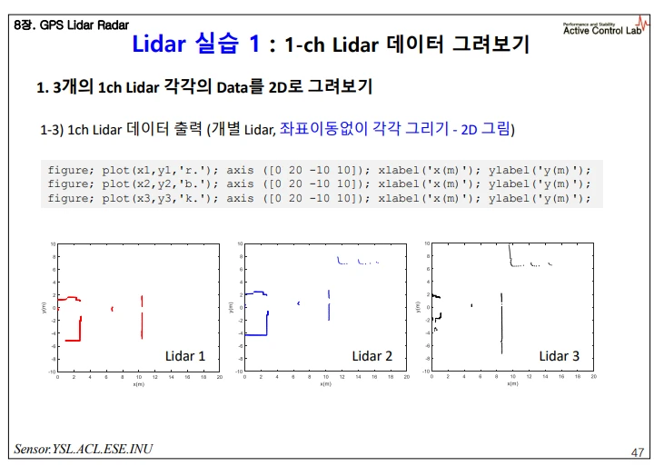

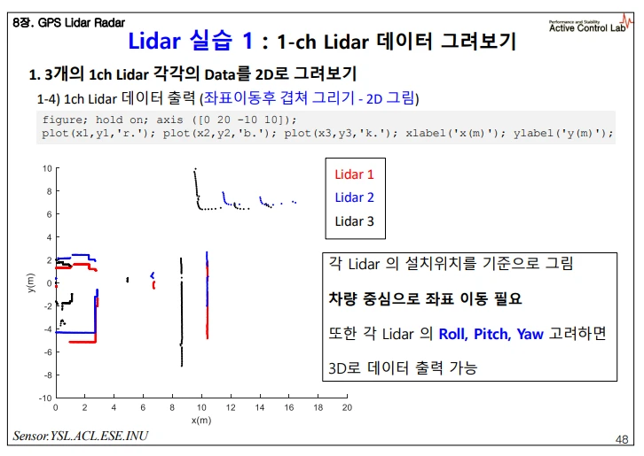

⇒ 같은 그림이지만 겹쳐지지 않는 모습. 차량 중심으로 이동이 필요하다.

Pitch 보정 및 x, y 좌표 보정이 필요하다.

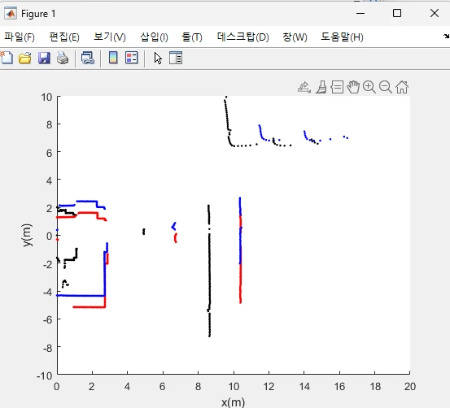

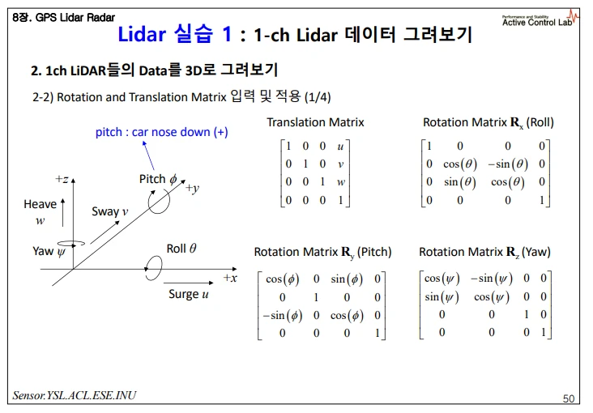

- Roll 기준, Pitch 기준, Yaw 기준일 때 회전 변환 Matrix를 각각 정의하면 됨.
- 평행이동은 Translation Matrix.

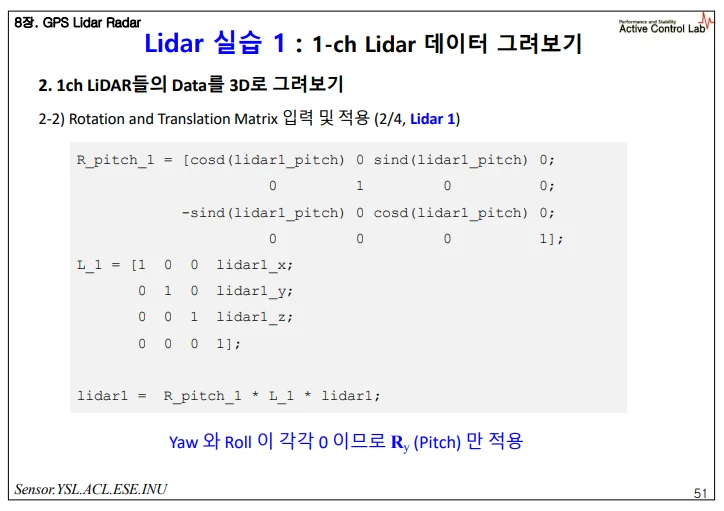

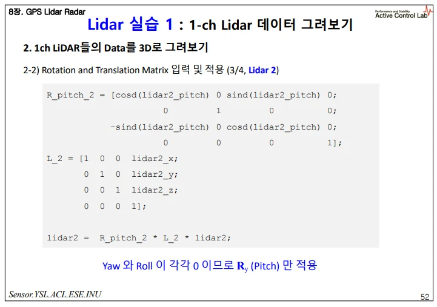

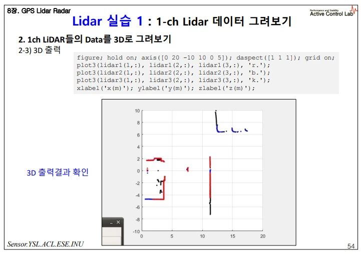

---

## 실습2

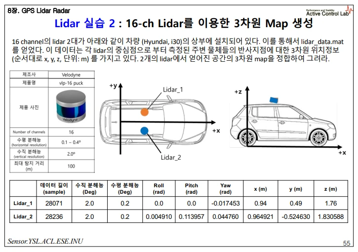

- Velodyne의 수평 분해능은 0.1~0.4 선택 가능. (Angle Resolution)
- 360도 스캔이 가능.
- 수직 분해능은 2도. (16개의 레이어 사이의 각도)
- 최대 탐지 거리는 100m

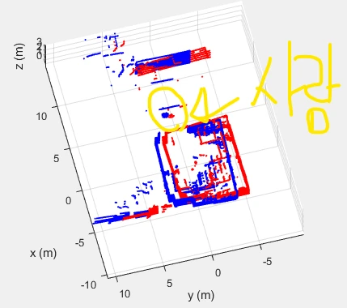

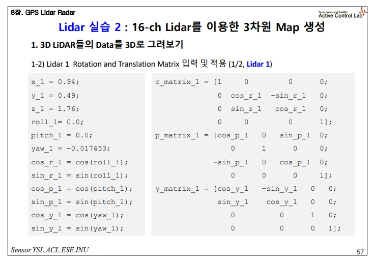

- 회전 변환 matrix를 그리는데, 이전에는 매트릭스 안에다가 값을 넣어주는 방식이었지만, 이번에는 값을 미리 정해놓고 매트릭스를 만든다. 결과적으로 차이는 없음.
- 이전에는 cosd, sind를 이용해 degree로 값을 구했지만, 이번에는 d를 빼고 radian 단위의 삼각함수를 이용한다.

> 자동차를 그리기 위해서 자동차 데이터를 받음. stlread를 통해 데이터를 읽어올 수 있다. stl은 점과 면으로 구성되어 있으며, 점을 이용해 뼈대를 그리고 면은 그 뼈대로부터 면을 색칠하는 데이터이다.  
> ⇒ 이번에는 면(faces) 데이터는 가져오지 않고, 점(vertices) 데이터만 사용하여 그린다.

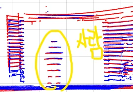

- 바닥에 물결 무늬의 레이더 선이 나오는 것은, 16채널 라이다가 수직으로 채널이 16개 나눠져있기 때문에 바닥을 찍고 튕겨나온 것을 그리게 된 것이다.

---

- 과제

    - 사람에 대한 Bounding Box를 그려보고, 사람과 차량 사이의 최소 거리를 추정해볼 것. (자율주행에서 거리를 구하는 것은 매우 중요한 문제)
        ⇒ Bounding Box는 실제로는 이미지 처리 로직을 통해 자동으로 그려져야 하지만, 지금은 임의의 Bounding Box를 그려주면 된다. 실제로 주행할 때는 사람임을 판단하고 Bounding Box를 그려주는 로직이 들어간다.
    - 차량의 리프트의 높이를 추정해보기.
        ⇒ 정합을 어떻게 해주었는지 확인해보면 리프트 높이 확인 가능.

---

1억이 넘어도 128채널을 사용하려는 이유가, 촘촘하게 비출 수 있어서 넓은 각도에 대해서 데이터를 모두 구할 수 있기 때문(즉, Resolution이 높기 때문이다.)

16채널 라이다 두 개를 써서 대회를 나갈 때, 하나는 아래로 살짝 틀고 하나는 위로 살짝 틀어서 25채널 정도가 유효할 수 있도록 만들었다.

라이다를 사용해서 대회를 나갔을 때, 내리막이나 오르막 등에 대해서 처리하는 것이 매우 힘들었다… ⇒ 그래서 카메라가 중요한 것이다.

나중에 Sensor Fusion을 사용하는데, 카메라와 레이더를 at the same time에 측정해서 동시에 데이터를 비교하며 사용하는 것이다.

- Radar : 직진성이 좋음.
- Lidar

라이다만 사용하면, 내리막-오르막 등에서 정확한 정보가 들어오지 않을 때의 대처법을 구하기 어렵다…
