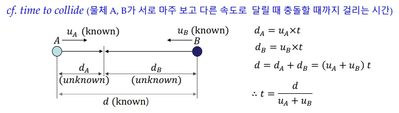
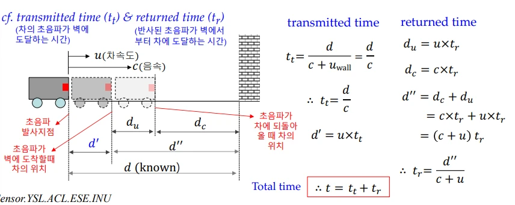
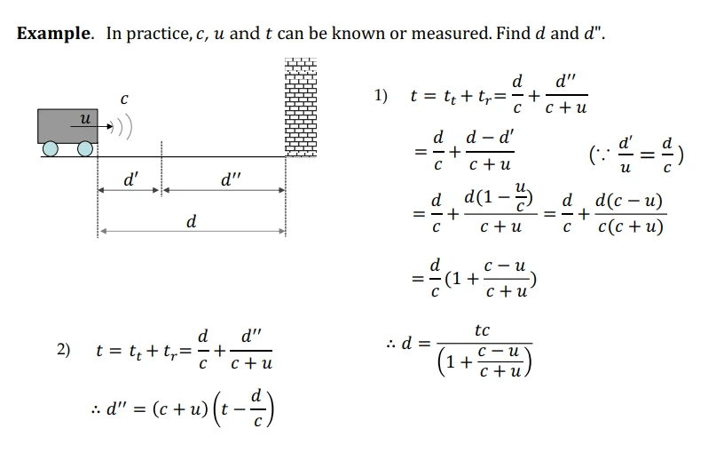
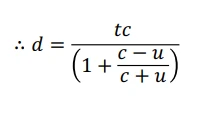
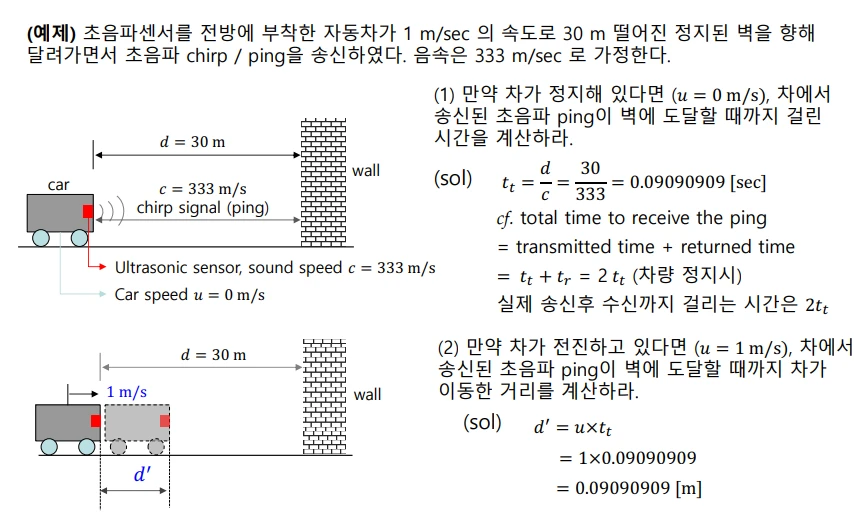
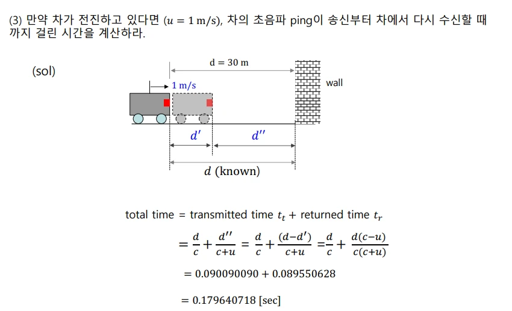
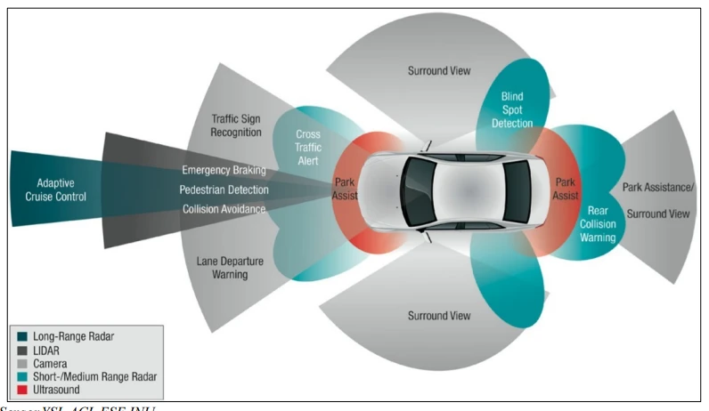
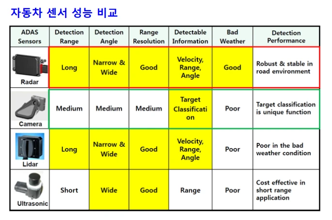

# 7주차-2 (SONAR TOF)

작성일 2023-04-19 · 최종 수정일 2023-04-22
{ .post-date }

## TOF(Time of Flight)

레이더이던 라이다이던 빛을 쏘고 반환되는 데이터를 통해 센싱을 하는 것인데, 소나는 음파를 쏘고 돌아오는 시간을 바탕으로 거리를 구한다던가, 받는 시간을 구한다던가… 이와 같은 것을 구할 수 있다.

- ttc(time to collide) : 충돌 시간. 내가 현재 방향으로 진행했을 때 몇 초 뒤에 해당 장애물에 부딪히게 되는가?

A라는 물체가 u(A)의 속도로 이동하고 있고, 반대편에서 B라는 물체가 u(B)라는 속도로 달려오고 있다. 여기서 우리가 알고 있는 것은 d(A), d(B), u(A), u(B)이다. 이 때 ttc를 구하면 어떻게 되는가?

d(A) = u(A) * t

d(B) = u(B) * t

d = d(A) + d(B) = (u(A) + u(B)) * t

t = d / (u(A) + u(B))

⇒ 기본적으로 거속시만 사용해서 구해나가는 것.

- ex) SONAR를 쏘고, 장애물로부터의 거리는 구할 수 있음. SONAR를 계속 쏘고 있으면 u(B)의 속도도 추정이 가능. 이걸 바탕으로 단순한 수식을 통해 ttc를 구할 수 있게 된다.

---

- 위와는 조금 다른 상황을 가정. 정지해 있는 벽이 있음.

한 시점에 멈췄다고 생각해보자. 초음파를 쏘면 벽에 부딪힐 것인데, 초음파를 쏘고 벽에 부딪힐 때까지 걸리는 시간을 t(t)라고 하고, 그 초음파가 튕겨서 수신되는 시간을 t(r&#41;이라고 한다.

초음파를 쏜 순간에도 차는 움직이기 때문에, 차에서 초음파가 발사되어 벽에 도착했을 때 차의 위치를 d’라고 하자. 그리고 d(u)는 벽에서 튕긴 초음파가 돌아오면서 차에 들어갈 때까지 차가 이동한 거리이다.

이때 d는 알고있다고 가정하자.

t(t) = d / c + u(wall) = d / c (벽은 움직이지 않기 때문에, d(wall) = 0)

d’ = u * t(t) (초음파가 벽에 부딪히는 시간이 t(t)이므로,)

d(u) = u * t(r&#41;

d(c&#41; = c * t(r&#41;

d’’ = d(c&#41; + d(u) = c * t(r&#41; + u * t(r&#41; = (c + u) * t(r&#41;

따라서, t(r&#41; = d’’ / c + u (t = t(t) + t(r&#41;)

---

t를 알고있고, d와 d’’을 구하라.

t(t) = d/c, t(r&#41; = d’’/c+u 를 사용해서 구하면 된다.

(d’/u = d/c, 똑같은 시간이 나오게 된다.)

---

u(c&#41;와 d를 알고 있음. 

- 벽에 도달할 때 까지 걸린 시간?

t(t) = 30 / 333 = 0.09090909 [sec] // 벽이 정지해 있음.

t(t) + t(r&#41; = 2t(t) (차량 정지 시, 빛의 속도는 같기 때문에 2t(t))

d’ = u * t(t) = 1 * t(t) = 0.090900909 [m]

---

---

## Radar

- Long Range Radar가 존재.

테슬라도 Dead Zone 한계 극복을 위해 근거리 Radar 재도입.

Cross Traffic Alert는 횡단보도에 사람이 건너거나, 어린아이들, 애완동물 등을 파악하기 위한 것.

레이더는 Beam Forming을 통해서 좁고 멀게, 혹은 넓고 짧게 볼 수 있다.  
(Adaptive Cruise Control)

Blind Spot (백미러에 안잡히는 부분)

⇒ 차에 총 네 개의 레이더가 달려있는데, 현재도 레이더가 많이 사용되고 있다.

초음파 센서는 주로 주차할 때 사용된다. 전방에 여섯개, 후방에 여섯개 센서를 달게 된다. 테슬라 초창기 버젼은 달려있는데, 최근에 나온것은 image processing해서 거리를 계산한다. (영상 처리를 통해 거리 추정)

테슬라는 Long-Range Radar를 버렸음. 초음파도 지웠음. (애초에 물리적으로 안달려있음.)

- 장거리, 중거리, 단거리. 어떤 것을 이용하는지.
- Radar : 
- Lidar : 중거리, 회전을 통해서 360도 체크하게 된다.
- Camera : 단거리, 중거리(해상도의 증가를 통해 측정 거리 증가 가능)
- Short Radar
- Ultrasound

- 레이더는 비가 내려도 good이지만, 라이다는 반사에 의해 퍼진다. 카메라도 물방울 같은게 묻고 그래서 문제가 될 수 있다. 하지만 테슬라는 카메라 학습을 통해 Poor → Good을 얻을 수 있게 됨.
- 초음파는 비오면 난반사가 발생
