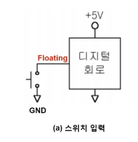
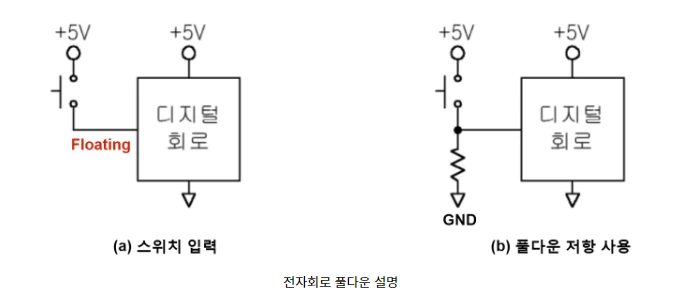

# 과제1

## 아두이노 실습

- volatile : volatile 키워드는 변수를 선언할 때 컴파일러에 대한 지시어이다. 프로그램 변수가 저장되고 조작되는 임시 메모리인 레지스터가 아닌, RAM으로부터 변수값을 로드하도록 컴파일러에게 지시한다.

특정한 상황 아래에서는 레지스터에 저장된 값이 실제로 원하는 값이 아닐 수도 있는데, 아두이노에서는 인터럽트와 관련된 서비스 루틴을 사용할 때 이러한 문제가 발생할 수 있다. 작성된 코드가 컴파일러에 의해 기계어로 변환될 때, 컴파일러는 최적화된 코드를 생성하게 되는데, 변수들의 값의 변화 추이를 예측하여 한 번 설정하면 프로그램 내에서 변경되지 않을 것 같은 값을 참조할 때 실제 읽어내기 동작을 생략하고 빠른 처리가 되도록 최적화할 가능성이 있다.

ex)

```c
void myFunction() {
	int state = 1;
	while (state > 0) {
		digitalWrite(LED_BUILTIN, HIGH);
	}
}
```

이와 같은 코드에서 state 값은 1이므로 while (state &gt; 0) 조건문에서 항상 참인 값이 될 것으로 판단한 컴파일러는 코드 최적화를 위해 비교 연산 동작을 하나라도 줄이고 다음과 같은 코드로 재해석할 수 있다.

```c
void myFunction() {
	int state = 1;
	while (True) {
		digitalWrite(LED_BUILTIN, HIGH);
	}
}
```

그러나 state 변수가 특별한 상황에 의하여 비록 코드에서 변경되지 않더라도 외부(인터럽트 등과 같은) 요인에 의해 변경될 수 있는 가능성도 있다. 이런 경우를 대비하여 컴파일러가 최적화를 시도할 때 volatile 지시어로 설정된 변수는 읽어내기 동작을 생략하지 않고 새로 읽어내도록 지시한다.

다음의 예제 스케치는 디지털핀 2번에 연결된 스위치 동작에 의해 인터럽트가 호출되고, 이 호출로 state 변수의 값이 변경되므로 컴파일러에게 이 변수는 수시로 변할 수 있는 변수이므로, 최적화하지 말 것을 지시한다.

```c
const byte interruptPin = 2;
volatile byte state = LOW;

void setup() {
  pinMode(LED_BUILTIN, OUTPUT);
  pinMode(interruptPin, INPUT_PULLUP);
  attachInterrupt(digitalPinToInterrupt(interruptPin), blink, CHANGE);
}

void loop() {
  digitalWrite(LED_BUILTIN, state);
}

void blink() {
  state = !state;
}
```

- Pull-up, Pull-down

[[전자회로 입문 3] Pull-up과 Pull-down 완벽 이해](https://openstory.tistory.com/154)



풀업저항과 풀다운저항이 사용되는 이유는, ‘플로팅’ 상태를 해결하기 위해서이다. 플로팅 상태라는 개념은 디지털 회로에서 파생된 것으로, 디지털 회로에서만 사용된다. 좀 더 자세하게 얘기하자면, 플로팅이 되었다는 것은 ‘0’인지 ‘1’인지 알 수 없는 상태라는 것이다.

이 상황의 회로에서는 스위치가 눌리지 않는 이상은 해당 입력이 어떤 상태인지 파악할 수 없다. (GND가 없기 때문에 현재 전압이 어떤 상태인지 파악할 수 없음.)



이에 따라 위와 같이 풀다운, 또는 풀업 저항을 사용하여 회로를 구성해 플로팅 현상을 해결한다. 하지만 실제로는 (a) 회로는 사용할 수 없는 회로이다. 왜냐면, 저항을 연결하지 않았기 때문에 저항이 매우 적어서 옴의 법칙에 따라 이론상 매우 큰 전류가 생성되기 때문에 회로의 소자에 전기적으로 큰 부담을 줄 수 있다.

따라서 풀다운 저항을 사용하여 이런 상황에 대처할 수 있게 된다.

---

1. ADC value가 들어오는데, 이것은 해당 노드의 전압을 표현하는 것이다. 5V = 1023이기 때문에, 보정하려면 공식을 거쳐야 한다.

    5 (V) * x = 1023 : ADC 값은 x로 나오게 된다. 

    따라서, ADC 값인 x를 구하려면 전압에서 1023/5를 곱하면 된다.

    이와 반대로, ADC 값이 있을 때 V를 구하려면, 5/1023을 ADC 값에 곱해주면 된다.

---

1. 측정된 값을 바탕으로 거리 변화에 따른 CDS 센서 저항값의 변화를 파악해야 한다.

여기서 측정된 값은 ADC 값이고, 이는 V2에 걸리는 전압을 의미한다. 먼저 ADC 값에 5/1023을 곱해서 저항값으로 변환한다.

[아두이노 코딩 : 조도센서(CDS,포토레지스터)로 LED Dimming 하기](https://juahnpop.tistory.com/46)

---

- Python을 이용해서 위치에서 속도를 구하는 여러가지 방법… 차분을 사용한다.

⇒ 과제에서도 차분을 사용한다.

[Python을 이용한 위치에서 속도를 구하는 여러가지 방법에 대한 예제](https://pinkwink.kr/782)
