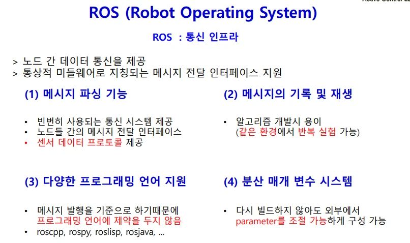
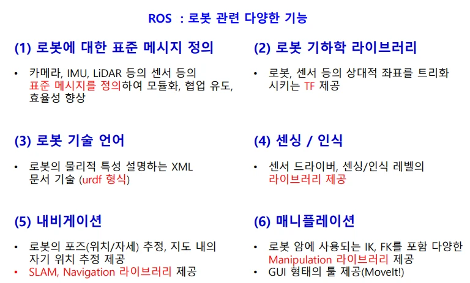
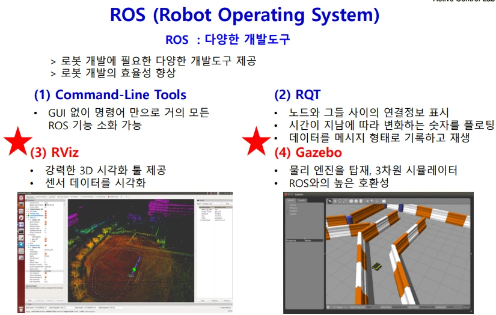
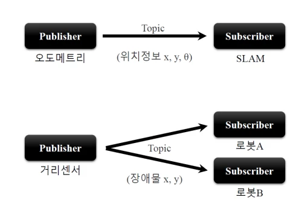
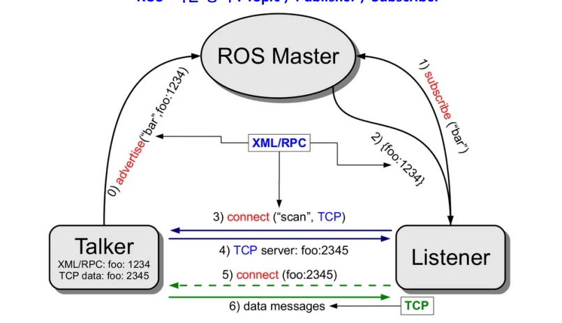
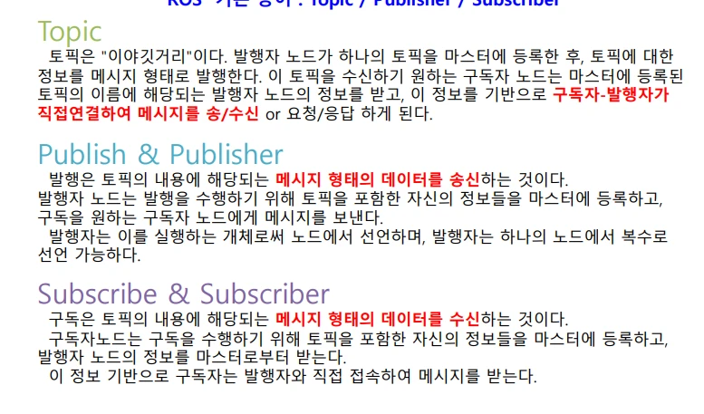
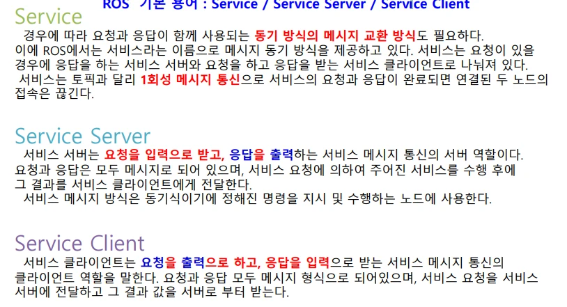
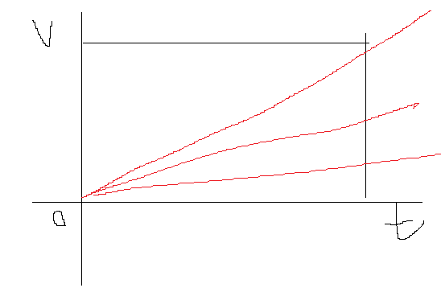
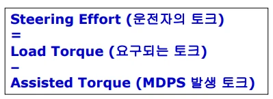
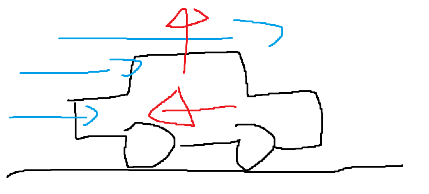

# 9주차(ROS)

## ROS

ros는 로봇을 개발할 때 주로 사용되는 소프트웨어이다. ROS는 오픈소스로서, 메타 운영체제로 불리기도 한다. 메타 운영체제는 하드웨어 위에 리눅스가 있는 상태로서 OS가 또 올라가는 것이라고 생각하면 된다. 즉, 기존의 운영체제가 있는 상태에서 또 올라가게 되는 것이다.

ROS 특히 센서, 액추에이터 관점에서 다룰 수 있다는 장점이 있고, 이기종 디바이스 간의 통신을 지원할 수 있다. 다른 기종 사이 간의 통신을 간단하게 지원하기 때문에 PC와 라즈베리 파이 통신을 간단히 구현할 수 있다. (그게 아니라면 시리얼 통신이나 UDP가 필요하다.) ⇒ 통신도 일대일 통신이 아니라 멀티 디바이스에서도 통신이 가능하다는 장점이 있다.



- 노드를 생성해서 데이터를 주고받을 수 있음.
- 센서 데이터를 매우 유용하게 주고받을 수 있음.
- 디버깅을 하기 위해서 저장을 하거나 시뮬레이션을 하기 위해서도 사용했던 센서 데이터가 있어야 하는데, 그걸 기록하고 replay 시켜주는 기능도 잘 지원된다.
- 프로그래밍 언어도 많이 지원되고, (C/C++, Python, Java, Matlab, Simulink 등)



- 라이다라고 한다면 포인트 클라우드 2라는 규격이 있고, IMU라면 IMU에 맞는 메시지 타입이 있고 한데, 센서를 만드는 회사들이 표준 메시지에 맞게 바꿔주는 드라이버를 제공하고 있어서, 센서를 사용할 때 라이다 회사가 주는 드라이버를 설치함으로써 표준 메시지 타입인 포인트 클라우드 2와 같이 규격화된 데이터를 전달할 수도 있다.
- 정보 접근도 매우 쉬움. 커뮤니티가 잘 형성되어 있음.



- RViz는 3D 시각화 툴을 제공하고, RViz를 쓰게 되면 실시간으로 나오는 센서 데이터를 바탕으로 시각화를 하며 볼 수 있게 된다. 센서 데이터의 시각화에 있어서 매우 중요한 툴이다.
- Gazebo는 Simulator이다. 어떤 로봇을 제어하는 것을 만들었다면, 시뮬레이션을 돌려보고 동작을 확인하고 디버깅을 해야할 것이다. ROS Gazebo는 물리엔진을 탑재한 시뮬레이터여서, ROS와 매우 밀접한 프로그램으로 사용된다. 실제로 액추에이터를 만드는 회사들도 Gazebo를 바탕으로 시뮬레이션 데이터를 제공하고 있기도 하다.

---

- Node : 최소 단위의 실행 가능한 프로세스를 말한다. 병렬 처리 등을 할 때 각각의 노드들이 돌아가는 것처럼, ROS 단에서 처리하는 단위이다.
- Package : 하나 이상의 노드, 노드 실행을 위한 정보 등을 묶어 놓은 것이다.
- Message : 노드간의 데이터를 주고받을 수 있는 방식. 우리가 알고 있는 integer, float, boolean 등을 사용하거나 point cloud 2 등의 타입으로 전송할 수 있게 된다.

---

- 두 노드 간의 메시지 전송은 항상 Topic이라는 것으로 이루어지며, Publisher와 Subscriber가 존재하게 된다. 1대1 통신도 가능하지만, 1대다 통신도 가능하다. (마치 direct 방식과 in-direct 방식의 message passing 처럼)
    Publisher-Subscriber 개념이다.





- Master를 기준으로 Talker(Publisher)와 Listener(Subscriber)가 데이터를 주고받을 수 있다.



- 서비스 : Topic은 노드 하나가 계속해서 토픽을 내보내면 필요한 사람이 갖다 쓰는 형태라고 볼 수 있는데, 서비스의 개념은 요청을 해야만 전달해주는 것을 말한다. 즉, 어떤 트리거가 있어야만 정보를 주는 것이 서비스이다.



- 서비스 서버 : 요청을 입력으로 받고, 응답을 출력하는 서비스 메시지 통신의 서버 역할..
- 서비스 클라이언트 : 서비스 클라이언트는 요청을 출력으로 하고, 응답을 입력으로 받는 서비스 메시지 통신의 클라이언트 역할을 한다.

---

- roscore : ROS master를 시작시켜주는 역할. 

---

- 실습할 때는 안테나 하나로 진행한다. GPS 데이터를 수신하려면 센서 노드가 데이터를 받아서 토픽으로 publish 해주어야 한다. GPS가 nmea라는 메시지 타입(해군에서 사용하는 데이터 타입으로 보인다)으로 전달 되고, 이를 우리가 알고있는 좌표계로 바꿔주는 것이 필요하다. 즉, nmea를 파싱하는 것이 필요하다. 이 역할을 하는 것이 nmea_navsat_driver이다.
- 이 드라이버는 github에 opensource로 공개가 되어 있어서, 정해진 순서대로 따라가면 된다.

- catkin_make : src에 새로 설치한 git clone 파일이 들어가있는데, 이것은 아직 빌드가 된 상황이 아니라서 catkin_make라는 command를 통해서 빌드를 시키고 사용하게 된다. setup.bash는 가끔 Master에서 package를 찾지 못하는 일이 가끔 발생해서, 그걸 방지하기 위해서 계속 해줌.

```bash
ls /dev/ttyUSB* # 연결된 USB 확인
sudo chmod +777 /dev/ttyUSB0 # 권한 문제가 없다면 chmod로 권한 추가
# ROS가 문제없이 접근할 수 있도록 만들어준다.
roscore
# ros 창을 끄지 말고 계속 켜놓고 실행해야 한다.
# 또다른 terminal을 열어서 rosrun을 수행해야 한다.
rosrun nmea_navsat_driver nmea_serialdriver _port:=/dev/ttyUSB0 _baud:115200
# Port Number와 Baud Rate를 파라미터로 전달해준다.
```

이렇게 데이터를 전달받으면 \$ rqt를 이용해서 토픽을 확인해볼 수 있다. 그리고 볼 수 있는 타입을 바꿔줄 수도 있는데, 이 데이터를 시각화할 수도 있다.

(rqt도 다른 터미널 창이 되어야 함. 즉, roscore, rosrun, rqt 총 세 개의 터미널이 필요하게 된다.) rqt에서 각 토픽을 더블클릭해서 내부에 어떤 데이터가 어떤 타입으로 들어가있는지 등을 볼 수 있다. 예를 들어 /fix에는 sensor_msgs/NavSatFix 등이 들어있는 것으로 보인다.

추가로, GPS 데이터를 받을 때 GPS 수신기 설정을 해주어야 한다. RTK는 기지국으로부터 보정 메시지를 받게 되는데, 받는 통신 방법을 RTCM이라고 하고, 이를 안드로이드에서 설정해줄 수 있어야 한다. 수신기와 핸드폰을 블루투스로 연결해서 세팅을 하게 되는데, 세팅을 하는 앱은 안드로이드에서만 할 수 있다. 따로 apk로 받아서 연결을하고 마운트포인트를 선택한다. (서울 인천지역은 RTCM31 혹은 RTCM32를 사용한다.)   이 중간에 엔트리 서버에 진입하기 위해 아이디와 비밀번호가 필요하다.

---

라이다는 ouster 64채널 사용. 라이다도 마찬가지로 데이터를 토픽으로 전달해주는 드라이버가 있어서, 이를 전달받을 수 있게 된다. ouster lidar는 그 안에 IMU 정보도 들어있어서, OS1 64채널짜리 topic을 받아볼 수 있게 된다.

똑같이 따라가면 되지만, 조심할 것은 github repository에 특정 패키지가 링킹되어 있어서--recurse-submodules를 반드시 설정해주어야 한다.

라이다와 같은 경우에는, 데이터를 뿌리기 위한 모듈이 필요하다. 모듈에 LAN이 있게 되고, LAN을 곧바로 연결해주면 된다. 다만 주의할 점은, 보통 TCP/IP로 통신한다고 하면 IP 등을 세팅해주고 하는데, wifi를 끄고 IPv4 method &gt; Link-Local Only로 설정해야 LAN을 통해 데이터를 보내주는 모듈 포트와 PC 사이에 로컬로 연결이 이루어지게 된다.

\$ roslaunch ouster_ros sensor.launch sensor_hostname:=os-XXXXXXXXXXXX.local

ouster_ros (package name), sensor.launch (launch 안에 있는 모든 노드들을 실행시켜준다. 이때 들어가는 argument는 sensor의 hostname. serial number이므로 동일하다.)

rviz에서 포인트 클라우드가 나오게 되고, 그 위에는 빛을 반사한 물체의 반사율 등을 볼 수 있게 된다. displays에서는 그림을 그리는 것에 대한 설정이 나오는데, queue size 등을 조정해 그림을 업데이트 하는 속도를 정할 수도 있다.

---

ros에서는 메시지 데이터를 rosbag이라는 형식으로 저장도 가능하다. 

rostopic list를 하면 현재 publish 되고 있는 topic list를 볼 수 있고, 그러면 GPS 토픽들 계속 나오고 LIDAR 토픽들을 확인할 수 있다. 

모든 토픽을 저장하는 것이 아니라 필요로 하는 토픽의 이름만 지정해서 저장할 수도 있다.

파일명은 데이터를 저장할 파일의 이름이다.

토픽들이 publish되고 있으면 list에 토픽들이 나올텐데, 센서 node를 키지 않아도 아까 저장했던 topic들이 실제 publish 되는것처럼 replay가 가능해진다. -l이 붙은 것은 loop라고 해서, 끝나면 처음부터 끝까지 무한루프를 돌리는 것이다.

전달받은 백파일을 RViz로 돌려봐도 되고, 매트랩에 있는 패키지를 통해서 그려볼 수도 있다.

---

## Steering Mechanism

- 6 DOF

    - Longitudinal : acceleration/deceleration (종방향)
    - Lateral : handling, maneuvering stability (횡방향)
    - Vertical : ride

자율주행이라면, 컴퓨터가 알아서 운전을 하는 것이다. 조수석에 타고 있으면 멀미를 많이 느끼기도 하는데, 자율주행 분야에서 승차감, ride quality for autonomous vehicle은 매우 중요하게 여겨지고 있다. 멀미가 없어야 하고, 승차감이 좋아야 하고 등… 천천히 가더라도 운전자에 따라서는 멀미를 느낄 수도 있다. 급가속 → 급감속에 대하여 멀미, 불편, 불안 등을 느낄 수 있게 된다.

그래프적으로 고려하면, 



이와 같이 특정 속도까지 도달하는데 완만하게 도달하거나 급격하게 도달할 수도 있는데, 이에 대해서 노련해질 수 있도록 기술적으로 진보 필요. 아직까지는 자율주행자동차가 이 부분에 대해서는 부족하다.

ax : 급가속, 급감속 → 멀미 불편 불안

ay : tyre pressure + suspension (타이어가 너무 흐물흐물하거나 차의 서스펜션이 너무 딱딱하면 안됨. 이런 것들도 자율적으로 이루어져야 함.)

az : suspension

인지 판단 제어(제어는 실제로는 종, 횡방향만 다루는게 전부이다.)

앞으로는 이런 부분을 고려하면서 운전자가 편안한 탑승감을 느낄 수 있도록 해야 한다. ARQC(Autonomous Riding Quality Control)

---

- 차량의 치수
- 축거 (wheel base) : 차량에서 제일 중요한 수치. 앞바퀴와 뒷바퀴의 중심 사이의 거리를 의미. 바퀴의 중심을 기준으로 
- 오버행 (overhang) : 앞, 뒤로 튀어나온 부분을 앞/뒤 오버행이라고 한다. 
- 전장 (length) : 그리고 오버행과 축거를 더한 것을 전장이라고 한다.
- 전폭 : 차량을 앞에서 볼 때 가로 길이
- 윤거 : 전폭의 기준을 바퀴의 중심으로 한 것.
- 전고 : 차량을 앞에서 볼 때 차체의 높이.
- 최저지상고 : 지면부터 차체까지의 최소 거리
- 축거가 긴 것이 대체로 대형 차량이다. 축거가 길수록 승차감이 향상될 수 있다. 축거가 어느정도 이상이 되어야 승차감이 나오게 된다. 그런데, 축거가 길어지면 회전 반경이 커진다.
- 일반적으로 도로는 2.5m 이상은 다 되더라. 다른 국가도 다 비슷하긴 하다. 전폭은 거의 2m를 넘지 않고, 전장은 거의 5m를 넘지 않는다.

---

- 차량의 구동방식
- 구동방식 : 엔진이 위치한 방향.

- FF 전륜구동 (우리나라는 이게 가장 많음) : 아반떼, 소나타, 그렌저 등

    - 앞바퀴가 돌면서 뒷바퀴를 돌리게 된다.
    - 전륜구동은 미끄러운 언덕을 잘 올라간다. 그래서 전륜구동을 사용하지 않는 외제차들도 눈 쌓인 언덕을 가지 못하기도 한다.

- FR 후륜구동 : 엔진은 앞에 있지만, 샤프트라는 걸로 뒷바퀴에 연결해놔서 뒷바퀴가 움직여서 앞바퀴가 따라가게 하는 것.

    - 전륜구동에 비해서는 고급스러움
    - 전륜구동에 비해 승차감이 더 좋다.

- AWD 4륜 구동 : 엔진이 동시에 앞바퀴와 뒷바퀴를 동시에 돌리는 것으로 보인다.

    - 바퀴 네 곳에서 컨트롤하기 때문에 눈 쌓인 언덕을 그냥 올라간다.
    - 단, 비용은 500~1000이상 더 상승할 수도 있음.
    - 제일 추천되지만, 비용이 비싸다.

- RR : 엔진이 뒤
- MR : 엔진이 가운데

---

- Steering Wheel : 휠을 돌리면 안에 연결된 기어가 돌면서 회전의 방향을 결정하게 된다.

    - MDPS(EPS와 같은 말) : Motor Driven Power Steering, Electric Power Steering.

        - 핸들과 모터가 연결되어 있어서, 회전 시에 모터가 구동을 시키는데, 운전자가 조금만 돌리면 (엔코더가 달려있어서) 돌리는 방향과 힘을 센싱해서 회전을 도와준다.

        

        사람의 핸들링에서 운전 의지를 파악하는 것이 매우 어렵고, 노하우가 많이 필요하게 된다.

        

        - 고속으로 주행할 때는 공기에 의해 양력이 생기면서 차가 위로 떠오르는 힘을 받게 된다. 그래서, 차가 가벼워지는 것처럼 느껴지게 된다. 그래서 고속으로 주행할 때는 바퀴가 찌그러지지 않고 펴지게 돼서 회전이 다소 가벼워지게 된다. 그렇기 때문에 Assisted Torque를 반드시 줄여야만 안전하게 주행할 수 있게 된다.

            - Look-Up Table : 이와 같은 방식으로 특정 속도에서 특정 각도만큼 회전시키고자 할 때 assisted torque의 양을 얼마나 지정해야 하는지 사전에 정해져 있는 데이터.

            |    각도\\속도 | v1 | v2 | v3 |
            |---|---|---|---|
            | 0~50 | τ1 | τ2 | τ3 |
            | 50~100 | τ4 | τ5 | τ6 |
            | 100~150 | τ7 | τ8 | τ9 |

            - 자율주행을 할 때 가장 중요한 것은 Safety 인데, 이것이 거의 극복이 되어가고 있으므로 이후에는 ARQC로 중요점이 넘어가게 될 것이다.
