# 10주차(Driving Models)

- EPS의 타입, C, R

    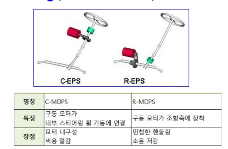

    - 저가형 차량은 C 타입(Column)
    - 고가형 타입은 R 타입(Rack)

    왜 현대차는 문제가 많은 C-MDPS를 사용하는가? : 비용 절감을 위해서.

    외국은 C 타입의 위험성 때문에 R타입을 고수한지 오래됐고, 현대차가 C타입을 넣기 시작한지 얼마 되지 않았다.

    - 회전 운동을 직선 운동으로 바꿔주는 장치 Rack and Pinion

    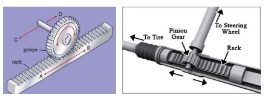

    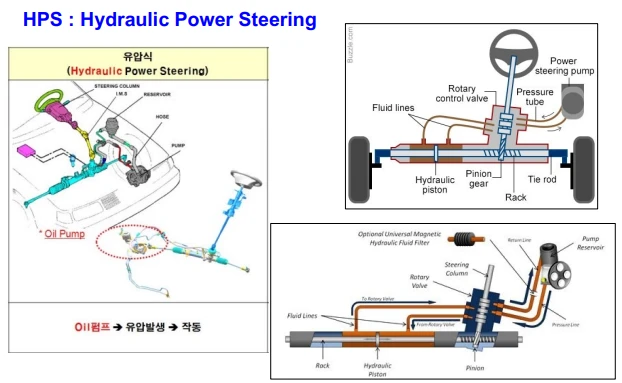

    - HPS는 큰 토크를 낼 수 있는 저가형 Steering 이지만, 응답속도가 느린 편이다.

---

- Understeer & Oversteer

    - 코너링에서 굉장히 중요한 요소이다.

    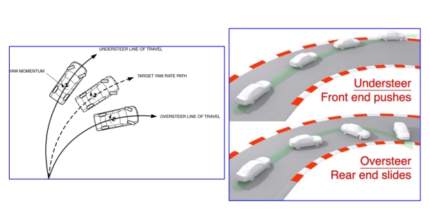

    C-MDPS와 같은 저가형 Steering을 사용하면 응답속도가 떨어져서 코너링이 원만하게 이루어지지 않을 수도 있다. 이를 **Understeer**라고 한다.

    이와 반대로 코너링을 할 때 과도하게 꺾이는 경우를 **Oversteer**라고 한다. (눈이 오거나 비가 오거나 모래가 떨어져서 도로가 미끄러워지는 경우)

    ⇒ 이런 현상이 나타나면 속도를 줄여야 함.

fc = m * v^2 / r : centrifugal force(원심력) 회전의 중심에서 벗어나 밖으로 튀어나갈려고 하려는 힘을 말한다. 따라서 Understeer나 Oversteer가 발생하면 속도를 줄여서 원심력을 줄여야 한다.

---

- ESP(Electronic Stability Program)

    - Oversteer와 Understeer가 발생하면 IMU를 이용해서 이를 탐지할 수 있다. ESP는 차량 속도에 비해 과도하거나 부족한 회전력이 걸리면 S/W적으로 처리해서 차량의 코너링을 제어해준다.
    - Oversteer는 우회전을 할 때 기준으로 왼쪽 앞바퀴에 브레이크를 걸어주고, Understeer는 우회전을 할 때 기준으로 오른쪽 뒷바퀴에 브레이크를 걸어준다.

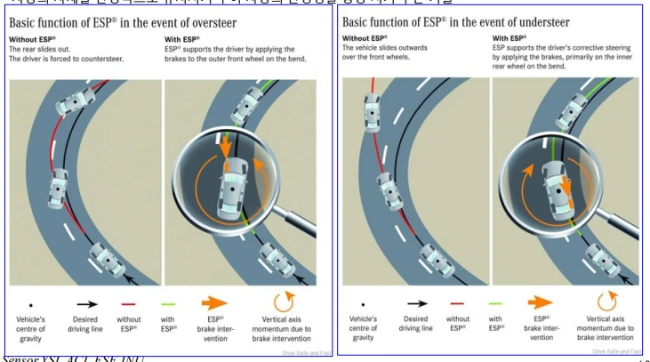

(좌 : Oversteer, 우 : Understeer)

이와 같이 자동차의 동작을 제어하려면 **4륜 구동**이 필요하다. 전륜구동, 후륜구동인지 등을 알아야 한다. 4륜 구동이 아니면 눈길에서 위험하다.

---

- Steady-State Cornering (정상상태 선회)

    - 똑같은 반지름을 유지하면서 안정적으로 코너링을 하는 상태
    - Ready - Steady - Go, 안정된 상태를 의미함!

    - 개루프(Open-Loop) 시스템

        - 교정 과정이 없는 시스템. control, feedback 시스템이 없다.
        - y = GHr, y/r = GH

    - 폐루프(Closed-Loop) 시스템

        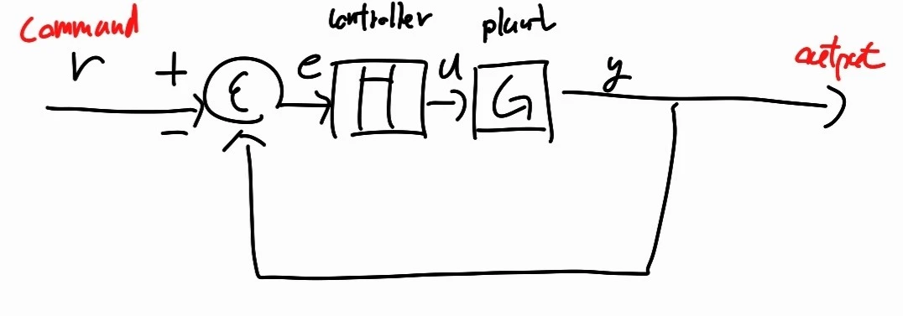

        - 오차를 가지고 들어와서 고친 뒤에 output을 내보내는 시스템. 잘못된 값이 나와도 고치지 않고 바로 내보낸다.
        - y/r = GH/(1+GH)
        - feedback path가 존재. 값이 지정한 값의 output이 나올때까지 계속해서 값을 고친다. feedback path가 존재하기 때문이다.

        - 안에 encoder가 있거나, 뒤에 카메라를 달아서 돌아간 정도를 체크하면서 feedback을 제공한다.

            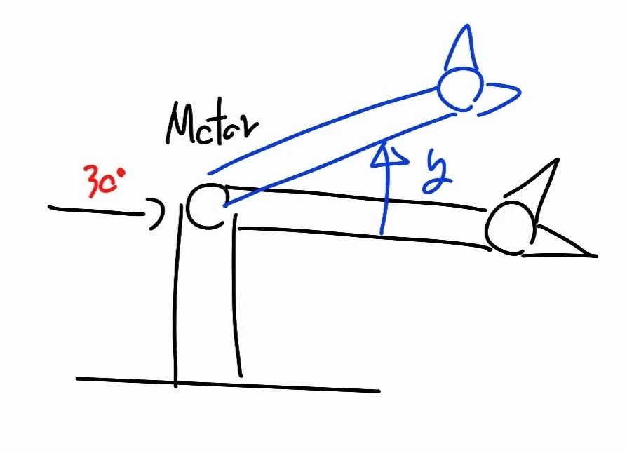

    - 자동차 Handling에서는 IMU의 yaw 측정을 통해서 계속해서 feedback을 하고 값을 보정한다.
    - Understeer gradient:

- 저속 선회 (Low-Speed Turning, Steady-State라고 가정)

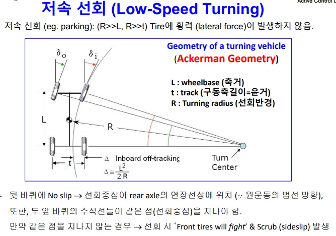

저속 선회를 하는 상황이라고 가정해서 고속 선회에서 나타나는 Slip을 배제하고 얘기한다.

- L : wheelbase (축거)
- t : track (구동축길이 = 윤거)
- R : Turning radius (선회반경)

일반적인 차량은 회전할 때 앞바퀴만 회전한다. steering mechanism에 의해서(rack and pinion) 바퀴가 꺾이게 된다. 

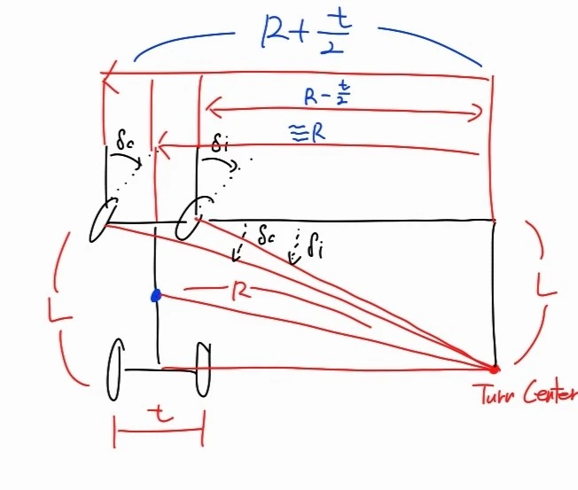

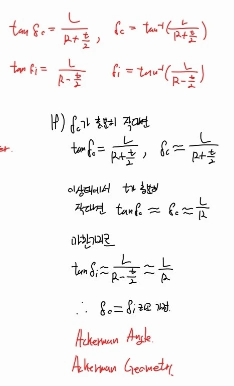

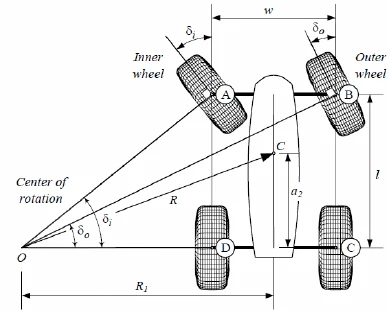

- Bicycle Model에서 델타o = 델타i = 델타

평균적인 관점에서는 델타 = L/R

바이시클 모델에서는 델타가 존재하지 않는다고 가정하는 것으로 보인다. 실제로는 바퀴가 네 개임에도 불구하고 바이시클 모델처럼 만듦. 그런데 주행 해보니 문제는 없더라. 하지만 고속 주행을 한다면 약간의 오차가 발생할 수 있다.

여기서 델타는 wheel angle에 대한 것이고, 실제로 steering을 동작하면 wheel과 steering은 비례 관계를 가지고 동작한다. (steering을 돌리면, 그것에 비례하는 크기로 angle이 돌아가게 될 것.)

---

- 후륜의 이탈궤적 (off-tracking distance)

직진할 때는 뒷바퀴가 앞바퀴의 궤적을 그대로 따라간다.

우선회할 때는 뒷바퀴는 꺾이지 않는데, 앞바퀴와 뒷바퀴는 서로 같은 궤적을 따라가지 않는다.

그래서 초보자들이 논두렁같은 길을 가다가 뒷바퀴가 자주 빠지곤 한다. 그것이 바로 델타, 궤적 이탈 때문에 그렇다.

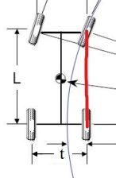

앞바퀴와 뒷바퀴의 중심은 동일한 직선상에 위치한다. 단지, 앞바퀴의 방향만 꺾였을 뿐이다. 

주차할 때나 출차할 때 뒷바퀴가 움직이는 정도를 파악하고, 즉, 이탈 궤적을 고려하고 차를 이동시켜야 한다.

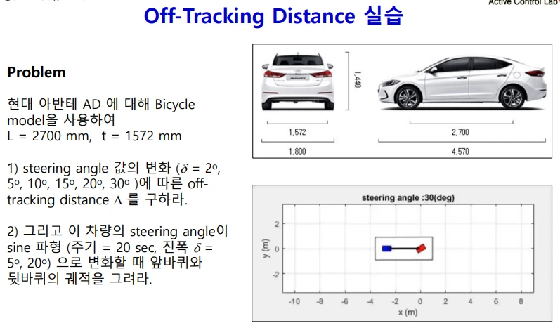

- 1) wheel angle의 변화 delta. 

라지델타 = L^2/2R, 스몰델타 = L/R

Bicycle Model을 사용 (바퀴가 앞 뒤에 하나만 있다고 가정)

- 2) 진폭이 5도, 20도일 때 앞바퀴와 뒷바퀴의 궤적을 그려라.

---

- ㄱ

      ㄴ

    이 형태의 도로가 있을 때, L과 t가 주어져 있다. 차량의 속도가 주어졌을 때, 도로에 대한 모든 길이 정보를 주면 델타를 어떻게 설정해야 빠져나올 수 있을지 알 수 있다? 시뮬레이션 돌려보면 된다. 검증하면 된다. 이게 숙제다. 구간별 델타를 설정하는 법. 차가 도로를 치면 안된다. (처음에 우회전하면서. 코너를 잘 추정해야 한다.) 시간 스텝 사이즈를 적당히 설정하라. 일종의 OpenAI의 짐과 같은 것. 어떻게 델타를 결정하고, 언제쯤 시간이 지나면 회전을 시키기 시작해야 하지? 또, 때되면 알아서 빠져나오고 해야하지? 이런 것을 적절하게 시뮬레이션을 돌려보아라.

    충돌 체크는 자동차와 도로의 외곽선이 overlap되지 않도록 해야함. 그런데, 우리는 바퀴가 overlap 되지 않도록만 하면 된다.

    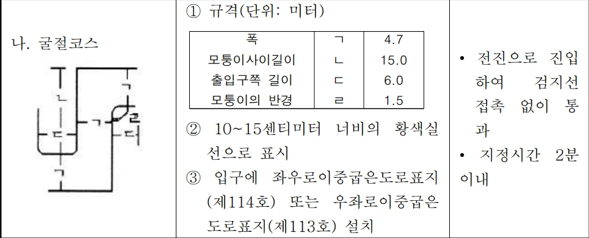

---

- Localization : 

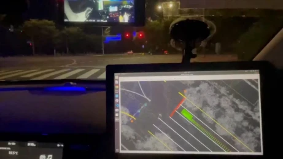

서울 상암에서 자율주행차로 주행한 영상. Real World + 자동차 주행 지도가 나오는데, 자동차의 주행 경로가일 것으로 추정되는 경로를 찍는다. (이것은 SLAM으로 만들어 냄). 기존에 3D MAP을 가지고 있으면, 라이다 데이터가 들어오는 것을 바탕으로 현재 위치를 알아낼 수 있다. (Localization 기법 중 하나) 

흰색 선은 현재 주행 중인 상암 지역의 도로 정보를 알고있기 때문에 도로를 표시한 것. 

그리고 Way Point(도착점)이 지도 상에 찍히게 되는데, 영상에서는 보이지 않음. Start Point와 End Point가 정해지면, 도로교통법을 준수하면서 가게 만드는 것.

---

- **SLAM**(simultaneous localization and mapping)

    - **localization** : 내가 현재 어디인지 찾고 결정하는 것.

    그런데 센서는 항상 노이즈를 타므로, 완전히 정확한 위치(x, y)를 파악할 수는 없다. 아무리 좋은 gps를 사용한다고 해도 오차의 범위가 커지기 때문에 주행 속도가 빠르거나 repeater(기지국)의 신뢰도에 따라 데이터 신뢰도가 달라질 수 있음. 현재 점이 찍힌 지점의 중심을 기준으로, 정확히 그 지점이 아니라 그 지점의 주변부에 위치할 수도 있다. (정규분포를 따름. 중간에 위치할 확률이 정규분포의 중앙. 멀어질수록 정규분포 상에서도 멀어짐.)

    - 앞바퀴의 중심과 중심을 연결하는 선의 중간 지점이 차량의 중심점이라고 부르게 된다. 왜냐면, 바퀴가 돌 때 앞바퀴가 돌아가기 때문에, 일반적으로 이런 방식으로 중심을 정의한다. (차량 동역학적인 관점. 일반적으로 차량이 회전을 할 때는 앞바퀴만 회전하기 때문에 이렇게 표현한다. 특수한 차량의 경우는 뒷바퀴도 회전하긴 하지만, 일반적인 관점에서 표현한다.)

    - Gaussian Distribution (가우시안 분포 == 정규 분포)

        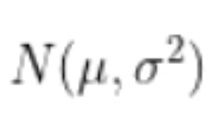

        - 내 위치는 뮤와 시그마에 의해 정의되는 것이다. 나의 위치는 확률적으로 계산된다.

            - 내 위치가 이 곳에 있을 확률이 높고요, 아닐 수도 있어요. 여기가 아니라 저기에 있을 확률도 있어요. (이런 식으로 위치 정의)

    - 자율주행 연구(Autonomous Driving)는 확률적 로보틱스(Probabilistic Robotics)의 일환이다. 왜냐면, 자율적으로 로봇의 이동을 맡기니까. 단지 확률적으로 동작이 정해지기 때문에, 그래서 어려운 것이다.

    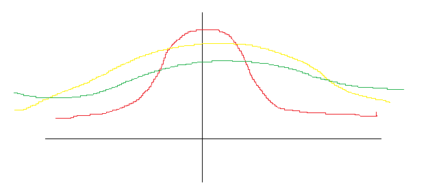

    이러한 분포에서 각각의 그래프에 대해 모두 시그마 값이 존재하는데, 시그마 값이 클수록 분포가 넓어지기 때문에, 녹색 그래프가 시그마가 가장 크다고 볼 수 있고, 이 말은 정확한 위치를 표현할 가능성이 적다는 것이다. (확률이 낮다는 것) 우리나라에서 만든 LIDAR 등은 신뢰도가 떨어져서 사용 불가능. 즉, 시그마 값이 크다는 것.

    - 만약 차를 직선으로 주행시킨다고 하면, 타이어가 편마모되어 있거나 도로의 한 쪽면은 미끄럽지만 다른 한 쪽은 미끄럽지 않은 등의 상황이 발생할 때, 차가 한쪽으로 기울어질 수도 있다. (한쪽 타이어는 2\*pi\*r이 가지만, 다른 쪽은 그만큼 가지 못할 때)
    - 혹은 사람이 한 쪽에만 많이 타 있을 때, 수평 등이 기울어지면서 차의 주행이 잘못될 수도 있다.
    - 이러한 조건 상에서도 자율주행자동차는 직진으로 갈 수 있어야 한다. 한쪽으로 치우치거나 뒤뚱거리는 상황에서도 중앙으로 갈 수 있어야 한다.
    - 왼쪽과 오른쪽에 동시에 센서를 쏘고 값이 equal할 때 중앙이라고 인식하고 보낸다. 중앙에 있는 선 따라서 간다고 중앙으로 무조건 가지는 않는다.
    - 그런데 센서가 노이즈를 타게 된다. 그래서 양쪽 센서의 값이 무조건 맞는 값이라고 볼 수는 없다.
    - 이러한 조건 하에서 도로의 노란선, 흰선 등을 따라가면서, 센서를 통해 얻어지는 여러 값을 활용하면서 주행해야 한다.

    - SLAM은 Map을 만드는 것과 Localization을 동시에 수행하는 것이다. 한 번도 가보지 않은 곳을 가면서 Map도 만들고 Localization도 실시하는 것. 드론에다가 SLAM을 적용해서 동굴 탐사 등을 할 수도 있을 것이다. 혹은 지하 터널에서 SLAM 기능을 가진 드론이 탐사를 하게 만들 수도 있을 것이다. ex) 후쿠시마 원전 폭발에서 원자력 발전소 안에 투입할 로봇을 만드는 것. 그런데 컴퓨터 CPU가 죽어서 동작이 꺼짐. 미국의 방사능 하에서도 동작가능한 군사용 로봇을 투입시켜서 Mapping 다 하면서 파악함.

        - 일본의 Fanac : 산업용 로봇 세계 1위 기업

    - 하지만 SLAM은 매우 어렵기 때문에 보통 이미 만들어진 HD Map을 사용하려고 한다. (현대 자동차는 이 방향을 따라가려고 함.)
    - 그래서 현대 자동차의 접근법은 완전한 SLAM은 아니고, HD Map based SLAM을 하는 것이다. 라이다를 쏘고 GPS를 받아서 종합적으로 판단해서, 그래도 내 위치가 맞을 좌표를 확률적으로 정하는 것. 여기에 카메라까지 더할 수도 있다.
    - 그런데, 도심에서는 GPS가 상당히 노이즈가 많이 타기 때문에 more LIDAR에 의존한다. 하지만 LIDAR는 비가 오는 날에는 난반사 등에 의해 localization이 불가능하다는 한계가 있다.
    - 우리가 실습했던 것은 Map 기반의 LIDAR를 활용한 localization을 한 것이다. Point Cloud를 긁어 모아서, 그때마다 상태가 다른데, 그 값들을 Averaging시켜서 Tuning 시키는 것. 이걸 기반으로 Map을 만들 수 있는 것이다.
    - 라이다를 통해 데이터를 긁어 모아서, 건물 모퉁이를 HD Map과 대조하면서, 현재 위치를 추정하면서 주행시키는 것.
    - 위치가 확률적으로 결정나는 것이지, exact한 포인트는 없다.
    - **그래서, Camera가 있으면 좋다!** 
    - 하지만 뭔가 LIDAR의 정렬이 틀어졌다거나, 다른 차와 추돌을 해서 LIDAR가 틀어졌다면, 자율주행이 불가능해질 것이다. 그러면 자율주행을 끄고 직접 운전해야 될 것.
    - SLAM은 자율주행 뿐만 아니라 로봇에도 많이 필요함.
    - 앞으로는 배송용 엘리베이터가 만들어질 것으로 보인다. (새로운 건물들, 판교에 있는 네이버 신사옥은 이렇게 만들어져 있음.)

    - 테슬라

        - 카메라 8대
        - 전방 3대
        - 후방 1대
        - 측면 2대

    - 카메라 8대를 이용해서 하늘에서 쳐다보는 방향으로 지도를 그려낸다. 흐린 부분은 시그마 스퀘어가 큰 것. 8대의 카메라가 종합적으로 판단한 것을 바탕으로 그림을 그려내는 것.
    - NeRF : 2D 이미지를 바탕으로 3D 모델을 만들어내는 것. 사진의 중복되는 점을 연결하여 만들어낼 수 있음.
    - 자율주행도 이와 비슷하지만, 사람의 눈높이보다 낮은 곳에 달린 카메라를 이용하여 그림을 그려내야 하는 것이 어려움. 그래서, 엄청난 시스템을 만들고 AI 모델을 탑재하여 하는 중…
