# 11주차(Odometric Localization)

## SLAM

SLAM은 이상적으로 기대하는 방법인데, SLAM을 하기 위해서는 전제 조건이 따라야 하는 것들도 있고, 차의 센서도 많이 맞춰져야 하기 때문에 쉽지 않다. 그래서 실제 자율주행을 할 때 많이 사용하는 것이 바로 Map Matching이다.

Map과 어떤 부분을 매칭시키는가? 특수한 건물의 모습이라던지, 이런 부분들을 서로 여러 개의 맵 매칭에 필요로한 포인트들, 그것이 틀어져 있다면 방향을 맞춰가면서 에러 값이 가장 minimized된 것을 매칭시키게 된다.

Localization은 내 정확한 위치를 항상 가지고 가야하는 것이라, 매우 어렵다. 측정된 데이터가 틀어진 정도를 보정하면서 Map으로 만들 수 있음.

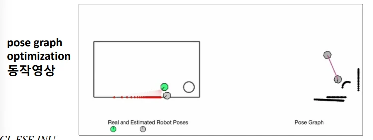

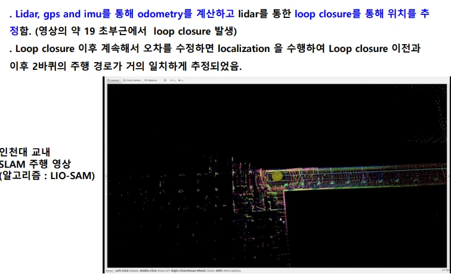

- Loop Closure : 한 바퀴 돌았을 때 이전에 측정된 것과 현재 측정된 것 간의 오차를 측정하여 보정을 해 나갈 수 있다. 주행할 때 어긋나게 되면 한 번씩 보정하면서 실제 주행 상태를 최대한 정확하게 추정하고자 하는 것.
- Map을 매칭해 나가면서 도로의 요철을 파악하거나 다시 원점으로 돌아올 수 있도록 계속해서 Map Matching을 해나간다.

---

- **Odometric Localization**

어쩔 수 없이 사용하는 부분. Localization 정보를 얻을 수 있는 것 중, GPS를 사용할 때 지하로 들어간다던지, 그렇게 되면 정확한 Localization이 불가능하다. 현재 차량의 속도, Steering Angle, yaw angle, 바퀴의 사이즈 등 다양한 정보를 종합적으로 판단하면 주행 상태나 거리 등을 추정할 수는 있다. 이를 Odometric Localization이라고 한다. 순전히 센서에 의존해서 움직인 거리와 좌표를 추정하는 것을 말한다.

다른 말로, 일반적으로 Dead Reckoning이라는 말을 많이 사용한다. 폰에서 터널을 들어가면 내 차가 어디쯤에 있는지를 혼자 계산한다. GPS 정보가 없고, 달리는 차량의 정보는 티맵에 들어가지는 않는다. 예를 들어 터널 진입할 때 속도가 50km 였다면 터널 나갈 때까지 50km로 쭉 간다고 생각하는 것이다. (즉, 터널에 들어갈 때 최종 속도로 쭉 간다고 가정하는 것이다. 내가 차량 정보를 등록시키면, 바퀴 반지름이 얼마정도 되는지, CAN을 통해 wheel speed 읽기, IMU 등을 활용하면서 좀 더 정확하게 주행 정보 추정이 가능해진다.)

계산하는 과정에서 바퀴가 헛바퀴를 돌거나 요철을 밟는 등의 과정이 누적되면 오차가 점차 누적되면서 실제 값과 격차가 발생하게 된다.

이런 오차들은 Map Matching, GPS 신호를 기반으로 보정하면서 잡아가면 된다.

그러나 시간 대에 따른 GPS의 위치에 따라 GPS 신호가 튀면서 잘못된 신호가 전달되기도 하고, 관중석 근처에 가면 신호에 교란이 발생해서 완전한 GPS 주행이 불가능해진다. 그러므로 고성능 GPS가 필요해진다.  

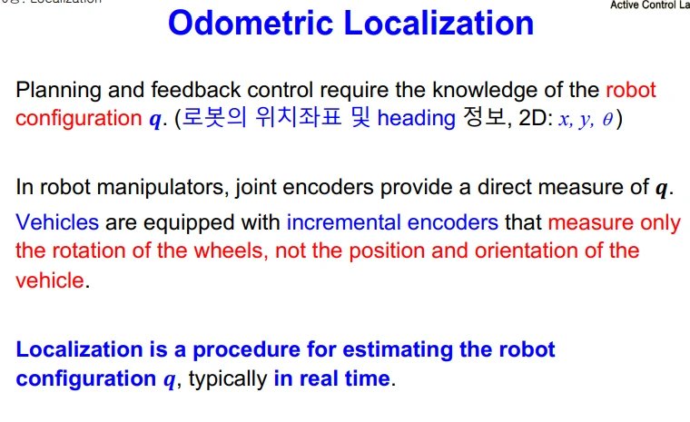

Localization은 로봇의 현재 위치 configuration q를 거의 real time하게 추정하는 과정을 말한다.

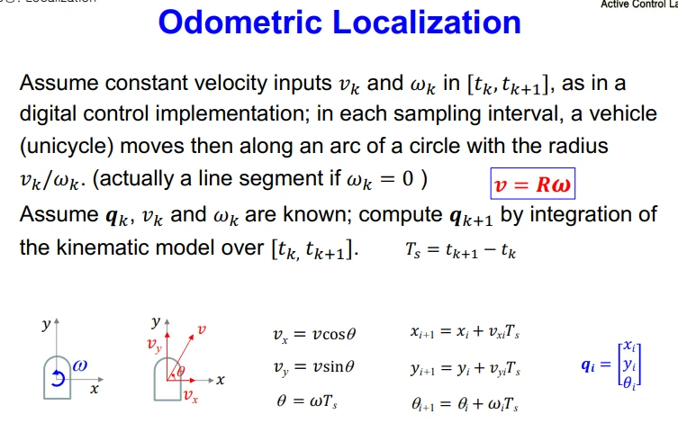

- 속도 :  velocity → vector, 크기 + 방향
- 속력 : speed → scalar, 크기

V = V\*i + V

x축 y축 좌표가 있다고 한다면, 여기서 속도 v라는 벡터가 있다면, Vx, Vy 크기를 구할 수 있을 것이다. x방향의 단위 벡터를 i라고 하고, y방향의 단위 벡터를 j라고 한다.

만약 V(1, 1)이라고 한다면, i는 (1, 0)이 될 것이고, j는 (0, 1)이 될 것이다. 그러므로 속도 v 벡터 = [Vx; Vy];로 만들어지고, 이는 다시 말하면 = Vx[1; 0] + Vy[0; 1]이다.

속력은 그냥 v이다. (벡터가 아님.) v = sqrt(Vx^2 + Vy^2)을 말한다. 얘는 크기만 갖는 물리량이다.

일정한 속도를 갖고 얘기하는 것이고, (constant), 속도 velocity가 linear한 것이다. 즉, 직선 방향에 대한 속도. rotation도 velocity가 있다. steering wheel을 돌리면 회전을 하기 때문이다. rotational velocity가 있게 되는데, 이게 평면에서 rotational velocity라고 하는게, 예를 들어 차가 원을 그리며 돈다고 한다면, (원점을 중심으로 이차원 좌표 축에서) 원점과 theta의 각도를 갖고 회전한다고 해보자. 이렇게 하면 velocity는 velocity인데, 우리가 크기 관점에서 각속도라고 얘기해도 된다. 구태여 벡터로 표현하지 않아도 된다. 평면에서 움직이기 때문이다. 이 때 각속도(혹은 각속력이라고 불러도 된다.)를 오메가(w)라고 부른다. 회전하는 속도는 반지름 r과 매우 관련이 있다. 

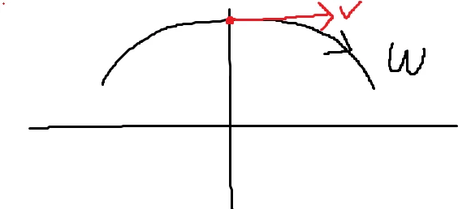

이때 v = Rw 이다. 벡터로 표현해도 되고, 안해도 된다.

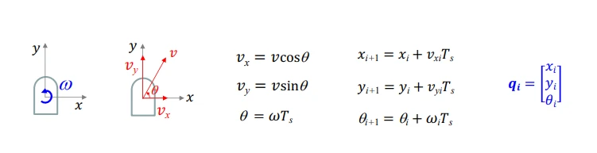

예를 들어 차량의 속도 정보가 1초에 백 번 CAN을 통해 들어온다고 해보자. 이렇게 하면 CAN이라는 조건 하에서 주기 T는 1/100 sec이고, 주파수는 100Hz 이다. discrete한 v라는 정보가 들어오게 된다. 그리고 steering angle theta가 들어오게 된다. (혹은 단순하게, yaw angle) 

이때 Vx = vcos(theta), Vy = vsin(theta)

theta = wTs 인데, 그 이유는 시간 Ts * 속도 w(속력으로 볼 수도 있음) 을 계산하면 theta가 나오는 것이다. 변위는 속도\*시간이니까.

그러면 굉장히 짧은 순간에 움직여졌던 theta가 얻어진다. 우리는 이 데이터를 100Hz로 받고 있는 것이다. 그러면 iteration 형태로 만들어내야 한다. xi, yi, theta(i)에 initial value가 다 있다고 가정하고, 추가적인 값들이 계속 들어온다고 하자. (i가 0이라면, xi, yi, theta(i)는 0이어야 할 것. 최초 위치기 때문에) 이렇게 되면 Ts만큼 시간이 흘렀을 때 내 위치가 어디인지 계산할 수 있다. 이런 속도 정보를 적분하면서 변위를 구할 수 있을 것이다.

GPS가 주는 정보가 정확하다고 가정하자. (RTK) 그러면 Dead Reckoning의 값과 현재 GPS 데이터를 바꿔치기하면서 보정할 수 있다. GPS의 신뢰도가 떨어지면 Dead Reckoning으로 바꿔치기 할 수 있다.

실내에서의 로봇은 GPS를 쓸 수 없기 때문에 Dead Reckoning과 주행 정보, 이미지, 다양한 센서 등 비전에 의존하여 주행해내야 한다. 없애는 방법은 라이다를 통해 Map Matching을 하면 된다. 그런데, Table을 옮겨버린다면 Map Matching이 불가능해진다. 의외로 실내도 어렵다. 내 높이가 낮으면 부딪히는 요소가 많은데, 내 위치도 좀 헷갈린다. 그래서 크기 자체를 크게 만들어서 특징적인 요소를 Matching, 원채널 라이다를 쏘면서 파악하고, Dead Reckoning에 의존하면서 맞추고… 이것의 연속이다. 공간이 작으면 저가형 라이다를 써도 되지만 아니라면 고가형 라이다를 써야한다. Vision based로 가려면 머리가 뛰어나도록 컴퓨터가 강력해야 한다. 라이다가 좋으면 컴퓨터가 좀 떨어져도 문제 없다. → 라이다에 의존하면 되니까. 근데 인테리어를 바꾸면 학습을 새로 시키고, Map도 다시 만들어야 한다. 테이블 배치를 바꾸면 학습을 새로 시켜야 하고, HD Map을 다시 만들어야 한다.

⇒ 절대 가서는 안되는 지형을 어떻게 define할 것인가? 접근 금지 영역을 설정해 두어야 한다. 그렇게 해두면 가야될 때는 가고, 안가도 될 때는 가고 할 수 있을 것이다.

- Odometric Localization의 정확도를 높이는 방법

    - Euler integration(속도가 느리다면 이걸 써도 문제는 없다.)

        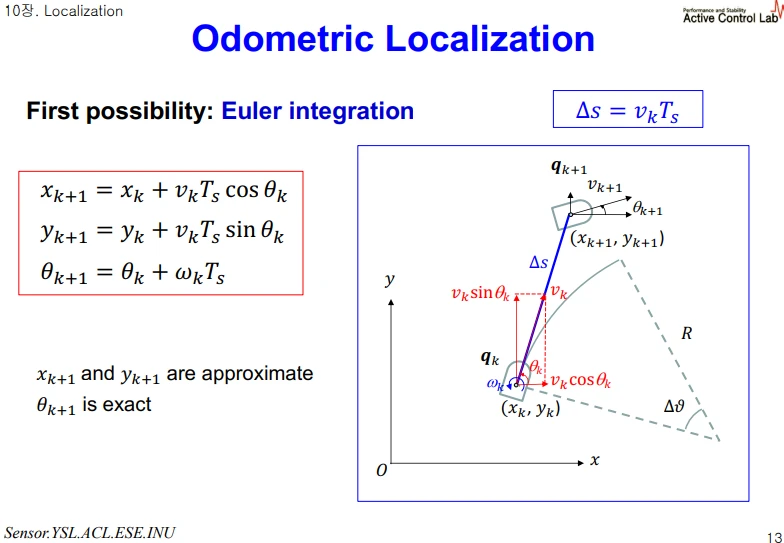

        - 어디부터가 느린것인가? 그건 답이 없다. 일단 써보면서 정확도가 얼마나 되는지 알아봐야 할 것. IMU를 갖고 있는 것이 주행하다가 인코더 등을 통해서 모터의 동작 정도를 파악하게 되고, 그런걸 라이다로 매칭해가면서… 그렇게 하게 되는데 천천히 주행하면 엄청나게 정확해진다. 속도가 빨라지게 되면 델타s가 증가하기 때문에 추정이 매우 어렵다. 추정이 어려울 때는 exact integration을 쓰는 것이 중요하게 될 것.
        - 현재 위치가 Xk, Yk이다. thetaK가 현재 주어진 정보. 이 세 개를 현재 가지고 있다. Next Step으로 가면 Xk+1, Yk+1, thetaK+1을 갖는다. 그리고 속도 정보(속력이라고 보자) Vk를 가지고 있다. 내가 가진 것은 이것 뿐이다. 그리고 wK를 갖고 있다. 이러한 정보를 Ts 뒤에 전달받게 된다. Localization 정보를 dead reckoning으로 계산해야 한다. 현재 위치 정보, 속도, 오메가를 가지고 다음 위치를 추정해보자. 움직인 좌표점의 이동. 이걸 델타 s라고 둔다. s는 이동거리, 즉 좌표 이동 거리를 말한다. 따라서 델타s는 Vk\*Ts. Vk는 속도 정보에 해당한다. 

    - 2nd order Runge-Kutta integration
    - exact integration(이걸 쓰는게 마음은 제일 편할 것.)

---

## 실습

대부분의 차량은 앞바퀴로 조향을 하기 때문에, 바퀴의 속도를 다룬다면 뒷바퀴의 속도를 주로 다루게 된다.

각도와 관련된 센서는 바이어스가 굉장히 쉽게 발생한다. 실제 값에 무언가 값이 더해진 상태. 혹은 Yaw Drift라고도 한다. 상태가 똑같지만 센서 자체에서 발생하는 문제 때문에 센서에 발생하는 Noise의 일종. 이걸 없애기 위해서 평균값을 빼주게 된다. 이를 통해 Zero mean을 생성하게 된다. 그런데 초반 약 6000개 정도에 대해서만 평균을 구하게 되는데, 이게 실제로 Drift가 발생한 것인지 아닌지를 모르기 때문에 초반 상태에서의 yaw_mean을 구하게 된다.

% initial variable

x와 y는 모르니까 0, 0

세타는 230도라고 되어있는데, 이것은 처음부터 알고있는 값이라고 생각하면 된다.

RL, RR이 km/h로 되어있는데, 위에 나와있는 dead reckoning의 경우는 m/s의 단위이기 때문에, 값을 3.6으로 나눠주면 m/s로 바뀌게 되고, 차의 평균 속도를 구할 때는 뒷바퀴 두 개의 속도를 평균으로 나누게 된다.

wk는 yaw_mean을 빼줘서 drift를 없애주는 과정이다.

Euler, Runge-Kutta, Exact 방식 세 개가 있는데, Euler가 가장 간단하다.

Runge-Kutta는 Euler와 똑같지만, 뒤에 붙는 식들이 조금 달라진다.

Exact도 마찬가지로, 보정해주는 값이 달라지고, 그 외는 똑같다.

현재는 30km/h 정도로 주행하기 때문에 Euler나 Runge-Kutta나 Exact나 수 mm 정도의 차이밖에 나오지 않지만, 속도가 커질 수록 오차는 더욱 커진다. 이걸 분석하려면 차속에 따라 오차 범위 정도를 분석할 수도 있을 것이다. 

---

Odometric Localization을 통해 나의 x, y 좌표 Heading 값을 구한다. theta를 읽어내는 것. x, y, theta 세 가지의 값을 읽어낸다.

우리가 읽어오는 정보는 Current 정보만 받는 것이고, 이를 통해 Predict를 하게 된다. 뭐를 통해서? 나의 차량의 속도 정보와 각속도 정보

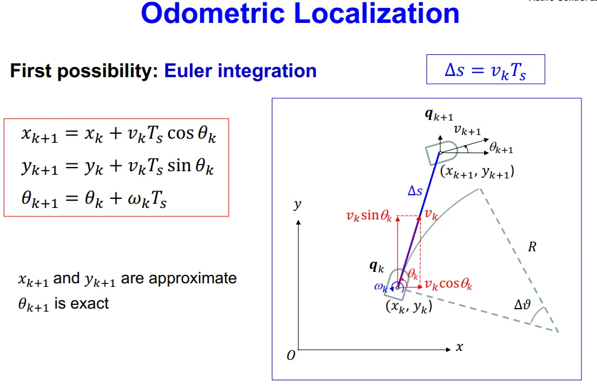

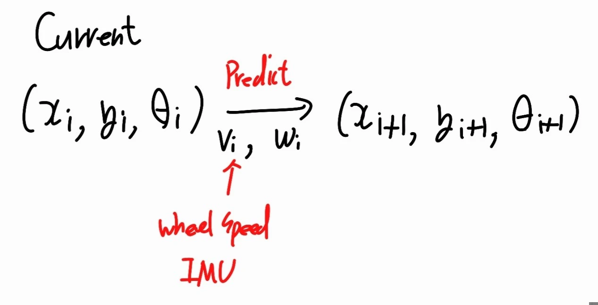

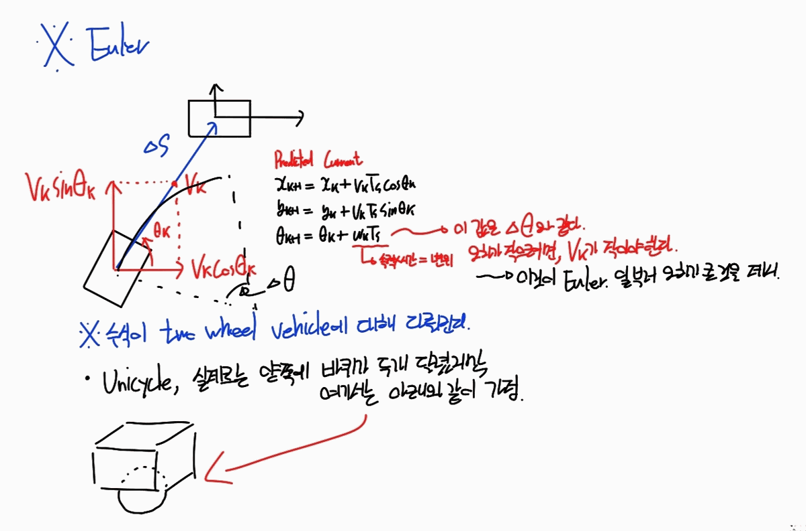

Euler 

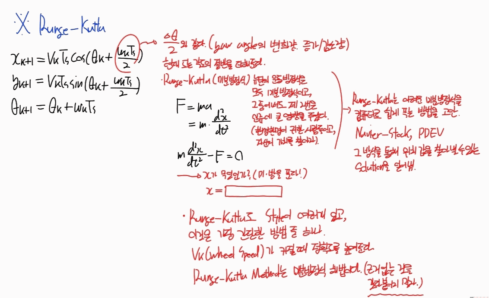

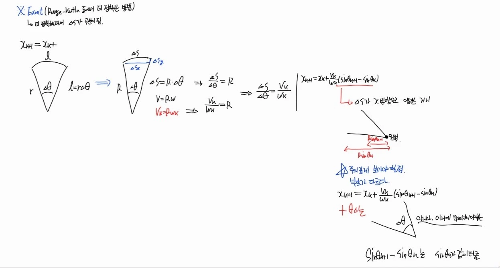

- 실습 1에서는 yaw angle이 나와있지 않은데, 실습 2에 와서 학교 주변을 삥 도는데, 시간이 바뀌는 것에 따라 wheel speed(v), theta(yaw angle)을 그려라. 어떻게 누적되고 있는지 그걸 구해보자. (Runge-Kutta로 했을때 v, theta가 어떻게 업데이트되고 있는지 그려라. 이걸 그대로 그리면 전체 움직임이 나오게 될 것. 실제 도는 결과를 캡쳐하고, 그래프를 그리고, 앞에서 분석했듯이 Euler로도 돌려보고, Exact로 돌렸을 때, 이 세가지로 다 해봐서 그래프(wheel speed, theta), 세 가지 경로를 다 그려봐라. 그래서, exact가 정답이라고 가정할 때 error, e(Ex - Eu), e(Ex - RK)를 구해봐라. e(Ex - Ex) 는 0일 것. v, theta에 대한 오차를 그리면 되는 것으로 보인다.
