# 12주차(Dead-Reckoning & Stanley)

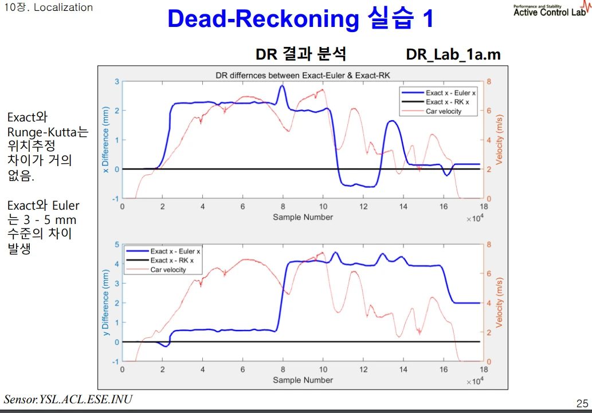

Exact가 정답이라고 가정하고 진행하지만, 실제로 정답인 것은 아니다. 수학적으로 가장 정확한 것인 거고, 근사적인 거지, 완전한 정답은 아니다. 자율주행 영역에는 정답이 존재하지 않고 항상 근사적으로 해결해 나간다. 그러므로 자율주행은 Probabilistic Robotics (확률적 로봇학) 이라고 한다.

센서를 통해서 Localization을 통해 내 위치를 계속해서 기억해야 한다.

- Dead-Reckoning

    - Euler : **속도가 충분히 작아야 Exact에 근사**하다. 충분히 느린 속도는 Euler와 Exact가 큰 차이가 없다. 느리게 갈 때는 Euler를 써도 문제는 없다. 하지만 빠른 속도라면 Exact를 써야 한다. 
    - Runge-Kutta : 여기에서 추가된 wkTs2는 대체 어디서 나온 것인가? Runge-Kutta는 원래 미분방정식인데, 거기서 쓸데 없는 것 다 날리고 두 개만 끌고 들어간게 second-order이다. 이것이 의미하는 것은 델타 세타의 절반만 이용한 것이다. (즉, 델타 세타, 이전과 비교했을 때 각도의 변화량이 wkTs이고, xk+1, yk+1을 구할 때는 그것의 절반만 사용한다.)
    - Exact

- Lidar를 사용하여 실내에서 내 위치를 확인할 수 있다. (`Map 기반 주행`) 고정밀 Map과 측정 정보를 대조하면서 현재 위치를 파악하는 Localization을 할 수 있다.

    - 예를 들면 가구의 위치나, 기둥의 위치, 요철의 위치 그리고 그 형태 등을 기록한 Map을 만들어두면 측정되는 센서 데이터를 통해 Localization을 진행할 수 있다.
    - 이 방식을 이용하는 것도 핫한 자율주행 방식 중의 하나이다. (Point Cloud를 통한 분석)
    - 내가 라이다를 쏘면 현재 위치를 기준으로 시야에 보이지 않는 구역(사각지대)을 제외한 데이터를 얻어낼 수 있으며, Edge Point 등을 얻을 수도 있다.
    - 이를 통해서 내 위치가 어디인지 알아야 하고, 측정된 결과를 바탕으로 현재 어디서 어디로부터 몇 m나 떨어져 있고… 등의 정보를 얻어낼 수 있다. (Euclidean Distance 등을 통해서)
    - 각도 등을 통해서 얻을 수도 있음. 예를 들면, 특정 기둥과 내 차가 평행한 상태인지 등을 파악도 가능함. 이런 방법들을 종합적으로 사용하여 Map Matching을 시도하며 best-fit을 찾아낸다. 그런데 로봇이 현재 비틀어진 상태라면 맵도 비틀어진 상태로 얻어지게 될 수 있으므로, Map과 대응하기 위해 각도를 뒤틀어서 얻어낼 수 있음. (이런 알고리즘들은 Github 같은 곳에 이미 많이 존재하므로 갖다 사용하면 된다.)

- Dead-Reckoning은 Lidar 등을 사용하지 않고, 대표적으로 차량의 IMU나 CAN 등을 통해서 주행 상태를 추정해 Localization을 수행하는 것이다. (눈 감고 주행하는 것임.)

---

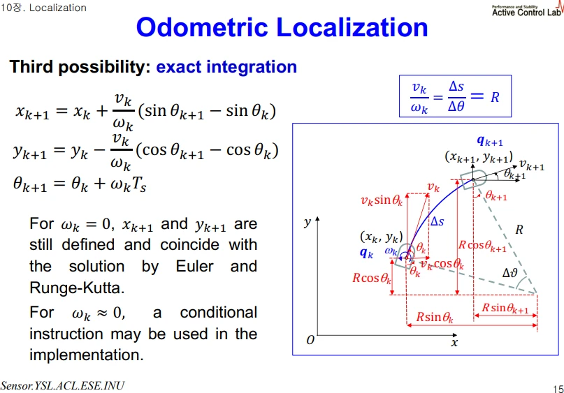

- 실제로는 wk가 + 방향인데, 우회전하고 있다. 원래는 좌회전이 +인데, 그림에서는 우회전을 하고 있다. 이전보다 Rsin(thetaK)를 이동하게 되는데, 문제는 오메가 값이 반대로 작용한다. (오른쪽으로 가는데 wk가 왼쪽 방향, 즉, 좌회전이 +라고 가정함) 그래서 xk+1에 -가 붙는다고 생각 가능.
- 이걸 유도할 수 있는가? 이 가정에서는 그대로 계산하면 된다. 좌회전할 때 wk가 양수이고, 현재 우회전하고 있기 때문에…

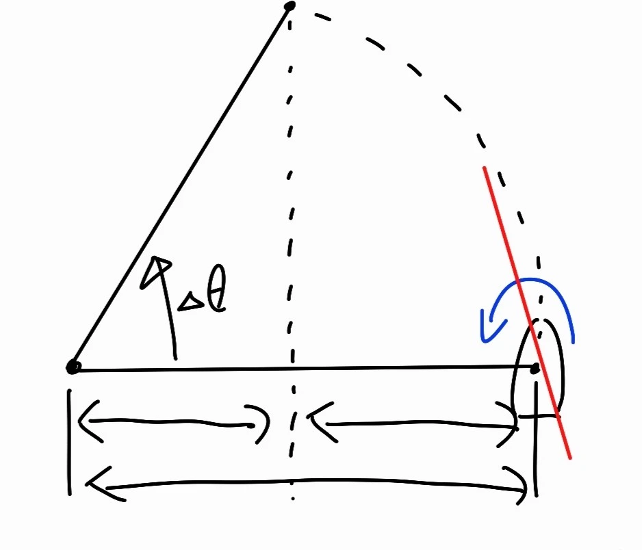

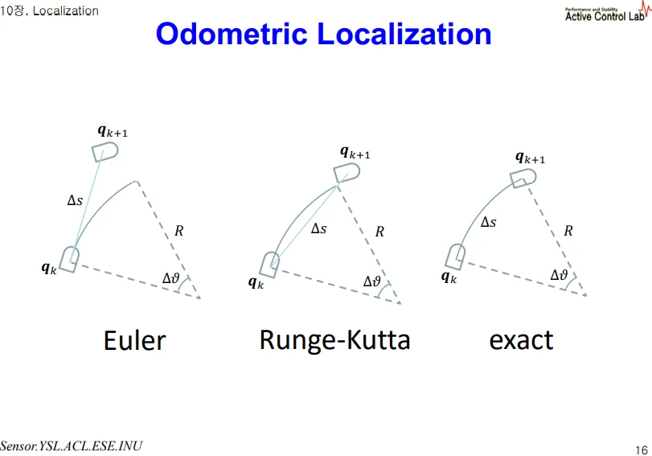

- Exact로 갈수록 오차 감소. Exact는 수학적으로는 맞다고 하지만, 가장 정확하게 구하려면 카메라나 라이다 등을 사용해야만 한다.

---

- Virtual Lidar ⇒ Camera 이용
- Waymo ⇒ Multiple Multi-Layered Lidars

실제 피지컬한 라이다가 매우 고가이기 때문에, Mass Production이 불가능하다. 왜냐면, 라이다를 탑재하면 차량의 가격이 너무 높아지기 때문이다. 그리고 미관상도 좋지 않기 때문에, 결점이 많다…

그래서 테슬라는 애시당초에 라이다를 버리고 Virtual Lidar를 이용, Camera에서 얻어진 이미지를 바탕으로 AI를 붙여서, 이걸 통해서 모든 것을 다 해낸다. (**Localization**, **AEB**[Autonomous Emergency Braking], **Cruise**, **Object Detection**)

테슬라가 FSD(Beta)를 만들어내기 위해 존재하는 AI 시스템이 현재로서는 인류 최강의 AI 시스템이라고 할 수 있다. (현재는 학습량이 2억마일정도 되고, 3억마일정도가 되면 완전 자율 주행이 될 수 있을 것이라고 추정 중.)

- 중요한 것은, 잘 되는 것을 학습시키는 것이 아니라 안되는 것을 학습시키는 것이다. 학습된 Training Network가 차로 올라가게 되면, 이를 통해 자율 주행을 할 수 있게 된다.
- 테슬라의 차량은 초기에 설계될 때부터 이 구조를 미리 계획했기 때문에, 모든 과정이 유기적으로 이루어지게 된다. 시간이 갈수록 타 기업과의 학습량에는 매우 큰 차이가 발생하게 된다.
- 차량에는 여러 개의 네트워크(딥러닝)가 존재하게 되며, 하나는 Lane을 찾고, 하나는 신호등을 찾고, 하나는 횡단보도를 찾고, 하나는 사람을 찾고 … 이런 식으로 딥러닝을 사용하게 되기 때문에 매우 많은 연산이 필요하다. 그래서 속도가 느릴 수밖에 없다. 따라서 매우 많은 학습량이 필요하게 되는 것이다.
- 현대 자동차 대회에서 요구하는 것이 ‘신호등을 읽을 수 있으면 좋겠다.’ 고도 얘기하는데, 이걸 비젼으로 체크하는 딥러닝 모델을 전 대학이 잘 개발하지 못하고 있으므로, 현재는 Broadcast를 전달받는 V2X를 이용해서 예측 주행을 하게 된다.
- 신호등은 Color를 파악해야 하기 때문에, 반드시 비젼을 사용해야만 한다. 라이다의 사용이 불가능함. 나머지는 대부분 다 라이다로 해결하려고 하는 상태.

---

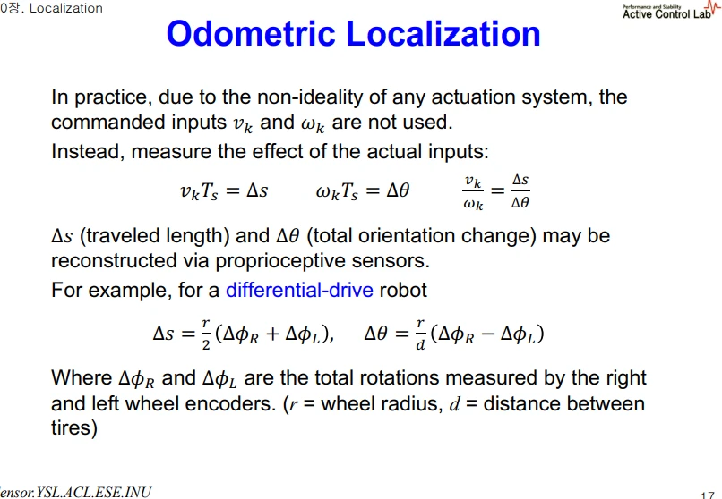

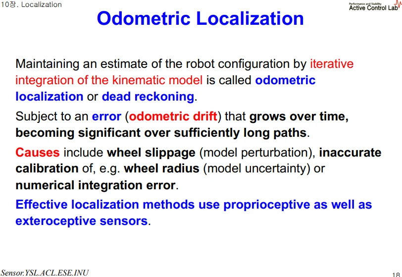

Dead-Reckoning은 갈수록 오차가 누적된다. 오차가 발생할 수 있는 조건은 slippage 등이 있다. (미끄러운 바닥이나 타이어의 마모로 인한 직경 감소 등) ⇒ 예측하거나 일일이 측정하기 어려운 근본적인 문제들이 항상 존재할 수 있다. 그러므로 어쩔수 없는 지하 등은 Dead-Reckoning을 이용해야 근접한 주행 정보를 얻어낼 수 있다.

---

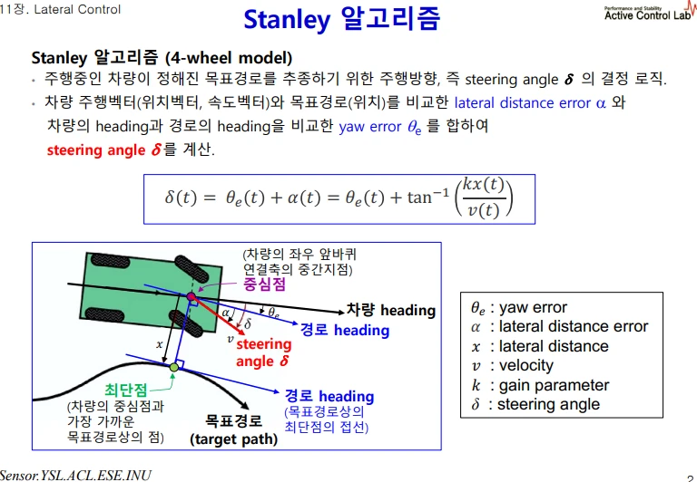

- Steering Angle은 바퀴의 Angle이고, Lateral Control은 좌, 우로 이동하는 것을 말한다.
- 위의 자료에서 녹색의 네모 박스가 차량이고, 바퀴는 네 개 있다. (**Four Wheel Model**) 차량의 Heading은 중앙지점을 연장한 선을 말하고, 정면 방향을 향한다.
- 목표경로(Target Path)는 내가 가야할 길이 곡선으로 휘어져 있다. 앞바퀴의 중심점을 차량의 중심점이라고 하는데, 이 차량의 중심점을 목표 경로 위에 올려야 한다. 그러려면 차량을 우회전해서 오른쪽으로 가게 만들어야 하는데, 몇 도나 틀어서 가야 할까?
- 목표경로를 만드는 방법은, 왼쪽의 Lane Line, 오른쪽의 Lane Line을 측정하고, 하나하나에 대응되는 평균 지점을 잡고 이를 이으면 Target Path로 만들 수 있다. (ex. 도로의 양쪽 Lane Line의 좌표의 중앙지점을 이어서 Target Path를 만들어 낼 수 있음.)
- 우리가 생각해야 할 것은, 차량의 중심점을 잘 기억하고, heading에서 target path에 대해 수선의 발을 내린다. 그러면 이 지점을 찾아내고(최단 거리를 찾아내는 것), 이 지점에서의 기울기를 구하는 것이 바로 `Path Heading` 이라고 한다.
- 이 경로 Heading을 평행이동해서 차량의 중심 쪽으로 옮기면, 경로 Heading과 차량 Heading의 오차. 세타 e가 나오게 된다. 이를 yaw error라고 한다.
- yaw error만 맞추면, 차량은 계속해서 경로 heading과 평행이동하기 때문에 영원히 target path로 가지 못한다. 그러므로, alpha 만큼 추가로 꺾어서 경로 target path에 차량이 올라갈 수 있도록 만든다.

1) theta e를 어떻게 구하고,

2) alpha를 어떻게 구할까?

- alpha

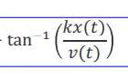

이때 v는 차량의 속도. wheel speed를 말한다.

x는 차량의 중심점과 target path와의 최단 거리를 말한다. 그게 x.

이렇게 계산하면 delta가 계산된다. ⇒ 이것이 실제로 많이 사용된다. 물론, 문제가 있긴 하기 때문에 다른 방법도 있긴 하지만 stanley는 가장 기본이 되는 방법이라고 할 수 있다. 실내에서 쓰는 것에 적용하면 매우 잘 작동할 것이다.

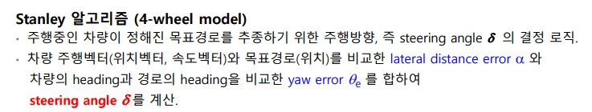

이 수식은 우회전이나 좌회전 모두에 대해 적용된다.

---

- 좌회전 하는 상황

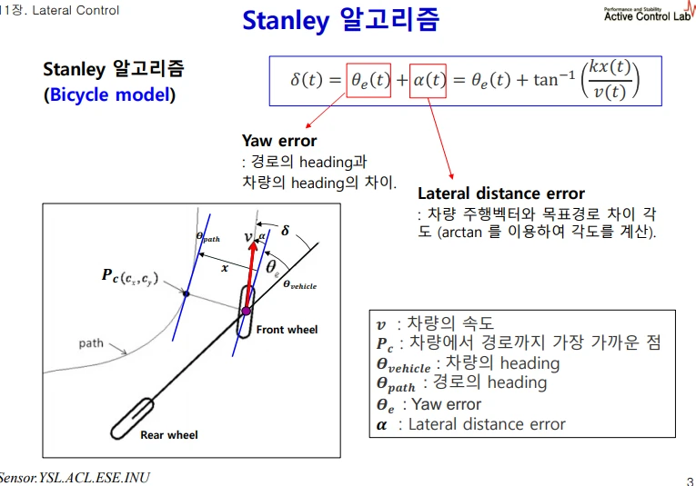

- Bicycle Model을 적용한다. (Ackerman Geometry를 만족함.)
- 그림에 나와있는 것을 보면, Heading 방향은 뒷바퀴와 앞바퀴를 연장한 수선, 방향은 앞쪽을 향한다. 차량의 방향은 앞 쪽을 보고 있지만, 앞 바퀴가 왼쪽으로 틀어져 있기 때문에 좌회전을 하는 상황이다.
- 이 상태에서 target path가 만들어지면, 이전과 똑같이 앞바퀴의 중심과 path에 대한 수선의 발을 내리고, 이것의 접선을 구한다. 이것이 접선의 방정식이고, target path heading이 된다.
- 이걸 평행이동 해서 차량의 앞바퀴 중심에 이동해 둔다.
- 이때 생기는 세타 e가 yaw error이다. yaw error만 꺾어서 이동하면 역시 마찬가지로, 계속 target path와 평행하게 이동하므로, alpha만큼 더 꺾어야만 한다.
- 차량이 달리고 있을 때의 속도는 CAN으로 읽을 수 있고, 우리가 할 것은 최단점을 찾아내는 것이다.
- 그런데, **그래서 최단점을 어떻게 찾을 것인가?**
- 예를 들어 내가 Map Matching을 했는데, 1차로로 가야만 하는데, 2차로로 가고 있는 상황이라면, target path를 1차로로 가도록 만들어야 한다. 그 때 어떻게 가는가? stanley를 이용해 가게 되고, 그 때 k 값도 결정해야 하고, 최단점을 계속해서 계산하면서 x값을 얻게 되고, 차량의 속도를 CAN으로 계속 받으면서 적당하게 target path로 들어갈 수 있게 된다.
- 이때 alpha를 lateral distance error, theta e를 yaw error라고 한다.

---

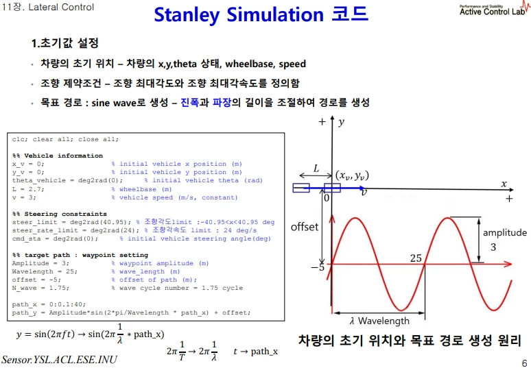

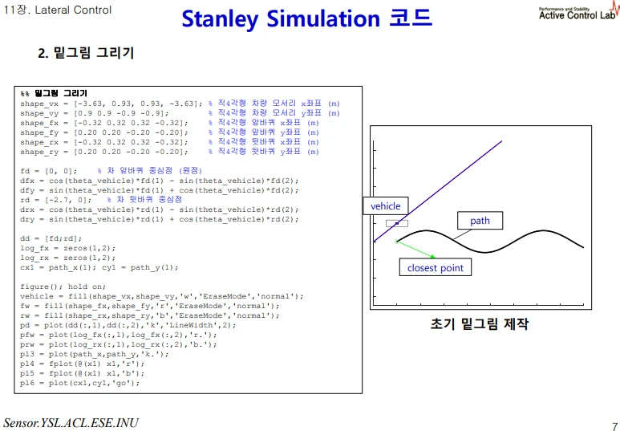

- 실제로 target path 위에 올라가는 것은 앞바퀴이기 때문에 뒷바퀴의 오차가 발생하게 된다.

과제 : stanley를 이용해 더 어려운 곡선을 따라가도록 하기

---

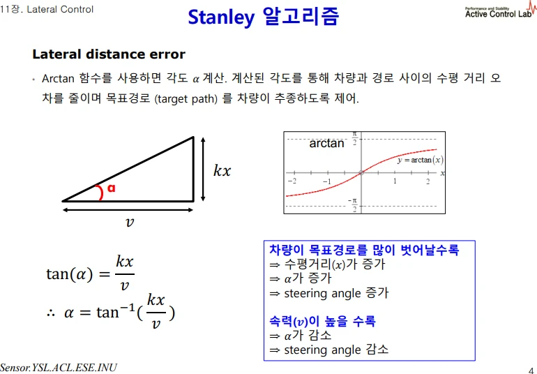

- 항상 arctan 2를 써야함. 1과 2의 차이는 존재.

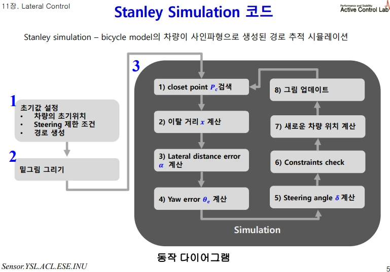

- delta 값은 많아봤자 좌, 우로 60~70도이다. 그렇게 많이 돌아갈 수 없음. 그러므로 제한 조건을 걸어야 함.
- 그리고 바퀴는 무한히 빠르게 돌릴 수 없기 때문에 이러한 제한 조건들을 realistic하게 설정해야 한다.
- closest point 계산
- 이탈 거리 x 계산
- alpha 계산
- yaw error 계산
- alpha + yaw error는 steering angle delta
- 이전에 설정한 제한 조건에 부합하는지 검사
- 새로운 차량 위치를 계산
- 다시 업데이트

⇒ 이런 방식으로 시뮬레이션이 이루어진다.

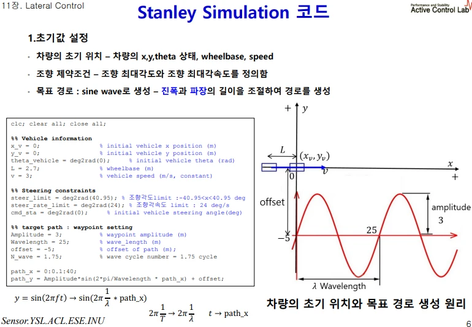

- Bicycle Model
- target path는 5m 떨어진 곳에 sin 파형으로 했고, 주기는 25, 진폭은 3m라는 파형을 따라가도록 한다.
- 꺾을 수 있는 한계가 존재하기 때문에, 한 번에 확 꺾지는 못하고, 점점 sin을 따라오게 될 것이다.
- 뒷바퀴는 앞바퀴와의 오차가 어쩔 수 없이 존재하기 때문에 오차는 반드시 생기게 된다.
- sin을 그릴 때, **시간 영역을 공간 영역으로 바꿔서** 그리게 된다.

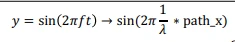

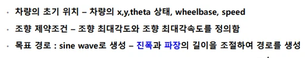

- 조향 최대각도와 조향 최대각속도를 정의한다.

---

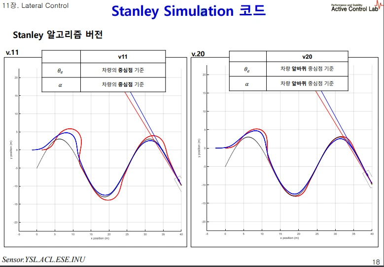

- 차량의 v값, k값 등을 어떻게 세팅하냐에 따라서 오차가 많이 발생할 수도 있고, 잘 잡아갈 수도 있다.
- `Look Ahead Distance`(실제 최단점보다 살짝 앞을 잡아서 따라가도록 하는 점)나 K값, V값 등에 따라서, 그리고 target path의 곡률에 따라서 점차 보정해나가면서 잘 따라갈 수 있어야 한다.

---

- 가고자 하는 ‘점’을 찾는 것이다. 즉, 현재 위치를 기준으로 Closest Point Pc를 찾으러 가게 되는데, 차량 앞바퀴의 중심점과 가장 가까운 곳을 찾게 된다. 현재 코드에서는 차량 앞바퀴 중심점과 가장 가까운 포인트를 찾는 간단한 find_closest_point를 이용하여 찾게 된다.

```matlab
idx = find_closest_point(x_v, y_v, path_x, path_y);
% 현재는 간단한 시뮬레이션이기 때문에 차량의 현재 앞바퀴와
% 모든 path의 point의 Euclidean Distance를 검사해서 찾아낸다.
cx1 = path_x(idx);
cy1 = path_y(idx);
```

```matlab
cx2 = path_x(idx+1);
cy2 = path_y(idx+1);
% 여기는 다음 closest point
```

이탈거리 x를 계산한다.

점과 직선 사이의 거리를 찾아낸다.

a(slope_path)x+b(y)y+c(-slope_path\*cx1 + cy1) = 0

좌표계가 조금 중요하다. World 좌표계라고 해서, 그림에 대해서 봤을 때, X, Y가 있을 때 

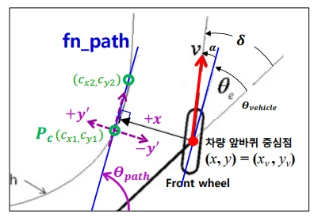

여기서 → +X, 위로가 +Y (월드 좌표계)

+X와 theta(path)의 각도를 비교해서 좌회전인지 우회전인지를 판단할 수 있게 된다…

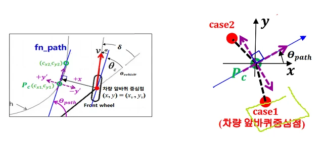

어떻게 path가 차량의 왼쪽에 있는가, 오른쪽에 있는가를 판단하기 위해, 간단하게 해결하기 위하여 회전변환을 적용한다. theta(path)를 -theta(path)만큼 회전변환한다.  그러면 그림이 어떻게 될까? (+X 축 방향으로 회전변환)

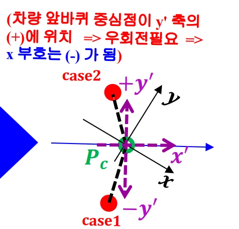

이때 앞바퀴의 y좌표에 따라서 왼쪽에 있는지 오른쪽에 있는지 체크가 가능해진다.

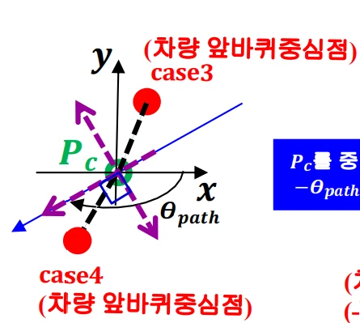

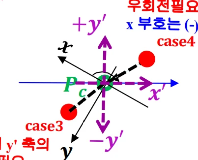

⇒ 이런 과정을 거쳐서 회전을 어떻게 해야될지 파악하게 된다.

차량 좌표계 (앞쪽 +x, 왼쪽 +y) 따라서, +y로 튼다는 것은 차가 좌회전을 한다는 것이고, -y로 튼다는 것은 우회전을 한다는 것이다. 

if문을 여러 개 나누면 되기는 하지만, 한 방에 푸는 쪽으로 가야 한다.

그래서, 자료에서는 +x (좌회전)이라고 가정하고 진행한다.

---

- Lateral Distance Error alpha 계산

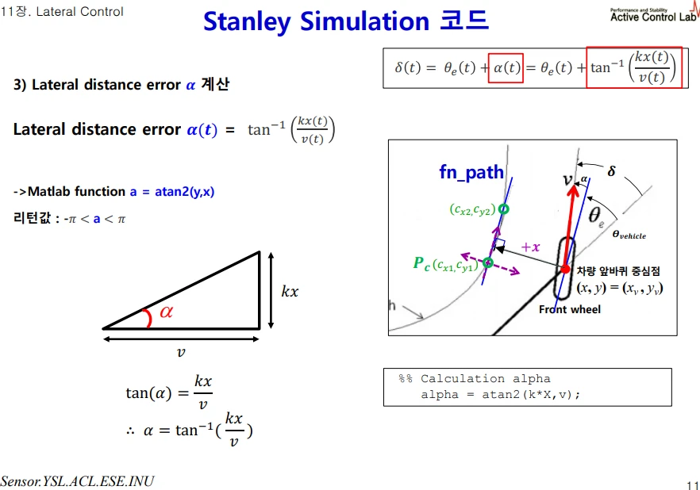

steering angle(delta). stanley에서 결국 정하는 것은 바퀴의 각도를 정하는 것이다. 저 각도를 어떻게 정할 것인가가 문제인 것이다.

차량의 속도가 빠르면 alpha값이 크지 않아도 되고, k값도 적당한 관계를 설정해야 한다.

⇒ stanley는 고속에서는 사용하기 어렵고, 저속에서 사용하게 된다. 고속에서는 거의 MPC를 사용한다.

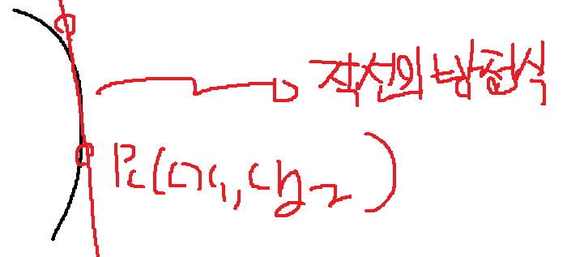

y = (y2-y1)/(x2-x1)(x-x1) + y1 여기서 기울기가 a인 것이고, 여기에 x1과 y1에다가 cx1, cy1만 갖다 붙인 것이다. 이때 a가 slope인 것이다.

이 직선의 방정식을 평행하게 옮기면, +X를 기준으로 각도 등을 판단한다.

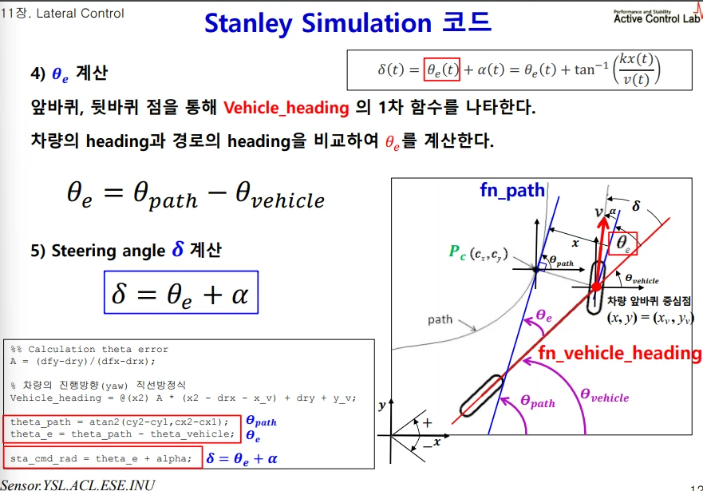

theta(error) = theta(path) - theta(vehicle)

```matlab
Vehicle_heading = @(x2) A * (x2-drx-s_v) + dry_y_v;
sta_cmd_rad = theta_e + alpha;
% 이 변수가 결국 이동해야되는 값임.
% theta(error) + alpha
% 이 delta가 steering angle
```

이후에는 제약 조건을 만족하는지 체크하는 부분이다.

stanley를 가지고 빈 칸에 주차하도록 차를 빼고 넣는 것도 할 수 있는데, 생각해야 할 것들이 많다.
