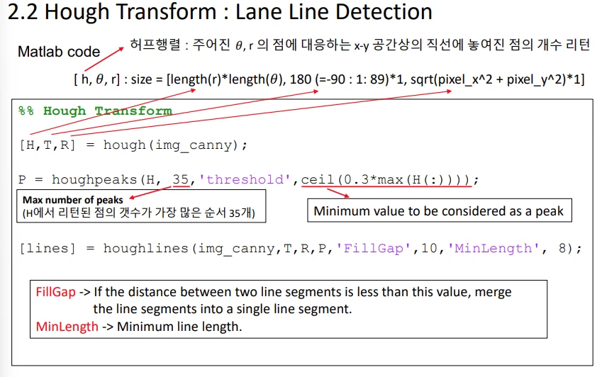

# 과제3

[https://bigbigpark.tistory.com/36](https://bigbigpark.tistory.com/36)

현재 필요한 것

- GPS Data의 Stamp와 Point Clouds의 Stamp가 다르다.

GPS Data는 6045개이고 Point Clouds는 3855개이다.

Point Cloud는 모두 0, 0을 기준으로 만들어진 것이라서, 평행이동 및 회전이동이 필요하다.

GPS Data와 매칭해서 이동시켜주어야 한다.

하지만 Time Stamp가 매칭되지는 않음…

