# 13주차(Lane Line Detection)

작성일 2023-05-30 · 최종 수정일 2026-04-14
{ .post-date }

- 컴퓨터 비젼으로 할 수 있는 것이 굉장히 많다. 대표적으로 할 수 있는 것이 Lane Line Detection이고, 이를 이용하면 차가 차로를 벗어나지 않고 잘 달릴 수 있게 된다. ⇒ 매우 중요한 부분임.

    - Deep Learning, Reinforcement Learning 등을 통해 다양한 방식으로 이미 구현이 되어 있는 것들이 많다.

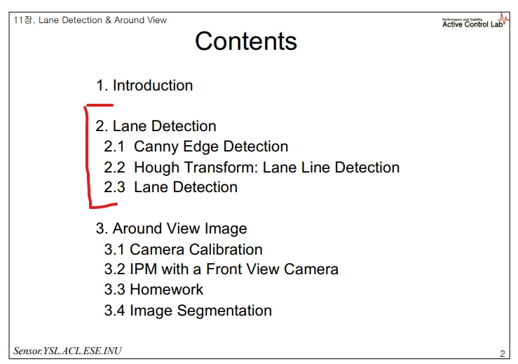

실제 영상을 분석해서 Lane Line을 찍어내면, 그 Line의 중심으로 주행을 하게 될 것이다.

---

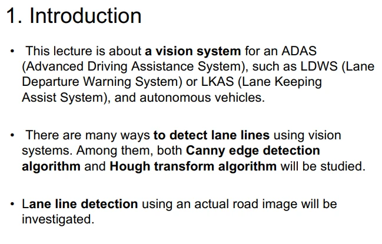

LDWS(Lane Departure Warning System) : 아반떼, K3 정도 되는 승용차에도 대부분 Default로 탑재되어 있는 기능. 어떤 차로가 있으면, 거길 벗어나려고 하면 운전자에게 경보를 울림.

LKAS(Lane Keeping Assist System) : 경보를 제공할 뿐만 아니라, 차로를 벗어나지 않고 중앙으로 이동하도록 운전 경로를 조절한다.

⇒ 최근의 부가 가치는 결국 S/W에서 나오게 된다.

## Lane Line Detection

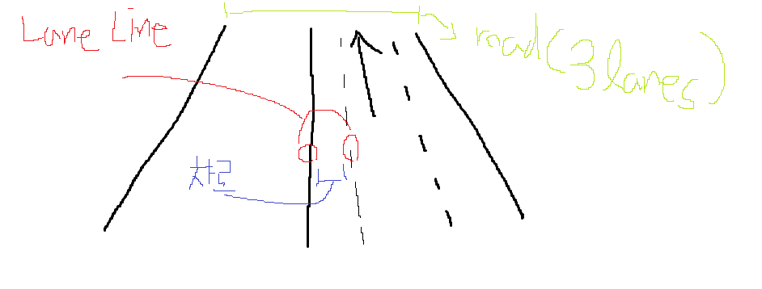

- Canny Edge Detection
- Hough Transform Algorithm

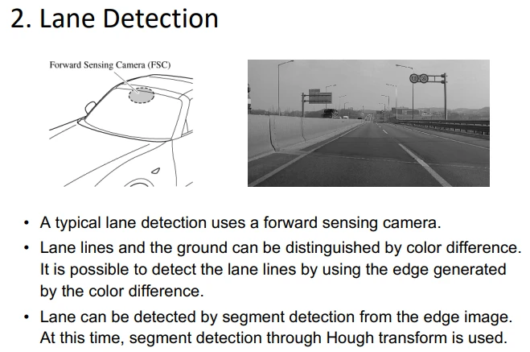

⇒ 위와 같이 전송되는 Image에서 어떻게 Lane을 분석할 것인가?

- Color Difference
- Edge Detection

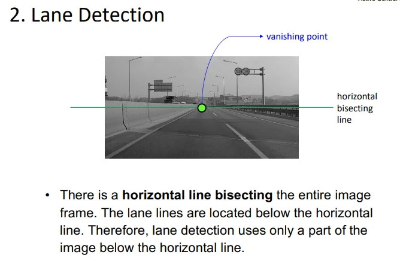

- Vanishing Point(소실점)이 존재함. 보통 이미지의 중심을 기준으로 위쪽은 거의 주행에 도움이 되지 않기 때문에 잘라버려도 평지 주행에 문제가 되지는 않는다. (아랫쪽만 처리함) 프로세싱에 걸리는 시간이 너무 크기 때문에 이를 줄이는 것이다. (`Horizontal Line Bisecting`)
- 만약 신호등을 보고자 한다면, Bisecting된 이미지에서 위를 봐야 할 것이다. 이런 경우에는 이미지의 특정 부분만 잘라서 보거나 하는 방식으로 필요한 정보를 추려낼 수 있을 것이다.
- 정지선을 찾으려면 Bisecting된 이미지의 아랫쪽을 봐야하고, 그 중에서도 중앙을 몰아서 보는 것이 이득이 될 것이다. (RoI : Reason Of Interest, 어떤 이미지에서 원하는 정보를 얻기 위해 필요한 관심사. 그 영역) RoI는 상황에 따라서 계속해서 바뀌게 될 수 있다.

```matlab
clear; clf; close all;

%% image read and grayscale, crop
img_ori = imread('lanedetect.bmp'); % 3채널 uint8

img_gray = rgb2gray(img_ori); % 1채널 uint8
img_gray = double(img_gray); % gray image 생성
% uint8은 필터링 과정에서 255를 넘어가 overflow 발생. 
% double은 0-1 사이 단계한다.

figure(1); clf; imshow(uint8(img_gray));

col = length(img_gray(:, 1));
row = length(img_gray(1, :));

img_gray = img_gray(col/2:col, 1:row);

figure(2); clf; imshow(uint8(img_gray));
```

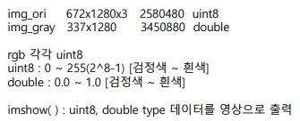

- img_ori (3channel) → img_gray (1channel)
- 데이터를 plotting 할 때는 uint8을 이용하고, handling은 double을 이용.

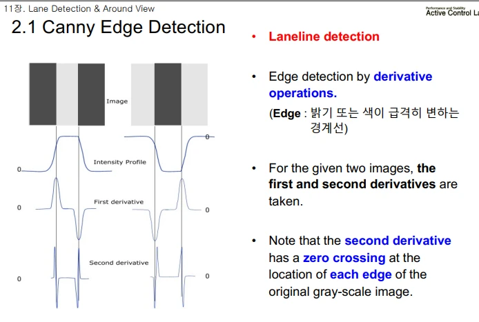

- 검정색 아스팔트 위에 흰색 선이 있다고 생각해보자. 그러면 검정색(0)으로 쭉 데이터가 나오다가 (1)이 나오게 되는 부분이 나타나는데, 이 곳이 Lane이 나타나는 부분이라고 생각할 수 있다. 이것에 대해서 미분을 해보자.
- First Derivative

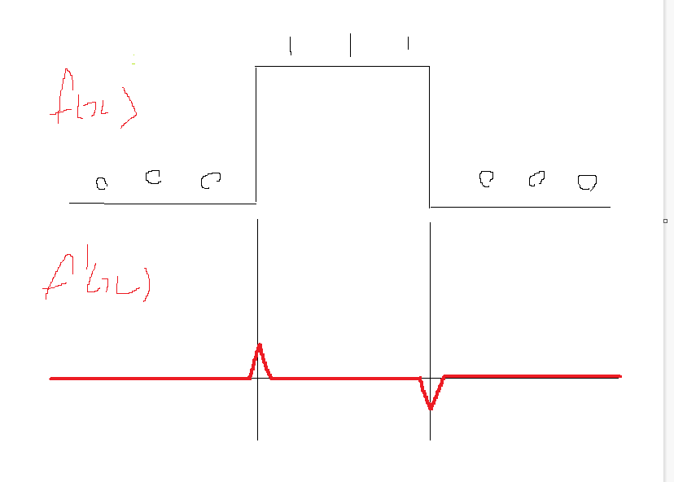

Gray Scale 데이터를 미분해보면, 이와 같이 나타나게 되기 때문에 미분값이 급격하게 변하는 곳에서 Lane Line이 나타난다고 볼 수 있다.  
⇒ 한 번 미분하는 방법(오차가 많이 발생해서, 안정적이지 않다.)

- Second Derivative

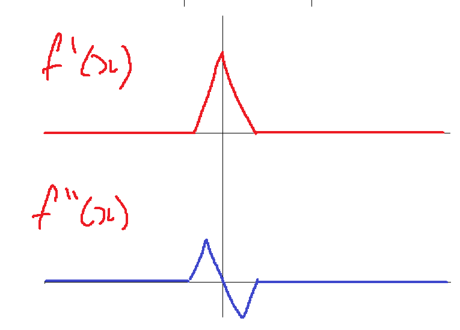

두 번 미분해보면 한 번 미분할 때보단 값이 안정적이더라. (`두 번 미분할 경우, Zero-Crossing을 찾게 됨.`) ⇒ Edge가 어디있는지 알려준다.

- 일반적인 경우는 왼쪽 그림의 경우를 다루게 된다.

> Note that the second derivative has a `zero crossing` at the location of each edge of the original gray-scale image.  
>   
> 0, 1 데이터로부터 0→1, 1→0의 Point를 Edge라고 칭하고 비젼 분석을 통해 이를 나타내게 된다.

```matlab
%% Testing Derivatives

clear; clc;
sig = [0, 0, 0, 0, 0, 0, 0, 0, 0, 0, 1, 1, 1, 1, 1, 1, 1, 1, 1, 1, 0, 0, 0, 0, 0, 0, 0, 0, 0, 0];
d_sig = diff(sig);
dd_sig = diff(d_sig);
figure(1);
subplot(3,1,1); plot(sig);
subplot(3,1,2); plot(d_sig);
subplot(3,1,3); plot(dd_sig);
```

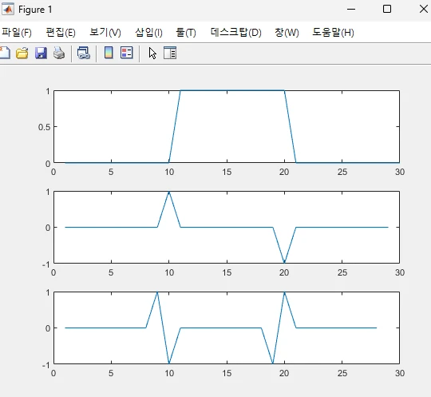

---

## Canny Edge Detection

포토샵에서 자동으로 누끼 따주는 기술 등이 다 Canny Edge Detection을 사용하는 것이다.

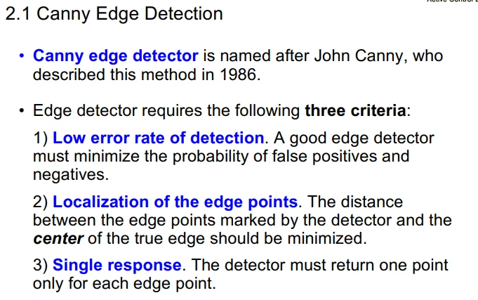

- 1) 에러가 많으면 안된다.
- 2) Edge의 위치를 정확히 파악해야 한다.
- 3) 반드시 하나의 답을 주어야 한다.

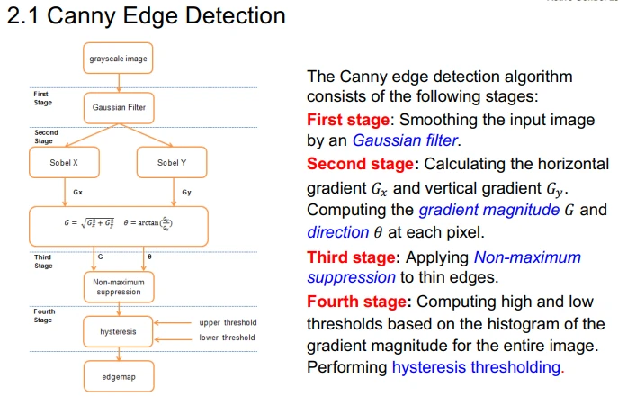

- First Stage : Gaussian Filter
- Second Stage : Gradient Magnitude Direction

- Third Stage : Non-maximum Suppression

    - 최대가 아닌 값들을 모두 0으로 만들어주는 것.
    - 이를 Non-maximum Suppression이라고 한다. (확실한 것만 취함)

- Fourth Stage : hysteresis thresholding

---

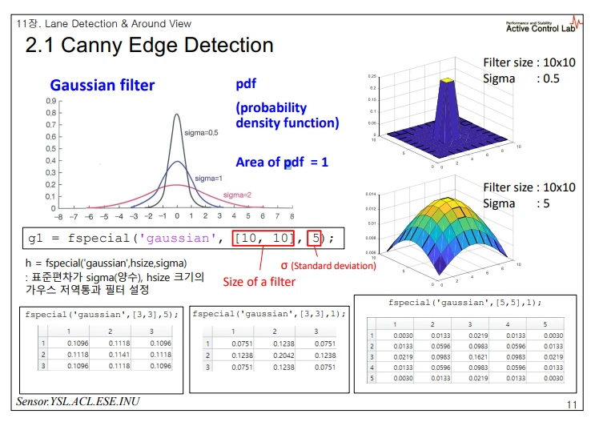

- Gaussian 분포

    - **표준정규분포** : 정규분포를 표준화해서 나타낸 것. 표준정규분포표를 도입해서 값을 해석한다. (Normalized Gaussian Distribution) 평균이 0이고, sigma가 1이다.
    - **정규 분포** : Gaussian Distribution. 평균이 0이 아닐 수도 있고, sigma가 1이 아닐 수도 있다.
    - 이때 sigma란, 퍼져있는 정도를 나타낸다. 뾰족하면 뾰족할 수록, sigma의 값이 작다고 볼 수 있다. 즉, 옆으로 커질수록 분산이 큰 것이다.
    - 중앙이 평균값.
    - PDF (확률 밀도 함수. Probability Density Function)
    - fspecial, gaussian option을 사용해서 정규분포로 나타낸다.

    - [10, 10] : Size of a filter. pixel Size로 생각하자. 10 * 10

        - 100개의 pixels에 대해 다룸.

    - Standard Deviation : 5

    ⇒ sigma가 0.5일 때, 5일 때 두 개의 그림을 그려보았다.

    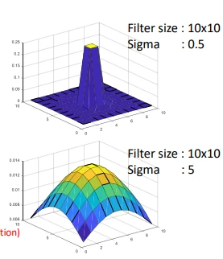

    - 이것은 가우시안 분포를 2D로 나타낸 것이다. 이전에는 1D로만 다뤘기 때문에 일차원적으로 보여진 것.
    - 예를 들어 [3, 3], 5 로 설정한다면, 높이가 낮은 분포가 나오게 될 것.

    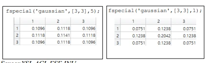

    - 그리고 가운데 값이 가장 크고, 대칭인 Symmetric Matrix가 될 것이다.

    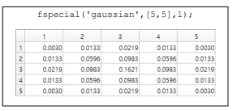

- `그런데, 이런 Filter를 왜 만드나요?`

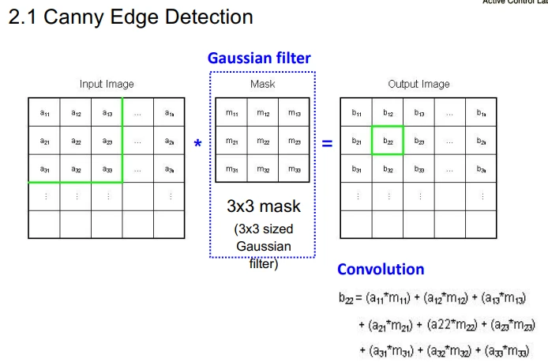

- 2D Image Convolution을 적용. `현재 이미지를 0과 1 사이로 Normalization`을 시켰다. 이 이미지에 대해서 Gaussian Filter로 Convolution을 적용할 것이다. 예를 들어 Filter를 3\*3로 적용했다면, 이걸 위에다가 갖다대는 것이다. 즉, Filter를 적용하는 것이다. 

- Gaussian Filter는 보통 중간값이 가장 크다. sigma 값을 작게할 수록 중간값이 더 커질 것이다. 이렇게 하면 이미지에 어떤 변화가 나타날까? 

    - a11\*m11 + a12\*m12 + … 이런 식으로 9개의 곱셈과 8개의 덧셈이 이루어지고, 이를 통해서 어떠한 스칼라 값이 하나 얻어질 것이다. 이를 통해서 주변에 있는 8개의 Information을 축소시키고, 가운데 있는 값을 대표값으로 끄집어 올려내는 것이다.

- Filter를 설계한다는 것은, 이미지로부터 어떠한 정보를 꺼내볼 것인지를 선택할 수 있는 것이다. 예를 들어, Filter의 크기를 1로 만들면 한 픽셀마다 데이터를 꺼낼 수도 있다. 못하는건 아님. 수학적인 용도와 목적에 따라서 꺼내게 되는 것.
- 이렇게 계산된 값이 바뀐 이미지 b22의 위치에 들어가게 된다.
- 만약 a11를 중심으로 filter를 적용하면, 바깥 영역은 0으로 계산되는 것으로 보인다.

이런 방식으로 masking을 하면서 Output Image를 만들어 낸다.

가우시안 필터의 크기가 커질수록, 계산량이 많아진다.

⇒ `그래서 이렇게 만들어진 Output Image가 무슨 필요가 있는가?`

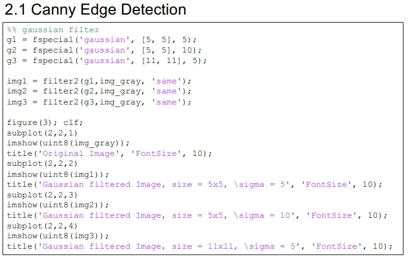

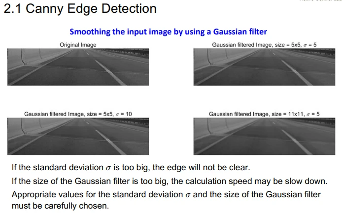

- Gaussian Filter 5\*5, sigma = 10일 때
- Gaussian Filter 11\*11, sigma = 5일 때

Filter를 뾰족하게 만들어서 Masking을 하면 또렷하게 Image가 나오게 되고, Filter를 완만하게 만들어서 Masking을 하면 Image가 Blur된 것처럼 나온다.

- Sigma가 너무 크면, 계산량이 많아져서 계산 속도가 느려지게 되고, Edge가 명확하게 나오지 않을 것이다.
- 그러므로 Gaussian Filter의 Size와 Sigma를 적절하게 설정하는 것이 중요하다.

---

- Lane Line Detection에서 가장 중요한 것은 두 번 미분하는 것.
- 미분이란 것은, delta x. x의 변화량이 무한히 적을 때에 대하여 다루는 것이다. 그리고 차분은 그냥 변화량이다. 어떤 데이터를 받을 때 sampling rate가 1초에 1000번이라면, delta x가 1/1000이고, 1/1000에 대한 데이터 변화량이 차분이다. (현재와 이전의 값의 차이)
- Practical한 IT 코딩에서는 미분을 만날 일이 없다. 차분을 만난다. (현실 세계에서는 미분을 다루기가 어렵기 때문이다.)
- 차분 : Difference
- 미분 : Differentiation

⇒ IT 관점에서는 사실상, Practically하게 같다고 볼 수 있음. 그러면 우리가 미분의 `Infinitesimally Small`. ‘무한히 작은’이라는 가정을 벗어날 수 있다.

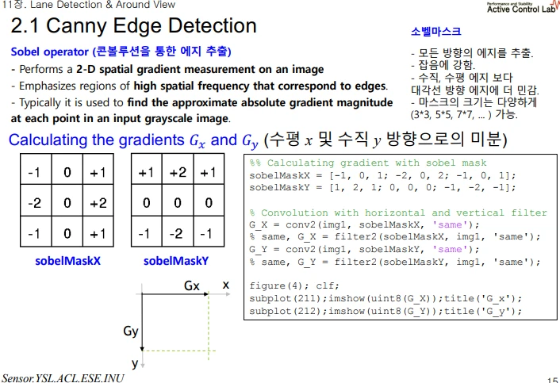

- 소벨마스크 : 값이 계단처럼 변하게 되는 것. 미분 필터의 역할을 한다. 이전에 나왔던 Gaussian Filter는 불필요한 데이터. 중요하지 않은 데이터를 흐릿하게 만드는 것의 역할이었다. 하지만 소벨마스크는 sobelMaskX, sobelMaskY로 나누어서 미분을 해준다.

    - sobelMaskX : 수평 방향으로 미분을 진행한다. (x 방향에 대한 미분) → 그래서 수직방향 직선 성분을 찾아낸다.
    - sobelMaskY : 수직 방향으로 미분을 진행한다. (y 방향에 대한 미분) → 그래서 수평방향 직선 성분을 찾아낸다.
    - 이전에 Gaussian Filter를 적용하여 데이터를 강조했고, sobelMask를 이용하여 Edge를 추출한다.
    - 잡음에 강하고, 대각선 방향 Edge에 더 민감하다.

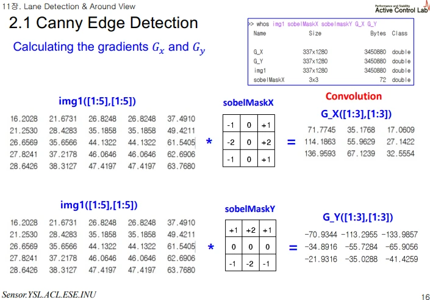

- Image Data가 이렇게 있을 때, SobelMask에 넣게 되면 G_X, G_Y가 나오게 된다.

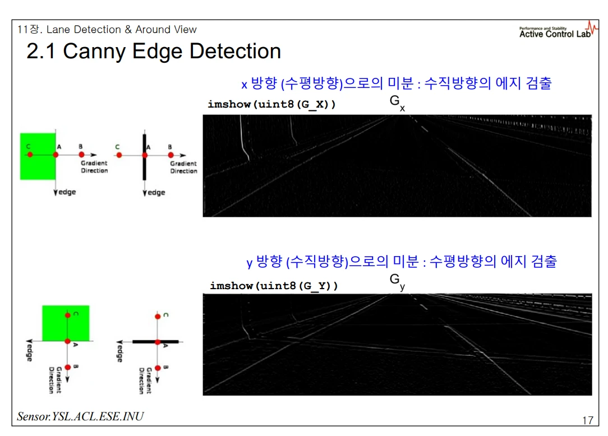

- sobelMask X를 적용시키니까, 수직방향 Edge가 명확하게 나타나게 된다. 실질적으로 검정색과 흰색만 나타난다. (x 방향으로 미분. 미분의 목적은 edge를 찾기 위한 것.)
- sobelMask Y를 적용시키니까, 위에서는 잘 안보이던 수평방향의 성분이 보이기 시작한다.

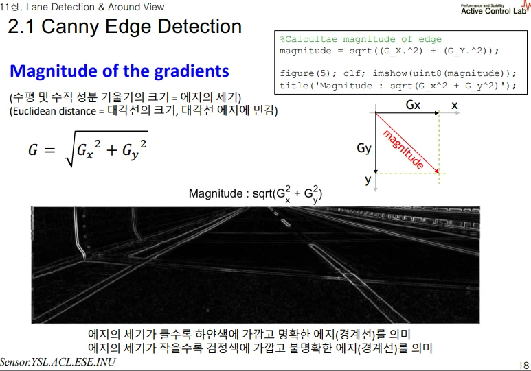

- sobelMask X는 수직방향에 대한 데이터를 주고, sobelMask Y는 수평방향에 대한 데이터를 준다. 그러므로, 수직, 수평 데이터를 피타고라스 정리를 이용해 합성시킨다. 이러면 무엇이 나오게 되냐? 위의 이미지가 나오게 된다. 이렇게 되면 Lane Line의 폭. 외곽선이 나오기 시작한다.
- Edge의 세기가 클수록, 하얀색에 가깝고 명확한 Edge를 의미한다.
- Edge의 세기가 작을수록, 검정색에 가깝고 불명확한 Edge를 의미한다.

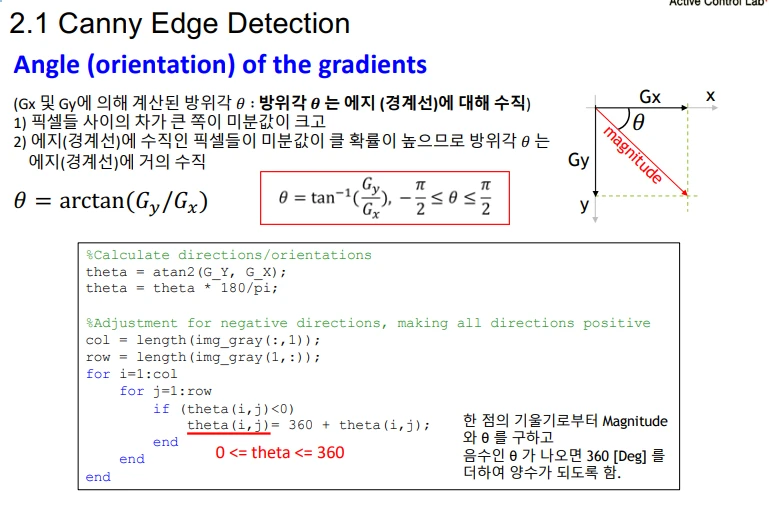

- arctan을 통해 Gx, Gy에 적용하여 theta 값을 찾아보자. `그런데, 왜 찾나요?`  

- 우리가 궁극적으로 찾고자 하는 Lane Line의 특성은 무엇인가?

    - sobelMask를 거쳐서 나온 Edge들에 대해서 theta를 찾아서, Lane Line이 아닌 녀석들을 걸러내야만 한다.
    - **arctan로 Gy/Gx의 theta 값을 추정해낸다.**

    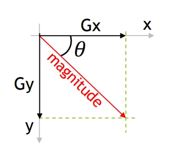

    - 그러면 우리는 도로에 Lane Line이 존재할 수 있는 범위를 알아야 한다.

    - 우리가 arctan를 사용할 때는, arctan2를 사용해야 한다. (뭐가 다를까?)

        - atan은 -pi/2 ~ pi/2 범위에서만 값을 표현하게 되고, atan2는 atan의 범위를 넘어서서 표현할 수 있다. 그래서 내가 원하는 값을 얻기 위해서 atan2를 사용해야 할 수도 있다. (공간에 대한 계산은 atan2)

        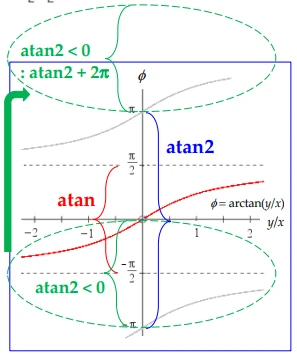

- Quantization을 실시해야 한다.

---

> 2023/05/31 13-2

1. Canny Edge Detection을 통해 불필요한 자그마한 물체들을 Blur처리 했음. (적당한 Blur 처리를 통해 처리할 데이터에 집중한다.)

<!-- -->

- 그 과정에서 두 번의 미분(차분)을 통해서 Masking하는 필터를 디자인 한다. 그것을 SobelMask-X, SobelMask-Y를 사용하게 됨. (Zero-Crossing)

    - 아랫쪽 Half 이미지에 대해서 SobelMask-X, -Y를 적용해서 G_X, G_Y를 얻어낼 수 있다.

    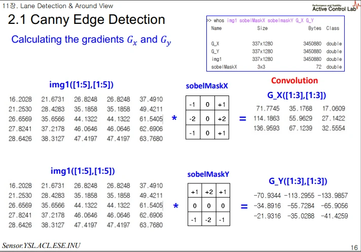

    - 이렇게 얻어낸 G_X, G_Y를 플로팅해보니, 아래와 같이 나오게 되더라.

    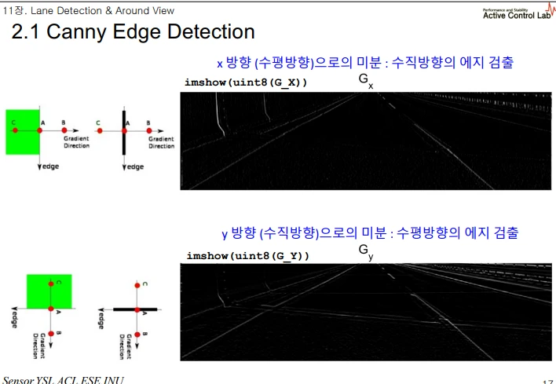

- 그리고 각각의 G_X, G_Y에서 theta라는 array, magnitude라는 array를 얻어낸다.

    - theta = arctan2(Gy/Gx)

    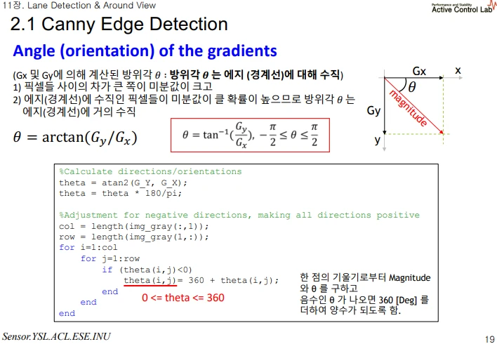

    - 만약 theta가 음수인 영역에서는 theta에 + 360을 해줘서 값이 음수가 나오지 않도록 한다.
    - theta의 방향성은 위의 이미지와 같다. (우하단 방향)

- Quantization

    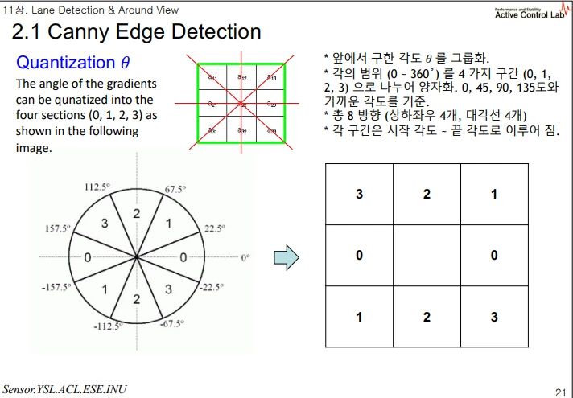

    - theta를 Quantization해서 0, 1, 2, 3으로 표현해보자. 현재 중앙 픽셀을 바탕으로, 그 주변 픽셀과의 관계를 파악하고자 한다. 이때 1과 3은 대각 위치와의 관계를 파악하고, 0은 horizontal, 2는 vertical 위치와의 관계를 파악하게 된다.
    - 결국 arctan2를 사용하는 것은, 기울어진 정도를 파악하기 위해서이다. 

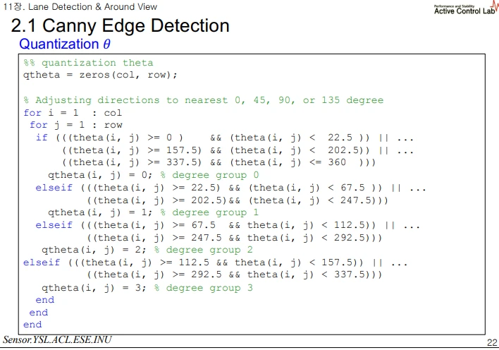

qtheta : quantized theta

- if문을 이용해서 특정 범위 안에 있는 index의 값은 0, 1, 2, 3으로 만들어준다.

    - 이렇게 해서 degree 그룹을 나눠줄 수 있다.

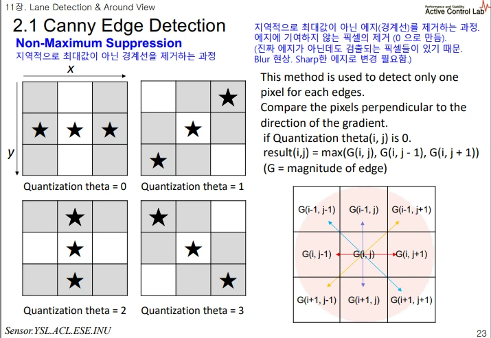

- 이후에 Non-Maximum Suppression을 실시하여, 값을 0 아니면 1로 바꿔버리는 과정을 거친다.
- 지역적으로 최대값이 아닌 에지(경계선)를 제거하는 과정. 에지에 기여하지 않는 픽셀의 제거(0으로 만듦.)
- 그리고 진짜 에지가 아닌데도 검출되는 픽셀들이 있기 때문. Blur 현상. Sharp한 에지로 변경 필요함.
- 쓸데없는 에지를 유발하는 부분을 없애고, 진짜 에지만 남겨두게 된다.
- 여기서 G는 SobelMask X,Y로 얻었던 G_X, G_Y로부터 만들어낸 magnitude matrix를 이용한다. G는 얼마나 하얗느냐! 그걸 의미한다.
- 이걸 거쳐서, Maximum이 아닌 것을 0으로 만들어버린다.

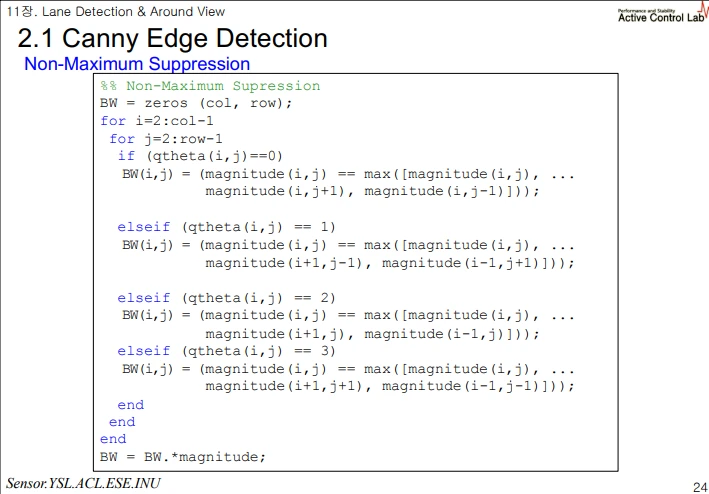

- BW라는 array를 만든다.
- 이때, if문의 첫 부분에서 qtheta(i,j) == 0일 때(horizontal) 만약, magnitude(i,j)가 가장 크다면, BW(i,j) = 1을 넣는다. 즉, Quantization된 값을 기준으로 중앙에 있는 내 자신(i, j)이 가장 크다면, 그 자리가 1이 된다. 아니면, 기존에 만들어진 대로 0이 유지된다.
- 만약 qtheta(i,j) == 0이었다면, horizontal에서 i,j가 가장 큰지 비교, qtheta(i, j) == 1이었다면, NW, SW에서 가장 큰지 비교… 이런 식으로 이어나감
- 그리고 마지막에는 BW와 magnitude를 곱해준다. (magnitude와 이전의 BW를 곱하기 때문에, BW가 0인 부분은 항상 0이 되고, 그게 아니라면 곱해진 값이 나오게 될 것.

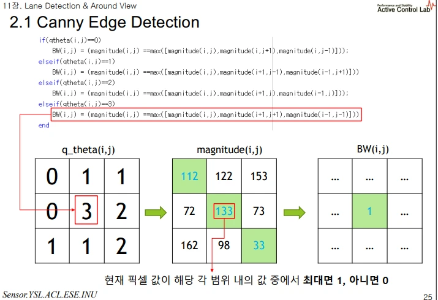

- 위의 예시를 보면, qtheta(i,j) == 3일 때, 가운데 값이 가장 크다면, BW는 1이 되는 것으로 보인다.

---

- Hysteresis Thresholding

    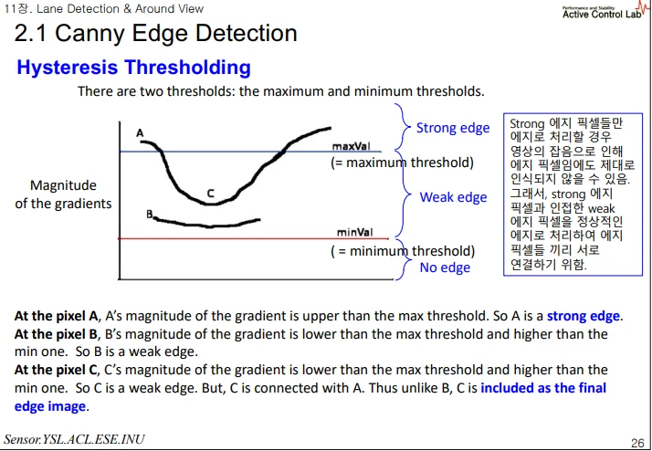

    - BW를 봐보면, 0, 작은값, 큰값… 여러 값이 나올 수 있게 된다.
    - Strong한 값이 나온다는 건, 너는 에지야! 라고 해준다.
    - Weak한 값이 나온다면, 특별한 처리를 해준다.
    - No edge가 나온다면, edge가 아니다.

    - Weak edge가 문제가 될 수 있다. 이미지의 여러 문제 때문에 edge가 잘 나오지 않을 수도 있다. 만약, weak가 만약 내가 설정한 maximum threshold보다 작다면 weak이지만, 만약 이것이 strong edge와 연결되어 있다면, 이것도 edge로 인정해준다.

        - Strong 에지 픽셀들만 에지로 처리할 경우, 영상의 잡음으로 인해 에지 픽셀임에도 제대로 인식되지 않을 수 있다. 그래서, strong 에지 픽셀과 인접한 weak 에지 픽셀을 정상적인 에지로 처리하여 에지 픽셀들끼리 서로 연결하기 위함.

    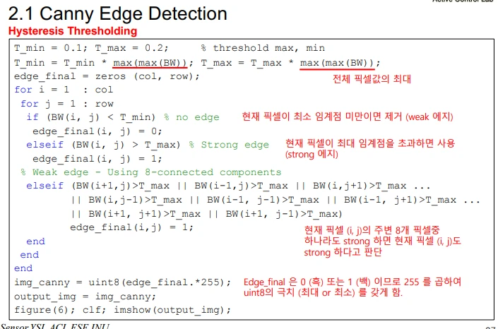

    - 만약 BW의 값이 0.2(T_max)보다 크다면, edge이다.
    - 만약 BW의 값이 0.1(T_min)보다 작으면, edge가 아니다.

    ```matlab
    T_min = 0.1; T_max = 0.2;
    T_min = T_min * max(max(BW));
    T_max = T_max * max(max(BW));
    % BW의 최댓값, 최솟값을 뽑아서 edge 설정.
    ```

    - 이후, if문 처리를 통해 edge_final의 값을 설정함.

    - 문제는, weak edge를 어떻게 설정할 것인가? 이다.

        - 초기의 if, elseif에 걸리지 않았다면 weak_edge에 포함되는데, 이때 내 픽셀 주변에 strong_edge가 하나라도 있나요?라고 던져본다. 그래서 만약 yes!가 나오게 된다면? (주변에 strong_edge가 하나라도 있다면? ⇒ 너는 edge로 인정한다.)
        - 즉, weak edge에 속하는 픽셀의 주변에 strong edge가 하나라도 존재한다면, 그것도 edge로 인정해준다. (값이 1)

    - 이렇게 되면, 결국 0아니면 1만 남게 된다.

    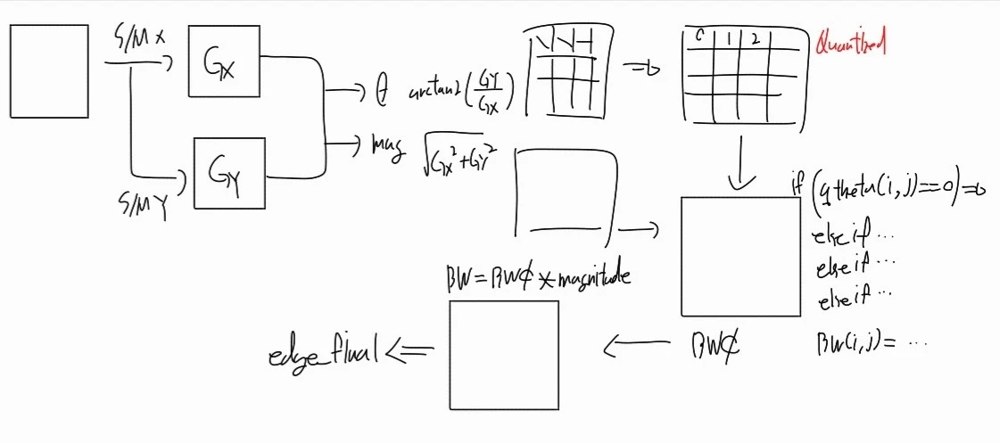

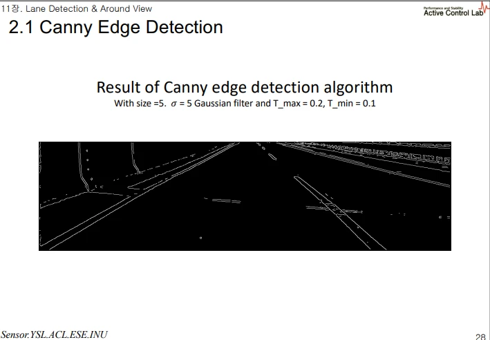

- matlab은 이론, background가 되는 수학을 빨리 보기 위해서 채택하는 것이다. 실시간으로 돌아가게 하려면 matlab으로 올리는 것이 매우 어렵다. 그래서 C, Python 등을 사용하게 된다.
